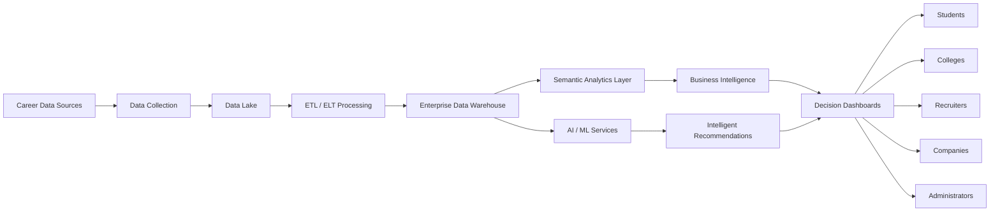
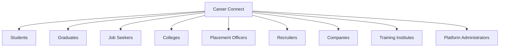
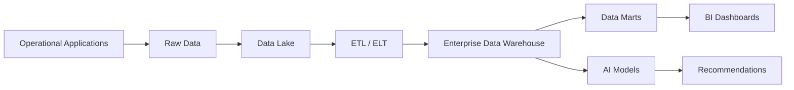
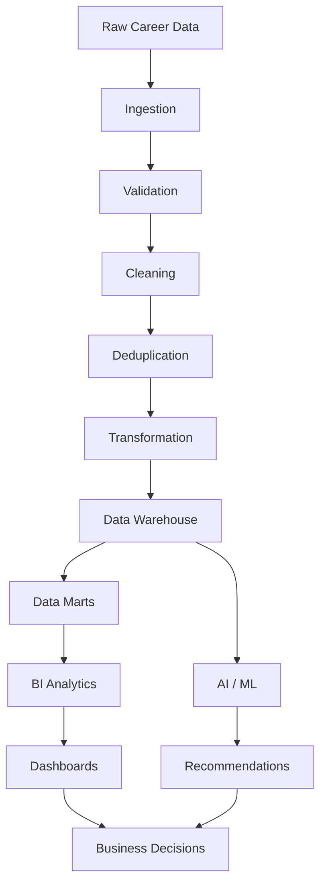
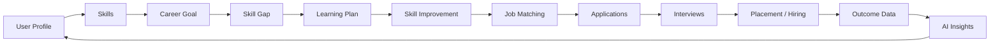
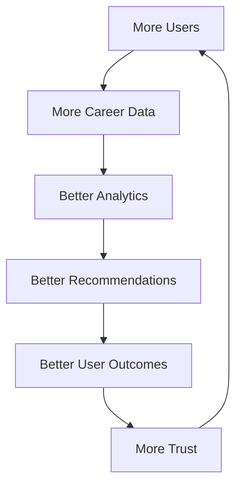

# 01 — Vision Document

# Career Connect — AI Career Intelligence Platform

**Document Type:** Product Vision Document
**Project Classification:** Enterprise SaaS / AI / Cloud / Data Warehouse / Business Intelligence
**Target:** Final Year BE CSE Project, Portfolio, Startup MVP
**Version:** 1.0
**Status:** Vision Baseline
**Architecture Style:** Cloud-Native, Data-Driven, AI-Enabled, Modular SaaS

---

## 1. Executive Vision

**Career Connect** is an AI-powered Career Intelligence Platform designed to transform fragmented career, recruitment, education, skills, salary, placement, and hiring data into actionable intelligence.

The platform combines:

- Artificial Intelligence
- Machine Learning readiness
- Data Engineering
- Enterprise Data Warehousing
- ETL/ELT pipelines
- Data Lakes
- Business Intelligence
- Interactive analytics
- Cloud computing
- Career recommendation systems
- Recruitment intelligence

into one unified platform.

The core vision is:

> **“Convert career data into career intelligence.”**

Traditional career platforms primarily help users **search for jobs, upload resumes, or apply for positions**.

Career Connect goes beyond that model.

It continuously analyzes relationships between:

**Student → Skills → Education → Certifications → Jobs → Companies → Salaries → Applications → Interviews → Placements → Hiring Trends → Market Demand**

and transforms those relationships into intelligent recommendations, forecasts, dashboards, and decision-support systems.

---

# 2. Vision Statement

> **Career Connect aims to become an intelligent career decision platform that helps individuals, colleges, recruiters, and organizations understand the evolving job market through AI, analytics, cloud computing, and enterprise data intelligence.**

The platform is designed not merely as a job portal, but as a **Career Intelligence Operating System**.

It will help answer questions such as:

### For Students

- Which careers best match my current skills?
- What skills am I missing?
- What technologies are currently in demand?
- Which jobs should I target?
- What salary range can I realistically expect?
- Which certifications are valuable?
- What should I learn next?
- How competitive is my profile?
- How can I improve my resume?
- Which companies are hiring people like me?

### For Colleges

- What percentage of students are placement-ready?
- Which skills are missing across departments?
- Which companies are hiring our students?
- What are the salary trends?
- Which technologies should be added to training programs?
- How does our placement performance compare with other institutions?
- Which students require intervention?

### For Recruiters

- What skills are currently available in the talent pool?
- Which colleges contain relevant candidates?
- Which candidate profiles match a role?
- What is the expected salary range?
- Which locations contain the strongest talent?
- What are competitors hiring for?

### For Companies

- Which technologies are growing?
- Which roles are becoming difficult to hire?
- What skills will be required in the future?
- Where should recruitment efforts be concentrated?
- How are salary levels changing?

---

# 3. Product Philosophy

Career Connect is built around five product principles.

## 3.1 Data First

Every major feature should be supported by structured, measurable data.

The platform should avoid making important decisions purely from static user input.

Instead, it should combine:

- Profile data
- Historical data
- Job-market data
- Skill data
- Salary data
- Placement data
- Learning data
- Application data
- Recruitment data
- AI-generated insights

to produce stronger recommendations.

---

## 3.2 Intelligence Over Information

The objective is not simply to display information.

The system must turn information into **actionable intelligence**.

For example:

**Basic System**

> Python is in demand.

**Career Connect**

> Python demand increased significantly across Data Engineering and AI-related roles. Your current profile has Python and SQL, but lacks cloud data engineering skills. Adding BigQuery/AWS, Airflow, and Spark to your learning path could improve your fit for target roles.

The second approach demonstrates the difference between:

**Information → Analysis → Intelligence → Action**

---

## 3.3 One Platform, Multiple Perspectives

Career data means different things to different stakeholders.

The same underlying warehouse should support different decision interfaces.

For example:

### Student View

```text
My Skills
      ↓
Skill Gap
      ↓
Recommended Roles
      ↓
Learning Roadmap
      ↓
Job Opportunities
```

### College View

```text
Student Skill Distribution
          ↓
Skill Gap Analysis
          ↓
Training Requirements
          ↓
Placement Readiness
          ↓
Placement Performance
```

### Recruiter View

```text
Hiring Requirement
       ↓
Skill Matching
       ↓
Candidate Pool
       ↓
Interview Funnel
       ↓
Hiring Analytics
```

### Executive View

```text
Market Demand
      ↓
Hiring Trends
      ↓
Salary Trends
      ↓
Technology Trends
      ↓
Strategic Decisions
```

---

# 4. The Core Problem

The modern career ecosystem contains enormous amounts of information, but that information is fragmented.

Career-related data exists across:

- Job boards
- Company career pages
- University systems
- Placement records
- Resume databases
- Learning platforms
- Certification systems
- Salary websites
- Recruitment systems
- Student portals
- HR systems
- Professional networks
- Internal spreadsheets
- CSV files
- APIs
- Public datasets

These sources generally operate independently.

As a result, users struggle to understand the bigger picture.

For example, a student may know:

> “Java is a popular technology.”

But may not know:

- Which roles require Java?
- Which companies currently hire Java developers?
- Which related skills are required?
- What salary level is associated with those roles?
- Which certifications are valuable?
- Which city has the most opportunities?
- What experience level is required?
- How does Java demand compare with Python, Go, or JavaScript?
- What skills should be learned next?

Career Connect solves this fragmentation by creating a unified intelligence layer.

---

# 5. Product Vision Architecture

At a conceptual level, Career Connect follows this lifecycle:



The architecture intentionally separates:

**Data Collection → Data Processing → Data Storage → Intelligence → Visualization**

This separation makes the system easier to scale, monitor, test, and maintain.

---

# 6. Strategic Product Goal

Career Connect has one primary strategic goal:

> **Build a unified intelligence platform for career, employment, education, and recruitment decisions.**

This goal can be divided into six strategic pillars.

## Pillar 1 — Career Intelligence

Understand the relationship between:

- Roles
- Skills
- Technologies
- Salaries
- Locations
- Experience
- Companies
- Industries

---

## Pillar 2 — Talent Intelligence

Understand the available talent pool.

Analyze:

- Student profiles
- Skills
- Certifications
- Education
- Experience
- Projects
- Interview outcomes
- Placement readiness

---

## Pillar 3 — Market Intelligence

Understand how the job market is changing.

Analyze:

- Hiring trends
- Skill demand
- Emerging technologies
- Salary movement
- Geographic demand
- Role growth
- Industry trends

---

## Pillar 4 — Learning Intelligence

Connect career goals with learning recommendations.

The system should identify:

```text
Current Skills
       ↓
Target Career
       ↓
Required Skills
       ↓
Skill Gap
       ↓
Learning Recommendations
       ↓
Progress Tracking
```

---

## Pillar 5 — Recruitment Intelligence

Help recruiters make better decisions using structured talent and hiring data.

The platform should support:

- Candidate discovery
- Skill matching
- Hiring analytics
- Recruitment funnel analysis
- Interview analytics
- Location intelligence
- College intelligence

---

## Pillar 6 — Institutional Intelligence

Help colleges and placement departments understand student employability and placement outcomes.

The system should provide:

- Placement dashboards
- Student readiness analytics
- Skill-gap reports
- Company hiring trends
- Department analytics
- Salary analytics
- Placement forecasting

---

# 7. Target User Ecosystem

Career Connect is designed as a multi-sided platform.



Each user category interacts with the same intelligence ecosystem but receives a different experience.

---

# 8. Primary Value Proposition

## Students

### Problem

Students often lack personalized career direction.

### Career Connect Value

Career Connect converts a student's profile into an actionable career strategy.

Example:

```text
Profile
↓
Resume Analysis
↓
Skill Extraction
↓
Career Matching
↓
Skill Gap
↓
Learning Roadmap
↓
Job Matching
↓
Interview Preparation
```

---

# 9. College Value Proposition

Colleges often store placement information but do not have an integrated intelligence platform for analyzing it.

Career Connect can transform raw institutional records into:

- Placement KPIs
- Department comparisons
- Skill analytics
- Salary intelligence
- Company hiring intelligence
- Student readiness analytics
- Historical placement trends
- Training recommendations

This enables colleges to move from:

**Placement Reporting**

to:

**Placement Intelligence**

---

# 10. Recruiter Value Proposition

Recruiters need more than candidate lists.

They need intelligence around:

- Talent availability
- Skill concentration
- Institution quality
- Hiring trends
- Salary expectations
- Candidate pipelines
- Interview conversion
- Recruitment efficiency

Career Connect provides a data-driven recruitment perspective.

---

# 11. Company Value Proposition

Companies can use aggregated intelligence to understand:

- Which technologies are growing
- Which skills are scarce
- Which locations have stronger talent availability
- Which institutions are producing relevant candidates
- How salary expectations are changing
- Which roles are becoming increasingly competitive

This transforms recruitment from a reactive process into a strategic intelligence function.

---

# 12. Data-Centric Vision

A defining characteristic of Career Connect is its data architecture.

The platform should be designed so that operational transactions and analytical workloads are separated.

Conceptually:



This allows the platform to support both:

### Operational Workloads

Examples:

- Login
- Profile updates
- Resume upload
- Job application
- Course enrollment
- Interview scheduling

and:

### Analytical Workloads

Examples:

- Salary trends
- Placement rates
- Hiring trends
- Skill demand
- Application funnel
- College comparison
- Company hiring analysis

---

# 13. AI Vision

AI is not intended to be a decorative chatbot feature.

AI must be integrated into the platform's decision-making workflows.

The AI layer should eventually support:

### Resume Intelligence

- Resume parsing
- Skill extraction
- Resume quality analysis
- ATS evaluation
- Improvement recommendations

### Career Intelligence

- Career recommendations
- Role matching
- Skill-gap analysis
- Career pathway generation

### Learning Intelligence

- Course recommendations
- Certification recommendations
- Personalized learning roadmap

### Interview Intelligence

- Mock interviews
- Question generation
- Answer evaluation
- Feedback generation

### Conversational Intelligence

A Career AI Assistant should allow users to ask questions such as:

> “Which skills should I learn to become a cloud data engineer?”

or

> “Why am I not matching this role?”

or

> “Compare Data Engineer and Data Scientist career paths.”

The AI should utilize structured platform information wherever possible instead of functioning as an isolated generic chatbot.

---

# 14. Business Intelligence Vision

Career Connect should treat dashboards as a strategic product capability.

The platform should support multiple analytical dimensions:

### Time

- Daily
- Weekly
- Monthly
- Quarterly
- Yearly

### Geography

- Country
- State
- City
- Region

### Organization

- Company
- College
- Department
- Recruiter

### Career

- Job Role
- Skill
- Technology
- Certification
- Experience Level

### Compensation

- Minimum Salary
- Maximum Salary
- Average Salary
- Median Salary
- Salary Distribution

### Recruitment

- Applications
- Interviews
- Offers
- Hires
- Rejections

---

# 15. Executive Intelligence

The long-term platform should allow executives to answer questions without manually processing spreadsheets.

For example:

> What are the fastest-growing skills this quarter?

> Which cities have the highest demand for cloud engineers?

> Which companies increased hiring activity?

> What is the average salary for entry-level data engineers?

> Which technology categories are declining?

> Which colleges have the strongest placement performance?

This creates the concept of a:

## Career Intelligence Command Center

where data becomes an executive decision-support system.

---

# 16. SaaS Vision

Career Connect should be architected as a potential multi-tenant SaaS platform.

Conceptually:

```text
Career Connect Platform
        |
        +-------------------+
        |                   |
     Tenant A            Tenant B
     College A           College B
        |                   |
   Students             Students
   Staff                 Staff
   Recruiters            Recruiters
```

The architecture should allow multiple organizations to coexist securely while maintaining logical or physical data isolation according to deployment requirements.

Potential tenants include:

- Universities
- Autonomous colleges
- Training institutes
- Recruitment agencies
- Companies
- Corporate HR teams

---

# 17. Long-Term Platform Evolution

The product should evolve through distinct maturity stages.

## Stage 1 — Data Platform

Build:

- Data ingestion
- Data lake
- ETL
- Data warehouse
- Data models
- Analytics foundation

---

## Stage 2 — Intelligence Platform

Add:

- Dashboards
- KPI analytics
- Skill intelligence
- Salary intelligence
- Placement intelligence
- Hiring intelligence

---

## Stage 3 — AI Career Platform

Add:

- Resume AI
- Career AI
- Skill-gap AI
- Learning recommendations
- Interview AI
- Career assistant

---

## Stage 4 — Enterprise SaaS

Add:

- Multi-tenancy
- Organization administration
- Advanced RBAC
- Enterprise reporting
- API ecosystem
- Billing
- Usage analytics
- Enterprise integrations

---

## Stage 5 — Career Intelligence Ecosystem

The long-term vision is a platform where:

```text
Education
    +
Skills
    +
Learning
    +
Jobs
    +
Recruitment
    +
Salary
    +
Placement
    +
AI
    +
Analytics
```

become one connected intelligence ecosystem.

---

# 18. Differentiation

Career Connect should differentiate itself from traditional job portals by focusing on **intelligence rather than listings**.

| Traditional Job Platform | Career Connect                |
| ------------------------ | ----------------------------- |
| Job Search               | Job Intelligence              |
| Resume Upload            | Resume Intelligence           |
| Job Applications         | Application Analytics         |
| Basic Profile            | Skill Intelligence            |
| Static Recommendations   | AI Career Recommendations     |
| Job Listings             | Market Intelligence           |
| Basic Recruiter Search   | Talent Intelligence           |
| Placement Reports        | Placement Analytics           |
| Generic Learning         | Personalized Learning Roadmap |
| Basic Chatbot            | Context-Aware Career AI       |

The strategic differentiation is:

> **Career Connect does not simply tell users what opportunities exist. It helps explain what they should do next and why.**

---

# 19. Project Success Definition

The project should be considered successful when it demonstrates an end-to-end transformation of raw career data into useful intelligence.

The complete lifecycle should be:



This demonstrates the complete chain:

**Data → Engineering → Warehouse → Analytics → AI → Decision**

---

# 20. Enterprise-Level Design Principles

The platform vision is guided by the following principles.

### Scalability

The architecture should support growth from a college-level deployment to a multi-tenant SaaS environment.

### Modularity

Frontend, backend, AI, ETL, warehouse, and infrastructure components should be independently maintainable.

### Observability

The system should provide visibility into:

- Pipeline failures
- API failures
- Application errors
- Data-quality problems
- Infrastructure health
- AI service failures

### Security

Security should be considered at every layer:

```text
Identity
↓
Authentication
↓
Authorization
↓
API Security
↓
Data Security
↓
Auditability
```

### Data Quality

Analytics are only as reliable as the underlying data.

Therefore, the platform must treat:

- Validation
- Completeness
- Accuracy
- Consistency
- Deduplication
- Freshness

as first-class engineering concerns.

---

# 21. Technology Vision

The platform is envisioned around a modern cloud-native technology ecosystem.

## Frontend

- Next.js
- TypeScript
- Tailwind CSS
- Shadcn UI

## Backend

- Node.js
- NestJS

## AI Services

- Python
- AI model APIs
- Machine Learning-ready service architecture

## Operational Database

- PostgreSQL
- Supabase

## Data Warehouse

- BigQuery or Snowflake

## Storage

- Cloud Object Storage

## Authentication

- Supabase Auth
- Google Authentication

## Infrastructure

- Docker
- GitHub Actions

## Deployment

- Vercel
- Render
- Cloud infrastructure

The exact service selection may evolve during implementation, but the architecture should preserve the separation between application systems, analytical systems, and AI services.

---

# 22. Product Experience Vision

The user experience should feel like a modern enterprise SaaS product rather than a conventional academic project.

The design language should combine principles associated with:

- Apple
- Linear
- Vercel
- Stripe
- Snowflake
- Microsoft Fabric
- Power BI

The visual direction should emphasize:

- Clean layouts
- Strong information hierarchy
- Minimal visual noise
- Responsive interfaces
- High-quality typography
- Glass-like surfaces where appropriate
- Data-rich dashboard components
- Subtle motion
- Professional enterprise aesthetics

The platform should feel:

> **Premium + Intelligent + Trustworthy + Fast + Modern**

---

# 23. Color and Visual Identity

The primary visual identity should use:

- Blue
- White
- Dark Gray
- Purple accents

with carefully controlled glassmorphism.

The design system should avoid excessive effects.

3D/glass effects should support hierarchy and usability rather than distract from analytical information.

For dashboards, readability and data interpretation should always take priority over decoration.

---

# 24. Career Intelligence Loop

A key product concept is the **Career Intelligence Loop**.



The system becomes smarter as outcome data grows.

For example:

- Which skills lead to interviews?
- Which qualifications lead to offers?
- Which colleges have stronger outcomes?
- Which training programs improve placement?
- Which technologies lead to higher salaries?

This creates the foundation for future predictive analytics.

---

# 25. Data Flywheel Vision

The platform should eventually create a data flywheel.



This is strategically important because the long-term value of the product increases as the quality, depth, and historical coverage of its data grows.

---

# 26. Academic Value

Although Career Connect is designed with startup-level thinking, it should also demonstrate strong academic value.

The project can demonstrate practical knowledge across:

### Computer Science

- Software engineering
- Distributed systems concepts
- Databases
- APIs
- Security
- Cloud computing

### Data Engineering

- ETL
- Data lakes
- Data warehouses
- Data marts
- Data quality
- Pipeline orchestration

### Data Analytics

- KPIs
- Aggregations
- Trends
- Dimensional analysis
- Business intelligence

### Artificial Intelligence

- NLP
- Recommendation systems
- Semantic matching
- Classification
- Prediction
- Generative AI

### Software Architecture

- Microservices/modular architecture
- API design
- Authentication
- RBAC
- Observability
- CI/CD

This gives the project strong academic and professional depth.

---

# 27. Portfolio Value

Career Connect should demonstrate that the developer understands more than frontend development.

A successful implementation should show competency across:

```text
Frontend Engineering
        +
Backend Engineering
        +
Cloud Computing
        +
Data Engineering
        +
Data Warehousing
        +
Business Intelligence
        +
Artificial Intelligence
        +
Security
        +
DevOps
        +
System Architecture
```

This makes the project suitable as a portfolio centerpiece.

---

# 28. Startup Potential

Career Connect can potentially evolve into a commercial SaaS product.

Potential business customers include:

- Colleges
- Universities
- Training providers
- Recruitment agencies
- Corporate HR departments
- Career coaching organizations
- Workforce development organizations

Potential paid capabilities may eventually include:

- Premium analytics
- Institutional dashboards
- Recruiter tools
- Enterprise APIs
- AI career coaching
- Workforce intelligence
- Advanced reporting
- Multi-tenant administration

The final business strategy will depend on validated market demand, customer research, regulatory requirements, and actual product adoption.

---

# 29. North Star Metric

A suitable long-term North Star Metric is:

> **Career Outcomes Influenced**

This represents the number of measurable career decisions or outcomes meaningfully improved through the platform.

Examples include:

- Successful job matches
- Interview conversions
- Placements
- Skill improvements
- Learning completions
- Hiring outcomes

Supporting metrics may include:

- Monthly active users
- Resume analyses
- Career recommendations
- Skill-gap analyses
- Applications
- Interviews
- Offers
- Placement rate
- Recruiter engagement
- Dashboard usage

---

# 30. Vision-Level KPIs

The platform should eventually measure success across four categories.

## Product KPIs

- Daily Active Users
- Monthly Active Users
- Feature adoption
- Session engagement
- Recommendation usage

## AI KPIs

- Recommendation relevance
- Resume-analysis accuracy
- Skill extraction accuracy
- AI response quality
- User satisfaction

## Business KPIs

- Conversion rate
- Institution adoption
- Recruiter adoption
- Retention
- Revenue potential

## Career Outcome KPIs

- Interview rate
- Offer rate
- Placement rate
- Skill-gap closure
- Learning completion
- Successful job matches

---

# 31. Vision Statement for GitHub

The following statement summarizes the complete product vision:

> **Career Connect is a cloud-native AI Career Intelligence Platform that integrates career data, enterprise data warehousing, ETL pipelines, business intelligence, and artificial intelligence to help students, colleges, recruiters, and organizations make smarter career and workforce decisions.**

---

# 32. One-Line Product Definition

> **Career Connect turns fragmented career and hiring data into AI-powered, actionable career intelligence.**

---

# 33. Product Tagline

> **From Career Data to Career Intelligence.**

Alternative positioning:

> **Understand the Market. Discover Your Path. Build Your Future.**

---

# 34. Final Vision

Career Connect should not be viewed as:

- Just a job portal
- Just a resume analyzer
- Just a college placement system
- Just a dashboard
- Just an AI chatbot
- Just a data warehouse project

It should be architected as a unified system where all of these capabilities are connected by a common intelligence layer.

The ultimate vision is:

```text
                 CAREER CONNECT
          AI CAREER INTELLIGENCE PLATFORM
                       │
      ┌────────────────┼────────────────┐
      │                │                │
   PEOPLE            DATA              AI
      │                │                │
 Students          Jobs             Resume AI
 Graduates         Skills           Career AI
 Colleges          Salaries         Interview AI
 Recruiters        Companies        Recommendations
 Companies         Placements       Predictions
      │                │                │
      └────────────────┼────────────────┘
                       │
              BUSINESS INTELLIGENCE
                       │
              DECISION INTELLIGENCE
                       │
                CAREER OUTCOMES
```

**Final Vision:**

> **Build a trusted, scalable, cloud-native intelligence platform that connects people, skills, education, jobs, companies, and AI—transforming raw career data into decisions, recommendations, and measurable career outcomes.**

---

## Document Status

| Attribute              | Value                                 |
| ---------------------- | ------------------------------------- |
| Project                | Career Connect                        |
| Product                | AI Career Intelligence Platform       |
| Document               | Vision Document                       |
| Version                | 1.0                                   |
| Status                 | Approved Vision Baseline              |
| Architecture Direction | Cloud-Native                          |
| Data Strategy          | Data Lake + Enterprise Data Warehouse |
| Intelligence Layer     | BI + AI                               |
| Product Model          | Multi-User / Multi-Tenant SaaS Ready  |
| Target                 | Academic + Portfolio + Startup MVP    |
