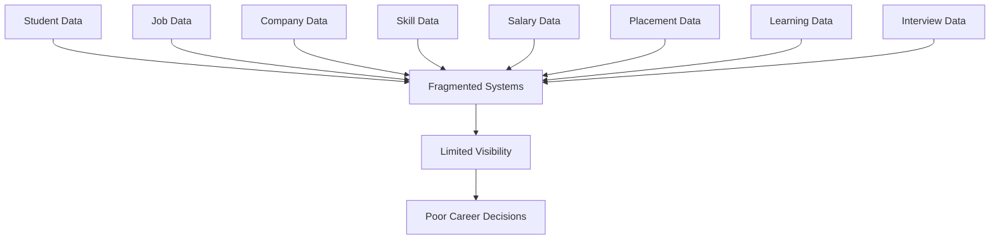
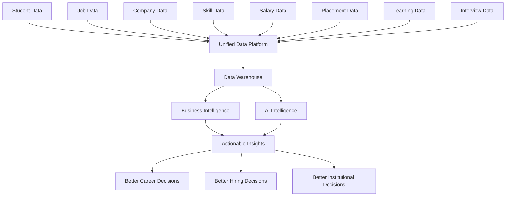

# 02 — Problem Statement

# Career Connect — AI Career Intelligence Platform

**Document Type:** Problem Statement
**Project:** Career Connect
**Version:** 1.0
**Status:** Project Baseline
**Classification:** AI + Cloud + Data Warehouse + Business Intelligence + SaaS

---

# 1. Introduction

The global career and employment ecosystem generates a massive volume of data from students, universities, employers, recruiters, job portals, learning platforms, certification providers, salary platforms, and recruitment systems.

However, this information is highly fragmented.

Students may have access to job listings but lack personalized career intelligence. Colleges may have placement records but lack advanced analytics. Recruiters may have access to candidate profiles but lack comprehensive talent-market intelligence. Companies may have hiring information but limited visibility into broader skill, salary, and workforce trends.

The result is a disconnected ecosystem where important career decisions are often made using incomplete information, manual spreadsheets, static reports, and generalized recommendations.

**Career Connect** is proposed to solve this problem by creating a unified platform that collects, processes, analyzes, and intelligently interprets career-related data.

---

# 2. Problem Background

The current career ecosystem contains several disconnected information systems.

A typical ecosystem may look like:

```text
Students
   |
Student Portal
   |
Placement Cell
   |
Excel / CSV Files
   |
College Database


Job Seekers
   |
Job Portals
   |
Company Websites
   |
Applications


Recruiters
   |
ATS / HR Systems
   |
Recruitment Reports


Learning
   |
Courses
   |
Certifications
   |
Learning Platforms
```

Each system contains only a portion of the overall career picture.

There is usually no unified intelligence layer connecting:

```text
Student
   +
Skills
   +
Education
   +
Certification
   +
Learning
   +
Jobs
   +
Companies
   +
Applications
   +
Interviews
   +
Salary
   +
Placement
   +
Market Demand
```

Career Connect addresses this fragmentation.

---

# 3. Core Problem

The central problem is:

> **Career-related data exists in large quantities, but it is fragmented, poorly integrated, difficult to analyze, and rarely transformed into personalized and actionable intelligence.**

This creates problems for every major stakeholder.

---

# 4. Student Problems

Students are one of the primary users of the platform.

## 4.1 Lack of Personalized Career Direction

Many students know the technologies they study but do not know which careers best match their profile.

For example:

```text
Student knows:
Python + SQL + Excel
```

But may not know whether the profile is better suited for:

- Data Analyst
- Business Analyst
- Data Engineer
- Data Scientist
- BI Developer
- Backend Developer

A generic job search system does not sufficiently solve this decision problem.

---

## 4.2 Skill-Gap Visibility

Students frequently know their current skills but do not have an accurate understanding of the skills required for target careers.

Example:

```text
Current Skills
Python
SQL
Excel

Target Role
Data Engineer

Required Skills
Python
SQL
Cloud
ETL
Airflow
Spark
Data Warehousing
```

The missing information is the **skill gap**.

Without structured analysis, students may spend time learning irrelevant technologies.

---

## 4.3 Resume Quality Problems

Students often create resumes without understanding:

- ATS requirements
- Relevant keywords
- Role-specific skills
- Resume structure
- Experience relevance
- Skill prioritization
- Achievement presentation

A static resume checker provides limited value.

The user needs contextual feedback based on the target career and market requirements.

---

## 4.4 Difficulty Understanding Job Market Trends

Students may not know:

- Which technologies are increasing in demand
- Which job roles are growing
- Which cities have more opportunities
- Which companies are hiring
- What experience levels are expected
- How salaries differ across roles and locations

The information exists, but it is not presented as connected intelligence.

---

## 4.5 Learning Path Confusion

There are thousands of:

- Courses
- Certifications
- Tutorials
- Bootcamps
- Training programs

Students often face:

> **“What should I learn next?”**

The problem is not lack of educational content.

The problem is **lack of personalized prioritization**.

---

## 4.6 Lack of Career Feedback Loop

Most platforms do not continuously connect:

```text
Learning
↓
Skills
↓
Applications
↓
Interviews
↓
Offers
↓
Career Outcomes
```

Without this feedback loop, students cannot easily determine which actions actually improve their career outcomes.

---

# 5. Graduate and Job Seeker Problems

Graduates and job seekers face additional challenges.

## 5.1 Job Matching Is Often Too Generic

Traditional job matching may focus primarily on:

- Job title
- Keywords
- Location
- Experience

It may not fully consider:

- Transferable skills
- Adjacent technologies
- Certifications
- Career trajectory
- Learning progress
- Skill gaps

A more intelligent matching mechanism is required.

---

## 5.2 Salary Information Is Fragmented

Salary information may differ by:

- Company
- City
- Country
- Role
- Experience
- Technology
- Industry

Without aggregation and normalization, users cannot easily understand realistic compensation ranges.

---

## 5.3 Difficulty Comparing Career Paths

A job seeker may be choosing between:

```text
Data Analyst
vs
Data Engineer
vs
Data Scientist
```

Important comparison factors include:

- Skills
- Salary
- Demand
- Learning effort
- Number of opportunities
- Experience requirements
- Technology stack
- Career progression

These dimensions should be presented together.

---

# 6. College Problems

Colleges and placement departments face a different class of problems.

## 6.1 Placement Data Is Often Fragmented

Placement information may exist in:

- Excel sheets
- CSV files
- Student information systems
- Department databases
- Email records
- Manual reports

This makes centralized analysis difficult.

---

## 6.2 Limited Skill Intelligence

A college may know:

> “300 students participated in placement training.”

But may not know:

- What skills are missing?
- Which departments have stronger technical skills?
- How many students are job-ready?
- Which technologies have the largest skill gap?
- Which training programs produce better outcomes?

---

## 6.3 Manual Placement Reporting

Placement officers frequently need to generate reports involving:

- Students placed
- Company-wise hiring
- Salary statistics
- Department performance
- Placement percentage
- Offer counts
- Historical comparisons

When this is done manually, reporting becomes time-consuming and error-prone.

---

## 6.4 Lack of Predictive Insights

Traditional placement systems mainly report historical outcomes.

They answer:

> “What happened?”

Career intelligence should also help answer:

> “Why did it happen?”

and eventually:

> “What is likely to happen next?”

For example:

```text
Historical Placement Data
        ↓
Skill Analysis
        ↓
Performance Analysis
        ↓
Trend Detection
        ↓
Placement Readiness Insight
```

---

# 7. Placement Officer Problems

Placement officers need to coordinate:

- Students
- Recruiters
- Companies
- Interviews
- Tests
- Training
- Offers
- Placement statistics

The challenge is turning operational activity into strategic intelligence.

The system should help answer:

- Which students require intervention?
- Which skills should be trained before the next hiring cycle?
- Which companies are most relevant to the student population?
- Which departments have the strongest placement potential?
- Which recruiters show increasing interest?

---

# 8. Recruiter Problems

Recruiters face the opposite problem.

Instead of too little candidate information, they often encounter too much.

## 8.1 Talent Discovery

Recruiters need to identify candidates who match:

- Skills
- Experience
- Education
- Certifications
- Location
- Role requirements

Searching manually across large talent pools can be inefficient.

---

## 8.2 Limited Talent-Market Intelligence

Recruiters may know their own hiring data but have limited visibility into:

- Competitor hiring
- Emerging skills
- Salary movement
- Talent availability
- Location-wise talent concentration
- College talent pools

This limits strategic recruitment decisions.

---

## 8.3 Recruitment Funnel Visibility

Recruitment involves several stages:

```text
Applications
↓
Screening
↓
Assessment
↓
Interview
↓
Offer
↓
Joining
```

Without analytics, recruiters may not know where candidates are dropping out.

Career Connect should provide funnel intelligence.

---

# 9. Company Problems

Organizations need workforce intelligence for future planning.

Companies may need to determine:

- Which technologies are becoming strategically important?
- Which skills are becoming difficult to acquire?
- Where should recruiting teams focus?
- Which locations provide better talent availability?
- How are compensation expectations changing?
- Which roles are experiencing increased demand?

This requires combining internal and external signals.

---

# 10. Training Institute Problems

Training providers also require intelligence.

They need to understand:

- Which skills are in demand?
- Which technologies should be taught?
- Which courses lead to better employment outcomes?
- Which certifications matter?
- Which learner segments need additional training?

Career Connect can connect training intelligence with employment intelligence.

---

# 11. Data Fragmentation Problem

One of the largest technical problems is data fragmentation.

Consider the following independent sources:

```text
Student Database
      |
Job Database
      |
Company Database
      |
Salary Database
      |
Certification Database
      |
Placement Database
      |
Interview Database
      |
Learning Database
```

Each source may have:

- Different formats
- Different naming conventions
- Different identifiers
- Different update frequencies
- Duplicate records
- Missing values

For example:

```text
"React.js"
"ReactJS"
"React JS"
"React"

```

may represent the same technology.

Without transformation and standardization, analytics become unreliable.

---

# 12. Data Quality Problem

Raw career data may contain:

- Duplicate records
- Missing values
- Invalid values
- Inconsistent names
- Incorrect salary formats
- Invalid dates
- Duplicate companies
- Duplicate skills
- Inconsistent locations

Example:

```text
Company A
company a
COMPANY A
Company-A
Co. A
```

These may represent one organization.

A proper data engineering layer is therefore required.

---

# 13. Analytics Problem

A database can store information, but storing information is not the same as understanding it.

For example:

```text
Applications = 10,000
Interviews = 2,000
Offers = 500
Hires = 400
```

Raw numbers alone are not sufficient.

The system should derive:

```text
Application → Interview Conversion
Interview → Offer Conversion
Offer → Joining Conversion
Overall Hiring Conversion
```

This converts transactional data into business metrics.

---

# 14. Data Warehouse Problem

Operational databases are primarily designed for transactional workloads.

Analytical queries often involve:

- Large datasets
- Historical analysis
- Aggregations
- Multiple joins
- Time-based comparisons
- Dimensions
- Measures

For example:

> “Compare average salary by role, city, company, experience level, and year.”

Running large analytical workloads directly against an operational application database can create performance and scalability problems.

Career Connect therefore requires a dedicated analytical architecture.

---

# 15. ETL/ELT Problem

Data cannot simply be copied from source systems into analytics.

The platform must perform:

```text
Extract
↓
Validate
↓
Clean
↓
Transform
↓
Deduplicate
↓
Standardize
↓
Enrich
↓
Load
```

The pipeline must also support:

- Incremental processing
- Error handling
- Logging
- Monitoring
- Data-quality checks
- Scheduling
- Metadata management

This makes data engineering a core part of the product.

---

# 16. AI Problem

AI systems are powerful only when they have reliable context.

A generic AI chatbot can provide generic career advice.

Career Connect aims to provide:

```text
User Profile
+
Skills
+
Career Target
+
Job Market Data
+
Salary Data
+
Learning Data
+
Historical Outcomes
```

to produce more contextual intelligence.

The goal is not simply:

> “Ask an AI question.”

The goal is:

> **“Use AI on top of structured career intelligence.”**

---

# 17. Recommendation Problem

A recommendation system should not blindly recommend popular careers.

It should consider:

- User skills
- Education
- Experience
- Career goal
- Current market demand
- Required skills
- Salary expectations
- Geographic preferences
- Learning progress

Conceptually:

```text
User Profile
      +
Market Demand
      +
Role Requirements
      +
Historical Outcomes
      ↓
Career Recommendation
```

---

# 18. Business Intelligence Problem

Different users require different business metrics.

For example:

### Student

```text
Skill Score
Resume Score
Skill Gap
Job Match Score
Learning Progress
```

### College

```text
Placement Rate
Average Salary
Department Performance
Company Hiring
Student Readiness
```

### Recruiter

```text
Application Funnel
Interview Conversion
Candidate Quality
Hiring Time
Talent Availability
```

### Executive

```text
Market Demand
Salary Trends
Skill Growth
Hiring Growth
Regional Opportunities
```

A single generic dashboard cannot satisfy all these use cases.

The solution requires role-specific analytical experiences powered by a shared semantic data layer.

---

# 19. Lack of Unified Intelligence

The most important problem can be represented as:



Career Connect introduces a unified intelligence layer:



---

# 20. Root Causes

The major root causes can be summarized as follows.

| Root Cause                   | Result                      |
| ---------------------------- | --------------------------- |
| Fragmented data sources      | Incomplete information      |
| Manual reporting             | Slow decision-making        |
| Poor data quality            | Inaccurate analytics        |
| Lack of standardization      | Difficult integration       |
| No unified warehouse         | Limited historical analysis |
| Generic recommendations      | Low personalization         |
| Limited AI context           | Generic AI responses        |
| Weak visualization           | Difficult interpretation    |
| Lack of predictive analytics | Reactive decisions          |
| Siloed systems               | Poor ecosystem visibility   |

---

# 21. Consequences of the Existing Problem

The fragmented ecosystem can result in:

### Students

- Wrong career choices
- Inefficient learning
- Poor resume quality
- Missed job opportunities
- Limited market awareness

### Colleges

- Manual reporting
- Weak skill-gap visibility
- Slow placement analysis
- Poor training prioritization
- Limited benchmarking

### Recruiters

- Inefficient candidate discovery
- Higher screening effort
- Limited talent intelligence
- Poor funnel visibility

### Companies

- Slower workforce planning
- Limited market visibility
- Difficulty identifying emerging skills

---

# 22. Proposed Problem Resolution

Career Connect proposes a unified solution based on five layers.

```text
Layer 1
DATA COLLECTION

        ↓

Layer 2
DATA ENGINEERING

        ↓

Layer 3
DATA WAREHOUSE

        ↓

Layer 4
AI + BUSINESS INTELLIGENCE

        ↓

Layer 5
ACTIONABLE DECISIONS
```

Each layer solves a specific problem.

---

## Layer 1 — Data Collection

Collect career and employment information from:

- Application systems
- Student systems
- Job datasets
- Company datasets
- Salary datasets
- Learning systems
- Certification records
- Placement systems

---

## Layer 2 — Data Engineering

Perform:

- Cleaning
- Validation
- Standardization
- Deduplication
- Transformation
- Enrichment

---

## Layer 3 — Data Warehouse

Create centralized analytical structures using:

- Fact tables
- Dimension tables
- Surrogate keys
- Historical data
- Star schemas
- Snowflake schemas
- Data marts

---

## Layer 4 — Intelligence

Use:

- Business Intelligence
- Statistical analysis
- AI services
- Recommendation engines
- Predictive analytics
- Natural language interfaces

---

## Layer 5 — Decision Support

Deliver:

- Dashboards
- Recommendations
- Alerts
- Reports
- Career plans
- Hiring insights
- Placement intelligence

---

# 23. Problem-to-Solution Mapping

| Problem                        | Career Connect Solution   |
| ------------------------------ | ------------------------- |
| Fragmented career data         | Unified data platform     |
| Resume quality issues          | AI Resume Analyzer        |
| Unknown skill gaps             | AI Skill Gap Analysis     |
| Career uncertainty             | AI Career Recommendation  |
| Learning confusion             | AI Learning Roadmap       |
| Poor market visibility         | Job Market Analytics      |
| Salary uncertainty             | Salary Intelligence       |
| Manual placement reporting     | Placement Dashboard       |
| Recruiter inefficiency         | Talent Intelligence       |
| Company hiring uncertainty     | Hiring Analytics          |
| Data inconsistency             | ETL + Data Quality        |
| Historical analysis difficulty | Enterprise Data Warehouse |
| Generic AI answers             | Context-aware Career AI   |
| Limited decision support       | Interactive BI Dashboards |

---

# 24. Technical Problem Statement

From a software engineering perspective, the project must solve the following technical challenge:

> **How can a scalable cloud-native platform continuously ingest heterogeneous career data, transform it into high-quality analytical datasets, store it in an enterprise-grade data warehouse, and expose the resulting intelligence through AI-powered and role-specific business intelligence interfaces?**

This single question represents the core technical challenge of the project.

---

# 25. Data Engineering Problem Statement

From a data engineering perspective:

> **How can Career Connect build reliable ETL/ELT pipelines that transform fragmented career data into standardized, validated, deduplicated, historical analytical datasets suitable for BI and AI workloads?**

The platform must address:

```text
Ingestion
+
Transformation
+
Quality
+
Lineage
+
Historical Data
+
Monitoring
```

---

# 26. Data Warehouse Problem Statement

From a data warehousing perspective:

> **How can operational career data be modeled into dimensions, facts, star schemas, snowflake schemas, and analytical data marts that support high-performance historical analysis?**

The warehouse should support analysis by:

- Student
- Company
- Skill
- Job
- College
- Date
- Location
- Technology
- Salary
- Placement
- Interview
- Application
- Learning

---

# 27. AI Problem Statement

From an AI perspective:

> **How can structured career intelligence be combined with AI services to generate personalized, explainable, and actionable career recommendations?**

AI should operate on relevant context such as:

```text
Profile
+
Skills
+
Target Role
+
Market Demand
+
Job Requirements
+
Learning Progress
+
Historical Outcomes
```

rather than relying only on generic prompts.

---

# 28. Business Intelligence Problem Statement

From a BI perspective:

> **How can complex career, hiring, salary, skill, and placement data be transformed into intuitive dashboards that support operational, tactical, and strategic decisions?**

The platform therefore requires:

```text
Raw Data
↓
Warehouse
↓
Semantic Metrics
↓
KPI Layer
↓
Dashboard
↓
Decision
```

---

# 29. Cloud Problem Statement

From a cloud computing perspective:

> **How can the platform be deployed using scalable, modular, cloud-native infrastructure while separating application, storage, analytics, AI, and data-processing workloads?**

The architecture should support:

- Elastic scaling
- Managed services
- Containerization
- Secure APIs
- Automated deployment
- Centralized monitoring
- Data storage scalability

---

# 30. Security Problem Statement

Career Connect handles potentially sensitive information such as:

- Student profiles
- Resumes
- Applications
- Interview information
- Placement outcomes
- Recruiter information
- Organizational data

Therefore:

> **How can access to career and recruitment data be securely controlled while maintaining usability, auditability, and multi-role access?**

The platform must incorporate:

- Authentication
- Authorization
- RBAC
- Secure APIs
- Input validation
- Audit logs
- Rate limiting
- Secure storage
- Tenant isolation where applicable

---

# 31. Non-Functional Problem Statement

The system should not solve only functional requirements.

It must also address:

### Scalability

Handle increasing users and data volumes.

### Performance

Provide responsive application and dashboard experiences.

### Availability

Maintain reliable access to core services.

### Security

Protect data and system resources.

### Maintainability

Allow individual components to evolve independently.

### Extensibility

Support future AI models, data sources, dashboards, and integrations.

### Observability

Provide sufficient logs, metrics, traces, and monitoring.

---

# 32. Final Consolidated Problem Statement

The complete project problem can be stated as:

> **The current career ecosystem is fragmented across job platforms, educational institutions, recruitment systems, learning platforms, salary sources, and manually maintained datasets. Students struggle to understand suitable careers, skill gaps, learning priorities, job-market trends, and salary opportunities. Colleges and placement officers lack unified analytics for student readiness, placement performance, skills, and recruiter demand. Recruiters and companies lack integrated visibility into talent availability, hiring trends, skill demand, salary patterns, and recruitment performance. Existing systems largely provide isolated information rather than connected intelligence.**
>
> **Career Connect addresses this problem by designing a cloud-native AI Career Intelligence Platform that integrates heterogeneous career data through data lake and ETL pipelines, transforms it into an enterprise data warehouse, and exposes the resulting intelligence through business intelligence dashboards, analytics, AI recommendations, career assistance, recruitment intelligence, and institutional decision-support tools.**

---

# 33. Expected Problem Resolution

After implementing Career Connect, the intended transformation is:

```text
BEFORE

Fragmented Data
      ↓
Manual Analysis
      ↓
Static Reports
      ↓
Generic Recommendations
      ↓
Reactive Decisions


AFTER

Integrated Data
      ↓
Automated ETL
      ↓
Enterprise Data Warehouse
      ↓
BI + AI Intelligence
      ↓
Personalized Insights
      ↓
Actionable Decisions
      ↓
Better Career Outcomes
```

---

# 34. Core Project Challenge

The project is therefore not simply:

> “Build a career website.”

The actual challenge is:

> **Build an end-to-end career intelligence ecosystem in which cloud computing, data engineering, data warehousing, business intelligence, AI, and software engineering operate together as one production-oriented platform.**

---

# 35. Problem Statement Summary

| Area        | Existing Problem              | Required Direction        |
| ----------- | ----------------------------- | ------------------------- |
| Career      | Lack of personalized guidance | AI Career Intelligence    |
| Skills      | Unknown skill gaps            | Skill Gap Analytics       |
| Resume      | Generic resume feedback       | AI Resume Intelligence    |
| Learning    | Too many choices              | Personalized Roadmap      |
| Jobs        | Fragmented opportunities      | Job Market Intelligence   |
| Salary      | Inconsistent information      | Salary Analytics          |
| College     | Manual placement reporting    | Placement BI              |
| Recruitment | Difficult talent discovery    | Recruiter Intelligence    |
| Company     | Limited hiring visibility     | Workforce Analytics       |
| Data        | Fragmented sources            | Unified Data Platform     |
| ETL         | Manual processing             | Automated Pipelines       |
| Warehouse   | Limited historical analytics  | Enterprise DW             |
| BI          | Static reporting              | Interactive Dashboards    |
| AI          | Generic assistance            | Context-Aware AI          |
| Cloud       | Siloed infrastructure         | Cloud-Native Architecture |
| Security    | Role/access complexity        | Secure RBAC Platform      |

---

# 36. Final Statement

**Career Connect exists to solve one fundamental problem:**

> **People and organizations have access to large amounts of career data, but not enough career intelligence.**

The platform bridges that gap by transforming:

**Data → Information → Analytics → Intelligence → Action → Outcome**

This transformation is the central problem-solving principle behind the entire Career Connect architecture.

---

## Document Status

| Attribute         | Value                                                  |
| ----------------- | ------------------------------------------------------ |
| Project           | Career Connect                                         |
| Document          | Problem Statement                                      |
| Version           | 1.0                                                    |
| Status            | Baseline                                               |
| Primary Problem   | Fragmented Career Intelligence                         |
| Technical Focus   | Cloud + Data Engineering + Data Warehouse + AI + BI    |
| Target Users      | Students, Colleges, Recruiters, Companies, Job Seekers |
| Product Direction | Enterprise SaaS                                        |
