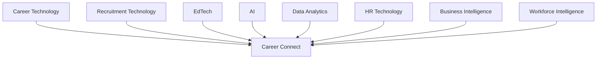

# 03 — Market Research

# Career Connect — AI Career Intelligence Platform

**Document Type:** Market Research
**Project:** Career Connect
**Version:** 1.0
**Status:** Market Opportunity Baseline
**Research Horizon:** 2025–2030
**Target Markets:** India + Global
**Primary Domains:** Career Technology, HR Technology, EdTech, AI, Talent Intelligence, Workforce Analytics, Business Intelligence

---

# 1. Executive Market Summary

Career Connect operates at the intersection of several rapidly evolving markets:

- Career technology
- Online recruitment
- HR technology
- Talent intelligence
- Learning and upskilling
- Artificial intelligence
- Workforce analytics
- Business intelligence
- Enterprise SaaS

The fundamental market opportunity comes from a structural change in the labor market:

> **Skills, jobs, technologies, and career paths are changing faster than traditional career guidance and reporting systems can adapt.**

The World Economic Forum's _Future of Jobs Report 2025_, based on input from more than 1,000 employers representing over 14 million workers across 55 economies, identifies technological change, AI, economic uncertainty, demographic shifts, and the green transition as major forces reshaping work through 2030. It also highlights technology-related skills such as AI, big data, networks, and cybersecurity among the fastest-growing areas of demand.

LinkedIn's 2025 Work Change Report similarly indicates that skills required for many jobs are changing even when the job itself remains, reinforcing the need for continuous adaptation and upskilling.

This creates a strong product thesis for Career Connect:

> **The future career platform should not only connect people with jobs; it should continuously connect people with skills, roles, learning, market demand, and career outcomes.**

---

# 2. Market Research Objective

The objective of this market research is to determine whether Career Connect addresses a meaningful and durable market need.

The research evaluates:

1. Labor-market transformation
2. AI-driven workforce change
3. Skills and reskilling demand
4. Student and graduate needs
5. Institutional needs
6. Recruiter needs
7. Enterprise workforce intelligence
8. India-specific opportunity
9. Global opportunity
10. Product whitespace
11. Market-entry strategy
12. Commercialization potential

---

# 3. Research Methodology

The market research uses a combination of:

### Primary Research Sources

Where available, the analysis prioritizes:

- World Economic Forum
- LinkedIn Economic Graph
- U.S. Bureau of Labor Statistics
- Government of India / Press Information Bureau
- EY workforce research
- Public labor-market datasets

### Research Approach

The market is analyzed using four perspectives:

```text
Macro Trends
     ↓
Market Need
     ↓
Customer Problems
     ↓
Product Opportunity
```

The analysis deliberately avoids fabricating a precise global market-size number where authoritative and comparable figures are not available.

For commercialization, a **bottom-up market sizing model** is recommended instead of presenting an unsupported top-down estimate.

---

# 4. Major Market Trend #1 — Rapid Workforce Transformation

Work is changing because of multiple simultaneous forces.

The World Economic Forum identifies the following as major drivers through 2030:

- Technological change
- Geoeconomic fragmentation
- Economic uncertainty
- Demographic change
- Green transition

These forces are expected to reshape both jobs and skills.

This matters directly to Career Connect because career guidance cannot remain static when the underlying labor market is dynamic.

A traditional model is:

```text
Education
   ↓
Degree
   ↓
Job
```

The emerging model is closer to:

```text
Education
   ↓
Skills
   ↓
Continuous Learning
   ↓
Career Transition
   ↓
Reskilling
   ↓
New Role
   ↓
Continuous Adaptation
```

This supports the need for a platform that continuously monitors skills and career transitions.

---

# 5. Major Market Trend #2 — Skills Are Becoming More Dynamic

One of the strongest market signals is the acceleration of skill change.

LinkedIn reports that the skills required for many jobs are shifting even when workers remain in the same role. It also notes that professionals are proactively adapting and upskilling.

This means the traditional model:

> **“Get a degree and find a job.”**

is increasingly being replaced by:

> **“Build relevant skills, demonstrate those skills, continuously adapt, and navigate changing roles.”**

Career Connect should therefore treat **skills as the central unit of career intelligence**.

---

# 6. Major Market Trend #3 — AI Is Reshaping Careers

Artificial intelligence is no longer only an emerging technology topic.

It is increasingly integrated into workplace processes.

EY's 2025 India workforce research reports that 88% of surveyed employees in India use generative AI at work and 37% report using it daily. The same research highlights the growing importance of structured AI learning and role-based skill development.

The implication for Career Connect is significant.

AI should influence:

```text
Career Planning
Skill Assessment
Learning
Resume Optimization
Job Matching
Interview Preparation
Recruitment
Workforce Planning
```

AI therefore represents both:

- A product capability
- A market driver

---

# 7. Major Market Trend #4 — Technical and Data Roles Continue to Matter

The U.S. Bureau of Labor Statistics' 2024–2034 projections provide another indication of continued demand for technology- and data-intensive occupations.

For example, BLS projects:

| Occupation                                 | Projected Growth 2024–2034 |
| ------------------------------------------ | -------------------------: |
| Data Scientists                            |                      33.5% |
| Information Security Analysts              |                      28.5% |
| Actuaries                                  |                      21.8% |
| Operations Research Analysts               |                      21.5% |
| Computer & Information Research Scientists |                      19.7% |
| Software Developers                        |                      15.8% |

BLS projects overall employment growth of 3.1% across all occupations over the same period.

These projections are U.S.-specific and should not be treated as direct forecasts for India. However, they reinforce a broader market direction toward technology, data, AI, analytical, and cybersecurity capabilities.

Career Connect can operationalize this trend by building:

- Role intelligence
- Skill intelligence
- Technology intelligence
- Salary intelligence
- Learning pathways

---

# 8. Major Market Trend #5 — India Is a Strategic AI Talent Market

India represents a particularly important market for Career Connect.

India's Ministry of Electronics and Information Technology reported in December 2025 that India had the highest annual AI talent acquisition rate among countries in the cited Stanford AI Index comparison, at about 33%, and that India's AI talent concentration had grown more than threefold since 2016.

The same government release reported that:

- AI jobs span multiple sectors.
- AI skill demand is increasing.
- India is among the leading countries in AI skill penetration.
- India is investing in large-scale AI skilling.
- FutureSkills PRIME includes AI, big data, and cloud computing pathways.
- More than 1.6 million candidates had enrolled or been trained through the referenced FutureSkills PRIME programs.

This combination of:

```text
Large Talent Pool
+
Large Student Population
+
Rapid Digital Adoption
+
AI Adoption
+
Skilling Demand
```

makes India an attractive initial market hypothesis for Career Connect.

---

# 9. Major Market Trend #6 — Continuous Learning Is Becoming Core to Employability

The market is moving away from one-time education toward continuous skill development.

EY's India research reports that 87% of employees and 90% of employers surveyed consider skill development important, while also highlighting the need for structured, role-based learning pathways.

This creates a major product opportunity.

Career Connect should not stop at:

```text
User → Job Recommendation
```

It should support:

```text
User
 ↓
Target Career
 ↓
Required Skills
 ↓
Skill Gap
 ↓
Learning Roadmap
 ↓
Skill Acquisition
 ↓
Job Matching
 ↓
Interview
 ↓
Career Outcome
```

This makes learning a component of the career journey rather than a separate product category.

---

# 10. Major Market Trend #7 — Career Mobility Is Increasing

LinkedIn's Work Change research reports that professionals entering the workforce today are on pace to hold twice as many jobs over their careers compared with 15 years ago.

The important implication is that the platform should not treat career choice as a one-time event.

Career Connect should support:

- First-job discovery
- Career transitions
- Internal mobility
- Reskilling
- Role changes
- Technology transitions
- Leadership progression

The product therefore has potential value beyond college placement.

---

# 11. Major Market Trend #8 — The Market Is Moving Toward Skills-Based Intelligence

Career decisions increasingly require understanding skills rather than only credentials.

A degree may indicate educational background.

A skill graph can describe:

```text
What the person knows
+
What the role requires
+
What skills are missing
+
What adjacent roles are possible
```

This creates an important product architecture principle:

> **The Career Connect data model should be skill-centric rather than job-title-centric.**

A job is one node.

A skill can connect:

```text
Student
Job
Company
Course
Certification
Salary
Interview
Placement
Career Path
```

This makes the skill dimension one of the most strategically important entities in the platform.

---

# 12. Market Need by Customer Segment

## 12.1 Students

### Current Needs

Students need:

- Career clarity
- Relevant skills
- Resume improvement
- Job matching
- Interview preparation
- Learning recommendations
- Salary awareness

### Market Opportunity

Career Connect can serve students through a freemium or institution-sponsored model.

Potential value proposition:

> **“Tell me where I am, where I want to go, and what I should do next.”**

---

# 13. Graduates and Job Seekers

### Current Needs

- Better job matching
- Career transitions
- Skill-gap analysis
- Salary information
- Upskilling
- Interview preparation

### Opportunity

This segment creates an important long-term opportunity because users may continue using Career Connect after graduation.

Potential lifecycle:

```text
Final-Year Student
      ↓
Graduate
      ↓
Job Seeker
      ↓
Employee
      ↓
Career Switcher
      ↓
Senior Professional
```

The product can therefore maintain long-term user relationships.

---

# 14. Colleges and Universities

Colleges are strong potential B2B customers.

### Needs

- Placement analytics
- Student readiness analytics
- Department comparison
- Skill-gap analysis
- Company hiring trends
- Salary analytics
- Historical reporting
- Accreditation-ready reporting
- Executive dashboards

### Product Opportunity

Career Connect can become an institutional analytics layer.

Instead of:

```text
College ERP
+
Excel Reports
+
Placement Spreadsheets
```

the institution gets:

```text
College Data
↓
Data Warehouse
↓
Placement Intelligence
↓
Executive Dashboard
```

---

# 15. Placement Officers

Placement officers represent a high-value operational user group.

They need both:

### Operational Intelligence

- Candidate lists
- Interview schedules
- Application status
- Company requirements

and:

### Strategic Intelligence

- Placement trends
- Skill gaps
- Department performance
- Company demand
- Salary movement

This combination makes the placement-office workflow an especially strong use case for the platform.

---

# 16. Recruiters

Recruiters operate in a talent-discovery market.

Their core questions include:

```text
Who matches?
Where are they?
How many are available?
What skills do they have?
What will they cost?
Which channels work best?
Where does the hiring funnel break?
```

Career Connect can address these questions using:

- Candidate intelligence
- Skill matching
- Recruitment analytics
- Talent pools
- College intelligence
- Location intelligence

---

# 17. Companies and HR Teams

The enterprise opportunity expands the platform beyond recruiting.

Potential use cases include:

- Workforce planning
- Skill intelligence
- Hiring demand analysis
- Internal mobility
- Reskilling
- Talent supply analysis
- Compensation intelligence

This positions Career Connect closer to a **workforce intelligence platform**, rather than a simple recruiting product.

---

# 18. Training Institutes

Training organizations can use Career Connect to understand which programs are relevant to the market.

Potential metrics:

```text
Skill Demand
Course Demand
Certification Demand
Job Conversion
Salary Outcomes
Employment Outcomes
```

This creates a possible B2B2C business model.

For example:

```text
Career Connect
     ↓
Training Institute
     ↓
Student
     ↓
Skills
     ↓
Job
```

---

# 19. Market Segmentation

The market can be segmented along four dimensions.

## Segment A — Individual Users

```text
Students
Graduates
Job Seekers
Career Switchers
Professionals
```

## Segment B — Education

```text
Colleges
Universities
Placement Offices
Training Institutes
```

## Segment C — Hiring

```text
Recruiters
Recruitment Agencies
HR Teams
Talent Acquisition Teams
```

## Segment D — Enterprise Intelligence

```text
Companies
HR Leadership
Workforce Planning
Learning & Development
Talent Strategy
```

---

# 20. Market Needs Matrix

| Segment             | Primary Need           | Career Connect Capability |
| ------------------- | ---------------------- | ------------------------- |
| Students            | Career direction       | AI Career Recommendation  |
| Students            | Skill gap              | Skill Gap Analysis        |
| Students            | Resume                 | AI Resume Analyzer        |
| Graduates           | Job matching           | Smart Job Matching        |
| Job Seekers         | Salary insight         | Salary Intelligence       |
| Colleges            | Placement reporting    | Placement BI              |
| Colleges            | Student readiness      | Skill Intelligence        |
| Placement Officers  | Hiring analytics       | Recruiter Analytics       |
| Recruiters          | Candidate discovery    | Talent Intelligence       |
| Companies           | Skill demand           | Workforce Intelligence    |
| Training Institutes | Market-aligned courses | Skill Demand Analytics    |

---

# 21. Market Opportunity: India First

India is especially suitable as an initial market for several reasons.

### Factor 1 — Large Digital Talent Ecosystem

Government reporting highlights India's growing AI and digitally skilled workforce and significant investment in AI and digital skilling.

### Factor 2 — Strong AI Adoption

EY's research indicates very high generative-AI usage among surveyed Indian employees.

### Factor 3 — Large Education Ecosystem

Career Connect can initially target:

- Engineering colleges
- Universities
- Degree colleges
- Training institutes
- Placement departments

### Factor 4 — Strong IT Employment Ecosystem

India has a large technology and services ecosystem, increasing the relevance of:

- Software
- Data
- Cloud
- AI
- Cybersecurity
- Analytics
- Product roles

### Factor 5 — Skill Transition Pressure

As technologies evolve, students and employees require continuous reskilling.

This directly maps to the product's skill-intelligence architecture.

---

# 22. Global Market Opportunity

The product can expand beyond India because the underlying problem is global.

The global labor market is experiencing:

- Technology-driven change
- Skill transformation
- AI adoption
- Workforce mobility
- Continuous learning requirements

The World Economic Forum's global employer research confirms that these changes are not confined to one country.

Potential future markets include:

```text
India
↓
Southeast Asia
↓
Middle East
↓
Europe
↓
North America
↓
Global
```

Localization requirements would include:

- Country-specific job markets
- Currency
- Salary structures
- Education systems
- Employment regulations
- Taxonomies
- Languages

---

# 23. Total Addressable Market Framework

A precise TAM should not be invented without a validated pricing model and verified customer counts.

Career Connect should instead use a bottom-up framework.

## Individual TAM

```text
Addressable Individual Users
×
Annual Revenue Per User
=
Individual TAM
```

## Institution TAM

```text
Addressable Colleges / Universities
×
Annual Institutional Contract Value
=
Institutional TAM
```

## Recruiter TAM

```text
Addressable Recruiter Organizations
×
Annual Recruiter Subscription
=
Recruitment TAM
```

## Enterprise TAM

```text
Addressable Companies
×
Annual Enterprise Contract Value
=
Enterprise TAM
```

Then:

```text
Total TAM
=
Individual
+
Institution
+
Recruiter
+
Enterprise
```

This model is more defensible than selecting a large generic “career-tech market” number without establishing the actual customer and pricing assumptions.

---

# 24. Serviceable Addressable Market

For the academic/startup MVP, the initial serviceable market should be significantly narrower.

Recommended initial focus:

```text
India
+
Engineering / Technology Colleges
+
Final-Year Students
+
Placement Departments
+
Entry-Level Recruiters
```

This gives the product a clear beachhead.

The platform can then expand toward:

```text
Graduates
+
Job Seekers
+
Training Institutes
+
HR Teams
+
Enterprises
```

---

# 25. Serviceable Obtainable Market

The first obtainable market should be defined through pilots rather than broad geographic targeting.

Recommended initial objective:

```text
5–10 Colleges
+
1,000–10,000 Students
+
Multiple Recruiters
+
Selected Job Data
```

These numbers are **proposed pilot targets, not market facts**.

The purpose is to validate:

- Data quality
- Product-market fit
- Dashboard usefulness
- AI recommendation quality
- Institutional willingness to adopt

---

# 26. Product-Market Fit Hypothesis

The central hypothesis is:

> **Students and institutions will value Career Connect when it converts fragmented career information into personalized, explainable, actionable recommendations and measurable outcomes.**

This hypothesis should be tested through real users.

---

# 27. Customer Pain Intensity

A useful market prioritization model is:

| Problem                  | Pain        | Frequency | Business Value |
| ------------------------ | ----------- | --------- | -------------- |
| Career uncertainty       | High        | High      | High           |
| Skill-gap identification | High        | High      | High           |
| Resume optimization      | Medium–High | High      | High           |
| Placement reporting      | High        | Recurring | Very High      |
| Talent discovery         | High        | Recurring | Very High      |
| Hiring analytics         | High        | Recurring | Very High      |
| Salary intelligence      | Medium–High | Recurring | High           |
| Learning recommendations | High        | Recurring | High           |

The strongest initial B2B opportunities are likely to be institutional analytics and recruiter intelligence because they correspond to recurring organizational workflows.

This is a product hypothesis that should be validated through customer interviews.

---

# 28. Market Opportunity Map

Career Connect sits at the intersection of multiple markets.



The strategic advantage is that the platform can combine capabilities that are frequently sold or implemented separately.

---

# 29. White-Space Opportunity

The strongest potential product whitespace is not another job board.

The opportunity is:

> **A connected intelligence layer between education, skills, learning, jobs, hiring, salary, and outcomes.**

Conceptually:

```text
Education
   ↓
Skills
   ↓
Career
   ↓
Learning
   ↓
Jobs
   ↓
Applications
   ↓
Interviews
   ↓
Hiring
   ↓
Salary
   ↓
Outcome
```

Career Connect should own the intelligence connecting these stages.

---

# 30. Data Network Opportunity

The platform becomes increasingly valuable when multiple data domains are connected.

For example:

```text
Skill
 ↕
Job
 ↕
Company
 ↕
Salary
 ↕
Location
 ↕
Candidate
 ↕
Learning
 ↕
Placement
```

This enables analytical questions that isolated systems cannot answer easily.

For example:

> “Which skills are associated with higher placement rates for graduates targeting data roles?”

This requires multiple datasets to be connected.

---

# 31. AI Opportunity

AI creates a new product layer on top of the data platform.

Without the data platform:

```text
AI
↓
Generic Career Advice
```

With the Career Connect intelligence layer:

```text
User
+
Personal Profile
+
Skill Graph
+
Job Data
+
Salary Data
+
Learning Data
+
Market Trends
↓
Contextual AI
↓
Personalized Career Intelligence
```

This architecture creates more strategic value than simply embedding a chatbot into a traditional job portal.

---

# 32. BI Opportunity

Business intelligence creates a second major product layer.

The same data warehouse can generate:

### Student BI

```text
Profile
Skills
Career Fit
Progress
Applications
```

### College BI

```text
Placement
Salary
Departments
Companies
Skill Gaps
```

### Recruiter BI

```text
Talent
Applications
Interviews
Offers
Hiring Funnel
```

### Executive BI

```text
Market Demand
Skills
Salary
Hiring
Workforce Trends
```

This creates a highly reusable analytical infrastructure.

---

# 33. Market Timing

The timing for Career Connect is attractive because several trends are converging simultaneously:

```text
AI Adoption
       +
Skill Transformation
       +
Continuous Learning
       +
Digital Recruitment
       +
Data Availability
       +
Cloud Infrastructure
       +
Growing Analytics Adoption
```

The World Economic Forum identifies technological transformation and skill changes as major forces through 2030, while LinkedIn reports ongoing changes in job and skill requirements.

India's high AI adoption and growing AI talent ecosystem further strengthen the initial-market case.

---

# 34. Market Risks

A professional market analysis must also identify risks.

## Risk 1 — Data Availability

Reliable, legal, high-quality job and salary data may be difficult to obtain.

### Mitigation

Use:

- Licensed APIs
- Public datasets
- Organization-provided datasets
- Synthetic datasets for development
- User-contributed information with appropriate controls

---

## Risk 2 — AI Accuracy

Career recommendations may be incorrect.

### Mitigation

Use:

- Confidence scores
- Explainable recommendations
- Human-readable reasoning
- Data-backed recommendations
- Clear disclaimers
- Evaluation pipelines

---

## Risk 3 — Privacy

Career and resume data can be sensitive.

### Mitigation

Implement:

- Strong access control
- Encryption
- Data minimization
- Audit logs
- Tenant isolation
- Secure retention policies

---

## Risk 4 — Market Competition

Large platforms already operate in recruitment, learning, or professional networking.

### Mitigation

Career Connect should focus on:

> **Career intelligence + data warehouse + institutional analytics + AI personalization**

rather than attempting to immediately replace established job platforms.

Detailed competitor positioning is reserved for **Section 4 — Competitor Analysis**.

---

## Risk 5 — Rapid Technology Change

AI and cloud technologies evolve rapidly.

### Mitigation

Use modular architecture:

```text
AI Provider Abstraction
+
API Abstraction
+
Data Source Abstraction
+
Warehouse Abstraction
```

This reduces dependence on a single vendor.

---

# 35. Competitive Market Positioning Hypothesis

The intended positioning is:

```text
Traditional Job Portal
        ↓
Opportunities

Learning Platform
        ↓
Courses

Resume Tool
        ↓
Resume

College ERP
        ↓
Institutional Records

BI Platform
        ↓
Analytics

AI Assistant
        ↓
Conversation
```

Career Connect attempts to connect all of these concepts:

```text
                CAREER CONNECT
                     ↓
         Career Intelligence Layer
                     ↓
     ┌───────────────┼───────────────┐
     ↓               ↓               ↓
   Career          Learning        Hiring
 Intelligence     Intelligence   Intelligence
     ↓               ↓               ↓
                     AI
                     +
                    BI
```

This positioning will be evaluated more deeply in the next market-analysis section.

---

# 36. Market Expansion Strategy

The product should not attempt to serve every customer on Day 1.

A phased market strategy is recommended.

## Phase 1 — Campus Intelligence

Primary customers:

- Colleges
- Placement officers
- Final-year students

Primary features:

- Placement analytics
- Student dashboard
- Skill-gap analysis
- Resume AI
- Job analytics

---

## Phase 2 — Student Career Platform

Expand into:

- Graduates
- Job seekers
- Career switchers

Features:

- Career recommendations
- Learning roadmap
- Salary intelligence
- Job matching
- AI career assistant

---

## Phase 3 — Recruiter Intelligence

Add:

- Candidate intelligence
- Talent pools
- Recruiter analytics
- Hiring funnel
- College intelligence

---

## Phase 4 — Enterprise Workforce Intelligence

Add:

- Workforce planning
- Skill intelligence
- Internal mobility
- Reskilling analytics
- Enterprise dashboards
- Organization-level benchmarking

---

# 37. Recommended Beachhead Market

For a college project that also has startup potential, the recommended initial beachhead is:

> **Indian engineering and technology colleges with active placement departments.**

Why?

Because this segment naturally combines:

```text
Students
+
Placement Data
+
Companies
+
Applications
+
Interviews
+
Offers
+
Salary
+
Skills
```

That makes the segment ideal for demonstrating the complete:

**Data Lake → ETL → Warehouse → BI → AI**

architecture.

---

# 38. Market Validation Strategy

Before attempting commercial scale, Career Connect should validate four hypotheses.

## Hypothesis A — Student Value

Students will use AI-driven career and skill-gap recommendations.

### Validation

Measure:

- Recommendation usage
- Resume analyses
- Roadmap usage
- User retention

---

## Hypothesis B — College Value

Placement teams will use unified analytics instead of manual reporting.

### Validation

Measure:

- Report generation time
- Dashboard usage
- Reporting frequency
- Placement officer feedback

---

## Hypothesis C — Recruiter Value

Recruiters will benefit from skill- and institution-based talent intelligence.

### Validation

Measure:

- Candidate search usage
- Match quality
- Recruiter engagement
- Interview conversion

---

## Hypothesis D — Outcome Value

Career intelligence can improve measurable career outcomes.

### Validation

Measure:

- Interview conversion
- Placement conversion
- Skill-gap closure
- Learning completion
- Offer conversion

---

# 39. Proposed Market Validation Experiments

| Experiment       | Goal                        | Success Signal                |
| ---------------- | --------------------------- | ----------------------------- |
| Student pilot    | Test career AI              | High repeat usage             |
| Resume test      | Measure AI usefulness       | Users improve resumes         |
| College pilot    | Test placement BI           | Reduced reporting effort      |
| Recruiter pilot  | Test candidate intelligence | Better candidate selection    |
| Skill dashboard  | Test market insight         | Frequent dashboard engagement |
| Learning roadmap | Test personalization        | Course/skill completion       |
| Salary analytics | Test information value      | Repeated usage                |

---

# 40. Key Market Assumptions

The project should explicitly record the assumptions it depends on.

### Assumption 1

Career decisions are becoming increasingly skill-driven.

### Assumption 2

Users value personalized recommendations more than generic information.

### Assumption 3

Institutions need stronger placement and employability analytics.

### Assumption 4

Recruiters benefit from structured skill intelligence.

### Assumption 5

AI can improve career decision-support when grounded in reliable data.

### Assumption 6

Organizations will increasingly require continuous reskilling.

These are **testable hypotheses**, not guaranteed outcomes.

---

# 41. Strategic Market Thesis

Career Connect's market thesis can be expressed as:

```text
Work Changes
      ↓
Skills Change
      ↓
Career Paths Change
      ↓
Learning Needs Change
      ↓
Recruitment Changes
      ↓
Data Volume Increases
      ↓
Need for Intelligence Increases
```

Therefore:

> **As the labor market becomes more dynamic, the value of connected career intelligence increases.**

---

# 42. Market Opportunity Statement

The opportunity is not simply to build another destination for job listings.

The larger opportunity is to create:

> **A career intelligence infrastructure layer connecting people, skills, education, learning, employment, hiring, salaries, and outcomes.**

This infrastructure can support multiple products.

```text
Career AI
Recruiter AI
College BI
Student Intelligence
Workforce Analytics
Skill Intelligence
Salary Intelligence
Learning Intelligence
```

All can share the same underlying data and intelligence platform.

---

# 43. Strategic Recommendation

Based on the market signals reviewed, Career Connect should be positioned as a:

> **Data-driven AI Career Intelligence Platform**

rather than as a conventional job portal.

The recommended product hierarchy is:

```text
                     Career Connect
                           │
                 Career Intelligence
                           │
          ┌────────────────┼────────────────┐
          │                │                │
        AI               BI              Data
          │                │                │
   Career Coach       Dashboards       Warehouse
   Resume AI          Analytics        ETL
   Skill Gap          Reports          Data Lake
   Interview AI       KPIs             Data Quality
          │                │                │
          └────────────────┼────────────────┘
                           │
                    Career Outcomes
```

---

# 44. Research Findings

The research identifies six major market signals:

### Finding 1

The labor market is undergoing structural transformation through technology, economic, demographic, and environmental forces.

### Finding 2

Skills are changing rapidly, creating a requirement for continuous career adaptation.

### Finding 3

AI is becoming embedded in workplace workflows, with particularly strong adoption signals in India.

### Finding 4

Technology- and data-intensive occupations continue to show strong projected demand in major labor-market datasets such as the U.S. BLS projections.

### Finding 5

India is strategically important for AI talent, skill development, and digital workforce transformation.

### Finding 6

The strongest potential opportunity lies not in isolated job search, learning, or analytics features, but in connecting them through a common intelligence platform.

The sixth point is a **product inference** based on the market signals and problem analysis above.

---

# 45. Market Opportunity Score

The following is a strategic assessment for project prioritization.

| Factor                         | Assessment |
| ------------------------------ | ---------- |
| Market Need                    | Very High  |
| Technology Relevance           | Very High  |
| AI Relevance                   | Very High  |
| Data Opportunity               | Very High  |
| Cloud Relevance                | High       |
| BI Opportunity                 | Very High  |
| Student Demand Potential       | High       |
| Institutional Demand Potential | High       |
| Recruiter Demand Potential     | High       |
| Global Expansion Potential     | High       |
| Startup Potential              | High       |
| Technical Complexity           | Very High  |
| Competition Risk               | High       |
| Data Risk                      | High       |
| Privacy Risk                   | High       |

These ratings are strategic judgments for product planning, not independently measured market statistics.

---

# 46. Final Market Conclusion

The research supports the hypothesis that Career Connect is addressing a meaningful problem at the intersection of:

```text
AI
+
Career Technology
+
Education
+
Recruitment
+
Data Engineering
+
Business Intelligence
+
Workforce Intelligence
```

The strongest reason to build the product is not simply that “AI is popular.”

The stronger rationale is:

> **The underlying labor market is becoming more dynamic, skills are changing, organizations require continuous workforce adaptation, and large amounts of career data are being generated without necessarily being transformed into connected decision intelligence.**

Career Connect is designed specifically around this gap.

---

# 47. Final Market Position

### Product Category

**AI Career Intelligence Platform**

### Primary Beachhead

**Indian Colleges + Placement Ecosystem**

### Secondary Market

**Students + Graduates + Job Seekers**

### Third Market

**Recruiters + Talent Acquisition**

### Long-Term Market

**Enterprise Workforce Intelligence**

### Strategic Asset

**Career Data + Skill Graph + Data Warehouse + AI Intelligence Layer**

### Long-Term Vision

```text
Career Data
     ↓
Career Intelligence
     ↓
Better Decisions
     ↓
Better Skills
     ↓
Better Hiring
     ↓
Better Career Outcomes
```

---

# 48. Market Research Conclusion Statement

> **Career Connect has a credible market opportunity because it addresses a growing need for connected career, skill, learning, recruitment, and workforce intelligence. The platform's strongest differentiation should come from combining enterprise-grade data engineering and warehousing with AI and business intelligence, rather than competing solely as another job-search or resume product. India provides a particularly attractive initial market hypothesis due to its large digital talent ecosystem, growing AI adoption, and strong focus on AI and technology skilling.**

---

## Document Status

| Attribute          | Value                                  |
| ------------------ | -------------------------------------- |
| Project            | Career Connect                         |
| Document           | Market Research                        |
| Version            | 1.0                                    |
| Research Horizon   | 2025–2030                              |
| Primary Market     | India                                  |
| Expansion Market   | Global                                 |
| Beachhead          | Colleges + Placement Ecosystem         |
| Core Opportunity   | Career Intelligence                    |
| Key Drivers        | AI + Skills + Workforce Transformation |
| Strategic Position | AI + BI + Data Intelligence            |
| Market Validation  | Required before commercial scale       |
| Status             | Market Opportunity Baseline            |
