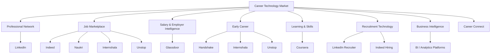
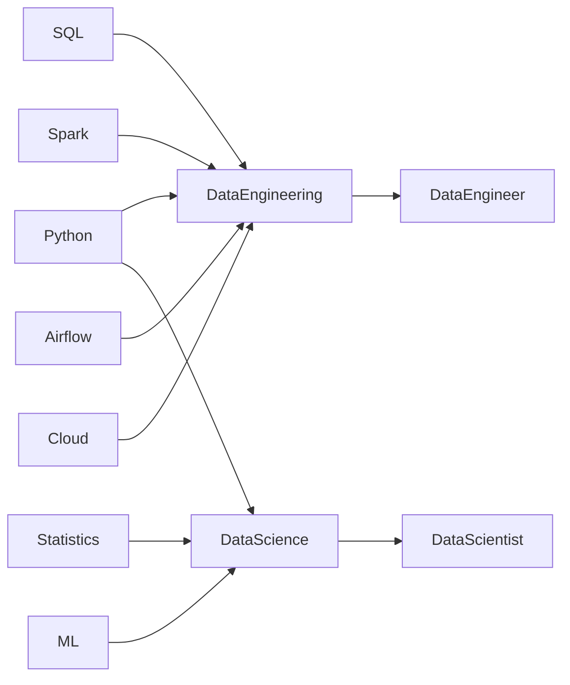
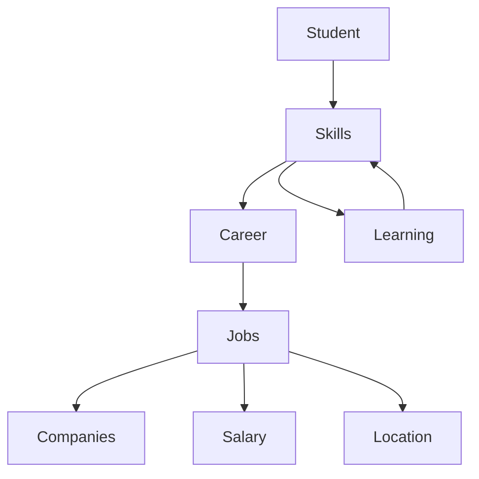
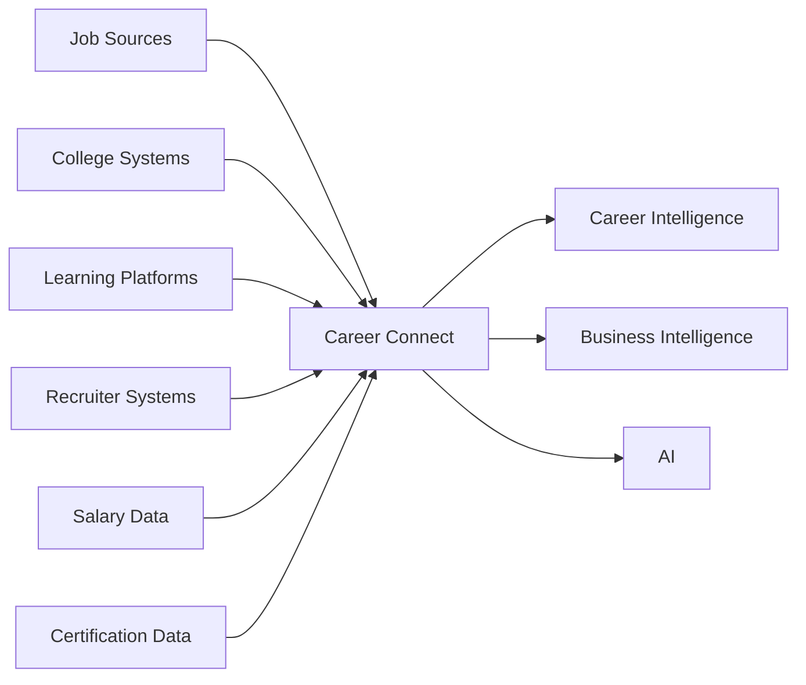
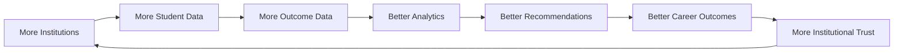

# 04 — Competitor Analysis

# Career Connect — AI Career Intelligence Platform

**Document Type:** Competitor Analysis
**Project:** Career Connect
**Version:** 1.0
**Status:** Strategic Competitive Baseline
**Research Date:** July 2026
**Market Scope:** India + Global
**Primary Categories:** Career Platforms, Recruitment Platforms, Early-Talent Platforms, Learning Platforms, Salary Intelligence, Workforce Intelligence, Business Intelligence

---

# 1. Executive Summary

Career Connect enters a market containing several highly capable platforms, but these competitors generally specialize in different parts of the career ecosystem.

The competitive landscape includes:

- Professional networks
- Job marketplaces
- Salary and employer-review platforms
- Early-career platforms
- Internship platforms
- Learning platforms
- Enterprise skills platforms
- Talent acquisition systems
- Business intelligence platforms

For example, LinkedIn combines professional networking, jobs, learning, and recruiter-oriented products, including Talent Insights.

Indeed combines job search and employer hiring capabilities, including resume search, AI-powered sourcing, hiring analytics, and Hiring Insights.

Glassdoor combines jobs, salary information, company reviews, and employer-brand analytics.

Handshake focuses heavily on the student and early-career market, connecting students, educational institutions, and employers while supporting career discovery and upskilling.

In India, Internshala combines internships, jobs, training, and employer hiring, while Unstop combines jobs, internships, competitions, hackathons, mentoring, mock interviews, and courses for students and freshers.

Coursera increasingly connects learning with skills and workforce development, including skills tracking, labor-market information, role-based learning, and enterprise analytics.

Therefore, Career Connect should **not** attempt to compete feature-for-feature with every large platform.

Its strategic position should instead be:

> **A unified career intelligence layer connecting skills, education, learning, jobs, salary, recruitment, placement, analytics, and AI.**

This distinction is central to the product strategy.

---

# 2. Competitive Landscape

The market can be visualized as follows:



Career Connect intersects multiple categories rather than belonging to only one.

---

# 3. Competitive Categories

The competitors should be analyzed in six categories.

## Category 1 — Professional Networks

Primary example:

**LinkedIn**

Strength:

```text
Network
+
Professional Identity
+
Jobs
+
Recruiting
+
Learning
```

---

## Category 2 — Job Marketplaces

Examples:

- Indeed
- Naukri
- Internshala
- Unstop

Strength:

```text
Jobs
+
Applications
+
Recruiter Access
```

---

## Category 3 — Workplace and Salary Intelligence

Primary example:

**Glassdoor**

Strength:

```text
Company Reviews
+
Salary Information
+
Employer Brand
+
Job Search
```

---

## Category 4 — Early-Talent Platforms

Primary example:

**Handshake**

Strength:

```text
Students
+
Universities
+
Employers
+
Career Services
```

---

## Category 5 — Learning and Skills Platforms

Primary example:

**Coursera**

Strength:

```text
Learning
+
Skills
+
Credentials
+
Workforce Development
```

---

## Category 6 — Career Intelligence

Target category:

**Career Connect**

Intended strength:

```text
Career Data
+
Skill Intelligence
+
Learning
+
Jobs
+
Salary
+
Placement
+
Recruitment
+
AI
+
BI
```

---

# 4. Direct Competitor — LinkedIn

## 4.1 Company and Product Position

LinkedIn describes itself as a professional network used for professional identity, networking, jobs, internships, and learning. LinkedIn also operates recruiter and talent-intelligence products.

This makes LinkedIn one of the strongest competitors from an ecosystem perspective.

---

## 4.2 Major Strengths

### Professional Graph

LinkedIn's professional network is a major strategic asset.

It connects:

```text
People
+
Companies
+
Skills
+
Jobs
+
Professional Experience
+
Education
```

### Recruiter Ecosystem

LinkedIn has dedicated recruiter and talent-intelligence capabilities.

### Job Discovery

Users can search for jobs and internships as part of the broader professional network.

### Brand

Its global professional-network positioning creates a substantial trust and distribution advantage.

---

## 4.3 LinkedIn's Competitive Advantage

```text
Professional Identity
        +
Network Effects
        +
Recruiter Network
        +
Job Market
        +
Learning
```

This is difficult for a new company to reproduce.

---

## 4.4 Career Connect Weakness Relative to LinkedIn

Career Connect should **not** claim superiority in:

- Professional networking
- Global professional identity
- Social graph
- Network effects

Instead, it should differentiate through:

```text
Career Intelligence
+
Institutional Analytics
+
Placement Intelligence
+
Skill Gap Analytics
+
Data Warehouse
+
Contextual AI
```

---

## 4.5 Strategic Lesson

Do not compete with LinkedIn on:

> “We have more professional networking.”

Compete on:

> “We turn career and institutional data into deeper intelligence.”

---

# 5. Direct Competitor — Indeed

## 5.1 Market Position

Indeed positions itself as a global job site and hiring platform. Its employer products include job posting, resume search, interviews, analytics, and hiring insights.

Indeed also offers AI-powered sourcing through Smart Sourcing, combining sourcing, resume search, and outreach capabilities.

---

## 5.2 Major Strengths

### Job Marketplace

Strong emphasis on:

- Job discovery
- Job applications
- Employer hiring

### Recruiter Tools

Indeed provides:

- Resume search
- Candidate sourcing
- Outreach
- Hiring analytics

### Hiring Intelligence

Indeed's Hiring Insights convert job-seeker and resume activity into hiring reports that can support recruiting decisions.

---

## 5.3 Competitive Advantage

Indeed is highly optimized around:

```text
Job
↓
Candidate
↓
Application
↓
Hiring
```

---

## 5.4 Career Connect Differentiation

Career Connect expands the lifecycle:

```text
Education
↓
Skills
↓
Career
↓
Learning
↓
Job
↓
Application
↓
Interview
↓
Placement / Hiring
↓
Outcome
```

The objective is therefore not to become “another Indeed.”

The objective is to build the intelligence connecting **before-job and after-job signals**.

---

# 6. Direct Competitor — Naukri

## 6.1 Market Position

Naukri has a strong position in the Indian employment ecosystem.

Its recruiter-facing products include resume-database access and talent-related services. Its Naukri FastForward offerings also include resume critique and quality-oriented services.

---

## 6.2 Major Strengths

```text
India Job Market
+
Recruiter Access
+
Resume Database
+
Employer Services
```

---

## 6.3 Competitive Threat

For an India-first product, Naukri represents an important established competitor.

Career Connect should therefore avoid building a product whose sole proposition is:

> “Search Indian jobs.”

That proposition already has strong incumbents.

---

## 6.4 Career Connect Differentiation

Career Connect should focus on:

```text
Career Intelligence
+
College Analytics
+
Placement Analytics
+
Skill Graph
+
AI Career Planning
+
Recruitment Intelligence
```

---

# 7. Direct Competitor — Glassdoor

## 7.1 Market Position

Glassdoor combines:

- Jobs
- Company reviews
- Salary information
- Employer branding
- Employer analytics

Its employer platform emphasizes employer branding and employee insights.

Its consumer platform provides access to jobs, salaries, and company reviews.

---

## 7.2 Major Strengths

Glassdoor's major advantage is:

> **Employer and compensation intelligence.**

The platform connects:

```text
Company
+
Employee Experience
+
Salary
+
Jobs
```

---

## 7.3 Competitive Gap

Career Connect should not attempt to recreate the entire company-review ecosystem.

Instead, it can use salary and employer information as analytical dimensions within a broader career-intelligence model.

For example:

```text
Role
+
Skill
+
Company
+
Location
+
Experience
+
Salary
+
Demand
```

This makes salary one analytical dimension instead of the sole product.

---

# 8. Direct Competitor — Handshake

## 8.1 Market Position

Handshake is particularly relevant because it overlaps strongly with Career Connect's proposed college and student focus.

Handshake states that it connects knowledge workers, educational institutions, and employers and supports career discovery, hiring, and upskilling.

Its career-center offering focuses on helping educational institutions connect students and employers.

---

## 8.2 Major Strengths

```text
Students
+
Universities
+
Employers
+
Career Centers
```

This is very close to the intended Career Connect ecosystem.

---

## 8.3 Competitive Threat

Handshake proves that the college + student + employer model can support a dedicated platform.

It should therefore be considered one of Career Connect's most strategically relevant benchmark competitors.

---

## 8.4 Career Connect Differentiation

The potential differentiation is deeper analytical infrastructure:

```text
Student
↓
Skills
↓
Placement Readiness
↓
Institution Analytics
↓
Job Market Analytics
↓
Salary Intelligence
↓
AI Recommendations
```

Career Connect should position itself as more intelligence-centric.

---

# 9. Direct Competitor — Internshala

## 9.1 Market Position

Internshala offers internships and jobs, while also providing training and placement-oriented offerings. Its product pages indicate internship and job search, job posting, and training across areas such as machine learning, web development, Java, and digital marketing.

Its platform also explicitly targets students and freshers.

---

## 9.2 Major Strengths

```text
Students
+
Internships
+
Fresher Jobs
+
Training
```

This makes Internshala especially important for the Indian student segment.

---

## 9.3 Career Connect Differentiation

Career Connect should avoid competing mainly on the number of internship listings.

Instead:

```text
Internship
+
Skill Requirements
+
Student Skill Profile
+
Outcome Data
↓
Career Intelligence
```

The value becomes analytical rather than purely marketplace-driven.

---

# 10. Direct Competitor — Unstop

## 10.1 Market Position

Unstop positions itself around career transformation and combines:

- Internships
- Jobs
- Competitions
- Hackathons
- Mock tests
- Mock interviews
- Mentorship
- Courses

This gives it significant overlap with student and fresher career journeys.

---

## 10.2 Major Strengths

Unstop's strength is its breadth of engagement.

```text
Student
 ↓
Competition
 ↓
Hackathon
 ↓
Internship
 ↓
Course
 ↓
Job
```

This creates strong student activity.

---

## 10.3 Career Connect Differentiation

Career Connect should focus on the intelligence behind these events:

```text
Participation
+
Skills
+
Performance
+
Learning
+
Applications
+
Placement
```

The objective is to understand **career outcomes**, not merely provide opportunities.

---

# 11. Indirect Competitor — Coursera

## 11.1 Market Position

Coursera has expanded beyond course delivery into skills-based workforce development.

Its enterprise products include:

- Skills tracks
- Role-based learning
- Skill development analytics
- Enterprise learning
- Skills benchmarking
- Career Graph
- Labor-market-oriented intelligence

---

## 11.2 Major Strength

Coursera's strength is:

> **Learning intelligence.**

It can connect:

```text
Learning
+
Skills
+
Credentials
+
Workforce Development
```

---

## 11.3 Strategic Threat

As learning platforms become more skills-centric, the boundary between:

- Learning
- Skills
- Careers
- Jobs

becomes less distinct.

Therefore, Career Connect cannot treat learning as an afterthought.

---

## 11.4 Differentiation

Career Connect should make learning **outcome-aware**:

```text
Target Role
↓
Required Skills
↓
Skill Gap
↓
Learning
↓
Skill Improvement
↓
Job Match
↓
Career Outcome
```

This is more tightly integrated than simply recommending courses.

---

# 12. Competitive Comparison Matrix

The following matrix is a strategic product comparison.

| Capability                          | LinkedIn |   Indeed | Glassdoor | Handshake | Internshala |   Unstop | Coursera | Career Connect |
| ----------------------------------- | -------: | -------: | --------: | --------: | ----------: | -------: | -------: | -------------: |
| Professional Network                |      ●●● |        ● |         ● |        ●● |           ● |       ●● |        ● |              ● |
| Job Search                          |      ●●● |      ●●● |        ●● |       ●●● |          ●● |       ●● |        ● |             ●● |
| Internships                         |       ●● |        ● |         ● |       ●●● |         ●●● |      ●●● |        ● |             ●● |
| Student Focus                       |       ●● |        ● |         ● |       ●●● |         ●●● |      ●●● |       ●● |            ●●● |
| College Focus                       |       ●● |        ● |         ● |       ●●● |          ●● |       ●● |       ●● |            ●●● |
| Recruitment                         |      ●●● |      ●●● |        ●● |        ●● |          ●● |       ●● |       ●● |            ●●● |
| Salary Intelligence                 |       ●● |       ●● |       ●●● |         ● |           ● |        ● |        ● |            ●●● |
| Skill Intelligence                  |       ●● |       ●● |         ● |        ●● |          ●● |       ●● |      ●●● |            ●●● |
| Learning                            |      ●●● |        ● |         ● |        ●● |         ●●● |       ●● |      ●●● |            ●●● |
| Placement Analytics                 |        ● |        ● |         ● |        ●● |          ●● |       ●● |        ● |            ●●● |
| Career Recommendation               |       ●● |       ●● |         ● |        ●● |          ●● |       ●● |       ●● |            ●●● |
| AI Career Coach                     |       ●● |       ●● |         ● |        ●● |          ●● |       ●● |       ●● |            ●●● |
| Enterprise BI                       |       ●● |       ●● |        ●● |        ●● |           ● |        ● |      ●●● |            ●●● |
| Data Warehouse-Centric Architecture | Not Core | Not Core |  Not Core |  Not Core |    Not Core | Not Core |  Partial |            ●●● |
| Cross-Domain Career Intelligence    |       ●● |       ●● |        ●● |        ●● |          ●● |       ●● |       ●● |            ●●● |

**Legend:**
● = limited / secondary
●● = significant
●●● = core strength

This matrix is a **strategic product assessment**, not a benchmark generated from standardized third-party scoring.

---

# 13. Competitive Positioning Map

Career Connect can be positioned on a two-dimensional map:

```text
                    HIGH INTELLIGENCE
                           ↑
                           |
             Career Connect
                           |
       Coursera            |
                           |
        Glassdoor          |
                           |
                           |
------------------------------------------------→
Marketplace                        Platform Depth
                           |
        Indeed             |
                           |
       Internshala         |
                           |
       Unstop              |
                           |
```

A second useful model is:

```text
                    CAREER INTELLIGENCE
                           ↑
                           |
                       ★ Career Connect
                           |
          LinkedIn         |       Coursera
                           |
      Glassdoor            |
                           |
------------------------------------------------→
              JOB / TALENT MARKETPLACE
                           |
         Indeed            |
     Naukri                |
   Internshala             |
      Unstop               |
```

The desired position is:

> **High career intelligence + high platform depth**

---

# 14. Direct vs Indirect Competition

## Direct Competitors

These compete for similar users or workflows.

- LinkedIn
- Indeed
- Naukri
- Handshake
- Internshala
- Unstop

---

## Adjacent Competitors

These compete for specific parts of the product.

- Glassdoor
- Coursera
- Learning platforms
- Resume platforms
- Interview platforms
- ATS platforms

---

## Infrastructure Competitors

These may not compete for the user directly but compete in architecture or analytical capabilities.

Examples include:

- Snowflake
- BigQuery
- Power BI
- Microsoft Fabric
- Tableau
- Databricks

These are not substitutes for Career Connect.

They are technology components or analytical benchmarks.

---

# 15. Competitive Feature Gap

A major opportunity is visible when the capabilities are connected.

Most platforms specialize in one or several connected domains:

```text
LinkedIn
→ Network + Jobs + Recruiting

Indeed
→ Jobs + Hiring

Glassdoor
→ Salary + Reviews + Jobs

Handshake
→ Students + Colleges + Employers

Internshala
→ Internships + Training + Jobs

Unstop
→ Student Opportunities + Competitions + Hiring

Coursera
→ Learning + Skills
```

Career Connect's intended model is:

```text
Education
+
Skills
+
Learning
+
Jobs
+
Companies
+
Salary
+
Applications
+
Interviews
+
Placements
+
Hiring
+
AI
+
BI
```

The strategic opportunity is therefore **cross-domain integration**.

---

# 16. The Data Advantage

The strongest long-term differentiator should be the data model.

Suppose the platform has the following entities:

```text
Student
Company
Job
Skill
Technology
College
Course
Certification
Application
Interview
Salary
Placement
Location
Date
```

These can be connected through a unified analytical model.

For example:

```text
Student
  ↓
Skill
  ↓
Job
  ↓
Company
  ↓
Salary
  ↓
Location
  ↓
Application
  ↓
Interview
  ↓
Placement
```

This allows higher-order questions.

---

# 17. Example of Competitive Intelligence

A traditional platform may answer:

> “Find Data Analyst jobs.”

Career Connect should eventually answer:

> “You currently match approximately 72% of the skill requirements for entry-level Data Analyst roles in Bengaluru. SQL and Excel are strengths, while Power BI and statistical analysis are the largest gaps in your selected target roles. Based on current platform data, improving those skills would increase your match against the analyzed job set.”

The actual scoring methodology would need to be validated and calibrated.

The important competitive distinction is:

**Search → Intelligence**

---

# 18. Example — College Intelligence

Traditional placement reporting:

```text
Placed Students = 420
Average Salary = X
Highest Salary = Y
```

Career Connect:

```text
Placement Rate
+
Department Trend
+
Skill Distribution
+
Company Demand
+
Salary Distribution
+
Student Readiness
+
Year-over-Year Change
+
Skill Gap
```

The platform can therefore move:

**Reporting → Decision Support**

---

# 19. Example — Recruiter Intelligence

Traditional recruiter experience:

```text
Post Job
↓
Receive Applications
↓
Filter Candidates
```

Career Connect:

```text
Job Requirement
↓
Required Skill Graph
↓
Available Talent Pool
↓
College / Location Concentration
↓
Candidate Match
↓
Interview Funnel
↓
Offer Conversion
↓
Hiring Intelligence
```

This is a much broader product proposition.

---

# 20. Competitive Moat

Career Connect's potential moat should not primarily be the UI.

UI can be copied.

The potential moat should be:

```text
Data Model
+
Historical Data
+
Skill Graph
+
Outcome Data
+
Institutional Integrations
+
AI Context
+
Analytics Layer
```

---

# 21. Skill Graph as a Strategic Asset

One particularly important component is the **Career Skill Graph**.

Example:



The same skill can belong to multiple career paths.

This creates a reusable intelligence structure.

---

# 22. Career Graph

The skill graph can become a higher-level Career Graph.



This graph becomes an important foundation for:

- Recommendations
- Search
- Analytics
- AI
- Matching
- Forecasting

---

# 23. AI Differentiation Strategy

AI should not be the primary differentiator by itself.

Why?

Because competitors can also integrate AI.

Indeed already describes AI-powered sourcing capabilities, and LinkedIn offers AI-powered job-related tools.

Therefore:

> **The moat is not “we use AI.”**

The stronger proposition is:

> **“Our AI is grounded in a connected career data model and organizational intelligence layer.”**

---

# 24. Business Intelligence Differentiation

Career Connect should differentiate through the depth of analytics.

A basic dashboard might show:

```text
Jobs = 20,000
Applications = 12,000
Offers = 2,000
```

A deeper intelligence system should support:

```text
Why did applications increase?
Which skills drive interviews?
Which companies increased demand?
Which cities have higher demand?
Which institutions have stronger conversion?
Which learning paths correlate with better outcomes?
```

This moves from:

**Descriptive BI**

toward:

**Diagnostic → Predictive → Prescriptive Intelligence**

where the evidence supports those advanced methods.

---

# 25. Positioning Against Job Boards

Career Connect should not position itself as:

> “A better job board.”

Recommended positioning:

> **“The intelligence platform behind better career decisions.”**

This protects the product from direct comparison based solely on:

- Number of jobs
- Number of users
- Recruiter count
- Listing volume

These are difficult metrics for a startup to win against established marketplaces.

---

# 26. Positioning Against Learning Platforms

Career Connect should not claim:

> “We have more courses than Coursera.”

Instead:

> **“We determine what you should learn based on your target career and the skills required by the market.”**

Courses can remain external or integrated resources.

Career Connect owns the intelligence.

---

# 27. Positioning Against College ERP Systems

College ERP systems typically focus on institutional operations.

Career Connect should focus on:

```text
Career Outcomes
+
Skills
+
Placement
+
Recruitment
+
Market Intelligence
```

Thus:

**ERP = Operational Institution Management**

**Career Connect = Career and Placement Intelligence**

This distinction is strategically useful.

---

# 28. Positioning Against BI Platforms

Power BI, Tableau, Snowflake, BigQuery, and similar technologies are not direct product substitutes.

They provide infrastructure or analytics capabilities.

Career Connect should instead package domain intelligence:

```text
Data Warehouse
+
Semantic Model
+
Career KPIs
+
AI
+
Domain Dashboards
```

This means customers buy a **career intelligence solution**, rather than having to assemble all components themselves.

---

# 29. Competitive Strategy

The recommended strategy is:

## Don't Compete Everywhere

Avoid trying to replace:

- LinkedIn
- Indeed
- Naukri
- Coursera
- Power BI
- ATS systems

Instead:

> **Integrate with the ecosystem and build an intelligence layer above it.**

---

# 30. Ecosystem Strategy

The long-term architecture should support:



This positions Career Connect as an intelligence hub rather than an isolated data island.

---

# 31. Build vs Integrate Strategy

A critical startup decision is deciding what Career Connect should build itself.

## Build Internally

- Career intelligence model
- Skill graph
- Data warehouse
- ETL pipelines
- BI semantic layer
- Career recommendation logic
- Institution analytics
- AI orchestration layer
- Domain-specific dashboards

## Integrate

Potentially:

- Job data sources
- Identity providers
- Learning content
- LLM providers
- Cloud infrastructure
- Email
- Notifications
- Payment systems
- External career APIs

This keeps internal engineering effort focused on the true differentiators.

---

# 32. Competitive Weaknesses to Avoid

Career Connect should avoid becoming:

### “Everything App”

Trying to implement every possible feature too early could dilute the product.

### Generic AI Wrapper

Simply connecting an LLM to a chat window provides weak differentiation.

### Another Job Board

Listing jobs alone creates strong direct competition.

### Another Course Platform

Course quantity is difficult to compete on.

### Dashboard-Only Product

Dashboards without workflows can become passive reporting tools.

### Student-Only Product

A student-only model limits long-term B2B potential.

---

# 33. Recommended Product Wedge

The strongest initial wedge is:

> **College Placement Intelligence + Student Career Intelligence**

This creates a natural two-sided environment:

```text
College
   ↕
Career Connect
   ↕
Students
```

Recruiters can then join the ecosystem.

```text
College
   ↕
Career Connect
   ↕
Students
   ↕
Recruiters
```

This is a more defensible starting point than launching as a general global job marketplace.

---

# 34. Competitive Advantage by Phase

## Phase 1

### Advantage

Placement + Skill Analytics

```text
College Data
+
Student Data
+
Placement Data
```

---

## Phase 2

### Advantage

AI Career Intelligence

```text
Student
+
Skill Graph
+
Job Market
```

---

## Phase 3

### Advantage

Recruiter Intelligence

```text
Talent
+
Skills
+
Institutions
+
Hiring
```

---

## Phase 4

### Advantage

Workforce Intelligence

```text
Skills
+
Roles
+
Learning
+
Hiring
+
Workforce Planning
```

---

# 35. Competitive Positioning Statement

The recommended positioning statement is:

> **Career Connect is an AI-powered career intelligence platform that connects education, skills, learning, jobs, salaries, recruitment, and placement outcomes through a unified data and analytics architecture.**

---

# 36. Competitive Differentiation Statement

The strongest differentiation statement is:

> **Unlike traditional job boards, career networks, learning platforms, or placement systems that focus on individual parts of the career journey, Career Connect is designed to connect the entire journey into a unified intelligence layer.**

This is the core strategic message.

---

# 37. Competitive Matrix — Strategic Summary

| Competitor  | Primary Strength                      | Career Connect Response               |
| ----------- | ------------------------------------- | ------------------------------------- |
| LinkedIn    | Network + jobs + recruiting           | Focus on deeper career intelligence   |
| Indeed      | Jobs + hiring                         | Focus on cross-domain intelligence    |
| Naukri      | India employment ecosystem            | Focus on skills + analytics + AI      |
| Glassdoor   | Salary + employer intelligence        | Make salary one part of broader model |
| Handshake   | Students + colleges + employers       | Add deeper warehouse + BI + AI        |
| Internshala | Internships + training + fresher jobs | Add outcome-driven intelligence       |
| Unstop      | Student opportunities + engagement    | Add analytics + career intelligence   |
| Coursera    | Learning + skills                     | Connect learning to career outcomes   |

---

# 38. Strategic Competitive Moat

Career Connect's long-term competitive moat should evolve through five layers.

```text
Layer 1
Data Integration
        ↓
Layer 2
Skill Graph
        ↓
Layer 3
Historical Outcome Data
        ↓
Layer 4
AI Intelligence
        ↓
Layer 5
Institutional + Recruiter Network
```

The moat strengthens as these layers accumulate.

---

# 39. Data Flywheel

The competitive flywheel can become:



A second flywheel can develop on the recruiter side:

```text
More Recruiters
↓
More Hiring Signals
↓
Better Market Intelligence
↓
Better Matching
↓
More Recruiters
```

The actual network effects will need real-world validation.

---

# 40. Competitive Risks

## Risk 1 — Incumbent Feature Expansion

Large platforms can add similar AI capabilities.

### Response

Build differentiation around:

- Proprietary data model
- Institutional integrations
- Historical outcomes
- Skill graph
- Workflow ownership

---

## Risk 2 — Platform Dependency

External data providers or AI providers could change policies.

### Response

Use abstraction layers and multiple compatible providers where legally and technically appropriate.

---

## Risk 3 — User Acquisition

Large networks already have users.

### Response

Start with institutional distribution rather than mass consumer acquisition.

---

## Risk 4 — Data Licensing

Access to external job or salary data may be constrained.

### Response

Use authorized sources, licensed APIs, public/open datasets where permitted, institution-provided data, and synthetic data for academic demonstrations.

---

# 41. Competitive Strategy for the BE Project

For a final-year project, the competitive objective should not be:

> “Build something bigger than LinkedIn.”

That would be unrealistic.

The objective should be:

> **Demonstrate an architecture that solves a more specialized intelligence problem across a connected data ecosystem.**

This is substantially more credible academically and technically.

---

# 42. Competitive Strategy for a Startup MVP

The startup MVP should focus on one high-value workflow.

Recommended MVP:

```text
College
↓
Upload / Connect Placement Data
↓
ETL
↓
Data Warehouse
↓
Placement Dashboard
↓
Student Skill Intelligence
↓
AI Career Recommendations
```

This demonstrates the full platform thesis while keeping the initial product focused.

---

# 43. Competitive Strategy for Portfolio Positioning

The project should be presented as:

> **A production-oriented AI + Data + Cloud platform**

rather than:

> “A college website.”

The portfolio should emphasize:

```text
Cloud Architecture
+
ETL
+
Data Warehouse
+
Star Schema
+
BI
+
AI
+
Security
+
CI/CD
+
Scalability
```

---

# 44. Final Competitive Position

Career Connect should occupy this strategic position:

```text
                 HIGH DATA INTELLIGENCE
                         ↑
                         |
                         |      ★ Career Connect
                         |
       Coursera          |        Glassdoor
                         |
    LinkedIn             |
                         |
------------------------------------------------→
                    MARKETPLACE / NETWORK
                         |
         Indeed          |
       Naukri            |
      Handshake          |
      Internshala        |
         Unstop          |
                         |
```

The target space is:

> **High intelligence + high cross-domain integration + high institutional value.**

---

# 45. Final Competitive Thesis

The strongest competitive thesis for Career Connect is:

> **Career Connect should not attempt to win by having more jobs, more users, more courses, or a larger professional network than established platforms. It should win by understanding the relationships among skills, education, learning, jobs, salaries, applications, interviews, placements, and hiring outcomes better within its target market.**

---

# 46. Final Recommended Differentiators

The product should prioritize seven differentiators:

### 1. Unified Career Data Model

Connect all major career entities.

### 2. Career Skill Graph

Connect skills to jobs, courses, companies, and outcomes.

### 3. Institutional Intelligence

Provide placement and student-readiness analytics.

### 4. AI + Data Integration

Ground AI recommendations in structured career data.

### 5. Outcome Analytics

Measure what happens after a recommendation.

### 6. Multi-Stakeholder Platform

Serve:

```text
Students
+
Colleges
+
Recruiters
+
Companies
```

### 7. Cloud Data Architecture

Use:

```text
Data Lake
+
ETL
+
Warehouse
+
Data Marts
+
BI
+
AI
```

as a foundational platform capability.

---

# 47. Competitive Conclusion

The competitive landscape is strong and contains highly capable incumbents.

LinkedIn has professional-network and talent-intelligence strength.

Indeed has large-scale job matching, resume sourcing, and hiring analytics.

Glassdoor has strong salary, employer, and workplace-intelligence positioning.

Handshake has a strong early-talent and educational-institution ecosystem.

Internshala and Unstop are highly relevant to India's student and fresher ecosystem.

Coursera is increasingly strong in skills-based learning and workforce intelligence.

Therefore, Career Connect's opportunity is **not to replace these platforms**.

Its strategic opportunity is to build a specialized intelligence architecture that connects the information generated across these types of ecosystems.

---

# 48. Final Positioning Statement

> **Career Connect is not another LinkedIn, Indeed, Naukri, or Coursera. It is a career intelligence platform designed to connect the data layer between education, skills, learning, employment, recruitment, salary, and career outcomes.**

---

# 49. Strategic One-Line Differentiation

> **Job platforms help users find opportunities. Learning platforms help users build skills. Career Connect aims to understand the relationship between the two—and turn that relationship into actionable intelligence.**

---

## Document Status

| Attribute               | Value                                                    |
| ----------------------- | -------------------------------------------------------- |
| Project                 | Career Connect                                           |
| Document                | Competitor Analysis                                      |
| Version                 | 1.0                                                      |
| Research Date           | July 2026                                                |
| Direct Competitors      | LinkedIn, Indeed, Naukri, Handshake, Internshala, Unstop |
| Adjacent Competitors    | Glassdoor, Coursera                                      |
| Primary Differentiation | Cross-domain Career Intelligence                         |
| Core Moat               | Data + Skill Graph + Outcomes + AI                       |
| Recommended Wedge       | College Placement + Student Intelligence                 |
| Long-Term Position      | Career + Workforce Intelligence                          |
| Status                  | Strategic Competitive Baseline                           |
