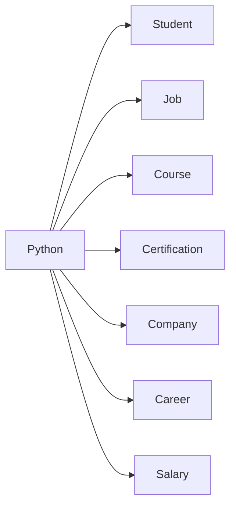
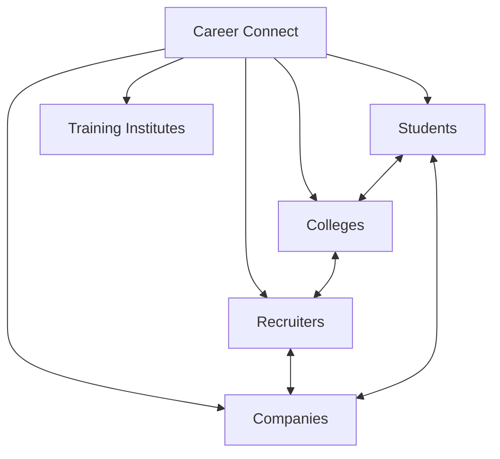
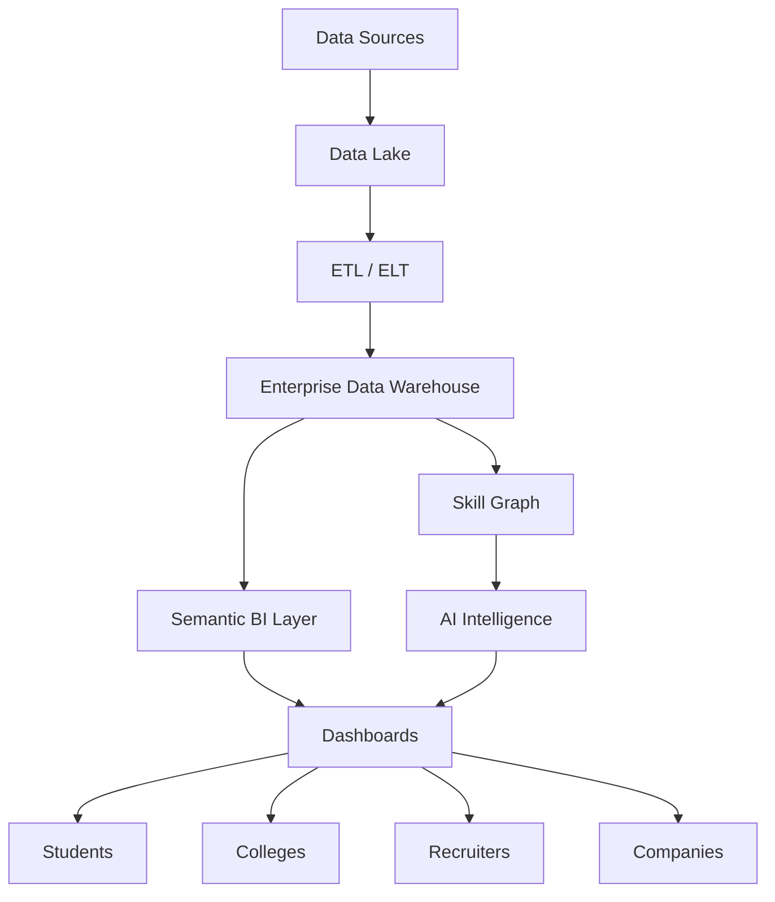

# 05 — SWOT Analysis

# Career Connect — AI Career Intelligence Platform

**Document Type:** Strategic SWOT Analysis
**Project:** Career Connect
**Version:** 1.0
**Status:** Strategic Planning Baseline
**Research Date:** July 2026
**Market Scope:** India + Global
**Product Category:** AI Career Intelligence / Talent Intelligence / Workforce Analytics / SaaS

---

# 1. Executive Summary

SWOT analysis evaluates Career Connect across four strategic dimensions:

```text
INTERNAL
 ├── Strengths
 └── Weaknesses

EXTERNAL
 ├── Opportunities
 └── Threats
```

Career Connect's strongest internal advantage is its proposed **cross-domain architecture**.

Instead of focusing on a single workflow such as job search, learning, recruiting, or placement reporting, the platform connects:

```text
Education
+
Skills
+
Learning
+
Jobs
+
Companies
+
Salary
+
Applications
+
Interviews
+
Placements
+
Hiring
+
AI
+
Business Intelligence
```

Its strongest external opportunity comes from a labor market where technological change and skill requirements are accelerating. The World Economic Forum's _Future of Jobs Report 2025_ says nearly 40% of job skills are expected to change by 2030 and that skills gaps remain a major barrier to business transformation; AI, big data, and cybersecurity are among the technology skill areas expected to grow rapidly.

AI adoption also creates a strong timing opportunity. EY's 2025 India workforce research reports that 88% of surveyed employees in India use GenAI at work and 37% use it daily.

At the same time, the biggest threats are substantial:

- Large incumbents already own users and distribution.
- AI features can be copied.
- Data access and licensing can be difficult.
- Incorrect recommendations can damage trust.
- Privacy and security requirements are significant.
- Building a cross-domain platform creates substantial technical complexity.

Therefore, Career Connect should compete through **data architecture, institutional workflows, skill intelligence, outcome data, and domain-specific AI**, rather than attempting to beat established platforms purely through feature count.

---

# 2. SWOT Framework

```mermaid id="gz9r5a"
flowchart TD

A[Career Connect SWOT]

A --> B[Strengths]
A --> C[Weaknesses]
A --> D[Opportunities]
A --> E[Threats]

B --> B1[Unified Data Model]
B --> B2[AI + BI Integration]
B --> B3[Multi-Stakeholder Platform]
B --> B4[Cloud-Native Architecture]
B --> B5[Skill Intelligence]

C --> C1[High Complexity]
C --> C2[Data Dependency]
C --> C3[Limited Initial Distribution]
C --> C4[AI Accuracy Risk]
C --> C5[Large Development Scope]

D --> D1[AI Workforce Transformation]
D --> D2[Skills-Based Hiring]
D --> D3[College Analytics]
D --> D4[Recruiter Intelligence]
D --> D5[Global Expansion]

E --> E1[Large Incumbents]
E --> E2[Data Licensing]
E --> E3[Privacy Risks]
E --> E4[AI Commoditization]
E --> E5[Rapid Technology Change]
```



---

# 3. Strengths

# S1 — Unified Career Intelligence Architecture

The most important architectural strength is the decision to connect multiple domains into one platform.

Traditional systems usually optimize individual workflows.

Career Connect is designed around the relationship:

```text
Student
↓
Skills
↓
Career
↓
Learning
↓
Jobs
↓
Applications
↓
Interviews
↓
Placement / Hiring
↓
Salary
↓
Career Outcomes
```

This creates analytical relationships that are difficult to obtain from isolated systems.

### Strategic Value

A common data model can support multiple products without creating separate data silos.

```text
One Data Platform
        ↓
One Intelligence Layer
        ↓
Multiple Experiences
```

This is a major architectural strength.

---

# S2 — Combination of AI and Business Intelligence

Many products emphasize either:

- AI
- Analytics
- Learning
- Recruiting
- Job search

Career Connect intentionally combines:

```text
AI
+
BI
+
Data Engineering
+
Data Warehouse
```

This creates two complementary intelligence layers.

### AI

Answers:

> “What should I do?”

### BI

Answers:

> “What is happening?”

### Data Warehouse

Answers:

> “What happened historically?”

### Data Engineering

Answers:

> “Can we trust and continuously process the data?”

Together:

```text
History
+
Current State
+
Patterns
+
AI Reasoning
=
Decision Intelligence
```

---

# S3 — Strong Skill-Centric Product Model

The platform should treat the **skill** as a core analytical entity.

A single skill can connect to:

```text
Student
Job
Career
Company
Course
Certification
Salary
Interview
Placement
```

For example:



This makes the skill graph reusable across multiple product features.

### Strategic Value

The same skill infrastructure can support:

- Skill-gap analysis
- Job matching
- Career recommendations
- Course recommendations
- Salary analysis
- Hiring trends
- Workforce planning

---

# S4 — Multi-Stakeholder Architecture

Career Connect is not restricted to one user type.

It can support:

```text
Students
Graduates
Job Seekers
Colleges
Placement Officers
Recruiters
Companies
Training Institutes
Administrators
```

This creates the possibility of a connected ecosystem.



The platform can therefore develop both B2C and B2B value.

---

# S5 — Enterprise Data Warehouse Foundation

The explicit use of:

- Fact tables
- Dimension tables
- Star schemas
- Snowflake schemas
- Slowly Changing Dimensions
- Surrogate keys
- Data marts

gives the project a strong analytical architecture.

Instead of building dashboards directly on transactional tables, the system can use:

```text
Operational Database
        ↓
Data Lake
        ↓
ETL / ELT
        ↓
Enterprise Warehouse
        ↓
Semantic Layer
        ↓
Data Marts
        ↓
BI
```

This is a major technical differentiator for a final-year project and a strong portfolio signal.

---

# S6 — Cloud-Native Design

The proposed architecture is designed around cloud-native components:

- Managed database
- Object storage
- Cloud warehouse
- Containerization
- Server deployment
- CI/CD
- API services
- AI services

This enables the project to demonstrate more than local application development.

The architecture can evolve from:

```text
College Demo
```

to:

```text
Cloud SaaS
```

without fundamentally changing the product concept.

---

# S7 — Modular Architecture

The proposed separation into:

```text
frontend/
backend/
ai/
etl/
warehouse/
dashboard/
database/
services/
packages/
```

creates clear domain boundaries.

This supports:

- Independent development
- Testing
- Deployment
- Scaling
- Replacement of individual technologies

For example, an AI provider can be changed without redesigning the entire application if the AI service is abstracted correctly.

---

# S8 — Strong BI Potential

Career Connect has a naturally high number of analytical dimensions.

For example:

```text
Time
Location
College
Department
Company
Job Role
Skill
Technology
Experience
Employment Type
Salary
Recruiter
```

This allows sophisticated analysis such as:

```text
Average Salary
by Role
by City
by Experience
by Year
by Technology
```

The same warehouse can power multiple dashboards.

---

# S9 — High AI Surface Area

The product can support multiple AI modules:

```text
Resume AI
Skill Extraction
Skill Gap AI
Career Recommendation
Learning Recommendation
Mock Interview
Interview Feedback
Career Chat
Job Matching
```

This gives the platform significant scope for demonstrating:

- NLP
- Semantic matching
- Embeddings
- Retrieval-Augmented Generation
- Recommendation logic
- Generative AI
- Predictive modeling

The design should nevertheless avoid treating every AI feature as mandatory for the first release.

---

# S10 — Strong Academic Breadth

From an academic perspective, the project demonstrates multiple areas in a single system:

```text
Cloud Computing
+
DBMS
+
Data Warehousing
+
ETL
+
Business Intelligence
+
AI
+
Machine Learning
+
Web Development
+
Cybersecurity
+
DevOps
```

This makes the project highly suitable for a multidisciplinary final-year BE CSE submission.

---

# 4. Weaknesses

# W1 — High Technical Complexity

The largest weakness is the breadth of the system.

The platform combines:

```text
Frontend
+
Backend
+
Database
+
ETL
+
Warehouse
+
BI
+
AI
+
Cloud
+
DevOps
+
Security
```

Each individual domain can become a complete project.

Therefore, attempting to implement every proposed feature at production depth simultaneously creates a major delivery risk.

### Mitigation

Use a layered delivery strategy:

```text
MVP
↓
Core Platform
↓
Analytics
↓
AI
↓
Enterprise Features
```

---

# W2 — Large Scope Creates Schedule Risk

The full vision contains dozens of features.

For a college project, uncontrolled scope expansion can result in:

- Incomplete features
- Poor testing
- Weak documentation
- Unstable deployment
- Superficial AI
- Incomplete dashboards

### Mitigation

Prioritize based on the architecture rather than feature count.

A smaller working system with:

```text
Real ETL
+
Real Warehouse
+
Real BI
+
Real AI
```

is strategically stronger than a large application with many incomplete screens.

---

# W3 — Data Availability Dependency

The product depends heavily on career-related data.

The required domains include:

- Jobs
- Salaries
- Companies
- Skills
- Placements
- Applications
- Interviews
- Learning
- Certifications

Obtaining consistent, legal, high-quality external data can become a major challenge.

### Mitigation

Use multiple source classes:

```text
Institution Data
+
Open/Public Data
+
Licensed APIs
+
Synthetic Data
+
User-Generated Data
```

For the academic version, synthetic data can be used for demonstrating the warehouse and analytics architecture where real data cannot legally or technically be obtained.

---

# W4 — Data Quality Complexity

Career information contains inconsistent terminology.

Examples:

```text
React
React.js
ReactJS
React JS
```

or:

```text
Bangalore
Bengaluru
Bangalore Urban
```

or:

```text
Software Engineer
Software Developer
Application Developer
```

Without a canonical taxonomy, analytics can become misleading.

### Mitigation

Implement:

- Master dimensions
- Canonical IDs
- Mapping tables
- Standardized taxonomies
- Data-quality rules
- Data lineage

---

# W5 — AI Accuracy Risk

AI-generated recommendations may be:

- Incorrect
- Outdated
- Overconfident
- Biased
- Insufficiently contextual

This is particularly important for career recommendations because users may make consequential decisions based on the output.

### Mitigation

Implement:

```text
AI Recommendation
+
Evidence
+
Confidence
+
Explanation
+
User Confirmation
```

The platform should distinguish:

> “The data indicates…”

from:

> “The AI recommends…”

This helps maintain transparency.

---

# W6 — Dependence on External AI Providers

The proposed system may use OpenAI, Gemini, Claude, or equivalent services.

This introduces:

- API dependency
- Cost dependency
- Availability dependency
- Model behavior changes
- Rate limits
- Vendor policy changes

### Mitigation

Create:

```text
AI Provider Interface
```

with multiple adapters.

Conceptually:

```text
AI Service
   |
   +-- OpenAI Adapter
   +-- Gemini Adapter
   +-- Claude Adapter
   +-- Local Model Adapter
```

This creates provider flexibility.

---

# W7 — Limited Initial Distribution

Established platforms have enormous user bases and distribution networks.

Career Connect starts with:

```text
No large network
No historical user base
No large recruiter base
No established brand
```

This is a significant commercial weakness.

### Mitigation

Use institutional distribution:

```text
College
↓
Placement Department
↓
Students
↓
Recruiters
```

This creates a narrower but more accessible entry point.

---

# W8 — High Infrastructure Cost at Scale

The combination of:

- Cloud storage
- Data warehouse
- AI APIs
- ETL
- Logging
- Monitoring
- Containers

can produce significant operating costs as usage grows.

### Mitigation

Implement:

- Cost budgets
- Query optimization
- Data partitioning
- Caching
- Usage limits
- AI model routing
- Batch processing
- Data retention policies

---

# W9 — Complex UX Risk

The product serves multiple stakeholder types.

A student needs a very different interface from a recruiter or CEO.

If the platform attempts to place every feature into one dashboard, the experience may become overwhelming.

### Mitigation

Use role-based workspaces:

```text
Student Workspace
College Workspace
Recruiter Workspace
Executive Workspace
Admin Workspace
```

All workspaces can share the same data platform while presenting different experiences.

---

# 5. Opportunities

# O1 — Rapid Skills Transformation

The World Economic Forum reports that nearly 40% of job skills are expected to change by 2030 and identifies skills gaps as a major barrier to business transformation. It also highlights AI, big data, networks, and cybersecurity among rapidly growing technology skill areas.

This directly supports Career Connect's core strategy.

The platform can turn skill transformation into:

```text
Skill Monitoring
↓
Skill Gap Detection
↓
Learning Recommendation
↓
Career Recommendation
```

---

# O2 — Accelerating AI Adoption

EY's 2025 India workforce research reports that 88% of surveyed Indian employees use GenAI at work and 37% report daily use.

This indicates that AI-powered career workflows are increasingly aligned with workplace behavior.

Career Connect can use AI for:

- Career coaching
- Resume review
- Interview preparation
- Skill recommendations
- Market analysis
- Natural-language analytics

---

# O3 — India's AI Talent and Skilling Ecosystem

The Indian government has been actively expanding AI talent development through the IndiaAI Mission and related workforce initiatives. A December 2025 government release described an ecosystem involving government, educational institutions, and industry to expand AI skills.

This creates favorable strategic conditions for a platform focused on:

```text
AI
+
Skills
+
Education
+
Employability
```

---

# O4 — AI-Driven Productivity and Job Transformation

EY's India research estimates that GenAI could materially change productivity and task composition across Indian workforces, reinforcing the importance of workforce reskilling and role adaptation.

This creates a longer-term opportunity for Career Connect to evolve from:

**Student Career Platform**

into:

**Workforce Intelligence Platform**

---

# O5 — College Placement Intelligence

One of the strongest opportunities is institutional analytics.

Many educational institutions generate substantial amounts of placement data.

Career Connect can transform:

```text
Placement Spreadsheet
```

into:

```text
Institutional Data Warehouse
↓
Placement Data Mart
↓
Executive Dashboard
↓
Skill Intelligence
↓
Recruiter Intelligence
```

Potential customers:

- Engineering colleges
- Universities
- Autonomous colleges
- Training institutes

---

# O6 — Recruiter Intelligence

Recruiters can use aggregated insights about:

- Talent pools
- Skills
- Colleges
- Locations
- Salaries
- Applications
- Interviews
- Hiring conversion

This creates a potentially monetizable B2B product.

---

# O7 — Skill-Based Hiring

As organizations increasingly focus on skills rather than only traditional credentials, the Career Connect skill graph becomes strategically valuable.

The product could calculate:

```text
Candidate Skill Vector
        vs
Job Skill Vector
        ↓
Match Score
```

This creates a foundation for:

- Job matching
- Candidate matching
- Learning recommendations
- Internal mobility

---

# O8 — Career Mobility

LinkedIn's Work Change research highlights continued transformation in jobs, talent, and skills as AI changes work.

Career Connect can eventually support:

```text
Career Entry
↓
Career Growth
↓
Career Transition
↓
Reskilling
↓
Internal Mobility
```

This increases lifetime customer value.

---

# O9 — AI Career Copilot

A major product opportunity is a context-aware AI assistant.

Instead of:

> “Ask me anything.”

the assistant should know:

```text
User Profile
+
Skills
+
Target Career
+
Learning Progress
+
Applications
+
Relevant Market Data
```

The assistant can then help users navigate the full career journey.

---

# O10 — Natural-Language BI

A high-value future feature is:

> “Show me the top five skills associated with Data Engineer jobs in Bengaluru this year.”

The system can translate:

```text
Natural Language
↓
Semantic Query
↓
Warehouse
↓
Metric Engine
↓
Visualization
```

This would combine AI with BI in a particularly strong way.

---

# O11 — Predictive Analytics

Once historical data becomes sufficiently rich, Career Connect can explore:

- Placement probability
- Job demand forecasts
- Skill-demand forecasts
- Salary forecasts
- Hiring trends
- Attrition risk
- Career-transition patterns

Predictive models must be validated carefully and should not be presented as guaranteed outcomes.

---

# O12 — Enterprise Workforce Intelligence

Long term, organizations could use the same platform for:

```text
Current Skills
+
Future Skills
+
Hiring
+
Reskilling
+
Internal Mobility
+
Workforce Planning
```

This could transform Career Connect from a student-focused product into a broader workforce intelligence platform.

---

# O13 — International Expansion

The architecture can support expansion beyond India.

Potential regions:

```text
India
↓
Southeast Asia
↓
Middle East
↓
Europe
↓
North America
```

The main localization requirements would be:

- Labor-market data
- Currency
- Education standards
- Taxonomies
- Employment rules
- Language
- Salary conventions

---

# 6. Threats

# T1 — Large Incumbents

Companies such as LinkedIn, Indeed, and other established career platforms have significant distribution, data, brand recognition, and hiring relationships.

This creates a substantial competitive threat.

### Response

Do not compete directly on:

```text
Number of Users
Number of Jobs
Professional Network Size
Brand Recognition
```

Instead compete through:

```text
Domain Intelligence
Institutional Analytics
Skill Graph
Outcome Data
AI + BI
```

---

# T2 — Feature Commoditization by AI

Resume analysis, chatbots, recommendation systems, and AI assistants can increasingly be implemented using widely available models and tooling.

Therefore:

> **AI itself is not a sustainable moat.**

### Response

Build the moat around:

```text
Data
+
Workflows
+
Outcome History
+
Institutional Relationships
+
Skill Graph
+
Domain-Specific Metrics
```

---

# T3 — Data Licensing and Legal Constraints

Career data may be subject to:

- Copyright
- Terms of service
- API restrictions
- Privacy regulations
- Licensing agreements

Uncontrolled web scraping can create legal and operational risk.

### Response

Use:

- Licensed sources
- Authorized APIs
- Public datasets where permitted
- Institutional data
- User-generated data
- Synthetic datasets for demos

The production architecture should treat data provenance and licensing as first-class metadata.

---

# T4 — Privacy and Security Risk

Career data can contain:

- Resumes
- Education history
- Employment history
- Contact details
- Applications
- Interview information
- Salary information

A major breach could severely damage trust.

### Response

Implement:

```text
Authentication
+
RBAC
+
Encryption
+
Audit Logs
+
Data Minimization
+
Tenant Isolation
+
Secure APIs
+
Monitoring
```

---

# T5 — Algorithmic Bias

Career recommendations can unintentionally reinforce existing inequalities.

For example, historical hiring data may encode:

- Institutional bias
- Geographic bias
- Gender disparities
- Experience bias

A recommendation engine trained directly on such data could reproduce these patterns.

### Response

Implement:

- Bias evaluation
- Explainability
- Human review
- Fairness metrics
- Feature governance
- Model monitoring

Historical outcomes should not automatically be treated as ideal outcomes.

---

# T6 — Rapid Technology Change

AI models, cloud services, data platforms, and developer frameworks can change rapidly.

### Response

Use abstraction:

```text
Frontend
↓
API Layer
↓
Service Layer
↓
Provider Abstraction
↓
Infrastructure
```

This reduces lock-in.

---

# T7 — Cloud Vendor Lock-In

If the system becomes deeply dependent on one cloud platform, migration may become expensive.

### Response

Use:

- Docker
- Portable SQL
- Object-storage abstraction
- Service interfaces
- Infrastructure-as-code
- Containerized workloads

The selected warehouse may still use vendor-specific features where they deliver meaningful value.

---

# T8 — User Trust Risk

Career decisions are personal and high-impact.

A user may ask:

> “Should I become a Data Engineer?”

If the system gives poor advice, trust decreases.

### Response

Recommendations should communicate:

```text
Recommendation
+
Reason
+
Evidence
+
Confidence
+
Alternative Options
```

The system should support informed decisions rather than claim perfect career prediction.

---

# T9 — Cold Start Problem

A new platform does not initially have enough historical outcomes for strong recommendations.

### Response

Use a staged intelligence model:

```text
Stage 1
Rules + Curated Knowledge

Stage 2
Statistics + Market Data

Stage 3
Historical Outcome Modeling

Stage 4
Personalized Predictive Models
```

This allows the product to become smarter over time.

---

# 7. SWOT Matrix

|              | **Positive**                   | **Negative**                  |
| ------------ | ------------------------------ | ----------------------------- |
| **Internal** | **Strengths**                  | **Weaknesses**                |
|              | Unified career data model      | High technical complexity     |
|              | AI + BI integration            | Large implementation scope    |
|              | Skill graph                    | Data dependency               |
|              | Multi-stakeholder design       | AI accuracy challenges        |
|              | Cloud-native architecture      | Limited initial distribution  |
|              | Enterprise warehouse           | Potential infrastructure cost |
|              | Strong academic breadth        | Complex UX                    |
| **External** | **Opportunities**              | **Threats**                   |
|              | AI workforce transformation    | Large incumbents              |
|              | Skills-based hiring            | AI commoditization            |
|              | India AI-skilling growth       | Data licensing constraints    |
|              | College placement intelligence | Privacy/security risks        |
|              | Recruiter intelligence         | Algorithmic bias              |
|              | Workforce analytics            | Technology volatility         |
|              | Natural-language BI            | Vendor lock-in                |
|              | Global expansion               | User trust / cold start       |

---

# 8. SO Strategy

## Strengths + Opportunities

SO strategies use internal strengths to exploit external opportunities.

### SO1 — Build a Skill Intelligence Platform

Use:

```text
Skill Graph
+
Warehouse
+
AI
```

to capitalize on increasing skill transformation.

---

### SO2 — Make Colleges the Initial Distribution Channel

Use the multi-stakeholder architecture to enter through:

```text
College
↓
Placement Officer
↓
Students
↓
Recruiters
```

---

### SO3 — Create AI-Powered Career Intelligence

Combine:

```text
User Data
+
Market Data
+
Skill Data
+
AI
```

to produce personalized recommendations.

---

### SO4 — Develop Workforce Intelligence

Use the same warehouse to eventually provide:

```text
Recruitment
+
Reskilling
+
Internal Mobility
+
Workforce Planning
```

for enterprises.

---

# 9. WO Strategy

## Weaknesses + Opportunities

WO strategies use external opportunities to reduce weaknesses.

### WO1 — Start Narrow

Instead of implementing all planned features immediately:

```text
MVP
=
College Placement BI
+
Student Skill Intelligence
+
Resume AI
```

This reduces implementation risk while validating the core market.

---

### WO2 — Use Synthetic Data Initially

Use synthetic datasets to build:

- ETL
- Warehouse
- Dashboards
- AI prototypes

Then progressively introduce real partner data.

---

### WO3 — Use AI Provider Abstraction

A provider-neutral AI layer reduces dependency on one model vendor.

---

### WO4 — Build Institutional Partnerships

Partner institutions can provide legitimate domain data and real validation opportunities.

This addresses the cold-start and data-quality problems simultaneously.

---

# 10. ST Strategy

## Strengths + Threats

ST strategies use internal strengths to defend against threats.

### ST1 — Compete Through Data Architecture

Large platforms can copy UI features.

The stronger defense is:

```text
Historical Data
+
Skill Graph
+
Outcome Data
+
Institutional Workflow
```

---

### ST2 — Build Domain-Specific AI

Avoid a generic chatbot.

Build:

```text
Career AI
Placement AI
Recruiter AI
Workforce AI
```

using the platform's domain context.

---

### ST3 — Own the Institutional Workflow

If Career Connect becomes deeply integrated into:

- Placement processes
- Student readiness
- Recruiter workflows
- Reporting

switching costs can increase.

This is a strategic hypothesis, not a guaranteed moat.

---

# 11. WT Strategy

## Weaknesses + Threats

WT strategies reduce internal weaknesses while avoiding external threats.

### WT1 — Do Not Become a General Job Board

This avoids direct competition with large job marketplaces.

---

### WT2 — Avoid Unsupported AI Predictions

Do not claim:

> “This career will guarantee you a job.”

Instead:

> “Based on the analyzed data, these roles have stronger alignment with your current profile.”

---

### WT3 — Control Data Exposure

Every external dataset should have:

```text
Source
License
Refresh Date
Transformation History
Quality Score
```

---

### WT4 — Prioritize Security Early

Security should not be a final-stage feature.

Implement security alongside the first production architecture.

---

# 12. Strategic SWOT Prioritization

Not all SWOT items are equally important.

The top strategic factors are:

| Priority | Factor                           | Impact    |
| -------- | -------------------------------- | --------- |
| 1        | Unified data model               | Very High |
| 2        | Skill intelligence               | Very High |
| 3        | AI + BI integration              | Very High |
| 4        | Data availability                | Very High |
| 5        | Incumbent competition            | Very High |
| 6        | Institutional distribution       | High      |
| 7        | Privacy/security                 | Very High |
| 8        | AI accuracy                      | High      |
| 9        | Technical complexity             | High      |
| 10       | Workforce intelligence expansion | High      |

---

# 13. Strategic Core

The SWOT analysis reveals that Career Connect should be built around four strategic assets:

```text
1. DATA
     ↓
2. SKILL GRAPH
     ↓
3. INTELLIGENCE
     ↓
4. WORKFLOWS
```

These four components are more important than simply increasing the number of UI features.

---

# 14. Recommended Strategic Architecture

The SWOT analysis supports the following architecture:



This architecture addresses the main opportunity while reducing dependence on any single feature.

---

# 15. Strategic Moat

The SWOT analysis indicates that the strongest potential moat is not technology alone.

The moat should develop as:

```text
Data
↓
Relationships
↓
Historical Outcomes
↓
Skill Graph
↓
Domain Intelligence
↓
AI Personalization
↓
Workflow Integration
```

This is a compounding advantage model.

The more valid historical outcome data the platform obtains, the better its analytical and recommendation capabilities may become, subject to data quality and model validation.

---

# 16. SWOT-Based Product Priorities

## Priority 1 — Data Foundation

Build:

- Source ingestion
- Data quality
- Data lake
- ETL
- Warehouse
- Data marts

---

## Priority 2 — Skill Intelligence

Build:

- Skill taxonomy
- Skill normalization
- Skill graph
- Skill-demand analytics
- Skill-gap scoring

---

## Priority 3 — Institutional BI

Build:

- Placement dashboard
- Student readiness
- Salary analytics
- Company analytics
- Department analytics

---

## Priority 4 — AI Career Layer

Build:

- Resume AI
- Career recommendations
- Skill-gap explanation
- Learning roadmap
- Career assistant

---

## Priority 5 — Recruiter Intelligence

Build:

- Candidate matching
- Talent analytics
- Hiring funnel
- Institution analytics

---

# 17. What the SWOT Says About the MVP

The SWOT analysis strongly suggests that the MVP should **not** attempt to launch every capability in the original product vision.

Recommended MVP:

```text
                         MVP
                          │
           ┌──────────────┼──────────────┐
           ↓              ↓              ↓
     Data Platform     College BI     Student AI
           │              │              │
        ETL + DW       Placement      Resume +
                        Analytics      Skill Gap
```

This preserves the product's core architectural thesis while controlling implementation complexity.

---

# 18. What Should Be Deferred

The following should be considered later-stage capabilities:

- Global workforce benchmarking
- Advanced predictive career forecasting
- Enterprise workforce planning
- Billing infrastructure
- Large-scale recruiter marketplace
- Full external course marketplace
- Multinational labor-market expansion
- Advanced autonomous AI agents

They remain part of the long-term roadmap, but should not compromise the core platform.

---

# 19. SWOT-Derived Success Conditions

Career Connect is most likely to succeed if it achieves these conditions:

### Condition 1

Data quality is high enough for users to trust analytics.

### Condition 2

AI recommendations are explainable and demonstrably useful.

### Condition 3

The student experience is simple despite backend complexity.

### Condition 4

College workflows save meaningful administrative effort.

### Condition 5

Recruiters receive measurable value from talent intelligence.

### Condition 6

The platform builds reusable data assets rather than isolated features.

### Condition 7

Security and privacy are designed from the beginning.

---

# 20. Strategic Failure Conditions

The project is at risk if it becomes:

```text
Beautiful UI
+
Generic Chatbot
+
Fake Dashboard Data
+
No Real ETL
+
No Real Warehouse
+
No Measurable Outcomes
```

That would undermine the central product vision.

A stronger demonstration is:

```text
Realistic Data
+
Real ETL
+
Data Quality
+
Warehouse
+
Analytical Models
+
BI
+
Contextual AI
```

even with a smaller number of visible features.

---

# 21. SWOT Conclusion

Career Connect has a strong conceptual position because it sits at the intersection of several structural trends:

```text
AI Adoption
+
Skill Transformation
+
Continuous Learning
+
Digital Recruitment
+
Data Explosion
+
Workforce Analytics
```

The external environment is favorable to skill intelligence and AI-enabled workforce tools. The World Economic Forum reports significant expected changes in job skills and strong growth in AI- and data-related skill demand. LinkedIn's research highlights AI-driven changes in work, jobs, and skills, while EY's India research shows substantial workplace GenAI adoption.

However, these opportunities exist alongside serious threats:

- Powerful incumbents
- Data constraints
- Privacy requirements
- AI reliability challenges
- Rapid technological change

Therefore, the recommended strategic direction is:

> **Start narrow, build the data foundation correctly, own the skill-intelligence layer, prove measurable institutional and student value, and expand toward recruiter and workforce intelligence.**

---

# 22. Final SWOT Statement

> **Career Connect's greatest strength is its ability to connect career data, skill intelligence, AI, data warehousing, and business intelligence into one platform. Its greatest weakness is the complexity of delivering that vision. Its greatest opportunity is the rapid transformation of jobs and skills driven by AI and technology. Its greatest threat is competition from large platforms with strong distribution, data, and brand advantages.**

---

# 23. CTO-Level Strategic Decision

Based on this SWOT analysis, the recommended strategic decision is:

```text
DO NOT BUILD:
Another Job Portal

DO NOT BUILD:
Another Generic AI Chatbot

DO NOT BUILD:
Another Dashboard Application


BUILD:

A Career Intelligence Data Platform
             +
AI Intelligence Layer
             +
Institutional BI
             +
Skill Graph
             +
Recruiter Intelligence
```

The central product asset should therefore be:

> **A trusted career intelligence data ecosystem that converts fragmented career information into measurable, explainable, and actionable intelligence.**

---

## Document Status

| Attribute            | Value                                    |
| -------------------- | ---------------------------------------- |
| Project              | Career Connect                           |
| Document             | SWOT Analysis                            |
| Version              | 1.0                                      |
| Research Date        | July 2026                                |
| Primary Strength     | Unified Career Intelligence Architecture |
| Primary Weakness     | Technical and Data Complexity            |
| Primary Opportunity  | AI + Skill Transformation                |
| Primary Threat       | Established Platform Competition         |
| Recommended Wedge    | College Placement + Student Intelligence |
| Core Strategic Asset | Data + Skill Graph + Outcomes            |
| Strategic Direction  | Data Platform → Intelligence → SaaS      |
| Status               | Strategic Planning Baseline              |
