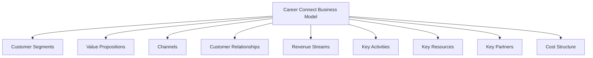
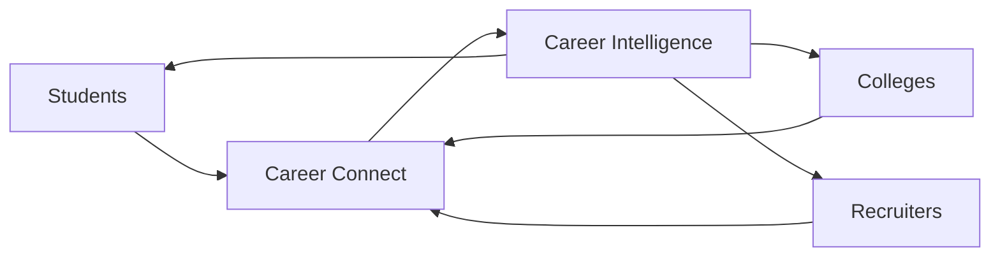
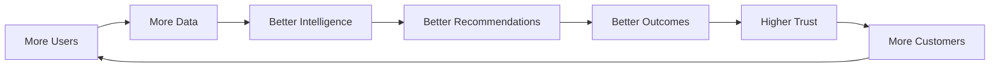
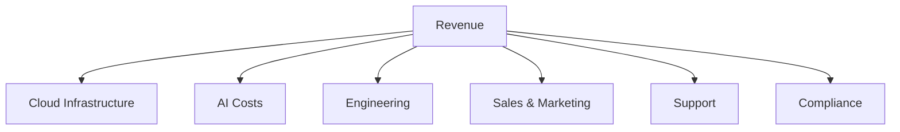
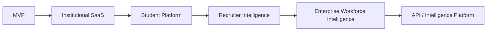
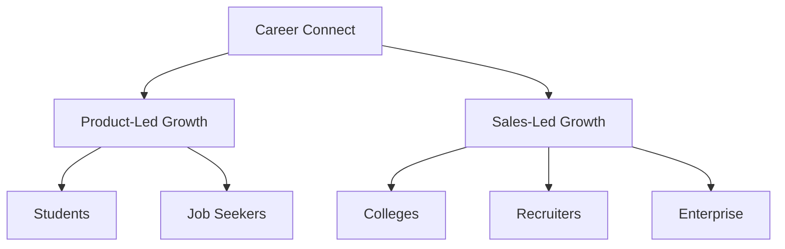
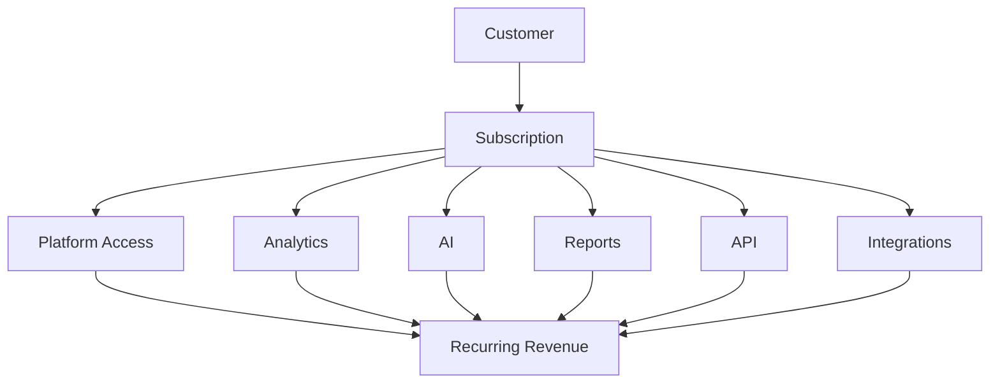

# 06 — Business Model

# Career Connect — AI Career Intelligence Platform

**Document Type:** Business Model Document
**Project:** Career Connect
**Version:** 1.0
**Status:** Strategic Business Model Baseline
**Business Type:** SaaS / B2B / B2C / B2B2C
**Initial Market:** India
**Long-Term Market:** Global

---

# 1. Executive Summary

Career Connect is designed as a **multi-sided AI Career Intelligence SaaS platform**.

The business model connects four primary stakeholder groups:

```text
Students / Job Seekers
          ↕
     Career Connect
          ↕
Colleges / Institutions
          ↕
Recruiters / Companies
```

The platform creates value by transforming fragmented career and workforce data into:

- Career intelligence
- Skill intelligence
- Placement intelligence
- Recruitment intelligence
- Salary intelligence
- Learning intelligence
- Business intelligence
- AI-powered recommendations

The recommended commercial strategy is **not** to rely on a single revenue stream.

Instead, Career Connect should use a layered model:

```text
Free Users
    ↓
Premium Users
    ↓
Institutional SaaS
    ↓
Recruiter SaaS
    ↓
Enterprise Intelligence
    ↓
API / Data Products
```

This allows the platform to begin with a relatively accessible student experience while building higher-value recurring B2B revenue.

---

# 2. Business Model Vision

The long-term business vision is:

> **Build a career intelligence infrastructure company that monetizes intelligence, analytics, workflows, and AI across individuals, institutions, recruiters, and enterprises.**

The business should therefore be treated as a **data and intelligence platform**, not merely a job marketplace.

---

# 3. Business Model Canvas

The Career Connect Business Model Canvas is:



---

# 4. Customer Segments

Career Connect should serve multiple customer segments, but they should not all be prioritized equally during the initial launch.

---

## 4.1 Segment A — Students

Target users:

- Engineering students
- Computer science students
- IT students
- Final-year students
- Graduates
- Freshers

Primary needs:

```text
Career Guidance
+
Resume Improvement
+
Skill Gap
+
Learning Roadmap
+
Job Discovery
+
Interview Preparation
```

### Business Role

Students are primarily a **user acquisition and engagement segment**.

They may not be the highest-value direct revenue segment initially, but they create the user base that attracts institutions and recruiters.

---

# 5. Segment B — Job Seekers

Target users:

- Fresh graduates
- Early-career professionals
- Career switchers
- Upskilling professionals

Primary needs:

- Career transitions
- Skill analysis
- Job matching
- Salary intelligence
- Learning recommendations
- AI career coaching

### Business Role

This segment can support:

- Premium subscriptions
- AI usage
- Career reports
- Advanced analytics

---

# 6. Segment C — Colleges and Universities

This should be the primary B2B beachhead.

Potential customers:

- Engineering colleges
- Universities
- Autonomous colleges
- Degree institutions
- Placement departments
- Career development centers

Primary needs:

```text
Placement Analytics
+
Student Readiness
+
Skill Gap Analysis
+
Company Hiring Analytics
+
Salary Analytics
+
Executive Reporting
```

### Business Role

This segment can provide:

> **Recurring institutional SaaS revenue**

and potentially become an important distribution channel for students.

---

# 7. Segment D — Placement Officers

Placement officers are a specialized institutional persona.

Their requirements include:

- Placement dashboards
- Student filtering
- Company management
- Hiring reports
- Placement funnel analytics
- Salary analysis
- Department comparisons

### Business Role

Placement officers can become the primary operational champions inside colleges.

The product strategy should therefore optimize for:

> **“Reduce placement reporting effort while increasing placement intelligence.”**

---

# 8. Segment E — Recruiters

Recruiters need:

- Candidate discovery
- Skill matching
- Talent pools
- College intelligence
- Hiring analytics
- Funnel analytics
- Salary intelligence

### Business Role

Recruiters represent a high-value SaaS/customer segment because hiring organizations have direct economic value from better talent acquisition.

Potential pricing model:

```text id="g0nhj6"
Recruiter Seat
+
Hiring Usage
+
Analytics
+
Premium Intelligence
```

---

# 9. Segment F — Companies

Companies can use Career Connect for:

- Hiring intelligence
- Skill demand
- Workforce planning
- Salary intelligence
- Talent supply
- Reskilling
- Internal mobility

This becomes a longer-term enterprise market.

---

# 10. Segment G — Training Institutes

Training providers can use the platform to identify:

- Skill demand
- Course demand
- Emerging technologies
- Job-role requirements
- Certification trends
- Employment outcomes

This opens a potential B2B2C model.

---

# 11. Segment Prioritization

Not every segment should be pursued simultaneously.

Recommended sequence:

```text
Priority 1
Colleges + Placement Departments

Priority 2
Students + Graduates

Priority 3
Recruiters

Priority 4
Companies

Priority 5
Training Institutes

Priority 6
Enterprise Workforce Intelligence
```

This is designed to keep the initial go-to-market focused.

---

# 12. Core Value Proposition

The central value proposition is:

> **Career Connect transforms fragmented career, skill, placement, salary, learning, and recruitment data into actionable intelligence through AI, analytics, and cloud-based data infrastructure.**

---

# 13. Value Proposition for Students

Career Connect provides:

```text
My Profile
↓
My Skills
↓
My Career Options
↓
My Skill Gap
↓
My Learning Roadmap
↓
My Job Matches
↓
My Interview Preparation
↓
My Career Progress
```

The student experiences the platform as a **personal career intelligence system**.

---

# 14. Value Proposition for Colleges

The institutional value proposition is:

> **Transform placement data into a strategic intelligence system.**

Instead of manually creating:

```text
Excel
+
CSV
+
Reports
+
Charts
```

the institution gets:

```text
Central Data Platform
↓
ETL
↓
Warehouse
↓
Placement Data Mart
↓
BI Dashboards
↓
Executive Intelligence
```

---

# 15. Value Proposition for Recruiters

The recruiter proposition is:

> **Find the right talent faster using skill, location, institution, and hiring intelligence.**

Recruiters should be able to move from:

```text
Job Requirement
↓
Candidate Search
```

to:

```text
Job Requirement
↓
Skill Intelligence
↓
Talent Availability
↓
Candidate Matching
↓
Hiring Analytics
```

---

# 16. Value Proposition for Companies

The enterprise proposition is:

> **Understand the talent market before making workforce decisions.**

For example:

```text
Which skills are growing?
Where is talent available?
What roles are becoming difficult to hire?
How are salary ranges changing?
Where should hiring expand?
```

---

# 17. Business Model Structure

Career Connect should use a **multi-layer monetization structure**.

```text
                         CAREER CONNECT
                               |
       ┌───────────────────────┼───────────────────────┐
       ↓                       ↓                       ↓
     B2C                     B2B                    Enterprise
       |                       |                       |
  Premium Users          Colleges / Recruiters    Companies
       |                       |                       |
Subscription             SaaS Contracts            Enterprise
AI Credits               Analytics                 Intelligence
Reports                  Seats                     API
```

---

# 18. Revenue Stream 1 — Freemium

The free tier should reduce user acquisition friction.

### Free Student Plan

Possible capabilities:

- Basic profile
- Basic skill assessment
- Limited job analytics
- Limited AI interaction
- Basic career suggestions
- Limited resume analysis

The free tier's purpose is:

```text
Acquire
↓
Engage
↓
Demonstrate Value
↓
Convert
```

---

# 19. Revenue Stream 2 — Student Premium

Premium can unlock:

- Advanced Resume AI
- Detailed ATS analysis
- Advanced Skill Gap
- Personalized Learning Roadmap
- Advanced Job Matching
- Salary Intelligence
- Mock Interview AI
- Career Reports
- Higher AI usage

A suitable pricing architecture is:

```text
Free
↓
Premium
↓
Pro
```

Pricing should be validated with actual user research before commercial launch.

---

# 20. Revenue Stream 3 — Institutional SaaS

This is expected to be one of the strongest monetization channels.

### College SaaS

Possible modules:

```text
Student Management
Placement Analytics
Skill Analytics
Company Analytics
Salary Analytics
Executive Dashboard
Reports
```

Pricing can be structured around:

```text
Institution
+
Number of Students
+
Number of Admin Users
+
Modules
+
Data Volume
```

---

# 21. Institutional Pricing Model

Rather than using a single flat price, use tiered institutional plans.

## Starter

Designed for small institutions.

Includes:

- Basic placement dashboard
- Student analytics
- Basic reporting
- Limited administrative users

---

## Professional

Includes:

- Advanced placement analytics
- Skill-gap analytics
- Company analytics
- Salary analytics
- AI-assisted reports
- More users

---

## Enterprise

Includes:

- Advanced data warehouse
- Custom integrations
- Dedicated tenant configuration
- Advanced RBAC
- API access
- Custom dashboards
- Data governance
- Premium support

---

# 22. Revenue Stream 4 — Recruiter SaaS

Recruiters can pay for:

- Candidate search
- Advanced filters
- Skill matching
- Talent intelligence
- Candidate analytics
- Hiring funnel analytics
- College talent intelligence

Possible pricing structure:

```text
Free Recruiter
↓
Professional Recruiter
↓
Enterprise Recruiter
```

---

# 23. Revenue Stream 5 — Hiring Usage

In addition to subscriptions, the platform could eventually support usage-based pricing for selected recruiter capabilities.

Examples:

```text
Candidate Search
API Calls
Advanced Matching
AI Screening
Assessment Volume
```

This allows organizations with highly variable usage to pay according to consumption.

---

# 24. Revenue Stream 6 — Enterprise Workforce Intelligence

This is the long-term high-value product.

Potential capabilities:

- Workforce dashboards
- Skill inventory
- Future-skill planning
- Hiring intelligence
- Internal mobility
- Reskilling analytics
- Compensation intelligence
- Workforce forecasting

Possible pricing structure:

```text id="1m1qac"
Annual Enterprise Contract
+
User Seats
+
Data Volume
+
Analytics Modules
+
API Usage
```

---

# 25. Revenue Stream 7 — Premium AI

AI can be monetized independently or included within premium plans.

Potential units:

```text
AI Resume Analysis
AI Mock Interviews
AI Career Reports
AI Market Reports
AI Executive Insights
AI Career Coach Usage
```

However, the business should avoid creating a confusing “pay-per-message” experience for every basic AI interaction.

The better strategy is to bundle meaningful AI workflows into subscriptions.

---

# 26. Revenue Stream 8 — Reports

Users and organizations can purchase advanced reports.

Examples:

- Career Intelligence Report
- Salary Intelligence Report
- College Placement Report
- Skill Demand Report
- Hiring Trend Report
- Company Talent Report
- Workforce Intelligence Report

Possible delivery:

```text
Interactive Dashboard
+
PDF
+
Excel
+
Scheduled Email
+
API
```

---

# 27. Revenue Stream 9 — API and Data Products

At maturity, the platform can provide domain APIs.

Examples:

```text
Skill API
Career API
Job Intelligence API
Salary API
College Analytics API
Talent Intelligence API
```

Customers could integrate these into:

- HR systems
- College portals
- Learning platforms
- Recruitment systems
- Career applications

The API business can provide higher-margin infrastructure revenue if data licensing and permissions are appropriately structured.

---

# 28. Revenue Stream 10 — Marketplace Opportunities

A future marketplace could connect:

```text
Students
+
Training Providers
+
Career Coaches
+
Employers
```

Possible monetization:

- Platform commission
- Premium listings
- Sponsored placements
- Lead generation

This should remain a later-stage opportunity because marketplace dynamics can significantly increase operational complexity.

---

# 29. Recommended Revenue Mix

A mature Career Connect business could aim for a diversified revenue mix.

Illustrative target:

```text id="2glk7h"
Institutional SaaS        35%
Recruiter SaaS            25%
Enterprise Intelligence   20%
Student Premium           10%
AI / Reports              5%
APIs / Other              5%
```

These percentages are **strategic planning assumptions**, not forecasts or guaranteed outcomes.

The exact mix should be determined after customer validation.

---

# 30. B2C Model

The B2C funnel is:

```text id="7w37xw"
Visitor
↓
Free Account
↓
Profile Completion
↓
Resume Analysis
↓
Career Recommendation
↓
Skill Gap
↓
Premium Conversion
↓
Long-Term Retention
```

The key metric should not simply be sign-ups.

The key question is:

> **Does the product create enough repeated value for users to return?**

---

# 31. B2B College Model

The institutional funnel is:

```text id="ma87mi"
College Outreach
↓
Demo
↓
Pilot
↓
Data Integration
↓
Dashboard Adoption
↓
Annual Contract
↓
Expansion
```

Expansion can occur through:

```text
Placement
↓
Skill Analytics
↓
Student Career AI
↓
Recruiter Intelligence
↓
Institution-Wide Intelligence
```

---

# 32. B2B Recruiter Model

The recruiter funnel:

```text id="54jv7j"
Recruiter Signup
↓
Create Hiring Requirement
↓
Search Talent
↓
Candidate Matching
↓
Interview
↓
Hire
↓
Analytics
↓
Paid Conversion
```

The platform should prove a measurable business outcome such as:

- Faster candidate discovery
- Better match quality
- Higher interview conversion
- Lower recruiting effort

---

# 33. Enterprise Model

The enterprise sales cycle is longer.

```text
Lead
↓
Discovery
↓
Data Assessment
↓
Pilot
↓
Security Review
↓
Integration
↓
Contract
↓
Expansion
```

Enterprise customers may require:

- SSO
- Security reviews
- Data-processing agreements
- Custom integrations
- Dedicated support
- SLAs
- Audit controls

---

# 34. Land-and-Expand Strategy

A particularly suitable strategy is:

> **Land with one use case, expand through adjacent intelligence modules.**

Example:

```text
Land:
Placement Dashboard

Expand:
Skill Gap Analytics

Expand:
Student Career AI

Expand:
Recruiter Intelligence

Expand:
Institutional Workforce Intelligence
```

This increases customer lifetime value without requiring a new customer for every product module.

---

# 35. Two-Sided Network Model

Career Connect can eventually develop two-sided network effects.



More students can create better talent insights.

More recruiters can create more hiring signals.

More institutions can create more placement and skill data.

The actual strength of these network effects must be validated through adoption data.

---

# 36. Data Flywheel as Business Flywheel

The product's potential data flywheel is:



The flywheel only works if data quality, consent, privacy, and model quality remain strong.

---

# 37. Unit Economics Framework

The business should track:

### Customer Acquisition Cost

```text
CAC = Total Sales + Marketing Cost / New Customers
```

### Customer Lifetime Value

```text
LTV = Average Revenue Per Customer × Expected Retention Period × Gross Margin
```

These are simplified planning formulas; the exact finance model should account for churn, expansion, support cost, and cohort behavior.

---

# 38. B2C Unit Economics

Key metrics:

- Customer Acquisition Cost
- Free-to-Paid Conversion
- Monthly Recurring Revenue per User
- Churn
- Retention
- AI Cost per User
- Support Cost per User

The key risk is:

> **AI usage cost may rise faster than subscription revenue.**

Therefore, AI workloads must be architected for cost control.

---

# 39. B2B Unit Economics

Key metrics:

- Average Contract Value
- Sales Cycle
- Customer Acquisition Cost
- Gross Margin
- Net Revenue Retention
- Expansion Revenue
- Churn
- Implementation Cost
- Support Cost

Institutional SaaS can have stronger economics than B2C if implementation and support are standardized.

---

# 40. AI Cost Economics

AI introduces a special cost layer.

Conceptually:

```text id="2kd3j4"
User Request
↓
AI Processing
↓
Token / Compute Cost
↓
Platform Cost
```

Therefore the platform should implement:

- Model routing
- Caching
- Prompt optimization
- Retrieval optimization
- Smaller models for simple tasks
- Larger models only for complex tasks
- Usage quotas

---

# 41. Cost Structure

The main cost categories are:

## Technology

- Cloud hosting
- Database
- Warehouse
- Storage
- CDN
- Monitoring

## AI

- Model APIs
- Embeddings
- Vector search
- AI compute

## Engineering

- Software development
- Data engineering
- ML engineering
- DevOps

## Sales and Marketing

- Customer acquisition
- Institution outreach
- Recruiter acquisition

## Operations

- Support
- Data management
- Compliance
- Customer success

---

# 42. Cost Architecture

The platform cost structure can be modeled as:



The goal is not to minimize every cost.

The objective is:

> **Spend aggressively where the cost creates measurable customer value.**

---

# 43. Freemium Strategy

The free version should be sufficiently useful to create trust.

But it should also create clear reasons to upgrade.

Example:

### Free

```text
Basic Resume Score
Basic Career Suggestions
Basic Job Analytics
Limited AI
```

### Premium

```text
Advanced Resume AI
Advanced Skill Gap
Learning Roadmap
Mock Interview
Salary Intelligence
Unlimited Career Analysis
```

---

# 44. Institution-Led Student Acquisition

A major strategic opportunity is to allow colleges to sponsor student access.

Instead of:

```text
Student → Pay
```

the platform can support:

```text
College → Subscription
        ↓
     Students
```

This B2B2C model reduces individual payment friction.

---

# 45. Example B2B2C Model

```text
College
   |
   | Annual SaaS Contract
   ↓
Career Connect
   |
   +---- Student AI
   |
   +---- Placement Analytics
   |
   +---- Career Dashboard
   |
   +---- Recruiter Analytics
```

The institution pays while students become daily users.

This can create stronger distribution economics than pure B2C acquisition.

---

# 46. Enterprise Expansion

Once a strong skill graph is established, the same platform can become useful for employers.

Example:

```text id="h3b0kc"
Employee Skills
↓
Current Role
↓
Target Role
↓
Skill Gap
↓
Learning
↓
Internal Mobility
```

This opens an enterprise reskilling product.

---

# 47. Business Model Evolution

The business can evolve through four stages.

## Stage 1 — Project / MVP

Primary objective:

> Prove technical feasibility.

Revenue:

```text
None / Pilot
```

---

## Stage 2 — Early SaaS

Primary customers:

- Colleges
- Students
- Small recruiters

Revenue:

```text
Subscriptions
+
Institutional SaaS
```

---

## Stage 3 — Growth Platform

Primary customers:

- Colleges
- Recruiters
- Companies

Revenue:

```text
SaaS
+
AI
+
Reports
+
Recruiter Services
```

---

## Stage 4 — Intelligence Platform

Primary customers:

- Enterprises
- Workforce organizations
- Institutions
- Recruiters

Revenue:

```text
Enterprise Contracts
+
APIs
+
Data Products
+
Intelligence Services
```

---

# 48. Business Model Evolution Diagram



---

# 49. Pricing Philosophy

Pricing should follow **value**, not technical complexity.

For example:

A college should not pay more simply because the warehouse contains more tables.

It should pay more because it receives:

- More users
- More modules
- More automation
- More reporting
- More integrations
- More intelligence

---

# 50. Packaging Philosophy

Recommended packaging:

```text
PLAN 1
Free

PLAN 2
Premium

PLAN 3
Institution

PLAN 4
Recruiter

PLAN 5
Enterprise
```

Each plan should be clearly differentiated by outcomes.

---

# 51. Potential Enterprise Add-Ons

Enterprise customers may purchase:

- SSO
- Advanced RBAC
- Custom integrations
- Dedicated data pipelines
- Custom dashboards
- API access
- Advanced analytics
- Data exports
- Custom AI workflows
- Dedicated support

---

# 52. Partnership Model

Potential strategic partners:

```text
Colleges
Universities
Recruiters
HR Technology Providers
Learning Platforms
Training Institutes
Cloud Providers
AI Providers
Certification Organizations
```

Partnerships can provide:

- Data
- Distribution
- Customers
- Integrations
- Credibility

---

# 53. Channel Strategy

Potential customer acquisition channels:

## Education Channel

- College partnerships
- Placement departments
- Career centers
- Campus demonstrations

## Digital Channel

- SEO
- Content marketing
- Career reports
- Social media
- Product-led growth

## Recruiter Channel

- Direct sales
- HR communities
- Recruitment partnerships

## Enterprise Channel

- Consultative sales
- Technology partnerships
- Workforce transformation programs

---

# 54. Product-Led Growth

The student product can use a product-led growth model.

Example:

```text id="9eiyq4"
Free Resume Analysis
↓
User receives score
↓
Skill Gap Revealed
↓
Roadmap Recommended
↓
Premium Features
```

The product demonstrates value before requesting payment.

---

# 55. Sales-Led Growth

The institutional product should primarily use sales-assisted growth.

Example:

```text id="1pmc5e"
College
↓
Demo
↓
Pilot
↓
Proof of Value
↓
Annual Subscription
```

This is more appropriate for B2B institutional purchases.

---

# 56. Product-Led + Sales-Led Hybrid

The overall model should therefore be:



This gives the platform two independent growth engines.

---

# 57. Customer Lifetime Value Strategy

The platform should maximize lifetime value by expanding with the user.

For an individual:

```text
Student
↓
Graduate
↓
Job Seeker
↓
Professional
↓
Career Switcher
```

For an institution:

```text
Placement Analytics
↓
Skill Intelligence
↓
Student AI
↓
Recruiter Intelligence
↓
Enterprise Analytics
```

For a company:

```text
Recruitment
↓
Talent Intelligence
↓
Skill Intelligence
↓
Workforce Planning
↓
Reskilling
```

---

# 58. Revenue Expansion Strategy

A customer should have multiple paths to expand.

```text
Base Subscription
+
More Users
+
More Modules
+
More Data
+
More AI
+
More API Usage
+
More Integrations
=
Expansion Revenue
```

This is preferable to relying only on new customer acquisition.

---

# 59. Business Model Risks

## Risk 1 — Over-Monetization

Too many paywalls may damage trust.

### Response

Keep core career value accessible.

---

## Risk 2 — AI Cost Explosion

Heavy AI use can reduce margins.

### Response

Use intelligent model routing and usage controls.

---

## Risk 3 — Long Institutional Sales Cycles

Colleges may take time to approve software purchases.

### Response

Offer pilot deployments and modular onboarding.

---

## Risk 4 — Data Licensing Costs

Premium data may be expensive.

### Response

Build a diversified source strategy.

---

## Risk 5 — Marketplace Complexity

Adding courses, recruiters, and services too early may create operational overhead.

### Response

Focus initially on SaaS and intelligence.

---

# 60. Recommended Business Model

The recommended model is:

> **B2B2C SaaS with Freemium B2C, Institutional SaaS, Recruiter SaaS, and Long-Term Enterprise Workforce Intelligence.**

In practical terms:

```text
                    Career Connect
                         |
       ┌─────────────────┼─────────────────┐
       ↓                 ↓                 ↓
     B2C                B2B              Enterprise
       |                 |                 |
 Students          Colleges            Companies
 Graduates         Recruiters          HR Teams
 Job Seekers                            Workforce
       |                 |                 |
 Premium           SaaS Contracts     Enterprise
 AI                Analytics          Intelligence
 Reports           AI                 APIs
```

---

# 61. Recommended Initial Revenue Strategy

For the initial startup MVP, focus on:

### Primary

**Institutional SaaS**

### Secondary

**Student Premium**

### Third

**Recruiter SaaS**

### Later

**Enterprise Workforce Intelligence**

### Long-Term

**APIs + Intelligence Products**

This provides a practical progression.

---

# 62. Business Model for the College Project

For academic demonstration, the project does not need real financial monetization.

Instead, demonstrate:

```text id="b6gjkw"
Subscription Plans
+
Role-Based Plans
+
Feature Entitlements
+
Usage Tracking
+
Institutional Tenant
```

This proves that the application architecture is SaaS-ready.

---

# 63. Example Tenant Model

A college becomes a tenant.

```text
Tenant: ABC Engineering College

Users:
├── Admin
├── Placement Officer
├── Faculty
├── Recruiter
└── Students
```

Each tenant has:

- Users
- Data
- Dashboards
- Reports
- Settings
- Permissions

This supports future subscription-based deployment.

---

# 64. SaaS Revenue Architecture



---

# 65. Key Business Metrics

The platform should monitor:

### Acquisition

- Visitors
- Signups
- Institution leads
- Recruiter leads

### Activation

- Profile completion
- Resume upload
- First AI interaction
- Dashboard usage

### Engagement

- Weekly active users
- Monthly active users
- AI sessions
- Report generation
- Career recommendations

### Conversion

- Free-to-paid
- Pilot-to-contract
- Recruiter conversion

### Retention

- Monthly churn
- Annual renewal
- Student retention
- Institution renewal

### Revenue

- MRR
- ARR
- ARPU
- ACV
- Expansion revenue

---

# 66. North Star Business Metric

A suitable business-level North Star Metric is:

> **Career Outcomes Influenced**

Supporting metrics:

```text
Successful Job Matches
+
Interview Conversions
+
Placements
+
Skill-Gap Closures
+
Learning Completions
+
Hiring Outcomes
```

The business should optimize for value creation, not simply AI usage.

---

# 67. Long-Term Business Vision

The ultimate business evolution is:

```text
Career Tool
     ↓
Career Platform
     ↓
Career Intelligence Platform
     ↓
Talent Intelligence Platform
     ↓
Workforce Intelligence Platform
```

This creates a very large strategic surface without requiring all functionality on Day 1.

---

# 68. Final Business Model Thesis

> **Career Connect should monetize access to intelligence rather than merely monetize access to listings.**

The platform's economic value should come from helping customers:

- Make better career decisions
- Improve placement outcomes
- Find talent faster
- Understand skill demand
- Improve workforce planning
- Reduce manual reporting
- Convert fragmented data into decisions

---

# 69. Final Business Model

```text
                         CAREER CONNECT
                               |
                 ┌─────────────┴─────────────┐
                 |                           |
              USERS                      ORGANIZATIONS
                 |                           |
        ┌────────┴────────┐        ┌─────────┴─────────┐
        ↓                 ↓        ↓                   ↓
     Students       Job Seekers  Colleges           Recruiters
        |                 |        |                   |
        └─────────┬───────┘        └─────────┬─────────┘
                  ↓                          ↓
               B2C SaaS                    B2B SaaS
                  |                          |
                  └──────────┬───────────────┘
                             ↓
                    Career Intelligence
                             |
                  ┌──────────┼──────────┐
                  ↓          ↓          ↓
                 AI         BI         Data
                  |          |          |
                  └──────────┼──────────┘
                             ↓
                    ENTERPRISE PLATFORM
                             |
                       Workforce AI
                             +
                     Talent Intelligence
                             +
                         APIs / Data
```

---

# 70. Final Recommendation

The recommended commercial sequence is:

```text
STEP 1
Build College Placement Intelligence

↓

STEP 2
Add Student Career Intelligence

↓

STEP 3
Add Recruiter Intelligence

↓

STEP 4
Add Enterprise Workforce Intelligence

↓

STEP 5
Expose APIs / Intelligence Products
```

This sequence maximizes architectural reuse while minimizing early market complexity.

---

# 71. Business Model Conclusion

Career Connect has the potential to operate as a **multi-sided SaaS business** rather than a single-purpose application.

The core business model is:

> **Freemium B2C + Institutional SaaS + Recruiter SaaS + Enterprise Workforce Intelligence**

with future monetization through:

- AI
- Reports
- APIs
- Integrations
- Data products
- Enterprise modules

The central commercial principle is:

> **Acquire users through accessible career tools, monetize organizations through intelligence, and expand over time into workforce analytics.**

This creates a business model aligned with the product's architecture:

```text
Data
↓
Intelligence
↓
Workflows
↓
Outcomes
↓
Revenue
```

---

## Document Status

| Attribute               | Value                             |
| ----------------------- | --------------------------------- |
| Project                 | Career Connect                    |
| Document                | Business Model                    |
| Version                 | 1.0                               |
| Business Model          | B2B2C SaaS                        |
| B2C                     | Freemium + Premium                |
| B2B                     | Institutional + Recruiter SaaS    |
| Enterprise              | Workforce Intelligence            |
| Future Revenue          | APIs + Intelligence Products      |
| Recommended Beachhead   | Colleges + Placement Departments  |
| Core Monetization Asset | Career Intelligence               |
| North Star Metric       | Career Outcomes Influenced        |
| Strategic Model         | Land → Prove Value → Expand       |
| Status                  | Strategic Business Model Baseline |
