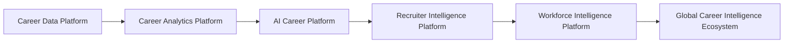
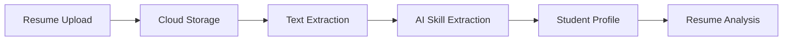
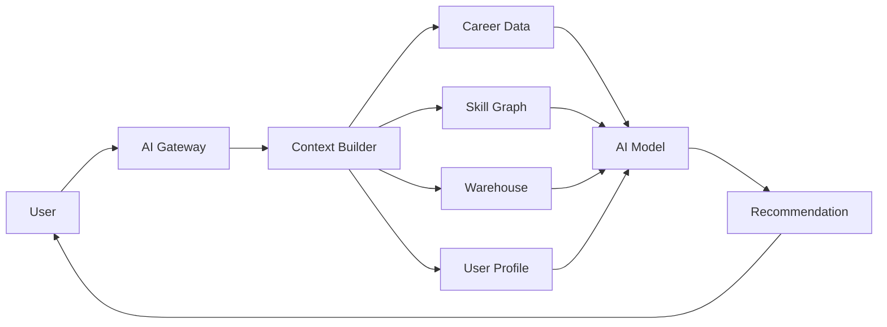
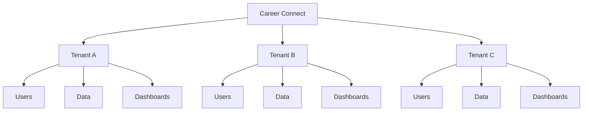
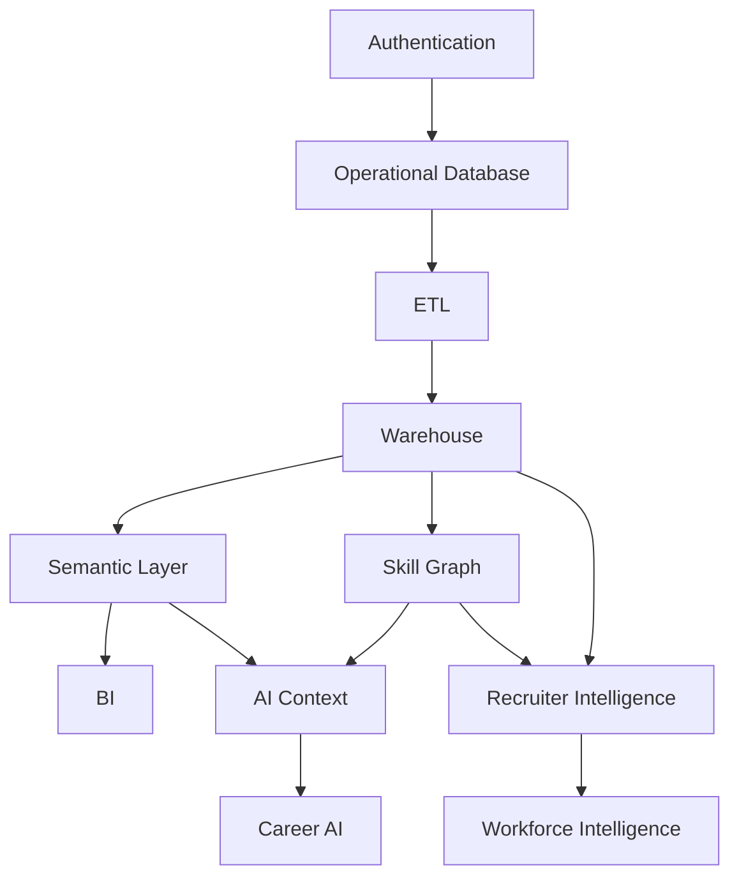
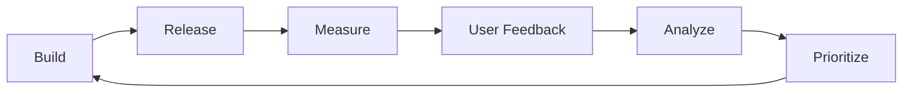

# 07 — Product Roadmap

# Career Connect — AI Career Intelligence Platform

**Document Type:** Product Roadmap
**Project:** Career Connect
**Version:** 1.0
**Status:** Product Strategy Baseline
**Product Type:** Cloud-Native SaaS / AI / Data Platform / BI
**Initial Market:** India
**Long-Term Market:** Global

---

# 1. Executive Summary

The Career Connect product roadmap defines how the platform evolves from an academic-grade working MVP into a scalable AI Career Intelligence SaaS platform.

The roadmap deliberately follows a **foundation-first strategy**.

Career Connect should not begin by implementing every AI feature, every dashboard, and every enterprise capability simultaneously.

Instead, the platform should evolve through:

```text
Foundation
    ↓
MVP
    ↓
Analytics Platform
    ↓
AI Career Platform
    ↓
Recruiter Intelligence
    ↓
Enterprise Workforce Intelligence
    ↓
Global Intelligence Platform
```

The most important roadmap principle is:

> **Build the data foundation first, intelligence second, automation third, and ecosystem scale fourth.**

---

# 2. Product Roadmap Vision

The ultimate product evolution is:



Each stage should build on the previous stage rather than creating independent products.

---

# 3. Product Development Philosophy

The roadmap is governed by six principles.

## 3.1 Foundation Before Features

Do not build advanced AI on unreliable data.

Priority:

```text
Data
↓
Quality
↓
Warehouse
↓
Metrics
↓
AI
```

---

## 3.2 Vertical Slices Over Isolated Components

Every major release should ideally demonstrate a complete user workflow.

For example:

```text
Student
↓
Upload Resume
↓
Extract Skills
↓
Calculate Skill Gap
↓
Recommend Career
↓
Generate Learning Plan
```

This is stronger than having six unrelated screens.

---

## 3.3 Real Architecture, Incremental Scope

The system should be architected for the long term but implemented incrementally.

Example:

```text
Architecture:
Multi-Tenant SaaS Ready

MVP:
Single Institutional Tenant
```

This avoids premature complexity while preserving future scalability.

---

## 3.4 Data-Centric Product Development

Every new feature should answer:

> What new data does this create?

and:

> What new intelligence can this data enable?

This creates a continuous data flywheel.

---

## 3.5 Outcome-Oriented Development

Features should ultimately improve:

- Career decisions
- Learning decisions
- Placement outcomes
- Hiring decisions
- Workforce decisions

A feature should not exist merely because it looks impressive.

---

## 3.6 Security by Design

Security should be introduced from the beginning rather than added after the platform is complete.

---

# 4. Roadmap Overview

The recommended product roadmap contains eight major phases.

| Phase   | Product Stage | Primary Objective                 |
| ------- | ------------- | --------------------------------- |
| Phase 0 | Discovery     | Validate requirements             |
| Phase 1 | Foundation    | Build architecture and data layer |
| Phase 2 | MVP           | Launch core career intelligence   |
| Phase 3 | Analytics     | Build enterprise BI               |
| Phase 4 | AI            | Add contextual intelligence       |
| Phase 5 | Recruiter     | Build talent intelligence         |
| Phase 6 | Enterprise    | Build workforce intelligence      |
| Phase 7 | Scale         | Multi-tenant SaaS and ecosystem   |
| Phase 8 | Global        | International career intelligence |

---

# 5. Phase 0 — Product Discovery

## Objective

Establish the exact problem, user personas, workflows, data model, and MVP boundary.

### Major Activities

- Stakeholder interviews
- User-persona definition
- User journey mapping
- Requirement prioritization
- Data-source analysis
- Competitive validation
- Architecture planning
- Security planning

---

## Deliverables

```text id="x4b2gw"
Product Vision
Problem Statement
User Personas
User Journeys
Feature Prioritization
Initial Data Model
Architecture Proposal
MVP Definition
```

---

## Exit Criteria

The project should have:

- Approved problem statement
- Defined MVP
- Defined target users
- Initial architecture
- Initial warehouse design
- Initial product backlog

---

# 6. Phase 1 — Technical Foundation

## Objective

Create the technical foundation required for all future modules.

This is the most important engineering phase.

---

## 6.1 Repository Foundation

Create:

```text id="0xg1uh"
apps/
packages/
services/
warehouse/
etl/
ai/
dashboard/
frontend/
backend/
database/
docs/
scripts/
docker/
.github/
```

---

## 6.2 Frontend Foundation

Set up:

- Next.js
- TypeScript
- Tailwind
- Shadcn UI
- Routing
- Layout system
- Design tokens
- Responsive system
- Authentication flows

---

## 6.3 Backend Foundation

Set up:

- NestJS
- REST API
- Validation
- Authentication
- Authorization
- Error handling
- Logging
- API versioning

---

## 6.4 Database Foundation

Create operational PostgreSQL structures for:

- Users
- Roles
- Organizations
- Students
- Companies
- Jobs
- Skills
- Applications

---

## 6.5 Authentication Foundation

Implement:

- Supabase Auth
- Email authentication
- Google login
- Session handling
- Role assignment

---

## 6.6 RBAC Foundation

Initial roles:

```text id="7p2qj9"
SUPER_ADMIN
ORG_ADMIN
PLACEMENT_OFFICER
RECRUITER
FACULTY
STUDENT
JOB_SEEKER
```

---

## 6.7 Infrastructure Foundation

Set up:

- Docker
- Environment management
- CI pipeline
- Basic deployment
- Cloud storage
- Development/staging/production environments

---

## 6.8 Phase 1 Deliverable

At the end of Phase 1:

```text
Login
+
Role Management
+
Base Database
+
API
+
Frontend Shell
+
Cloud Deployment
+
CI/CD Foundation
```

should be operational.

---

# 7. Phase 2 — Career Connect MVP

## Objective

Create the first fully working product around the student + institution use case.

The MVP should demonstrate:

```text
Real User
+
Real Data Flow
+
Real ETL
+
Real Warehouse
+
Real Dashboard
+
Basic AI
```

---

# 8. MVP Module 1 — Student Profile

Features:

- Personal profile
- Education
- Department
- Skills
- Certifications
- Projects
- Experience
- Career interests

Example:

```text id="cvp9dg"
Student
├── Education
├── Skills
├── Projects
├── Certifications
├── Experience
└── Career Goal
```

---

# 9. MVP Module 2 — Resume Upload

Support:

- PDF
- DOCX

Pipeline:



---

# 10. MVP Module 3 — Resume Intelligence

Initial capabilities:

- Resume parsing
- Skill extraction
- Resume completeness
- Keyword analysis
- Role alignment
- Basic ATS-oriented checks

Output example:

```text id="h8sej8"
Resume Score
82 / 100

Strengths
✓ Technical Skills
✓ Projects
✓ Education

Improvements
• Add measurable achievements
• Improve role-specific keywords
• Strengthen project descriptions
```

---

# 11. MVP Module 4 — Skill Gap Analysis

Input:

```text
Current Skills
+
Target Career
```

Output:

```text id="nhyk38"
Required Skills
-
Current Skills
=
Skill Gap
```

The module should provide:

- Missing skills
- Priority
- Current proficiency
- Target proficiency
- Recommended learning areas

---

# 12. MVP Module 5 — Career Recommendation

The initial recommendation engine can combine:

```text id="b0m8hm"
Skills
+
Education
+
Experience
+
Career Preferences
+
Job Requirements
```

Output:

```text
Recommended Career
Match Score
Required Skills
Skill Gaps
Suggested Next Steps
```

Early versions may use a deterministic scoring system before introducing advanced machine learning.

---

# 13. MVP Module 6 — Job Intelligence

The MVP job module should support:

- Job ingestion
- Job search
- Role filtering
- Skill filtering
- Location filtering
- Experience filtering
- Employment type

Example:

```text id="8v2x24"
Data Engineer

Location: Bengaluru
Experience: 0–2 years
Skills:
Python
SQL
Cloud
ETL
```

---

# 14. MVP Module 7 — Placement Dashboard

Initial KPIs:

```text
Placement Rate
Students Placed
Average Salary
Highest Salary
Companies Hiring
Offers
Departments
```

Example:

```text id="v4ne2v"
Placement Rate      82%
Students Placed     410
Average Salary      $8,400
Highest Salary      $24,000
Companies           72
```

The example amounts are illustrative UI data only, not market claims.

---

# 15. MVP Module 8 — Data Pipeline

The first real ETL pipeline should support:

```text
CSV
+
JSON
+
Institution Data
        ↓
Validation
        ↓
Cleaning
        ↓
Deduplication
        ↓
Transformation
        ↓
Warehouse
```

---

# 16. MVP Module 9 — Data Warehouse

Initial dimensions:

```text
dim_date
dim_student
dim_company
dim_job
dim_skill
dim_college
dim_location
```

Initial facts:

```text
fact_application
fact_placement
fact_salary
```

This is sufficient to demonstrate the first analytical layer.

---

# 17. MVP Module 10 — Basic Analytics

Initial analytical questions:

- What is the placement rate?
- Which companies hired the most students?
- Which departments have the highest placement rate?
- Which skills are most common?
- What are average salaries by role?
- Which cities have the most jobs?

---

# 18. Phase 2 Completion Criteria

The MVP is complete when the following flow works end-to-end:

```text
Student
↓
Login
↓
Profile
↓
Resume
↓
Skills
↓
Career Recommendation
↓
Job Intelligence
↓
Application
↓
Placement Analytics
```

and:

```text
Raw Data
↓
ETL
↓
Warehouse
↓
Dashboard
```

also works reliably.

---

# 19. Phase 3 — Enterprise Analytics Platform

## Objective

Transform the MVP into a serious Business Intelligence platform.

The focus shifts from individual features to analytical depth.

---

# 20. Data Warehouse Expansion

Add dimensions:

```text
dim_date
dim_student
dim_company
dim_skill
dim_job
dim_college
dim_location
dim_technology
dim_recruiter
dim_course
dim_certification
dim_experience
dim_employment_type
```

---

# 21. Fact Table Expansion

Add:

```text
fact_applications
fact_placements
fact_salaries
fact_interviews
fact_hiring
fact_learning
fact_certifications
```

This establishes a broad analytical foundation.

---

# 22. Data Mart Strategy

Create:

```text id="t7p0gi"
Student Data Mart
Placement Data Mart
Recruiter Data Mart
Hiring Data Mart
Salary Data Mart
Skills Data Mart
Learning Data Mart
```

---

# 23. Executive Dashboard

Build:

```text id="33lqt7"
Total Users
Placement Rate
Average Salary
Hiring Growth
Skill Demand
Top Companies
Top Technologies
Regional Demand
```

---

# 24. College Dashboard

Features:

- Placement rate
- Department ranking
- Salary distribution
- Company hiring
- Skill distribution
- Student readiness
- Historical comparison

---

# 25. Student Dashboard

Features:

- Profile score
- Skill score
- Resume score
- Career match
- Learning progress
- Applications
- Interviews
- Offers

---

# 26. Recruiter Dashboard

Features:

- Open roles
- Candidates
- Applications
- Interviews
- Offers
- Hiring funnel
- Skill availability
- College talent distribution

---

# 27. Analytics Dashboard

Add:

### Skill Analytics

```text
Skill Demand
Skill Growth
Skill Distribution
Skill Gap
```

### Technology Analytics

```text
Technology Demand
Technology Trends
Role Associations
```

### Salary Analytics

```text
Median
Average
Distribution
Role Comparison
Location Comparison
```

---

# 28. Advanced BI

Move from:

```text
Descriptive
```

to:

```text
Descriptive
↓
Diagnostic
↓
Predictive
↓
Prescriptive
```

### Descriptive

> What happened?

### Diagnostic

> Why did it happen?

### Predictive

> What may happen?

### Prescriptive

> What should we do?

The final two stages require careful statistical/model validation.

---

# 29. Phase 4 — AI Career Intelligence Platform

## Objective

Introduce deeper AI capabilities while grounding them in the warehouse and structured platform data.

---

# 30. AI Architecture



---

# 31. AI Module — Career Coach

The AI Career Coach should answer questions such as:

> What career is suitable for me?

> What skills should I learn?

> How do I transition from developer to data engineer?

> Which roles match my experience?

The assistant should use structured user context wherever possible.

---

# 32. AI Module — Advanced Resume Intelligence

Add:

- Semantic skill extraction
- Role-specific resume scoring
- Achievement quality analysis
- Missing keyword detection
- Project relevance analysis
- Job-specific resume improvement

---

# 33. AI Module — Learning Roadmap

Input:

```text
Current Skills
+
Target Role
```

Output:

```text
Learning Stage 1
Learning Stage 2
Learning Stage 3
Projects
Certifications
Assessment
```

---

# 34. AI Module — Mock Interview

Support:

```text id="z9z9hn"
Role Selection
↓
Interview Type
↓
Question
↓
User Answer
↓
AI Evaluation
↓
Feedback
↓
Next Question
```

Evaluation dimensions can include:

- Relevance
- Clarity
- Technical accuracy
- Communication
- Completeness

---

# 35. AI Module — Job Matching

Move from keyword matching to semantic matching.

Conceptually:

```text
Candidate Vector
        vs
Job Vector
        ↓
Similarity
        ↓
Skill Alignment
        ↓
Experience Alignment
        ↓
Match Score
```

---

# 36. AI Module — Natural-Language BI

Allow questions such as:

> Show placement rate by department for the last three years.

> Which skills are growing fastest?

> Compare average salary for Data Analyst and Data Engineer roles.

Architecture:

```text id="cyv5we"
Natural Language
↓
Intent Detection
↓
Semantic Layer
↓
Query Generation
↓
Validation
↓
Warehouse
↓
Chart
```

Generated queries must be validated before execution.

---

# 37. Phase 5 — Recruiter Intelligence Platform

## Objective

Build the recruiter side of the ecosystem.

---

# 38. Recruiter Candidate Search

Search by:

- Skill
- Role
- Experience
- College
- Location
- Certification
- Education

---

# 39. Smart Candidate Matching

```text id="5zjhve"
Job Requirement
↓
Skill Extraction
↓
Skill Graph
↓
Candidate Matching
↓
Ranked Candidates
```

---

# 40. Recruitment Funnel

Track:

```text
Applications
↓
Screened
↓
Shortlisted
↓
Interviewed
↓
Selected
↓
Offer
↓
Joined
```

---

# 41. Recruiter Intelligence

Add:

- Candidate availability
- Skill concentration
- College talent
- Regional talent
- Salary expectations
- Recruitment performance

---

# 42. Phase 6 — Enterprise Workforce Intelligence

## Objective

Expand beyond recruitment into workforce strategy.

---

# 43. Workforce Skill Inventory

Companies can maintain:

```text
Employee
↓
Current Skills
↓
Current Role
↓
Target Role
↓
Skill Gap
```

---

# 44. Internal Mobility

Support:

```text id="gm4n80"
Employee
↓
Current Role
↓
Target Role
↓
Skill Gap
↓
Learning
↓
Internal Opportunity
```

---

# 45. Workforce Planning

Analytics can answer:

- Which skills will be required?
- Which roles are growing?
- Where are talent gaps?
- Which teams require reskilling?
- Where should hiring occur?

---

# 46. Enterprise Dashboard

KPIs:

```text
Workforce Size
Critical Skills
Skill Gaps
Hiring Demand
Internal Mobility
Learning Progress
Talent Risk
```

---

# 47. Phase 7 — SaaS Scale

## Objective

Transform the platform into true multi-tenant SaaS.

---

# 48. Multi-Tenant Architecture



---

# 49. Tenant Isolation

Potential strategies:

### Shared Database + Tenant ID

Suitable for simpler deployments.

### Schema per Tenant

Provides stronger logical separation.

### Database per Tenant

Suitable for high-isolation enterprise environments.

The architecture should support a configurable strategy rather than assuming one model for every customer.

---

# 50. Enterprise Identity

Add:

- SSO
- OAuth
- Enterprise identity providers
- Organization policies
- Advanced RBAC

---

# 51. Billing

Introduce:

- Plans
- Subscriptions
- Invoices
- Usage
- Entitlements
- Billing history

---

# 52. Usage Metering

Track:

```text
Users
AI Requests
API Calls
Data Volume
Reports
Storage
```

This enables usage-aware enterprise billing.

---

# 53. Phase 8 — Global Career Intelligence

## Objective

Expand the platform to international labor markets.

---

# 54. Global Data Model

Support:

```text
Countries
Regions
Cities
Currencies
Education Systems
Job Taxonomies
Salary Systems
Employment Rules
Languages
```

---

# 55. International Career Comparison

Allow:

> Compare Data Engineer opportunities in India, Singapore, UAE, UK, and US.

Potential dimensions:

- Salary
- Demand
- Cost of living
- Skills
- Experience
- Visa-related information where legally and appropriately sourced

---

# 56. Localization

Support:

- International currencies
- Time zones
- Languages
- Regional terminology
- Country-specific employment models

---

# 57. Product Roadmap Timeline

A practical project roadmap can be organized into:

```text id="y4q8vx"
Phase 0
Discovery

↓

Phase 1
Foundation

↓

Phase 2
MVP

↓

Phase 3
Analytics

↓

Phase 4
AI

↓

Phase 5
Recruiter Intelligence

↓

Phase 6
Enterprise

↓

Phase 7
SaaS Scale

↓

Phase 8
Global
```

---

# 58. Academic Project Timeline

For a final-year BE CSE project, the full commercial roadmap should be reduced to a realistic academic scope.

Recommended academic implementation:

```text id="b1x6ia"
Foundation
+
MVP
+
Core ETL
+
Warehouse
+
BI
+
Selected AI
```

This is sufficient to demonstrate the core product thesis.

---

# 59. Recommended Final-Year Feature Set

The final academic release should prioritize:

### User

- Student login
- Student profile
- Resume upload
- Skill management

### AI

- Resume analysis
- Skill extraction
- Skill-gap analysis
- Career recommendation
- Career chatbot

### Data Engineering

- Job dataset
- Student dataset
- Company dataset
- Salary dataset
- Placement dataset
- ETL pipeline
- Data quality

### Warehouse

- Fact tables
- Dimension tables
- Star schema
- Data marts

### BI

- Executive dashboard
- College dashboard
- Student dashboard
- Recruiter dashboard

### Security

- Authentication
- RBAC
- Audit logs
- API security

---

# 60. Feature Prioritization Framework

Use:

```text
P0 = Critical
P1 = High
P2 = Medium
P3 = Future
```

---

# 61. P0 — Critical Features

```text
Authentication
RBAC
Student Profile
Resume Upload
Skill Management
Job Data
ETL
Warehouse
Placement Analytics
Core Dashboard
```

---

# 62. P1 — High Priority

```text
Resume AI
Skill Gap
Career Recommendation
Salary Analytics
Recruiter Dashboard
Application Funnel
Learning Roadmap
AI Career Assistant
```

---

# 63. P2 — Medium Priority

```text
Mock Interview
Advanced Matching
Natural Language BI
Advanced Reports
Notifications
Certification Intelligence
```

---

# 64. P3 — Future

```text
Workforce Planning
Internal Mobility
Global Intelligence
Enterprise APIs
Marketplace
Advanced Predictive Models
Autonomous AI Agents
```

---

# 65. Product Backlog Structure

The backlog should be organized by product domain.

```text
EPIC-01 Authentication
EPIC-02 Student
EPIC-03 Jobs
EPIC-04 Resume AI
EPIC-05 Skills
EPIC-06 Learning
EPIC-07 Placement
EPIC-08 Recruitment
EPIC-09 Data Engineering
EPIC-10 Warehouse
EPIC-11 BI
EPIC-12 AI
EPIC-13 Security
EPIC-14 DevOps
EPIC-15 SaaS
```

---

# 66. Release Strategy

Recommended release structure:

```text
v0.1
Architecture Prototype

v0.2
Authentication + Core Database

v0.3
Student + Job Modules

v0.4
ETL + Warehouse

v0.5
BI Dashboards

v0.6
Resume AI

v0.7
Skill Gap + Career Recommendation

v0.8
Recruiter Intelligence

v0.9
Security + Testing + Observability

v1.0
Production-Oriented MVP
```

---

# 67. MVP Release Definition

Version 1.0 should satisfy:

```text
✓ Cloud Deployment
✓ Authentication
✓ Role-Based Access
✓ Student Profile
✓ Resume Upload
✓ Resume AI
✓ Skill Gap
✓ Career Recommendation
✓ Job Analytics
✓ ETL Pipeline
✓ Data Warehouse
✓ Placement BI
✓ Recruiter BI
✓ Basic Security
✓ Monitoring
✓ Documentation
```

---

# 68. Post-MVP Releases

## v1.1

- Improved AI
- Better recommendations
- Advanced reports
- More dashboards

## v1.2

- Mock interviews
- Natural-language BI
- Advanced matching

## v2.0

- Multi-tenant SaaS
- Billing
- Enterprise administration
- Advanced APIs

## v3.0

- Workforce intelligence
- Internal mobility
- Predictive analytics

---

# 69. Roadmap Prioritization by Business Value

| Feature               | User Value | Business Value | Technical Value | Priority |
| --------------------- | ---------- | -------------- | --------------- | -------- |
| Student Profile       | High       | Medium         | High            | P0       |
| Resume AI             | Very High  | High           | High            | P1       |
| Skill Gap             | Very High  | Very High      | Very High       | P1       |
| Career Recommendation | Very High  | Very High      | Very High       | P1       |
| ETL                   | High       | Very High      | Very High       | P0       |
| Warehouse             | High       | Very High      | Very High       | P0       |
| Placement BI          | Very High  | Very High      | Very High       | P0       |
| Recruiter Analytics   | High       | Very High      | Very High       | P1       |
| Mock Interview        | High       | High           | Medium          | P2       |
| Natural-Language BI   | High       | High           | Very High       | P2       |
| Workforce Planning    | Medium     | Very High      | Very High       | P3       |
| Global Analytics      | Medium     | Very High      | Very High       | P3       |

---

# 70. Roadmap Dependency Graph

Several features depend on other capabilities.



This dependency chain explains why the roadmap begins with architecture and data engineering.

---

# 71. Roadmap Governance

Every roadmap item should be evaluated against:

```text
User Value
Business Value
Technical Complexity
Data Dependency
Security Impact
Scalability Impact
Maintenance Cost
```

A feature should move forward when its value justifies its complexity.

---

# 72. Product Discovery Loop

The roadmap should not be static.

Use:



This creates continuous product improvement.

---

# 73. Product Analytics

Every release should measure:

### Acquisition

- New users
- New institutions
- New recruiters

### Activation

- Profile completion
- Resume upload
- First recommendation
- First dashboard interaction

### Engagement

- Weekly active users
- AI sessions
- Dashboard sessions
- Reports generated

### Outcome

- Skill improvements
- Applications
- Interviews
- Placements
- Hires

---

# 74. AI Evaluation Roadmap

AI should evolve through controlled stages.

## Stage 1

Rule-based intelligence.

## Stage 2

LLM-assisted workflows.

## Stage 3

Retrieval-augmented AI.

## Stage 4

Personalized recommendation models.

## Stage 5

Predictive and decision-support systems.

This avoids premature machine-learning complexity.

---

# 75. Data Engineering Roadmap

Data engineering maturity should evolve as:

```text id="bz6g50"
Manual Import
↓
Scheduled ETL
↓
Incremental ETL
↓
Data Quality
↓
Metadata
↓
Lineage
↓
Monitoring
↓
Real-Time / Streaming
```

Real-time streaming should only be introduced where it solves a real business requirement.

---

# 76. BI Maturity Roadmap

```text
Basic KPIs
↓
Interactive Dashboards
↓
Drilldowns
↓
Cross-Dimensional Analysis
↓
Semantic Metrics
↓
Self-Service BI
↓
Natural-Language BI
↓
Predictive BI
```

---

# 77. Cloud Maturity Roadmap

```text
Local Development
↓
Containerized Development
↓
Cloud Deployment
↓
CI/CD
↓
Staging + Production
↓
Monitoring
↓
Autoscaling
↓
High Availability
↓
Multi-Region
```

Not every stage is required for the academic project.

---

# 78. Security Maturity Roadmap

```text
Authentication
↓
RBAC
↓
Input Validation
↓
Secure API
↓
Audit Logs
↓
Encryption
↓
Security Monitoring
↓
Advanced Enterprise Controls
```

---

# 79. Roadmap Success Criteria

The roadmap should be considered successful when:

### Phase 1

The system is technically deployable.

### Phase 2

The end-to-end MVP works.

### Phase 3

The warehouse supports meaningful BI.

### Phase 4

AI provides useful contextual intelligence.

### Phase 5

Recruiters can use the platform for talent decisions.

### Phase 6

Organizations can use the system for workforce intelligence.

### Phase 7

The platform can operate as a multi-tenant SaaS.

### Phase 8

The architecture supports international expansion.

---

# 80. CTO-Level Roadmap Principle

The most important roadmap decision is:

> **Do not optimize for the number of features. Optimize for the depth of the intelligence platform.**

A successful Career Connect release should always improve at least one of these assets:

```text
Data Quality
Data Coverage
Skill Graph
Analytics
AI Context
Workflow Integration
User Outcomes
```

---

# 81. Final Product Roadmap

```text
                     CAREER CONNECT
                           │
                           ▼
                 PHASE 0 — DISCOVERY
                           │
                           ▼
                PHASE 1 — FOUNDATION
                           │
                           ▼
                    PHASE 2 — MVP
                           │
                           ▼
               PHASE 3 — ANALYTICS
                           │
                           ▼
                   PHASE 4 — AI
                           │
                           ▼
             PHASE 5 — RECRUITER AI
                           │
                           ▼
             PHASE 6 — ENTERPRISE
                           │
                           ▼
              PHASE 7 — SaaS SCALE
                           │
                           ▼
               PHASE 8 — GLOBAL
```

---

# 82. Recommended Academic Roadmap

For the BE CSE final project, the recommended scope is:

```text
PHASE 1
Foundation

+

PHASE 2
MVP

+

Selected PHASE 3
BI

+

Selected PHASE 4
AI
```

This provides the strongest balance between:

- Technical depth
- Demonstrability
- Architecture quality
- Completion probability
- Academic value
- Portfolio value

---

# 83. Final Product Strategy

The roadmap ultimately transforms Career Connect through four strategic identities:

```text
1
Career Application

↓

2
Career Analytics Platform

↓

3
AI Career Intelligence Platform

↓

4
Workforce Intelligence Platform
```

The final destination is not simply a larger application.

It is a deeper intelligence platform.

---

# 84. Final Roadmap Statement

> **Career Connect should evolve incrementally from a cloud-native career data foundation into an AI-powered career intelligence platform, then into a recruiter and workforce intelligence system. The roadmap prioritizes reliable data, enterprise analytics, explainable AI, institutional workflows, and measurable outcomes before large-scale expansion.**

---

# 85. Final CTO Recommendation

The first production-oriented milestone should be:

> **“A college and student career intelligence system powered by a real ETL pipeline, enterprise-style warehouse, BI dashboards, and contextual AI.”**

Once that milestone is stable, the same platform can progressively support:

```text
Recruitment
→ Workforce Intelligence
→ Enterprise SaaS
→ Global Career Intelligence
```

This creates a realistic path from:

**Final Year Project → Portfolio Product → SaaS MVP → Startup Platform**

---

## Document Status

| Attribute                       | Value                               |
| ------------------------------- | ----------------------------------- |
| Project                         | Career Connect                      |
| Document                        | Product Roadmap                     |
| Version                         | 1.0                                 |
| Initial Focus                   | College + Student Intelligence      |
| MVP Focus                       | Data + ETL + Warehouse + BI + AI    |
| Phase Count                     | 8                                   |
| Long-Term Direction             | Workforce Intelligence              |
| Product Model                   | SaaS                                |
| Recommended Academic Scope      | Foundation + MVP + BI + Selected AI |
| Recommended Commercial Strategy | Land → Prove → Expand               |
| Status                          | Product Strategy Baseline           |
