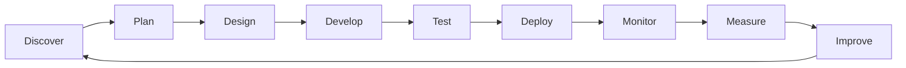
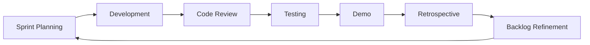
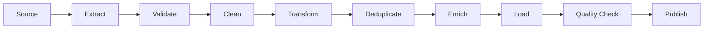
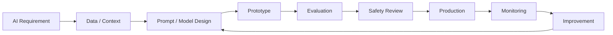
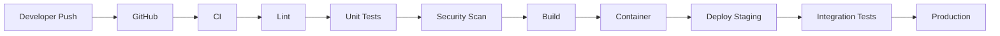
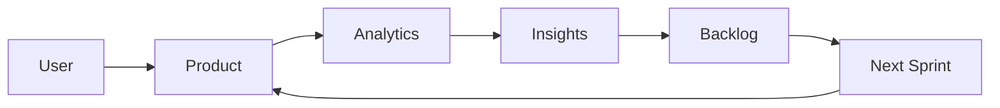
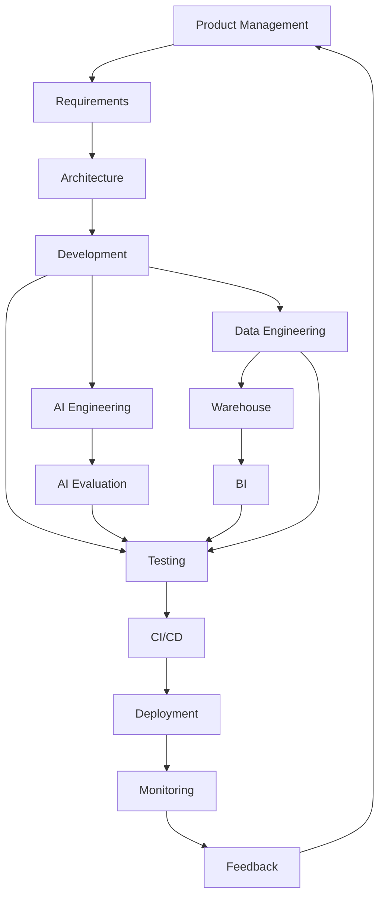

# 08 — Software Development Lifecycle

# Career Connect — AI Career Intelligence Platform

**Document Type:** Software Development Lifecycle (SDLC)
**Project:** Career Connect
**Version:** 1.0
**Status:** Engineering Process Baseline
**Development Approach:** Agile + DevSecOps + DataOps + MLOps
**Architecture Style:** Cloud-Native, Modular, Data-Driven, AI-Enabled SaaS

---

# 1. Executive Summary

Career Connect is too complex to develop using an informal “build everything first, test later” approach.

The platform contains multiple engineering disciplines:

```text
Frontend Engineering
+
Backend Engineering
+
Database Engineering
+
Data Engineering
+
Data Warehousing
+
Business Intelligence
+
AI Engineering
+
Cloud Engineering
+
Security Engineering
+
DevOps
```

Therefore, Career Connect requires a structured Software Development Lifecycle that coordinates all engineering activities.

The recommended lifecycle combines:

```text
Agile
+
DevSecOps
+
DataOps
+
MLOps
```

into one integrated product-development model.

---

# 2. SDLC Vision

The development lifecycle is designed around the following principle:

> **Every requirement must move through a controlled path from idea → design → implementation → validation → deployment → monitoring → improvement.**

The complete lifecycle is:



This creates a continuous engineering feedback loop.

---

# 3. Recommended Development Methodology

Career Connect should use a **hybrid Agile methodology**.

The methodology combines:

## Agile

For:

- Product development
- Sprint planning
- User stories
- Incremental delivery
- Feedback

## DevSecOps

For:

- CI/CD
- Automated security checks
- Infrastructure
- Deployment
- Monitoring

## DataOps

For:

- Data pipelines
- Data quality
- Warehouse changes
- Data validation
- Pipeline monitoring

## MLOps

For:

- AI model/version management
- Evaluation
- Prompt/version control
- Model monitoring
- AI quality testing

---

# 4. Integrated Engineering Lifecycle

The complete lifecycle becomes:

```text
Product Discovery
        ↓
Requirements
        ↓
Architecture
        ↓
UX/UI Design
        ↓
Software Development
        ↓
Data Engineering
        ↓
AI Development
        ↓
Testing
        ↓
Security Validation
        ↓
CI/CD
        ↓
Deployment
        ↓
Observability
        ↓
User Feedback
        ↓
Product Improvement
```

---

# 5. SDLC Phases

Career Connect will use the following major phases:

| Phase | Name             | Primary Output               |
| ----- | ---------------- | ---------------------------- |
| 1     | Discovery        | Product understanding        |
| 2     | Requirements     | Approved requirements        |
| 3     | Planning         | Product backlog              |
| 4     | Architecture     | Technical architecture       |
| 5     | UX/UI Design     | Design system and wireframes |
| 6     | Development      | Working software             |
| 7     | Data Engineering | Trusted analytical data      |
| 8     | AI Engineering   | AI capabilities              |
| 9     | Testing          | Validated product            |
| 10    | Security         | Security assurance           |
| 11    | CI/CD            | Automated delivery           |
| 12    | Deployment       | Running system               |
| 13    | Monitoring       | Operational visibility       |
| 14    | Feedback         | Improvement backlog          |

---

# 6. Phase 1 — Discovery

## Objective

Understand the problem before writing production code.

The discovery stage converts the original product vision into measurable problems.

---

## Activities

- Stakeholder identification
- User interviews
- Problem validation
- User journey mapping
- Competitor analysis
- Data-source analysis
- Technical feasibility
- Risk identification

---

## Stakeholder Groups

```text
Students
Graduates
Job Seekers
Colleges
Placement Officers
Recruiters
Companies
Training Institutes
Administrators
```

---

# 7. Discovery Deliverables

The following artifacts should be created:

```text
Vision Document
Problem Statement
Market Research
Competitor Analysis
SWOT
Personas
User Journeys
Initial Product Backlog
Initial Risk Register
```

---

# 8. Discovery Exit Criteria

The team should not proceed into full development until:

- The target customer is defined.
- The primary problem is clear.
- The MVP is bounded.
- Major data requirements are known.
- Major technical risks are documented.

---

# 9. Phase 2 — Requirements Engineering

## Objective

Convert business problems into specific system requirements.

Requirements should be divided into:

```text
Functional Requirements
+
Non-Functional Requirements
+
Data Requirements
+
AI Requirements
+
Security Requirements
```

---

# 10. Requirement Hierarchy

A requirement should follow:

```text
Business Goal
↓
Product Capability
↓
Epic
↓
Feature
↓
User Story
↓
Acceptance Criteria
↓
Test Case
```

Example:

```text
Business Goal:
Improve student employability

↓

Capability:
Career Intelligence

↓

Feature:
Skill Gap Analysis

↓

User Story:
Student wants to see missing skills

↓

Acceptance Criteria:
System calculates and displays prioritized gaps

↓

Test Case:
Verify correct skill-gap calculation
```

---

# 11. User Story Format

Career Connect should use a standardized format:

> **As a [user], I want [capability], so that [business value].**

Example:

> As a student, I want to analyze my skill gap against a target role so that I know what skills to learn next.

---

# 12. Acceptance Criteria

Every major feature should have measurable acceptance criteria.

Example:

### Feature

**Skill Gap Analysis**

### Criteria

```text
Given a target career
When the student submits their current skills
Then the system should identify missing required skills
And rank them by priority
And show an explanation
```

This makes requirements testable.

---

# 13. Requirement Prioritization

Use:

```text
P0 — Critical
P1 — High
P2 — Medium
P3 — Future
```

### P0

Core system functionality.

### P1

Important product differentiators.

### P2

Enhancement features.

### P3

Long-term capabilities.

---

# 14. Phase 3 — Agile Planning

Career Connect should use sprint-based development.

Recommended sprint length:

> **2 weeks**

A sprint should produce a potentially demonstrable increment.

---

# 15. Sprint Structure



---

# 16. Sprint Planning

Each sprint should define:

- Sprint goal
- User stories
- Technical tasks
- Data tasks
- AI tasks
- Testing tasks
- Security tasks

---

# 17. Sprint Goal Example

### Sprint Goal

> Build the end-to-end student resume intelligence workflow.

Tasks:

```text
Frontend Resume Upload
Backend Upload API
Cloud Storage
Text Extraction
Skill Extraction
AI Analysis
Score Calculation
Result Dashboard
Testing
```

---

# 18. Definition of Ready

A user story is ready for development when:

- Requirement is understood.
- Dependencies are known.
- Acceptance criteria exist.
- UX is available where required.
- Data requirements are identified.
- Security impact is understood.

---

# 19. Definition of Done

A feature is considered complete only when:

```text
Code Complete
+
Code Reviewed
+
Unit Tested
+
Integration Tested
+
Security Checked
+
Documentation Updated
+
CI Passing
+
Deployed to Test Environment
```

“Works on my machine” is not considered done.

---

# 20. Phase 4 — System Architecture

## Objective

Define how the complete platform will operate before large-scale implementation.

Architecture should cover:

- Application layer
- Data layer
- AI layer
- Analytics layer
- Infrastructure
- Security
- Observability

---

# 21. Architecture Review

Every major architectural decision should answer:

1. Why is this technology needed?
2. What problem does it solve?
3. What are the alternatives?
4. What is the operational cost?
5. Does it scale?
6. How easy is it to replace?

---

# 22. Architecture Decision Records

Important technical decisions should be documented as ADRs.

Example:

```text
ADR-001
Choose PostgreSQL for OLTP

ADR-002
Choose BigQuery / Snowflake for Analytics

ADR-003
Use NestJS for Backend

ADR-004
Use Python for AI Services

ADR-005
Use Docker for Service Packaging
```

---

# 23. Phase 5 — UX/UI Design

## Objective

Create a user experience that hides backend complexity.

The system may have:

```text
ETL
Warehouse
AI
APIs
Data Marts
```

but the user should experience:

```text
Simple
Clear
Fast
Intelligent
```

---

# 24. UX Design Process

```text
Research
↓
Personas
↓
User Journey
↓
Wireframe
↓
Prototype
↓
Usability Review
↓
Visual Design
↓
Implementation
```

---

# 25. Role-Based UX

Different users should receive different workspaces.

```text
Student Workspace
College Workspace
Placement Workspace
Recruiter Workspace
Executive Workspace
Admin Workspace
```

The architecture should reuse components while changing:

- Navigation
- KPIs
- Actions
- Data access
- Dashboard layout

---

# 26. Design System

The design system should standardize:

- Typography
- Colors
- Spacing
- Buttons
- Cards
- Tables
- Charts
- Forms
- Modals
- Alerts
- Navigation

This prevents inconsistent UI development.

---

# 27. Phase 6 — Application Development

Development should follow modular engineering.

```text
Frontend
↓
API
↓
Application Services
↓
Database / External Services
```

The backend should not directly expose database logic to every controller.

Recommended:

```text
Controller
↓
Service
↓
Repository
↓
Database
```

---

# 28. Backend Development Standards

Every backend module should include:

```text
Controller
Service
DTO
Validation
Repository
Tests
Documentation
```

---

# 29. API Versioning

Use versioned APIs:

```text
/api/v1/auth
/api/v1/students
/api/v1/jobs
/api/v1/skills
/api/v1/applications
/api/v1/analytics
/api/v1/ai
```

This supports future backward compatibility.

---

# 30. Frontend Development Standards

Frontend code should emphasize:

- Reusable components
- Type safety
- Responsive design
- Loading states
- Error states
- Empty states
- Accessibility
- API abstraction

Avoid putting complex business logic directly into visual components.

---

# 31. Phase 7 — Data Engineering Lifecycle

Career Connect requires its own development lifecycle for analytical data.

This is **DataOps**.

The pipeline lifecycle is:



---

# 32. Data Source Registration

Every source should have metadata:

```text
Source ID
Source Name
Source Type
Owner
Refresh Frequency
Format
License
Last Updated
Schema Version
Quality Score
```

---

# 33. Data Validation

Validate:

- Data types
- Null values
- Required fields
- Range constraints
- Date validity
- Referential integrity
- Duplicate records

Example:

```text
salary >= 0
experience >= 0
job_id IS NOT NULL
student_id IS NOT NULL
```

---

# 34. Data Quality Dimensions

The platform should monitor:

```text
Completeness
Accuracy
Consistency
Uniqueness
Validity
Timeliness
```

A data-quality score can be generated.

Example:

```text
Data Quality Score = 96%
```

The score is a monitoring metric, not an assertion that data is universally correct.

---

# 35. Data Lineage

Every analytical record should ideally be traceable:

```text
Source
↓
Raw Dataset
↓
Transformation
↓
Warehouse Table
↓
Dashboard
```

This is important when users question an analytical result.

---

# 36. Data Pipeline Testing

Pipeline tests should verify:

### Schema

Does the input contain required columns?

### Quality

Are values valid?

### Transformation

Are business rules correctly applied?

### Reconciliation

Do source and warehouse totals align where they should?

---

# 37. Phase 8 — AI Engineering Lifecycle

AI requires a separate lifecycle because model behavior cannot be validated exactly like traditional software.

---

# 38. AI Development Lifecycle



---

# 39. AI Requirement Definition

Every AI feature must specify:

- Input
- Context
- Expected output
- Failure conditions
- Evaluation criteria
- Safety restrictions

Example:

### Resume AI

Input:

```text
Resume
+
Target Role
```

Output:

```text
Skills
Score
Strengths
Weaknesses
Recommendations
```

---

# 40. AI Context Engineering

The system should distinguish between:

```text
User Context
+
Platform Context
+
Market Context
+
Historical Context
```

The AI service should only receive data necessary for the task.

---

# 41. AI Evaluation

AI evaluation should include:

- Accuracy
- Relevance
- Consistency
- Completeness
- Safety
- Hallucination rate
- Response latency

Example evaluation dataset:

```text
100 Resume Samples
+
Target Roles
+
Expected Skills
+
Expert Evaluations
```

---

# 42. AI Guardrails

Career Connect should implement:

```text
Input Validation
+
Output Validation
+
Prompt Safety
+
Data Access Rules
+
Sensitive Data Controls
+
Confidence / Evidence
```

AI should not be permitted to bypass authorization rules.

---

# 43. AI Versioning

Track:

```text
Model Version
Prompt Version
System Instructions
Retrieval Configuration
Evaluation Version
Deployment Date
```

This makes AI behavior reproducible and auditable.

---

# 44. Phase 9 — Testing

Testing should occur throughout development, not only at the end.

Testing levels:

```text
Unit
↓
Integration
↓
System
↓
End-to-End
↓
Performance
↓
Security
↓
User Acceptance
```

---

# 45. Unit Testing

Test individual components.

Examples:

```text
Skill matching function
Salary calculation
Placement percentage
Authentication service
Data transformation
```

---

# 46. Integration Testing

Test system interactions.

Examples:

```text
Frontend → API
API → Database
API → AI Service
ETL → Warehouse
Warehouse → BI
```

---

# 47. End-to-End Testing

Test complete workflows.

### Student Workflow

```text
Login
↓
Upload Resume
↓
Extract Skills
↓
Skill Gap
↓
Career Recommendation
```

### College Workflow

```text
Login
↓
Placement Dashboard
↓
Filter Department
↓
Generate Report
```

### Recruiter Workflow

```text
Create Job
↓
Find Candidates
↓
Shortlist
↓
Interview
↓
Analytics
```

---

# 48. Performance Testing

Measure:

- API response time
- Database query time
- Dashboard load time
- ETL processing duration
- AI latency
- Concurrent users
- Warehouse query performance

---

# 49. Load Testing

Test scenarios such as:

```text
100 concurrent users
500 concurrent users
1,000 concurrent users
```

The exact production capacity should be determined from measured benchmarks rather than assumptions.

---

# 50. Security Testing

Test:

- Authentication
- Authorization
- RBAC
- SQL injection
- XSS
- CSRF where applicable
- Broken access control
- File upload security
- API abuse
- Rate limiting
- Secret exposure

---

# 51. Phase 10 — Security Engineering

Security should operate across the entire SDLC.

```text
Design
↓
Code
↓
Test
↓
Deploy
↓
Monitor
```

---

# 52. Secure Development Lifecycle

Security checks should include:

```text
Threat Modeling
Dependency Scanning
Secret Scanning
Static Analysis
Dynamic Testing
Container Scanning
Access Review
Audit Logging
```

---

# 53. Threat Modeling

Major threats should be documented.

Example:

```text
Threat:
Unauthorized access to student resume

Asset:
Student Resume

Threat Actor:
Unauthorized User

Control:
RBAC + Object-Level Authorization
```

---

# 54. Secrets Management

Never store:

```text
API Keys
JWT Secrets
Database Passwords
Cloud Credentials
```

directly in source code.

Use environment variables and managed secret storage in production.

---

# 55. Phase 11 — CI/CD

The development process should automatically validate code before deployment.



---

# 56. Continuous Integration

Every pull request should run:

- Formatting
- Linting
- Type checking
- Unit tests
- Security scans
- Build validation

---

# 57. Continuous Delivery

Successful builds can progress to:

```text
Development
↓
Staging
↓
Production
```

Production deployment should have appropriate approval controls for higher-risk changes.

---

# 58. Branching Strategy

A simple strategy:

```text
main
│
├── develop
│
├── feature/*
├── bugfix/*
└── hotfix/*
```

For a small team, trunk-based development with short-lived branches may be preferable.

The selected branching model should optimize for small, reviewable changes rather than long-running branches.

---

# 59. Pull Request Process

Every pull request should include:

```text
Problem
Solution
Testing
Security Impact
Data Impact
Screenshots where relevant
```

Required checks:

```text
CI Passing
Code Review
No Critical Security Issues
```

---

# 60. Phase 12 — Deployment

Deployment environments:

```text
LOCAL
  ↓
DEVELOPMENT
  ↓
STAGING
  ↓
PRODUCTION
```

---

# 61. Environment Separation

Each environment should have independent:

- Configuration
- Secrets
- Database access
- API credentials
- Logging destinations

Production data should not be copied casually into development environments.

---

# 62. Infrastructure as Code

Cloud resources should eventually be defined through infrastructure-as-code.

Potential components:

```text
Network
Storage
Database
Containers
Secrets
Monitoring
IAM
```

This enables reproducible infrastructure.

---

# 63. Phase 13 — Monitoring and Observability

A production platform needs visibility into its behavior.

Observability should include:

```text
Logs
+
Metrics
+
Traces
+
Alerts
```

---

# 64. Application Monitoring

Track:

- Request rate
- Error rate
- Latency
- Status codes
- Authentication failures
- API usage

---

# 65. Data Pipeline Monitoring

Track:

```text
Pipeline Success
Pipeline Failure
Records Processed
Records Rejected
Data Quality Score
Processing Time
Last Successful Run
```

---

# 66. AI Monitoring

Track:

- AI requests
- Latency
- Token/usage cost
- Failures
- Safety incidents
- Evaluation scores
- User feedback

---

# 67. Business Monitoring

Track:

```text
Users
Applications
Interviews
Placements
AI Usage
Dashboard Usage
Conversions
```

Technical monitoring should ultimately connect with business outcomes.

---

# 68. Alerting

Alerts should be categorized.

### Critical

- Production unavailable
- Database unavailable
- Major security event

### High

- ETL failure
- AI service failure
- Elevated API error rate

### Medium

- Data quality degradation
- Increased latency

### Informational

- Scheduled pipeline completed
- Deployment completed

---

# 69. Phase 14 — Feedback and Continuous Improvement

After release, the SDLC does not end.

The system should collect:

- User feedback
- Support tickets
- Error reports
- Product analytics
- AI evaluation feedback
- Dashboard usage
- Feature requests

---

# 70. Product Feedback Loop



This turns user behavior into product improvement.

---

# 71. Release Management

Every release should contain:

```text
Version
Release Date
Changes
Bug Fixes
Security Changes
Database Changes
Data Pipeline Changes
AI Changes
Known Issues
Rollback Plan
```

---

# 72. Database Migration Strategy

Database changes should be version-controlled.

Example:

```text
001_initial_schema
002_add_student_skills
003_add_applications
004_add_placements
005_add_audit_logs
```

Migrations should be tested before production execution.

---

# 73. Data Warehouse Change Management

Warehouse changes should follow:

```text
Schema Proposal
↓
Impact Analysis
↓
Transformation Update
↓
Quality Tests
↓
Dashboard Validation
↓
Deployment
```

A warehouse schema change can impact many downstream dashboards.

---

# 74. BI Change Management

Every KPI should have a formal definition.

Example:

### Placement Rate

```text
Placement Rate =
Placed Students / Eligible Students × 100
```

The exact business definition must be documented before dashboard implementation.

This prevents different dashboards from calculating the same KPI differently.

---

# 75. AI Change Management

Any major AI change should record:

```text
Previous Model
New Model
Prompt Changes
Data Changes
Evaluation Results
Known Behavior Changes
Rollback Option
```

This is particularly important when replacing AI providers or model versions.

---

# 76. Team Structure

A production-oriented team can be divided into:

```text
Product
├── Product Manager
└── Business Analyst

Engineering
├── Frontend Engineer
├── Backend Engineer
└── Full Stack Engineer

Data
├── Data Engineer
├── Analytics Engineer
└── BI Developer

AI
├── AI Engineer
└── ML Engineer

Platform
├── Cloud Engineer
└── DevOps Engineer

Quality
└── QA Engineer
```

For a student team, one person may perform multiple roles.

---

# 77. Academic Team Mapping

A BE CSE team might divide responsibilities as:

```text
Member 1
Frontend + UX

Member 2
Backend + API

Member 3
Database + Warehouse

Member 4
ETL + Data Engineering

Member 5
AI + Analytics
```

The exact allocation depends on team size.

---

# 78. Engineering Governance

The project should define ownership for:

- Architecture
- Database
- Data
- AI
- Security
- Releases
- Documentation

This prevents critical decisions from becoming informal.

---

# 79. Documentation-Driven Development

Every major subsystem should have documentation.

Required:

```text
Architecture
API
Database
ETL
Data Dictionary
AI
Security
Deployment
Testing
Operations
```

Documentation should be updated with code changes.

---

# 80. Technical Debt Management

Technical debt must be explicitly tracked.

Example:

```text
TD-001
Temporary mock data source

TD-002
Simple rule-based recommendation engine

TD-003
Temporary single-tenant configuration
```

Each debt item should contain:

- Reason
- Impact
- Owner
- Target resolution

---

# 81. Risk Management

Maintain a risk register.

Example:

| Risk                    | Probability | Impact    | Mitigation              |
| ----------------------- | ----------- | --------- | ----------------------- |
| Data source unavailable | High        | High      | Multiple sources        |
| AI inaccurate           | Medium      | High      | Evaluation + guardrails |
| Scope expansion         | High        | High      | MVP prioritization      |
| Cloud cost increase     | Medium      | Medium    | Monitoring + budgets    |
| Security vulnerability  | Medium      | Very High | DevSecOps               |
| ETL failure             | Medium      | High      | Retry + monitoring      |
| Warehouse schema change | Medium      | High      | Change management       |

---

# 82. Quality Gates

Each phase should have a quality gate.

```text
Requirements
     ↓
Requirements Review

Architecture
     ↓
Architecture Review

Development
     ↓
Code Review

Testing
     ↓
QA Approval

Security
     ↓
Security Review

Deployment
     ↓
Release Approval
```

---

# 83. Release Readiness Checklist

Before production release:

```text
✓ Requirements Complete
✓ Acceptance Criteria Met
✓ Tests Passing
✓ Critical Bugs Closed
✓ Security Review Complete
✓ Database Migrations Tested
✓ ETL Validated
✓ AI Evaluation Completed
✓ Monitoring Configured
✓ Logging Enabled
✓ Rollback Plan Available
✓ Documentation Updated
```

---

# 84. Rollback Strategy

Every production deployment should have a rollback strategy.

Possible mechanisms:

```text
Application Rollback
Database Migration Rollback
Container Version Rollback
Feature Flag Disable
AI Model Rollback
Pipeline Version Rollback
```

Rollback mechanisms should be tested rather than assumed to work.

---

# 85. Feature Flags

Feature flags can be used for controlled releases.

Example:

```text
enable_resume_ai = true
enable_mock_interview = false
enable_nl_bi = false
```

This allows unfinished features to remain hidden.

---

# 86. Progressive Deployment

For higher-scale deployments:

```text
Internal Users
↓
Pilot Users
↓
Small Percentage
↓
Larger Percentage
↓
All Users
```

This reduces deployment risk.

---

# 87. SDLC Metrics

Engineering performance can be measured using:

### Delivery

- Deployment frequency
- Lead time
- Sprint completion

### Quality

- Defect rate
- Escaped defects
- Test coverage

### Reliability

- Availability
- Mean time to recovery
- Incident count

### Data

- Pipeline success rate
- Data-quality score
- Freshness

### AI

- Evaluation score
- Error rate
- Latency
- Cost per request

---

# 88. Academic SDLC Simplification

For the final-year project, the full enterprise lifecycle can be implemented in a simplified form:

```text
Requirements
↓
Design
↓
Development
↓
Data Engineering
↓
AI
↓
Testing
↓
Deployment
↓
Monitoring
```

However, the documentation should preserve the enterprise-level architecture.

---

# 89. Recommended Development Cycle

A practical 2-week sprint could look like:

### Days 1–2

Planning + design

### Days 3–7

Implementation

### Days 8–9

Integration + testing

### Day 10

Demo + retrospective

This is a practical planning template, not a strict requirement.

---

# 90. Example Sprint

## Sprint Goal

> Build the first end-to-end placement analytics pipeline.

### Tasks

```text
Create source dataset
↓
Upload raw data
↓
Validate
↓
Transform
↓
Load warehouse
↓
Create placement fact
↓
Create KPI queries
↓
Build dashboard
↓
Test
↓
Deploy
```

This represents a complete vertical slice.

---

# 91. SDLC Architecture

The complete development ecosystem is:



---

# 92. Final SDLC Model

Career Connect should ultimately operate using:

```text
                    CAREER CONNECT SDLC

             ┌──────────────────────────┐
             │      PRODUCT DISCOVERY   │
             └────────────┬─────────────┘
                          ↓
             ┌──────────────────────────┐
             │      REQUIREMENTS        │
             └────────────┬─────────────┘
                          ↓
             ┌──────────────────────────┐
             │       ARCHITECTURE       │
             └────────────┬─────────────┘
                          ↓
        ┌─────────────────┼─────────────────┐
        ↓                 ↓                 ↓
   SOFTWARE DEV       DATA ENGINEERING    AI ENGINEERING
        ↓                 ↓                 ↓
        └─────────────────┼─────────────────┘
                          ↓
                     TESTING
                          ↓
                    SECURITY
                          ↓
                      CI/CD
                          ↓
                    DEPLOYMENT
                          ↓
                   OBSERVABILITY
                          ↓
                  USER FEEDBACK
                          ↓
                  PRODUCT IMPROVEMENT
                          ↓
                    NEXT ITERATION
```

---

# 93. CTO-Level SDLC Principle

The most important development rule is:

> **Do not allow product development, data engineering, AI engineering, and infrastructure engineering to become disconnected projects.**

They must move together.

For example:

```text
Feature:
Career Recommendation
```

requires:

```text
Frontend
+
Backend API
+
Student Data
+
Skill Data
+
Job Data
+
Warehouse
+
Recommendation Logic
+
AI
+
Security
+
Testing
+
Monitoring
```

Therefore, Career Connect should be developed as **one integrated product system**.

---

# 94. Final SDLC Recommendation

The recommended engineering methodology is:

```text
Agile
+
DevSecOps
+
DataOps
+
MLOps
```

with:

- Two-week iterations
- Small vertical slices
- Continuous integration
- Automated testing
- Data-quality controls
- AI evaluation
- Security gates
- Continuous deployment
- Production monitoring
- User-feedback loops

---

# 95. Final SDLC Statement

> **Career Connect will follow an iterative, security-aware, data-centric Software Development Lifecycle that combines Agile product development with DevSecOps, DataOps, and MLOps practices. The lifecycle will ensure that software, data, AI, security, infrastructure, and business intelligence evolve together through controlled requirements, design, implementation, testing, deployment, monitoring, and continuous improvement.**

---

## Document Status

| Attribute                 | Value                          |
| ------------------------- | ------------------------------ |
| Project                   | Career Connect                 |
| Document                  | Software Development Lifecycle |
| Version                   | 1.0                            |
| Methodology               | Agile                          |
| Engineering Practices     | DevSecOps + DataOps + MLOps    |
| Sprint Model              | 2-Week Iterations              |
| Primary Quality Principle | Definition of Done             |
| Deployment Model          | CI/CD                          |
| AI Model                  | Continuous Evaluation          |
| Data Model                | Continuous Data Quality        |
| Security                  | Security by Design             |
| Final-Year Applicability  | Yes                            |
| Enterprise Applicability  | Yes                            |
| Status                    | Engineering Process Baseline   |
