# 09 — System Architecture

# Career Connect — AI Career Intelligence Platform

**Document Type:** System Architecture Document
**Project:** Career Connect
**Version:** 1.0
**Status:** Architecture Baseline
**Architecture Style:** Cloud-Native, Modular, Data-Centric, AI-Enabled, SaaS-Ready
**Primary Pattern:** Modular Distributed Architecture
**Deployment Model:** Cloud
**Target:** Academic Project + Portfolio + Startup MVP + Enterprise Evolution

---

# 1. Executive Summary

Career Connect requires an architecture that can simultaneously support:

- High-volume application transactions
- Data ingestion
- ETL/ELT processing
- Enterprise analytics
- AI workloads
- Interactive dashboards
- Secure multi-role access
- Cloud deployment
- Future multi-tenancy

A conventional three-tier web application is insufficient for the complete product vision because operational workloads, analytical workloads, data engineering workloads, and AI workloads have fundamentally different characteristics.

The recommended architecture therefore separates the system into major architectural domains:

```text
Presentation
     ↓
Application Services
     ↓
Operational Data
     ↓
Data Engineering
     ↓
Analytical Warehouse
     ↓
Business Intelligence
     ↓
AI Intelligence
     ↓
Decision Experiences
```

The architecture is intentionally **modular rather than unnecessarily microservice-heavy**.

For the initial implementation, domain-focused services and modular backend components should be preferred over dozens of independently deployed microservices. As scale and organizational requirements increase, individual components can be separated into independent services.

---

# 2. Architecture Vision

The architecture must transform Career Connect from a collection of screens into an integrated intelligence platform.

The conceptual architecture is:

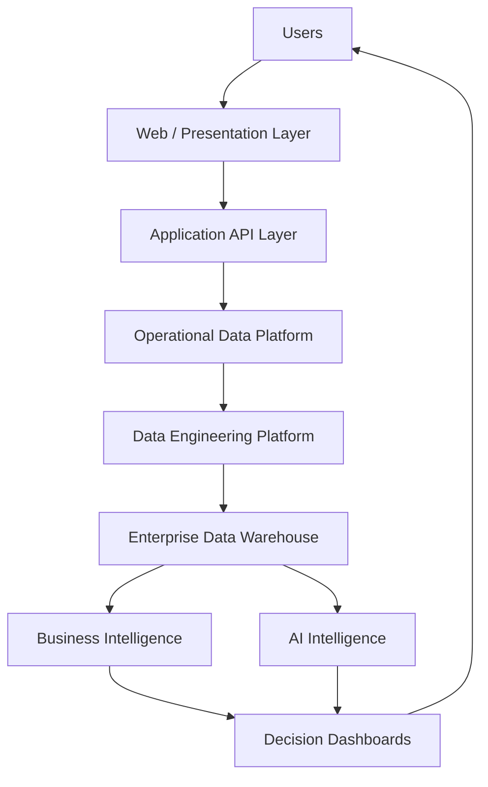

The key principle is:

> **Applications generate operational data; data engineering converts it into trusted analytical data; BI and AI convert that data into intelligence.**

---

# 3. Architecture Objectives

The architecture must satisfy the following objectives.

## 3.1 Scalability

Support growth in:

- Users
- Jobs
- Companies
- Students
- Applications
- Resumes
- AI requests
- Analytical datasets

---

## 3.2 Performance

Provide:

- Fast application APIs
- Responsive dashboards
- Efficient warehouse queries
- Asynchronous processing for expensive operations

---

## 3.3 Security

Protect:

- Identity
- Resumes
- Student records
- Applications
- Salary data
- Organizational data
- AI context

---

## 3.4 Maintainability

Allow individual domains to evolve independently.

---

## 3.5 Extensibility

Make it possible to add:

- New AI providers
- New data sources
- New dashboards
- New business modules
- New integrations

without redesigning the entire system.

---

## 3.6 Observability

Provide visibility across:

```text
Application
+
Database
+
ETL
+
Warehouse
+
AI
+
Infrastructure
```

---

# 4. Architecture Principles

Career Connect should follow these architectural principles.

## Principle 1 — Separation of Workloads

Operational, analytical, AI, and ingestion workloads should not unnecessarily compete for the same resources.

---

## Principle 2 — API First

Frontend applications should communicate with backend services through well-defined APIs.

---

## Principle 3 — Data as a Product

Analytical datasets should have:

- Ownership
- Documentation
- Quality checks
- Lineage
- Versioning

---

## Principle 4 — Secure by Default

Access should be denied unless explicitly authorized.

---

## Principle 5 — Async for Expensive Operations

Long-running workloads should not block normal HTTP requests.

Examples:

- Resume parsing
- AI analysis
- ETL
- Report generation
- Large exports

---

## Principle 6 — Observable by Default

Every major service should emit meaningful:

- Logs
- Metrics
- Events

---

## Principle 7 — Replaceable Infrastructure

External providers should be accessed through interfaces or adapters wherever practical.

---

# 5. High-Level Architecture

The complete platform can be represented as:

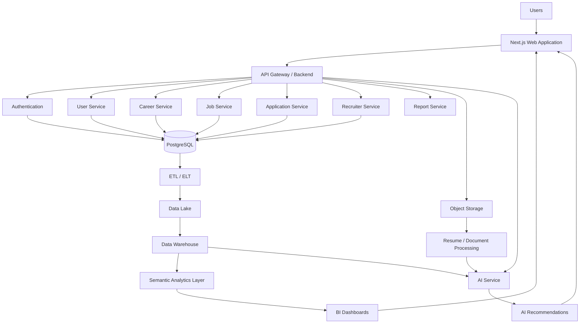

---

# 6. Major Architectural Layers

Career Connect contains nine major layers.

```text
1. Experience Layer
2. API Layer
3. Application Layer
4. Operational Data Layer
5. Data Engineering Layer
6. Data Warehouse Layer
7. Intelligence Layer
8. Infrastructure Layer
9. Security & Observability Layer
```

---

# 7. Layer 1 — Experience Layer

The experience layer provides the user-facing applications.

Primary technology:

- Next.js
- TypeScript
- Tailwind CSS
- Shadcn UI

Primary user experiences:

```text
Student Portal
College Portal
Placement Portal
Recruiter Portal
Executive Dashboard
Admin Portal
```

---

# 8. Student Experience

The student interface should provide:

```text
Dashboard
Profile
Resume
Skills
Career Recommendations
Skill Gap
Learning Roadmap
Jobs
Applications
Interviews
AI Career Coach
Reports
```

---

# 9. College Experience

The college portal should provide:

```text
Institution Dashboard
Students
Placement
Companies
Applications
Interviews
Salary Analytics
Skill Analytics
Reports
```

---

# 10. Recruiter Experience

The recruiter interface should provide:

```text
Recruiter Dashboard
Jobs
Candidates
Talent Search
Matching
Applications
Interviews
Hiring Funnel
Analytics
```

---

# 11. Executive Experience

Executives should receive a high-level analytical workspace:

```text
KPIs
Hiring Trends
Placement Trends
Salary Trends
Skill Demand
Technology Trends
Regional Analytics
```

---

# 12. Layer 2 — API Layer

The API layer exposes controlled application interfaces.

Recommended technology:

**NestJS + TypeScript**

Primary responsibilities:

- Routing
- Authentication checks
- Authorization
- Request validation
- Rate limiting
- API versioning
- Error handling

Example:

```text
/api/v1/auth
/api/v1/students
/api/v1/jobs
/api/v1/skills
/api/v1/applications
/api/v1/placements
/api/v1/analytics
/api/v1/ai
/api/v1/reports
```

---

# 13. API Gateway Concept

For the initial system, NestJS can serve as the central API boundary.

As scale increases, an API gateway can manage:

```text
Authentication
Routing
Rate Limiting
Observability
Request Policies
```

The gateway should not contain business logic.

---

# 14. Layer 3 — Application Services

The application layer contains domain-specific business capabilities.

Recommended domains:

```text
Identity
Organization
Student
Career
Skill
Job
Company
Recruitment
Application
Interview
Placement
Learning
Certification
Reporting
Notification
```

---

# 15. Domain-Driven Organization

Instead of organizing the code only by technical type:

```text
controllers/
services/
models/
```

the backend should also reflect business domains.

Example:

```text
modules/
├── auth/
├── students/
├── skills/
├── jobs/
├── companies/
├── applications/
├── interviews/
├── placements/
├── learning/
├── recruiters/
├── reports/
└── analytics/
```

This improves maintainability.

---

# 16. Recommended Backend Pattern

Each domain should approximately follow:

```text
Controller
   ↓
Application Service
   ↓
Domain Logic
   ↓
Repository
   ↓
Database
```

Example:

```text
StudentController
      ↓
StudentService
      ↓
StudentDomain
      ↓
StudentRepository
      ↓
PostgreSQL
```

---

# 17. Layer 4 — Operational Data Layer

The operational system should use:

**PostgreSQL / Supabase**

This layer is responsible for transactional workloads.

Examples:

```text
Create Student
Update Profile
Create Job
Apply to Job
Schedule Interview
Create Placement Record
Update Learning Progress
```

---

# 18. OLTP Responsibilities

The operational database should prioritize:

- Transaction integrity
- Consistency
- Low-latency access
- Referential integrity
- CRUD operations

It should not become the primary engine for heavy historical BI workloads.

---

# 19. Layer 5 — Object Storage

Cloud object storage should store large unstructured files.

Examples:

```text
Resumes
Certificates
Profile Documents
Generated Reports
Data Files
Raw Source Files
Exports
```

Conceptually:

```text
Application
    ↓
Object Storage
    ↓
Processing Pipeline
```

---

# 20. Resume Storage Architecture

A secure resume flow:


The application should store the document itself in object storage rather than unnecessarily placing large binary files inside transactional tables.

---

# 21. Layer 6 — Data Engineering Layer

The data engineering layer transforms operational and external data into analytical datasets.

Major components:

```text
Extract
Validate
Clean
Standardize
Deduplicate
Transform
Enrich
Load
Monitor
```

---

# 22. Data Source Types

Career Connect can receive data from:

```text
PostgreSQL
CSV
JSON
APIs
Institution Systems
External Data Providers
Synthetic Datasets
```

---

# 23. Data Lake

The data lake provides scalable storage for raw and processed data.

Recommended logical zones:

```text
raw/
staging/
clean/
curated/
```

---

# 24. Raw Zone

The raw zone preserves source data as received.

Example:

```text
raw/jobs/2026/07/30/jobs.csv
raw/students/2026/07/30/students.json
raw/salaries/2026/07/30/salaries.csv
```

The raw layer should generally be treated as immutable where practical.

---

# 25. Staging Zone

The staging layer performs initial standardization.

Operations include:

- Schema alignment
- Type conversion
- Basic validation
- Parsing

---

# 26. Clean Zone

The clean layer contains standardized data.

Examples:

```text
Normalized Skills
Standardized Companies
Canonical Locations
Validated Job Records
Clean Salaries
```

---

# 27. Curated Zone

The curated layer prepares business-ready datasets for warehouse loading and advanced analytics.

---

# 28. Data Pipeline Architecture

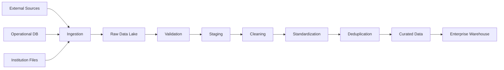

---

# 29. ETL vs ELT Strategy

Career Connect may use both approaches.

### ETL

Useful when transformation should happen before warehouse loading.

```text
Extract
↓
Transform
↓
Load
```

### ELT

Useful when the analytical warehouse can perform scalable transformations.

```text
Extract
↓
Load
↓
Transform
```

The production implementation can choose the pattern per workload.

---

# 30. Incremental Processing

Large datasets should not always be reprocessed from scratch.

Use:

```text
Created At
Updated At
Watermarks
Change Detection
```

Example:

```text
Last Successful Load
        ↓
Read New / Updated Records
        ↓
Transform
        ↓
Load
```

---

# 31. Data Quality Architecture

Each pipeline should execute quality rules.

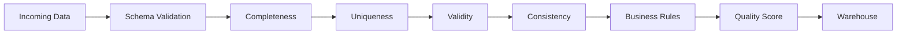

---

# 32. Layer 7 — Enterprise Data Warehouse

The warehouse is the analytical center of Career Connect.

Candidate technologies:

- BigQuery
- Snowflake

The warehouse should support:

- Historical analysis
- Aggregations
- Dimensional modeling
- Data marts
- BI
- AI context retrieval

---

# 33. Warehouse Architecture

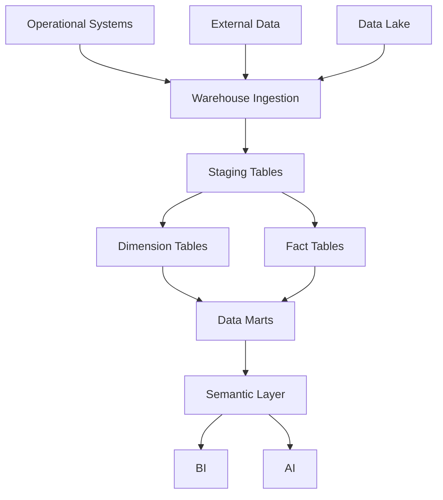

---

# 34. Dimensional Model

Core dimensions:

```text
dim_date
dim_student
dim_company
dim_job
dim_skill
dim_college
dim_location
dim_technology
dim_recruiter
dim_course
dim_certification
dim_experience
dim_employment_type
```

Core facts:

```text
fact_applications
fact_placements
fact_salaries
fact_interviews
fact_hiring
fact_learning
fact_certifications
```

---

# 35. Surrogate Keys

Warehouse dimensions should use surrogate keys wherever appropriate.

Example:

```text
student_key = 10482
```

rather than relying exclusively on an operational identifier.

Benefits include:

- Historical tracking
- Source independence
- Slowly changing dimensions
- Warehouse consistency

---

# 36. Slowly Changing Dimensions

For dimensions such as:

- Student
- Company
- College
- Job

historical changes may matter.

Example:

```text
Student Department:

2025 → Computer Science
2026 → Data Science
```

A Type 2 SCD design could preserve this history.

---

# 37. Layer 8 — Intelligence Layer

The intelligence layer consists of two major components:

```text
Business Intelligence
+
Artificial Intelligence
```

They should share trusted analytical data.

---

# 38. Business Intelligence Architecture

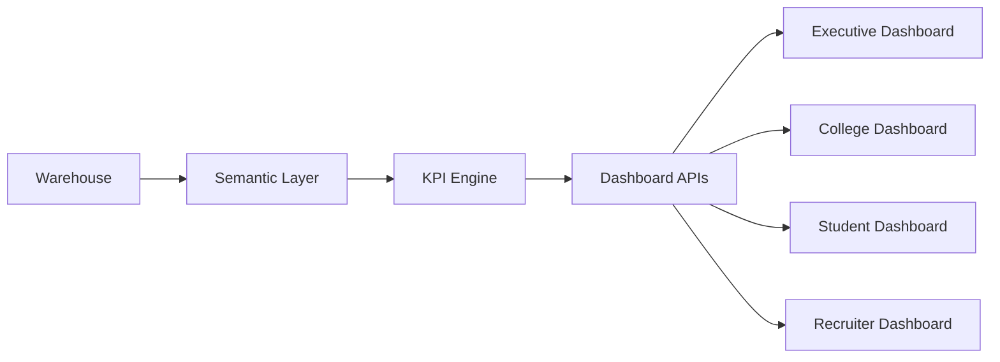

---

# 39. Semantic Layer

The semantic layer should define business metrics consistently.

Examples:

```text
Placement Rate
Average Salary
Interview Conversion
Application Conversion
Hiring Conversion
Skill Demand
```

A metric should have one official definition.

---

# 40. Example — Placement Rate

```text
Placement Rate =
Placed Eligible Students
/
Eligible Students
× 100
```

The exact definition should be formally documented in the data dictionary.

---

# 41. AI Architecture

AI should be accessed through a dedicated service.

Recommended:

**Python AI Service**

Responsibilities:

- Resume analysis
- Skill extraction
- Embeddings
- Recommendations
- AI chat
- Interview evaluation
- Learning recommendations

---

# 42. AI Gateway

The AI gateway provides an abstraction between application services and external models.

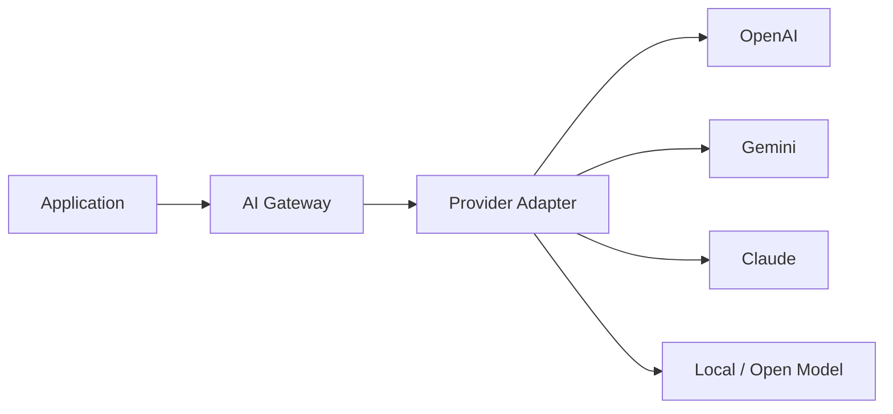

Only supported providers should be enabled in a given environment.

---

# 43. AI Context Architecture

A career recommendation request should ideally combine:

```text
User Profile
+
Current Skills
+
Target Role
+
Job Requirements
+
Market Data
+
Learning History
```

rather than relying solely on free-form user text.

---

# 44. Retrieval Architecture

For contextual AI, the system may use:

```text
User Request
↓
Intent
↓
Relevant Context
↓
Structured Data Retrieval
↓
Optional Vector Retrieval
↓
AI Model
↓
Validated Response
```

This is a foundation for retrieval-augmented generation.

---

# 45. Skill Graph

The skill graph connects:

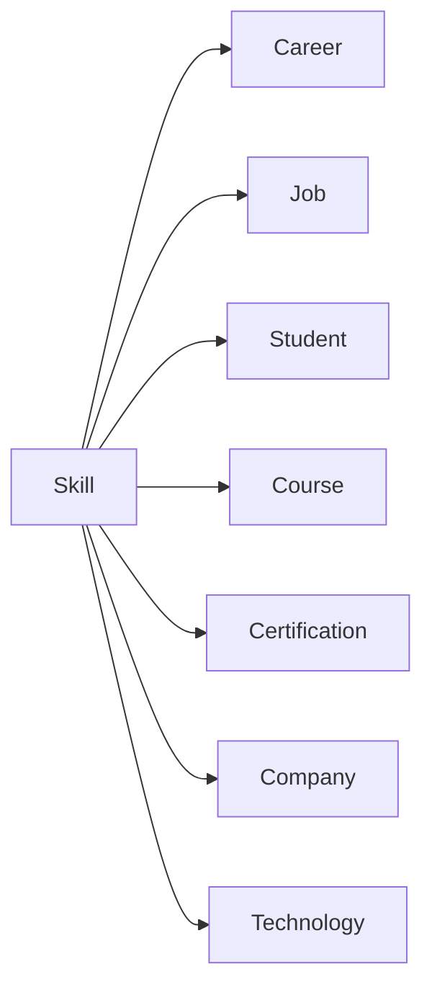

This graph becomes a central reusable intelligence structure.

---

# 46. Career Recommendation Architecture

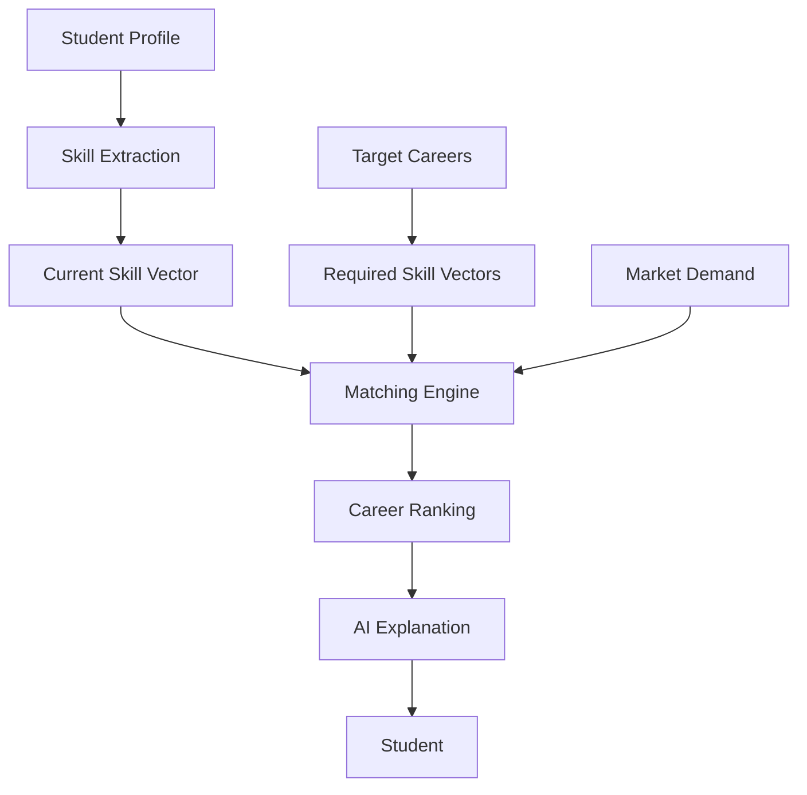

---

# 47. AI + Warehouse Interaction

The AI service should not access every table directly.

Instead:

```text
AI Request
↓
Context Service
↓
Approved Data Sources
↓
Semantic / Retrieval Layer
↓
AI Model
```

This improves:

- Security
- Governance
- Consistency
- Auditability

---

# 48. Layer 9 — Security Architecture

Security should span every layer.

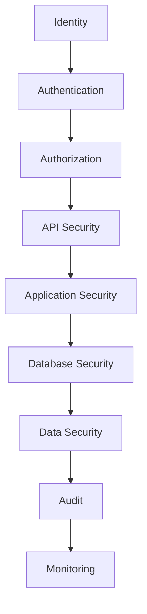

---

# 49. Authentication

Use:

- Supabase Auth
- OAuth / Google login
- Secure session management

The authentication system establishes identity but does not alone determine what a user is allowed to access.

---

# 50. Authorization

Authorization should be based on:

```text
Role
+
Organization
+
Resource
+
Action
```

Example:

```text
Placement Officer
+
College A
+
Student Record
+
View
```

---

# 51. RBAC

Initial role model:

```text
SUPER_ADMIN
ORG_ADMIN
PLACEMENT_OFFICER
FACULTY
RECRUITER
STUDENT
JOB_SEEKER
```

Roles should be extensible.

---

# 52. Object-Level Authorization

Role checks alone are not enough.

For example:

```text
Student A
```

should not be able to access:

```text
Student B's Resume
```

simply because both belong to the same broad user category.

Authorization must validate the actual resource.

---

# 53. File Security

Resume/document handling must enforce:

- File type validation
- Size limits
- Malware scanning where appropriate
- Access-controlled URLs
- Secure storage
- Retention policies

---

# 54. API Security

APIs should use:

```text
Authentication
+
Authorization
+
Validation
+
Rate Limiting
+
Logging
```

---

# 55. Database Security

Controls include:

- Least-privilege credentials
- Parameterized queries
- Encrypted connections
- Backup policies
- Restricted administrative access

---

# 56. Data Encryption

Sensitive data should be protected:

```text
In Transit
+
At Rest
```

Encryption strategy should be selected according to the capabilities of the chosen cloud/database services.

---

# 57. Audit Architecture

Important events should create audit records.

Examples:

```text
Login
Logout
Password Change
Role Change
Resume Access
Profile Update
Data Export
AI Report Generation
Admin Action
```

Example:

```text
audit_id
user_id
organization_id
action
resource_type
resource_id
timestamp
ip_address
metadata
```

---

# 58. Observability Architecture

The platform should provide centralized observability.

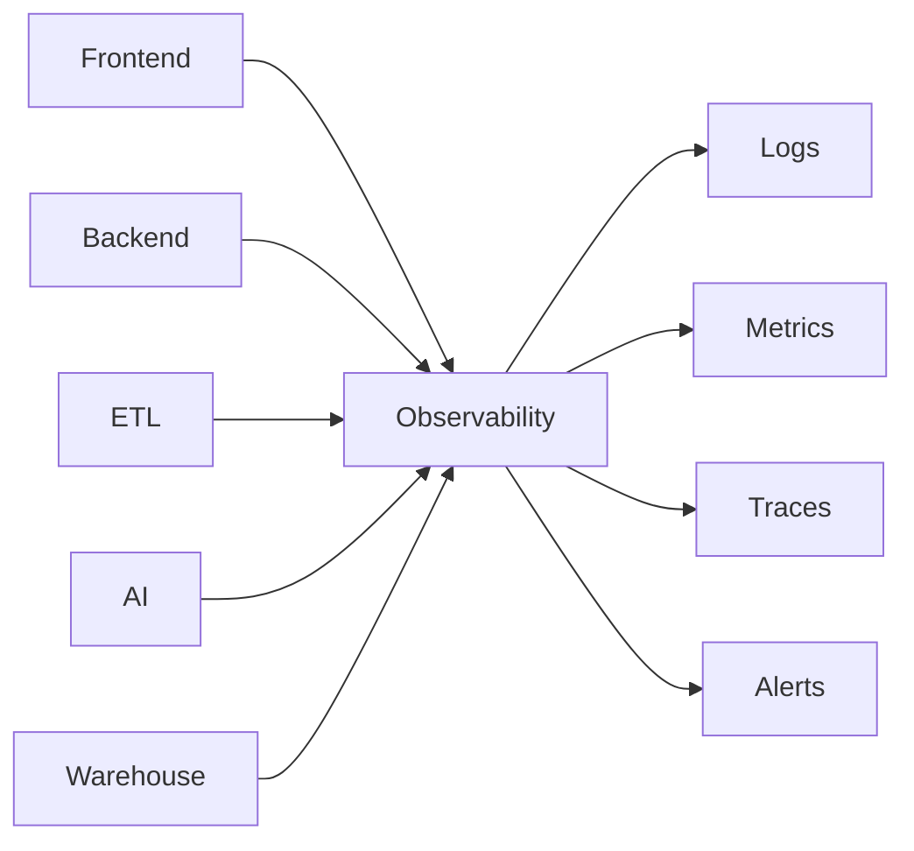

---

# 59. Application Logging

Logs should contain:

- Timestamp
- Service
- Request ID
- User/tenant context where appropriate
- Event
- Severity
- Error details

Sensitive values should not be logged unnecessarily.

---

# 60. Distributed Request Correlation

For complex workflows, use a correlation ID.

Example:

```text
request_id = cc-8f41a7
```

The same identifier can connect:

```text
Frontend
↓
API
↓
Database
↓
AI
↓
Audit Log
```

This makes troubleshooting significantly easier.

---

# 61. Event-Driven Architecture

Some workflows are naturally asynchronous.

Examples:

```text
Resume Uploaded
Job Imported
ETL Completed
Placement Updated
Report Generated
AI Analysis Completed
```

These can be represented as domain events.

---

# 62. Event Flow Example

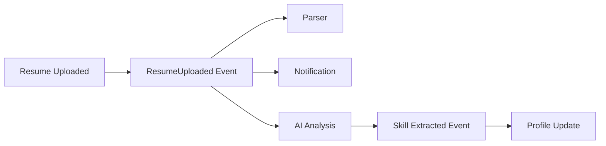

The initial implementation may use a simpler queue or job system rather than a large event-streaming infrastructure.

---

# 63. Background Jobs

Use background workers for:

- Resume processing
- AI analysis
- ETL
- Report generation
- Notifications
- Large exports

Conceptually:

```text
HTTP Request
↓
Create Job
↓
Return Job ID
↓
Worker Processes
↓
Store Result
↓
Notify User
```

---

# 64. Caching Architecture

Caching can improve:

- API response time
- Dashboard performance
- Frequently requested analytics
- Configuration lookups

Potential cache targets:

```text
Popular Jobs
Skill Metadata
Dashboard KPIs
Reference Data
AI Context
```

Caching must have explicit invalidation policies.

---

# 65. Search Architecture

A future dedicated search layer may support:

- Job search
- Candidate search
- Skill search
- Company search
- Course search

Search should remain separate from analytical warehouse querying.

---

# 66. Notification Architecture

Notifications may support:

```text
In-App
Email
Push
```

Examples:

```text
New Job Match
Interview Reminder
Skill Recommendation
Placement Update
Report Ready
```

Notifications should be asynchronous.

---

# 67. Reporting Architecture

Report generation should follow:

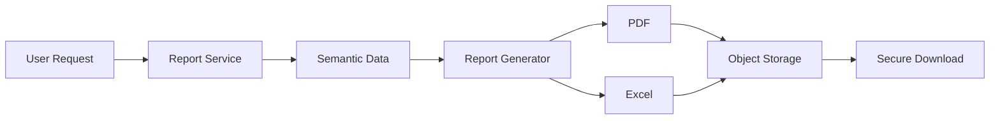

---

# 68. Export Security

Exports may contain sensitive data.

Therefore:

- Access should be authorized.
- Export actions should be audited.
- Generated files should have controlled lifetime.
- Secure, expiring download links should be preferred.

---

# 69. Multi-Tenant Architecture

The future SaaS model should introduce tenant context.

```text
Request
↓
Tenant Resolution
↓
Authorization
↓
Business Logic
↓
Tenant-Scoped Data
```

---

# 70. Tenant-Aware Data Model

Core entities may contain:

```text
tenant_id
```

where appropriate.

Example:

```text
student
├── student_id
├── tenant_id
├── name
└── ...
```

Global reference entities may not require tenant ownership if they are intentionally shared and governance permits.

---

# 71. Multi-Tenant Isolation Levels

Possible strategies:

### Level 1

Shared tables + `tenant_id`

### Level 2

Schema per tenant

### Level 3

Database per tenant

### Level 4

Dedicated infrastructure for high-isolation enterprise customers

The implementation should use the least complex model that meets the required security and isolation level.

---

# 72. Disaster Recovery

The architecture should provide:

- Database backups
- Object storage durability
- Configuration backups
- Infrastructure reproducibility
- Recovery procedures

Recovery objectives should be defined:

```text
RPO = Recovery Point Objective
RTO = Recovery Time Objective
```

Specific targets should be selected based on deployment requirements and budget.

---

# 73. High Availability

Critical application services should avoid unnecessary single points of failure.

Potential strategies:

```text
Multiple application instances
+
Managed database
+
Object storage
+
Health checks
+
Automatic restart
```

The academic deployment can use a simpler topology while preserving the production architecture.

---

# 74. Scalability Strategy

Career Connect should scale different workloads independently.

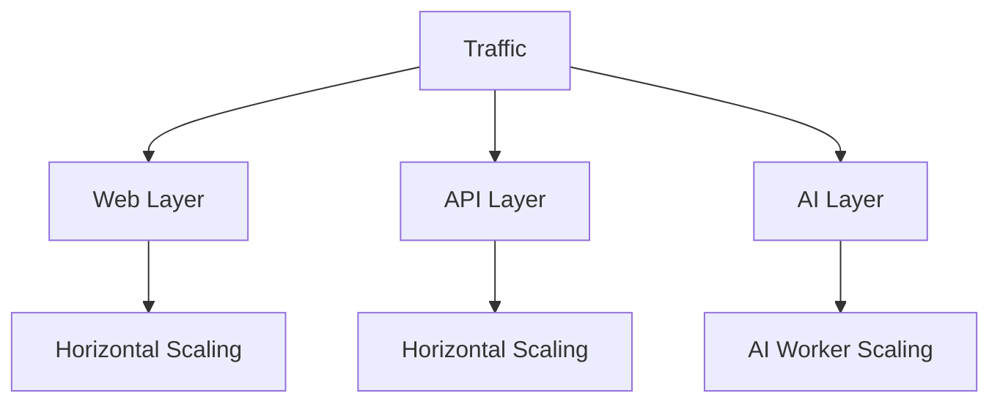

Analytical workloads scale independently through the warehouse.

---

# 75. Scaling Example

Suppose:

```text
Application Traffic ↑
```

The system should scale:

```text
Frontend / API Instances ↑
```

without necessarily scaling:

```text
Warehouse
```

at the same rate.

Similarly:

```text
AI Requests ↑
```

should primarily scale the AI worker layer.

This is an important architectural benefit of workload separation.

---

# 76. Performance Architecture

Performance should be optimized at multiple levels:

```text
Browser
↓
CDN
↓
API
↓
Cache
↓
Database
↓
Warehouse
```

Common techniques:

- Pagination
- Caching
- Query optimization
- Indexes
- Async processing
- Data partitioning
- Pre-aggregated metrics

---

# 77. Database Indexing

Operational tables should use appropriate indexes.

Example:

```text
student.email
application.student_id
application.job_id
job.company_id
job.location_id
```

Indexes should be based on measured query patterns rather than added indiscriminately.

---

# 78. Warehouse Optimization

The selected warehouse should use capabilities such as:

- Partitioning
- Clustering
- Materialized/precomputed views where beneficial
- Query optimization
- Data retention strategies

The exact implementation depends on BigQuery or Snowflake.

---

# 79. Architecture for the Academic Version

For the BE project, a realistic deployment can use:

```text
Next.js
    ↓
NestJS
    ↓
Supabase PostgreSQL
    ↓
Cloud Storage

Python AI Service
    ↓
LLM Provider

ETL
    ↓
BigQuery / Snowflake

BI Dashboard
    ↓
Warehouse
```

This provides the complete architecture without requiring dozens of infrastructure services.

---

# 80. Production Evolution

The academic topology can evolve toward:

```text
Academic MVP
     ↓
Containerized SaaS
     ↓
Managed Cloud Services
     ↓
Dedicated Workers
     ↓
Event-Driven Components
     ↓
Multi-Tenant Platform
     ↓
Enterprise Deployment
```

---

# 81. Complete System Architecture

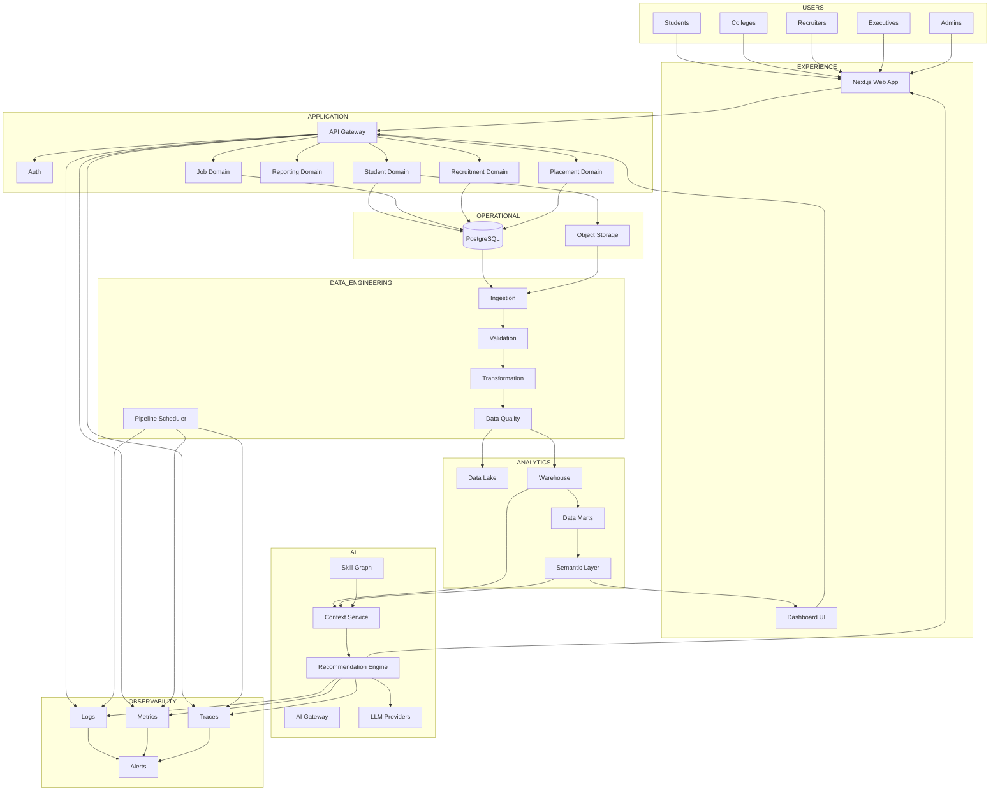

---

# 82. Architecture-to-Requirement Mapping

| Requirement         | Architectural Component    |
| ------------------- | -------------------------- |
| Student Portal      | Experience Layer           |
| Authentication      | Auth Service               |
| RBAC                | Authorization Layer        |
| Resume Upload       | Object Storage             |
| Resume AI           | AI Service                 |
| Skill Gap           | Skill Graph + AI           |
| Jobs                | Job Service                |
| Applications        | Application Service        |
| Placement           | Placement Service          |
| ETL                 | Data Engineering Layer     |
| Data Lake           | Object Storage / Data Lake |
| Warehouse           | BigQuery / Snowflake       |
| BI                  | Semantic + Dashboard Layer |
| Recruiter Analytics | Recruitment + BI           |
| Reports             | Reporting Service          |
| Security            | Security Layer             |
| Monitoring          | Observability Layer        |
| SaaS                | Tenant Architecture        |

---

# 83. Technology-to-Layer Mapping

| Layer          | Recommended Technology             |
| -------------- | ---------------------------------- |
| Web            | Next.js                            |
| Language       | TypeScript                         |
| UI             | Tailwind + Shadcn                  |
| Backend        | NestJS                             |
| AI             | Python                             |
| Operational DB | PostgreSQL                         |
| Auth           | Supabase Auth                      |
| Storage        | Cloud Object Storage               |
| Warehouse      | BigQuery / Snowflake               |
| Containers     | Docker                             |
| CI/CD          | GitHub Actions                     |
| Hosting        | Vercel + Render / Cloud            |
| BI             | Custom Dashboards / BI Integration |
| AI Providers   | OpenAI / Gemini / Claude           |
| Source Control | GitHub                             |

The exact cloud services should be selected based on cost, availability, institutional constraints, and deployment needs.

---

# 84. Architectural Trade-Off — Monolith vs Microservices

Career Connect should **not** begin as a large microservices system.

A better approach is:

> **Modular monolith first, service extraction later.**

Initial:

```text
One Backend
├── Auth
├── Students
├── Jobs
├── Applications
├── Placement
├── Reports
└── Analytics
```

Later:

```text
API
├── Student Service
├── Recruitment Service
├── AI Service
├── Reporting Service
└── Notification Service
```

This reduces early operational complexity.

---

# 85. Why Modular Monolith First?

Benefits:

- Faster development
- Easier local testing
- Lower infrastructure cost
- Simpler debugging
- Fewer deployment dependencies
- Clear domain boundaries

The architecture remains service-oriented internally, allowing later extraction.

---

# 86. When to Extract a Service

A domain should become an independent service when at least one of these becomes significant:

```text
Independent Scaling Need
Independent Deployment Need
Independent Security Boundary
High Computational Load
Different Technology Requirements
Organizational Ownership
```

This avoids microservices for the sake of appearance.

---

# 87. AI Service as an Early Exception

The AI layer is a strong candidate for independent deployment from an early stage because it uses:

- Python
- AI-specific libraries
- External models
- Specialized workloads

Therefore:

```text
NestJS Application
      ↕
Python AI Service
```

is reasonable even in the MVP.

---

# 88. ETL Service as an Independent Workload

ETL should also be separated operationally because it has:

- Different runtime characteristics
- Batch scheduling
- Heavy compute
- Data validation
- Retry requirements

Conceptually:

```text
Application Platform
        +
ETL Platform
```

rather than running heavy pipelines inside normal web API processes.

---

# 89. Architecture Quality Attributes

The architecture should be evaluated against:

```text
Scalability
Availability
Performance
Security
Maintainability
Testability
Observability
Extensibility
Portability
Data Quality
```

---

# 90. Architecture Decision Summary

| Decision        | Recommendation                 |
| --------------- | ------------------------------ |
| Backend Pattern | Modular Monolith initially     |
| AI              | Separate Python Service        |
| ETL             | Separate Data Processing Layer |
| OLTP            | PostgreSQL                     |
| Analytics       | BigQuery / Snowflake           |
| Storage         | Object Storage                 |
| Authentication  | Supabase Auth                  |
| Frontend        | Next.js                        |
| Deployment      | Containers + Cloud             |
| Communication   | REST initially                 |
| Async Workloads | Background Jobs                |
| Analytics       | Semantic Layer + Data Marts    |
| Multi-Tenancy   | Tenant-aware architecture      |
| Observability   | Logs + Metrics + Traces        |

---

# 91. Architecture Risks

## Risk 1 — Over-Engineering

Too many services may slow the project.

**Mitigation:** Modular monolith first.

---

## Risk 2 — Warehouse Complexity

A sophisticated warehouse may exceed project requirements.

**Mitigation:** Start with core facts and dimensions, expand incrementally.

---

## Risk 3 — AI Coupling

Direct dependency on a specific AI provider may create lock-in.

**Mitigation:** AI provider abstraction.

---

## Risk 4 — Data Quality

Poor data creates poor intelligence.

**Mitigation:** Data-quality framework from the beginning.

---

## Risk 5 — Security Complexity

Multi-role access can become difficult.

**Mitigation:** Central RBAC + object-level authorization + audit logs.

---

# 92. Final Architecture Principle

The architecture should always preserve this separation:

```text
TRANSACTIONAL

Users
Jobs
Applications
Profiles
Placements


↓

DATA ENGINEERING

Extract
Clean
Transform
Validate


↓

ANALYTICAL

Warehouse
Facts
Dimensions
Data Marts


↓

INTELLIGENCE

BI
AI
Recommendations
Predictions


↓

EXPERIENCE

Dashboards
Reports
Career Actions
Hiring Decisions
```

This is the central architectural pattern of Career Connect.

---

# 93. Final CTO Architecture Recommendation

The recommended architecture is:

> **A cloud-native modular platform with Next.js for experience, NestJS for application services, PostgreSQL for operational transactions, object storage for documents and raw data, a dedicated ETL/DataOps layer for analytical processing, BigQuery or Snowflake for enterprise analytics, Python-based AI services for intelligent workloads, and a semantic BI layer for dashboards and reporting.**

The initial implementation should favor a **modular monolith with dedicated AI and data-processing workloads**, then extract services as scale, security, or organizational requirements justify it.

---

# 94. Final Architecture Statement

> **Career Connect is architected as a cloud-native, data-centric intelligence platform in which operational applications, data engineering, enterprise warehousing, business intelligence, and AI are separated into distinct but connected layers. The architecture is designed to support an academic MVP today while providing a credible path toward a secure, scalable, multi-tenant SaaS platform tomorrow.**

---

## Document Status

| Attribute          | Value                                   |
| ------------------ | --------------------------------------- |
| Project            | Career Connect                          |
| Document           | System Architecture                     |
| Version            | 1.0                                     |
| Architecture Style | Cloud-Native + Modular + Data-Centric   |
| Frontend           | Next.js + TypeScript                    |
| Backend            | NestJS                                  |
| AI                 | Python AI Service                       |
| OLTP               | PostgreSQL                              |
| Warehouse          | BigQuery / Snowflake                    |
| Storage            | Cloud Object Storage                    |
| Primary Pattern    | Modular Monolith + Specialized Services |
| Data Architecture  | Data Lake + ETL + EDW + Data Marts      |
| Analytics          | BI + Semantic Layer                     |
| Security           | Auth + RBAC + Audit                     |
| Observability      | Logs + Metrics + Traces                 |
| SaaS Readiness     | Multi-Tenant Architecture               |
| Status             | Architecture Baseline                   |
