# 10 — Cloud Architecture

# Career Connect — AI Career Intelligence Platform

**Document Type:** Cloud Architecture Document
**Project:** Career Connect
**Version:** 1.0
**Status:** Cloud Architecture Baseline
**Deployment Model:** Cloud-Native
**Primary Strategy:** Managed Services + Containers + Serverless/Managed Compute
**Initial Cloud Recommendation:** Google Cloud–centric Analytics Architecture with Vercel + Supabase + Render
**Alternative Warehouse:** Snowflake
**CI/CD:** GitHub Actions

---

# 1. Executive Summary

Career Connect is fundamentally a cloud-native data and intelligence platform.

The cloud architecture must support five different workload families:

```text
Application Workloads
+
Data Workloads
+
AI Workloads
+
Analytics Workloads
+
Operational / Security Workloads
```

These workloads should not be forced into one infrastructure layer.

The recommended architecture separates them:

```text
Users
   ↓
Frontend
   ↓
Application Services
   ↓
Operational Database
   ↓
Data Lake
   ↓
ETL / ELT
   ↓
Cloud Data Warehouse
   ↓
BI + AI
```

For the proposed implementation, the frontend can be deployed on Vercel, backend and Python services can be containerized and deployed on Render, Supabase can provide managed PostgreSQL/Auth/Storage capabilities, and Google Cloud can provide object storage and BigQuery for the analytical platform. Render supports Docker-based deployments, Supabase provides managed PostgreSQL with Auth and Storage integration, Google Cloud Storage provides managed object storage, and BigQuery provides a managed analytics data warehouse.

Snowflake remains a valid alternative for the warehouse layer. Its current architecture separates data storage from compute and uses independent virtual warehouses for query workloads.

The architecture is deliberately designed so that individual vendors can be replaced without rebuilding the complete application.

---

# 2. Cloud Architecture Vision

The long-term cloud vision is:

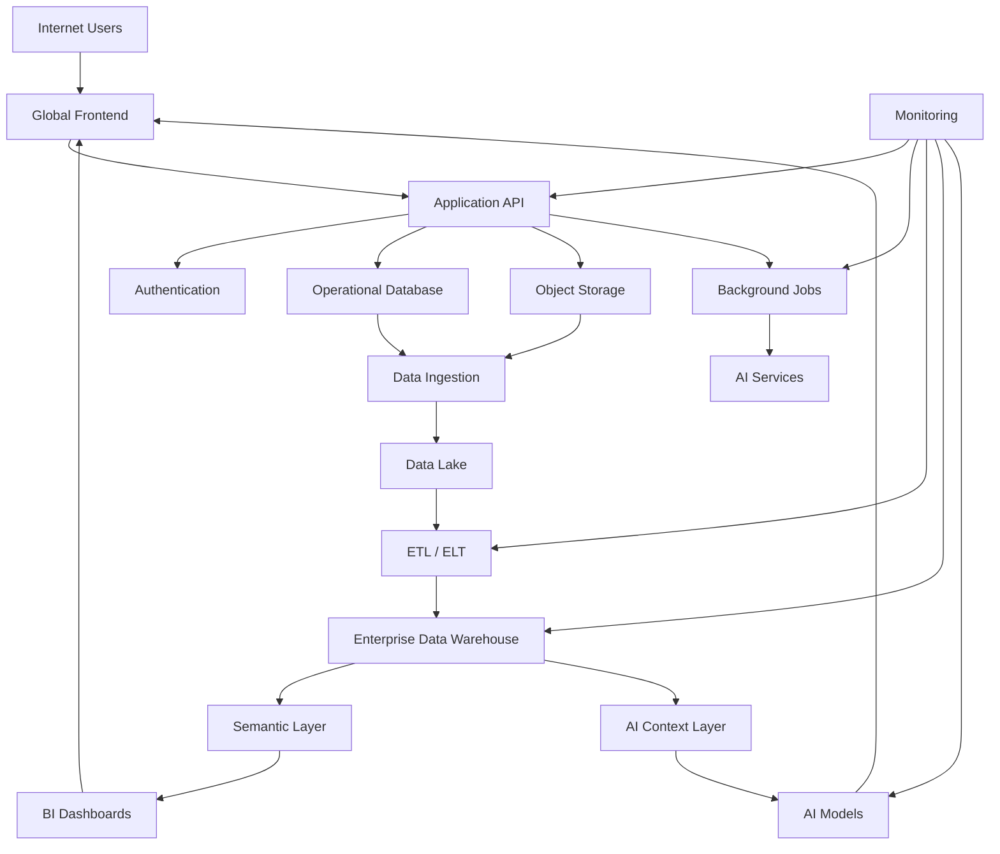

The architecture separates **transactional systems from analytical systems** and isolates expensive AI and data-processing operations from normal user requests.

---

# 3. Cloud Architecture Objectives

The cloud platform must provide:

## 3.1 Scalability

The platform should support growth in:

- Students
- Colleges
- Recruiters
- Companies
- Jobs
- Applications
- Resumes
- AI requests
- Analytical data

---

## 3.2 Availability

Core services should continue operating even when a non-critical component fails.

For example:

```text
AI unavailable
        ↓
Core Application Still Works
```

and:

```text
BI pipeline delayed
        ↓
Operational Application Still Works
```

This is an important principle of workload isolation.

---

# 4. Cloud Architecture Principles

## Principle 1 — Managed Where Possible

Managed services should be preferred when they reduce operational complexity without compromising architectural requirements.

---

## Principle 2 — Containers for Portable Services

Backend and AI services should be containerized.

This makes the workloads portable across:

- Render
- Google Cloud
- AWS
- Azure
- Kubernetes

Render currently supports deploying Docker-based services and uses containerized environments for its services.

---

## Principle 3 — Separate Compute From Data

The application should not treat the operational database as the company's analytical warehouse.

---

## Principle 4 — Object Storage for Large Files

Resumes, generated reports, raw source files, and other large objects should be stored in object storage rather than unnecessarily inside transactional database rows.

Google Cloud Storage is a managed object-storage service using buckets and objects.

---

## Principle 5 — Warehouse for Analytics

BI queries should run against the warehouse/data marts rather than heavily querying the operational application database.

BigQuery is a managed cloud data warehouse and supports analytical queries over warehouse data and external data sources including Cloud Storage.

---

## Principle 6 — Asynchronous Expensive Work

Long-running workloads should use background processing.

Examples:

```text
Resume Parsing
AI Analysis
ETL
Report Generation
Large Exports
```

---

# 5. Recommended Cloud Stack

| Layer                 | Recommended Technology                            |
| --------------------- | ------------------------------------------------- |
| Frontend              | Next.js                                           |
| Frontend Hosting      | Vercel                                            |
| Backend               | NestJS                                            |
| Backend Hosting       | Render                                            |
| AI Service            | Python                                            |
| AI Hosting            | Render initially                                  |
| Operational DB        | Supabase PostgreSQL                               |
| Authentication        | Supabase Auth                                     |
| Application Storage   | Supabase Storage / Cloud Storage                  |
| Data Lake             | Google Cloud Storage                              |
| ETL                   | Python + Scheduled Jobs                           |
| Warehouse             | BigQuery                                          |
| Alternative Warehouse | Snowflake                                         |
| Containers            | Docker                                            |
| CI/CD                 | GitHub Actions                                    |
| Source Control        | GitHub                                            |
| Monitoring            | Cloud/provider monitoring + application telemetry |
| Secrets               | Managed secret/configuration systems              |
| DNS/CDN               | Vercel / Cloud DNS depending on deployment        |

Supabase currently provides PostgreSQL as the database foundation for Auth, Storage, Realtime, and related capabilities.

---

# 6. Why a Hybrid Cloud Architecture?

Career Connect does not need to force every component into one provider.

A hybrid logical architecture can use:

```text
Vercel
   +
Supabase
   +
Render
   +
Google Cloud
```

The reason is specialization.

```text
Vercel
→ Frontend Delivery

Supabase
→ Postgres + Auth + Application Storage

Render
→ Containerized Backend / AI

Google Cloud
→ Data Lake + Warehouse
```

This keeps each workload aligned with an appropriate service.

---

# 7. Alternative — Single Cloud Architecture

A future enterprise deployment can consolidate more components into Google Cloud.

Conceptually:

```text
Cloud Load Balancer
        ↓
Cloud Run / Managed Compute
        ↓
Cloud SQL
        ↓
Cloud Storage
        ↓
BigQuery
        ↓
BI / AI
```

This may reduce cross-provider complexity but can increase dependence on one cloud ecosystem.

---

# 8. Application Cloud Architecture

The application plane is:

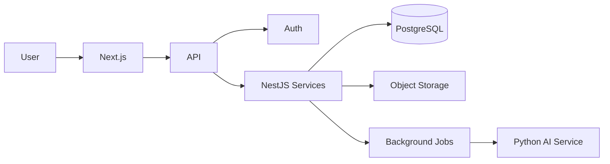

---

# 9. Frontend Hosting

Next.js should be deployed independently from backend services.

A suitable initial model is:

```text
GitHub
   ↓
Vercel
   ↓
Next.js
   ↓
Users
```

Vercel provides deployment infrastructure for Next.js applications and supports deployment workflows connected to Git repositories.

---

# 10. Frontend Responsibilities

The frontend should handle:

- Authentication UI
- Dashboard rendering
- User interaction
- Form validation
- Client-side state
- Visualization
- API communication

The frontend should not contain sensitive business rules that must be enforced server-side.

---

# 11. Backend Cloud Architecture

The backend should run as a containerized NestJS service.

```text
GitHub
   ↓
Docker Build
   ↓
Container Registry / Deployment
   ↓
Render
   ↓
NestJS API
```

Render supports Docker-based service deployment directly from repositories or prebuilt images.

---

# 12. Backend Service Responsibilities

The backend handles:

```text
Authentication
Authorization
Business Logic
CRUD
Application Workflows
Reporting Requests
AI Orchestration
Data Access
Audit Events
```

---

# 13. Application Database

Supabase PostgreSQL should serve as the transactional system.

Main entities:

```text
Users
Organizations
Students
Companies
Recruiters
Jobs
Applications
Interviews
Placements
Courses
Certifications
Learning Progress
```

Supabase provides managed PostgreSQL and integrates its Auth and Storage capabilities with the project database.

---

# 14. Supabase Authentication Architecture

Authentication flow:

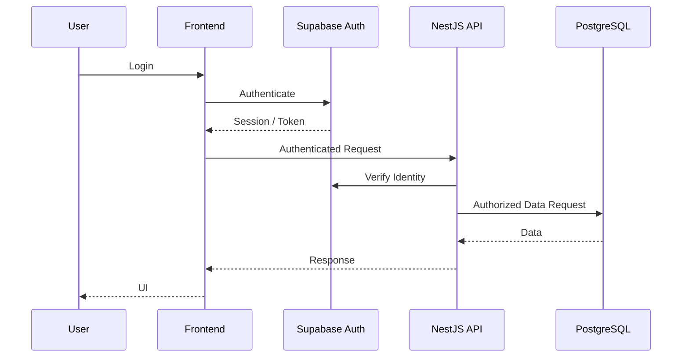

Supabase Auth integrates with PostgreSQL and supports authorization patterns involving Row Level Security.

---

# 15. Operational Database Security

The database should not be exposed directly to arbitrary internet clients.

Preferred model:

```text
User
 ↓
Frontend
 ↓
Backend API
 ↓
Database
```

Direct database access should be restricted to trusted services and controlled administrative tooling.

---

# 16. Object Storage Architecture

Two categories of storage should be distinguished.

## Application Object Storage

For:

- Resumes
- Certificates
- Generated reports

## Data Lake Storage

For:

- Raw datasets
- Staging datasets
- Curated files
- ETL artifacts

Google Cloud Storage is designed for scalable managed object storage using buckets and objects.

---

# 17. Resume Storage Model

```text
gs://career-connect-data/

resumes/
    tenant/
        student/
            resume.pdf
```

The exact bucket naming strategy should be defined during implementation.

Access should use controlled authorization and preferably short-lived signed access mechanisms rather than public objects.

---

# 18. Data Lake Architecture

Recommended structure:

```text
career-connect-data/

raw/
├── jobs/
├── companies/
├── salaries/
├── skills/
├── colleges/
└── placements/

staging/
├── jobs/
├── salaries/
└── placements/

clean/
├── jobs/
├── companies/
├── skills/
└── locations/

curated/
├── career/
├── recruitment/
├── placement/
├── salary/
└── learning/
```

---

# 19. Data Lake Design Principle

The data lake should preserve raw source information sufficiently to support:

- Reprocessing
- Auditing
- Historical comparison
- Pipeline debugging
- Schema evolution

Raw data should not be unnecessarily overwritten.

---

# 20. ETL Compute Architecture

The ETL layer should run separately from the web application.

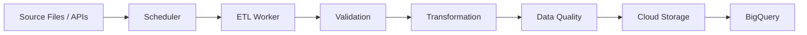

---

# 21. ETL Scheduling

Initial implementation:

```text
Daily
Weekly
Manual Trigger
```

Future:

```text
Hourly
Event Triggered
Near Real Time
```

Scheduling frequency should depend on actual source freshness requirements.

---

# 22. Incremental ETL

The pipeline should store:

```text
last_successful_run
watermark
source_version
row_count
error_count
```

Example:

```text
New Data
    ↓
Compare Last Updated
    ↓
Load Changed Records
    ↓
Transform
    ↓
Warehouse
```

---

# 23. Warehouse — BigQuery Recommendation

For the initial cloud/data-warehouse implementation, BigQuery is recommended because it naturally fits the Google Cloud object-storage/data-warehouse architecture.

BigQuery is a fully managed cloud data warehouse and can query data in the warehouse or external data such as Cloud Storage. Its architecture also separates storage and compute.

---

# 24. BigQuery Logical Architecture

```text
Google Cloud Project
│
├── Dataset: raw
├── Dataset: staging
├── Dataset: warehouse
├── Dataset: marts
└── Dataset: analytics
```

Example:

```text
career_connect_dw
├── dim_student
├── dim_company
├── dim_job
├── dim_skill
├── dim_date
├── fact_application
├── fact_placement
├── fact_salary
└── fact_interview
```

---

# 25. BigQuery Storage and Compute

BigQuery's architecture separates storage and compute, which aligns well with Career Connect's requirement to scale analytical storage and query workloads independently.

This allows the analytical layer to evolve independently from the operational application.

---

# 26. Snowflake Alternative

Snowflake is a valid alternative if the project prioritizes a Snowflake-centric data-platform story.

Snowflake uses separate compute resources called virtual warehouses, and each warehouse is an independent compute cluster.

Conceptually:

```text
Data
 ↓
Snowflake Storage
 ↓
Virtual Warehouse
 ↓
Analytics
```

---

# 27. BigQuery vs Snowflake

| Dimension              | BigQuery                   | Snowflake                             |
| ---------------------- | -------------------------- | ------------------------------------- |
| Cloud Orientation      | Google Cloud native        | Multi-cloud architecture              |
| Storage                | Managed                    | Managed                               |
| Compute                | Managed                    | Virtual Warehouses                    |
| Best Fit               | GCP-centric data platform  | Warehouse-centric enterprise platform |
| Career Connect Role    | Recommended initial choice | Strong alternative                    |
| Operational Complexity | Low                        | Low–Medium                            |
| Learning Value         | Excellent                  | Excellent                             |

This is an architectural recommendation, not a claim that one warehouse is universally superior.

Snowflake officially describes its architecture as using cloud infrastructure with separate storage and compute layers and independently managed virtual warehouses.

---

# 28. Recommended Warehouse Decision

For this project:

> **Primary:** BigQuery

> **Alternative:** Snowflake

Reason:

```text
Cloud Storage
+
BigQuery
+
GCP Analytics
```

creates a coherent data-engineering demonstration.

Snowflake should remain a documented alternative for the startup/enterprise version.

---

# 29. AI Cloud Architecture

The AI layer should be independent from the core backend.

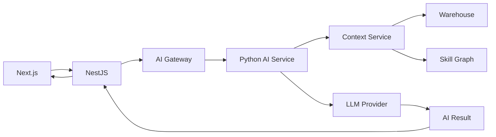

---

# 30. AI Compute Strategy

AI workloads should be separated into:

### Synchronous

Fast:

- Career question
- Simple explanation
- Skill lookup

### Asynchronous

Expensive:

- Resume analysis
- Mock interview analysis
- Large report generation
- Batch recommendations

This reduces API latency.

---

# 31. AI Cost Control

The cloud design should include:

```text
Model Routing
+
Caching
+
Usage Limits
+
Prompt Optimization
+
Batch Processing
```

For example:

```text
Simple Request
→ Smaller / Lower-Cost Model

Complex Analysis
→ Advanced Model
```

The actual model-routing policy should be based on measured quality and cost.

---

# 32. AI Provider Abstraction

Use:

```text
AI Gateway
    |
    +--- OpenAI
    |
    +--- Gemini
    |
    +--- Claude
    |
    +--- Future Provider
```

The application should call:

```text
careerAI.analyze()
```

rather than directly embedding provider-specific logic throughout the application.

---

# 33. Cloud Network Architecture

A production deployment should conceptually separate:

```text
Public Zone
Private Application Services
Private Data Layer
Analytics Layer
Management / Monitoring
```

Conceptually:

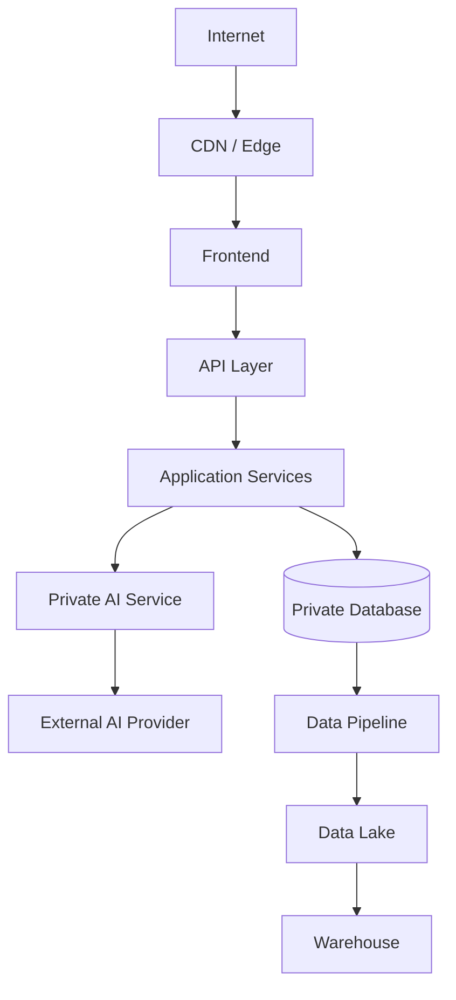

The exact networking implementation depends on the selected cloud providers.

---

# 34. Public vs Private Resources

## Publicly Accessible

Only components that require internet access:

- Frontend
- API endpoints
- Authentication endpoints

## Restricted

- Database
- ETL workers
- Internal AI workers
- Warehouse administration
- Secrets

---

# 35. Domain and DNS Architecture

Recommended:

```text
careerconnect.ai
```

Conceptual routing:

```text
careerconnect.ai
    ↓
Frontend

api.careerconnect.ai
    ↓
Backend

ai.careerconnect.ai
    ↓
AI Service
```

Internal services should not necessarily receive public DNS names.

---

# 36. CDN and Edge Strategy

Static and cacheable frontend content should be delivered through the frontend hosting/CDN layer.

Dynamic API traffic should continue through the backend API.

The key separation is:

```text
Static / Cached
→ Edge

Dynamic / Secure
→ Backend
```

---

# 37. Background Job Architecture

Use an asynchronous job model.

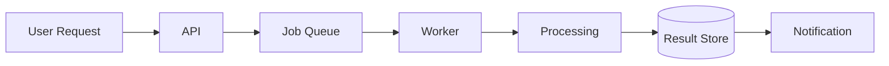

Initial implementation can use a managed/background job mechanism appropriate to the deployment platform.

---

# 38. Scheduled Data Jobs

Scheduled jobs include:

```text
Daily Job Import
Daily Salary Refresh
Weekly Skill Aggregation
Weekly Placement Refresh
Monthly Reports
```

The schedule should remain configurable.

---

# 39. Report Generation

PDF/Excel exports should not block the main request thread.

Architecture:

```text
User
 ↓
Request Report
 ↓
Create Job
 ↓
Worker
 ↓
Query Warehouse
 ↓
Generate File
 ↓
Object Storage
 ↓
Secure Download
```

---

# 40. Business Intelligence Cloud Architecture

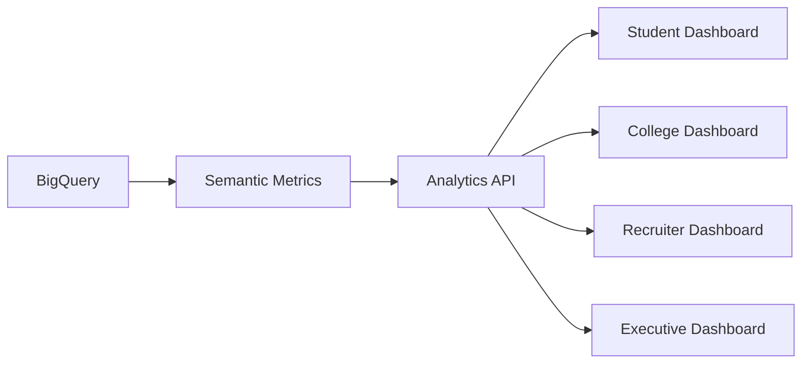

The frontend should not execute unrestricted warehouse queries directly.

---

# 41. Semantic Layer

The semantic layer should define:

```text
Metric
Dimension
Filter
Time Grain
Business Rule
```

Example:

```text
Metric:
Placement Rate

Dimensions:
College
Department
Year

Filters:
Eligible Students
```

---

# 42. Natural-Language BI Architecture

Future architecture:

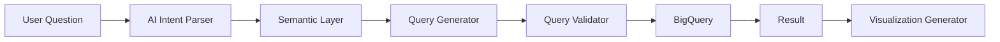

The generated query must be constrained to approved datasets and business metrics.

---

# 43. Monitoring Architecture

The cloud monitoring system should observe:

```text
Frontend
Backend
Database
ETL
Warehouse
AI
Storage
CI/CD
```

---

# 44. Application Metrics

Monitor:

```text
Request Rate
Error Rate
Latency
Active Users
API Usage
Authentication Failures
```

---

# 45. Data Metrics

Monitor:

```text
Rows Ingested
Rows Rejected
Pipeline Duration
Data Freshness
Data Quality
Warehouse Load
```

---

# 46. AI Metrics

Monitor:

```text
Requests
Success Rate
Latency
Usage Cost
Evaluation Score
Failures
```

---

# 47. Business Metrics

Monitor:

```text
Users
Applications
Interviews
Placements
Recommendations
Reports
Recruiter Searches
```

This allows technical health to be linked to product health.

---

# 48. Disaster Recovery Architecture

The cloud platform should maintain:

```text
Database Backups
+
Object Storage Durability
+
Versioned Deployments
+
Infrastructure Configuration
+
ETL Reproducibility
```

Supabase documents database backups and point-in-time recovery capabilities on applicable plans, while cloud object storage provides durable managed storage.

Exact recovery objectives should be defined per environment.

---

# 49. Recovery Objectives

Define:

## RPO

**Recovery Point Objective**

> How much data can the business afford to lose?

## RTO

**Recovery Time Objective**

> How quickly must the service recover?

Example target categories:

```text
Academic Demo
→ Best Effort

Production SaaS
→ Defined RPO / RTO

Enterprise
→ Contractual RPO / RTO
```

---

# 50. Backup Strategy

Back up:

```text
Operational Database
Configuration
Critical Metadata
Infrastructure Definitions
```

Raw analytical datasets should also have appropriate lifecycle/retention policies.

---

# 51. Disaster Scenario

Suppose:

```text
Application Server Failure
```

Expected result:

```text
Frontend
✓ Available

Database
✓ Available

Data Lake
✓ Available

Warehouse
✓ Available

AI
Potentially Degraded

API
Replacement Instance
```

This illustrates why workloads are separated.

---

# 52. Security Architecture in the Cloud

Security layers:

```text
Identity
↓
Authentication
↓
Authorization
↓
Network
↓
Application
↓
Database
↓
Storage
↓
Monitoring
```

---

# 53. Secret Management

Never store:

```text
API Keys
Database Passwords
JWT Secrets
Cloud Credentials
AI Credentials
```

in Git.

Use environment variables during development and a managed secret system for production.

---

# 54. CI/CD Cloud Architecture

GitHub Actions can automate build, testing, and deployment workflows. GitHub documents Actions as a CI/CD platform that can build and test pull requests and deploy changes to environments.

Recommended:

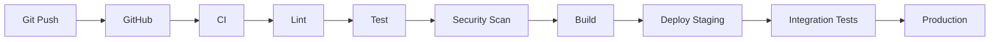

---

# 55. Environment Architecture

Three primary environments:

```text
Development
    ↓
Staging
    ↓
Production
```

Each should have:

- Separate environment variables
- Separate credentials
- Appropriate database separation
- Environment-specific configuration

---

# 56. Production Deployment Strategy

For the proposed initial stack:

```text
GitHub
  |
  +---- Vercel
  |       |
  |      Next.js
  |
  +---- Render
  |       |
  |      NestJS
  |       |
  |      Python AI
  |
  +---- Supabase
  |       |
  |      PostgreSQL
  |       |
  |      Auth / Storage
  |
  +---- Google Cloud
          |
      Cloud Storage
          |
       BigQuery
```

This is the recommended baseline topology for the academic/startup MVP.

---

# 57. Cloud Architecture — End-to-End

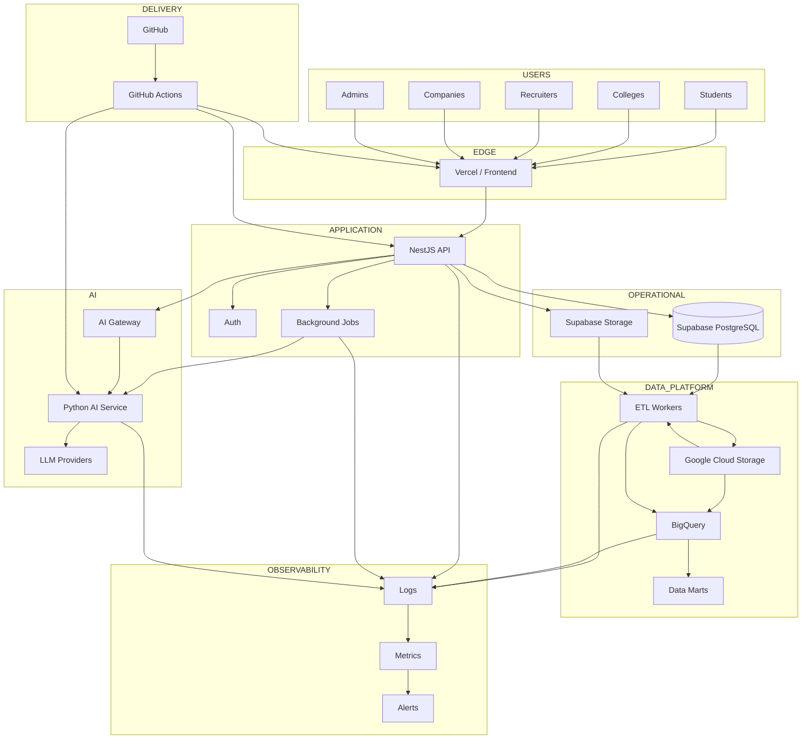

---

# 58. Cloud Security Boundaries

The architecture should establish clear trust boundaries.

```text
Internet
   │
   ▼
Frontend
   │
   ▼
API Boundary
   │
   ├── Auth
   ├── Application
   └── Authorization
        │
        ├── Operational DB
        ├── Storage
        └── AI
             │
             └── External AI Providers
```

The data warehouse should not be treated as an unrestricted data source for every application feature.

---

# 59. Data Access Governance

Access should follow:

```text
Who?
+
What?
+
Which Tenant?
+
Which Data?
+
Which Action?
+
Why?
```

Examples:

### Student

Can access:

```text
Own Profile
Own Resume
Own Applications
Own Learning Data
```

### Placement Officer

Can access:

```text
Authorized College Students
Placement Analytics
Company Data
```

### Recruiter

Can access:

```text
Authorized Candidate Profiles
Relevant Jobs
Hiring Data
```

---

# 60. Cost Architecture

Cloud cost should be divided into:

```text
Frontend
Backend
Database
Storage
ETL
Warehouse
AI
Monitoring
Networking
```

The highest variable-cost components are likely to be workload-dependent, particularly AI and analytical processing.

Snowflake, for example, explicitly documents compute, storage, data transfer, and cloud-services costs as separate cost considerations; BigQuery likewise requires deliberate query and storage cost management.

---

# 61. Cost Optimization Strategy

Use:

```text
Caching
+
Batch Processing
+
Incremental ETL
+
Warehouse Optimization
+
AI Model Routing
+
Lifecycle Policies
+
Usage Monitoring
```

---

# 62. Academic Cost Optimization

For a college demonstration:

```text
Small Dataset
+
Limited AI Requests
+
Scheduled ETL
+
Minimal Cloud Instances
+
Limited Retention
```

should be sufficient to demonstrate the architecture.

Production-scale infrastructure should not be provisioned simply to create an impressive architecture diagram.

---

# 63. Cloud Scaling Model

The architecture should scale independently.

```text
Users ↑
→ Frontend/API Scale

AI Requests ↑
→ AI Worker Scale

Data Volume ↑
→ Storage/Warehouse Scale

ETL Volume ↑
→ ETL Worker Scale
```

This is the primary reason for separating workload domains.

---

# 64. Cloud Maturity Roadmap

```text
Level 1
Local Development

↓

Level 2
Cloud MVP

↓

Level 3
Containerized Services

↓

Level 4
CI/CD + Monitoring

↓

Level 5
Autoscaling + Managed Data Platform

↓

Level 6
Multi-Tenant SaaS

↓

Level 7
Enterprise Cloud Architecture
```

---

# 65. Academic Deployment

The recommended academic deployment:

```text
Next.js
→ Vercel

NestJS
→ Render

Python AI
→ Render

PostgreSQL
→ Supabase

Auth
→ Supabase Auth

Storage
→ Supabase Storage / Cloud Storage

Warehouse
→ BigQuery

Source Control
→ GitHub

CI/CD
→ GitHub Actions
```

Render supports Docker services, Supabase provides managed Postgres/Auth/Storage capabilities, and GitHub Actions can automate build/test/deployment workflows.

---

# 66. Startup MVP Deployment

For a startup MVP:

```text
Vercel
+
Render
+
Supabase
+
Google Cloud
+
GitHub Actions
```

remains a practical starting topology.

As scale increases, components can migrate toward a more consolidated cloud architecture where justified.

---

# 67. Enterprise Deployment

A mature enterprise deployment could become:

```text
Cloud Load Balancer
        ↓
Application Services
        ↓
Private Database
        ↓
Private Data Processing
        ↓
Enterprise Data Lake
        ↓
Enterprise Warehouse
        ↓
Governed BI
        ↓
Governed AI
```

Additional capabilities could include:

- Private networking
- Dedicated environments
- SSO
- Enterprise IAM
- Security monitoring
- Dedicated data isolation
- Disaster recovery regions

---

# 68. Vendor-Neutral Abstraction

The application should avoid hardcoding cloud-specific behavior unnecessarily.

Example:

```text
StorageService
    |
    +-- SupabaseStorage
    +-- GoogleCloudStorage
    +-- S3CompatibleStorage
```

Similarly:

```text
WarehouseService
    |
    +-- BigQueryAdapter
    +-- SnowflakeAdapter
```

This creates portability.

---

# 69. Cloud Architecture Decision Matrix

| Decision         | Recommended         | Alternative                  |
| ---------------- | ------------------- | ---------------------------- |
| Frontend Hosting | Vercel              | Cloud Run / equivalent       |
| Backend Hosting  | Render              | Cloud Run                    |
| Database         | Supabase PostgreSQL | Managed PostgreSQL           |
| Auth             | Supabase Auth       | Cloud identity provider      |
| App Storage      | Supabase Storage    | Cloud Storage                |
| Data Lake        | Cloud Storage       | S3-compatible object storage |
| Warehouse        | BigQuery            | Snowflake                    |
| AI Service       | Python              | Managed AI runtime           |
| Containers       | Docker              | Managed build/runtime        |
| CI/CD            | GitHub Actions      | Cloud-native CI/CD           |
| Architecture     | Hybrid              | Single Cloud                 |

---

# 70. Cloud Architecture Risks

## Risk 1 — Multi-Cloud Complexity

Using multiple vendors increases:

- Configuration complexity
- Networking complexity
- Operational overhead

### Mitigation

Keep the number of cross-provider dependencies small and abstract provider interfaces.

---

## Risk 2 — Vendor Lock-In

Deep use of provider-specific features can make migration difficult.

### Mitigation

Use:

- Containers
- Portable SQL
- Storage interfaces
- Warehouse adapters
- Infrastructure documentation

---

## Risk 3 — Cost Sprawl

Multiple services can create unnoticed recurring costs.

### Mitigation

Implement:

- Budgets
- Alerts
- Usage dashboards
- Resource tagging
- Lifecycle policies

---

## Risk 4 — Secrets Mismanagement

Cloud credentials can be leaked through code or logs.

### Mitigation

Use managed secret/configuration systems and CI/CD secret stores.

---

## Risk 5 — Data Residency

Institutional or user data may have location-specific requirements.

### Mitigation

Select storage/processing regions and contractual configurations appropriate to the deployment.

---

# 71. Recommended Cloud Architecture by Environment

## Development

```text
Local Docker
+
Supabase Development
+
Small Warehouse Dataset
```

## Staging

```text
Vercel Preview
+
Render Staging
+
Supabase Staging
+
BigQuery Staging Dataset
```

## Production

```text
Vercel Production
+
Render Production
+
Supabase Production
+
Google Cloud Storage
+
BigQuery Production
+
Monitoring
```

---

# 72. Cloud Governance

Every production resource should have:

```text
Owner
Environment
Purpose
Cost Center
Data Classification
Retention
Security Level
```

Example:

```text
resource = career-connect-prod-bq
environment = production
owner = data-platform
classification = confidential
```

---

# 73. Data Classification

Recommended classification:

### Public

Aggregated public market trends.

### Internal

Operational metrics.

### Confidential

Student and recruiter information.

### Restricted

Sensitive authentication, security, and highly sensitive organizational data.

The classification should determine access and retention rules.

---

# 74. Cloud Data Lifecycle

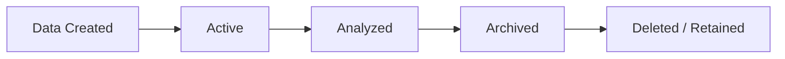

Retention should be driven by:

- Business purpose
- Legal requirements
- Institutional policy
- Storage cost

---

# 75. Cloud Architecture — Final Reference Model

```text
                         INTERNET
                            │
                            ▼
                   ┌─────────────────┐
                   │ VERCEL / EDGE   │
                   │ Next.js         │
                   └────────┬────────┘
                            │
                            ▼
                   ┌─────────────────┐
                   │ BACKEND API     │
                   │ NestJS          │
                   │ Render          │
                   └────────┬────────┘
                            │
              ┌─────────────┼─────────────┐
              ▼             ▼             ▼
        ┌──────────┐  ┌──────────┐  ┌──────────┐
        │ Supabase │  │ Storage  │  │ AI       │
        │ Postgres │  │          │  │ Service  │
        │ + Auth   │  │          │  │ Python   │
        └────┬─────┘  └────┬─────┘  └────┬─────┘
             │             │              │
             └─────────────┼──────────────┘
                           ▼
                  ┌──────────────────┐
                  │ DATA ENGINEERING │
                  │ ETL / ELT        │
                  └────────┬─────────┘
                           ▼
                  ┌──────────────────┐
                  │ CLOUD STORAGE    │
                  │ DATA LAKE        │
                  └────────┬─────────┘
                           ▼
                  ┌──────────────────┐
                  │ BIGQUERY         │
                  │ DATA WAREHOUSE   │
                  └────────┬─────────┘
                           ▼
                  ┌──────────────────┐
                  │ DATA MARTS       │
                  │ SEMANTIC LAYER   │
                  └───────┬───┬──────┘
                          │   │
                  ┌───────┘   └────────┐
                  ▼                    ▼
           ┌──────────────┐    ┌──────────────┐
           │ BI DASHBOARD │    │ AI CONTEXT   │
           └──────────────┘    └──────┬───────┘
                                      ▼
                                ┌────────────┐
                                │ AI MODELS  │
                                └────────────┘

          GITHUB ──> GITHUB ACTIONS ──> DEPLOYMENT
```

---

# 76. Final Cloud Architecture Decision

The recommended architecture for Career Connect is:

> **Hybrid cloud-native architecture with Vercel for the Next.js experience layer, Render for containerized NestJS/Python services, Supabase for managed PostgreSQL and authentication, Google Cloud Storage for the data lake, BigQuery for the enterprise analytics warehouse, and GitHub Actions for CI/CD.**

This architecture provides a practical balance between:

- Development speed
- Cloud capability
- Data engineering depth
- AI integration
- Portability
- Academic demonstrability
- Startup readiness

The services named above currently document support for the corresponding deployment/storage/database/analytics capabilities.

---

# 77. Final CTO Recommendation

For the academic implementation, **do not deploy a complicated Kubernetes or multi-region architecture simply to appear enterprise-grade**.

Instead, demonstrate the architecture through real working boundaries:

```text
Frontend
        ↓
Backend
        ↓
Operational Database
        ↓
ETL
        ↓
Data Lake
        ↓
Warehouse
        ↓
BI
        ↓
AI
```

That is enough to prove the central architectural thesis.

As the product grows, the architecture can evolve independently toward:

```text
Managed Containers
→ Event-Driven Processing
→ Multi-Tenant SaaS
→ Enterprise Security
→ High Availability
→ Global Deployment
```

---

# 78. Final Cloud Architecture Statement

> **Career Connect will use a cloud-native, workload-isolated architecture in which frontend delivery, application services, transactional data, object storage, data engineering, analytics, AI, and CI/CD are independently scalable and operationally governed. The initial implementation prioritizes managed services and container portability, while the architectural interfaces preserve a path toward BigQuery/Snowflake analytics, enterprise security, multi-tenancy, and global SaaS deployment.**

---

## Document Status

| Attribute             | Value                                   |
| --------------------- | --------------------------------------- |
| Project               | Career Connect                          |
| Document              | Cloud Architecture                      |
| Version               | 1.0                                     |
| Architecture          | Hybrid Cloud-Native                     |
| Frontend              | Next.js + Vercel                        |
| Backend               | NestJS + Render                         |
| AI                    | Python + Render                         |
| Database              | Supabase PostgreSQL                     |
| Auth                  | Supabase Auth                           |
| Storage               | Supabase Storage / Google Cloud Storage |
| Data Lake             | Google Cloud Storage                    |
| Warehouse             | BigQuery                                |
| Warehouse Alternative | Snowflake                               |
| Containers            | Docker                                  |
| CI/CD                 | GitHub Actions                          |
| Primary Strategy      | Managed Services + Portable Containers  |
| SaaS Readiness        | Yes                                     |
| Enterprise Path       | Yes                                     |
| Status                | Cloud Architecture Baseline             |
