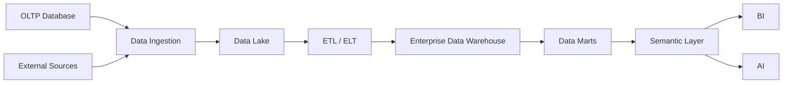
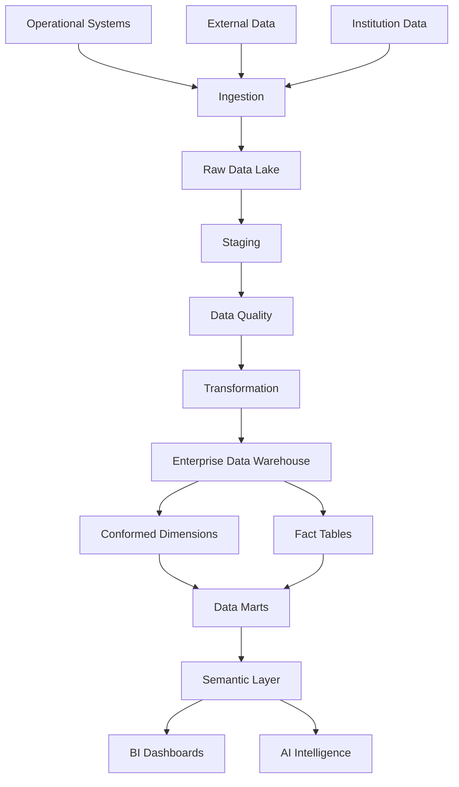
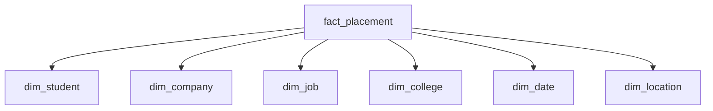
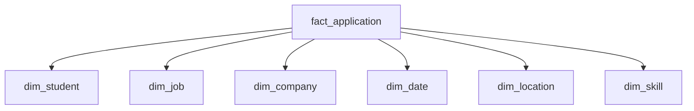
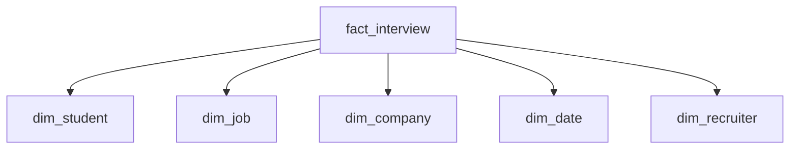
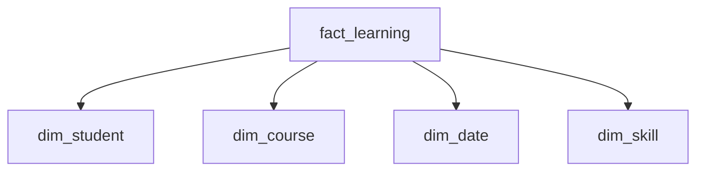
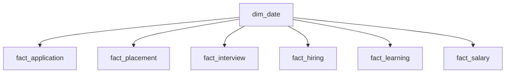
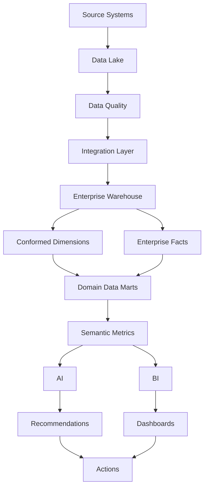

# 11 — Data Warehouse Architecture

# Career Connect — AI Career Intelligence Platform

**Document Type:** Enterprise Data Warehouse Architecture
**Project:** Career Connect
**Version:** 1.0
**Status:** Data Architecture Baseline
**Architecture Style:** Dimensional + Layered + Cloud-Native
**Primary Warehouse:** BigQuery
**Alternative Warehouse:** Snowflake
**Data Strategy:** Data Lake + Enterprise Data Warehouse + Data Marts + Semantic Layer

---

# 1. Executive Summary

The Data Warehouse is the analytical core of Career Connect.

The operational application database is designed to handle transactional workloads such as:

```text
Create Student
Update Profile
Create Job
Apply to Job
Schedule Interview
Record Placement
```

The data warehouse is designed for fundamentally different workloads:

```text
Historical Analysis
Trend Analysis
Aggregations
KPI Calculation
Cross-Dimensional Analysis
Business Intelligence
AI Context
Forecasting
```

The architecture therefore separates:

```text
OLTP
Operational Transactions

        ↓

Data Lake
Raw + Historical Data

        ↓

ETL / ELT
Cleaning + Transformation

        ↓

Enterprise Data Warehouse
Facts + Dimensions

        ↓

Data Marts
Business-Specific Analytics

        ↓

Semantic Layer
Trusted Business Metrics

        ↓

BI + AI
Decision Intelligence
```

The warehouse should become the **single analytical source of truth** for Career Connect.

---

# 2. Data Warehouse Vision

The warehouse must answer questions across the entire career lifecycle:

```text
Education
↓
Skills
↓
Learning
↓
Jobs
↓
Applications
↓
Interviews
↓
Offers
↓
Placements
↓
Salary
↓
Career Outcomes
```

The goal is not simply to store historical records.

The goal is to create a model where relationships between these entities can be analyzed efficiently and consistently.

---

# 3. Core Data Warehouse Principle

The central principle is:

> **Separate transactional data from analytical data while preserving a reliable historical view of the business.**

Conceptually:



---

# 4. Why Career Connect Requires a Warehouse

Consider the following analytical question:

> Compare placement rates by college, department, year, salary band, company, role, and skill category.

This requires:

- Historical data
- Multiple dimensions
- Aggregation
- Filtering
- Joins
- Business rules

An operational application database is not the ideal analytical foundation for this class of workload.

The warehouse is designed specifically for such analysis.

---

# 5. OLTP vs OLAP

## OLTP

**Online Transaction Processing**

Designed for:

- Inserts
- Updates
- Deletes
- Short transactions
- Real-time application workflows

Example:

```text
Student applies to a job
```

---

## OLAP

**Online Analytical Processing**

Designed for:

- Aggregations
- Historical analysis
- Trends
- Business intelligence
- Large analytical queries

Example:

```text
Application-to-interview conversion by role and year
```

---

# 6. OLTP vs OLAP Comparison

| Characteristic         | OLTP                      | OLAP                     |
| ---------------------- | ------------------------- | ------------------------ |
| Primary Purpose        | Transactions              | Analysis                 |
| Data                   | Current operational state | Historical + analytical  |
| Query Type             | Short                     | Complex                  |
| Writes                 | Frequent                  | Controlled / batch       |
| Reads                  | Record-level              | Aggregate                |
| Design                 | Normalized                | Dimensional              |
| Typical User           | Application user          | Analyst / Executive / AI |
| Career Connect Example | Job Application           | Hiring Funnel Analysis   |

---

# 7. Three-Layer Analytical Architecture

Career Connect should use three major analytical storage stages:

```text id="k8r5qf"
Layer 1
Data Lake

Layer 2
Enterprise Data Warehouse

Layer 3
Data Marts
```

Each layer serves a different purpose.

---

# 8. Layer 1 — Data Lake

The data lake stores raw and semi-processed data.

Examples:

```text id="s6a1av"
raw_jobs
raw_companies
raw_students
raw_salaries
raw_placements
raw_skills
raw_courses
```

The data lake preserves source-level data for:

- Reprocessing
- Audit
- Historical recovery
- New transformation logic
- Source debugging

---

# 9. Layer 2 — Enterprise Data Warehouse

The warehouse stores standardized, business-ready analytical entities.

It contains:

```text id="z7k2xm"
Dimensions
+
Facts
+
Historical Versions
+
Conformed Data
```

The EDW becomes the central analytical platform.

---

# 10. Layer 3 — Data Marts

Data marts organize warehouse data around specific business domains.

Recommended marts:

```text id="a7k9x1"
Student Mart
Placement Mart
Recruitment Mart
Hiring Mart
Salary Mart
Skill Mart
Learning Mart
Executive Mart
```

---

# 11. Complete Warehouse Architecture



---

# 12. Warehouse Design Principles

The data warehouse should follow these principles.

## 12.1 Subject-Oriented

Data should be organized around major business subjects.

Examples:

- Student
- Job
- Skill
- Company
- Placement

---

## 12.2 Integrated

Different source systems should be standardized into common definitions.

Example:

```text
Bangalore
Bengaluru
```

should map to one canonical location entity where appropriate.

---

## 12.3 Historical

The warehouse should preserve meaningful changes over time.

---

## 12.4 Non-Volatile Analytical Data

Once analytical records are loaded, changes should occur through controlled processes rather than uncontrolled transactional updates.

---

# 13. Enterprise Data Model

Core analytical subjects:

```text id="7a4q1n"
Student
Company
Job
Skill
Technology
College
Department
Location
Date
Recruiter
Course
Certification
Experience
Employment Type
```

---

# 14. Dimension Tables

The primary dimensions are:

```text id="0j7d2r"
dim_date
dim_student
dim_company
dim_job
dim_skill
dim_college
dim_department
dim_location
dim_technology
dim_recruiter
dim_course
dim_certification
dim_experience
dim_employment_type
```

---

# 15. Fact Tables

Core facts:

```text id="7j1h43"
fact_applications
fact_placements
fact_salaries
fact_interviews
fact_hiring
fact_learning
fact_certifications
fact_job_postings
```

Additional facts may be introduced as requirements mature.

---

# 16. Dimension vs Fact

## Dimension

Answers:

> “Who / What / Where / When?”

Examples:

```text
Student
Company
Job
Location
Skill
Date
```

## Fact

Answers:

> “What happened / How much?”

Examples:

```text
Application
Placement
Salary
Interview
Hiring
```

---

# 17. Example Star Schema

A placement analysis can use:

```text id="8tiwln"
               dim_student
                    |
                    |
dim_college --- fact_placement --- dim_company
                    |
                    |
                 dim_job
                    |
                    |
                 dim_date
```

This is a classic star-schema pattern.

---

# 18. Fact Table Design Principles

Every fact table should define:

- Grain
- Measures
- Dimension keys
- Degenerate dimensions where applicable
- Audit metadata

The **grain** is especially important.

---

# 19. Fact Table Grain

Example:

### fact_application

Possible grain:

> **One row represents one student application to one job.**

This means:

```text id="j27f3v"
Student
+
Job
+
Application Event
=
One Fact Row
```

---

# 20. Fact Placement Grain

Possible grain:

> **One row represents one student placement outcome for one hiring event.**

Example:

```text id="2l9npg"
Student
Company
Job
College
Date
Salary
Placement Status
```

---

# 21. Fact Interview Grain

Possible grain:

> **One row represents one interview event for one application.**

This allows:

```text id="g4b9yz"
Interview Count
Interview Outcome
Interview Round
Interview Date
```

---

# 22. Fact Salary Grain

Possible grain:

> **One row represents one salary observation associated with one role, company, location, and time period.**

Possible measures:

```text id="o7k4x2"
Minimum Salary
Maximum Salary
Reported Salary
Median Salary
```

The actual salary model should distinguish between reported observations and derived aggregates.

---

# 23. Fact Hiring Grain

Possible grain:

> **One row represents one completed hiring outcome associated with a company, job, candidate, and date.**

Measures can include:

```text id="k19x8a"
Hiring Count
Offer Count
Joining Count
Time to Hire
```

---

# 24. Fact Learning Grain

Possible grain:

> **One row represents one student-learning activity for one course/module/event.**

Measures:

```text id="x3k5v7"
Progress %
Completion Flag
Time Spent
Assessment Score
```

---

# 25. Fact Certification Grain

Possible grain:

> **One row represents one certification achievement by one learner.**

Measures:

```text id="b8c2q6"
Certification Score
Completion Flag
Attempt Count
```

---

# 26. Fact Job Posting Grain

Possible grain:

> **One row represents one job-posting event.**

Possible measures:

```text id="mz9p4c"
Openings
Applications
Views
Days Open
```

This supports hiring-demand analytics.

---

# 27. Date Dimension

`dim_date` is one of the most important warehouse dimensions.

Possible attributes:

```text id="a8h4k9"
date_key
full_date
day
day_name
week
month
month_name
quarter
year
fiscal_year
is_weekend
```

---

# 28. Date Dimension Use Cases

Allows:

```text id="m2w9tx"
Monthly Hiring
Quarterly Salary
Yearly Placement
Weekly Applications
Year-over-Year Growth
```

without repeatedly calculating calendar attributes.

---

# 29. Student Dimension

`dim_student` may include:

```text id="5gq7ps"
student_key
student_id
name
gender
college_key
department_key
graduation_year
education_level
experience_level
location_key
career_goal
status
effective_from
effective_to
is_current
```

Sensitive attributes should be governed according to privacy requirements.

---

# 30. Company Dimension

`dim_company` may include:

```text id="c1x4dk"
company_key
company_id
company_name
industry
company_size
headquarters_location_key
company_type
status
effective_from
effective_to
is_current
```

---

# 31. Job Dimension

`dim_job` may include:

```text id="j3l6pw"
job_key
job_id
job_title
job_category
career_level
employment_type
experience_level
company_key
location_key
technology_key
status
```

---

# 32. Skill Dimension

`dim_skill` should become a major analytical dimension.

Possible attributes:

```text id="y2e9md"
skill_key
skill_id
skill_name
skill_category
skill_type
technology_family
difficulty_level
canonical_name
```

---

# 33. Skill Normalization

Example:

```text id="h3l8d1"
React
React.js
ReactJS
React JS
```

should map to a canonical skill where the source semantics indicate they are equivalent.

Possible model:

```text id="l9j4kr"
skill_key = 10025
canonical_name = React
aliases =
  React.js
  ReactJS
  React JS
```

---

# 34. Technology Dimension

`dim_technology` can represent technology ecosystems.

Examples:

```text id="p1c8zr"
Java
Python
AWS
Azure
GCP
React
Angular
Spark
Kafka
```

It can be related to skills through a mapping table.

---

# 35. Location Dimension

Location analytics should support multiple geographic levels.

```text id="m8x1cd"
Country
State
Region
City
Postal Area
```

Example:

```text
India
→ Tamil Nadu
→ Chennai
```

---

# 36. College Dimension

Possible fields:

```text id="d2n7qa"
college_key
college_id
college_name
university
city
state
country
institution_type
accreditation_category
```

The exact accreditation taxonomy should be configurable rather than hard-coded.

---

# 37. Recruiter Dimension

Possible attributes:

```text id="f9m4js"
recruiter_key
recruiter_id
company_key
department
designation
location_key
status
```

---

# 38. Course Dimension

Possible attributes:

```text id="e4k7cp"
course_key
course_id
course_name
provider
category
difficulty
duration
delivery_mode
```

---

# 39. Certification Dimension

Possible attributes:

```text id="q5x8ln"
certification_key
certification_id
certification_name
provider
category
technology
level
```

---

# 40. Employment Type Dimension

Examples:

```text id="0r3vpa"
Full Time
Part Time
Contract
Internship
Apprenticeship
Freelance
Remote
Hybrid
```

Employment type should be normalized so that source differences do not fragment analytics.

---

# 41. Experience Dimension

Possible standard categories:

```text id="j5v3za"
Internship
Entry Level
1–2 Years
3–5 Years
6–10 Years
10+ Years
```

The underlying warehouse can store exact numeric experience separately.

---

# 42. Star Schema — Placement



Measures:

```text id="y8n2zc"
placement_count
salary_amount
offer_amount
joining_flag
```

---

# 43. Star Schema — Application



Measures:

```text id="2p7f1k"
application_count
screening_flag
shortlisted_flag
rejected_flag
```

---

# 44. Star Schema — Interview



Measures:

```text id="z8s2yt"
interview_count
pass_flag
score
```

---

# 45. Star Schema — Learning



Measures:

```text id="j9c5pu"
progress
completion_flag
assessment_score
hours_spent
```

---

# 46. Conformed Dimensions

A key enterprise warehouse concept is the use of **conformed dimensions**.

For example:

`dim_date` should be shared across:

```text
Applications
Placements
Interviews
Hiring
Learning
Salary
```

Similarly:

`dim_company` can be reused across:

```text
Jobs
Applications
Interviews
Hiring
Salary
```

This creates consistent analytics across multiple fact tables.

---

# 47. Conformed Dimension Architecture



This is one of the most important design principles in the Career Connect warehouse.

---

# 48. Surrogate Key Architecture

Operational IDs should remain as business/reference identifiers.

Warehouse relationships should primarily use surrogate keys.

Example:

```text id="3l8p7z"
student_id      = STU-2026-00125
student_key     = 845291
```

The surrogate key provides warehouse-oriented identity.

---

# 49. Slowly Changing Dimensions

Career Connect needs historical awareness.

Example:

```text id="f0tr6r"
Student Department

2025:
Computer Science

2026:
Data Science
```

If the warehouse overwrites the old value, historical reporting may become misleading.

---

# 50. SCD Type 1

Type 1 overwrites the old value.

```text id="3l3zvp"
Old → New
```

Useful when history is not analytically important.

Example:

```text
Formatting correction
```

---

# 51. SCD Type 2

Type 2 preserves historical versions.

Example:

```text id="i1ohzn"
Student Key 501
Department = CSE
Valid From = 2025-06-01
Valid To = 2026-05-31

Student Key 501
Department = Data Science
Valid From = 2026-06-01
Valid To = NULL
```

The dimension row may use:

```text
effective_from
effective_to
is_current
```

---

# 52. SCD Type 3

Type 3 retains limited prior-value information.

Example:

```text id="p2f9rx"
current_department
previous_department
```

It may be useful for selected analytical scenarios but should not replace Type 2 where full history is required.

---

# 53. Recommended SCD Strategy

| Dimension       | Strategy                       |
| --------------- | ------------------------------ |
| Student         | Type 2                         |
| Company         | Type 2                         |
| College         | Type 2                         |
| Job             | Type 2 / controlled versioning |
| Skill           | Type 1 + mapping history       |
| Location        | Type 2 where required          |
| Course          | Type 2                         |
| Certification   | Type 2                         |
| Date            | Static                         |
| Employment Type | Type 1                         |

This is a starting recommendation and should be refined based on actual business requirements.

---

# 54. Bridge Tables

Some relationships are many-to-many.

For example:

```text
Job ↔ Skill
Student ↔ Skill
Course ↔ Skill
Certification ↔ Skill
```

These should use bridge or mapping structures.

Example:

```text id="yyt0n0"
bridge_job_skill
```

with:

```text
job_key
skill_key
required_level
importance_weight
```

---

# 55. Student Skill Model

A powerful analytical structure is:

```text id="v0k4t4"
bridge_student_skill
```

Possible fields:

```text
student_key
skill_key
proficiency_level
verified_flag
source
first_seen_date
last_assessed_date
```

This becomes the foundation for skill-gap analytics.

---

# 56. Job Skill Model

```text id="8n8f7m"
bridge_job_skill
```

Possible fields:

```text
job_key
skill_key
required_level
importance_weight
mandatory_flag
```

This allows comparison:

```text
Student Skill
        vs
Job Requirement
```

---

# 57. Skill Gap Analytical Model

Conceptually:


---

# 58. Factless Fact Tables

Some analytical events are better represented without numerical measures.

Example:

```text id="b5r3h0"
fact_student_skill
```

The existence of a row itself represents:

> Student possesses or has been assessed for a specific skill.

Similarly:

```text
fact_job_skill
```

can represent:

> Job requires a specific skill.

---

# 59. Degenerate Dimensions

Transaction identifiers may sometimes remain directly in fact tables.

Example:

```text id="q8x0fm"
application_id
interview_id
offer_id
```

These can act as degenerate dimensions when there is no separate dimension table required.

---

# 60. Data Warehouse Layering

Inside the warehouse environment, use logical layers:

```text id="k3e91v"
staging
↓
integration
↓
warehouse
↓
marts
↓
semantic
```

---

# 61. Staging Layer

Purpose:

- Load raw warehouse-facing records
- Temporary transformations
- Type normalization
- Source reconciliation

Staging should generally not be used directly by BI dashboards.

---

# 62. Integration Layer

The integration layer creates:

- Standardized entities
- Canonical keys
- Shared mappings
- Conformed data

This is where source systems are unified.

---

# 63. Warehouse Layer

The core dimensional model resides here:

```text id="w4t6hz"
Dimensions
Facts
Bridge Tables
Historical Versions
```

---

# 64. Data Mart Layer

The data marts expose domain-specific structures.

Examples:

### Placement Mart

```text id="ynj4ti"
Placement
Student
College
Company
Salary
Date
```

### Recruitment Mart

```text
Job
Company
Candidate
Application
Interview
Hiring
```

---

# 65. Executive Mart

The Executive Mart should provide pre-modeled KPIs:

```text id="kz7ip8"
Placement Rate
Average Salary
Hiring Growth
Skill Growth
Application Conversion
Interview Conversion
```

This makes executive dashboards simpler and faster.

---

# 66. Student Analytics Mart

Possible fields/measures:

```text id="9h5d5n"
Student
Skill Score
Resume Score
Career Match
Applications
Interviews
Offers
Learning Progress
```

---

# 67. Skill Analytics Mart

Key dimensions:

```text id="q8g7r0"
Skill
Technology
Role
Company
Location
Date
```

Measures:

```text
Job Demand
Student Supply
Skill Gap
Salary
Growth Rate
```

---

# 68. Salary Analytics Mart

Dimensions:

```text id="p9a2f0"
Role
Company
Location
Experience
Technology
Date
```

Measures:

```text
Average Salary
Median Salary
Minimum Salary
Maximum Salary
Sample Count
```

---

# 69. Hiring Analytics Mart

Dimensions:

```text id="n5p1w6"
Company
Job
Location
Skill
Date
Recruiter
```

Measures:

```text id="5x1a4k"
Applications
Interviews
Offers
Hires
Time to Hire
Conversion Rate
```

---

# 70. Learning Analytics Mart

Dimensions:

```text id="q1b4y2"
Student
Course
Skill
Certification
Date
```

Measures:

```text
Enrollment
Completion
Progress
Assessment Score
Learning Hours
```

---

# 71. Data Warehouse KPI Layer

Core metrics should have centralized definitions.

Examples:

### Placement Rate

```text id="y2w0gq"
Placed Eligible Students
÷
Eligible Students
× 100
```

### Application Conversion

```text id="h3n1k5"
Interviews
÷
Applications
× 100
```

### Interview Conversion

```text id="m7x9l0"
Offers
÷
Interviews
× 100
```

### Hiring Conversion

```text id="n8k2c1"
Hires
÷
Applications
× 100
```

---

# 72. KPI Governance

Every KPI should have metadata:

```text id="2vq9b7"
metric_name
business_definition
formula
owner
source_tables
refresh_frequency
unit
validity_rules
```

This prevents inconsistent calculations across dashboards.

---

# 73. Data Warehouse Metadata

The warehouse should maintain technical metadata such as:

```text id="e4d7y2"
table_name
column_name
data_type
source_system
source_column
refresh_frequency
data_owner
classification
created_at
updated_at
```

---

# 74. Data Lineage

Example:


This enables traceability from executive KPI to original source.

---

# 75. Warehouse Data Quality

Each fact/dimension load should check:

```text id="5y2khf"
Null Rate
Duplicate Rate
Referential Integrity
Value Range
Freshness
Row Count
Source Reconciliation
```

Example:

```text id="nygptw"
Source Records: 100,000
Loaded: 99,850
Rejected: 150
```

The rejected records should be traceable.

---

# 76. Error Quarantine

Bad data should not necessarily stop an entire pipeline.

Use:

```text id="v3m8cx"
Valid Records
        ↓
Warehouse

Invalid Records
        ↓
Quarantine
        ↓
Error Log
```

This enables controlled recovery.

---

# 77. Incremental Warehouse Loading

Use incremental logic based on:

```text id="0z7kh4"
updated_at
created_at
source_watermark
change_hash
```

This reduces unnecessary reprocessing.

---

# 78. Full Refresh vs Incremental Load

| Method      | Advantage | Disadvantage       |
| ----------- | --------- | ------------------ |
| Full Load   | Simple    | Expensive          |
| Incremental | Efficient | More complex       |
| Hybrid      | Flexible  | More design effort |

Recommended:

> **Incremental by default, full refresh for controlled recovery or selected dimensions.**

---

# 79. Partitioning Strategy

Large fact tables should be partitioned around a suitable time field where the warehouse supports it.

Examples:

```text id="9k4tq2"
fact_application → application_date
fact_placement → placement_date
fact_interview → interview_date
fact_salary → observation_date
```

This reduces unnecessary data scanning in supported warehouse implementations.

---

# 80. Clustering Strategy

Frequently filtered dimensions may be useful clustering candidates.

For example:

```text id="x6b9n3"
company_key
job_key
location_key
skill_key
```

Actual clustering choices should be based on measured query patterns.

---

# 81. Historical Data Retention

Different datasets may require different retention periods.

Example framework:

```text id="r8f4j6"
Raw Data
→ Long Retention

Warehouse
→ Business Retention

Temporary Staging
→ Short Retention

Generated Reports
→ Policy-Based Retention
```

Exact durations should be determined by business and regulatory requirements.

---

# 82. Data Warehouse Security

Security should exist at multiple levels:

```text id="p4q7w1"
Dataset
↓
Table
↓
Row
↓
Column
↓
Application Role
```

Sensitive data should not be broadly exposed to analytics consumers.

---

# 83. Row-Level Security Concept

Example:

```text id="m7f3d2"
Tenant A
→ Only Tenant A rows

Tenant B
→ Only Tenant B rows
```

This becomes important when the SaaS platform becomes multi-tenant.

---

# 84. Column-Level Protection

Sensitive fields such as:

- Email
- Phone
- Personal identifiers
- Salary details
- Resume-derived information

may require restricted access.

Analytics dashboards should expose only the information needed for the business purpose.

---

# 85. PII Strategy

Personally identifiable information should be minimized where possible.

For analytics, prefer:

```text id="57r7c4"
student_key
```

instead of repeatedly exposing:

```text
student_name
student_email
phone_number
```

The warehouse should separate analytical identifiers from sensitive identity information where practical.

---

# 86. Warehouse Auditability

Important operations should be traceable:

```text id="2c7y4k"
Load Started
Load Completed
Rows Loaded
Rows Rejected
Schema Changed
Metric Changed
```

---

# 87. Warehouse Performance Architecture

BI query performance should be improved through:

- Proper dimensional modeling
- Partitioning
- Clustering
- Materialized/pre-aggregated structures where useful
- Data marts
- Query optimization
- Avoiding unnecessary joins

---

# 88. BI Consumption Architecture

Dashboards should query:

```text id="g8v6w1"
Semantic Layer
        ↓
Data Mart
        ↓
Warehouse
```

rather than repeatedly reconstructing complex business logic in frontend code.

---

# 89. AI Consumption Architecture

AI should preferably consume curated analytical/context datasets.

```text id="5a0tqg"
Warehouse
↓
Context View
↓
AI Retrieval
↓
AI Model
```

This avoids exposing the entire warehouse indiscriminately.

---

# 90. Data Warehouse + AI Relationship

The warehouse provides:

```text id="r0c5h7"
Historical Truth
+
Aggregated Intelligence
+
Business Metrics
```

The AI layer adds:

```text
Natural Language
+
Interpretation
+
Recommendation
```

Together:

```text
Warehouse
+
AI
=
Decision Intelligence
```

---

# 91. Predictive Analytics Foundation

The warehouse should be designed for eventual ML datasets.

Potential training datasets:

```text id="j7y5s1"
Student Career Dataset
Job Demand Dataset
Placement Outcome Dataset
Salary Dataset
Application Funnel Dataset
Skill Transition Dataset
```

This enables future predictive models.

---

# 92. Feature Store Direction

A mature ML architecture may introduce a feature store.

Examples:

```text id="r1m9f0"
student_skill_score
resume_score
application_count_30d
interview_conversion_90d
skill_gap_count
learning_progress
```

This should be a future capability, not an initial requirement.

---

# 93. Data Mesh Consideration

At enterprise scale, the platform could eventually organize datasets by domain:

```text id="k1f7o4"
Student Domain
Recruitment Domain
Placement Domain
Learning Domain
Skill Domain
```

However, the initial architecture should remain centrally governed.

---

# 94. Recommended Enterprise Data Strategy

The progression should be:

```text id="5n5a0k"
Centralized EDW
↓
Domain Data Marts
↓
Conformed Dimensions
↓
Governed Data Products
↓
Possible Data-Mesh Principles at Scale
```

Do not introduce Data Mesh simply for architectural complexity.

---

# 95. Warehouse Development Lifecycle

Warehouse development should follow:


---

# 96. Fact Table Design Checklist

Before creating a fact table, define:

```text id="l5t3w0"
Business Process
Grain
Dimensions
Measures
Additivity
Source
Refresh Frequency
Historical Strategy
Quality Rules
```

---

# 97. Additive Measures

Some measures can be safely summed.

Example:

```text
application_count
```

---

# 98. Semi-Additive Measures

Some measures can be summed across some dimensions but not others.

Example:

```text account_balance

```

Career Connect may encounter analogous metrics such as active candidate counts.

Such measures should be carefully defined rather than blindly aggregated.

---

# 99. Non-Additive Measures

Ratios such as:

```text id="1d6x4n"
Placement Rate
Conversion Rate
Average Salary
```

should generally be calculated from underlying additive measures rather than simply summed.

This is a critical BI design principle.

---

# 100. Example

Incorrect:

```text
Department A Placement Rate = 80%
Department B Placement Rate = 70%

Total = 150%
```

Correct:

```text
Total Placement Rate =
Total Placed
÷
Total Eligible
× 100
```

---

# 101. Warehouse Naming Convention

Recommended:

```text id="n2x4z8"
dim_
fact_
bridge_
stg_
int_
mart_
vw_
sp_
```

Examples:

```text
dim_student
fact_application
bridge_job_skill
stg_job_source
int_company_normalized
mart_placement
vw_salary_summary
```

---

# 102. Column Naming Convention

Use:

```text id="9m3x5v"
snake_case
```

Examples:

```text
student_key
application_date
salary_amount
placement_status
```

Avoid mixed naming styles.

---

# 103. Data Types

Use appropriate types for:

- Dates
- Timestamps
- Monetary values
- Counts
- Percentages
- Boolean flags
- Text

Monetary values should be represented with an appropriate numeric/decimal strategy for accurate financial calculations.

---

# 104. Source-to-Target Mapping

Every important warehouse table should maintain a mapping:

```text id="g1x3t7"
Source Column
→
Transformation
→
Target Column
```

Example:

```text
source_salary
→ clean_currency()
→ salary_amount
```

---

# 105. Warehouse Documentation

Each table should document:

```text id="h4k5q1"
Purpose
Grain
Columns
Keys
Relationships
Source
Refresh
SCD Strategy
Data Owner
Quality Rules
```

---

# 106. Warehouse Ownership

Recommended ownership:

```text id="n6p2x8"
Data Engineering
→ Pipeline

Analytics Engineering
→ Warehouse Model

BI
→ Semantic Metrics

Business Owner
→ KPI Definition
```

This separation creates governance.

---

# 107. Warehouse Governance

The governance model should address:

- Data ownership
- Data quality
- Access
- Definitions
- Retention
- Lineage
- Change management

---

# 108. Warehouse Architecture for Academic Demo

The academic implementation can begin with:

### Dimensions

```text
dim_date
dim_student
dim_company
dim_job
dim_skill
dim_college
dim_location
```

### Facts

```text
fact_application
fact_placement
fact_salary
fact_interview
```

### Mart

```text
placement_mart
```

This is sufficient to demonstrate:

```text
Star Schema
+
ETL
+
Historical Analytics
+
BI
```

---

# 109. Warehouse Architecture for Startup MVP

Expand to:

```text id="5j8s1d"
All Core Dimensions
+
All Core Facts
+
Student Mart
+
Placement Mart
+
Recruitment Mart
+
Salary Mart
+
Skill Mart
```

---

# 110. Warehouse Architecture for Enterprise

Add:

```text id="r4w7x2"
Governed Data Products
+
Advanced Security
+
Data Catalog
+
Lineage
+
Feature Store
+
Advanced ML
+
Cross-Organization Benchmarking
```

---

# 111. Enterprise Data Flow



---

# 112. Warehouse-to-Business Decision Chain

The complete value chain is:

```text id="3u1a5j"
Raw Data
↓
Trusted Data
↓
Historical Model
↓
Business Metrics
↓
Analysis
↓
AI Interpretation
↓
Decision
↓
Outcome
```

This is the central purpose of the data warehouse.

---

# 113. Data Warehouse Success Metrics

The warehouse should measure:

### Data Quality

- Completeness
- Uniqueness
- Validity
- Freshness

### Reliability

- Pipeline success rate
- Load failures
- Recovery time

### Performance

- Query latency
- Data refresh duration
- Dashboard response time

### Adoption

- Number of dashboards
- Warehouse consumers
- AI requests using warehouse context

---

# 114. Recommended Data Warehouse Technology Decision

### Primary

**BigQuery**

### Alternative

**Snowflake**

### Why BigQuery for Initial Implementation?

```text
Cloud-Native Analytics
+
Object Storage Integration
+
Scalable Analytical Workload
+
Low Infrastructure Management
```

### Why Snowflake Remains Valuable?

```text
Enterprise Data Platform
+
Independent Compute
+
Multi-Cloud Strategy
+
Strong Warehouse Ecosystem
```

The final selection should depend on project budget, cloud environment, institutional access, and team expertise.

---

# 115. Final Data Warehouse Reference Architecture

```text id="8a0q2r"
                    CAREER CONNECT
                 DATA PLATFORM LAYER
                          │
            ┌─────────────┴─────────────┐
            │                           │
       DATA SOURCES                APPLICATION DB
            │                           │
            └─────────────┬─────────────┘
                          ▼
                  ┌───────────────┐
                  │ DATA INGESTION│
                  └───────┬───────┘
                          ▼
                  ┌───────────────┐
                  │   DATA LAKE   │
                  │ RAW/STG/CLEAN │
                  └───────┬───────┘
                          ▼
                  ┌───────────────┐
                  │ ETL / ELT     │
                  │ QUALITY       │
                  └───────┬───────┘
                          ▼
              ┌────────────────────────┐
              │ ENTERPRISE DATA        │
              │ WAREHOUSE              │
              │                        │
              │ Facts + Dimensions     │
              └───────────┬────────────┘
                          ▼
                  ┌───────────────┐
                  │ DATA MARTS    │
                  └───────┬───────┘
                          ▼
                  ┌───────────────┐
                  │ SEMANTIC LAYER│
                  └───────┬───────┘
                     ┌────┴────┐
                     ▼         ▼
                    BI        AI
                     │         │
                     └────┬────┘
                          ▼
                   DECISION INTELLIGENCE
```

---

# 116. CTO-Level Data Warehouse Recommendation

The architecture should establish the warehouse as the **single governed analytical source of truth**, while keeping the operational database optimized for transactions.

The recommended structure is:

```text id="y3x7r6"
Operational PostgreSQL
        ↓
Cloud Data Lake
        ↓
ETL / ELT
        ↓
Enterprise Data Warehouse
        ↓
Conformed Dimensions + Facts
        ↓
Domain Data Marts
        ↓
Semantic Layer
        ↓
BI + AI
```

---

# 117. Final Data Warehouse Statement

> **Career Connect will implement an enterprise-style dimensional data warehouse that separates transactional workloads from analytical workloads and integrates heterogeneous career data into conformed dimensions, fact tables, historical structures, and domain-specific data marts. The warehouse will act as the governed analytical foundation for placement intelligence, recruitment analytics, salary intelligence, skill analytics, learning analytics, executive dashboards, and AI-driven career decision support.**

---

## Document Status

| Attribute            | Value                                                                       |
| -------------------- | --------------------------------------------------------------------------- |
| Project              | Career Connect                                                              |
| Document             | Data Warehouse Architecture                                                 |
| Version              | 1.0                                                                         |
| Primary Warehouse    | BigQuery                                                                    |
| Alternative          | Snowflake                                                                   |
| Data Lake            | Cloud Object Storage                                                        |
| Modeling             | Dimensional Modeling                                                        |
| Core Schema          | Star Schema                                                                 |
| Advanced Model       | Snowflake Schema                                                            |
| Historical Strategy  | SCD Type 1 / Type 2 / Selected Type 3                                       |
| Keys                 | Surrogate + Business Keys                                                   |
| Core Facts           | Applications, Placements, Salaries, Interviews, Hiring, Learning            |
| Core Dimensions      | Student, Company, Job, Skill, College, Date, Location, Technology           |
| Data Marts           | Student, Placement, Recruitment, Hiring, Salary, Skill, Learning, Executive |
| BI                   | Semantic Layer + Dashboards                                                 |
| AI                   | Warehouse-Grounded Context                                                  |
| Governance           | Data Quality + Lineage + Ownership                                          |
| SaaS Readiness       | Yes                                                                         |
| Enterprise Readiness | Yes                                                                         |
| Status               | Data Architecture Baseline                                                  |
