# 12 — Data Flow Diagram

# Career Connect — AI Career Intelligence Platform

**Document Type:** Data Flow Diagram (DFD) Specification
**Project:** Career Connect
**Version:** 1.0
**Status:** System Data Flow Baseline
**Architecture Scope:** Application + Data Engineering + Warehouse + BI + AI
**Modeling Approach:** Context Diagram + Level 0 + Level 1 + Level 2 DFD

---

# 1. Executive Summary

The Data Flow Diagram defines how information moves through the Career Connect platform.

Unlike a traditional web application, Career Connect contains several distinct data-flow domains:

```text
User Interaction
      ↓
Application Processing
      ↓
Operational Database
      ↓
Data Ingestion
      ↓
Data Lake
      ↓
ETL / ELT
      ↓
Data Warehouse
      ↓
BI + AI
      ↓
Reports / Recommendations / Decisions
```

The DFD therefore models not only application transactions, but also:

- Data ingestion
- Validation
- Transformation
- Storage
- Analytics
- AI processing
- Reporting
- Security-related flows
- Administrative operations

---

# 2. DFD Objectives

The DFD should clearly demonstrate:

1. Where data originates
2. Who generates the data
3. Which processes transform the data
4. Where data is stored
5. How data moves between systems
6. How analytical data reaches BI
7. How contextual data reaches AI
8. How results return to users

---

# 3. DFD Modeling Levels

Career Connect should be represented using four logical levels:

```text
Context Diagram
     ↓
Level 0 DFD
     ↓
Level 1 DFD
     ↓
Level 2 DFD
```

Each level progressively increases detail.

---

# 4. DFD Notation

The following logical notation will be used.

| Element         | Meaning                                                   |
| --------------- | --------------------------------------------------------- |
| External Entity | Person or external system interacting with Career Connect |
| Process         | Transformation or business operation                      |
| Data Store      | Persistent data storage                                   |
| Data Flow       | Movement of information                                   |
| Boundary        | System or subsystem boundary                              |

---

# 5. External Entities

Primary external entities:

```text
E1  Student
E2  Job Seeker
E3  College / University
E4  Placement Officer
E5  Recruiter
E6  Company
E7  Training Institute
E8  Administrator
E9  External Job Data Provider
E10 Salary / Market Data Provider
E11 Learning / Certification Provider
E12 AI Model Provider
```

Not every deployment will use every external provider directly. Some datasets may originate from institution-managed files or synthetic datasets.

---

# 6. Major Internal Processes

The major system processes are:

```text
P1   Identity & Access Management
P2   Student Profile Management
P3   Job & Company Management
P4   Application & Recruitment Management
P5   Placement Management
P6   Resume Intelligence
P7   Skill Intelligence
P8   Learning & Certification Management
P9   Data Ingestion
P10  Data Validation & Transformation
P11  Data Warehouse Processing
P12  Business Intelligence
P13  AI Career Intelligence
P14  Reporting & Export
P15  Administration & Governance
```

---

# 7. Major Data Stores

The core data stores are:

```text
D1   Operational PostgreSQL
D2   Object Storage
D3   Raw Data Lake
D4   Staging Data Lake
D5   Curated Data Lake
D6   Enterprise Data Warehouse
D7   Data Marts
D8   Audit Log Store
D9   AI / Recommendation Context
D10  Metadata & Data Quality Store
```

---

# 8. Context Diagram

The Context Diagram represents Career Connect as a single system.

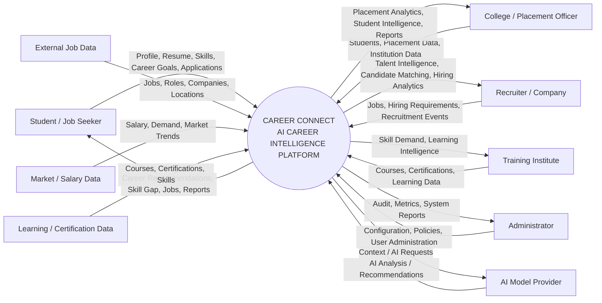

---

# 9. Context Diagram Explanation

The context diagram establishes that Career Connect operates as a central intelligence platform.

## Student Flow

Students provide:

```text
Profile
Resume
Skills
Career Goals
Applications
Learning Progress
```

Career Connect returns:

```text
Resume Analysis
Skill Gap
Career Recommendations
Job Matches
Learning Roadmap
AI Career Assistance
```

---

# 10. College Flow

Colleges provide:

```text
Student Records
Department Data
Placement Records
Company Data
Training Data
```

Career Connect returns:

```text
Placement Analytics
Skill Analytics
Salary Analytics
Company Hiring Analytics
Executive Reports
```

---

# 11. Recruiter Flow

Recruiters provide:

```text
Job Requirements
Candidate Requirements
Interview Results
Hiring Outcomes
```

Career Connect returns:

```text
Candidate Matches
Talent Intelligence
Hiring Funnel Analytics
College Talent Analytics
```

---

# 12. External Data Flow

External sources can provide:

```text
Jobs
Companies
Skills
Technologies
Salary
Locations
Courses
Certifications
Market Trends
```

These flows enter the data-engineering pipeline rather than directly becoming trusted BI data.

---

# 13. Level 0 DFD

The Level 0 DFD decomposes Career Connect into its major system processes.

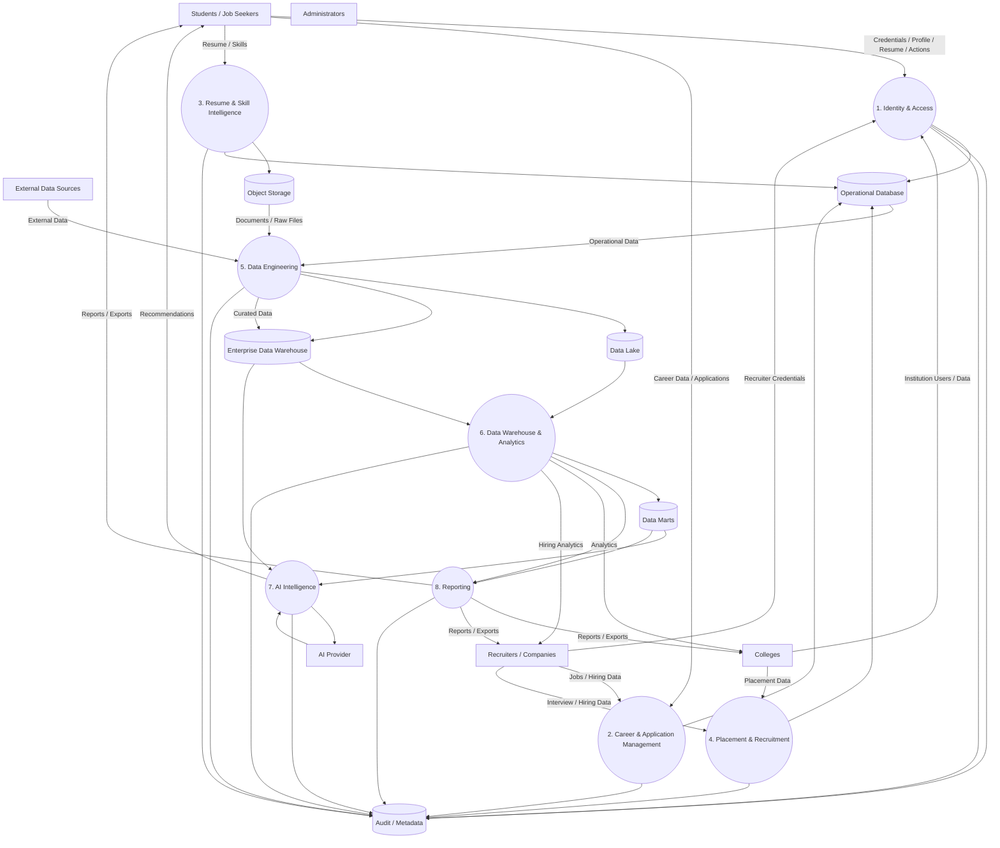

---

# 14. Level 0 Process Descriptions

## Process 1 — Identity & Access

Responsible for:

- Login
- Registration
- Session validation
- Role assignment
- Organization membership
- Permission checking

Inputs:

```text
Credentials
OAuth Information
Organization Information
```

Outputs:

```text
Authenticated Session
Role
Access Decision
```

---

# 15. Process 2 — Career & Application Management

Handles:

- Student profiles
- Career goals
- Job browsing
- Job applications
- Application status

Primary store:

```text
D1 — Operational Database
```

---

# 16. Process 3 — Resume & Skill Intelligence

Handles:

```text
Resume Upload
Resume Parsing
Skill Extraction
Resume Scoring
Skill Normalization
Skill Profile
```

Input:

```text
Resume
```

Output:

```text
Extracted Skills
Resume Score
Improvement Recommendations
```

---

# 17. Process 4 — Placement & Recruitment

Handles:

```text
Placements
Interviews
Offers
Hiring
Candidate Management
Recruitment Funnel
```

Primary store:

```text
D1 — Operational Database
```

---

# 18. Process 5 — Data Engineering

This is the core data-processing process.

```text
Extract
↓
Validate
↓
Clean
↓
Transform
↓
Deduplicate
↓
Standardize
↓
Enrich
↓
Load
```

Inputs:

- Operational data
- External data
- Institution data
- File-based data

Outputs:

- Raw data
- Curated data
- Warehouse-ready data

---

# 19. Process 6 — Data Warehouse & Analytics

This process:

- Loads dimensional data
- Builds facts
- Calculates metrics
- Creates data marts
- Provides analytical datasets

Outputs:

```text
KPI
Trend
Comparison
Distribution
Forecasting Inputs
```

---

# 20. Process 7 — AI Intelligence

Consumes:

```text
Student Context
Skill Graph
Job Requirements
Market Analytics
Learning Data
Warehouse Metrics
```

Produces:

```text
Career Recommendation
Skill Gap
Resume Review
Learning Recommendation
Interview Feedback
AI Assistant Response
```

---

# 21. Process 8 — Reporting

Generates:

- PDF
- Excel
- Dashboard exports
- Scheduled reports
- Executive reports

The generated files should be stored in object storage with controlled access.

---

# 22. Level 1 DFD — Student Career Intelligence

This diagram expands the student experience.

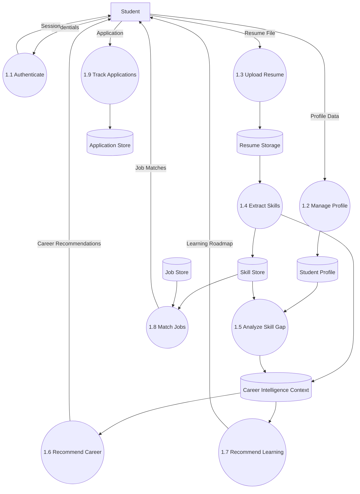

---

# 23. Student Resume Flow

The resume flow is:

```text
Student
↓
Upload Resume
↓
Object Storage
↓
Resume Parser
↓
Skill Extraction
↓
Skill Normalization
↓
Student Skill Profile
↓
AI Analysis
↓
Resume Score
```

---

# 24. Student Skill Flow


---

# 25. Student Job Matching Flow

```text
Student Profile
+
Student Skills
+
Career Goal
        ↓
Job Requirements
        ↓
Skill Matching
        ↓
Experience Matching
        ↓
Location Matching
        ↓
Match Score
        ↓
Recommended Jobs
```

---

# 26. Level 1 DFD — College Placement Intelligence

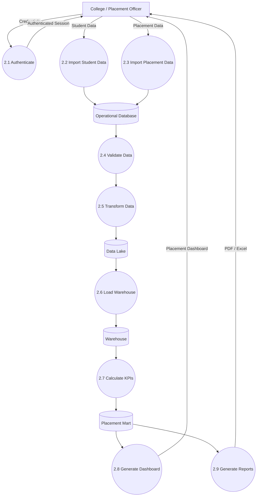

---

# 27. College KPI Flow

The placement analytics pipeline is:

```text
Student Records
+
Placement Records
+
Company Records
+
Salary Records
        ↓
Validation
        ↓
Transformation
        ↓
Warehouse
        ↓
Placement Data Mart
        ↓
KPI Calculation
        ↓
Dashboard
```

---

# 28. Level 1 DFD — Recruiter Intelligence

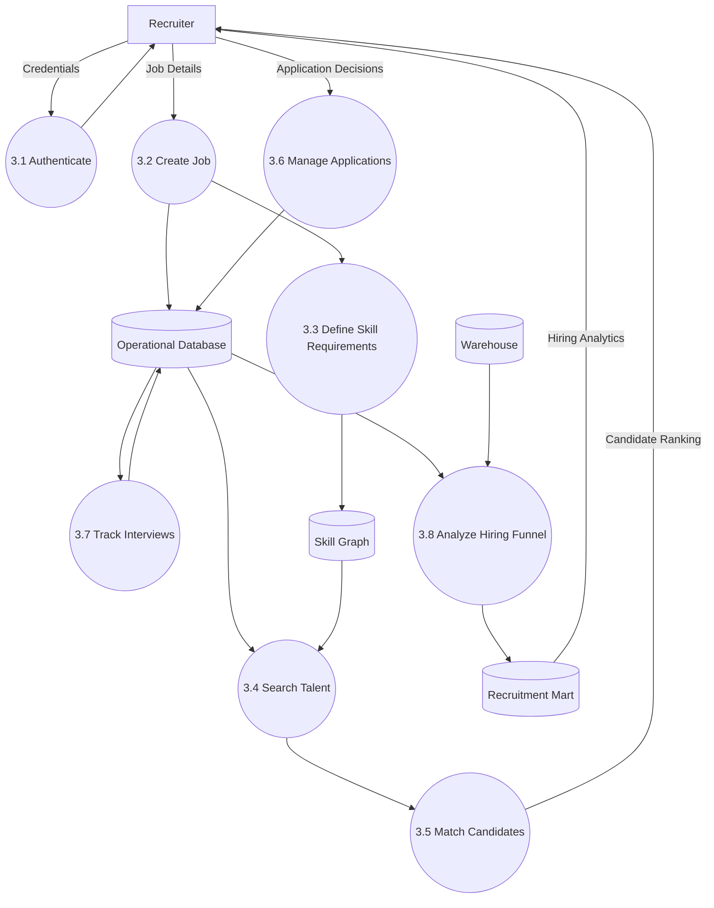

---

# 29. Recruiter Matching Flow

```text
Recruiter Job
↓
Required Skills
↓
Skill Graph
↓
Candidate Skill Profiles
↓
Eligibility Filter
↓
Match Scoring
↓
Candidate Ranking
↓
Recruiter
```

---

# 30. Level 1 DFD — Data Engineering

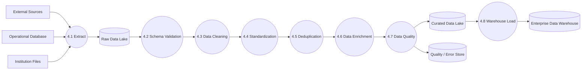

---

# 31. Data Engineering Data Flows

### Extract

```text
Source
→ Raw Record
```

### Validate

```text
Raw Record
→ Valid / Invalid
```

### Clean

```text
Valid Record
→ Standard Record
```

### Standardize

```text
Source Terminology
→ Canonical Terminology
```

### Deduplicate

```text
Duplicate Records
→ Golden Record
```

### Enrich

```text
Basic Record
→ Record + Metadata
```

### Load

```text
Curated Dataset
→ Warehouse
```

---

# 32. Level 1 DFD — Business Intelligence

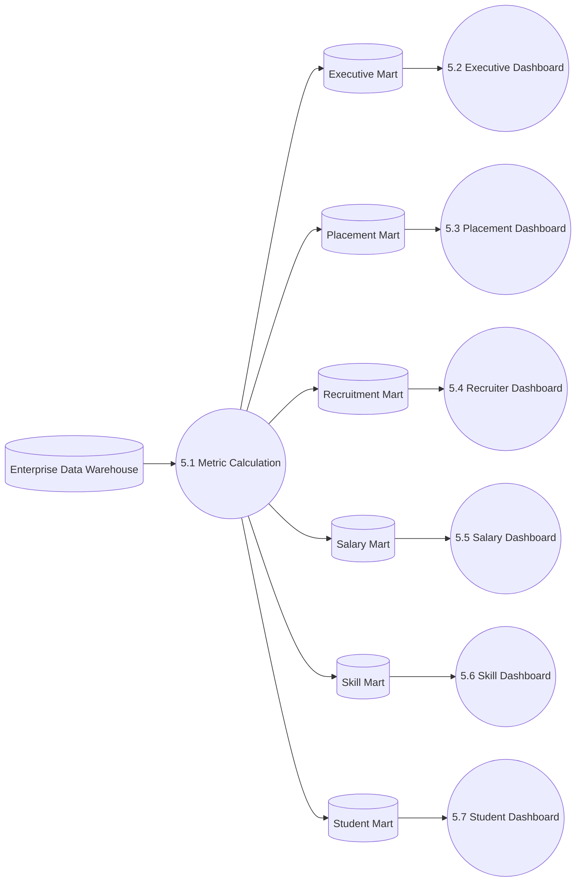

---

# 33. BI Data Flow

The BI flow should follow:

```text
Warehouse
↓
Business Metrics
↓
Data Mart
↓
Dashboard API
↓
Frontend Visualization
↓
User
```

The frontend should consume trusted metrics rather than duplicating warehouse business logic.

---

# 34. Level 1 DFD — AI Career Intelligence

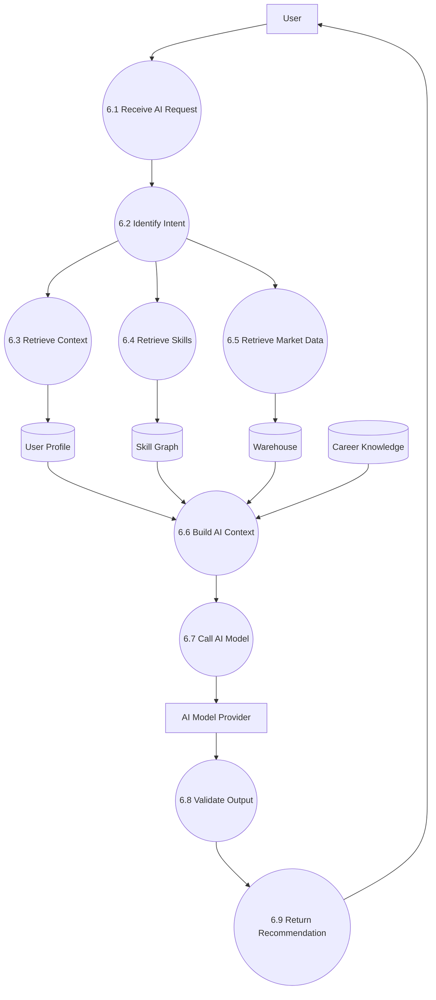

---

# 35. AI Context Flow

The AI system should construct a controlled context object:

```text
User Profile
+
Career Goal
+
Current Skills
+
Skill Gap
+
Target Job Requirements
+
Relevant Market Metrics
+
Learning History
```

Then:

```text
Context
↓
AI Model
↓
Response
↓
Validation
↓
User
```

---

# 36. AI Output Validation

AI-generated content should pass through a validation process.

Validation can check:

```text
Required Fields
Policy Violations
Unsafe Claims
Unsupported Structured Values
Malformed Output
```

Where appropriate, structured outputs should be validated against schemas before being displayed or persisted.

---

# 37. Level 1 DFD — Reporting

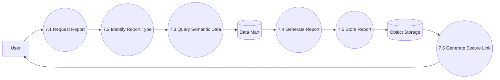

---

# 38. Report Data Flow

Supported output types:

```text
Dashboard
PDF
Excel
CSV
Scheduled Report
```

The reporting layer should use trusted warehouse metrics.

---

# 39. Level 1 DFD — Administration

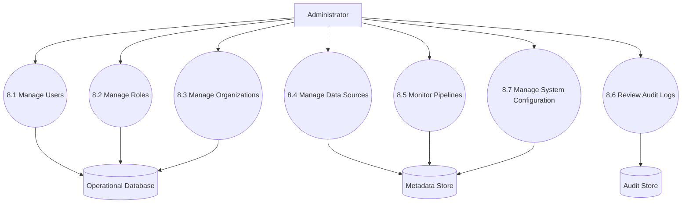

---

# 40. Level 2 DFD — Resume Intelligence

The resume workflow can be decomposed further.

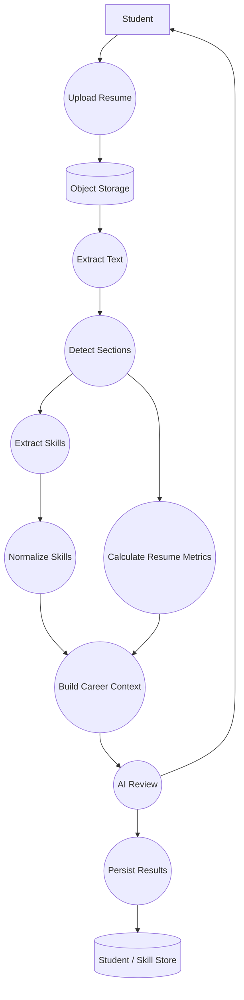

---

# 41. Resume Intelligence Data Stores

The process may interact with:

```text
Resume Object
Resume Metadata
Extracted Skills
Resume Score
AI Feedback
Target Career
```

The original file should remain separated from structured analytical metadata.

---

# 42. Level 2 DFD — Skill Gap Analysis

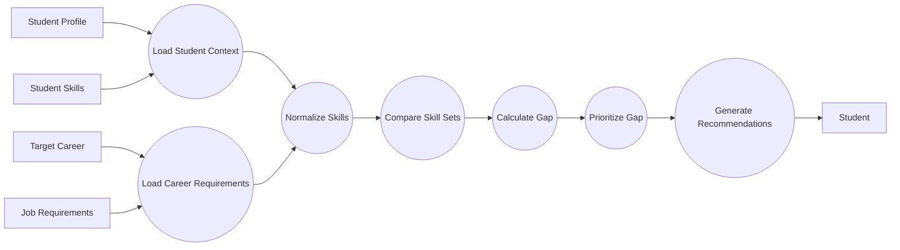

---

# 43. Skill Gap Data Flow

The core logic is:

```text
Student Skills
-
Required Skills
=
Missing Skills
```

Then:

```text
Missing Skills
+
Importance
+
Current Demand
+
Career Goal
=
Prioritized Skill Gap
```

---

# 44. Level 2 DFD — Placement Analytics

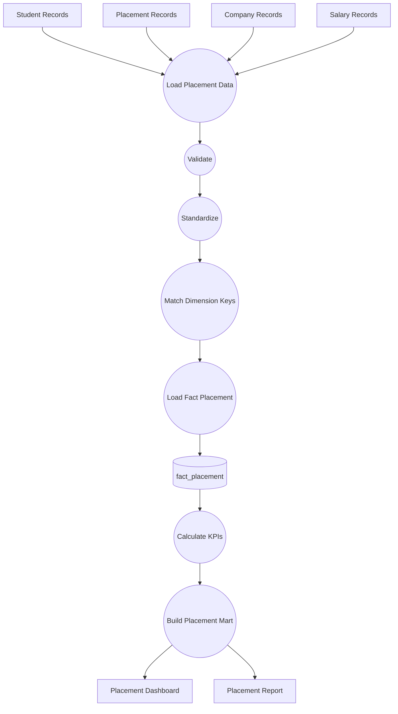

---

# 45. Placement KPI Data Flow

```text
Placement Records
↓
Eligible Students
↓
Placed Students
↓
Placement Rate
```

Additional:

```text
Placement Records
+
Salary
+
Company
+
Role
↓
Salary Analytics
```

---

# 46. Level 2 DFD — Hiring Funnel

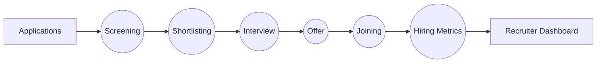

---

# 47. Recruitment Funnel Data

The warehouse should preserve:

```text
Application
Screening
Shortlist
Interview
Offer
Joining
```

This allows conversion analysis between stages.

---

# 48. Level 2 DFD — ETL Pipeline

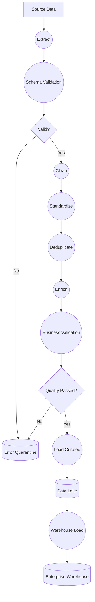

---

# 49. ETL Error Flow

Invalid data should follow:

```text
Bad Record
↓
Quarantine
↓
Error Log
↓
Alert
↓
Correction
↓
Replay
```

A failed record should not silently disappear.

---

# 50. Level 2 DFD — Data Quality

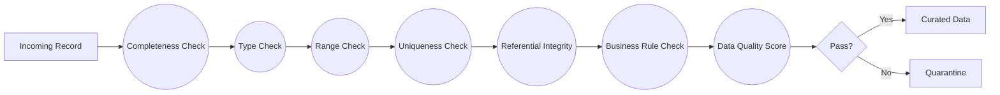

---

# 51. Level 2 DFD — AI Career Recommendation

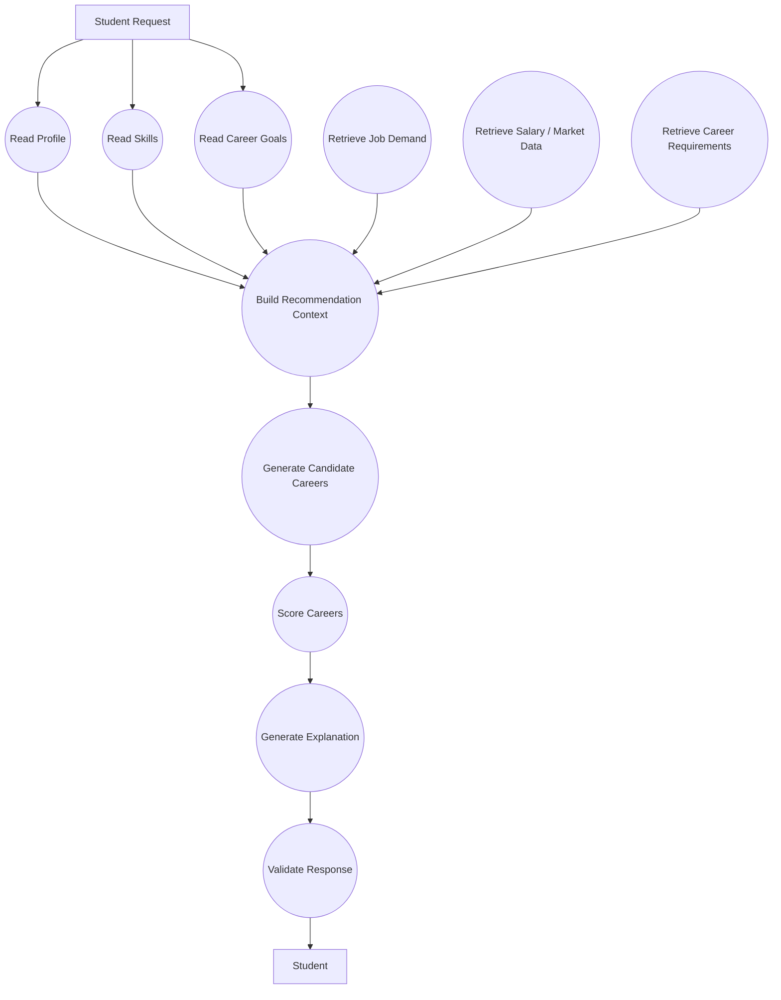

---

# 52. AI Recommendation Output

A recommendation should contain structured information such as:

```text
Career
Match Score
Supporting Skills
Missing Skills
Market Signals
Recommended Actions
Confidence / Explanation
```

The score methodology should be explicitly documented rather than treated as an unexplained AI number.

---

# 53. Cross-System Data Flow

The core system can be summarized as:

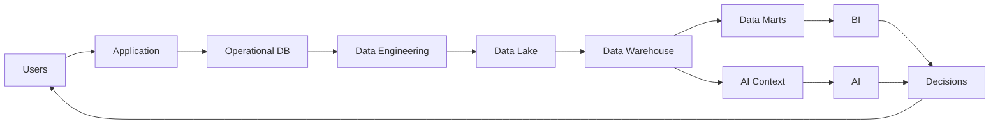

---

# 54. Data Flow — Student to AI

```text
Student
↓
Profile
↓
Skills
↓
Career Goal
↓
Context Retrieval
↓
Warehouse / Skill Graph
↓
AI
↓
Recommendation
↓
Student
```

---

# 55. Data Flow — College to BI

```text
College
↓
Placement Data
↓
Operational Database / Files
↓
ETL
↓
Data Lake
↓
Warehouse
↓
Placement Mart
↓
Semantic Metrics
↓
BI Dashboard
```

---

# 56. Data Flow — Recruiter to Talent Intelligence

```text
Recruiter
↓
Job Requirement
↓
Skill Extraction
↓
Skill Graph
↓
Candidate Dataset
↓
Matching
↓
Candidate Ranking
↓
Recruiter
```

---

# 57. Data Flow — External Market Data

```text
External Source
↓
Ingestion
↓
Raw Data Lake
↓
Schema Validation
↓
Transformation
↓
Standardization
↓
Data Quality
↓
Warehouse
↓
Skill / Salary / Job Analytics
```

---

# 58. Data Flow — Report Generation

```text
User
↓
Report Request
↓
Semantic Layer
↓
Data Mart
↓
Report Generator
↓
PDF / Excel
↓
Object Storage
↓
Secure Download
↓
User
```

---

# 59. Data Flow — Audit

Important user/system actions should follow:

```text
Action
↓
Application Service
↓
Audit Event
↓
Audit Store
↓
Monitoring / Admin
```

Examples:

```text
Login
Role Change
Resume Access
Data Export
AI Request
Admin Update
```

---

# 60. Data Flow — Notification

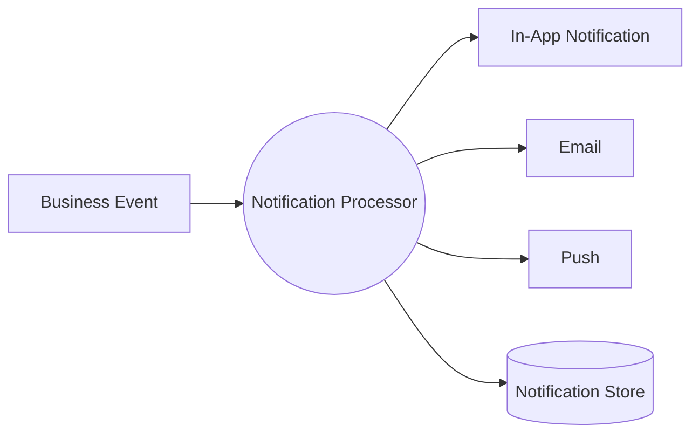

Examples:

```text
New Job Match
Interview Reminder
Report Ready
Placement Update
Skill Recommendation
```

---

# 61. External Entity to Data Store Mapping

| Entity              | Primary Data Generated        | Primary Destination       |
| ------------------- | ----------------------------- | ------------------------- |
| Student             | Profile, Skills, Applications | Operational DB            |
| College             | Placement, Student Data       | Operational DB / Lake     |
| Recruiter           | Jobs, Interviews, Hiring      | Operational DB            |
| Company             | Job / Hiring Data             | Operational DB            |
| Training Institute  | Courses / Certifications      | Operational DB / Lake     |
| External Job Source | Job Data                      | Data Lake                 |
| Market Source       | Salary / Trends               | Data Lake                 |
| AI Provider         | AI Response                   | AI Service / Application  |
| Administrator       | Configuration / Audit         | Operational + Audit Store |

---

# 62. Process-to-Data Store Mapping

| Process             | Data Stores                             |
| ------------------- | --------------------------------------- |
| Identity            | Operational DB, Audit                   |
| Student Profile     | Operational DB, Object Storage          |
| Resume Intelligence | Object Storage, Skill Store, AI Context |
| Applications        | Operational DB                          |
| Placement           | Operational DB                          |
| ETL                 | Data Lake, Metadata                     |
| Warehouse           | Enterprise Warehouse                    |
| BI                  | Data Marts                              |
| AI                  | Context Store, Warehouse, Skill Graph   |
| Reports             | Data Marts, Object Storage              |
| Administration      | Operational DB, Metadata, Audit         |

---

# 63. DFD Data Classification

Data flows should be classified.

## Public

Examples:

```text
Aggregated Market Trends
Public Job Data
General Skill Taxonomy
```

## Internal

Examples:

```text
Operational Metrics
Internal Reports
System Metadata
```

## Confidential

Examples:

```text
Student Profiles
Applications
Recruiter Data
Placement Records
```

## Restricted

Examples:

```text
Authentication Secrets
Security Metadata
Highly Sensitive Personal Data
```

---

# 64. DFD Security Boundaries

Sensitive flows should cross controlled boundaries.

```text
External User
↓
Authentication
↓
Authorization
↓
Application API
↓
Protected Data Store
```

The data warehouse should not be directly exposed to normal end users.

---

# 65. DFD Tenancy Flow

For SaaS deployment:

```text
Request
↓
Identify Tenant
↓
Authenticate User
↓
Authorize Tenant Access
↓
Retrieve Tenant-Scoped Data
↓
Process Request
↓
Return Result
```

---

# 66. Tenant-Aware Analytical Flow

```mermaid id="zy8c5i"
flowchart LR

A[User]
--> B[API]

B --> C[Tenant Context]

C --> D[Authorized Query]

D --> E[Data Mart]

E --> F[Dashboard]

F --> A
```

Shared market/reference data may be intentionally global, while organization-specific data remains tenant-scoped.

---

# 67. DFD for AI Data Governance

AI data access should flow through controlled context retrieval:

```text
User Request
↓
Authorization
↓
Intent Classification
↓
Approved Context
↓
Warehouse / Skill Graph
↓
Context Builder
↓
AI Model
↓
Output Validation
↓
User
```

The model should not be given unrestricted access to the warehouse.

---

# 68. DFD for Data Lineage

Every analytical result should conceptually be traceable:

```text
Dashboard KPI
↓
Data Mart
↓
Fact / Dimension
↓
Transformation
↓
Curated Dataset
↓
Raw Dataset
↓
Source
```

This creates analytical trust and supports debugging.

---

# 69. DFD for Data Quality Lineage

```text
Source Record
↓
Validation
↓
Transformation
↓
Quality Score
↓
Warehouse Record
↓
Metric
```

If an executive questions a KPI, the organization should be able to trace its lineage.

---

# 70. DFD Balance Rules

The following balancing rules should be maintained.

### Context vs Level 0

Every major external input/output shown in the Context Diagram should be represented in Level 0.

### Level 0 vs Level 1

Every Level 0 process should decompose into Level 1 processes without changing its external meaning.

### Level 1 vs Level 2

Every Level 1 process expanded into Level 2 should preserve the same input/output boundary.

---

# 71. DFD Naming Standards

Processes should use:

```text
Verb + Noun
```

Examples:

```text
Validate Data
Load Warehouse
Analyze Resume
Calculate Skill Gap
Generate Report
```

Data stores should use nouns:

```text
Student Profile
Application Store
Data Warehouse
Skill Graph
```

Data flows should describe actual information:

```text
Student Profile Data
Job Requirements
Placement Records
AI Recommendation
```

---

# 72. DFD Anti-Patterns to Avoid

Do not create:

### Direct User → Database

Users should interact through controlled application services.

### Frontend → Warehouse

Analytical access should go through governed interfaces.

### AI → Entire Database

AI access should be controlled by context and authorization.

### ETL → Direct Dashboard

ETL should publish trusted data to the warehouse/marts before BI consumption.

### External API → Production Warehouse

External data should pass through validation and quality controls.

---

# 73. Complete End-to-End DFD

```mermaid id="f0z8h4"
flowchart TB

U1[Student]
U2[College]
U3[Recruiter]
U4[Admin]
U5[External Sources]

P1((Application Platform))
P2((AI Platform))
P3((Data Engineering))
P4((Analytics Platform))
P5((Reporting Platform))

D1[(Operational DB)]
D2[(Object Storage)]
D3[(Data Lake)]
D4[(Enterprise Warehouse)]
D5[(Data Marts)]
D6[(Audit / Metadata)]

U1 --> P1
U2 --> P1
U3 --> P1
U4 --> P1

P1 --> D1
P1 --> D2
P1 --> D6

D1 --> P3
D2 --> P3
U5 --> P3

P3 --> D3
P3 --> D4
P3 --> D6

D4 --> P4
P4 --> D5

D4 --> P2
D5 --> P2
D6 --> P2

P2 --> P1
P4 --> P1

P4 --> P5
D5 --> P5
P5 --> D2

P5 --> U1
P5 --> U2
P5 --> U3

P2 --> U1
P4 --> U2
P4 --> U3

U4 --> D6
```

---

# 74. Final DFD — Simplified Academic Diagram

For the final-year project presentation, a simplified diagram can be used:

```mermaid id="fxp3mz"
flowchart LR

A[Students]
B[Colleges]
C[Recruiters]

A --> D[Career Connect]
B --> D
C --> D

D --> E[(Operational Database)]

E --> F[ETL / Data Processing]

F --> G[(Data Warehouse)]

G --> H[BI Dashboards]
G --> I[AI Intelligence]

H --> A
H --> B
H --> C

I --> A
I --> B
I --> C
```

This is suitable for a viva or architecture presentation, while the detailed Level 1 and Level 2 diagrams provide the formal documentation.

---

# 75. DFD-to-Architecture Mapping

| DFD Component        | System Architecture              |
| -------------------- | -------------------------------- |
| Student / Recruiter  | Frontend                         |
| Application Platform | NestJS                           |
| Operational DB       | PostgreSQL                       |
| Object Storage       | Cloud Storage                    |
| Data Engineering     | ETL / DataOps                    |
| Data Lake            | Cloud Storage                    |
| Warehouse            | BigQuery / Snowflake             |
| Data Marts           | Warehouse Layer                  |
| BI                   | Semantic + Dashboard Layer       |
| AI                   | Python AI Service                |
| Audit                | Audit Store                      |
| Metadata             | Data Quality / Metadata Platform |

---

# 76. DFD-to-Data Warehouse Mapping

```text
DFD Input
↓
Data Engineering
↓
Dimension / Fact
```

Examples:

```text
Student Data
→ dim_student

Job Data
→ dim_job

Company Data
→ dim_company

Skill Data
→ dim_skill

Applications
→ fact_application

Placements
→ fact_placement

Interviews
→ fact_interview

Salary
→ fact_salary
```

---

# 77. DFD-to-AI Mapping

```text
Student Request
+
Student Profile
+
Skills
+
Career Goal
+
Market Data
        ↓
AI Context
        ↓
AI Model
        ↓
Recommendation
```

This makes the AI layer a consumer of governed data rather than an isolated chatbot.

---

# 78. DFD-to-BI Mapping

```text
Operational / External Data
↓
ETL
↓
Warehouse
↓
Data Mart
↓
Semantic Metric
↓
Dashboard
```

This is the core business-intelligence data flow.

---

# 79. DFD Success Criteria

The DFD architecture is considered complete when it clearly demonstrates:

```text
✓ External Entities
✓ Processes
✓ Data Stores
✓ Data Flows
✓ Data Engineering
✓ Warehouse
✓ BI
✓ AI
✓ Reporting
✓ Security Boundaries
✓ Tenant Boundaries
✓ End-to-End Flow
```

---

# 80. DFD Summary

Career Connect's complete data movement can be summarized as:

```text
                        CAREER CONNECT
                             │
        ┌────────────────────┼────────────────────┐
        │                    │                    │
     USERS              EXTERNAL DATA        INSTITUTIONS
        │                    │                    │
        └────────────────────┼────────────────────┘
                             ▼
                    APPLICATION PLATFORM
                             │
                             ▼
                    OPERATIONAL DATABASE
                             │
                             ▼
                       DATA INGESTION
                             │
                             ▼
                         DATA LAKE
                             │
                             ▼
                     ETL / ELT PROCESS
                             │
                             ▼
                   ENTERPRISE DATA WAREHOUSE
                             │
                    ┌────────┴────────┐
                    ▼                 ▼
               DATA MARTS        AI CONTEXT
                    │                 │
                    ▼                 ▼
                BUSINESS              AI
              INTELLIGENCE       INTELLIGENCE
                    │                 │
                    └────────┬────────┘
                             ▼
                    ACTIONABLE INSIGHTS
                             │
                             ▼
                         USERS
```

---

# 81. CTO-Level DFD Principle

The most important DFD principle is:

> **Every important piece of data should have a clear origin, controlled transformation path, governed storage location, and defined consumer.**

For example:

```text
Salary
↓
Source
↓
Raw Data
↓
Validation
↓
Normalization
↓
Warehouse
↓
Salary Mart
↓
Salary KPI
↓
Dashboard
↓
AI Explanation
```

This establishes traceability from raw information to business decision.

---

# 82. Final DFD Statement

> **The Career Connect Data Flow Architecture defines a complete movement of information from students, colleges, recruiters, companies, institutional systems, and external data sources through the application layer, operational database, object storage, data lake, ETL/ELT pipelines, enterprise data warehouse, data marts, business intelligence layer, AI intelligence layer, and reporting services. The architecture provides controlled, traceable, secure, and reusable data flows capable of supporting both academic demonstration and future enterprise-scale SaaS deployment.**

---

## Document Status

| Attribute      | Value                                         |
| -------------- | --------------------------------------------- |
| Project        | Career Connect                                |
| Document       | Data Flow Diagram                             |
| Version        | 1.0                                           |
| DFD Levels     | Context + Level 0 + Level 1 + Level 2         |
| Primary Inputs | Users + Institutions + External Sources       |
| Core Processes | Application + ETL + Warehouse + BI + AI       |
| Core Stores    | PostgreSQL + Object Storage + Data Lake + EDW |
| BI Output      | Dashboards + KPIs + Reports                   |
| AI Output      | Recommendations + Career Intelligence         |
| Security       | Controlled Data Access + Audit                |
| SaaS           | Tenant-Aware Data Flow                        |
| Status         | System Data Flow Baseline                     |
