# 13 — ER Diagram

# Career Connect — AI Career Intelligence Platform

**Document Type:** Entity Relationship Diagram Specification
**Project:** Career Connect
**Version:** 1.0
**Status:** Database Architecture Baseline
**Model Type:** Enterprise Relational Data Model
**Primary Database:** PostgreSQL
**Analytical Extension:** Data Warehouse Model
**Architecture Scope:** Users + Organizations + Students + Jobs + Recruitment + Learning + Placement + AI

---

# 1. Executive Summary

The Entity Relationship Diagram defines the logical relationships among the major entities in the Career Connect platform.

The ER model is designed to support the complete career lifecycle:

```text
User
 ↓
Organization
 ↓
Student / Recruiter
 ↓
Skills
 ↓
Jobs
 ↓
Applications
 ↓
Interviews
 ↓
Offers
 ↓
Placements
 ↓
Learning
 ↓
Career Outcomes
```

The model must support both:

### Operational Workloads

- Authentication
- Profile management
- Job management
- Applications
- Interviews
- Learning
- Placement records

and:

### Analytical Workloads

- Placement analytics
- Salary analytics
- Skill analytics
- Hiring analytics
- Career recommendations
- Recruitment intelligence

The operational ER model therefore acts as the foundation from which the data warehouse is populated.

---

# 2. ER Model Objectives

The database design should provide:

- Referential integrity
- Normalized operational data
- Clear ownership
- Extensible relationships
- Historical support
- Multi-tenant capability
- Role-based access
- Data quality
- AI integration

---

# 3. Core Entity Categories

The entities can be grouped into eight domains.

```text id="kqxy5a"
1. Identity
2. Organization
3. Student & Education
4. Career & Skills
5. Jobs & Companies
6. Recruitment
7. Learning
8. Analytics & Governance
```

---

# 4. Entity Overview

The core operational entities are:

```text id="v4qg1r"
User
Role
Permission
Organization
Department
Student
Education
Project
Experience
Skill
StudentSkill
Company
Recruiter
Job
JobSkill
Application
Interview
Offer
Placement
Salary
Course
CourseSkill
Certification
StudentCertification
LearningProgress
CareerPath
CareerRecommendation
Resume
ResumeAnalysis
AuditLog
Notification
```

---

# 5. Entity Relationship Philosophy

The model follows several principles.

## 5.1 Normalize Transactional Data

Avoid storing the same information repeatedly.

For example:

```text id="odv3z0"
Company
```

should exist as an independent entity instead of being duplicated as plain text across every job and application.

---

## 5.2 Use Junction Tables for Many-to-Many Relationships

Examples:

```text id="6k2h3t"
Student ↔ Skill
Job ↔ Skill
Course ↔ Skill
Student ↔ Certification
```

These relationships should use dedicated tables.

---

## 5.3 Separate Identity from Profiles

A `User` represents authentication and platform identity.

A `Student` represents the student's domain profile.

Similarly:

```text id="r0rj7p"
User
 ↓
Student

User
 ↓
Recruiter
```

---

# 6. High-Level ER Diagram

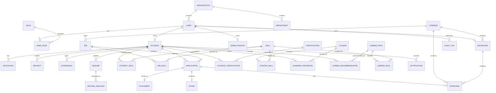

---

# 7. Identity Domain

The identity domain controls authentication and authorization.

Core entities:

```text id="u1jz3e"
USER
ROLE
PERMISSION
USER_ROLE
ROLE_PERMISSION
```

---

# 8. USER Entity

The `USER` table represents a platform identity.

### Main Attributes

```text id="n8sp6u"
user_id
email
password_hash / auth_provider_reference
display_name
phone
status
last_login_at
created_at
updated_at
```

Authentication credentials should preferably be managed by the selected identity provider rather than duplicating sensitive authentication logic inside the application database.

---

# 9. ROLE Entity

Represents authorization roles.

Initial roles:

```text id="2w19g1"
SUPER_ADMIN
ORG_ADMIN
PLACEMENT_OFFICER
FACULTY
RECRUITER
STUDENT
JOB_SEEKER
```

Attributes:

```text id="j8a9q4"
role_id
role_code
role_name
description
```

---

# 10. PERMISSION Entity

Represents individual actions.

Examples:

```text id="yr0i5y"
VIEW_STUDENT
EDIT_STUDENT
VIEW_PLACEMENT
CREATE_JOB
VIEW_CANDIDATE
EXPORT_REPORT
MANAGE_USERS
```

Attributes:

```text id="a8l4m5"
permission_id
permission_code
permission_name
description
```

---

# 11. USER_ROLE Entity

This junction table connects users and roles.

```text id="v3b0j5"
user_id
role_id
assigned_at
assigned_by
```

Relationship:

```text
USER M:N ROLE
```

implemented as:

```text
USER
  |
USER_ROLE
  |
ROLE
```

---

# 12. ROLE_PERMISSION Entity

This junction table connects roles and permissions.

```text id="7q4w6r"
role_id
permission_id
```

Relationship:

```text
ROLE M:N PERMISSION
```

---

# 13. Organization Domain

Organizations allow Career Connect to support multi-tenant SaaS.

Core entities:

```text id="nx5i8l"
ORGANIZATION
DEPARTMENT
ORGANIZATION_USER
```

---

# 14. ORGANIZATION Entity

Represents:

- College
- University
- Training Institute
- Company
- Other enterprise customer

Attributes:

```text id="r6x9k1"
organization_id
organization_type
organization_name
legal_name
country
state
city
status
created_at
updated_at
```

---

# 15. Organization Types

Possible values:

```text id="s8m4f7"
COLLEGE
UNIVERSITY
TRAINING_INSTITUTE
COMPANY
RECRUITMENT_AGENCY
ENTERPRISE
```

---

# 16. DEPARTMENT Entity

Represents organizational departments.

Example:

```text id="5u8o2k"
Computer Science
Information Technology
Electronics
Human Resources
Talent Acquisition
```

Attributes:

```text id="61s1h4"
department_id
organization_id
department_name
department_code
status
```

Relationship:

```text
ORGANIZATION 1:M DEPARTMENT
```

---

# 17. Student Domain

The student domain contains:

```text id="qk9j73"
STUDENT
EDUCATION
PROJECT
EXPERIENCE
RESUME
```

---

# 18. STUDENT Entity

`STUDENT` represents the career profile associated with a user.

Attributes:

```text id="m2t7xc"
student_id
user_id
organization_id
department_id
student_number
date_of_birth
gender
graduation_year
education_level
current_location_id
career_goal
profile_status
created_at
updated_at
```

Sensitive attributes should only be collected where required for a legitimate business purpose and governed appropriately.

---

# 19. USER-to-STUDENT Relationship

```text id="y8v4n2"
USER
  1
  |
  0..1
STUDENT
```

A user may have one student profile.

This separation allows the same identity model to support additional profile types.

---

# 20. EDUCATION Entity

Stores educational history.

Attributes:

```text id="4d3m7x"
education_id
student_id
institution_name
degree
field_of_study
start_date
end_date
grade
percentage
gpa
```

Relationship:

```text
STUDENT 1:M EDUCATION
```

---

# 21. PROJECT Entity

Represents academic or professional projects.

Attributes:

```text id="b0p7n4"
project_id
student_id
project_name
description
start_date
end_date
repository_url
demo_url
```

Relationship:

```text
STUDENT 1:M PROJECT
```

---

# 22. PROJECT_SKILL Entity

Projects can use multiple skills.

```text id="8l4q7c"
project_id
skill_id
proficiency_context
```

Relationship:

```text
PROJECT M:N SKILL
```

---

# 23. EXPERIENCE Entity

Represents work or internship experience.

Attributes:

```text id="w5j2q9"
experience_id
student_id
company_id
job_title
employment_type
start_date
end_date
description
```

Relationship:

```text
STUDENT 1:M EXPERIENCE
COMPANY 1:M EXPERIENCE
```

---

# 24. Skill Domain

The skill domain is one of the most important domains in Career Connect.

Core entities:

```text id="c4n7f2"
SKILL
SKILL_CATEGORY
STUDENT_SKILL
JOB_SKILL
CAREER_SKILL
COURSE_SKILL
PROJECT_SKILL
```

---

# 25. SKILL Entity

Attributes:

```text id="s0q4v8"
skill_id
skill_name
canonical_name
skill_category_id
skill_type
description
status
```

Examples:

```text id="w8q1d9"
Python
SQL
Java
React
AWS
Power BI
Spark
Machine Learning
```

---

# 26. SKILL_CATEGORY Entity

Examples:

```text id="t3m5k7"
Programming
Database
Cloud
Data Engineering
AI / ML
Analytics
DevOps
Soft Skills
```

Attributes:

```text id="p5n2x6"
skill_category_id
category_name
description
```

---

# 27. STUDENT_SKILL Entity

This junction entity represents a student's skills.

Attributes:

```text id="j4s8c2"
student_id
skill_id
proficiency_level
verified_flag
source
years_experience
last_assessed_at
```

Relationship:

```text
STUDENT M:N SKILL
```

---

# 28. Proficiency Level

Possible levels:

```text id="h4m7q1"
BEGINNER
INTERMEDIATE
ADVANCED
EXPERT
```

The proficiency taxonomy should remain configurable.

---

# 29. COMPANY Entity

Represents organizations that hire candidates.

Attributes:

```text id="y9k2m6"
company_id
organization_id
company_name
industry
company_size
website
headquarters_location_id
status
```

A company may be represented as an organization tenant or as a referenced market entity depending on the deployment.

---

# 30. RECRUITER Entity

Represents a recruiter employed or associated with a company.

Attributes:

```text id="q5w7x3"
recruiter_id
user_id
company_id
designation
recruiter_type
status
```

Relationship:

```text
COMPANY 1:M RECRUITER
USER 1:1 RECRUITER
```

---

# 31. Job Domain

Core entities:

```text id="m7c1v9"
JOB
JOB_SKILL
JOB_LOCATION
JOB_CATEGORY
```

---

# 32. JOB Entity

Represents an employment opportunity.

Attributes:

```text id="p3f8k4"
job_id
company_id
job_category_id
job_title
description
employment_type_id
experience_level_id
minimum_salary
maximum_salary
posted_date
closing_date
status
```

---

# 33. JOB_SKILL Entity

Represents skills required by a job.

Attributes:

```text id="s6k2n8"
job_id
skill_id
required_level
importance_weight
mandatory_flag
```

This table is essential for intelligent matching.

---

# 34. JOB_LOCATION Entity

A job may be available in multiple locations.

Attributes:

```text id="w1m5r7"
job_id
location_id
work_mode
```

Possible work modes:

```text id="a3h7u2"
ONSITE
HYBRID
REMOTE
```

---

# 35. APPLICATION Entity

Represents a student's application to a job.

Attributes:

```text id="v8p2k6"
application_id
student_id
job_id
applied_at
source
application_status
current_stage
updated_at
```

Relationship:

```text
STUDENT 1:M APPLICATION
JOB 1:M APPLICATION
```

---

# 36. Application Status

Possible values:

```text id="z0n6m4"
APPLIED
SCREENING
SHORTLISTED
ASSESSMENT
INTERVIEW
OFFERED
REJECTED
WITHDRAWN
HIRED
```

---

# 37. INTERVIEW Entity

Represents an interview event.

Attributes:

```text id="c5w3q8"
interview_id
application_id
recruiter_id
scheduled_at
interview_type
round_number
score
result
feedback
```

Relationship:

```text
APPLICATION 1:M INTERVIEW
RECRUITER 1:M INTERVIEW
```

---

# 38. OFFER Entity

Represents an employment offer.

Attributes:

```text id="h7s2x5"
offer_id
application_id
offered_at
base_salary
bonus
currency_code
offer_status
joining_date
```

Relationship:

```text
APPLICATION 1:0..1 OFFER
```

One application may produce zero or one final offer in the simplified model.

For complex recruitment scenarios, multiple offers or revised offers can be modeled separately.

---

# 39. PLACEMENT Entity

Represents a successful institutional placement outcome.

Attributes:

```text id="n4v8j2"
placement_id
application_id
student_id
company_id
job_id
college_id
placement_date
salary_amount
currency_code
placement_status
```

Relationship:

```text
APPLICATION 1:0..1 PLACEMENT
```

---

# 40. SALARY Entity

Salary observations may be captured separately from actual student placement records.

Attributes:

```text id="r2m6k9"
salary_id
company_id
job_id
location_id
experience_level_id
min_salary
max_salary
currency_code
source
observation_date
```

This supports market salary intelligence.

---

# 41. Learning Domain

Core entities:

```text id="f6p4v8"
COURSE
COURSE_SKILL
LEARNING_PROGRESS
CERTIFICATION
STUDENT_CERTIFICATION
```

---

# 42. COURSE Entity

Attributes:

```text id="q7c5x1"
course_id
provider
course_name
description
category
difficulty_level
duration_hours
delivery_mode
course_url
status
```

---

# 43. COURSE_SKILL Entity

Maps learning content to skills.

Attributes:

```text id="m4s8n2"
course_id
skill_id
coverage_level
```

Relationship:

```text
COURSE M:N SKILL
```

---

# 44. LEARNING_PROGRESS Entity

Tracks student learning.

Attributes:

```text id="v2k7p4"
learning_progress_id
student_id
course_id
started_at
completed_at
progress_percentage
assessment_score
status
```

Relationship:

```text
STUDENT 1:M LEARNING_PROGRESS
COURSE 1:M LEARNING_PROGRESS
```

---

# 45. CERTIFICATION Entity

Represents a certification definition.

Attributes:

```text id="x8n3m6"
certification_id
provider
certification_name
category
level
issue_authority
validity_period
```

---

# 46. STUDENT_CERTIFICATION Entity

Represents a student's earned certification.

Attributes:

```text id="j7q4w5"
student_certification_id
student_id
certification_id
issue_date
expiry_date
credential_id
verification_url
status
```

Relationship:

```text
STUDENT M:N CERTIFICATION
```

---

# 47. Career Intelligence Domain

The core entities are:

```text id="g3h8q2"
CAREER_PATH
CAREER_SKILL
CAREER_RECOMMENDATION
SKILL_GAP
```

---

# 48. CAREER_PATH Entity

Represents a recognized career role/path.

Examples:

```text id="r6x4p1"
Data Analyst
Data Engineer
Data Scientist
Cloud Engineer
Software Developer
Cybersecurity Analyst
```

Attributes:

```text id="k1n7c5"
career_path_id
career_name
career_category
description
career_level
```

---

# 49. CAREER_SKILL Entity

Maps career paths to required skills.

Attributes:

```text id="s4p9m2"
career_path_id
skill_id
required_level
importance_weight
mandatory_flag
```

Relationship:

```text
CAREER_PATH M:N SKILL
```

---

# 50. CAREER_RECOMMENDATION Entity

Represents a recommendation generated for a user.

Attributes:

```text id="q6v2x8"
recommendation_id
student_id
career_path_id
match_score
confidence_score
reasoning_summary
generated_at
model_version
status
```

This provides an auditable record of AI or rule-based recommendations.

---

# 51. SKILL_GAP Entity

Represents a detected missing skill for a student against a target career/job.

Attributes:

```text id="c9w5n3"
skill_gap_id
student_id
skill_id
target_type
target_id
current_level
required_level
gap_score
priority
detected_at
status
```

Possible target types:

```text id="h3m6v0"
CAREER
JOB
LEARNING_PATH
```

---

# 52. Resume Domain

Core entities:

```text id="p7q2k5"
RESUME
RESUME_ANALYSIS
RESUME_SKILL
```

---

# 53. RESUME Entity

Represents a stored resume.

Attributes:

```text id="v6m8s1"
resume_id
student_id
file_path
file_name
file_type
file_size
uploaded_at
version_number
is_active
```

The actual file should reside in controlled object storage.

---

# 54. RESUME_ANALYSIS Entity

Stores structured AI analysis results.

Attributes:

```text id="z4n7c2"
analysis_id
resume_id
target_career_id
overall_score
ats_score
content_score
skills_score
format_score
strengths
weaknesses
recommendations
model_name
model_version
analyzed_at
```

---

# 55. RESUME_SKILL Entity

Maps extracted skills to a specific resume.

Attributes:

```text id="b8x3k5"
resume_id
skill_id
confidence_score
extraction_source
```

This allows the platform to distinguish between:

```text id="m8c4j2"
Declared Student Skill
```

and:

```text id="p2v7n6"
AI-Extracted Resume Skill
```

---

# 56. Notification Domain

`NOTIFICATION` stores user notifications.

Attributes:

```text id="t5q8x1"
notification_id
user_id
notification_type
title
message
channel
read_at
created_at
```

Possible types:

```text id="u2k7m4"
JOB_MATCH
INTERVIEW_REMINDER
REPORT_READY
SKILL_RECOMMENDATION
PLACEMENT_UPDATE
SYSTEM_ALERT
```

---

# 57. Audit Domain

`AUDIT_LOG` records important system events.

Attributes:

```text id="r7n5x3"
audit_id
user_id
organization_id
action
resource_type
resource_id
timestamp
ip_address
user_agent
metadata
```

---

# 58. Entity Relationship — Identity

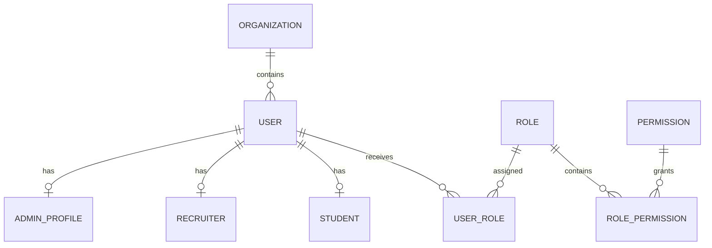

---

# 59. Entity Relationship — Student

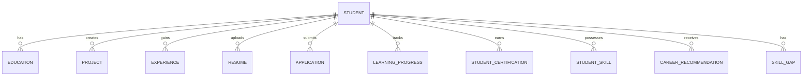

---

# 60. Entity Relationship — Skills

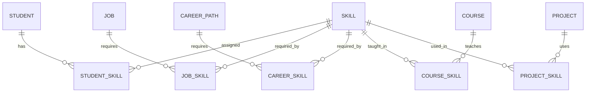

---

# 61. Entity Relationship — Recruitment

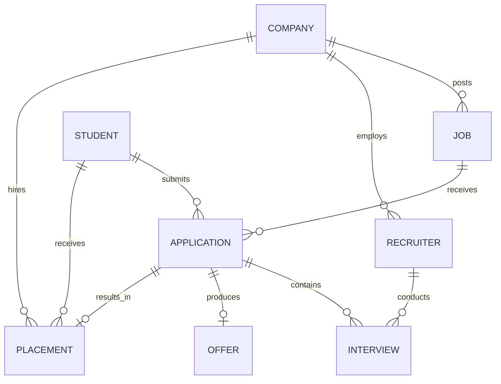

---

# 62. Entity Relationship — Learning

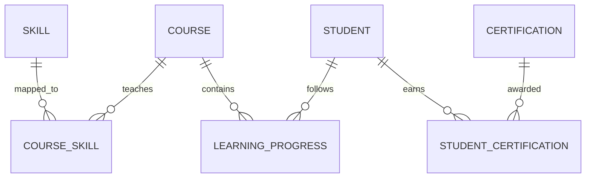

---

# 63. Entity Relationship — AI

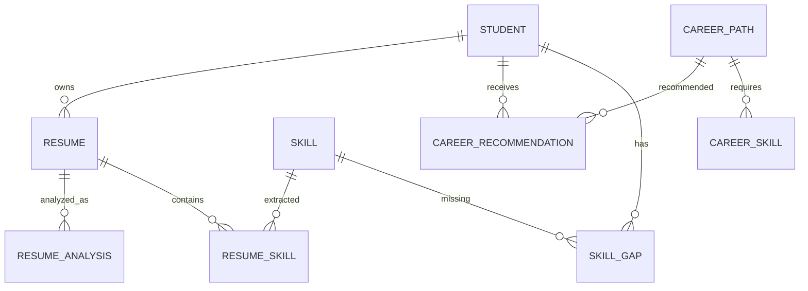

---

# 64. Full Operational ER Diagram

```mermaid id="p7t4y9"
erDiagram

    USER {
        uuid user_id PK
        string email
        string display_name
        string status
        timestamp created_at
        timestamp updated_at
    }

    ROLE {
        uuid role_id PK
        string role_code
        string role_name
        string description
    }

    PERMISSION {
        uuid permission_id PK
        string permission_code
        string permission_name
    }

    USER_ROLE {
        uuid user_id FK
        uuid role_id FK
        timestamp assigned_at
    }

    ROLE_PERMISSION {
        uuid role_id FK
        uuid permission_id FK
    }

    ORGANIZATION {
        uuid organization_id PK
        string organization_type
        string organization_name
        string status
    }

    DEPARTMENT {
        uuid department_id PK
        uuid organization_id FK
        string department_name
        string department_code
    }

    STUDENT {
        uuid student_id PK
        uuid user_id FK
        uuid organization_id FK
        uuid department_id FK
        string student_number
        int graduation_year
        string education_level
        string career_goal
    }

    EDUCATION {
        uuid education_id PK
        uuid student_id FK
        string institution_name
        string degree
        string field_of_study
        date start_date
        date end_date
    }

    PROJECT {
        uuid project_id PK
        uuid student_id FK
        string project_name
        string description
        string repository_url
    }

    PROJECT_SKILL {
        uuid project_id FK
        uuid skill_id FK
    }

    EXPERIENCE {
        uuid experience_id PK
        uuid student_id FK
        uuid company_id FK
        string job_title
        date start_date
        date end_date
    }

    SKILL {
        uuid skill_id PK
        uuid skill_category_id FK
        string skill_name
        string canonical_name
        string skill_type
    }

    SKILL_CATEGORY {
        uuid skill_category_id PK
        string category_name
    }

    STUDENT_SKILL {
        uuid student_id FK
        uuid skill_id FK
        string proficiency_level
        boolean verified_flag
        string source
    }

    COMPANY {
        uuid company_id PK
        uuid organization_id FK
        string company_name
        string industry
        string company_size
        string status
    }

    RECRUITER {
        uuid recruiter_id PK
        uuid user_id FK
        uuid company_id FK
        string designation
        string recruiter_type
    }

    JOB {
        uuid job_id PK
        uuid company_id FK
        string job_title
        string job_category
        string status
        date posted_date
        date closing_date
    }

    JOB_SKILL {
        uuid job_id FK
        uuid skill_id FK
        string required_level
        decimal importance_weight
        boolean mandatory_flag
    }

    APPLICATION {
        uuid application_id PK
        uuid student_id FK
        uuid job_id FK
        timestamp applied_at
        string application_status
        string current_stage
    }

    INTERVIEW {
        uuid interview_id PK
        uuid application_id FK
        uuid recruiter_id FK
        timestamp scheduled_at
        int round_number
        decimal score
        string result
    }

    OFFER {
        uuid offer_id PK
        uuid application_id FK
        timestamp offered_at
        decimal base_salary
        decimal bonus
        string currency_code
        string offer_status
    }

    PLACEMENT {
        uuid placement_id PK
        uuid application_id FK
        uuid student_id FK
        uuid company_id FK
        uuid job_id FK
        date placement_date
        decimal salary_amount
        string currency_code
    }

    SALARY {
        uuid salary_id PK
        uuid company_id FK
        uuid job_id FK
        uuid location_id FK
        decimal min_salary
        decimal max_salary
        string currency_code
        date observation_date
    }

    COURSE {
        uuid course_id PK
        string provider
        string course_name
        string difficulty_level
        decimal duration_hours
    }

    COURSE_SKILL {
        uuid course_id FK
        uuid skill_id FK
        string coverage_level
    }

    LEARNING_PROGRESS {
        uuid learning_progress_id PK
        uuid student_id FK
        uuid course_id FK
        decimal progress_percentage
        decimal assessment_score
        string status
    }

    CERTIFICATION {
        uuid certification_id PK
        string provider
        string certification_name
        string category
        string level
    }

    STUDENT_CERTIFICATION {
        uuid student_certification_id PK
        uuid student_id FK
        uuid certification_id FK
        date issue_date
        date expiry_date
        string status
    }

    CAREER_PATH {
        uuid career_path_id PK
        string career_name
        string career_category
        string career_level
    }

    CAREER_SKILL {
        uuid career_path_id FK
        uuid skill_id FK
        string required_level
        decimal importance_weight
        boolean mandatory_flag
    }

    CAREER_RECOMMENDATION {
        uuid recommendation_id PK
        uuid student_id FK
        uuid career_path_id FK
        decimal match_score
        decimal confidence_score
        string model_version
        timestamp generated_at
    }

    SKILL_GAP {
        uuid skill_gap_id PK
        uuid student_id FK
        uuid skill_id FK
        string target_type
        uuid target_id
        string current_level
        string required_level
        decimal gap_score
        string priority
    }

    RESUME {
        uuid resume_id PK
        uuid student_id FK
        string file_path
        string file_name
        string file_type
        int version_number
        boolean is_active
    }

    RESUME_ANALYSIS {
        uuid analysis_id PK
        uuid resume_id FK
        uuid target_career_id FK
        decimal overall_score
        decimal ats_score
        decimal skills_score
        string model_name
        string model_version
    }

    RESUME_SKILL {
        uuid resume_id FK
        uuid skill_id FK
        decimal confidence_score
        string extraction_source
    }

    NOTIFICATION {
        uuid notification_id PK
        uuid user_id FK
        string notification_type
        string title
        string channel
        timestamp read_at
    }

    AUDIT_LOG {
        uuid audit_id PK
        uuid user_id FK
        uuid organization_id FK
        string action
        string resource_type
        uuid resource_id
        timestamp timestamp
    }

    USER ||--o{ USER_ROLE : receives
    ROLE ||--o{ USER_ROLE : assigned
    ROLE ||--o{ ROLE_PERMISSION : contains
    PERMISSION ||--o{ ROLE_PERMISSION : grants

    ORGANIZATION ||--o{ USER : contains
    ORGANIZATION ||--o{ DEPARTMENT : contains

    USER ||--o| STUDENT : owns
    USER ||--o| RECRUITER : owns

    STUDENT ||--o{ EDUCATION : has
    STUDENT ||--o{ PROJECT : creates
    PROJECT ||--o{ PROJECT_SKILL : uses
    SKILL ||--o{ PROJECT_SKILL : used_by

    STUDENT ||--o{ EXPERIENCE : has
    COMPANY ||--o{ EXPERIENCE : provides

    SKILL_CATEGORY ||--o{ SKILL : contains
    STUDENT ||--o{ STUDENT_SKILL : possesses
    SKILL ||--o{ STUDENT_SKILL : assigned

    COMPANY ||--o{ RECRUITER : employs
    COMPANY ||--o{ JOB : posts

    JOB ||--o{ JOB_SKILL : requires
    SKILL ||--o{ JOB_SKILL : required_by

    STUDENT ||--o{ APPLICATION : submits
    JOB ||--o{ APPLICATION : receives

    APPLICATION ||--o{ INTERVIEW : includes
    RECRUITER ||--o{ INTERVIEW : conducts

    APPLICATION ||--o| OFFER : produces
    APPLICATION ||--o| PLACEMENT : results_in

    COMPANY ||--o{ PLACEMENT : hires
    STUDENT ||--o{ PLACEMENT : obtains

    COURSE ||--o{ COURSE_SKILL : teaches
    SKILL ||--o{ COURSE_SKILL : covered_by

    STUDENT ||--o{ LEARNING_PROGRESS : tracks
    COURSE ||--o{ LEARNING_PROGRESS : has

    CERTIFICATION ||--o{ STUDENT_CERTIFICATION : issued_as
    STUDENT ||--o{ STUDENT_CERTIFICATION : earns

    CAREER_PATH ||--o{ CAREER_SKILL : requires
    SKILL ||--o{ CAREER_SKILL : required_for

    STUDENT ||--o{ CAREER_RECOMMENDATION : receives
    CAREER_PATH ||--o{ CAREER_RECOMMENDATION : recommended

    STUDENT ||--o{ SKILL_GAP : has
    SKILL ||--o{ SKILL_GAP : identifies

    STUDENT ||--o{ RESUME : uploads
    RESUME ||--o{ RESUME_ANALYSIS : receives
    RESUME ||--o{ RESUME_SKILL : contains
    SKILL ||--o{ RESUME_SKILL : extracted

    USER ||--o{ NOTIFICATION : receives
    USER ||--o{ AUDIT_LOG : generates
```

---

# 65. Important Relationship Cardinalities

The major cardinalities are:

| Relationship                    | Cardinality                   |
| ------------------------------- | ----------------------------- |
| Organization → User             | 1:M                           |
| Organization → Department       | 1:M                           |
| User → Student                  | 1:0..1                        |
| User → Recruiter                | 1:0..1                        |
| Student → Education             | 1:M                           |
| Student → Project               | 1:M                           |
| Student → Experience            | 1:M                           |
| Student → Skill                 | M:N                           |
| Company → Job                   | 1:M                           |
| Job → Skill                     | M:N                           |
| Student → Application           | 1:M                           |
| Job → Application               | 1:M                           |
| Application → Interview         | 1:M                           |
| Application → Offer             | 1:0..1                        |
| Application → Placement         | 1:0..1                        |
| Company → Recruiter             | 1:M                           |
| Student → Course                | M:N through Learning Progress |
| Student → Certification         | M:N                           |
| Career → Skill                  | M:N                           |
| Student → Career Recommendation | 1:M                           |
| Student → Skill Gap             | 1:M                           |

---

# 66. Core Relationship Chain

The most important operational relationship is:

```text id="5t6c4p"
STUDENT
   ↓
APPLICATION
   ↓
JOB
   ↓
COMPANY
   ↓
INTERVIEW
   ↓
OFFER
   ↓
PLACEMENT
```

This forms the core recruitment-to-outcome lifecycle.

---

# 67. Skill Intelligence Relationship Chain

The second critical relationship is:

```text id="wt3z6n"
STUDENT
   ↓
STUDENT_SKILL
   ↓
SKILL
   ↑
JOB_SKILL
   ↑
JOB
```

This allows direct comparison between:

```text
What the student has
```

and:

```text
What the job requires
```

---

# 68. Career Intelligence Relationship Chain

```text id="5nq3u9"
STUDENT
   ↓
CURRENT SKILLS
   ↓
CAREER PATH
   ↓
CAREER SKILLS
   ↓
SKILL GAP
   ↓
LEARNING
   ↓
JOB
```

This relationship is the foundation of the Career Connect AI career journey.

---

# 69. Learning Intelligence Chain

```text id="o7r9z2"
SKILL GAP
   ↓
COURSE
   ↓
COURSE_SKILL
   ↓
LEARNING_PROGRESS
   ↓
SKILL IMPROVEMENT
   ↓
JOB MATCH
```

This creates the connection between learning activity and career outcomes.

---

# 70. Resume Intelligence Chain

```text id="8n2xv5"
STUDENT
   ↓
RESUME
   ↓
RESUME_ANALYSIS
   ↓
RESUME_SKILL
   ↓
STUDENT_SKILL
   ↓
SKILL GAP
```

This allows resume analysis to directly affect the student's career intelligence profile.

---

# 71. AI Auditability

Every significant recommendation should ideally retain:

```text id="q4h7v8"
User
Target
Input Context Reference
Recommendation
Score
Confidence
Model
Model Version
Generated Time
```

This makes AI recommendations more traceable.

---

# 72. Data Ownership Model

Entities should have clearly defined owners.

| Entity            | Owner                        |
| ----------------- | ---------------------------- |
| User              | Identity                     |
| Student           | Student / Institution        |
| Company           | Company / Platform           |
| Job               | Recruiter / Company          |
| Application       | Student + Recruiter Workflow |
| Placement         | Institution                  |
| Skill             | Platform Data Governance     |
| Course            | Learning Provider            |
| Certification     | Certification Provider       |
| Career Path       | Career Intelligence Team     |
| AI Recommendation | AI Platform                  |
| Audit Log         | Platform Security            |

---

# 73. Multi-Tenant Relationship Model

For SaaS deployment:

```text id="k3b8q4"
ORGANIZATION
      |
      +--- USERS
      |
      +--- STUDENTS
      |
      +--- JOBS
      |
      +--- PLACEMENTS
      |
      +--- REPORTS
```

Organization-owned data should be scoped appropriately.

Global reference entities may include:

```text id="j4m7p2"
SKILL
CAREER_PATH
COUNTRY
LOCATION
TECHNOLOGY
```

depending on governance strategy.

---

# 74. Referential Integrity

Foreign key relationships should ensure:

```text id="q6x3m9"
Application
→ Existing Student
→ Existing Job

Interview
→ Existing Application

Placement
→ Existing Application

StudentSkill
→ Existing Student
→ Existing Skill
```

Invalid orphaned records should not be allowed in the operational system.

---

# 75. Deletion Strategy

Hard deletion should be carefully controlled.

For many business entities, prefer:

```text id="r4k8n1"
status = INACTIVE
```

or:

```text id="w7p2q5"
deleted_at
```

instead of physically removing records that may be required for audit or analytics.

Personal data deletion requirements should still be supported where applicable.

---

# 76. Soft Delete Candidates

Potential candidates:

```text id="h3w6t8"
User
Company
Job
Course
Certification
Skill
Organization
```

The actual policy should depend on legal, business, and audit requirements.

---

# 77. Audit-Sensitive Entities

Changes to these entities should be logged:

```text id="j8v2c7"
User
Role
Permission
Student
Job
Application
Placement
Salary
Organization
```

---

# 78. Transaction Boundaries

The application should use transactions for operations that require atomic consistency.

Example:

```text id="6z5q1b"
Create Application
+
Create Application Event
+
Audit Event
```

should either succeed consistently or fail safely.

---

# 79. Normalization Strategy

The operational database should primarily follow normalized relational design.

Typical target:

```text id="1qk9y6"
Third Normal Form
```

where practical.

This reduces:

- Duplication
- Update anomalies
- Inconsistent records

The warehouse intentionally uses dimensional modeling instead.

---

# 80. OLTP to Warehouse Transformation

The relationship is:

```text id="7u4p2n"
Normalized Operational Model
            ↓
Transformation
            ↓
Dimensional Analytical Model
```

Example:

```text id="k3d8s4"
STUDENT
APPLICATION
JOB
COMPANY
```

becomes:

```text id="n5c7r1"
dim_student
dim_job
dim_company
fact_application
```

---

# 81. Operational ER vs Warehouse Model

| Operational ER Model      | Warehouse Model              |
| ------------------------- | ---------------------------- |
| Normalized                | Dimensional                  |
| Transaction-focused       | Analytical                   |
| Current state             | Historical                   |
| Foreign-key relationships | Fact/dimension relationships |
| CRUD                      | Aggregation                  |
| Application workloads     | BI/AI workloads              |

Both models are necessary.

---

# 82. ER Diagram for Viva Presentation

A simplified viva diagram can focus on:

```text id="l8p5s2"
USER
 ↓
STUDENT
 ↓
APPLICATION
 ↓
JOB
 ↓
COMPANY

STUDENT
 ↓
STUDENT_SKILL
 ↓
SKILL
 ↑
JOB_SKILL
 ↑
JOB

APPLICATION
 ↓
INTERVIEW
 ↓
OFFER
 ↓
PLACEMENT
```

This communicates the most important relationships quickly.

---

# 83. Recommended Primary Keys

Use UUIDs for operational entities where appropriate:

```text id="7t0x2k"
user_id
student_id
company_id
job_id
application_id
interview_id
placement_id
skill_id
course_id
```

Warehouse systems should use surrogate integer/bigint keys or platform-appropriate warehouse keys.

---

# 84. Business Keys

Business identifiers should also be preserved where needed.

Examples:

```text id="w8m4j9"
student_number
job_reference
company_registration_number
credential_id
```

Business keys should not necessarily replace surrogate primary keys.

---

# 85. ER Model Extension for Internships

Internships can be represented using either:

```text id="q6f1s2"
JOB
employment_type = INTERNSHIP
```

or a dedicated:

```text
INTERNSHIP
```

entity if internship workflows differ substantially from jobs.

For the initial design:

> **Use JOB + employment_type = INTERNSHIP.**

This avoids unnecessary duplication.

---

# 86. ER Model Extension for Assessments

Future entity:

```text id="n8c4y5"
ASSESSMENT
ASSESSMENT_ATTEMPT
ASSESSMENT_RESULT
```

This can later support:

- Coding tests
- Aptitude tests
- Technical assessments
- Mock interviews

---

# 87. ER Model Extension for Interviews

For advanced recruitment:

```text id="r1v7k3"
INTERVIEW
INTERVIEW_ROUND
INTERVIEWER
INTERVIEW_FEEDBACK
```

This can replace the simplified interview model once enterprise complexity increases.

---

# 88. ER Model Extension for AI Conversations

Future entities:

```text id="h5p3q8"
AI_SESSION
AI_MESSAGE
AI_TOOL_CALL
AI_FEEDBACK
```

These can support:

- Career AI history
- Conversation analytics
- AI quality evaluation
- Usage tracking

---

# 89. ER Model Extension for Notifications

Future entities:

```text id="c6w2n9"
NOTIFICATION_TEMPLATE
NOTIFICATION
NOTIFICATION_DELIVERY
```

This enables multichannel notifications.

---

# 90. ER Model Extension for Billing

For SaaS commercialization:

```text id="j9m4x1"
SUBSCRIPTION
PLAN
ENTITLEMENT
INVOICE
PAYMENT
USAGE_RECORD
```

These should remain separate from the core career domain.

---

# 91. ER Model Extension for Multi-Tenancy

Future SaaS entities:

```text id="f4q8y7"
TENANT
TENANT_USER
TENANT_SETTING
TENANT_FEATURE
```

However, `ORGANIZATION` can serve as the initial tenant concept to avoid unnecessary duplication.

---

# 92. ER Model Quality Rules

The database must enforce:

```text id="v6x9c3"
Unique Email
Unique Student Number within Organization
Unique Job Reference
Unique Skill Canonical Name
Valid Foreign Keys
Valid Status Values
Non-Negative Salary
Valid Date Ranges
```

---

# 93. Example Constraints

### Salary

```text id="n1w7r2"
minimum_salary >= 0
maximum_salary >= minimum_salary
```

### Graduation

```text id="h4p5x8"
graduation_year >= admission_year
```

### Interview

```text id="c8m2v4"
round_number >= 1
score >= 0
```

### Progress

```text id="z7q9k6"
0 <= progress_percentage <= 100
```

These constraints should be implemented at appropriate application/database layers.

---

# 94. ER Model for AI Skill Matching

The most important matching structure is:

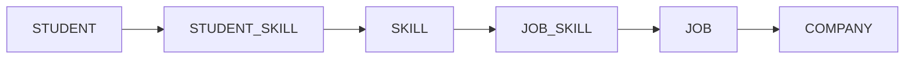

This enables:

> Candidate-to-job skill alignment.

---

# 95. ER Model for Career Recommendation

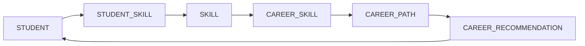

This creates a recommendation loop.

---

# 96. ER Model for Placement Intelligence

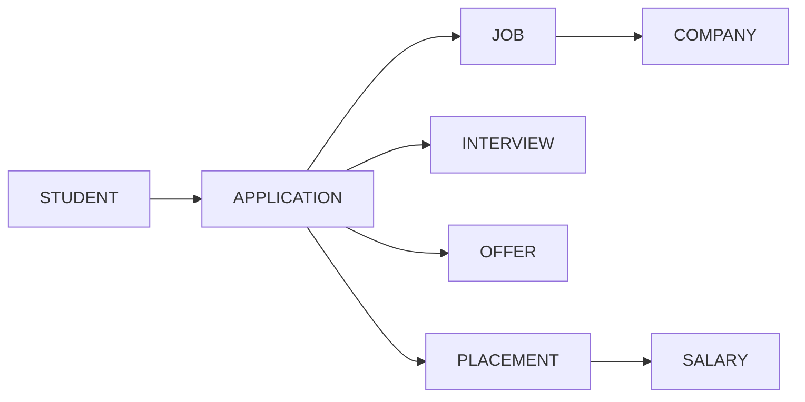

This creates the complete placement outcome chain.

---

# 97. ER Model for Learning Intelligence

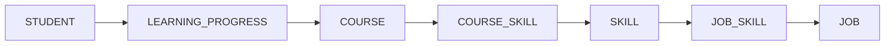

This connects:

**Learning → Skill → Job**

which is one of the central product concepts.

---

# 98. ER Model for Resume Intelligence

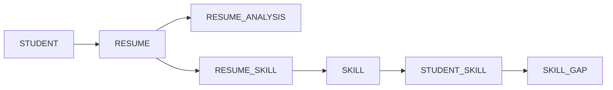

This connects:

**Resume → Skills → Skill Gap**

---

# 99. Database Boundary

The operational ER model should primarily contain:

```text id="m6z1x4"
Identity
Users
Organizations
Students
Jobs
Applications
Recruitment
Learning
Career Intelligence
```

The analytical model should contain:

```text id="q2w7j8"
Facts
Dimensions
Data Marts
Aggregates
Historical Snapshots
Metrics
```

---

# 100. Complete Domain Relationship Map

```text id="g4r8m2"
                         ORGANIZATION
                              │
                    ┌─────────┴─────────┐
                    │                   │
                DEPARTMENT            USER
                                        │
                     ┌──────────────────┼─────────────────┐
                     │                  │                 │
                  STUDENT           RECRUITER          ADMIN
                     │                  │
          ┌──────────┼──────────┐       │
          │          │          │       │
      EDUCATION   PROJECT   EXPERIENCE  │
          │          │                  │
          │       PROJECT_SKILL         │
          │          │                  │
          └──────────┼──────────────────┘
                     │
                 STUDENT_SKILL
                     │
                   SKILL
                     │
          ┌──────────┼───────────┐
          │          │           │
       JOB_SKILL CAREER_SKILL COURSE_SKILL
          │          │           │
         JOB      CAREER       COURSE
          │
      APPLICATION
          │
    ┌─────┼────────┐
    │     │        │
INTERVIEW OFFER  PLACEMENT
                     │
                  SALARY
```

---

# 101. ER Diagram Design Standards

All operational entities should use:

```text id="p7x2k4"
Primary Key
Foreign Keys
Created At
Updated At
Status where applicable
```

Auditable entities should additionally contain:

```text id="c4m8n6"
Created By
Updated By
```

where appropriate.

---

# 102. Timestamp Standards

Use consistent timestamp handling.

Recommended:

```text id="v9q3j1"
created_at
updated_at
deleted_at
```

Store timestamps in a consistent canonical timezone strategy, typically UTC, and convert for presentation.

---

# 103. Status Modeling

Avoid uncontrolled text values for important state fields.

Use:

- Enumerations
- Reference tables
- Controlled codes

Examples:

```text id="h5y1k7"
application_status
job_status
placement_status
course_status
user_status
```

---

# 104. ER Model Evolution Strategy

The ER model should evolve through migrations.

Example:

```text id="z6m8r4"
V001
Initial Schema

V002
Student Skills

V003
Jobs + Applications

V004
Recruitment

V005
Learning

V006
AI Career Intelligence
```

Every production database change should be version-controlled.

---

# 105. ER Diagram and API Relationship

The API resources should map naturally to domain entities.

Example:

```text id="j4k8c7"
/students
/skills
/jobs
/applications
/interviews
/placements
/courses
/certifications
/career-paths
/recommendations
```

This avoids an API design disconnected from the underlying business model.

---

# 106. ER Diagram and Data Warehouse Relationship

The ER model provides the operational source for warehouse loading.

Example:

```text id="b9x5q2"
STUDENT
   ↓
dim_student

JOB
   ↓
dim_job

COMPANY
   ↓
dim_company

SKILL
   ↓
dim_skill

APPLICATION
   ↓
fact_application

PLACEMENT
   ↓
fact_placement
```

---

# 107. ER Diagram and AI Relationship

AI uses operational and analytical entities to construct context.

Example:

```text id="z8q4m1"
Student
+
StudentSkill
+
ResumeAnalysis
+
CareerPath
+
SkillGap
+
Job
```

becomes:

```text id="t7c2p9"
AI Career Context
```

---

# 108. Final ER Design Principle

The ER model should support the central Career Connect relationship:

```text id="w9r3f5"
PERSON
   ↓
SKILLS
   ↓
CAREER
   ↓
LEARNING
   ↓
JOB
   ↓
APPLICATION
   ↓
INTERVIEW
   ↓
OFFER
   ↓
PLACEMENT
   ↓
OUTCOME
```

This is the core business graph represented through relational entities.

---

# 109. Recommended Core Tables for Academic Implementation

For the final-year version, the minimum strong operational schema should include:

```text id="a4n7q8"
users
roles
organizations
departments
students
education
projects
skills
student_skills
companies
recruiters
jobs
job_skills
applications
interviews
offers
placements
salaries
courses
course_skills
learning_progress
certifications
student_certifications
resumes
resume_analysis
career_paths
career_skills
career_recommendations
skill_gaps
audit_logs
```

This provides enough depth to demonstrate the complete product architecture.

---

# 110. Recommended Enterprise Extensions

For the future SaaS version, add:

```text id="j3k7v4"
Subscriptions
Plans
Billing
Usage
AI Sessions
AI Messages
Assessments
Interview Rounds
Notification Delivery
Tenant Settings
Data Sources
Data Quality
Metadata
Integrations
```

---

# 111. ER Model Success Criteria

The ER design is considered complete when it provides:

```text id="h8x2m6"
✓ Identity Model
✓ Organization Model
✓ Student Model
✓ Skill Graph
✓ Job Model
✓ Recruitment Model
✓ Placement Model
✓ Learning Model
✓ Career Model
✓ AI Model
✓ Audit Model
✓ Multi-Tenant Foundation
✓ Referential Integrity
✓ Extensibility
```

---

# 112. Final ER Architecture

```text id="p6w4n8"
                    CAREER CONNECT
                     ER ECOSYSTEM
                          │
        ┌─────────────────┼─────────────────┐
        │                 │                 │
      IDENTITY          CAREER          RECRUITMENT
        │                 │                 │
      USER              SKILL             JOB
      ROLE              CAREER            APPLICATION
      ORG               LEARNING          INTERVIEW
                        RESUME            OFFER
                        AI                PLACEMENT
                          │                 │
                          └────────┬────────┘
                                   │
                              OUTCOMES
                                   │
                              ANALYTICS
                                   │
                                  BI
                                   +
                                  AI
```

---

# 113. CTO-Level Database Recommendation

The database architecture should maintain a strong separation between:

### Operational Model

```text id="o7q3m9"
Normalized
Transactional
Current State
```

and:

### Analytical Model

```text id="l4z8k2"
Dimensional
Historical
Aggregate
BI-Oriented
```

The ER model should therefore remain clean and normalized, while the warehouse should transform it into star/snowflake schemas.

---

# 114. Final ER Diagram Statement

> **The Career Connect ER architecture defines a normalized, extensible relational model covering identity, organizations, students, education, projects, skills, companies, jobs, applications, interviews, offers, placements, salaries, courses, certifications, learning, resumes, career paths, AI recommendations, skill gaps, notifications, and auditability. Many-to-many relationships are resolved through junction entities, historical and analytical requirements are delegated to the data warehouse, and the model provides a strong operational foundation for AI-driven career intelligence and enterprise BI.**

---

## Document Status

| Attribute        | Value                                                 |
| ---------------- | ----------------------------------------------------- |
| Project          | Career Connect                                        |
| Document         | ER Diagram                                            |
| Version          | 1.0                                                   |
| Primary Database | PostgreSQL                                            |
| Model Type       | Normalized Relational Model                           |
| Identity         | User + Role + Permission                              |
| Organization     | Organization + Department                             |
| Student          | Student + Education + Project + Experience            |
| Skills           | Skill + StudentSkill + JobSkill + CareerSkill         |
| Recruitment      | Job + Application + Interview + Offer                 |
| Outcome          | Placement + Salary                                    |
| Learning         | Course + Certification + Learning Progress            |
| AI               | Resume + Analysis + Career Recommendation + Skill Gap |
| Governance       | Audit + Notifications                                 |
| SaaS Foundation  | Organization/Tenant Model                             |
| Warehouse Link   | Facts + Dimensions                                    |
| Status           | Database Architecture Baseline                        |
