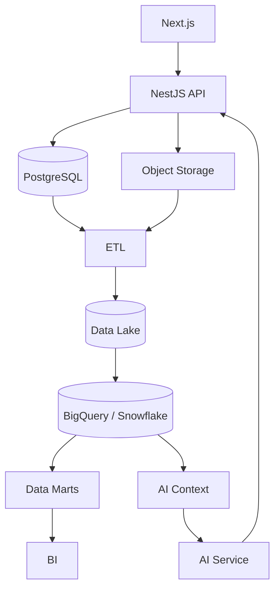
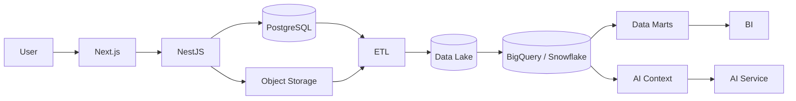

# 14 — Database Design

# Career Connect — AI Career Intelligence Platform

**Document Type:** Database Design Document
**Project:** Career Connect
**Version:** 1.0
**Status:** Database Design Baseline
**Primary OLTP Database:** PostgreSQL
**Authentication:** Supabase Auth
**Object Storage:** Supabase Storage / Cloud Object Storage
**Analytical Database:** BigQuery / Snowflake
**Database Style:** Normalized OLTP + Dimensional OLAP
**Design Approach:** Secure, Multi-Tenant, Extensible, Auditable

---

# 1. Executive Summary

The Career Connect database architecture is designed to support a complete career intelligence ecosystem rather than a simple CRUD application.

The database must support:

```text
Identity
Organizations
Students
Education
Skills
Projects
Experience
Companies
Recruiters
Jobs
Applications
Interviews
Offers
Placements
Salaries
Courses
Certifications
Learning
Resumes
AI Analysis
Career Recommendations
Skill Gaps
Notifications
Auditing
```

The database architecture is divided into two fundamentally different environments:

```text
                    CAREER CONNECT DATA

                           │
             ┌─────────────┴─────────────┐
             │                           │
       OPERATIONAL                   ANALYTICAL
          OLTP                          OLAP
             │                           │
       PostgreSQL                    BigQuery /
       Supabase                      Snowflake
             │                           │
      Transactions                 Historical Analysis
      CRUD                          BI
      Security                      Data Marts
      User Workflows                AI Context
```

The operational database is optimized for transactional correctness.

The analytical warehouse is optimized for historical and aggregate analysis.

This separation is a core architectural requirement.

---

# 2. Database Design Goals

The database must provide:

## 2.1 Integrity

Data should remain valid and internally consistent.

---

## 2.2 Security

Users should only access the data they are authorized to access.

---

## 2.3 Scalability

The system should support growth in:

- Users
- Organizations
- Students
- Jobs
- Applications
- Resumes
- Skills
- Recruiters
- Analytical records

---

## 2.4 Maintainability

The schema should be understandable and easy to evolve.

---

## 2.5 Performance

Frequently executed application queries should be optimized.

---

## 2.6 Auditability

Important changes and sensitive operations should be traceable.

---

## 2.7 SaaS Readiness

The design should support multiple organizations and tenant isolation.

---

# 3. Database Architecture

The recommended architecture is:



---

# 4. Operational Database

The primary operational database is PostgreSQL.

It should store:

```text
Users
Organizations
Students
Companies
Jobs
Applications
Interviews
Placements
Courses
Certifications
Learning Progress
Resumes Metadata
AI Results
Audit Records
```

---

# 5. Why PostgreSQL

PostgreSQL is suitable because it provides:

- Strong relational modeling
- Foreign keys
- Transactions
- Constraints
- JSON support
- Indexing
- Extensions
- Mature tooling
- Strong SQL capabilities

Supabase provides managed PostgreSQL as the underlying database for its platform and integrates authentication and storage capabilities around it.

---

# 6. Database Schemas

The operational database should be logically organized into schemas.

Recommended:

```text
auth/
core/
career/
recruitment/
learning/
ai/
reporting/
audit/
```

A simpler academic implementation can keep all application tables in a single `public` schema while preserving domain naming.

---

# 7. Suggested Schema Structure

```text
database/
│
├── migrations/
│
├── seeds/
│
├── functions/
│
└── schemas/
    ├── core/
    ├── career/
    ├── recruitment/
    ├── learning/
    ├── ai/
    └── audit/
```

---

# 8. Core Schema

The `core` domain contains:

```text
users
organizations
departments
roles
permissions
user_roles
role_permissions
locations
```

---

# 9. Users Table

## Table

```text
core.users
```

### Purpose

Stores application-level user identity metadata.

### Fields

| Column        | Type        | Key    | Description                 |
| ------------- | ----------- | ------ | --------------------------- |
| user_id       | UUID        | PK     | Application user identifier |
| auth_user_id  | UUID        | Unique | Identity-provider reference |
| email         | VARCHAR     | Unique | User email                  |
| display_name  | VARCHAR     |        | Display name                |
| phone         | VARCHAR     |        | Contact number              |
| status        | VARCHAR     |        | Account state               |
| last_login_at | TIMESTAMPTZ |        | Last login                  |
| created_at    | TIMESTAMPTZ |        | Creation timestamp          |
| updated_at    | TIMESTAMPTZ |        | Last update                 |

---

# 10. User Status

Recommended controlled values:

```text
ACTIVE
INACTIVE
SUSPENDED
PENDING
DELETED
```

The application should not accept arbitrary status text.

---

# 11. Organizations Table

## Table

```text
core.organizations
```

### Purpose

Represents a college, company, university, training institute, or other tenant.

### Fields

```text
organization_id
organization_type
organization_name
legal_name
website
country_code
state_code
city
status
created_at
updated_at
```

---

# 12. Organization Type

Recommended values:

```text
COLLEGE
UNIVERSITY
COMPANY
TRAINING_INSTITUTE
RECRUITMENT_AGENCY
ENTERPRISE
```

---

# 13. Departments Table

## Table

```text
core.departments
```

### Fields

```text
department_id
organization_id
department_code
department_name
status
created_at
updated_at
```

Relationship:

```text
Organization
    1
    |
    M
Department
```

---

# 14. Roles Table

## Table

```text
core.roles
```

### Fields

```text
role_id
role_code
role_name
description
is_system_role
created_at
```

---

# 15. Recommended Roles

```text
SUPER_ADMIN
ORG_ADMIN
PLACEMENT_OFFICER
FACULTY
RECRUITER
STUDENT
JOB_SEEKER
```

---

# 16. Permissions Table

## Table

```text
core.permissions
```

### Fields

```text
permission_id
permission_code
permission_name
resource
action
description
```

Example:

```text
STUDENT_READ
STUDENT_UPDATE
JOB_CREATE
JOB_READ
APPLICATION_READ
PLACEMENT_EXPORT
REPORT_EXPORT
```

---

# 17. User Roles Table

## Table

```text
core.user_roles
```

### Fields

```text
user_id
role_id
organization_id
assigned_at
assigned_by
```

The inclusion of `organization_id` allows a user to hold different roles across organizational contexts where required.

---

# 18. Role Permissions Table

## Table

```text
core.role_permissions
```

Fields:

```text
role_id
permission_id
```

This implements:

```text
Role
 ↓
Permissions
```

---

# 19. Locations Table

## Table

```text
core.locations
```

### Fields

```text
location_id
country
state
region
city
postal_code
latitude
longitude
timezone
created_at
```

Not every deployment needs every geographic field.

---

# 20. Location Hierarchy

The logical hierarchy is:

```text
Country
  ↓
State / Province
  ↓
Region
  ↓
City
  ↓
Postal Area
```

This supports location-based analytics.

---

# 21. Student Schema

Recommended tables:

```text
career.students
career.student_education
career.student_projects
career.student_experience
career.student_skills
career.student_preferences
```

---

# 22. Students Table

## Table

```text
career.students
```

### Fields

```text
student_id
user_id
organization_id
department_id
student_number
graduation_year
education_level
career_goal
current_location_id
profile_status
created_at
updated_at
```

---

# 23. Unique Student Constraint

Within an organization:

```text
UNIQUE (
    organization_id,
    student_number
)
```

This allows two different organizations to independently use the same numbering convention.

---

# 24. Student Education Table

## Table

```text
career.student_education
```

### Fields

```text
education_id
student_id
institution_name
degree
field_of_study
start_date
end_date
grade
gpa
percentage
created_at
updated_at
```

---

# 25. Student Projects Table

## Table

```text
career.student_projects
```

### Fields

```text
project_id
student_id
project_name
description
repository_url
demo_url
start_date
end_date
created_at
updated_at
```

---

# 26. Student Experience Table

## Table

```text
career.student_experience
```

Fields:

```text
experience_id
student_id
company_id
job_title
employment_type_id
start_date
end_date
description
created_at
updated_at
```

---

# 27. Skills Schema

Recommended tables:

```text
career.skill_categories
career.skills
career.student_skills
career.skill_aliases
career.skill_relations
```

---

# 28. Skill Categories

## Table

```text
career.skill_categories
```

Example values:

```text
Programming
Database
Cloud
AI / ML
Data Engineering
Analytics
DevOps
Cybersecurity
Soft Skills
```

---

# 29. Skills Table

## Table

```text
career.skills
```

### Fields

```text
skill_id
skill_category_id
skill_name
canonical_name
skill_type
description
status
created_at
updated_at
```

---

# 30. Skill Aliases

## Table

```text
career.skill_aliases
```

Example:

```text
skill_id | alias
---------|---------
101      | React
101      | React.js
101      | ReactJS
```

This supports skill normalization.

---

# 31. Student Skills

## Table

```text
career.student_skills
```

### Fields

```text
student_skill_id
student_id
skill_id
proficiency_level
years_experience
source
verified_flag
confidence_score
last_assessed_at
created_at
updated_at
```

---

# 32. Student Skill Uniqueness

A student should normally have one active skill record per skill:

```text
UNIQUE (
    student_id,
    skill_id
)
```

Historical assessment records can be handled through a separate assessment/history table.

---

# 33. Companies Schema

Recommended:

```text
recruitment.companies
recruitment.company_industries
recruitment.company_locations
```

---

# 34. Companies Table

## Table

```text
recruitment.companies
```

Fields:

```text
company_id
organization_id
company_name
legal_name
industry
company_size
website
headquarters_location_id
status
created_at
updated_at
```

---

# 35. Recruiters Table

## Table

```text
recruitment.recruiters
```

Fields:

```text
recruiter_id
user_id
company_id
designation
recruiter_type
status
created_at
updated_at
```

---

# 36. Job Schema

Recommended:

```text
recruitment.jobs
recruitment.job_skills
recruitment.job_locations
recruitment.job_categories
```

---

# 37. Jobs Table

## Table

```text
recruitment.jobs
```

Fields:

```text
job_id
company_id
created_by_recruiter_id
job_reference
job_title
job_category_id
description
employment_type_id
experience_level_id
minimum_salary
maximum_salary
currency_code
posted_at
closing_at
status
created_at
updated_at
```

---

# 38. Job Reference

A human-readable job identifier should be maintained.

Example:

```text
CC-JOB-2026-000145
```

This is a business identifier, not necessarily the database primary key.

---

# 39. Job Skills Table

## Table

```text
recruitment.job_skills
```

Fields:

```text
job_skill_id
job_id
skill_id
required_level
importance_weight
mandatory_flag
created_at
```

---

# 40. Job Locations Table

## Table

```text
recruitment.job_locations
```

Fields:

```text
job_location_id
job_id
location_id
work_mode
is_primary
```

---

# 41. Application Schema

Recommended:

```text
recruitment.applications
recruitment.application_events
recruitment.application_sources
```

---

# 42. Applications Table

## Table

```text
recruitment.applications
```

Fields:

```text
application_id
student_id
job_id
application_reference
applied_at
application_status
current_stage
source
created_at
updated_at
```

---

# 43. Application Events

## Table

```text
recruitment.application_events
```

This table preserves the application lifecycle.

Fields:

```text
event_id
application_id
event_type
event_time
performed_by
notes
metadata
```

Example events:

```text
APPLIED
SCREENED
SHORTLISTED
ASSESSMENT
INTERVIEW
OFFER
REJECTED
WITHDRAWN
HIRED
```

This event table is especially useful for funnel analytics and auditing state transitions.

---

# 44. Interviews Table

## Table

```text
recruitment.interviews
```

Fields:

```text
interview_id
application_id
recruiter_id
scheduled_at
interview_type
round_number
score
result
feedback
created_at
updated_at
```

---

# 45. Interview Rounds

For advanced implementations:

```text
recruitment.interview_rounds
```

could separate:

```text
Round 1
Technical
Round 2
Managerial
Round 3
HR
```

The simplified `interviews` design is sufficient for the initial implementation.

---

# 46. Offers Table

## Table

```text
recruitment.offers
```

Fields:

```text
offer_id
application_id
offer_reference
offered_at
base_salary
bonus
currency_code
offer_status
joining_date
created_at
updated_at
```

---

# 47. Placements Table

## Table

```text
recruitment.placements
```

Fields:

```text
placement_id
application_id
student_id
company_id
job_id
organization_id
placement_date
salary_amount
currency_code
placement_status
created_at
updated_at
```

---

# 48. Placement Constraint

A placement should normally reference a successful application:

```text
placement.application_id
→ applications.application_id
```

This preserves the recruitment-to-placement relationship.

---

# 49. Salary Intelligence Schema

Use separate concepts for:

```text
Actual Placement Salary
Market Salary Observation
Salary Aggregation
```

These should not be mixed.

---

# 50. Market Salary Table

## Table

```text
analytics.salary_observations
```

Fields:

```text
salary_observation_id
company_id
job_id
location_id
experience_level_id
minimum_salary
maximum_salary
currency_code
source
observation_date
sample_size
created_at
```

---

# 51. Why Separate Salary Observations?

Because:

```text
Actual Placement Salary
```

and:

```text
Market Salary Estimate
```

have different meanings.

The warehouse should preserve the distinction so dashboards do not accidentally interpret market ranges as actual employee outcomes.

---

# 52. Learning Schema

Recommended:

```text
learning.courses
learning.course_skills
learning.learning_progress
learning.certifications
learning.student_certifications
```

---

# 53. Courses Table

## Table

```text
learning.courses
```

Fields:

```text
course_id
provider
course_name
description
category
difficulty_level
duration_hours
delivery_mode
course_url
status
created_at
updated_at
```

---

# 54. Course Skills

## Table

```text
learning.course_skills
```

Fields:

```text
course_skill_id
course_id
skill_id
coverage_level
importance_weight
```

This enables:

```text
Course
  ↓
Skills Learned
```

---

# 55. Learning Progress

## Table

```text
learning.learning_progress
```

Fields:

```text
learning_progress_id
student_id
course_id
started_at
completed_at
progress_percentage
assessment_score
status
updated_at
```

---

# 56. Certifications

## Table

```text
learning.certifications
```

Fields:

```text
certification_id
provider
certification_name
category
level
credential_type
validity_period
status
```

---

# 57. Student Certifications

## Table

```text
learning.student_certifications
```

Fields:

```text
student_certification_id
student_id
certification_id
credential_id
issue_date
expiry_date
verification_url
status
```

---

# 58. Resume Schema

Recommended:

```text
ai.resumes
ai.resume_versions
ai.resume_analysis
ai.resume_skills
```

---

# 59. Resumes Table

## Table

```text
ai.resumes
```

Fields:

```text
resume_id
student_id
file_path
file_name
file_type
file_size
version_number
is_active
uploaded_at
created_at
updated_at
```

---

# 60. Resume Versions

A student may upload multiple versions.

Example:

```text
Resume v1
Resume v2
Resume v3
```

Therefore:

```text
ai.resume_versions
```

can track document history separately.

---

# 61. Resume Analysis Table

## Table

```text
ai.resume_analysis
```

Fields:

```text
analysis_id
resume_id
target_career_id
overall_score
ats_score
content_score
skills_score
format_score
strengths
weaknesses
recommendations
model_name
model_version
prompt_version
analyzed_at
```

---

# 62. Structured vs JSON AI Output

AI output should be stored in two forms where useful.

### Structured fields

For:

```text
overall_score
ats_score
model_version
target_career_id
```

### JSON metadata

For:

```text
detailed_feedback
explanations
section_analysis
```

PostgreSQL JSON/JSONB can be useful for flexible AI payloads, but core business metrics should remain strongly typed.

---

# 63. Career Intelligence Schema

Recommended:

```text
career.career_paths
career.career_skills
career.skill_gaps
career.recommendations
career.learning_recommendations
```

---

# 64. Career Paths Table

## Table

```text
career.career_paths
```

Fields:

```text
career_path_id
career_name
career_category
career_level
description
market_status
created_at
updated_at
```

---

# 65. Career Skills

## Table

```text
career.career_skills
```

Fields:

```text
career_skill_id
career_path_id
skill_id
required_level
importance_weight
mandatory_flag
```

---

# 66. Skill Gaps

## Table

```text
career.skill_gaps
```

Fields:

```text
skill_gap_id
student_id
skill_id
target_type
target_id
current_level
required_level
gap_score
priority
detected_at
resolved_at
status
```

---

# 67. Career Recommendations

## Table

```text
career.recommendations
```

Fields:

```text
recommendation_id
student_id
career_path_id
match_score
confidence_score
reasoning_summary
model_type
model_version
generated_at
status
```

---

# 68. Recommendation Versioning

Every AI recommendation should record the model/prompt context that produced it.

Example:

```text
model_version = gpt-model-version-X
prompt_version = career_v3
generated_at = ...
```

The exact model identifier depends on the provider.

This is important when the AI system changes over time.

---

# 69. AI Conversation Schema

Future support:

```text
ai.ai_sessions
ai.ai_messages
ai.ai_feedback
```

---

# 70. AI Sessions

## Table

```text
ai.ai_sessions
```

Fields:

```text
session_id
user_id
session_type
started_at
ended_at
status
```

Possible session types:

```text
CAREER_COACH
RESUME_REVIEW
MOCK_INTERVIEW
CAREER_SEARCH
BI_ASSISTANT
```

---

# 71. AI Messages

## Table

```text
ai.ai_messages
```

Fields:

```text
message_id
session_id
sender_type
message_text
model_name
model_version
token_usage
latency_ms
created_at
```

Sensitive conversation content should be governed by retention and privacy policies.

---

# 72. Notification Schema

Recommended:

```text
core.notification_templates
core.notifications
core.notification_deliveries
```

---

# 73. Notification Table

Fields:

```text
notification_id
user_id
notification_type
title
message
channel
status
read_at
created_at
```

Channels:

```text
IN_APP
EMAIL
PUSH
```

---

# 74. Audit Schema

The audit subsystem should be separated logically.

Recommended:

```text
audit.audit_logs
audit.data_access_logs
audit.security_events
```

---

# 75. Audit Logs

## Table

```text
audit.audit_logs
```

Fields:

```text
audit_id
user_id
organization_id
action
resource_type
resource_id
request_id
ip_address
user_agent
metadata
created_at
```

---

# 76. Database Access Model

The application should follow:

```text
Frontend
   ↓
API
   ↓
Service Layer
   ↓
Repository / ORM
   ↓
Database
```

The frontend should not contain raw database credentials.

---

# 77. Row-Level Security

For multi-tenant data, Row-Level Security can provide an additional access-control layer where appropriate.

Conceptually:

```text
Authenticated User
↓
Tenant Context
↓
RLS Policy
↓
Authorized Row
```

Supabase specifically supports PostgreSQL Row Level Security as part of its authorization model.

---

# 78. Tenant Isolation

Every organization-owned business table should be evaluated for a tenant/organization key.

Examples:

```text
students.organization_id
jobs.organization_id
placements.organization_id
reports.organization_id
```

Global reference data such as skill taxonomies may intentionally remain shared.

---

# 79. Soft Deletion

Tables that require historical/audit preservation may use:

```text
deleted_at
```

instead of immediate physical deletion.

Example:

```text
jobs.deleted_at
courses.deleted_at
companies.deleted_at
```

The application should always filter soft-deleted records unless explicitly requesting historical data.

---

# 80. Timestamp Standards

Use:

```text
created_at
updated_at
deleted_at
```

with:

```text
TIMESTAMPTZ
```

where timestamps are required.

Use a consistent canonical timezone strategy, preferably storing operational timestamps in UTC.

---

# 81. UUID Strategy

Operational entity IDs should preferably use UUIDs.

Example:

```sql
user_id UUID PRIMARY KEY
```

Advantages:

- Distributed generation
- Low collision risk
- Suitable for SaaS
- Avoids sequential public identifiers

---

# 82. Business Identifiers

Human-readable identifiers should remain separate.

Examples:

```text
student_number
job_reference
application_reference
offer_reference
credential_id
```

Example:

```text
application_reference =
CC-APP-2026-000182
```

---

# 83. Foreign Key Strategy

Foreign keys should be defined for all essential relationships.

Example:

```sql
FOREIGN KEY (student_id)
REFERENCES career.students(student_id)
```

This prevents orphaned records.

---

# 84. Delete Rules

Delete behavior must be intentional.

Examples:

### User → Student

Avoid cascading destructive deletion without a clear policy.

### Student → Application

Usually preserve historical application records.

### Job → Application

Do not delete applications merely because a job is closed.

Therefore, many relationships should use:

```text
RESTRICT
```

or controlled soft deletion rather than unrestricted cascade deletion.

---

# 85. Check Constraints

Examples:

```sql
CHECK (progress_percentage >= 0 AND progress_percentage <= 100)
```

```sql
CHECK (minimum_salary >= 0)
```

```sql
CHECK (maximum_salary >= minimum_salary)
```

These prevent invalid data from entering the database.

---

# 86. Unique Constraints

Recommended:

```text
users.email
organizations.organization_name + suitable scope
skills.canonical_name
job.job_reference
student.organization_id + student_number
application.application_reference
```

The exact uniqueness scope should be defined per business domain.

---

# 87. Indexing Strategy

Indexes should be created around actual query patterns.

Recommended initial indexes:

```text
users(email)
students(organization_id)
students(user_id)
student_skills(student_id)
student_skills(skill_id)
jobs(company_id)
jobs(status)
jobs(posted_at)
applications(student_id)
applications(job_id)
applications(application_status)
interviews(application_id)
placements(student_id)
placements(company_id)
```

---

# 88. Composite Indexes

For common filters:

```sql
CREATE INDEX idx_jobs_status_posted
ON recruitment.jobs(status, posted_at);
```

For applications:

```sql
CREATE INDEX idx_applications_student_status
ON recruitment.applications(student_id, application_status);
```

Composite indexes should be based on measured access patterns.

---

# 89. Partial Indexes

For active records:

```sql
CREATE INDEX idx_active_jobs
ON recruitment.jobs(company_id, posted_at)
WHERE status = 'ACTIVE';
```

This can be useful when the active subset is much smaller than the full table.

---

# 90. Full-Text Search

PostgreSQL full-text search can support basic search requirements for:

- Job descriptions
- Skills
- Course descriptions
- Resume-derived text

For larger search workloads, a dedicated search engine can be introduced later.

---

# 91. JSONB Strategy

JSONB can be used for:

- AI metadata
- Flexible source metadata
- Provider-specific fields
- External payload snapshots

It should not replace relational columns for frequently queried core business attributes.

Bad pattern:

```text
student_profile JSONB containing every field
```

Better:

```text
student table
+
optional metadata JSONB
```

---

# 92. Database Transactions

Transaction boundaries should be defined for business operations.

Example:

### Job Application

```text
BEGIN

Insert application
Insert application event
Create audit event

COMMIT
```

If any required operation fails:

```text
ROLLBACK
```

---

# 93. Concurrency Control

Potential concurrent situations:

```text
Two users update the same profile
Two recruiters modify application status
Two processes update learning progress
```

Use:

- Transactions
- Optimistic locking where required
- `updated_at` checks
- Appropriate database isolation

---

# 94. Optimistic Locking

A version field can be used:

```text
record_version
```

Example:

```text
Client reads version 4
Client updates expecting version 4
Database sees version 5
→ Reject stale update
```

This prevents accidental overwrites in collaborative workflows.

---

# 95. Database Connection Management

The backend should use:

- Connection pooling
- Sensible pool limits
- Connection timeouts
- Retry policies where appropriate

Too many application instances with excessive connection pools can overload the database.

---

# 96. Database Backup Strategy

The operational database should have:

```text
Automated Backups
Point-in-Time Recovery where available
Recovery Testing
Backup Monitoring
```

The backup strategy must be tested rather than assumed.

---

# 97. Database Migration Strategy

Schema changes must be version-controlled.

Example:

```text
001_create_core.sql
002_create_students.sql
003_create_skills.sql
004_create_jobs.sql
005_create_applications.sql
006_create_recruitment.sql
007_create_learning.sql
008_create_ai.sql
```

---

# 98. Seed Data Strategy

The project should maintain:

```text
database/seeds/
```

with:

```text
roles
permissions
skill_categories
skills
career_paths
employment_types
experience_levels
sample_locations
```

Development/test data should be clearly distinguished from production data.

---

# 99. Synthetic Data Strategy

Synthetic data should be used where real personal or proprietary data is unavailable.

Example dataset:

```text
10,000 Students
2,000 Jobs
500 Companies
300 Skills
50 Colleges
25,000 Applications
```

These values are illustrative dataset-generation targets, not statements about actual market size.

---

# 100. Data Privacy

Personal data should be minimized.

Examples:

```text
Name
Email
Phone
Resume
Education
Salary
Applications
Interview Feedback
```

Access should be restricted according to role and purpose.

---

# 101. Sensitive Data Separation

For stronger security, highly sensitive fields can be isolated from analytical tables.

For example:

```text
Identity DB
    ↓
student_id

Analytics
    ↓
student_key
```

This reduces unnecessary exposure of PII in analytical workloads.

---

# 102. Database-to-Warehouse Mapping

The operational model maps into warehouse structures.

Example:

| OLTP Table        | Warehouse         |
| ----------------- | ----------------- |
| students          | dim_student       |
| companies         | dim_company       |
| jobs              | dim_job           |
| skills            | dim_skill         |
| applications      | fact_application  |
| interviews        | fact_interview    |
| placements        | fact_placement    |
| courses           | dim_course        |
| learning_progress | fact_learning     |
| certifications    | dim_certification |

---

# 103. Database Architecture Flow



---

# 104. Database Security Matrix

| Data                  |        Student |     Placement Officer |  Recruiter |      Admin |
| --------------------- | -------------: | --------------------: | ---------: | ---------: |
| Own Profile           |           Full |               Limited |         No |       Full |
| Other Student Profile |             No |            Authorized | Authorized |       Full |
| Resume                |            Own |            Authorized | Authorized | Controlled |
| Applications          |            Own |            Authorized |   Relevant |       Full |
| Placement             |            Own |            Authorized |   Relevant |       Full |
| Salary                | Own/Authorized | Aggregated/Authorized | Authorized |       Full |
| Audit Logs            |             No |               Limited |    Limited |       Full |

Actual access rules should be implemented according to the organization's policy.

---

# 105. Database Performance Strategy

Performance should be handled at multiple levels:

```text
Application
↓
API Caching
↓
Database Indexing
↓
Query Optimization
↓
Connection Pooling
↓
Read Patterns
↓
Warehouse Separation
```

---

# 106. Read vs Write Workloads

The application database should prioritize:

```text
Write:
Applications
Profiles
Interviews
Learning Progress
```

Read-heavy analytics should move to:

```text
Warehouse
Data Marts
Precomputed Metrics
```

---

# 107. Database Scaling Strategy

Initial:

```text
One Managed PostgreSQL Instance
```

Later:

```text
Read Replicas
Caching
Connection Pooling
Partitioning
Independent Analytics
```

At very large scale, domain-specific service/database separation can be considered.

---

# 108. Partitioning Candidates

Large tables may eventually require partitioning.

Potential candidates:

```text
application_events
audit_logs
ai_messages
salary_observations
```

Time-based partitioning may be useful for high-volume event tables.

---

# 109. Event Tables

Operational event tables should be append-oriented where practical.

Examples:

```text
application_events
audit_logs
ai_messages
notification_deliveries
```

This simplifies historical tracking.

---

# 110. Database Design for Auditability

An important architecture rule is:

> **Do not use the current-state table as the only record of historical business activity.**

For example, changing:

```text
application_status
```

from:

```text
APPLIED
```

to:

```text
INTERVIEW
```

should not necessarily destroy the knowledge that the application passed through earlier stages.

Hence:

```text
applications
+
application_events
```

is stronger than only storing a current status.

---

# 111. Database Design for AI Auditability

Similarly, do not store only the latest AI recommendation.

Preserve:

```text
Recommendation
Model
Prompt Version
Timestamp
Target
```

This supports:

- Evaluation
- Debugging
- Reproducibility
- User support

---

# 112. Database Design for Data Quality

Data-quality metadata should be stored separately.

Potential table:

```text
audit.data_quality_results
```

Fields:

```text
quality_run_id
dataset_name
check_name
records_checked
records_failed
quality_score
run_time
status
```

---

# 113. Metadata Table

Potential:

```text
audit.data_sources
```

Fields:

```text
source_id
source_name
source_type
owner
license
refresh_frequency
last_successful_run
schema_version
status
```

This creates data governance at the source level.

---

# 114. Database Design for Data Lineage

Potential:

```text
audit.data_lineage
```

Fields:

```text
lineage_id
source_system
source_table
source_column
target_table
target_column
transformation_rule
pipeline_version
```

This becomes valuable in the enterprise version.

---

# 115. Database Testing Strategy

The database should be tested at multiple levels.

### Constraint Testing

- Foreign keys
- Unique constraints
- Check constraints

### Migration Testing

- Upgrade
- Rollback where supported
- Seed execution

### Query Testing

- Correct joins
- Correct filtering
- Correct aggregations

### Performance Testing

- Index effectiveness
- Query latency
- Connection behavior

---

# 116. Database Test Example

```text
Test:
Create Application

Given:
Valid Student
Valid Job

When:
Student submits application

Then:
Application exists
Status = APPLIED
Application event exists
Audit event exists
```

---

# 117. Database Anti-Patterns

Avoid:

### One Giant Table

Combining:

```text
Student + Job + Company + Application + Placement
```

into one table.

---

### Repeated Text

Storing:

```text
Python
Python
Python
```

across many tables rather than referencing a skill entity.

---

### No Foreign Keys

This creates orphaned data.

---

### No Audit History

This makes career outcomes difficult to reconstruct.

---

### Direct BI on OLTP

This can create performance and governance problems.

---

### Overuse of JSON

Flexible data does not mean everything should become JSON.

---

# 118. Recommended Database Folder Structure

```text
database/
│
├── migrations/
│   ├── 001_core.sql
│   ├── 002_student.sql
│   ├── 003_skill.sql
│   ├── 004_company.sql
│   ├── 005_job.sql
│   ├── 006_application.sql
│   ├── 007_recruitment.sql
│   ├── 008_learning.sql
│   ├── 009_ai.sql
│   └── 010_audit.sql
│
├── seeds/
│   ├── roles.sql
│   ├── permissions.sql
│   ├── skills.sql
│   ├── careers.sql
│   └── locations.sql
│
├── functions/
│
└── views/
    ├── active_jobs.sql
    ├── student_summary.sql
    └── placement_summary.sql
```

---

# 119. Recommended Database Naming Convention

Tables:

```text
snake_case
plural nouns
```

Examples:

```text
students
jobs
applications
interviews
placements
```

Primary keys:

```text
<table_singular>_id
```

Examples:

```text
student_id
job_id
application_id
```

Foreign keys should use the same referenced identifier name.

---

# 120. Database Documentation Standard

Every table documentation should include:

```text
Purpose
Owner
Grain
Primary Key
Foreign Keys
Columns
Indexes
Constraints
PII Classification
Retention
Source
Consumers
```

---

# 121. Database Development Workflow


Database changes should therefore be treated as part of the application lifecycle rather than ad-hoc manual edits.

---

# 122. Database Versioning

Every database release should have a known schema version.

Example:

```text
Database Version:
1.0.8
```

The backend version and database migration state should be compatible.

---

# 123. Zero-Downtime Migration Principle

For production:

```text
Add New Field
↓
Deploy Compatible Code
↓
Backfill
↓
Switch Usage
↓
Remove Old Field Later
```

Avoid destructive schema changes in the same release as dependent application code where possible.

---

# 124. Final Database Architecture

```text
                         CAREER CONNECT
                         DATABASE LAYER
                               │
            ┌──────────────────┴──────────────────┐
            │                                     │
        OPERATIONAL                          ANALYTICAL
           OLTP                                  OLAP
            │                                     │
      Supabase PostgreSQL                    BigQuery /
            │                                Snowflake
      ┌─────┼─────┐                              │
      │     │     │                              │
   Core  Career Recruitment                   Facts
      │     │     │                          Dimensions
      │     │     │                          Data Marts
      └─────┼─────┘                              │
            │                                    │
            └──────────── ETL ───────────────────┘
                               │
                         BI + AI
```

---

# 125. Final Database Design Principles

Career Connect should follow these principles:

```text
1. Normalize operational data.
2. Use foreign keys for integrity.
3. Use UUIDs for internal identity.
4. Use business keys for human reference.
5. Use indexes based on real queries.
6. Preserve important historical events.
7. Separate PII from analytical workloads where practical.
8. Use tenant-aware access control.
9. Version every schema change.
10. Keep AI outputs auditable.
11. Separate OLTP from OLAP.
12. Use the warehouse for analytics.
13. Keep flexible AI metadata in JSONB only where justified.
14. Test migrations and constraints.
15. Design for future SaaS expansion.
```

---

# 126. CTO-Level Database Recommendation

The recommended database strategy is:

> **PostgreSQL/Supabase as the secure transactional system of record, cloud object storage for documents and raw files, and BigQuery or Snowflake as the governed analytical system of record.**

The database should evolve through:

```text
Normalized OLTP
↓
Reliable Events
↓
ETL
↓
Dimensional Warehouse
↓
Data Marts
↓
BI + AI
```

---

# 127. Final Database Statement

> **Career Connect will use a normalized PostgreSQL operational database to manage identity, organizations, students, skills, jobs, recruitment, learning, placements, resumes, AI outputs, and governance data. The design uses strong constraints, foreign keys, indexed access paths, tenant-aware authorization, auditability, version-controlled migrations, and event-oriented history where required. Operational data will be transformed through controlled ETL pipelines into a dimensional cloud data warehouse that serves Business Intelligence and AI workloads without compromising transactional performance.**

---

## Document Status

| Attribute    | Value                                     |
| ------------ | ----------------------------------------- |
| Project      | Career Connect                            |
| Document     | Database Design                           |
| Version      | 1.0                                       |
| OLTP         | PostgreSQL / Supabase                     |
| OLAP         | BigQuery / Snowflake                      |
| Modeling     | Normalized OLTP + Dimensional OLAP        |
| Identity     | UUID + Business Keys                      |
| Tenant Model | Organization-Based                        |
| Security     | RBAC + RLS + API Authorization            |
| Audit        | Event + Audit Logging                     |
| AI Data      | Structured + JSONB Metadata               |
| Migration    | Version Controlled                        |
| Backup       | Managed Backup + Recovery                 |
| Performance  | Indexing + Pooling + Warehouse Separation |
| Privacy      | PII-Aware Design                          |
| Status       | Database Design Baseline                  |
