# 15 — Star Schema

# Career Connect — AI Career Intelligence Platform

**Document Type:** Enterprise Star Schema Design
**Project:** Career Connect
**Version:** 1.0
**Status:** Analytical Data Model Baseline
**Primary Warehouse:** BigQuery
**Alternative:** Snowflake
**Modeling Approach:** Dimensional Modeling
**Primary Use Cases:** BI, Analytics, Reporting, AI Context, Predictive Analytics

---

# 1. Executive Summary

The Star Schema is the primary dimensional modeling pattern for Career Connect's analytical warehouse.

The operational PostgreSQL database is optimized for transactions.

The Star Schema is optimized for questions such as:

- What is the placement rate by college?
- Which companies hired the most students?
- Which skills are most demanded?
- What is the average salary by role and location?
- What is the application-to-interview conversion rate?
- Which technologies are growing?
- Which colleges have the strongest placement outcomes?
- Which skills are associated with successful placements?

The fundamental Star Schema pattern is:

```text
                    DIMENSION
                       │
                       │
DIMENSION ─────── FACT TABLE ─────── DIMENSION
                       │
                       │
                    DIMENSION
```

The **fact table is at the center**, while dimensions surround it.

Career Connect will use multiple star schemas, each representing an important business process.

---

# 2. Star Schema Objectives

The Star Schema must provide:

1. Fast analytical queries
2. Simple BI consumption
3. Consistent business metrics
4. Historical analysis
5. Reusable dimensions
6. Clear fact-table grain
7. Scalable analytical modeling
8. Support for multiple data marts
9. AI-compatible analytical datasets

---

# 3. Why Star Schema for Career Connect?

A normalized operational database may contain many joins.

For example:

```text id="h4f7c2"
Student
→ Application
→ Job
→ Company
→ Location
→ Department
→ College
→ Date
```

Repeatedly joining these structures for every dashboard becomes difficult to manage.

A Star Schema simplifies the analytical query:

```text id="d8m2k7"
                dim_student
                     │
                     │
dim_company ── fact_application ── dim_job
                     │
                 dim_date
                     │
               dim_location
```

The BI layer can work with understandable business entities.

---

# 4. Star Schema Principles

Career Connect's dimensional model follows these principles.

## 4.1 Define Grain First

Every fact table must explicitly define what one row represents.

---

## 4.2 Use Surrogate Keys

Dimensions should use warehouse-generated surrogate keys.

---

## 4.3 Keep Facts Narrow

Fact tables should contain:

- Foreign keys
- Measures
- Necessary degenerate identifiers
- Technical metadata

---

## 4.4 Keep Dimensions Descriptive

Dimensions contain business context.

---

## 4.5 Reuse Conformed Dimensions

A common `dim_date` should be reused across many facts.

---

# 5. Enterprise Star Schema Map

Career Connect should use several star schemas.

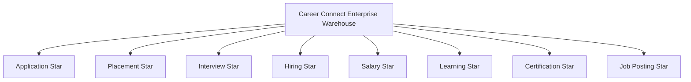

Each schema represents a specific business process.

---

# 6. Core Dimensions

The major conformed dimensions are:

```text
dim_date
dim_student
dim_company
dim_job
dim_skill
dim_college
dim_department
dim_location
dim_technology
dim_recruiter
dim_course
dim_certification
dim_experience
dim_employment_type
```

---

# 7. Core Fact Tables

The major facts are:

```text
fact_application
fact_placement
fact_interview
fact_hiring
fact_salary
fact_learning
fact_certification
fact_job_posting
```

Additional facts may be introduced as analytical requirements expand.

---

# 8. Conformed Dimensions

A dimension is **conformed** when the same definition and key structure can be reused across multiple fact tables.

Example:

```text
dim_date
```

can be shared by:

```text
fact_application
fact_interview
fact_placement
fact_hiring
fact_salary
fact_learning
```

This enables consistent cross-process analysis.

---

# 9. Dimension — Date

## Table

```text
warehouse.dim_date
```

### Key

```text
date_key
```

### Attributes

```text
full_date
day
day_name
week_number
month
month_name
quarter
year
fiscal_year
is_weekend
```

---

# 10. Date Dimension Example

| date_key | full_date  | month | quarter | year |
| -------: | ---------- | ----: | ------: | ---: |
| 20260730 | 2026-07-30 |     7 |       3 | 2026 |
| 20260731 | 2026-07-31 |     7 |       3 | 2026 |
| 20260801 | 2026-08-01 |     8 |       3 | 2026 |

---

# 11. Dimension — Student

## Table

```text
warehouse.dim_student
```

### Attributes

```text
student_key
student_business_id
student_number
student_name
education_level
graduation_year
gender
department_key
college_key
location_key
experience_level
career_goal
effective_from
effective_to
is_current
```

---

# 12. Student Dimension Example

```text
student_key
     ↓
dim_student
     ↓
Student Profile Context
     ↓
Application / Placement / Learning Facts
```

This allows BI to answer:

> Which students applied for which jobs?

and:

> Which student groups achieved stronger placement outcomes?

---

# 13. Dimension — Company

## Table

```text
warehouse.dim_company
```

### Attributes

```text
company_key
company_business_id
company_name
industry
company_size
company_type
headquarters_location_key
status
effective_from
effective_to
is_current
```

---

# 14. Dimension — Job

## Table

```text
warehouse.dim_job
```

### Attributes

```text
job_key
job_business_id
job_reference
job_title
job_category
career_level
employment_type_key
experience_level_key
company_key
status
posted_date
closing_date
```

The job dimension describes the business characteristics of a position.

---

# 15. Dimension — Skill

## Table

```text
warehouse.dim_skill
```

### Attributes

```text
skill_key
skill_business_id
skill_name
canonical_name
skill_category
skill_type
technology_family
difficulty_level
status
```

---

# 16. Dimension — College

## Table

```text
warehouse.dim_college
```

### Attributes

```text
college_key
college_business_id
college_name
university_name
institution_type
city
state
country
status
effective_from
effective_to
is_current
```

---

# 17. Dimension — Department

## Table

```text
warehouse.dim_department
```

### Attributes

```text
department_key
department_business_id
department_code
department_name
college_key
status
```

---

# 18. Dimension — Location

## Table

```text
warehouse.dim_location
```

### Attributes

```text
location_key
country
state
region
city
postal_code
timezone
```

This dimension supports:

```text
Country Analytics
State Analytics
City Analytics
Regional Analytics
```

---

# 19. Dimension — Technology

## Table

```text
warehouse.dim_technology
```

Examples:

```text
Python
Java
AWS
Azure
GCP
React
Angular
Spark
Kafka
Snowflake
BigQuery
```

Attributes:

```text
technology_key
technology_name
technology_category
technology_family
status
```

---

# 20. Dimension — Recruiter

## Table

```text
warehouse.dim_recruiter
```

Attributes:

```text
recruiter_key
recruiter_business_id
recruiter_name
designation
company_key
location_key
status
```

---

# 21. Dimension — Course

## Table

```text
warehouse.dim_course
```

Attributes:

```text
course_key
course_business_id
course_name
provider
category
difficulty_level
delivery_mode
duration_hours
status
```

---

# 22. Dimension — Certification

## Table

```text
warehouse.dim_certification
```

Attributes:

```text
certification_key
certification_business_id
certification_name
provider
category
level
status
```

---

# 23. Dimension — Experience

## Table

```text
warehouse.dim_experience
```

Example categories:

```text
Internship
Entry Level
1–2 Years
3–5 Years
6–10 Years
10+ Years
```

---

# 24. Dimension — Employment Type

## Table

```text
warehouse.dim_employment_type
```

Values may include:

```text
Full Time
Part Time
Contract
Internship
Apprenticeship
Freelance
Remote
Hybrid
```

---

# 25. Star Schema 1 — Application Analytics

The Application Star is one of the most important schemas.

## Business Process

> Student applies to a job.

## Grain

> One row represents one student application to one job.

---

# 26. Application Star Diagram

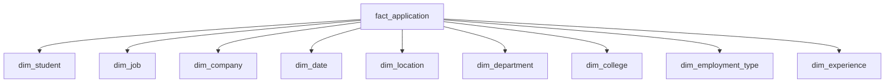

---

# 27. fact_application

### Foreign Keys

```text
student_key
job_key
company_key
date_key
location_key
department_key
college_key
employment_type_key
experience_level_key
```

### Degenerate Dimensions

```text
application_reference
```

### Measures

```text
application_count
screened_flag
shortlisted_flag
assessment_flag
interview_flag
offer_flag
hired_flag
```

---

# 28. Additive Measures in Application Fact

For example:

```text
application_count = 1
```

for each application record.

Then:

```text
SUM(application_count)
```

produces total applications.

---

# 29. Application Analytics

This schema supports:

> Applications by month

```text
dim_date
+
fact_application
```

> Applications by department

```text
dim_department
+
fact_application
```

> Applications by company

```text
dim_company
+
fact_application
```

---

# 30. Application Funnel

The same fact can support:

```text
Applications
↓
Screened
↓
Shortlisted
↓
Interviewed
↓
Offered
↓
Hired
```

Conversion metrics can be calculated from additive counts.

---

# 31. Application KPI Examples

### Total Applications

```text
SUM(application_count)
```

### Screening Conversion

```text
SUM(screened_flag)
/
SUM(application_count)
× 100
```

### Interview Conversion

```text
SUM(interview_flag)
/
SUM(application_count)
× 100
```

---

# 32. Star Schema 2 — Placement Analytics

## Business Process

> A student receives a successful placement outcome.

## Grain

> One row represents one placement outcome.

---

# 33. Placement Star Diagram

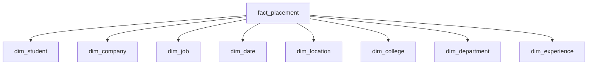

---

# 34. fact_placement

### Keys

```text
student_key
company_key
job_key
date_key
location_key
college_key
department_key
experience_level_key
```

### Measures

```text
placement_count
salary_amount
offer_amount
joining_flag
```

---

# 35. Placement KPI Examples

## Placement Rate

```text
Total Placed
÷
Total Eligible
× 100
```

The denominator should come from a clearly governed eligible-student definition.

---

## Average Placement Salary

```text
AVG(salary_amount)
```

---

## Highest Salary

```text
MAX(salary_amount)
```

---

# 36. Placement Analytics Questions

The placement star can answer:

> Which departments have the highest placement rate?

> Which companies hire the most students?

> What is the average salary by role?

> What is placement performance over time?

> Which locations produce higher salary outcomes?

---

# 37. Star Schema 3 — Interview Analytics

## Business Process

> A candidate participates in an interview.

## Grain

> One row represents one interview event.

---

# 38. Interview Star Diagram

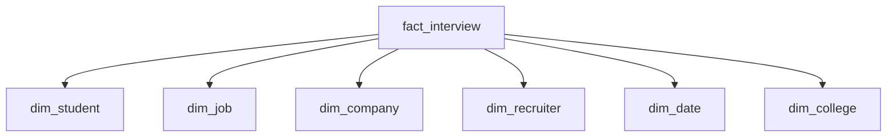

---

# 39. fact_interview

Measures:

```text
interview_count
passed_flag
failed_flag
score
round_number
```

Possible additional metrics:

```text
interview_duration_minutes
```

if the source captures it.

---

# 40. Interview Analytics

Questions:

> What is interview pass rate?

> Which companies have the highest interview conversion?

> Which departments achieve the highest interview success?

> Which interview rounds cause the most candidate drop-off?

---

# 41. Interview Conversion

Example:

```text
Interview Pass Rate =
Passed Interviews
÷
Completed Interviews
× 100
```

The exact denominator must be defined in the semantic layer.

---

# 42. Star Schema 4 — Hiring Analytics

## Business Process

> A company completes a hiring outcome.

## Grain

> One row represents one hiring outcome.

---

# 43. Hiring Star Diagram

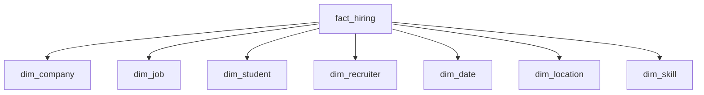

---

# 44. fact_hiring

Measures:

```text
application_count
interview_count
offer_count
hire_count
time_to_hire_days
```

---

# 45. Hiring Funnel Analytics

```text
Applications
↓
Screening
↓
Interview
↓
Offer
↓
Hire
```

The data mart can produce:

```text
Application → Interview %
Interview → Offer %
Offer → Hire %
Application → Hire %
```

---

# 46. Star Schema 5 — Salary Analytics

## Business Process

> A salary observation is recorded.

## Grain

> One row represents one salary observation for a role, company, location, experience level, and observation period.

---

# 47. Salary Star Diagram

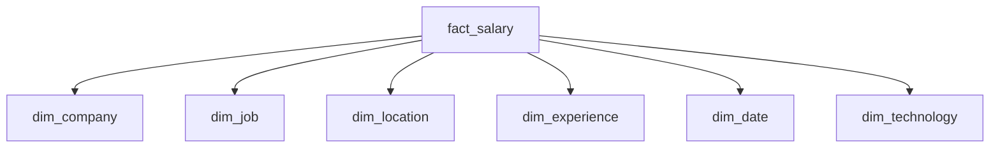

---

# 48. fact_salary

Measures:

```text
minimum_salary
maximum_salary
reported_salary
sample_count
```

Potential derived values:

```text
salary_midpoint
```

should be clearly labeled as a derived estimate if used.

---

# 49. Salary Analytics

Questions:

> What is average salary for Data Engineers?

> How does salary differ by city?

> What is salary growth by role?

> Which technologies correlate with higher salary ranges?

Any such relationship should be presented as analytical association, not proof of causation.

---

# 50. Star Schema 6 — Learning Analytics

## Business Process

> A learner participates in a course.

## Grain

> One row represents one student-course learning record for the selected analytical grain.

---

# 51. Learning Star Diagram

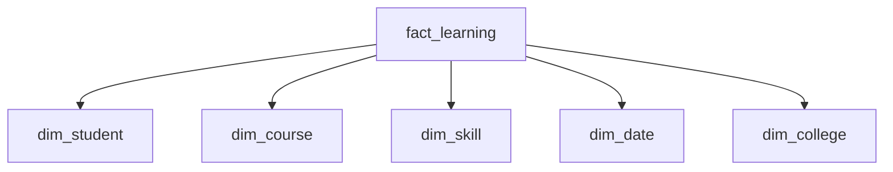

---

# 52. fact_learning

Measures:

```text
learning_activity_count
progress_percentage
completion_flag
assessment_score
learning_hours
```

---

# 53. Learning Analytics

Questions:

> Which courses have highest completion rates?

> Which skills are most commonly learned?

> Which learning pathways correlate with successful placements?

The last question requires careful statistical analysis to avoid inferring causation from simple correlation.

---

# 54. Star Schema 7 — Certification Analytics

## Business Process

> A student earns or attempts a certification.

## Grain

> One row represents one certification achievement for one student.

---

# 55. Certification Star Diagram

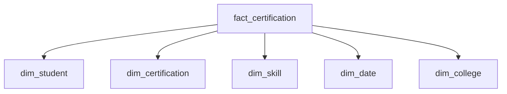

---

# 56. fact_certification

Measures:

```text
certification_count
completion_flag
score
attempt_count
```

---

# 57. Certification Analytics

Questions:

> Which certifications are most common?

> Which certifications are associated with selected job categories?

> Which institutions have higher certification participation?

---

# 58. Star Schema 8 — Job Posting Analytics

## Business Process

> A company posts a job.

## Grain

> One row represents one job posting event.

---

# 59. Job Posting Star Diagram

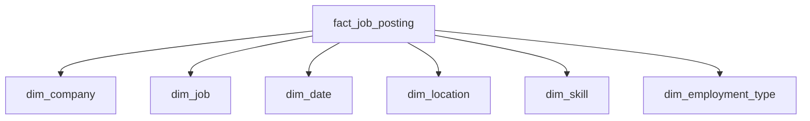

---

# 60. fact_job_posting

Measures:

```text
posting_count
open_position_count
application_count
view_count
days_open
```

---

# 61. Job Demand Analytics

This star supports:

> Top hiring companies

> Fastest-growing roles

> Skill demand

> City-wise job demand

> Employment-type distribution

> Technology trends

---

# 62. Star Schema 9 — Student Skill Analytics

Skill analysis is central to Career Connect.

A useful analytical fact is:

```text
fact_student_skill_snapshot
```

## Grain

> One row represents one student's measured skill state at a specific assessment/snapshot date.

---

# 63. Student Skill Star

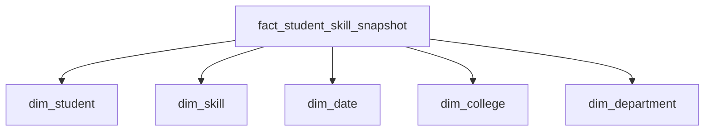

---

# 64. fact_student_skill_snapshot

Measures:

```text
proficiency_score
verified_flag
assessment_score
years_experience
```

This enables historical skill analysis.

---

# 65. Skill Demand vs Skill Supply

One of Career Connect's most valuable analytics is:

```text
Market Skill Demand
        vs
Student Skill Supply
```

This can be represented as:

```text
job_skill_demand
        |
        |
        ↓
   Skill Analytics
        ↑
        |
student_skill_supply
```

---

# 66. Skill Gap Star Schema

A specialized analytical fact can be:

```text
fact_skill_gap
```

Grain:

> One row represents one student's skill gap against one target career or job at a specific evaluation time.

---

# 67. Skill Gap Star

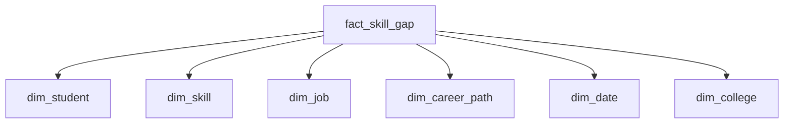

---

# 68. fact_skill_gap

Measures:

```text
current_score
required_score
gap_score
priority_score
```

This supports:

```text
Skill Gap Dashboard
Career Readiness
Learning Recommendation
```

---

# 69. Star Schema 10 — Career Recommendation Analytics

A specialized AI analytics fact can track recommendations.

```text
fact_career_recommendation
```

## Grain

> One row represents one generated career recommendation for one student.

---

# 70. Career Recommendation Star

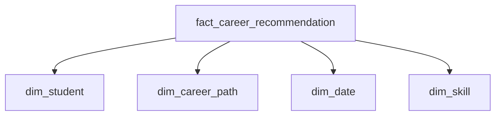

Measures:

```text
match_score
confidence_score
accepted_flag
```

---

# 71. Recommendation Outcome Analysis

This allows the system to measure:

```text
Recommendation
↓
User Acceptance
↓
Learning
↓
Application
↓
Interview
↓
Placement
```

This is extremely valuable for evaluating whether the intelligence layer creates useful outcomes.

---

# 72. AI Outcome Measurement

A future analytics model can compare:

```text
Recommended Career
vs
Actual Career Outcome
```

This enables AI evaluation.

---

# 73. Conformed Dimension Architecture

The major facts share:

```text
dim_date
dim_student
dim_company
dim_job
dim_location
dim_college
dim_skill
```

Conceptually:

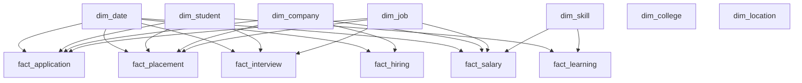

This is the heart of the enterprise dimensional model.

---

# 74. Date Role-Playing Dimensions

The same date dimension may play different roles.

Example:

```text
dim_date
```

may represent:

```text
application_date
posted_date
interview_date
placement_date
joining_date
observation_date
completion_date
```

Logical aliases can be used in semantic models.

---

# 75. Role-Playing Date Example

For `fact_application`:

```text
application_date_key
```

For `fact_placement`:

```text
placement_date_key
```

Both point to:

```text
dim_date.date_key
```

---

# 76. Degenerate Dimensions

Application references, offer references, and job references may remain directly in facts.

Example:

```text
fact_application
├── application_reference
├── student_key
├── job_key
└── date_key
```

This avoids creating unnecessary small dimensions.

---

# 77. Bridge Table — Job Skills

The Star Schema can also consume a bridge structure for many-to-many analysis.

```text
bridge_job_skill
```

Fields:

```text
job_key
skill_key
required_level
importance_weight
```

---

# 78. Bridge Table — Student Skills

```text
bridge_student_skill
```

Fields:

```text
student_key
skill_key
proficiency_level
assessment_date_key
```

This enables:

```text
Student
↔
Skill
```

analysis.

---

# 79. Why Many-to-Many Relationships Require Care

A job may require:

```text
Python
SQL
AWS
Spark
Airflow
```

A student may have:

```text
Python
SQL
AWS
```

The analytical system must avoid double-counting when connecting multiple skill rows to applications or placements.

The grain and bridge logic must therefore be explicit.

---

# 80. Fact Table Additivity

Fact measures can be categorized.

## Fully Additive

Can be summed across all dimensions.

Examples:

```text
application_count
interview_count
placement_count
hire_count
```

---

## Semi-Additive

Can be summed across some dimensions but not all.

Example:

```text
active_candidate_count
```

---

## Non-Additive

Should not simply be summed.

Examples:

```text
average_salary
conversion_rate
match_score
```

These should be calculated from underlying measures.

---

# 81. Example — Correct Salary Aggregation

Do not calculate:

```text
AVG(average_salary)
```

without considering the underlying sample counts.

Better:

```text
SUM(salary_total)
/
SUM(sample_count)
```

where a weighted aggregation is logically appropriate.

The exact formula depends on how the salary observations are represented.

---

# 82. Example — Correct Placement Rate

Do not average departmental percentages blindly.

Instead:

```text
SUM(placed_students)
/
SUM(eligible_students)
× 100
```

This produces a correctly weighted overall rate.

---

# 83. Example — Skill Demand

A simple skill-demand metric can be:

```text
COUNT(DISTINCT job_key)
```

for jobs requiring that skill.

More advanced demand metrics can incorporate:

- Openings
- Applications
- Hiring events
- Time
- Weight

---

# 84. Skill Supply Metric

A simple supply metric can be:

```text
COUNT(DISTINCT student_key)
```

for students possessing a skill.

Then:

```text
Demand / Supply
```

can provide a relative market pressure indicator.

The interpretation must be carefully documented because this is not a complete labor-market equilibrium measure.

---

# 85. Skill Demand Index

A future derived metric could be:

```text
Skill Demand Index =
Weighted Job Demand
/
Available Skill Supply
```

This is a product-defined analytical indicator, not a standard labor-market statistic.

---

# 86. Career Readiness Score

A student readiness score could combine:

```text
Skill Alignment
+
Resume Quality
+
Certification
+
Learning Progress
+
Experience
```

The formula must be versioned and documented.

Example:

```text
career_readiness_score =
weighted_skill_alignment
+
resume_score_component
+
learning_component
+
experience_component
```

The exact weights should be treated as configurable business logic rather than hard-coded assumptions.

---

# 87. Star Schema for Executive Dashboard

The executive dashboard can combine facts:

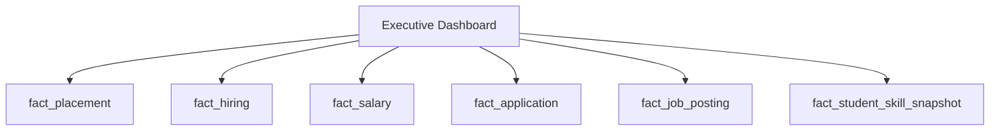

These facts share conformed dimensions such as:

```text
Date
Company
Job
Location
College
Skill
```

---

# 88. Executive KPIs

Core KPIs:

```text
Placement Rate
Average Salary
Highest Salary
Hiring Growth
Application Volume
Interview Conversion
Offer Conversion
Top Skills
Top Technologies
Top Hiring Companies
Regional Demand
```

---

# 89. College Dashboard Star Consumption

The College Dashboard primarily uses:

```text
fact_placement
fact_application
fact_interview
fact_learning
fact_student_skill_snapshot
```

Dimensions:

```text
dim_student
dim_department
dim_company
dim_job
dim_skill
dim_date
```

---

# 90. Student Dashboard Star Consumption

The Student Dashboard uses:

```text
fact_application
fact_interview
fact_learning
fact_skill_gap
fact_career_recommendation
fact_placement
```

The user should generally see only authorized records.

---

# 91. Recruiter Dashboard Star Consumption

The Recruiter Dashboard uses:

```text
fact_job_posting
fact_application
fact_interview
fact_hiring
fact_salary
```

with dimensions:

```text
Company
Job
Skill
Location
Date
Recruiter
```

---

# 92. Skill Intelligence Dashboard

The Skill Dashboard uses:

```text
fact_job_posting
fact_student_skill_snapshot
fact_skill_gap
fact_hiring
```

This allows:

```text
Demand
vs
Supply
vs
Skill Gap
vs
Hiring Outcome
```

---

# 93. Star Schema Data Pipeline

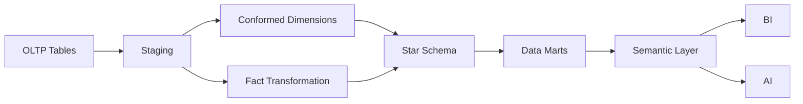

---

# 94. Surrogate Key Handling

Example:

```text
Operational Student ID:
STU-2026-1001

Warehouse Student Key:
784521
```

The fact table stores:

```text
student_key = 784521
```

rather than the external business identifier.

---

# 95. SCD Type 2 in Star Schema

For `dim_student`:

```text
student_key = 8451
student_business_id = STU-001
department = CSE
is_current = false

student_key = 9320
student_business_id = STU-001
department = Data Science
is_current = true
```

The same business entity can therefore have multiple historical warehouse versions.

---

# 96. Fact-to-SCD Relationship

Facts should use the dimension version that was valid when the event occurred.

Example:

```text
Application in 2025
→ Student Dimension Version A

Application in 2026
→ Student Dimension Version B
```

This preserves historically accurate reporting.

---

# 97. Fact Loading Process

A fact load should:

```text
1. Extract source event
2. Resolve business keys
3. Resolve surrogate dimension keys
4. Validate grain
5. Calculate measures
6. Insert fact row
7. Validate counts
```

---

# 98. Fact Load Example

Source:

```text
Application:
Student STU-102
Job JOB-55
Date 2026-07-30
```

Transformation:

```text
STU-102 → student_key 1234
JOB-55  → job_key 889
2026-07-30 → date_key 20260730
```

Fact:

```text
student_key = 1234
job_key = 889
date_key = 20260730
application_count = 1
```

---

# 99. Data Quality Rules for Facts

Before loading facts:

```text
Student key exists
Job key exists
Date key exists
Measures valid
Grain not duplicated
```

---

# 100. Duplicate Fact Prevention

Use a natural grain key or hash.

Example:

```text
student_key
+
job_key
+
application_event_id
```

must uniquely identify the intended fact row.

This prevents duplicate ingestion.

---

# 101. Star Schema Performance Strategy

Use:

```text
Partitioning
+
Clustering
+
Proper Grain
+
Conformed Dimensions
+
Pre-Aggregation where useful
```

---

# 102. Partitioning by Date

Examples:

```text
fact_application
→ application_date_key

fact_placement
→ placement_date_key

fact_hiring
→ hiring_date_key
```

This is especially useful for time-range BI queries.

---

# 103. Clustering

Common clustering candidates may include:

```text
company_key
job_key
college_key
skill_key
```

Actual clustering should be driven by query patterns and warehouse behavior.

---

# 104. Materialized / Aggregate Structures

For frequently used executive metrics:

```text
monthly_placement_summary
monthly_hiring_summary
skill_demand_summary
salary_summary
```

can reduce repeated expensive calculations.

The warehouse-specific implementation may use views, materialized views, aggregate tables, or equivalent mechanisms.

---

# 105. Star Schema Semantic Layer

The semantic layer should expose business-friendly fields.

Instead of:

```text
fact_placement.salary_amount
```

the BI user may see:

```text
Placement Salary
```

Instead of:

```text
SUM(fact_placement.placement_count)
```

the user sees:

```text
Total Placements
```

---

# 106. Semantic Metric Definitions

Example:

### Total Placements

```text
SUM(fact_placement.placement_count)
```

### Average Placement Salary

```text
AVG(fact_placement.salary_amount)
```

### Total Applications

```text
SUM(fact_application.application_count)
```

### Total Hires

```text
SUM(fact_hiring.hire_count)
```

---

# 107. Star Schema and AI

The star schema provides structured context for AI.

Example question:

> Which skills are currently highly demanded for Data Engineer roles?

AI can retrieve:

```text
dim_job
+
dim_skill
+
fact_job_posting
+
fact_hiring
```

and produce a grounded response.

---

# 108. Natural-Language BI Using Star Schema

Example:

> Show placement rate by department for 2025 and 2026.

The semantic layer maps:

```text
Placement Rate
→ fact_placement + eligible denominator

Department
→ dim_department

Year
→ dim_date
```

The system then generates the analytical query.

---

# 109. AI Query Safety

Natural-language queries should not directly generate unrestricted SQL.

Recommended flow:

```text
User Question
↓
Intent
↓
Allowed Metrics
↓
Allowed Dimensions
↓
Query Generation
↓
Validation
↓
Warehouse
```

This creates a governed BI interface.

---

# 110. Star Schema Governance

Every fact table should have:

```text
Business Owner
Grain Definition
Measure Definitions
Refresh Frequency
Data Quality Rules
Source
```

Every dimension should have:

```text
Business Definition
Key Strategy
SCD Strategy
Source
Owner
```

---

# 111. Star Schema Naming Convention

Recommended:

```text
dim_<entity>
fact_<business_process>
bridge_<relationship>
```

Examples:

```text
dim_student
dim_company
fact_application
fact_placement
fact_hiring
bridge_job_skill
```

---

# 112. Star Schema Folder Structure

```text
warehouse/
│
├── dimensions/
│   ├── dim_date.sql
│   ├── dim_student.sql
│   ├── dim_company.sql
│   ├── dim_job.sql
│   ├── dim_skill.sql
│   └── dim_location.sql
│
├── facts/
│   ├── fact_application.sql
│   ├── fact_placement.sql
│   ├── fact_interview.sql
│   ├── fact_hiring.sql
│   ├── fact_salary.sql
│   └── fact_learning.sql
│
├── bridges/
│   ├── bridge_job_skill.sql
│   └── bridge_student_skill.sql
│
└── marts/
    ├── placement_mart.sql
    ├── recruitment_mart.sql
    ├── salary_mart.sql
    └── skill_mart.sql
```

---

# 113. Complete Career Connect Star Schema

```mermaid
flowchart TB

D1[dim_date]
D2[dim_student]
D3[dim_company]
D4[dim_job]
D5[dim_skill]
D6[dim_college]
D7[dim_department]
D8[dim_location]
D9[dim_technology]
D10[dim_recruiter]

F1[fact_application]
F2[fact_placement]
F3[fact_interview]
F4[fact_hiring]
F5[fact_salary]
F6[fact_job_posting]
F7[fact_learning]
F8[fact_certification]
F9[fact_skill_gap]
F10[fact_career_recommendation]

D1 --> F1
D1 --> F2
D1 --> F3
D1 --> F4
D1 --> F5
D1 --> F6
D1 --> F7
D1 --> F8
D1 --> F9
D1 --> F10

D2 --> F1
D2 --> F2
D2 --> F3
D2 --> F4
D2 --> F7
D2 --> F8
D2 --> F9
D2 --> F10

D3 --> F1
D3 --> F2
D3 --> F3
D3 --> F4
D3 --> F5
D3 --> F6

D4 --> F1
D4 --> F2
D4 --> F3
D4 --> F4
D4 --> F5
D4 --> F6

D5 --> F5
D5 --> F6
D5 --> F7
D5 --> F9
D5 --> F10

D6 --> F1
D6 --> F2
D6 --> F3
D6 --> F7
D6 --> F9

D7 --> F1
D7 --> F2
D8 --> F1
D8 --> F2
D8 --> F5
D8 --> F6
D9 --> F5
D9 --> F6
D10 --> F3
D10 --> F4
```

---

# 114. Star Schema by Business Domain

| Domain         | Primary Fact               | Key Dimensions                           |
| -------------- | -------------------------- | ---------------------------------------- |
| Applications   | fact_application           | Student, Job, Company, Date              |
| Placement      | fact_placement             | Student, Company, Job, College, Date     |
| Interviews     | fact_interview             | Student, Job, Recruiter, Company, Date   |
| Hiring         | fact_hiring                | Company, Job, Recruiter, Student, Date   |
| Salary         | fact_salary                | Job, Company, Location, Experience, Date |
| Job Market     | fact_job_posting           | Job, Company, Skill, Location, Date      |
| Learning       | fact_learning              | Student, Course, Skill, Date             |
| Certifications | fact_certification         | Student, Certification, Skill, Date      |
| Skills         | fact_skill_gap             | Student, Skill, Career, Job, Date        |
| AI             | fact_career_recommendation | Student, Career, Skill, Date             |

---

# 115. Star Schema Query Examples

## Query 1 — Top Hiring Companies

```sql
SELECT
    c.company_name,
    SUM(h.hire_count) AS total_hires
FROM fact_hiring h
JOIN dim_company c
    ON h.company_key = c.company_key
GROUP BY c.company_name
ORDER BY total_hires DESC;
```

---

# 116. Query 2 — Placement Rate by Department

Conceptually:

```sql
SELECT
    d.department_name,
    SUM(p.placement_count) AS placed_students
FROM fact_placement p
JOIN dim_department d
    ON p.department_key = d.department_key
GROUP BY d.department_name;
```

The final placement-rate calculation must use the approved eligible-student denominator.

---

# 117. Query 3 — Skill Demand

```sql
SELECT
    s.canonical_name,
    COUNT(DISTINCT j.job_key) AS jobs_requiring_skill
FROM bridge_job_skill b
JOIN dim_skill s
    ON b.skill_key = s.skill_key
JOIN dim_job j
    ON b.job_key = j.job_key
GROUP BY s.canonical_name
ORDER BY jobs_requiring_skill DESC;
```

---

# 118. Query 4 — Average Salary by Role

```sql
SELECT
    j.job_title,
    AVG(s.reported_salary) AS average_salary
FROM fact_salary s
JOIN dim_job j
    ON s.job_key = j.job_key
GROUP BY j.job_title
ORDER BY average_salary DESC;
```

The salary measure should be chosen based on how the underlying observations are represented.

---

# 119. Query 5 — Applications by Month

```sql
SELECT
    d.year,
    d.month,
    SUM(a.application_count) AS total_applications
FROM fact_application a
JOIN dim_date d
    ON a.date_key = d.date_key
GROUP BY d.year, d.month
ORDER BY d.year, d.month;
```

---

# 120. Query 6 — Placement by College

```sql
SELECT
    c.college_name,
    SUM(p.placement_count) AS total_placements
FROM fact_placement p
JOIN dim_college c
    ON p.college_key = c.college_key
GROUP BY c.college_name
ORDER BY total_placements DESC;
```

---

# 121. Star Schema Testing

Each fact should be tested for:

```text
Correct Grain
Foreign Key Validity
Duplicate Prevention
Measure Accuracy
Date Resolution
Dimension Resolution
SCD Correctness
```

---

# 122. Fact Reconciliation

A crucial data-quality process is reconciliation.

Example:

```text
OLTP Applications = 125,000
Warehouse Applications = 124,980
```

The 20-record difference must be explainable.

Possible reasons:

- Invalid records
- Late-arriving data
- Excluded test data
- Failed pipeline rows

Silent discrepancies should not be accepted.

---

# 123. Late-Arriving Dimensions

A fact may arrive before a corresponding dimension record.

Example:

```text
New Job Application
↓
Job dimension not yet loaded
```

Possible solution:

```text
Unknown / Inferred Dimension Member
```

Later, replace or update the relationship when the real dimension record arrives.

---

# 124. Unknown Dimension Record

Each dimension may reserve a default record:

```text
unknown_key = 0
```

Example:

```text
student_key = 0
```

for unresolved records.

This prevents broken fact loads while preserving data lineage.

---

# 125. Slowly Changing Dimension Integration

Fact loading must resolve the correct historical dimension version.

Example:

```text
Application Date:
2025-10-10

Student Department at that time:
CSE
```

Even if the student later changes department, the 2025 fact should continue pointing to the historical CSE dimension version.

---

# 126. Star Schema for Historical Career Analysis

This makes it possible to answer:

> How did student skill profiles change over time?

```text
fact_student_skill_snapshot
+
dim_student
+
dim_skill
+
dim_date
```

Similarly:

> How did salary ranges change over time?

```text
fact_salary
+
dim_job
+
dim_location
+
dim_date
```

---

# 127. Star Schema for Trend Analysis

Trend analysis should use the date dimension consistently.

Examples:

```text
Monthly Hiring
Quarterly Placement
Yearly Salary
Weekly Applications
Skill Growth Over Time
```

---

# 128. Star Schema for Comparative Analytics

Because dimensions are shared, the system can compare:

```text
College A vs College B
Company A vs Company B
Role A vs Role B
City A vs City B
Skill A vs Skill B
Year A vs Year B
```

This is an important BI capability.

---

# 129. Star Schema for Executive Intelligence

Executive analytics should avoid overwhelming detail.

The semantic layer can expose:

```text
KPIs
Trends
Rankings
Exceptions
Top Movers
```

powered by the underlying star schemas.

---

# 130. Star Schema for AI Context

AI context views can be built from the same schemas.

Example:

```text
career_market_context
```

may combine:

```text
Role
Skill
Demand
Salary
Location
Experience
```

This creates structured context for AI.

---

# 131. Data Mart Relationship

Data marts are logical views or curated models over the enterprise star schemas.

Example:

```text
Enterprise Warehouse
        ↓
Placement Facts
        +
Student Dimension
        +
College Dimension
        +
Company Dimension
        ↓
Placement Mart
```

---

# 132. Star Schema vs Snowflake Schema

The Star Schema keeps dimensions comparatively denormalized.

Example:

```text
fact_placement
     |
dim_college
  └── university_name
  └── state
  └── country
```

This simplifies BI queries.

A Snowflake Schema would normalize those attributes into additional dimensions.

Career Connect will use Star Schema as the primary BI-friendly pattern and Snowflake Schema selectively where normalization offers clear value.

---

# 133. Recommended Star Schema for Academic Project

For the BE CSE project, the most important schema should be:

```text
               dim_student
                    |
dim_college — fact_placement — dim_company
                    |
                 dim_job
                    |
                 dim_date
```

with supporting:

```text
fact_application
fact_interview
fact_salary
```

This is enough to demonstrate a genuine enterprise-style warehouse model.

---

# 134. Recommended Star Schema for Startup MVP

Add:

```text
fact_hiring
fact_job_posting
fact_learning
fact_skill_gap
fact_career_recommendation
```

This expands the platform from placement analytics into career intelligence.

---

# 135. Recommended Star Schema for Enterprise

Add:

```text
Employee
Workforce
Internal Mobility
Learning
Reskilling
Compensation
Talent Planning
Workforce Forecasting
```

These become future fact/dimension groups.

---

# 136. Star Schema Evolution

```text
Academic
↓
Placement Star
↓
Recruitment Star
↓
Skill Intelligence Star
↓
Career Recommendation Star
↓
Workforce Intelligence Stars
```

The same conformed dimensions can remain reusable.

---

# 137. Star Schema Governance Checklist

Every star schema must define:

```text
✓ Business Process
✓ Fact Grain
✓ Dimensions
✓ Measures
✓ Additivity
✓ Surrogate Keys
✓ SCD Handling
✓ Refresh Schedule
✓ Source
✓ Data Quality
✓ Owner
✓ Consumers
```

---

# 138. Star Schema Performance Checklist

```text
✓ Correct Grain
✓ Partitioning
✓ Clustering
✓ Efficient Joins
✓ Conformed Dimensions
✓ Aggregate Tables where justified
✓ Query Monitoring
✓ Dashboard Optimization
```

---

# 139. Star Schema Security Checklist

```text
✓ Authorized Access
✓ Tenant Filtering
✓ PII Protection
✓ Sensitive Column Controls
✓ Auditability
✓ Data Classification
```

---

# 140. Final Star Schema Architecture

```text
                         CAREER CONNECT
                       STAR SCHEMA MODEL
                              │
          ┌───────────────────┼───────────────────┐
          │                   │                   │
      APPLICATION          PLACEMENT           HIRING
          │                   │                   │
   fact_application    fact_placement      fact_hiring
          │                   │                   │
          └───────────────────┼───────────────────┘
                              │
                    CONFORMED DIMENSIONS
                              │
        ┌──────────┬──────────┼──────────┬──────────┐
        ▼          ▼          ▼          ▼          ▼
      DATE      STUDENT    COMPANY      JOB      SKILL
        │          │          │          │          │
        └──────────┴──────────┴──────────┴──────────┘
                              │
                          DATA MARTS
                              │
                   ┌──────────┼──────────┐
                   ▼          ▼          ▼
                PLACEMENT  RECRUITMENT  SKILL
                   │          │          │
                   └──────────┼──────────┘
                              ▼
                       SEMANTIC LAYER
                              │
                         ┌────┴────┐
                         ▼         ▼
                         BI        AI
```

---

# 141. CTO-Level Star Schema Recommendation

The recommended dimensional strategy is:

> **Use multiple business-process-specific fact tables surrounded by reusable conformed dimensions, with explicit grain definitions, surrogate keys, controlled historical versions, and governed semantic metrics.**

The primary stars should be:

```text
Application
Placement
Interview
Hiring
Salary
Job Posting
Learning
Certification
Skill Gap
Career Recommendation
```

This provides enough breadth to support Career Connect's full intelligence model without forcing every business process into one massive fact table.

---

# 142. Final Star Schema Statement

> **Career Connect will use a conformed Star Schema architecture in which major business processes such as applications, placements, interviews, hiring, salaries, job postings, learning, certifications, skill gaps, and career recommendations are represented as independent fact tables connected to reusable dimensions such as date, student, company, job, skill, college, department, location, recruiter, technology, and experience. This design provides a high-performance, BI-friendly analytical foundation while preserving historical accuracy, metric consistency, and extensibility toward AI and workforce intelligence.**

---

## Document Status

| Attribute         | Value                                                                                                                     |
| ----------------- | ------------------------------------------------------------------------------------------------------------------------- |
| Project           | Career Connect                                                                                                            |
| Document          | Star Schema                                                                                                               |
| Version           | 1.0                                                                                                                       |
| Modeling Pattern  | Dimensional Star Schema                                                                                                   |
| Primary Warehouse | BigQuery                                                                                                                  |
| Alternative       | Snowflake                                                                                                                 |
| Core Fact Tables  | Application, Placement, Interview, Hiring, Salary, Job Posting, Learning, Certification, Skill Gap, Career Recommendation |
| Core Dimensions   | Date, Student, Company, Job, Skill, College, Department, Location, Recruiter, Technology                                  |
| Key Strategy      | Surrogate Keys                                                                                                            |
| History           | SCD Type 1 / Type 2                                                                                                       |
| Governance        | Grain + KPI + Data Quality                                                                                                |
| BI                | Semantic Layer + Data Marts                                                                                               |
| AI                | Warehouse-Grounded Context                                                                                                |
| Primary Goal      | High-Performance Analytical Model                                                                                         |
| Status            | Analytical Data Model Baseline                                                                                            |
