# 16 — Snowflake Schema

# Career Connect — AI Career Intelligence Platform

**Document Type:** Enterprise Snowflake Schema Design
**Project:** Career Connect
**Version:** 1.0
**Status:** Analytical Data Model Baseline
**Primary Warehouse:** BigQuery
**Alternative Warehouse:** Snowflake
**Modeling Approach:** Dimensional Modeling + Selective Normalization
**Primary Use Cases:** Enterprise BI, Historical Analytics, Skill Intelligence, Recruitment Analytics, AI Context

---

# 1. Executive Summary

The Snowflake Schema is an advanced dimensional modeling pattern that extends the Star Schema by normalizing selected dimension tables into related sub-dimensions.

Career Connect should use:

```text
Star Schema
+
Selective Snowflake Schema
```

rather than forcing the entire warehouse into one pattern.

The Star Schema is excellent for:

- Simple BI queries
- Dashboard performance
- Ease of understanding
- Business-user consumption

The Snowflake Schema is useful where dimensions contain reusable hierarchical structures.

Examples include:

```text
College
↓
University
↓
Location
↓
Country

Skill
↓
Skill Category
↓
Technology Family

Company
↓
Industry
↓
Industry Group

Job
↓
Job Category
↓
Career Family
```

The key principle is:

> **Keep frequently queried analytical dimensions simple, while normalizing large or hierarchical dimensions where doing so improves consistency, governance, and maintainability.**

---

# 2. Snowflake Schema Objectives

The Snowflake Schema should provide:

1. Reusable hierarchical dimensions
2. Reduced dimension redundancy
3. Better governance of reference data
4. Consistent master-data relationships
5. Support for complex organizational structures
6. Stronger taxonomy management
7. Enterprise-level extensibility
8. Compatibility with BI and AI layers

---

# 3. Star vs Snowflake

The difference can be summarized as:

### Star Schema

```text
             dim_student
                  |
dim_company — fact_application — dim_job
                  |
               dim_date
```

Dimensions are relatively denormalized.

---

### Snowflake Schema

```text
             dim_student
                  |
             dim_college
                  |
            dim_university
                  |
            dim_location
                  |
               dim_country

                    |
                    ↓
             fact_application
```

Dimension hierarchies are normalized.

---

# 4. Why Career Connect Needs Snowflake Modeling

Career Connect contains several hierarchical domains.

For example:

```text
Country
 └── State
      └── City

University
 └── College
      └── Department

Skill Family
 └── Skill Category
      └── Skill

Career Family
 └── Career Category
      └── Career Role
```

Repeating all hierarchy attributes directly inside every dimension can create redundancy.

Snowflake modeling allows the hierarchy to be maintained centrally.

---

# 5. Recommended Hybrid Strategy

Career Connect should use:

```text
                 ENTERPRISE WAREHOUSE
                         |
             ┌───────────┴───────────┐
             ↓                       ↓
        STAR SCHEMA            SNOWFLAKE SCHEMA
             |                       |
     Fast BI Dimensions      Complex Hierarchies
```

Recommended:

### Keep Denormalized

- Date
- Basic Student profile
- Basic Job
- Basic Company

### Normalize Selectively

- Geographic hierarchy
- Education hierarchy
- Skill hierarchy
- Career hierarchy
- Industry hierarchy
- Technology hierarchy

---

# 6. Snowflake Architecture

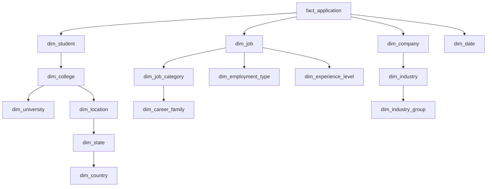

This creates the characteristic snowflake shape.

---

# 7. Snowflake Domain Areas

The major areas where normalization is useful are:

```text
1. Geography
2. Education
3. Skills
4. Careers
5. Industries
6. Technologies
7. Employment
```

---

# 8. Geographic Snowflake

The geographic model should support:

```text
Country
↓
State
↓
Region
↓
City
↓
Postal Area
```

---

# 9. Country Dimension

```text id="k3p9q2"
warehouse.dim_country
```

Attributes:

```text
country_key
country_code
country_name
currency_code
timezone
region_name
status
```

---

# 10. State Dimension

```text id="q6w4n8"
warehouse.dim_state
```

Attributes:

```text
state_key
state_code
state_name
country_key
status
```

Relationship:

```text
COUNTRY 1:M STATE
```

---

# 11. Region Dimension

Optional:

```text id="j8m4r5"
warehouse.dim_region
```

Attributes:

```text
region_key
region_name
state_key
country_key
```

This can support larger geographic markets.

---

# 12. City Dimension

```text id="m2x8c6"
warehouse.dim_city
```

Attributes:

```text
city_key
city_name
state_key
country_key
region_key
latitude
longitude
timezone
```

Relationship:

```text
COUNTRY
   ↓
STATE
   ↓
REGION
   ↓
CITY
```

---

# 13. Postal Area Dimension

For highly detailed location analytics:

```text id="s7n3q1"
warehouse.dim_postal_area
```

Attributes:

```text
postal_area_key
postal_code
city_key
state_key
country_key
```

This should only be included when detailed geographic analytics require it.

---

# 14. Geographic Snowflake Diagram

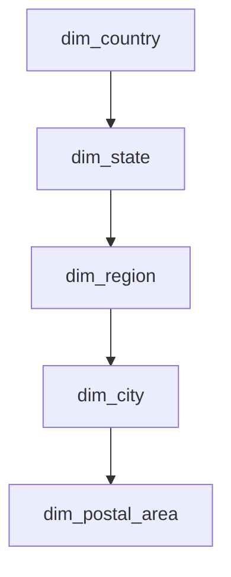

---

# 15. Geographic Benefits

This structure supports:

> Jobs by country

> Jobs by state

> Jobs by city

> Salary by region

> Student supply by location

without duplicating country and state metadata across multiple dimensions.

---

# 16. Education Snowflake

Education has a strong hierarchical structure:

```text
University
↓
College
↓
Department
↓
Program
```

---

# 17. University Dimension

```text id="d2c7m9"
warehouse.dim_university
```

Fields:

```text
university_key
university_name
university_type
country_key
state_key
status
```

---

# 18. College Dimension

```text id="p5w8x3"
warehouse.dim_college
```

Fields:

```text
college_key
college_name
college_type
university_key
city_key
status
```

---

# 19. Department Dimension

```text id="t9m6k2"
warehouse.dim_department
```

Fields:

```text
department_key
department_name
department_code
college_key
status
```

---

# 20. Academic Program Dimension

Future:

```text id="q4v7m1"
warehouse.dim_program
```

Fields:

```text
program_key
program_name
degree_type
specialization
department_key
```

---

# 21. Education Snowflake Diagram

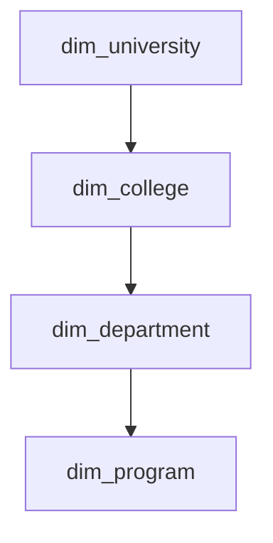

This supports:

```text
University
→ College
→ Department
→ Program
```

analytics.

---

# 22. Education Analytics

The hierarchy allows:

```text id="8j2m5r"
University Placement
↓
College Placement
↓
Department Placement
↓
Program Placement
```

This is useful for institutional analytics.

---

# 23. Skill Snowflake

Skill intelligence is one of the strongest reasons to use a Snowflake structure.

Possible hierarchy:

```text
Technology Family
↓
Technology
↓
Skill Category
↓
Skill
↓
Skill Alias
```

---

# 24. Skill Category Dimension

```text id="w5r3x8"
warehouse.dim_skill_category
```

Examples:

```text
Programming
Cloud
Database
AI / ML
Data Engineering
Analytics
DevOps
Cybersecurity
```

---

# 25. Technology Family Dimension

```text id="p9c4y6"
warehouse.dim_technology_family
```

Examples:

```text
Cloud Computing
Data Engineering
Artificial Intelligence
Web Development
Enterprise Software
```

---

# 26. Technology Dimension

```text id="j7m2q8"
warehouse.dim_technology
```

Attributes:

```text
technology_key
technology_name
technology_family_key
technology_category
status
```

---

# 27. Skill Dimension

```text id="q3x8m5"
warehouse.dim_skill
```

Attributes:

```text
skill_key
skill_name
canonical_name
skill_category_key
technology_key
skill_type
difficulty_level
status
```

---

# 28. Skill Alias Dimension

```text id="v6k1n4"
warehouse.dim_skill_alias
```

Examples:

```text
React.js
ReactJS
React JS
React
```

can map to one canonical skill where business rules confirm equivalence.

---

# 29. Skill Snowflake Diagram

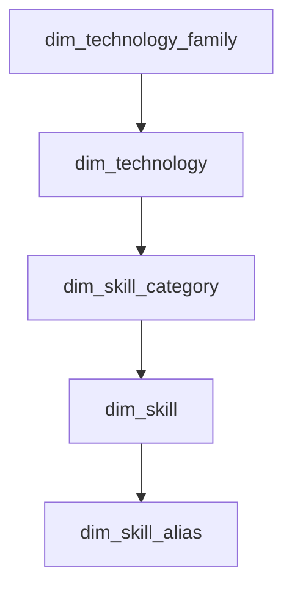

This structure creates a controlled career skill taxonomy.

---

# 30. Skill Hierarchy Example

```text
Data Engineering
    ↓
Data Processing
    ↓
Apache Spark
    ↓
Spark SQL
```

Another:

```text
Cloud Computing
    ↓
Google Cloud
    ↓
BigQuery
    ↓
BigQuery SQL
```

The actual hierarchy should depend on the organization's taxonomy rules.

---

# 31. Skill Analytics with Snowflake Modeling

This supports:

> Skill demand by technology family

> Skill supply by category

> Salary by technology

> Skill gaps by career family

> Job demand by cloud provider

---

# 32. Career Snowflake

Career paths can be organized as:

```text
Career Family
↓
Career Category
↓
Career Role
↓
Career Level
```

---

# 33. Career Family Dimension

Examples:

```text
Software Engineering
Data
Cloud
Cybersecurity
Product
Business
Design
```

---

# 34. Career Category Dimension

Examples:

```text
Data Engineering
Data Analytics
Data Science
Cloud Engineering
Application Development
```

---

# 35. Career Role Dimension

Examples:

```text
Data Engineer
Data Analyst
Data Scientist
Cloud Engineer
Backend Developer
Frontend Developer
```

---

# 36. Career Level Dimension

Examples:

```text
Intern
Entry Level
Mid Level
Senior
Lead
Manager
Director
```

---

# 37. Career Snowflake Diagram

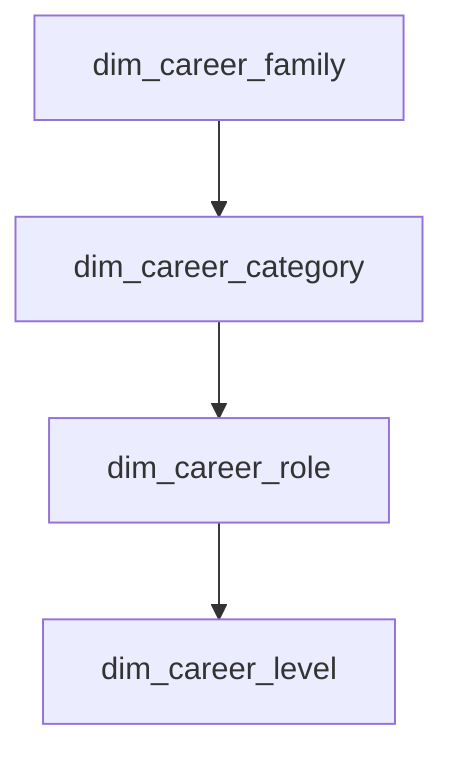

---

# 38. Career Intelligence Benefit

This structure supports:

```text
Career Family
↓
Career Category
↓
Specific Role
↓
Experience Level
```

and allows more precise recommendations.

---

# 39. Industry Snowflake

Companies can be organized into:

```text
Industry Group
↓
Industry
↓
Sub-Industry
```

---

# 40. Industry Group

Examples:

```text
Technology
Finance
Healthcare
Manufacturing
Retail
Education
Energy
```

---

# 41. Industry

Examples:

```text
Software
Banking
Insurance
Pharmaceuticals
Automotive
E-Commerce
```

---

# 42. Industry Snowflake Diagram

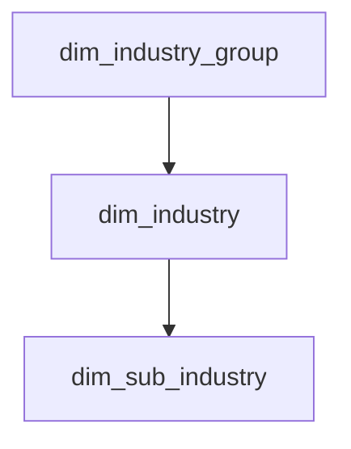

---

# 43. Company Relationship

The company dimension then references the industry hierarchy.

```text id="3x6m8s"
Company
  ↓
Industry
  ↓
Industry Group
```

This supports:

> Hiring by industry group

> Salary by industry

> Skill demand by industry

---

# 44. Employment Snowflake

Employment characteristics can be separated into:

```text
Employment Type
↓
Work Mode
↓
Contract Type
```

---

# 45. Employment Type

Examples:

```text
Full Time
Part Time
Contract
Internship
Apprenticeship
Freelance
```

---

# 46. Work Mode

Examples:

```text
Onsite
Hybrid
Remote
```

---

# 47. Employment Snowflake Diagram

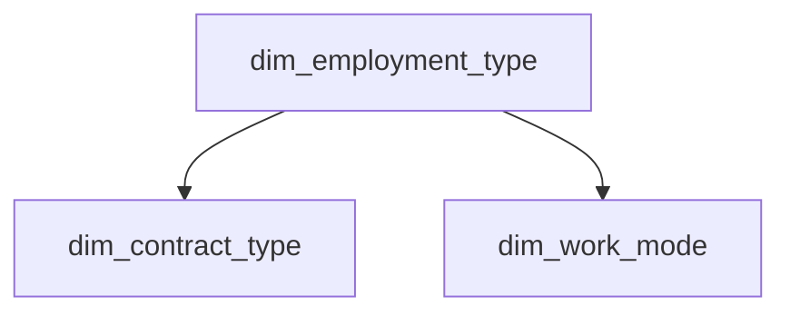

The exact structure should reflect the source data and business rules.

---

# 48. Job Snowflake

A job can be modeled using:

```text
Job
↓
Job Category
↓
Career Role
↓
Career Family
```

while separately connecting:

```text
Job
↓
Employment Type
↓
Work Mode
```

---

# 49. Job Snowflake Diagram

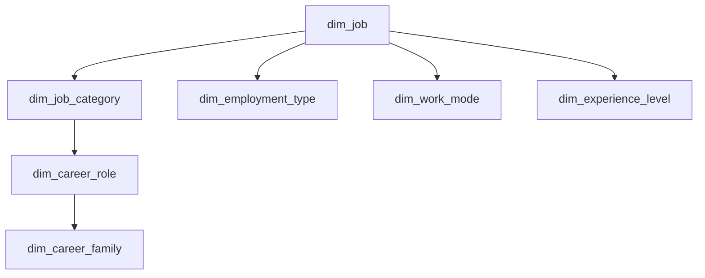

---

# 50. Company Snowflake

A company can use:

```text id="a3f7k2"
dim_company
     ↓
dim_industry
     ↓
dim_industry_group
```

and:

```text id="x8c5n1"
dim_company
     ↓
dim_city
     ↓
dim_state
     ↓
dim_country
```

---

# 51. Company Snowflake Diagram

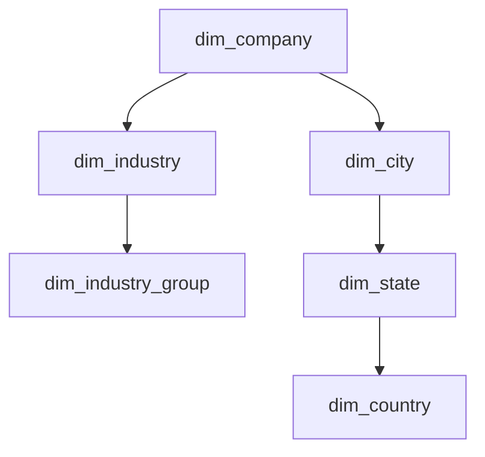

---

# 52. Student Snowflake

Student data may be normalized into:

```text
Student
↓
College
↓
University

Student
↓
Department
↓
Program

Student
↓
Location
↓
State
↓
Country
```

---

# 53. Student Snowflake Diagram

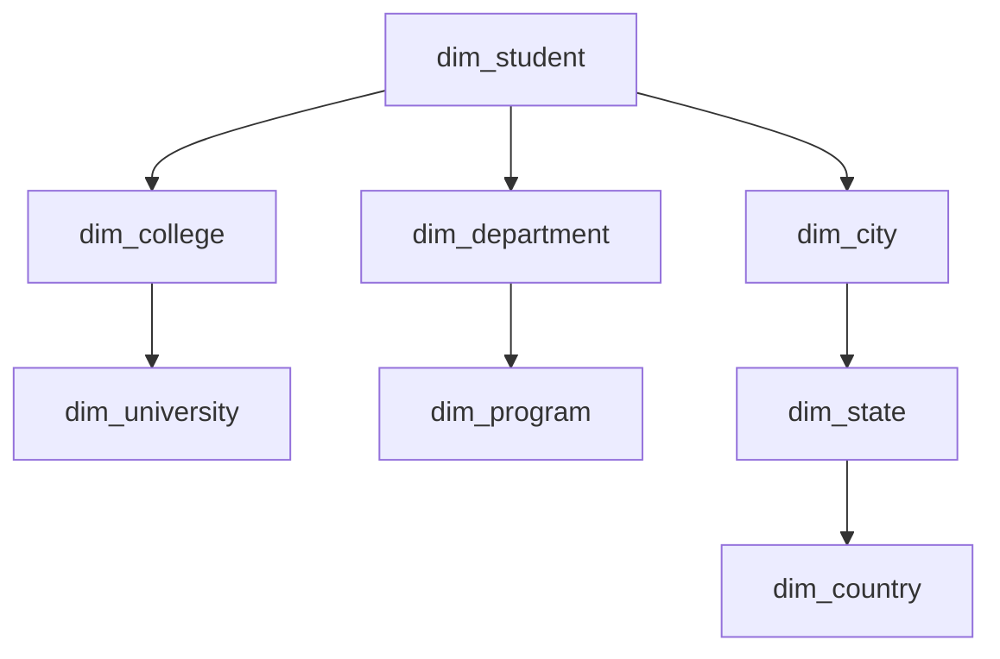

---

# 54. Full Snowflake Model

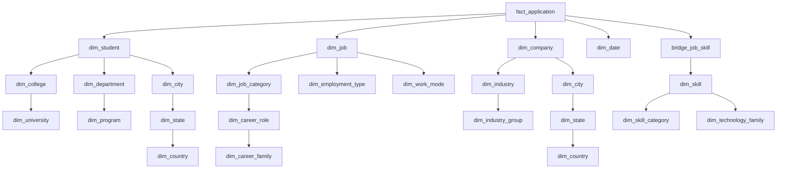

This represents a more normalized analytical model.

---

# 55. Why Not Snowflake Everything?

Over-normalizing analytical data creates additional joins.

For example:

```text
Dashboard
↓
Fact
↓
Company
↓
Industry
↓
Industry Group
```

may be more complex than:

```text
Dashboard
↓
Fact
↓
Company
```

with descriptive attributes already available.

Therefore:

> **Snowflake Schema should be applied selectively, not mechanically.**

---

# 56. Star vs Snowflake — Trade-Off

| Dimension                  | Star               | Snowflake                         |
| -------------------------- | ------------------ | --------------------------------- |
| Query Simplicity           | Excellent          | Moderate                          |
| BI Usability               | Excellent          | Moderate                          |
| Redundancy                 | Higher             | Lower                             |
| Hierarchical Modeling      | Moderate           | Excellent                         |
| Number of Joins            | Lower              | Higher                            |
| Governance                 | Good               | Strong                            |
| Maintenance of Hierarchies | Moderate           | Strong                            |
| Performance                | Often simpler      | Depends on warehouse/query design |
| Best Use                   | Dashboard-heavy BI | Complex master-data hierarchies   |

Actual query performance depends on the warehouse engine, physical design, data volume, and query patterns.

---

# 57. Recommended Hybrid Pattern

The Career Connect warehouse should use:

```text
Star
+
Selective Snowflake
```

Recommended Snowflaked dimensions:

```text
Geography
Education
Skill Taxonomy
Career Taxonomy
Industry
Technology
```

Recommended mostly-flat dimensions:

```text
Date
Basic Recruiter
Basic Employment Type
Some job attributes
```

---

# 58. Snowflake Schema and Master Data Management

The strongest reason for snowflaking is master-data governance.

For example:

```text
India
```

should not be represented as:

```text
India
IND
INDIA
Republic of India
```

across hundreds of dimension rows.

Instead:

```text
dim_country
```

stores the canonical country.

---

# 59. Master Data Example

Without normalization:

```text id="u90qej"
College A
University X
Chennai
Tamil Nadu
India
```

might be repeated thousands of times.

With Snowflake:

```text id="yd7wpk"
Student
↓
College A
↓
University X
↓
Chennai
↓
Tamil Nadu
↓
India
```

The hierarchy is maintained centrally.

---

# 60. Snowflake Schema for Skill Governance

Consider skill aliases:

```text
React
React.js
ReactJS
React JS
```

Instead of treating these as separate analytical entities:

```text id="5qu5y9"
dim_skill
    ↓
dim_skill_alias
```

creates a canonical mapping.

---

# 61. Skill Taxonomy Governance

The taxonomy should support:

```text id="2kb3w9"
Canonical Skill
Aliases
Category
Technology
Family
Version
Status
```

This is highly valuable for career intelligence.

---

# 62. Technology Hierarchy

Example:

```text
Cloud Computing
├── AWS
│   ├── EC2
│   ├── S3
│   └── Redshift
│
├── Azure
│   ├── Azure VM
│   └── Azure Data Factory
│
└── Google Cloud
    ├── Compute Engine
    ├── Cloud Storage
    └── BigQuery
```

This allows technology-level analytics.

---

# 63. Career Hierarchy

Example:

```text
Data
├── Analytics
│   ├── Data Analyst
│   └── BI Analyst
│
├── Engineering
│   ├── Data Engineer
│   └── Analytics Engineer
│
└── Science
    ├── Data Scientist
    └── ML Scientist
```

The Career Connect recommendation engine can use this hierarchy to recommend adjacent careers.

---

# 64. Adjacent Career Intelligence

If a user does not perfectly match:

```text
Data Scientist
```

the hierarchy could identify:

```text
Data Analyst
Analytics Engineer
ML Engineer
```

as adjacent career paths.

The actual recommendation should combine hierarchy with skill requirements and market data.

---

# 65. Snowflake Schema for Salary Analysis

Salary can be analyzed across normalized hierarchies:

```text
Salary Fact
↓
Job
↓
Career Role
↓
Career Family

Salary Fact
↓
Location
↓
State
↓
Country
```

This enables:

> Salary by career family and country.

---

# 66. Snowflake Schema for Job Market Analysis

The hierarchy can support:

```text
Job Demand
↓
Career Family
↓
Career Category
↓
Career Role
```

and:

```text
Job Demand
↓
Technology Family
↓
Technology
↓
Skill
```

---

# 67. Snowflake Schema for College Analytics

Placement analysis can follow:

```text
Placement
↓
College
↓
University
↓
State
↓
Country
```

and:

```text
Placement
↓
Department
↓
Program
```

This supports more detailed institutional benchmarking.

---

# 68. Snowflake Schema for Recruiter Analytics

Recruiter analytics can follow:

```text
Recruiter
↓
Company
↓
Industry
↓
Industry Group
```

and:

```text
Recruiter
↓
Location
↓
State
↓
Country
```

---

# 69. Snowflake Schema for Skill Demand

The skill-demand pipeline can be:

```text
Fact Job Posting
↓
Skill
↓
Skill Category
↓
Technology Family
```

This enables executive questions like:

> Which technology families have the highest hiring demand?

---

# 70. Snowflake Schema for AI Context

The AI context layer can traverse:

```text
Student
↓
Skill
↓
Skill Category
↓
Technology
↓
Career Role
↓
Career Family
```

This creates richer context for career recommendations.

---

# 71. Snowflake Schema for Data Quality

Normalized reference structures reduce taxonomy drift.

For example:

```text id="mb4j0e"
One Country Master
One State Master
One City Master
One Skill Master
One Career Master
```

becomes the authoritative reference point for analytical integration.

---

# 72. Snowflake Schema and Slowly Changing Dimensions

Snowflaked dimensions can independently maintain historical versions.

Example:

```text
dim_company
↓
dim_industry
```

If a company changes industry classification, the historical impact can be controlled without rewriting unrelated reference records.

---

# 73. SCD Considerations

Snowflaking creates an additional design decision:

> Should history be stored independently at each hierarchical level or represented through a versioned parent-child relationship?

For the academic version, simple Type 2 dimensions should be preferred.

For enterprise implementation, the history strategy must be defined for each hierarchy.

---

# 74. Surrogate Keys in Snowflake Schema

Each normalized dimension should have its own surrogate key.

Example:

```text id="1o6ojk"
country_key
state_key
city_key
college_key
university_key
skill_key
skill_category_key
technology_key
```

Relationships then use these warehouse keys.

---

# 75. Snowflake Query Example — College Hierarchy

```sql id="4rc5ww"
SELECT
    u.university_name,
    c.college_name,
    d.department_name,
    SUM(p.placement_count) AS placements
FROM fact_placement p
JOIN dim_college c
    ON p.college_key = c.college_key
JOIN dim_university u
    ON c.university_key = u.university_key
JOIN dim_department d
    ON p.department_key = d.department_key
GROUP BY
    u.university_name,
    c.college_name,
    d.department_name;
```

This demonstrates hierarchical drilldown.

---

# 76. Snowflake Query Example — Geographic Job Demand

```sql id="t7hbxu"
SELECT
    co.country_name,
    st.state_name,
    ci.city_name,
    SUM(jp.open_position_count) AS openings
FROM fact_job_posting jp
JOIN dim_city ci
    ON jp.city_key = ci.city_key
JOIN dim_state st
    ON ci.state_key = st.state_key
JOIN dim_country co
    ON st.country_key = co.country_key
GROUP BY
    co.country_name,
    st.state_name,
    ci.city_name;
```

This supports:

```text
Country
→ State
→ City
```

drilldown.

---

# 77. Snowflake Query Example — Skill Taxonomy

```sql id="zr3pqc"
SELECT
    tf.technology_family_name,
    t.technology_name,
    sc.skill_category_name,
    s.canonical_name,
    COUNT(DISTINCT jp.job_key) AS job_count
FROM bridge_job_skill b
JOIN dim_skill s
    ON b.skill_key = s.skill_key
JOIN dim_skill_category sc
    ON s.skill_category_key = sc.skill_category_key
JOIN dim_technology t
    ON s.technology_key = t.technology_key
JOIN dim_technology_family tf
    ON t.technology_family_key = tf.technology_family_key
JOIN fact_job_posting jp
    ON b.job_key = jp.job_key
GROUP BY
    tf.technology_family_name,
    t.technology_name,
    sc.skill_category_name,
    s.canonical_name;
```

This enables skill intelligence at multiple hierarchy levels.

---

# 78. Snowflake Schema and Semantic Layer

The BI semantic layer should hide unnecessary normalization.

Instead of exposing:

```text
country_key
state_key
city_key
```

the user sees:

```text
Country
State
City
```

The semantic layer manages the underlying joins.

---

# 79. Snowflake Schema and BI Performance

Because normalization creates additional joins, the platform should use:

```text
Curated views
+
Materialized views
+
Aggregate tables
+
Semantic models
```

where justified.

Not every BI query needs to traverse the entire hierarchy.

---

# 80. Snowflake Schema and AI Performance

AI context retrieval should usually use curated context tables/views rather than executing multiple hierarchy joins on every request.

Example:

```text id="cm9m1x"
career_market_context
```

could pre-combine:

```text
Career
Skill
Technology
Demand
Salary
Location
```

This gives AI a simpler retrieval interface.

---

# 81. Snowflake Schema Architecture Layers

```text id="z8x4m6"
Raw Data
↓
Staging
↓
Integration
↓
Snowflake Warehouse Model
↓
Semantic Views
↓
Data Marts
↓
BI / AI
```

---

# 82. Snowflake Integration Layer

Before the final warehouse model, the integration layer should standardize:

- IDs
- Taxonomies
- Dates
- Locations
- Currency
- Skill aliases
- Career roles
- Company names

This avoids pushing messy source mappings into BI queries.

---

# 83. Master Reference Tables

Recommended master/reference entities:

```text id="f3k8q5"
ref_country
ref_state
ref_city
ref_industry_group
ref_industry
ref_technology_family
ref_technology
ref_skill_category
ref_skill
ref_career_family
ref_career_category
ref_career_role
```

These can form the controlled hierarchy.

---

# 84. Reference Data Governance

Every reference entity should have:

```text id="j2x6n9"
Canonical ID
Canonical Name
Alias
Status
Effective Date
Source
Owner
```

---

# 85. Snowflake Model for Company Master Data

A company can contain:

```text id="b8w4q2"
company_key
company_name
industry_key
headquarters_city_key
company_type
company_size
```

The hierarchy then resolves:

```text
Company
↓
Industry
↓
Industry Group
```

and:

```text
Company
↓
City
↓
State
↓
Country
```

---

# 86. Snowflake Model for Job Master Data

A job can contain:

```text id="t4m6r1"
job_key
job_title
job_category_key
career_role_key
employment_type_key
work_mode_key
experience_level_key
```

This supports standardized job classification.

---

# 87. Job Taxonomy

A standardized job taxonomy is important because source data may contain:

```text
Software Engineer
Software Developer
Application Developer
Backend Engineer
```

The platform can map these into:

```text
Career Family
→ Software Engineering

Career Category
→ Application Development

Career Role
→ Backend Developer
```

The mapping logic should be governed and versioned.

---

# 88. Snowflake Schema and Data Quality

Normalization makes invalid hierarchies easier to detect.

Example:

```text
Skill
→ Technology
→ Technology Family
```

If a skill references an inactive technology, data-quality checks can flag it.

---

# 89. Snowflake Schema and Referential Integrity

Every child dimension should reference a valid parent.

Examples:

```text id="os4whk"
city.state_key
state.country_key

college.university_key
department.college_key

skill.skill_category_key
technology.technology_family_key
```

---

# 90. Snowflake Schema Validation

Pipeline validation should include:

```text
Parent Exists
Child Exists
No Circular Hierarchies
No Orphan Records
Canonical Names Unique
Active/Inactive Status Consistent
```

---

# 91. Hierarchy Testing

Test:

```text id="u90m1z"
Country → State
State → City
University → College
College → Department
Technology Family → Technology
Skill Category → Skill
Career Family → Career Role
```

---

# 92. Snowflake Schema Anti-Patterns

Avoid:

### Over-Normalization

Splitting every descriptive field into its own dimension.

### Excessive Joins

Creating BI queries with too many hierarchy joins.

### Inconsistent Keys

Using business names as relationships instead of warehouse keys.

### Uncontrolled Hierarchies

Allowing the same skill/career/location to belong to multiple conflicting parents without governance.

### Duplicate Masters

Creating separate country/skill/career taxonomies for every source.

---

# 93. Recommended Hybrid Architecture

The final analytical architecture should be:

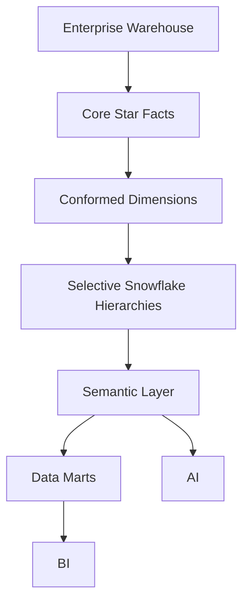

This keeps the central fact model simple while allowing complex reference structures.

---

# 94. Star + Snowflake Decision Matrix

| Domain          | Recommended Model | Reason               |
| --------------- | ----------------- | -------------------- |
| Date            | Star              | Simple hierarchy     |
| Student         | Star / Hybrid     | Frequent BI usage    |
| Company         | Hybrid            | Industry + geography |
| Job             | Hybrid            | Career taxonomy      |
| Skill           | Snowflake         | Rich taxonomy        |
| College         | Snowflake         | University hierarchy |
| Location        | Snowflake         | Geographic hierarchy |
| Career          | Snowflake         | Career taxonomy      |
| Technology      | Snowflake         | Technology hierarchy |
| Recruiter       | Star              | Relatively simple    |
| Employment Type | Star              | Simple reference     |
| Experience      | Star              | Simple reference     |

---

# 95. Snowflake Schema for Academic Project

The academic implementation should use only a few normalized dimensions.

Recommended:

```text id="qwr8j2"
dim_country
dim_state
dim_city

dim_university
dim_college
dim_department

dim_skill_category
dim_skill
```

Core fact:

```text id="by68tq"
fact_placement
fact_application
```

This is enough to demonstrate:

- Star Schema
- Snowflake Schema
- Hierarchical analytics
- ETL
- Data quality

---

# 96. Snowflake Schema for Startup MVP

Add:

```text id="0g2q8v"
Career Taxonomy
Technology Taxonomy
Industry Taxonomy
Employment Taxonomy
```

This enables more advanced market analytics.

---

# 97. Snowflake Schema for Enterprise

Expand to:

```text id="j9v4x1"
Global Geography
Global Education Taxonomy
Global Job Taxonomy
Global Skill Taxonomy
Global Industry Taxonomy
Global Technology Taxonomy
```

This becomes the master-data backbone for international expansion.

---

# 98. Snowflake Schema and Internationalization

A normalized geography hierarchy supports:

```text
Country
↓
State / Province
↓
Region
↓
City
```

while the same facts remain reusable across countries.

---

# 99. Snowflake Schema and Multi-Tenancy

Reference dimensions can often remain globally shared:

```text
Skills
Careers
Countries
Technologies
Industries
```

Organization-specific entities remain tenant-aware:

```text
Students
Placements
Recruiters
Company Hiring
Internal Learning
```

This creates a clean distinction between:

**Global Reference Data**

and:

**Tenant Business Data**

---

# 100. Snowflake Schema Security

Security should apply to the facts and potentially sensitive dimensions.

For example:

```text
fact_placement
```

may contain organization-specific data.

Whereas:

```text
dim_skill
```

may be globally shareable.

The authorization model should therefore be data-domain aware.

---

# 101. Snowflake Schema and Data Sharing

A mature SaaS version may allow:

```text
Global Market Data
        ↓
Shared Reference Intelligence
        ↓
Tenant Dashboards
```

while keeping:

```text
Tenant Placement Data
```

private.

This is valuable for benchmarking products.

---

# 102. Snowflake Schema Benchmarking

A possible future feature:

> Compare an institution's placement performance with anonymized market benchmarks.

Architecture:

```text
Tenant Data
+
Approved Aggregated Global Data
↓
Benchmarking Mart
↓
Benchmark Dashboard
```

Privacy and minimum-group-size controls must be applied.

---

# 103. Snowflake Schema and Data Governance

The schema should enable:

```text
Master Data Management
+
Taxonomy Governance
+
Data Quality
+
Lineage
+
Historical Tracking
```

This is one of the strongest enterprise advantages of selective snowflaking.

---

# 104. Snowflake Schema Performance Strategy

Because Snowflake Schema can increase joins:

```text id="j9f5x2"
Use:
Partitioning
Clustering
Materialized structures
Curated views
Semantic layer
Aggregate tables
```

The selected strategy should be validated using actual workloads.

---

# 105. Snowflake Schema and Data Marts

Data marts may selectively flatten snowflaked dimensions again.

Example:

```text
Enterprise Snowflake
↓
Placement Mart
↓
Flattened College / Department / University
```

This provides a powerful combination:

> **Normalized master data + simplified analytical consumption.**

---

# 106. Enterprise Data Flow

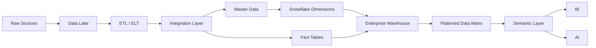

---

# 107. Snowflake Schema Governance Checklist

Every hierarchy should define:

```text id="s6f3y4"
✓ Parent
✓ Child
✓ Key
✓ Business Definition
✓ Effective Dates
✓ Status
✓ Owner
✓ Source
✓ Data Quality Rules
```

---

# 108. Snowflake Schema Testing Checklist

```text id="1l4v8a"
✓ Parent-child integrity
✓ Duplicate detection
✓ Orphan detection
✓ Hierarchy correctness
✓ Historical versioning
✓ Key consistency
✓ Source reconciliation
✓ Query performance
```

---

# 109. Snowflake Schema Naming Convention

Use:

```text
dim_
```

for business dimensions and clear hierarchy names.

Examples:

```text id="o7n4x3"
dim_country
dim_state
dim_city

dim_university
dim_college
dim_department

dim_technology_family
dim_technology
dim_skill_category
dim_skill
```

---

# 110. Recommended Warehouse Folder Structure

```text id="wb3x9h"
warehouse/
│
├── dimensions/
│   ├── geography/
│   │   ├── dim_country.sql
│   │   ├── dim_state.sql
│   │   └── dim_city.sql
│   │
│   ├── education/
│   │   ├── dim_university.sql
│   │   ├── dim_college.sql
│   │   └── dim_department.sql
│   │
│   ├── skills/
│   │   ├── dim_technology_family.sql
│   │   ├── dim_technology.sql
│   │   ├── dim_skill_category.sql
│   │   └── dim_skill.sql
│   │
│   └── careers/
│       ├── dim_career_family.sql
│       ├── dim_career_category.sql
│       └── dim_career_role.sql
│
├── facts/
│   ├── fact_application.sql
│   ├── fact_placement.sql
│   ├── fact_hiring.sql
│   └── fact_salary.sql
│
└── marts/
    ├── placement_mart.sql
    ├── skill_mart.sql
    └── hiring_mart.sql
```

---

# 111. Snowflake Schema Example — Full Placement Model

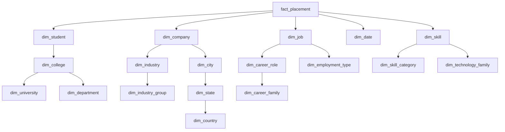

This single model can answer complex questions across:

```text
Student
+
Education
+
Company
+
Industry
+
Career
+
Skill
+
Technology
+
Location
+
Salary
+
Time
```

---

# 112. Example Executive Question

> Which technology family has the strongest placement outcomes among engineering colleges in a particular state?

The analytical path becomes:

```text id="z2sv5q"
Placement Fact
↓
College
↓
Department / Program
↓
Location
↓
Skill
↓
Technology
↓
Technology Family
↓
Placement Metrics
```

This demonstrates the analytical power of the snowflaked model.

---

# 113. Example Career Question

> Which related careers are closest to a student's current skill profile?

The hierarchy can be traversed:

```text id="aj0fkp"
Student Skills
↓
Skill Category
↓
Technology Family
↓
Career Category
↓
Career Role
```

This enables broader recommendation logic than simple keyword matching.

---

# 114. Example Recruiter Question

> Which industries are hiring Data Engineers with cloud skills?

The path:

```text id="kq14h8"
Job Posting Fact
↓
Job
↓
Career Role
↓
Skill
↓
Technology
↓
Company
↓
Industry
↓
Industry Group
```

This is a strong example of enterprise career intelligence.

---

# 115. Snowflake Schema and Data Warehouse Architecture

The combined warehouse becomes:

```text id="5y8kj1"
                  ENTERPRISE WAREHOUSE
                           │
              ┌────────────┴────────────┐
              ↓                         ↓
           FACTS                 MASTER DIMENSIONS
              │                         │
      Applications               Geography
      Placements                 Education
      Hiring                     Skills
      Salary                     Career
      Interviews                 Industry
      Learning                   Technology
              │                         │
              └────────────┬────────────┘
                           ↓
                      DATA MARTS
                           ↓
                    SEMANTIC LAYER
                      ↓        ↓
                     BI       AI
```

---

# 116. Star vs Snowflake Strategy for Career Connect

The final architecture should not select one model exclusively.

Recommended:

> **Star Schema for business-process facts and high-frequency BI consumption.**

> **Snowflake Schema for master-data hierarchies and taxonomy governance.**

This creates a hybrid enterprise warehouse.

---

# 117. Why This Hybrid Model Is Strong

It combines:

### Star Advantages

- Simple queries
- Easy dashboards
- Fast development
- Business-friendly modeling

with:

### Snowflake Advantages

- Strong master-data governance
- Reduced hierarchy duplication
- Reusable reference structures
- Detailed taxonomy support

---

# 118. Academic Implementation Strategy

For the BE CSE project:

```text id="q3n8b6"
Core Facts
+
Simple Dimensions
+
3 Snowflaked Hierarchies
```

Recommended hierarchies:

```text
Geography
Education
Skills
```

This demonstrates both modeling patterns without unnecessary complexity.

---

# 119. Startup MVP Strategy

For a startup:

```text
Star Facts
+
Snowflaked Skill Taxonomy
+
Snowflaked Job Taxonomy
+
Snowflaked Geography
+
Snowflaked Industry
```

This provides a stronger market-intelligence foundation.

---

# 120. Enterprise Strategy

For the enterprise version:

```text
Enterprise Facts
+
Master Data Management
+
Global Taxonomies
+
Versioned Hierarchies
+
Governed Data Products
+
Semantic Layer
```

---

# 121. Snowflake Schema Success Criteria

The model is successful when:

```text id="6p4m2k"
✓ Hierarchies are centrally governed
✓ Duplicate reference data is minimized
✓ Facts remain easy to analyze
✓ BI users do not manage raw joins
✓ AI context remains accessible
✓ Historical relationships are preserved
✓ Data quality improves
✓ Taxonomy changes are manageable
```

---

# 122. Final Snowflake Schema Architecture

```text id="xv4n8m"
                         CAREER CONNECT
                       SNOWFLAKE MODEL
                              │
                    ┌─────────┴─────────┐
                    │                   │
                  FACTS              DIMENSIONS
                    │                   │
             Applications          Geography
             Placements            Education
             Hiring                Skills
             Salary                Careers
             Interviews            Industry
             Learning              Technology
                    │                   │
                    └─────────┬─────────┘
                              │
                       SEMANTIC LAYER
                              │
                    ┌─────────┴─────────┐
                    ▼                   ▼
                   BI                  AI
```

---

# 123. CTO-Level Recommendation

Career Connect should adopt a **hybrid dimensional architecture**:

```text
                 Enterprise Warehouse
                         │
             ┌───────────┴───────────┐
             │                       │
          STAR FACTS           SNOWFLAKED MASTER DATA
             │                       │
             └───────────┬───────────┘
                         │
                    DATA MARTS
                         │
                  SEMANTIC LAYER
                         │
                     BI + AI
```

This provides the best balance between:

- Analytical simplicity
- Master-data governance
- Performance
- Maintainability
- Scalability
- AI readiness

---

# 124. Final Snowflake Schema Statement

> **Career Connect will use a selective Snowflake Schema architecture to normalize complex analytical hierarchies such as geography, education, skills, careers, industries, and technologies while retaining Star Schema structures for high-value business-process facts. The hybrid model reduces master-data duplication, strengthens taxonomy governance, supports historical hierarchy management, and provides a scalable foundation for enterprise Business Intelligence, AI context, benchmarking, and workforce intelligence.**

---

## Document Status

| Attribute           | Value                                                          |
| ------------------- | -------------------------------------------------------------- |
| Project             | Career Connect                                                 |
| Document            | Snowflake Schema                                               |
| Version             | 1.0                                                            |
| Primary Warehouse   | BigQuery                                                       |
| Alternative         | Snowflake                                                      |
| Modeling Strategy   | Hybrid Star + Snowflake                                        |
| Snowflaked Domains  | Geography, Education, Skills, Careers, Industry, Technology    |
| Core Facts          | Applications, Placements, Interviews, Hiring, Salary, Learning |
| Key Strategy        | Surrogate Keys                                                 |
| Historical Strategy | SCD Type 1 / Type 2                                            |
| Master Data         | Governed Reference Hierarchies                                 |
| BI                  | Semantic Layer + Data Marts                                    |
| AI                  | Structured Context Retrieval                                   |
| Academic Scope      | Selective Snowflaking                                          |
| Enterprise Scope    | Full Master-Data Hierarchies                                   |
| Status              | Analytical Data Model Baseline                                 |
