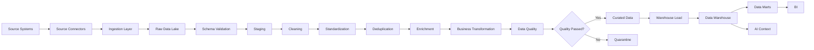
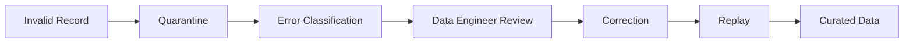
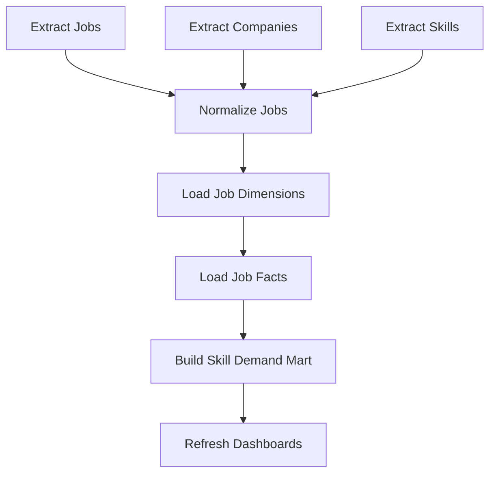
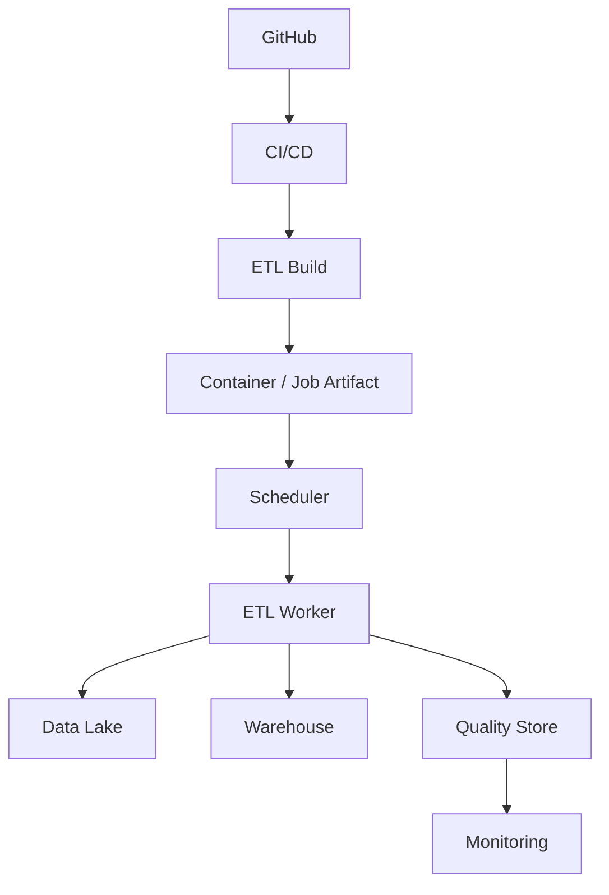
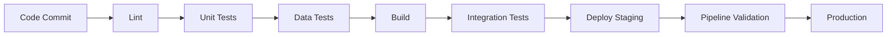
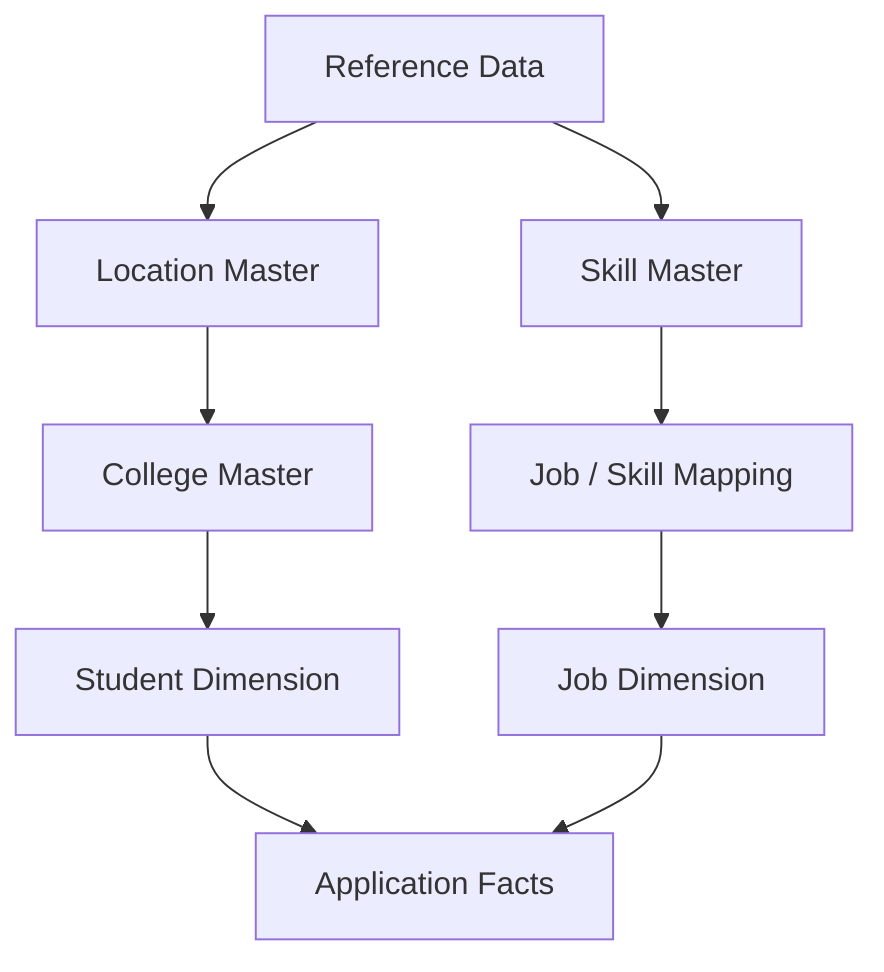
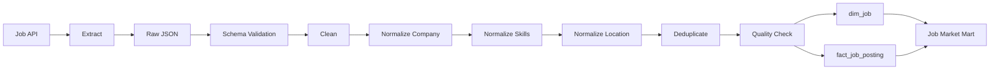
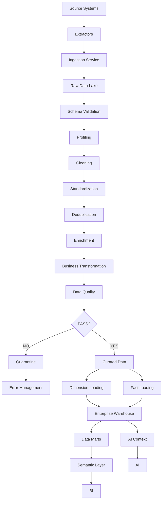

# 17 — ETL Design

# Career Connect — AI Career Intelligence Platform

**Document Type:** Enterprise ETL / ELT Design
**Project:** Career Connect
**Version:** 1.0
**Status:** Data Engineering Design Baseline
**Primary Pattern:** Batch ETL + Incremental ELT + Event-Driven Extensions
**Primary Data Lake:** Cloud Object Storage
**Primary Warehouse:** BigQuery
**Alternative Warehouse:** Snowflake
**Processing:** Python Data Services + SQL Transformations
**Orchestration:** Scheduled Workflows / Managed Scheduler
**Data Quality:** Automated Validation + Quarantine + Reconciliation

---

# 1. Executive Summary

The ETL platform is the data-engineering backbone of Career Connect.

Career Connect receives data from many heterogeneous sources:

```text
Students
Companies
Jobs
Internships
Skills
Certifications
Colleges
Recruiters
Placements
Courses
Salaries
Applications
Interviews
Hiring Trends
Locations
Technologies
Employment Types
Experience Levels
```

These sources will not naturally share:

- The same schema
- The same naming conventions
- The same identifiers
- The same formats
- The same refresh frequencies
- The same data quality

The ETL platform therefore converts fragmented source data into trusted, standardized, analytical data.

The complete pipeline is:

```text id="a2k4f8"
SOURCE
  ↓
EXTRACT
  ↓
INGEST
  ↓
RAW
  ↓
VALIDATE
  ↓
CLEAN
  ↓
STANDARDIZE
  ↓
DEDUPLICATE
  ↓
ENRICH
  ↓
TRANSFORM
  ↓
QUALITY CHECK
  ↓
CURATED
  ↓
WAREHOUSE
  ↓
DATA MART
  ↓
BI + AI
```

The core design principle is:

> **No raw external data should be treated as trusted analytical data until it passes validation, standardization, quality, and lineage controls.**

---

# 2. ETL Objectives

The ETL platform must provide:

1. Reliable ingestion
2. Data validation
3. Data cleaning
4. Standardization
5. Deduplication
6. Data enrichment
7. Incremental loading
8. Historical processing
9. Error handling
10. Data-quality measurement
11. Metadata management
12. Lineage
13. Retry capability
14. Monitoring
15. Reprocessing
16. Warehouse loading

---

# 3. ETL Architecture



---

# 4. ETL vs ELT Strategy

Career Connect should support both ETL and ELT.

## ETL

```text id="r7g5j2"
Extract
↓
Transform
↓
Load
```

Useful when:

- Source data requires heavy cleansing
- Sensitive data must be filtered before warehouse loading
- External files need preprocessing

---

## ELT

```text id="v3h8n1"
Extract
↓
Load
↓
Transform
```

Useful when:

- The warehouse has strong transformation capabilities
- Raw data should be preserved
- Transformations can be executed efficiently using SQL

---

# 5. Recommended Hybrid Strategy

The recommended architecture is:

```text id="i6p2w9"
External Source
↓
Extract
↓
Raw Data Lake
↓
Warehouse Staging
↓
SQL / Python Transformations
↓
Curated Warehouse
```

This provides the advantages of both ETL and ELT.

---

# 6. Data Source Categories

Career Connect should classify sources into four major categories.

## Category A — Internal Operational Data

Examples:

```text id="3v8m2j"
Students
Applications
Placements
Interviews
Learning
User Profiles
```

Primary source:

**PostgreSQL**

---

## Category B — Institutional Data

Examples:

```text id="n4q7x0"
College CSV
Placement Excel
Student Export
Department Data
Recruiter Data
```

---

## Category C — External Market Data

Examples:

```text id="s6f1c8"
Jobs
Companies
Salary
Skills
Technologies
Locations
Market Trends
```

---

## Category D — Reference Data

Examples:

```text id="5w9r3k"
Country
State
City
Skill Taxonomy
Career Taxonomy
Industry Taxonomy
Employment Type
Experience Level
```

Reference data is especially important for standardization.

---

# 7. Source Registry

Every source should be registered before entering the production pipeline.

Example table:

```text id="u3k8n2"
etl.source_registry
```

Fields:

```text id="c4t7m1"
source_id
source_name
source_type
owner
format
endpoint
refresh_frequency
license
data_classification
schema_version
active_flag
created_at
updated_at
```

---

# 8. Source Metadata

Each ingestion should record:

```text id="g2v6x4"
source_id
batch_id
ingestion_time
file_name
file_size
record_count
checksum
source_version
status
```

This allows every dataset to be traced back to its origin.

---

# 9. Source Connectors

The ingestion framework should support:

```text id="w5p9r3"
PostgreSQL
CSV
Excel
JSON
REST API
Object Storage
Manual Upload
Scheduled Export
```

The connector architecture should be pluggable.

---

# 10. Connector Interface

Conceptually:

```text id="m7q2x6"
DataConnector
    |
    +-- PostgreSQLConnector
    +-- CSVConnector
    +-- ExcelConnector
    +-- JSONConnector
    +-- APIConnector
    +-- StorageConnector
```

Each connector should expose a common interface such as:

```text id="j8x4c1"
extract()
validate_connection()
get_schema()
get_metadata()
```

---

# 11. Batch Identifier

Every ETL execution should receive a unique batch identifier.

Example:

```text id="9q5w2k"
batch_id = ETL-20260730-000142
```

The batch ID should appear in:

- Logs
- Metadata
- Quality results
- Error records
- Warehouse load metadata

---

# 12. Pipeline Stages

The standard pipeline contains:

```text id="z6v3p9"
1. Extract
2. Ingest
3. Raw Storage
4. Schema Validation
5. Profiling
6. Cleaning
7. Standardization
8. Deduplication
9. Enrichment
10. Transformation
11. Data Quality
12. Curated Storage
13. Warehouse Load
14. Reconciliation
15. Publish
```

---

# 13. Stage 1 — Extract

The extract process retrieves source data without unnecessarily changing its meaning.

Examples:

```text id="x8m5n3"
SELECT from PostgreSQL
GET REST API
Read CSV
Read JSON
Read Excel
Read Object Storage
```

---

# 14. Extraction Principles

Extraction should:

- Be repeatable
- Record metadata
- Avoid unnecessary transformation
- Preserve source information
- Support retry
- Support partial failure handling

---

# 15. Stage 2 — Ingestion

The ingestion layer transfers extracted data into the raw platform.

```text id="r1c8v5"
Source
↓
Ingestion Worker
↓
Raw Storage
```

At this stage, the main objective is reliable capture.

---

# 16. Stage 3 — Raw Data Lake

Raw files should be stored in immutable or append-oriented form where practical.

Recommended structure:

```text id="e3k7p2"
raw/
  source_name/
    dataset_name/
      ingestion_date/
        batch_id/
```

Example:

```text id="v9m2r6"
raw/
  jobs/
    source_a/
      2026-07-30/
        ETL-20260730-000142/
```

---

# 17. Raw Data Format

Recommended formats:

### CSV

Useful for human-generated datasets.

### JSON

Useful for API responses.

### Parquet

Recommended for larger analytical datasets because it is columnar and efficient for analytical processing.

The initial academic project can start with CSV/JSON and introduce Parquet as the pipeline matures.

---

# 18. Stage 4 — Schema Validation

Before transformation, validate the source structure.

Checks include:

```text id="g8k4z1"
Required Columns
Data Types
Column Names
Expected Record Structure
Version
```

Example:

```text id="u7m3p9"
Expected:
student_id
name
email
department

Received:
student_id
name
email
```

The missing department field should be flagged.

---

# 19. Schema Versioning

Every source schema should have a version.

Example:

```text id="x2r6v8"
jobs_schema_v1
jobs_schema_v2
jobs_schema_v3
```

If a source changes:

```text id="k5m8q3"
salary
```

to:

```text id="n7p4c2"
salary_min
salary_max
```

the transformation logic must explicitly accommodate the change.

---

# 20. Schema Drift Detection

The pipeline should detect:

- New columns
- Removed columns
- Renamed columns
- Changed data types
- Unexpected nullability

Example:

```text id="a6w9t1"
Schema Drift Detected

Dataset: jobs
Column: experience
Old Type: integer
New Type: string
```

The pipeline should then either:

```text id="v4k2m7"
Reject
```

or:

```text id="j1r8x5"
Route to controlled compatibility logic
```

based on the source policy.

---

# 21. Stage 5 — Data Profiling

Before transformation, profile the dataset.

Measure:

```text id="2q7m4v"
Row Count
Null Count
Unique Count
Min
Max
Mean
Distinct Values
Duplicate Rate
```

Example:

```text id="p6x8n1"
Rows: 100,000
Null Email: 2,450
Duplicate Email: 1,120
```

---

# 22. Data Profiling Dashboard

The data engineering team should eventually have:

```text id="t5m9c7"
Dataset Health
Rows
Null Rate
Duplicate Rate
Freshness
Schema Version
Quality Score
```

---

# 23. Stage 6 — Data Cleaning

Cleaning includes:

- Null handling
- Whitespace trimming
- Case normalization
- Date normalization
- Number parsing
- Invalid character handling
- Standardized text encoding

---

# 24. Null Handling

Null handling should be field-specific.

Do not blindly replace all nulls with:

```text id="9v4m2h"
Unknown
0
N/A
```

For example:

```text id="e7k3p9"
missing_salary
```

has a different meaning from:

```text id="d2q6x8"
salary = 0
```

The transformation must preserve semantic meaning.

---

# 25. Data Cleaning Example

Input:

```text id="w3r8m5"
"  Bangalore "
"ReactJS"
"PYTHON "
```

Output:

```text id="f6x2k9"
"Bengaluru"
"React"
"Python"
```

The transformation should be based on approved reference mappings rather than arbitrary assumptions.

---

# 26. Stage 7 — Standardization

Standardization maps different representations to canonical values.

Examples:

```text id="o4m6q1"
Bangalore → Bengaluru
Bengaluru → Bengaluru

ReactJS → React
React.js → React

Full-time → FULL_TIME
Full Time → FULL_TIME
```

---

# 27. Reference Mapping Tables

Maintain reference tables such as:

```text id="j8c4v2"
etl.location_alias
etl.skill_alias
etl.company_alias
etl.job_title_alias
etl.employment_type_alias
```

These provide controlled mappings.

---

# 28. Location Standardization

Input:

```text id="7m4x2p"
Bangalore
Bengaluru
Bangalore Urban
```

Canonical structure:

```text id="q5r8n3"
Country = India
State = Karnataka
City = Bengaluru
```

---

# 29. Company Standardization

Input:

```text id="y4w7k2"
ABC Technologies
ABC Tech Pvt Ltd
ABC Technologies Private Limited
```

The pipeline should use an approved company master or matching methodology rather than automatically assuming all similar names are identical.

---

# 30. Job Title Standardization

Examples:

```text id="r6m3x7"
Software Engineer
S/W Engineer
Software Developer
```

may map to a canonical taxonomy depending on the classification rules.

The mapping should preserve the original source title for traceability.

---

# 31. Skill Normalization

Example:

```text id="p2n7w4"
React.js
ReactJS
React JS
React
```

Canonical:

```text id="j9x5m2"
React
```

Source aliases should remain available for auditability.

---

# 32. Stage 8 — Deduplication

Duplicate data can exist within and across sources.

Deduplication may use:

```text id="v8m4r1"
Exact Match
Business Key Match
Composite Match
Fuzzy Match
Master Data Matching
```

---

# 33. Exact Duplicate

Example:

```text id="2x7p4n"
student_id = 1001
email = kalai@example.com
```

appears twice with identical values.

This is a simple exact duplicate.

---

# 34. Composite Duplicate

Two records may differ slightly:

```text id="z5c8m3"
Company A
Company A Pvt Ltd
```

Matching may require:

```text id="m8x2q7"
Normalized Name
Location
Website
Registration ID
```

---

# 35. Fuzzy Matching

Fuzzy matching may be used for:

- Company names
- Job titles
- Skills
- Locations

However:

> **Fuzzy matching should produce candidates for validation rather than automatically merging records when the consequence of a false match is significant.**

---

# 36. Golden Record

When duplicates are resolved, create one canonical record.

Example:

```text id="x7p4v1"
Source A
Source B
Source C
    ↓
Golden Company Record
```

The golden record should preserve:

```text id="n2m9q6"
canonical_id
source_ids
confidence
matching_method
updated_at
```

---

# 37. Stage 9 — Enrichment

Enrichment adds useful information from controlled reference sources.

Example:

```text id="4c7m1x"
Job
+
Location
+
Skill Taxonomy
+
Career Taxonomy
+
Technology Taxonomy
```

produces a richer analytical record.

---

# 38. Example Job Enrichment

Input:

```text id="e6n3w8"
Data Engineer
```

Enriched:

```text id="r4x9k2"
Career Family: Data
Career Category: Data Engineering
Role: Data Engineer
Skills: Python, SQL, Cloud, ETL
```

The enrichment rules must be versioned.

---

# 39. Stage 10 — Business Transformation

Transform data into business structures.

Examples:

```text id="n7q2m5"
Applications
→ application fact records

Placements
→ placement fact records

Student Data
→ student dimension records
```

---

# 40. Transformation Layer

Recommended structure:

```text id="b6v9p3"
staging
↓
intermediate
↓
warehouse
↓
mart
```

Example:

```text id="w4m8x2"
stg_jobs
↓
int_jobs_normalized
↓
dim_job
```

---

# 41. Surrogate Key Resolution

A fact record must resolve dimension keys.

Example:

```text id="q8f3m7"
student_business_id = STU-102
```

lookup:

```text id="j5x1r9"
dim_student
→ student_key = 8924
```

then:

```text id="v7m2c4"
fact_application.student_key = 8924
```

---

# 42. Unknown Member Handling

When a dimension record cannot be found:

```text id="0m6x4p"
student_key = 0
```

can represent:

```text id="j3q8n5"
UNKNOWN / UNRESOLVED
```

The pipeline should then create an issue for later resolution.

---

# 43. Stage 11 — Data Quality

Data quality is a mandatory stage.

The quality framework should evaluate:

```text id="h7n4q2"
Completeness
Validity
Uniqueness
Consistency
Accuracy Proxy
Timeliness
Referential Integrity
```

---

# 44. Completeness

Example:

```text id="e1r5x9"
Required student_id present
Required job_id present
Required date present
```

---

# 45. Validity

Example:

```text id="m8q3v7"
salary >= 0
progress between 0 and 100
date is valid
country code is recognized
```

---

# 46. Uniqueness

Examples:

```text id="c4n7x8"
Duplicate application reference
Duplicate student number
Duplicate source record
```

---

# 47. Consistency

Example:

```text id="p6r2m9"
application.status = HIRED
but no successful offer exists
```

This should trigger a business-rule exception where the workflow requires those relationships.

---

# 48. Referential Integrity

Example:

```text id="x3w7m1"
application.job_id
```

must resolve to:

```text id="q9n4v6"
dim_job
```

or an approved unknown member.

---

# 49. Timeliness

Track:

```text id="r8m2c5"
Source Updated At
Pipeline Processed At
Warehouse Published At
```

Then:

```text id="s1x6k9"
Freshness Lag
=
Published Time - Source Time
```

---

# 50. Data Quality Score

A composite quality score can be created.

Example conceptual model:

```text id="u7c3m9"
Quality Score =
Weighted Completeness
+
Weighted Validity
+
Weighted Uniqueness
+
Weighted Consistency
+
Weighted Freshness
```

The weights should be defined by dataset and business importance.

---

# 51. Quality Thresholds

Example:

```text id="w4p8x2"
95–100% → PASS
90–94.99% → WARNING
<90% → FAIL
```

These values are recommended starting thresholds, not universal standards.

Critical datasets may use stricter limits.

---

# 52. Stage 12 — Quarantine

When data fails critical validation:

```text id="m3x7q8"
Invalid Record
↓
Quarantine Store
```

Store:

```text id="t5n1r6"
batch_id
source_id
record_identifier
error_code
error_message
raw_payload
detected_at
```

---

# 53. Quarantine Workflow



---

# 54. Stage 13 — Curated Data

Only validated records should enter the curated layer.

The curated dataset should contain:

- Canonical identifiers
- Standardized attributes
- Quality status
- Metadata
- Transformation version

---

# 55. Curated Dataset Example

```text id="j9m4x7"
curated_jobs
├── canonical_job_id
├── company_key
├── role_key
├── location_key
├── employment_type_key
├── source_id
├── source_record_id
├── quality_score
├── transformation_version
└── processed_at
```

---

# 56. Stage 14 — Warehouse Loading

Warehouse loads should be separated into:

```text id="k5x2v8"
Dimension Loads
Fact Loads
Aggregate Loads
```

---

# 57. Dimension Load Sequence

Recommended order:

```text id="7n3q6m"
Reference Dimensions
↓
Organization Dimensions
↓
Student / Company / Job Dimensions
↓
Skill Dimensions
```

Parent dimensions should be loaded before dependent dimensions.

---

# 58. Fact Load Sequence

After required dimensions exist:

```text id="v6m9r1"
Application Facts
Placement Facts
Interview Facts
Hiring Facts
Salary Facts
Learning Facts
```

The sequence may be parallelized where dependencies allow.

---

# 59. Stage 15 — Reconciliation

After loading:

```text id="k4m8x3"
Source Count
vs
Warehouse Count
```

Compare:

```text id="g7n2v5"
Rows
Totals
Amounts
Status Counts
Date Ranges
```

---

# 60. Reconciliation Example

```text id="q2r8m6"
Source Applications:
100,000

Loaded:
99,850

Rejected:
150

Unresolved:
0
```

The pipeline should explicitly explain the difference.

---

# 61. Data Reconciliation Rules

Examples:

```text id="p7x4n2"
Source Applications
=
Warehouse Applications
+
Rejected Applications
```

For financial-type measures:

```text id="w9m3c6"
Source Salary Total
≈
Warehouse Salary Total
+
Expected Transformation Difference
```

Tolerance should be explicitly defined.

---

# 62. Stage 16 — Publish

A dataset is published only when:

```text id="z8q5m1"
Transformation Passed
+
Quality Passed
+
Reconciliation Passed
+
Metadata Written
```

Then:

```text id="v2x7r9"
Data Mart
↓
Semantic Layer
↓
BI
```

---

# 63. Incremental Loading

Career Connect should support incremental loading.

Common strategies:

```text id="n5k3q8"
Timestamp Watermark
Change Data Capture
Hash Comparison
Source Version
Event ID
```

---

# 64. Watermark Strategy

Example:

```text id="k7x2m4"
Last Successful Update:
2026-07-29 23:59:59

Next Run:
WHERE updated_at > last_watermark
```

The watermark must only advance after the relevant load succeeds.

---

# 65. Hash-Based Change Detection

For source systems without reliable update timestamps:

```text id="w3r8n2"
Record Hash =
SHA256(all relevant attributes)
```

Compare:

```text id="q5m7x1"
Old Hash
vs
New Hash
```

If changed:

```text id="j9c4v6"
Process Record
```

---

# 66. Change Data Capture

For higher-scale operational systems:

```text id="c6x2m9"
INSERT
UPDATE
DELETE
```

events can be captured and propagated to the analytical platform.

This can be introduced later when near-real-time analytics become necessary.

---

# 67. Batch Processing

The initial system should primarily use batch processing.

Examples:

```text id="n1p7q4"
Daily Job Ingestion
Daily Salary Load
Nightly Applications Sync
Weekly Skill Aggregation
Monthly Executive Reports
```

---

# 68. Near-Real-Time Processing

Future use cases:

```text id="u9m3x5"
New Job Published
Application Submitted
Interview Scheduled
Placement Updated
```

These can generate events.

The platform should only adopt streaming where business latency requirements justify the added complexity.

---

# 69. ETL Orchestration

Pipelines should have dependencies.

Example:



---

# 70. DAG Concept

A pipeline can be represented as a DAG:

```text id="3m7x9q"
extract_jobs
    ↓
validate_jobs
    ↓
clean_jobs
    ↓
normalize_jobs
    ↓
dim_job
    ↓
fact_job_posting
    ↓
skill_market_mart
```

No downstream task should run before its dependencies complete.

---

# 71. Job States

Each pipeline task should expose a state:

```text id="5k2n7p"
PENDING
RUNNING
SUCCESS
FAILED
RETRYING
SKIPPED
CANCELLED
```

---

# 72. Retry Strategy

Transient failures should be retried.

Examples:

- Network timeout
- Temporary API failure
- Cloud service temporary error

Do not blindly retry:

- Invalid schema
- Invalid credentials
- Persistent data-quality failure

Those require correction rather than repeated execution.

---

# 73. Exponential Backoff

For transient failures:

```text id="x8m4q2"
Attempt 1 → short delay
Attempt 2 → longer delay
Attempt 3 → longer delay
```

The exact retry policy should depend on the connector and failure type.

---

# 74. Idempotency

The same ETL batch should be safely rerunnable.

For example:

```text id="p5n8x3"
Run Batch 142
Run Batch 142 Again
```

should not create duplicate warehouse facts.

This is one of the most important production ETL principles.

---

# 75. Idempotent Loading Strategy

Use:

```text id="q7m3v9"
batch_id
source_record_id
business_key
load_timestamp
```

and appropriate merge/upsert logic.

---

# 76. Late-Arriving Data

Data may arrive after the expected processing window.

Example:

```text id="a6w9k4"
July 29 Placement
received July 31
```

The pipeline should support:

```text id="v2m7x5"
Late Arrival
↓
Historical Fact Update
```

without corrupting reporting.

---

# 77. Late-Arriving Dimension

If a fact arrives before its dimension:

```text id="j4x8r2"
Application
↓
Student not yet found
```

store:

```text id="m5n1q7"
student_key = UNKNOWN
```

Then resolve it after the dimension arrives.

---

# 78. Slowly Changing Dimensions in ETL

For Type 2 dimensions:

```text id="v7q3m8"
Compare Incoming Record
↓
Existing Record?
```

If unchanged:

```text id="t4x2n9"
No New Version
```

If changed:

```text id="g6m8r1"
Close Old Record
+
Create New Version
```

---

# 79. SCD Type 2 ETL Logic

Example:

```text id="9q2m7x"
Current:
Department = CSE
is_current = true

Incoming:
Department = Data Science
```

Transformation:

```text id="w5x1c8"
Old:
effective_to = current_timestamp
is_current = false

New:
department = Data Science
effective_from = current_timestamp
effective_to = NULL
is_current = true
```

---

# 80. Data Enrichment with AI

AI can be used carefully in data engineering for:

- Job classification
- Skill extraction
- Entity classification
- Text normalization

However:

> **AI-assisted transformations should produce confidence scores and validation results rather than silently becoming the authoritative source.**

---

# 81. AI-Assisted Job Classification

Input:

```text id="z3m9q7"
"Build scalable ETL pipelines using Python, SQL and cloud services"
```

Output:

```text id="n6x2v4"
Career Family: Data
Career Role: Data Engineer
Skills:
Python
SQL
Cloud
ETL
```

The classification should be validated against rules/reference data.

---

# 82. AI-Assisted Skill Extraction

Pipeline:

```text id="c8m4r1"
Resume Text
↓
LLM / NLP
↓
Extracted Skills
↓
Canonical Skill Mapping
↓
Confidence
↓
Student Skill Store
```

---

# 83. AI Confidence

Example:

```text id="k7x5m2"
Skill: Apache Spark
Confidence: 0.94
```

Low-confidence results can be:

```text id="w2q8n6"
Flagged for validation
```

instead of being automatically treated as verified skills.

---

# 84. Data Lineage

Every transformed record should ideally retain:

```text id="p4m8x1"
source_id
source_record_id
batch_id
transformation_version
processed_at
```

This allows the team to answer:

> Where did this number come from?

---

# 85. ETL Metadata Model

Recommended metadata tables:

```text id="y6r3m9"
etl.pipeline_runs
etl.pipeline_tasks
etl.source_registry
etl.data_quality_results
etl.quarantine_records
etl.data_lineage
etl.watermarks
```

---

# 86. Pipeline Runs Table

```text id="n2w7k4"
pipeline_run_id
pipeline_name
batch_id
started_at
finished_at
status
rows_processed
rows_failed
error_summary
```

---

# 87. Pipeline Tasks Table

```text id="v8x3m5"
task_run_id
pipeline_run_id
task_name
started_at
finished_at
status
input_rows
output_rows
error_count
```

---

# 88. Watermark Table

```text id="c5m9q2"
watermark_id
source_id
dataset
watermark_column
last_successful_value
updated_at
```

---

# 89. Data Quality Results Table

```text id="j4x7n8"
quality_run_id
dataset
check_name
records_checked
records_failed
quality_score
severity
status
run_at
```

---

# 90. Quarantine Table

```text id="q8m3v5"
quarantine_id
source_id
batch_id
source_record_id
error_code
error_message
raw_payload
status
detected_at
resolved_at
```

---

# 91. ETL Monitoring Dashboard

The Data Engineering team should see:

```text id="b6r2x9"
Pipeline Success %
Pipeline Failure %
Records Processed
Records Rejected
Data Quality %
Freshness
Average Runtime
Current Run
Failed Tasks
```

---

# 92. Data Freshness SLA

Each source can have its own expected freshness.

Example:

```text id="w4m9k2"
Jobs:
< 24 hours

Placement:
< 24 hours

Salary:
< 7 days

Reference Taxonomy:
< 30 days
```

These are example policy targets; actual SLAs should be set by business requirements.

---

# 93. Pipeline SLAs

Track:

```text id="x7q3m1"
Start Time
Expected Completion
Actual Completion
Freshness Lag
```

A pipeline that technically succeeds but produces stale data should still be considered operationally degraded.

---

# 94. Failure Handling

Failure types:

### Source Failure

Source unavailable.

### Transport Failure

Network/storage error.

### Schema Failure

Unexpected structure.

### Data Quality Failure

Invalid values.

### Transformation Failure

Logic/code issue.

### Warehouse Failure

Target unavailable.

### Reconciliation Failure

Unexpected count/value discrepancy.

Each class should have a different response path.

---

# 95. Failure Handling Matrix

| Failure                |   Retry | Quarantine |    Alert |
| ---------------------- | ------: | ---------: | -------: |
| Network Timeout        |     Yes |         No |   Medium |
| API 500                |     Yes |         No |   Medium |
| Authentication Error   | Limited |         No |     High |
| Invalid Schema         |      No |        Yes |     High |
| Invalid Record         |      No |        Yes |   Medium |
| Transformation Bug     |      No |        Yes | Critical |
| Warehouse Timeout      |     Yes |         No |     High |
| Reconciliation Failure |      No |        Yes |     High |

---

# 96. Pipeline Security

ETL pipelines may access:

- Student data
- Resumes
- Salary information
- Company records

Therefore:

```text id="n4k8x3"
Least Privilege
+
Encrypted Connections
+
Secret Management
+
Audit Logging
+
Access Controls
```

must be implemented.

---

# 97. ETL Secrets

Never store:

```text id="z5q2m7"
API Keys
Database Passwords
Cloud Credentials
```

inside Python scripts or SQL files committed to Git.

---

# 98. ETL Data Classification

Each dataset should have a classification.

Example:

```text id="t7m3x9"
Public
Internal
Confidential
Restricted
```

The pipeline should prevent unauthorized movement of restricted data into broadly accessible analytical datasets.

---

# 99. PII Masking

When raw data contains PII, create masked analytical versions where possible.

Example:

```text id="p2x8m4"
email:
ka****@example.com
```

or remove the PII completely from analytical tables where not required.

---

# 100. Data Minimization

Only move the attributes required for the downstream purpose.

For example:

```text id="k8m4q1"
Placement Dashboard
```

may not require:

```text id="6x7v3m"
student_phone
```

Therefore the phone number should not be included in the dashboard dataset.

---

# 101. ETL Deployment Architecture



---

# 102. ETL Container

Recommended project structure:

```text id="n6q3x8"
etl/
├── connectors/
├── extraction/
├── validation/
├── cleaning/
├── standardization/
├── deduplication/
├── enrichment/
├── transformations/
├── warehouse/
├── quality/
├── monitoring/
├── config/
└── tests/
```

---

# 103. ETL Configuration

Use configuration rather than hardcoded pipeline logic.

Example:

```yaml id="5j7m2p"
source:
  name: jobs_source
  type: api
  refresh: daily

validation:
  required_columns:
    - job_id
    - title
    - company

quality:
  minimum_score: 95
```

---

# 104. Environment Configuration

Use separate settings for:

```text id="q8m5x3"
development
staging
production
```

Do not share production credentials across environments.

---

# 105. ETL Testing Strategy

Testing should include:

### Unit Tests

Transformation functions.

### Integration Tests

Connector + storage + warehouse.

### Data Tests

Schema and quality.

### Reconciliation Tests

Source vs target.

### Regression Tests

Previously validated transformations continue working.

---

# 106. Transformation Unit Test Example

Input:

```text id="r4m7x2"
" FULL-TIME "
```

Expected:

```text id="k8n3q5"
FULL_TIME
```

---

# 107. Deduplication Test

Input:

```text id="c7x2m9"
React
React.js
ReactJS
```

Expected:

```text id="h5q8n1"
canonical_skill = React
```

subject to approved alias mappings.

---

# 108. Reconciliation Test

Input:

```text id="v3m9k4"
Source applications = 1000
```

Expected:

```text id="j2x7q8"
Warehouse + rejected = 1000
```

---

# 109. ETL CI/CD Pipeline



---

# 110. ETL Versioning

Every transformation should have a version.

Example:

```text id="x4m8q1"
job_standardization_v1
job_standardization_v2
```

If classification logic changes, the transformation version should be recorded.

---

# 111. Backfill Strategy

A backfill may be required when:

- A transformation bug is fixed
- New historical data becomes available
- A new business rule is introduced
- A warehouse field is added

Backfill architecture:

```text id="n7q3m5"
Historical Raw Data
↓
Updated Transformation
↓
Validation
↓
Controlled Warehouse Rebuild / Merge
```

---

# 112. Reprocessing Strategy

The raw data lake is critical because it allows reprocessing without repeatedly requesting data from the original source.

```text id="w8m2x6"
Raw Data
↓
New Transformation Logic
↓
Curated Data
↓
Warehouse
```

This is one of the strongest reasons to preserve raw source data.

---

# 113. ETL Observability

Each pipeline should emit:

```text id="f5k8m1"
run_started
run_completed
run_failed
records_processed
records_rejected
quality_failed
warehouse_loaded
```

---

# 114. Pipeline Correlation

The same:

```text id="y7x3m9"
batch_id
```

should be carried across:

```text id="n6q4v2"
Raw Data
Staging
Quality
Warehouse
Logs
Reports
```

This makes data incidents traceable.

---

# 115. ETL Data Contracts

A source contract should define:

```text id="k4m7x2"
Schema
Required Fields
Data Types
Allowed Values
Refresh Frequency
Ownership
Quality Expectations
Version
```

If a source breaks its contract, the pipeline should detect the issue.

---

# 116. Source-to-Target Mapping Example

### Source

```text id="r3v7m1"
job_title
company_name
salary_min
salary_max
city
```

### Transformation

```text id="f8x2q5"
job_title
→ canonical_job_role

company_name
→ company_key

city
→ location_key

salary_min / salary_max
→ salary measures
```

### Target

```text id="y5m9n3"
dim_job
fact_salary
```

---

# 117. ETL Business Rules

Example business rules:

```text id="u2x7m8"
Rule 1:
maximum_salary >= minimum_salary

Rule 2:
application_date <= interview_date

Rule 3:
offer_date >= interview_date

Rule 4:
placement_date >= offer_date

Rule 5:
progress_percentage between 0 and 100
```

The exact workflow rules should be defined according to the application's business process.

---

# 118. Currency Normalization

Career Connect is international-ready.

Salary data should retain:

```text id="m6q2x8"
source_currency
currency_code
original_amount
```

Where business requirements require normalization:

```text id="p7n4r1"
normalized_currency
exchange_rate
exchange_rate_date
normalized_amount
```

Do not overwrite the original amount.

---

# 119. Date and Time Normalization

Store:

```text id="x4m8c2"
source_timestamp
normalized_timestamp
timezone
```

where source systems contain different time zones.

Analytical date keys should be derived consistently.

---

# 120. Text Encoding

ETL should standardize:

- Character encoding
- Whitespace
- Unicode normalization
- Special symbols

This avoids unexpected differences in names and skills.

---

# 121. ETL Data Contracts for Skills

The skill dataset should require:

```text id="m3q8v2"
skill_id
skill_name
category
status
```

Optional:

```text id="f6x1n9"
technology
aliases
description
```

Missing mandatory fields should fail validation.

---

# 122. ETL Data Contracts for Jobs

Required:

```text id="x9m4q7"
job_id
job_title
company
posted_date
status
```

Optional:

```text id="r2v8k5"
salary
location
skills
experience
employment_type
```

---

# 123. ETL Data Contracts for Placement

Required:

```text id="h4k7x1"
student_id
company_id
job_id
placement_date
```

Potentially required based on institution policy:

```text id="m8q3v6"
salary
department
college
placement_status
```

---

# 124. Data Quality Severity Levels

```text id="j7m4x2"
INFO
WARNING
ERROR
CRITICAL
```

### INFO

Non-blocking anomaly.

### WARNING

Issue requiring attention.

### ERROR

Record rejected.

### CRITICAL

Pipeline or dataset publication blocked.

---

# 125. Pipeline Health Score

A pipeline health indicator can combine:

```text id="r6x2m8"
Execution Success
+
Quality Score
+
Freshness
+
Reconciliation
```

Example:

```text id="k3q7n5"
Pipeline Health = 97%
```

This is a monitoring metric and should not be confused with data accuracy.

---

# 126. ETL Dependency on Reference Data

The pipeline should load master data before dependent data.

Example:

```text id="b8m4q1"
Country
↓
State
↓
City
↓
College
↓
Student
```

Similarly:

```text id="h6x2r9"
Skill Category
↓
Skill
↓
Student Skill
↓
Job Skill
```

---

# 127. ETL Dependency Graph



---

# 128. ETL Parallelization

Independent sources can run in parallel.

Example:

```text id="m7x4n2"
Jobs ───────┐
Companies ──┼──> Integration
Skills ─────┘
```

Dependent operations should wait for required upstream tasks.

---

# 129. ETL Performance Strategy

Use:

```text id="x3q8m6"
Incremental Loads
Batch Processing
Columnar Formats
Partitioning
Parallel Extraction
Bulk Loading
Warehouse Optimization
```

---

# 130. Large-Volume Processing

When data volume increases:

```text id="v4m1k9"
Single Python Job
↓
Parallel Workers
↓
Distributed Processing
```

A distributed processing framework can be introduced later if measured volume justifies it.

---

# 131. ETL Cost Optimization

Control cost through:

```text id="r5q8m2"
Incremental Processing
Compression
Partition Pruning
Avoid Full Scans
Batch API Calls
Caching Reference Data
Lifecycle Policies
```

---

# 132. ETL Security Logging

Logs should not expose:

```text id="g3x7n1"
Passwords
Tokens
API Keys
Full Resume Content
Sensitive PII
```

Logs should contain metadata needed for troubleshooting without copying sensitive payloads unnecessarily.

---

# 133. ETL Disaster Recovery

If a pipeline fails:

```text id="a7m3x9"
Raw Data Remains
↓
Failed Batch Identified
↓
Issue Corrected
↓
Batch Replayed
↓
Warehouse Reconciled
```

This is why batch-level lineage and immutable raw data are important.

---

# 134. ETL Rollback Strategy

For incorrect transformations:

```text id="w2x8m5"
Identify Bad Batch
↓
Stop Publication
↓
Rollback Curated/Warehouse Changes
↓
Correct Transformation
↓
Reprocess Raw Batch
↓
Validate
↓
Republish
```

---

# 135. ETL Operational Runbook

Every major pipeline should have:

```text id="m6q4n8"
Purpose
Trigger
Inputs
Outputs
Dependencies
Quality Rules
Failure Modes
Retry Policy
Rollback
Owner
Escalation
```

---

# 136. ETL Documentation Structure

```text id="c8m2r7"
etl/
├── README.md
├── source_registry.md
├── architecture.md
├── data_contracts.md
├── quality_rules.md
├── transformations.md
├── lineage.md
├── monitoring.md
├── runbooks/
│   ├── jobs.md
│   ├── placements.md
│   ├── salaries.md
│   └── skills.md
└── tests/
```

---

# 137. ETL Example — Jobs Pipeline



---

# 138. ETL Example — Student Pipeline

```text id="n3q7x5"
College Export
↓
Raw Student Data
↓
Schema Validation
↓
PII Validation
↓
Department Mapping
↓
Location Mapping
↓
Duplicate Detection
↓
Student Dimension
↓
Student Skill Integration
```

---

# 139. ETL Example — Placement Pipeline

```text id="x8m2k4"
Placement File
↓
Validate Student
↓
Validate Company
↓
Validate Job
↓
Validate Date
↓
Validate Salary
↓
Resolve Dimension Keys
↓
Load Fact Placement
↓
Reconcile
```

---

# 140. ETL Example — Salary Pipeline

```text id="k4v8m1"
Salary Source
↓
Validate Currency
↓
Validate Range
↓
Normalize Role
↓
Normalize Location
↓
Normalize Experience
↓
Deduplicate Observation
↓
Fact Salary
```

---

# 141. ETL Example — Skill Pipeline

```text id="r6x3n8"
Source Skill
↓
Trim / Normalize Text
↓
Alias Mapping
↓
Category Mapping
↓
Technology Mapping
↓
Canonical Skill
↓
Skill Master
```

---

# 142. ETL Example — Resume Pipeline


---

# 143. Data Pipeline Security Boundary

```text id="h2m8q5"
External Data
↓
Secure Ingestion
↓
Raw Data
↓
Controlled Transformation
↓
Governed Warehouse
```

The pipeline should never allow unvalidated source data to directly appear in executive analytics.

---

# 144. ETL and BI Dependency

```text id="q6n3x8"
ETL Failure
↓
Stale Warehouse
↓
Stale Dashboard
```

Therefore the BI layer should display:

```text id="m7v2r4"
Data Last Updated
Data Freshness
```

where appropriate.

---

# 145. ETL and AI Dependency

AI recommendations based on stale market data may become misleading.

Therefore AI context should include:

```text id="j8m4q1"
Data Timestamp
Source
Freshness
```

where the information is time-sensitive.

---

# 146. ETL Data Freshness in AI

Example:

```text id="c3x7n5"
Job Demand Data
Last Updated:
2026-07-30
```

The AI can distinguish current information from stale data.

---

# 147. ETL Governance

The ETL platform should maintain:

```text id="s4m8x2"
Source Registry
Data Contracts
Quality Rules
Lineage
Ownership
Run History
Failure History
```

---

# 148. Data Ownership

Recommended:

```text id="p7x2m9"
Source Owner
→ Source Quality

Data Engineer
→ Pipeline

Analytics Engineer
→ Transformation

Business Owner
→ Business Rules

BI Team
→ Metrics

AI Team
→ AI Context
```

---

# 149. ETL Architecture Maturity

The pipeline should evolve through:

```text id="v5q8m3"
Level 1
Manual Imports

↓

Level 2
Scheduled ETL

↓

Level 3
Incremental ETL

↓

Level 4
Automated Data Quality

↓

Level 5
Metadata + Lineage

↓

Level 6
Event-Driven Processing

↓

Level 7
Enterprise Data Platform
```

---

# 150. Academic ETL Implementation

The final-year project should implement at least:

```text id="q8m4x2"
CSV / JSON Inputs
↓
Python ETL
↓
Cleaning
↓
Normalization
↓
Deduplication
↓
Validation
↓
BigQuery
↓
Data Mart
↓
Power BI / Dashboard
```

This demonstrates genuine ETL engineering.

---

# 151. Recommended Academic Datasets

Use realistic synthetic datasets for:

```text id="u3x7m1"
students.csv
companies.csv
jobs.csv
skills.csv
applications.csv
interviews.csv
placements.csv
salaries.csv
courses.csv
certifications.csv
```

Synthetic datasets should contain realistic relationships and deliberate data-quality issues for demonstrating the pipeline.

---

# 152. Deliberate Data Quality Cases

The project should intentionally include:

```text id="m8q2x5"
Duplicate student
Missing salary
Invalid city
Unknown skill
Incorrect date
Duplicate job
Invalid email
Unknown company
```

The ETL pipeline should detect and resolve or quarantine these records.

This makes the project much more impressive than a perfectly clean fake dataset.

---

# 153. ETL Demonstration Flow

During the final demonstration:

```text id="x5m8r2"
Upload Dirty Dataset
↓
Run ETL
↓
Show Data Quality
↓
Show Rejected Records
↓
Show Clean Dataset
↓
Load Warehouse
↓
Refresh Dashboard
```

This clearly demonstrates the value of the data engineering layer.

---

# 154. Complete ETL Architecture



---

# 155. CTO-Level ETL Recommendation

The recommended ETL strategy is:

> **Preserve raw data, validate early, standardize through governed reference data, deduplicate carefully, enrich transparently, transform into dimensional models, validate quality and reconciliation, then publish to BI and AI.**

The architecture should prioritize:

```text id="z2m7x4"
Reliability
+
Traceability
+
Idempotency
+
Data Quality
+
Incremental Processing
+
Recoverability
```

---

# 156. Final ETL Principle

The most important rule is:

> **A successful pipeline is not one that merely finishes. A successful pipeline produces trusted, traceable, reproducible, and fresh data.**

---

# 157. Final ETL Statement

> **Career Connect will implement a production-oriented ETL/ELT platform capable of ingesting heterogeneous operational, institutional, market, and reference data into a governed cloud data lake and enterprise warehouse. The pipeline will provide schema validation, profiling, cleaning, canonicalization, deduplication, enrichment, incremental processing, SCD handling, data-quality scoring, quarantine, reconciliation, lineage, retries, monitoring, and controlled publication. The resulting curated datasets will serve as the trusted foundation for Business Intelligence, analytics, and AI-powered career intelligence.**

---

## Document Status

| Attribute        | Value                                     |
| ---------------- | ----------------------------------------- |
| Project          | Career Connect                            |
| Document         | ETL Design                                |
| Version          | 1.0                                       |
| ETL Pattern      | Batch + Incremental ELT                   |
| Source Types     | DB, CSV, JSON, Excel, API, Files          |
| Raw Storage      | Cloud Data Lake                           |
| Processing       | Python + SQL                              |
| Quality          | Validation + Quarantine + Reconciliation  |
| History          | SCD Type 1 / Type 2                       |
| Loading          | Incremental + Full Refresh where required |
| Reliability      | Retry + Idempotency                       |
| Metadata         | Source + Run + Task + Quality + Lineage   |
| Warehouse        | BigQuery / Snowflake                      |
| Consumers        | BI + AI                                   |
| Security         | Data Classification + Least Privilege     |
| Academic Scope   | Python ETL + Synthetic Data + Warehouse   |
| Enterprise Scope | Governed DataOps Platform                 |
| Status           | Data Engineering Design Baseline          |
