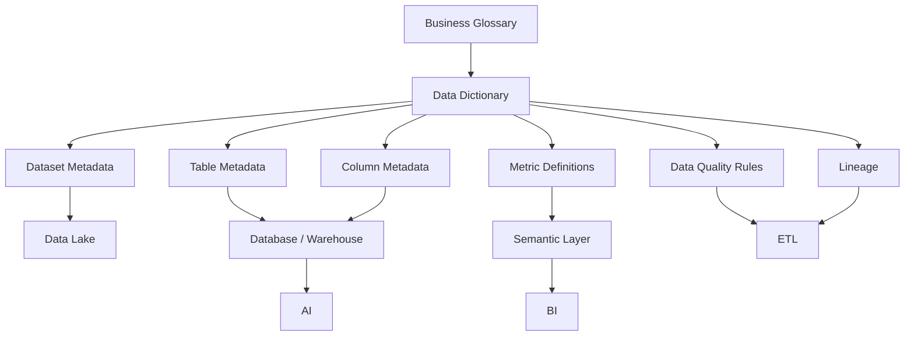

# 18 — Data Dictionary

# Career Connect — AI Career Intelligence Platform

**Document Type:** Enterprise Data Dictionary
**Project:** Career Connect
**Version:** 1.0
**Status:** Data Governance Baseline
**Scope:** Operational Database + Data Lake + Data Warehouse + BI + AI
**Primary OLTP:** PostgreSQL / Supabase
**Primary Warehouse:** BigQuery
**Alternative Warehouse:** Snowflake
**Modeling:** Relational + Dimensional + Analytical
**Governance:** Metadata + Data Quality + Lineage + Classification

---

# 1. Executive Summary

The Data Dictionary defines the meaning, structure, ownership, source, and usage of Career Connect data.

A data warehouse without a governed dictionary can produce technically correct queries with inconsistent business meanings.

For example, different dashboards might interpret:

```text
Placement Rate
```

as:

```text
Placed Students / Total Students
```

while another dashboard uses:

```text
Placed Students / Eligible Students
```

Both queries may execute successfully, but they represent different business definitions.

Therefore, Career Connect requires a centralized data dictionary that defines:

```text
Field
+
Meaning
+
Data Type
+
Source
+
Owner
+
Sensitivity
+
Allowed Values
+
Transformation
+
Business Definition
+
Consumers
```

The Data Dictionary becomes the reference point for:

- Developers
- Data Engineers
- BI Developers
- AI Engineers
- Product Managers
- Analysts
- Auditors
- Administrators

---

# 2. Data Dictionary Objectives

The dictionary must provide:

1. Consistent terminology
2. Clear field definitions
3. Standard data types
4. Source-to-target traceability
5. Business ownership
6. Data classification
7. Validation rules
8. Allowed values
9. Transformation rules
10. KPI definitions
11. AI context definitions
12. Historical rules
13. Retention expectations
14. API-to-database mapping

---

# 3. Data Dictionary Governance Model

The governance structure is:

```text
Business Owner
      ↓
Business Definition
      ↓
Data Owner
      ↓
Technical Definition
      ↓
Data Engineer
      ↓
Transformation
      ↓
Analytics Engineer
      ↓
Semantic Metric
      ↓
BI / AI
```

The business meaning should be approved before the technical implementation is considered final.

---

# 4. Metadata Levels

Career Connect should maintain metadata at five levels.

```text
Level 1 — Dataset
Level 2 — Table
Level 3 — Column
Level 4 — Metric
Level 5 — Data Flow
```

---

# 5. Dataset-Level Metadata

Each dataset should define:

| Attribute         | Description                          |
| ----------------- | ------------------------------------ |
| dataset_name      | Logical dataset name                 |
| owner             | Responsible business/technical owner |
| source            | Origin system                        |
| purpose           | Why dataset exists                   |
| classification    | Security category                    |
| refresh_frequency | Expected update schedule             |
| retention         | Retention policy                     |
| consumers         | Systems/users consuming it           |
| quality_sla       | Required quality threshold           |
| status            | Active/Deprecated                    |

---

# 6. Table-Level Metadata

Each table should define:

```text id="2qj6y9"
table_name
table_description
schema_name
data_owner
technical_owner
grain
primary_key
foreign_keys
source_system
refresh_frequency
classification
retention
scd_strategy
```

---

# 7. Column-Level Metadata

Every important field should define:

```text id="8x3m7p"
column_name
business_name
description
data_type
nullable
default_value
primary_key
foreign_key
allowed_values
source_column
transformation_rule
classification
owner
```

---

# 8. Standard Data Types

Recommended PostgreSQL logical types:

```text id="m7x4p1"
UUID
VARCHAR
TEXT
INTEGER
BIGINT
DECIMAL
BOOLEAN
DATE
TIMESTAMPTZ
JSONB
```

Warehouse implementations may use equivalent types.

---

# 9. Data Classification

Career Connect should classify data as:

```text
PUBLIC
INTERNAL
CONFIDENTIAL
RESTRICTED
```

---

# 10. Classification Definitions

## PUBLIC

Information that can safely be exposed publicly.

Examples:

```text
Public career taxonomy
Public skill names
Aggregated market statistics
```

---

## INTERNAL

Information intended for authorized internal use.

Examples:

```text
Pipeline metadata
System metrics
Internal configuration
```

---

## CONFIDENTIAL

Information requiring restricted access.

Examples:

```text
Student profile
Applications
Recruiter information
Placement records
```

---

## RESTRICTED

Highly sensitive information.

Examples:

```text
Authentication information
Security secrets
Highly sensitive personal information
Sensitive audit metadata
```

---

# 11. Naming Standards

Tables:

```text
snake_case
plural nouns
```

Examples:

```text
students
companies
applications
placements
```

Warehouse:

```text
dim_
fact_
bridge_
mart_
```

Examples:

```text
dim_student
fact_application
bridge_job_skill
mart_placement
```

Columns:

```text
snake_case
```

Examples:

```text
student_id
application_date
salary_amount
created_at
```

---

# 12. Primary Key Naming

Use:

```text
<entity>_id
```

Examples:

```text
student_id
job_id
company_id
application_id
skill_id
```

Warehouse surrogate keys:

```text
student_key
job_key
company_key
skill_key
```

---

# 13. Timestamp Standards

Operational tables should use:

```text
created_at
updated_at
deleted_at
```

where appropriate.

Event-specific timestamps should use explicit names:

```text
applied_at
scheduled_at
offered_at
placement_date
completed_at
```

---

# 14. Core Identity Data Dictionary

## 14.1 `core.users`

| Column        | Type        | Nullable | Classification | Description                 |
| ------------- | ----------- | -------: | -------------- | --------------------------- |
| user_id       | UUID        |       No | Internal       | Unique application user ID  |
| auth_user_id  | UUID        |       No | Restricted     | Identity-provider reference |
| email         | VARCHAR     |       No | Confidential   | User email                  |
| display_name  | VARCHAR     |      Yes | Confidential   | Display name                |
| phone         | VARCHAR     |      Yes | Confidential   | User phone                  |
| status        | VARCHAR     |       No | Internal       | Current account state       |
| last_login_at | TIMESTAMPTZ |      Yes | Internal       | Last authenticated session  |
| created_at    | TIMESTAMPTZ |       No | Internal       | Record creation time        |
| updated_at    | TIMESTAMPTZ |       No | Internal       | Last modification time      |

---

# 15. User Status Dictionary

Allowed values:

```text
ACTIVE
INACTIVE
SUSPENDED
PENDING
DELETED
```

Business rule:

> `DELETED` represents a retained account state where applicable; it does not automatically mean the underlying personal data can never be deleted.

---

# 16. `core.roles`

| Column         | Type        | Nullable | Description                     |
| -------------- | ----------- | -------: | ------------------------------- |
| role_id        | UUID        |       No | Unique role ID                  |
| role_code      | VARCHAR     |       No | Machine-readable role           |
| role_name      | VARCHAR     |       No | Human-readable role             |
| description    | TEXT        |      Yes | Role description                |
| is_system_role | BOOLEAN     |       No | Indicates protected system role |
| created_at     | TIMESTAMPTZ |       No | Creation timestamp              |

---

# 17. `core.permissions`

| Column          | Type    | Nullable | Description               |
| --------------- | ------- | -------: | ------------------------- |
| permission_id   | UUID    |       No | Unique permission ID      |
| permission_code | VARCHAR |       No | Permission code           |
| permission_name | VARCHAR |       No | Permission name           |
| resource        | VARCHAR |       No | Resource being controlled |
| action          | VARCHAR |       No | Allowed operation         |
| description     | TEXT    |      Yes | Permission explanation    |

Example:

```text
resource = STUDENT
action = READ
permission_code = STUDENT_READ
```

---

# 18. Organization Data Dictionary

## `core.organizations`

| Column            | Type        | Nullable | Classification | Description             |
| ----------------- | ----------- | -------: | -------------- | ----------------------- |
| organization_id   | UUID        |       No | Internal       | Organization identifier |
| organization_type | VARCHAR     |       No | Internal       | Type of organization    |
| organization_name | VARCHAR     |       No | Internal       | Display name            |
| legal_name        | VARCHAR     |      Yes | Confidential   | Registered/legal name   |
| website           | VARCHAR     |      Yes | Public         | Organization website    |
| country_code      | VARCHAR     |      Yes | Internal       | Country code            |
| state_code        | VARCHAR     |      Yes | Internal       | State/province code     |
| city              | VARCHAR     |      Yes | Internal       | City                    |
| status            | VARCHAR     |       No | Internal       | Organization state      |
| created_at        | TIMESTAMPTZ |       No | Internal       | Creation timestamp      |
| updated_at        | TIMESTAMPTZ |       No | Internal       | Last modification       |

---

# 19. Organization Types

Allowed values:

```text
COLLEGE
UNIVERSITY
COMPANY
TRAINING_INSTITUTE
RECRUITMENT_AGENCY
ENTERPRISE
```

---

# 20. `core.departments`

| Column          | Type        | Nullable | Description           |
| --------------- | ----------- | -------: | --------------------- |
| department_id   | UUID        |       No | Department identifier |
| organization_id | UUID        |       No | Parent organization   |
| department_code | VARCHAR     |       No | Department code       |
| department_name | VARCHAR     |       No | Department name       |
| status          | VARCHAR     |       No | Current status        |
| created_at      | TIMESTAMPTZ |       No | Creation timestamp    |
| updated_at      | TIMESTAMPTZ |       No | Last modification     |

---

# 21. Student Data Dictionary

## `career.students`

| Column              | Type        | Nullable | Classification | Description                        |
| ------------------- | ----------- | -------: | -------------- | ---------------------------------- |
| student_id          | UUID        |       No | Confidential   | Student profile identifier         |
| user_id             | UUID        |       No | Confidential   | Associated user                    |
| organization_id     | UUID        |       No | Internal       | Organization/tenant                |
| department_id       | UUID        |      Yes | Internal       | Student department                 |
| student_number      | VARCHAR     |       No | Confidential   | Institutional student identifier   |
| graduation_year     | INTEGER     |      Yes | Internal       | Expected/completed graduation year |
| education_level     | VARCHAR     |      Yes | Internal       | Current highest education level    |
| career_goal         | TEXT        |      Yes | Confidential   | User's stated career objective     |
| current_location_id | UUID        |      Yes | Confidential   | Current location reference         |
| profile_status      | VARCHAR     |       No | Internal       | Profile lifecycle state            |
| created_at          | TIMESTAMPTZ |       No | Internal       | Creation timestamp                 |
| updated_at          | TIMESTAMPTZ |       No | Internal       | Last modification                  |

---

# 22. Student Number

`student_number` means:

> The institution-issued identifier associated with the student.

Uniqueness:

```text
organization_id + student_number
```

---

# 23. Education Dictionary

## `career.student_education`

| Column           | Type        | Description                 |
| ---------------- | ----------- | --------------------------- |
| education_id     | UUID        | Education record identifier |
| student_id       | UUID        | Student reference           |
| institution_name | VARCHAR     | Institution name            |
| degree           | VARCHAR     | Degree awarded/pursued      |
| field_of_study   | VARCHAR     | Major/specialization        |
| start_date       | DATE        | Education start             |
| end_date         | DATE        | Education end               |
| grade            | VARCHAR     | Grade representation        |
| gpa              | DECIMAL     | GPA where applicable        |
| percentage       | DECIMAL     | Percentage where applicable |
| created_at       | TIMESTAMPTZ | Creation time               |
| updated_at       | TIMESTAMPTZ | Modification time           |

---

# 24. Project Dictionary

## `career.student_projects`

| Column         | Type        | Description            |
| -------------- | ----------- | ---------------------- |
| project_id     | UUID        | Project identifier     |
| student_id     | UUID        | Owner student          |
| project_name   | VARCHAR     | Project name           |
| description    | TEXT        | Project description    |
| repository_url | VARCHAR     | Source repository      |
| demo_url       | VARCHAR     | Demo URL               |
| start_date     | DATE        | Project start          |
| end_date       | DATE        | Project end            |
| created_at     | TIMESTAMPTZ | Creation timestamp     |
| updated_at     | TIMESTAMPTZ | Modification timestamp |

---

# 25. Experience Dictionary

## `career.student_experience`

| Column             | Type        | Description               |
| ------------------ | ----------- | ------------------------- |
| experience_id      | UUID        | Experience identifier     |
| student_id         | UUID        | Student                   |
| company_id         | UUID        | Associated company        |
| job_title          | VARCHAR     | Position held             |
| employment_type_id | UUID        | Employment classification |
| start_date         | DATE        | Start date                |
| end_date           | DATE        | End date                  |
| description        | TEXT        | Role description          |
| created_at         | TIMESTAMPTZ | Creation time             |
| updated_at         | TIMESTAMPTZ | Modification time         |

---

# 26. Skill Dictionary

## `career.skills`

| Column            | Type        | Classification | Description                |
| ----------------- | ----------- | -------------- | -------------------------- |
| skill_id          | UUID        | Internal       | Canonical skill identifier |
| skill_category_id | UUID        | Internal       | Skill category             |
| skill_name        | VARCHAR     | Public         | Primary skill name         |
| canonical_name    | VARCHAR     | Public         | Normalized skill name      |
| skill_type        | VARCHAR     | Public         | Type of skill              |
| description       | TEXT        | Public         | Skill definition           |
| status            | VARCHAR     | Internal       | Skill lifecycle            |
| created_at        | TIMESTAMPTZ | Internal       | Creation time              |
| updated_at        | TIMESTAMPTZ | Internal       | Modification time          |

---

# 27. Skill Type Dictionary

Possible values:

```text
TECHNICAL
SOFT_SKILL
DOMAIN
TOOL
TECHNOLOGY
LANGUAGE
METHODOLOGY
```

The final taxonomy should be governed centrally.

---

# 28. Skill Category Dictionary

## `career.skill_categories`

| Column            | Type    | Description         |
| ----------------- | ------- | ------------------- |
| skill_category_id | UUID    | Category identifier |
| category_name     | VARCHAR | Category name       |
| description       | TEXT    | Category definition |
| status            | VARCHAR | Current state       |

Example:

```text
AI / ML
Cloud
Database
Analytics
DevOps
Cybersecurity
```

---

# 29. Student Skill Dictionary

## `career.student_skills`

| Column            | Type        | Classification | Description                         |
| ----------------- | ----------- | -------------- | ----------------------------------- |
| student_skill_id  | UUID        | Internal       | Relationship ID                     |
| student_id        | UUID        | Confidential   | Student                             |
| skill_id          | UUID        | Internal       | Skill                               |
| proficiency_level | VARCHAR     | Confidential   | Claimed/assessed proficiency        |
| years_experience  | DECIMAL     | Confidential   | Years using skill                   |
| source            | VARCHAR     | Internal       | Origin of skill assertion           |
| verified_flag     | BOOLEAN     | Internal       | Whether validated                   |
| confidence_score  | DECIMAL     | Internal       | Confidence of extraction/assessment |
| last_assessed_at  | TIMESTAMPTZ | Internal       | Most recent assessment              |

---

# 30. Skill Source Values

Possible values:

```text
SELF_REPORTED
RESUME_EXTRACTED
ASSESSMENT
PROJECT
CERTIFICATION
INTERVIEW
ADMIN_VERIFIED
SYSTEM_INFERRED
```

---

# 31. Proficiency Dictionary

Possible values:

```text
BEGINNER
INTERMEDIATE
ADVANCED
EXPERT
```

Where numeric scoring is used, the mapping must be documented separately.

---

# 32. Company Data Dictionary

## `recruitment.companies`

| Column                   | Type        | Classification | Description             |
| ------------------------ | ----------- | -------------- | ----------------------- |
| company_id               | UUID        | Internal       | Company identifier      |
| organization_id          | UUID        | Internal       | Organization reference  |
| company_name             | VARCHAR     | Internal       | Company display name    |
| legal_name               | VARCHAR     | Confidential   | Legal entity name       |
| industry                 | VARCHAR     | Internal       | Industry classification |
| company_size             | VARCHAR     | Internal       | Employee-size category  |
| website                  | VARCHAR     | Public         | Company website         |
| headquarters_location_id | UUID        | Internal       | Headquarters location   |
| status                   | VARCHAR     | Internal       | Company status          |
| created_at               | TIMESTAMPTZ | Internal       | Creation timestamp      |
| updated_at               | TIMESTAMPTZ | Internal       | Modification timestamp  |

---

# 33. Company Size Dictionary

Example categories:

```text
STARTUP
SMALL
MEDIUM
LARGE
ENTERPRISE
```

Exact employee thresholds should be configurable.

---

# 34. Recruiter Dictionary

## `recruitment.recruiters`

| Column         | Type        | Description              |
| -------------- | ----------- | ------------------------ |
| recruiter_id   | UUID        | Recruiter identifier     |
| user_id        | UUID        | Associated user          |
| company_id     | UUID        | Employer company         |
| designation    | VARCHAR     | Recruiter designation    |
| recruiter_type | VARCHAR     | Recruiter classification |
| status         | VARCHAR     | Current recruiter state  |
| created_at     | TIMESTAMPTZ | Creation timestamp       |
| updated_at     | TIMESTAMPTZ | Modification timestamp   |

---

# 35. Job Data Dictionary

## `recruitment.jobs`

| Column                  | Type        | Classification | Description                   |
| ----------------------- | ----------- | -------------- | ----------------------------- |
| job_id                  | UUID        | Internal       | Job identifier                |
| company_id              | UUID        | Internal       | Hiring company                |
| created_by_recruiter_id | UUID        | Internal       | Recruiter who created job     |
| job_reference           | VARCHAR     | Internal       | Human-readable job identifier |
| job_title               | VARCHAR     | Public         | Original job title            |
| job_category_id         | UUID        | Internal       | Standardized job category     |
| description             | TEXT        | Internal       | Job description               |
| employment_type_id      | UUID        | Internal       | Employment classification     |
| experience_level_id     | UUID        | Internal       | Experience requirement        |
| minimum_salary          | DECIMAL     | Confidential   | Lower salary bound            |
| maximum_salary          | DECIMAL     | Confidential   | Upper salary bound            |
| currency_code           | VARCHAR     | Internal       | Currency                      |
| posted_at               | TIMESTAMPTZ | Internal       | Posting time                  |
| closing_at              | TIMESTAMPTZ | Internal       | Closing time                  |
| status                  | VARCHAR     | Internal       | Job lifecycle status          |
| created_at              | TIMESTAMPTZ | Internal       | Creation time                 |
| updated_at              | TIMESTAMPTZ | Internal       | Modification time             |

---

# 36. Job Status Dictionary

```text
DRAFT
ACTIVE
PAUSED
CLOSED
EXPIRED
CANCELLED
```

---

# 37. Employment Type Dictionary

```text
FULL_TIME
PART_TIME
CONTRACT
INTERNSHIP
APPRENTICESHIP
FREELANCE
```

Work mode should generally be modeled separately:

```text
ONSITE
HYBRID
REMOTE
```

---

# 38. Experience Level Dictionary

Recommended controlled values:

```text
INTERNSHIP
ENTRY_LEVEL
1_2_YEARS
3_5_YEARS
6_10_YEARS
10_PLUS_YEARS
```

---

# 39. Job Skill Dictionary

## `recruitment.job_skills`

| Column            | Type        | Description             |
| ----------------- | ----------- | ----------------------- |
| job_skill_id      | UUID        | Relationship identifier |
| job_id            | UUID        | Job                     |
| skill_id          | UUID        | Required skill          |
| required_level    | VARCHAR     | Required proficiency    |
| importance_weight | DECIMAL     | Relative importance     |
| mandatory_flag    | BOOLEAN     | Whether mandatory       |
| created_at        | TIMESTAMPTZ | Creation time           |

---

# 40. Application Dictionary

## `recruitment.applications`

| Column                | Type        | Classification | Description              |
| --------------------- | ----------- | -------------- | ------------------------ |
| application_id        | UUID        | Confidential   | Application identifier   |
| student_id            | UUID        | Confidential   | Applicant                |
| job_id                | UUID        | Internal       | Applied job              |
| application_reference | VARCHAR     | Internal       | Human-readable reference |
| applied_at            | TIMESTAMPTZ | Confidential   | Application time         |
| application_status    | VARCHAR     | Confidential   | Current state            |
| current_stage         | VARCHAR     | Confidential   | Recruitment stage        |
| source                | VARCHAR     | Internal       | Application source       |
| created_at            | TIMESTAMPTZ | Internal       | Creation time            |
| updated_at            | TIMESTAMPTZ | Internal       | Modification time        |

---

# 41. Application Status Dictionary

```text
APPLIED
SCREENING
SHORTLISTED
ASSESSMENT
INTERVIEW
OFFERED
REJECTED
WITHDRAWN
HIRED
```

---

# 42. Application Event Dictionary

## `recruitment.application_events`

| Column         | Type        | Description                   |
| -------------- | ----------- | ----------------------------- |
| event_id       | UUID        | Event identifier              |
| application_id | UUID        | Related application           |
| event_type     | VARCHAR     | Event classification          |
| event_time     | TIMESTAMPTZ | Event timestamp               |
| performed_by   | UUID        | User performing action        |
| notes          | TEXT        | Optional notes                |
| metadata       | JSONB       | Additional structured context |

---

# 43. Interview Dictionary

## `recruitment.interviews`

| Column         | Type        | Classification | Description          |
| -------------- | ----------- | -------------- | -------------------- |
| interview_id   | UUID        | Confidential   | Interview identifier |
| application_id | UUID        | Confidential   | Related application  |
| recruiter_id   | UUID        | Internal       | Interview owner      |
| scheduled_at   | TIMESTAMPTZ | Confidential   | Scheduled time       |
| interview_type | VARCHAR     | Internal       | Interview type       |
| round_number   | INTEGER     | Internal       | Interview round      |
| score          | DECIMAL     | Confidential   | Interview score      |
| result         | VARCHAR     | Confidential   | Outcome              |
| feedback       | TEXT        | Restricted     | Interview feedback   |
| created_at     | TIMESTAMPTZ | Internal       | Creation time        |
| updated_at     | TIMESTAMPTZ | Internal       | Modification time    |

---

# 44. Interview Type Dictionary

Possible values:

```text
TECHNICAL
MANAGERIAL
HR
BEHAVIORAL
CODING
SYSTEM_DESIGN
DOMAIN
FINAL
```

---

# 45. Interview Result Dictionary

```text
PASS
FAIL
PENDING
NO_SHOW
RESCHEDULED
```

---

# 46. Offer Dictionary

## `recruitment.offers`

| Column          | Type        | Classification | Description           |
| --------------- | ----------- | -------------- | --------------------- |
| offer_id        | UUID        | Confidential   | Offer identifier      |
| application_id  | UUID        | Confidential   | Related application   |
| offer_reference | VARCHAR     | Internal       | Offer reference       |
| offered_at      | TIMESTAMPTZ | Confidential   | Offer date            |
| base_salary     | DECIMAL     | Restricted     | Base compensation     |
| bonus           | DECIMAL     | Restricted     | Bonus                 |
| currency_code   | VARCHAR     | Internal       | Currency              |
| offer_status    | VARCHAR     | Confidential   | Offer state           |
| joining_date    | DATE        | Confidential   | Expected joining date |

---

# 47. Offer Status Dictionary

```text
DRAFT
ISSUED
ACCEPTED
DECLINED
EXPIRED
WITHDRAWN
```

---

# 48. Placement Dictionary

## `recruitment.placements`

| Column           | Type        | Classification | Description                   |
| ---------------- | ----------- | -------------- | ----------------------------- |
| placement_id     | UUID        | Confidential   | Placement record              |
| application_id   | UUID        | Confidential   | Successful application        |
| student_id       | UUID        | Confidential   | Placed student                |
| company_id       | UUID        | Internal       | Hiring company                |
| job_id           | UUID        | Internal       | Job                           |
| organization_id  | UUID        | Internal       | Institution/tenant            |
| placement_date   | DATE        | Confidential   | Placement date                |
| salary_amount    | DECIMAL     | Restricted     | Actual placement compensation |
| currency_code    | VARCHAR     | Internal       | Currency                      |
| placement_status | VARCHAR     | Internal       | Outcome state                 |
| created_at       | TIMESTAMPTZ | Internal       | Creation time                 |
| updated_at       | TIMESTAMPTZ | Internal       | Modification time             |

---

# 49. Placement Status Dictionary

```text
PLACED
JOINED
DECLINED
CANCELLED
VERIFIED
```

---

# 50. Salary Observation Dictionary

## `analytics.salary_observations`

| Column                | Type    | Description                       |
| --------------------- | ------- | --------------------------------- |
| salary_observation_id | UUID    | Observation identifier            |
| company_id            | UUID    | Company                           |
| job_id                | UUID    | Job                               |
| location_id           | UUID    | Location                          |
| experience_level_id   | UUID    | Experience category               |
| minimum_salary        | DECIMAL | Minimum reported amount           |
| maximum_salary        | DECIMAL | Maximum reported amount           |
| currency_code         | VARCHAR | Currency                          |
| source                | VARCHAR | Source of observation             |
| observation_date      | DATE    | Date observed                     |
| sample_size           | INTEGER | Number of underlying observations |

Important distinction:

> `salary_observations` represents market observations, while `placements.salary_amount` represents an actual recorded placement amount.

---

# 51. Course Dictionary

## `learning.courses`

| Column           | Type    | Description        |
| ---------------- | ------- | ------------------ |
| course_id        | UUID    | Course identifier  |
| provider         | VARCHAR | Course provider    |
| course_name      | VARCHAR | Course name        |
| description      | TEXT    | Course description |
| category         | VARCHAR | Course category    |
| difficulty_level | VARCHAR | Difficulty         |
| duration_hours   | DECIMAL | Expected duration  |
| delivery_mode    | VARCHAR | Delivery method    |
| course_url       | VARCHAR | Course location    |
| status           | VARCHAR | Course state       |

---

# 52. Course Difficulty

```text
BEGINNER
INTERMEDIATE
ADVANCED
EXPERT
```

---

# 53. Delivery Mode

```text
ONLINE
OFFLINE
HYBRID
SELF_PACED
INSTRUCTOR_LED
```

---

# 54. Learning Progress Dictionary

## `learning.learning_progress`

| Column               | Type        | Description           |
| -------------------- | ----------- | --------------------- |
| learning_progress_id | UUID        | Progress record       |
| student_id           | UUID        | Student               |
| course_id            | UUID        | Course                |
| started_at           | TIMESTAMPTZ | Start time            |
| completed_at         | TIMESTAMPTZ | Completion time       |
| progress_percentage  | DECIMAL     | Completion percentage |
| assessment_score     | DECIMAL     | Assessment result     |
| status               | VARCHAR     | Learning state        |
| updated_at           | TIMESTAMPTZ | Last update           |

---

# 55. Learning Status Dictionary

```text
NOT_STARTED
IN_PROGRESS
COMPLETED
DROPPED
PAUSED
```

---

# 56. Certification Dictionary

## `learning.certifications`

| Column             | Type    | Description              |
| ------------------ | ------- | ------------------------ |
| certification_id   | UUID    | Certification identifier |
| provider           | VARCHAR | Issuing organization     |
| certification_name | VARCHAR | Certification name       |
| category           | VARCHAR | Certification domain     |
| level              | VARCHAR | Certification level      |
| credential_type    | VARCHAR | Credential form          |
| validity_period    | VARCHAR | Validity description     |
| status             | VARCHAR | Lifecycle state          |

---

# 57. Student Certification Dictionary

## `learning.student_certifications`

| Column                   | Type    | Classification | Description           |
| ------------------------ | ------- | -------------- | --------------------- |
| student_certification_id | UUID    | Confidential   | Achievement record    |
| student_id               | UUID    | Confidential   | Student               |
| certification_id         | UUID    | Internal       | Certification         |
| credential_id            | VARCHAR | Confidential   | Credential identifier |
| issue_date               | DATE    | Confidential   | Issue date            |
| expiry_date              | DATE    | Confidential   | Expiry date           |
| verification_url         | VARCHAR | Internal       | Verification location |
| status                   | VARCHAR | Internal       | Verification state    |

---

# 58. Career Path Dictionary

## `career.career_paths`

| Column          | Type        | Description       |
| --------------- | ----------- | ----------------- |
| career_path_id  | UUID        | Career identifier |
| career_name     | VARCHAR     | Career role       |
| career_category | VARCHAR     | Career category   |
| career_level    | VARCHAR     | Career seniority  |
| description     | TEXT        | Career definition |
| market_status   | VARCHAR     | Market relevance  |
| created_at      | TIMESTAMPTZ | Creation time     |
| updated_at      | TIMESTAMPTZ | Modification time |

---

# 59. Career Skill Dictionary

## `career.career_skills`

| Column            | Type    | Description             |
| ----------------- | ------- | ----------------------- |
| career_skill_id   | UUID    | Relationship identifier |
| career_path_id    | UUID    | Career                  |
| skill_id          | UUID    | Required skill          |
| required_level    | VARCHAR | Required proficiency    |
| importance_weight | DECIMAL | Skill importance        |
| mandatory_flag    | BOOLEAN | Whether mandatory       |

---

# 60. Skill Gap Dictionary

## `career.skill_gaps`

| Column         | Type        | Classification | Description          |
| -------------- | ----------- | -------------- | -------------------- |
| skill_gap_id   | UUID        | Confidential   | Gap identifier       |
| student_id     | UUID        | Confidential   | Student              |
| skill_id       | UUID        | Internal       | Missing skill        |
| target_type    | VARCHAR     | Internal       | Job or career target |
| target_id      | UUID        | Internal       | Target entity        |
| current_level  | VARCHAR     | Confidential   | Current proficiency  |
| required_level | VARCHAR     | Internal       | Required proficiency |
| gap_score      | DECIMAL     | Confidential   | Calculated gap       |
| priority       | VARCHAR     | Confidential   | Gap priority         |
| detected_at    | TIMESTAMPTZ | Internal       | Detection time       |
| resolved_at    | TIMESTAMPTZ | Internal       | Resolution time      |
| status         | VARCHAR     | Internal       | Gap state            |

---

# 61. Skill Gap Priority

Recommended:

```text
CRITICAL
HIGH
MEDIUM
LOW
```

The priority algorithm must be documented separately.

---

# 62. Career Recommendation Dictionary

## `career.recommendations`

| Column            | Type        | Classification | Description               |
| ----------------- | ----------- | -------------- | ------------------------- |
| recommendation_id | UUID        | Confidential   | Recommendation ID         |
| student_id        | UUID        | Confidential   | Student                   |
| career_path_id    | UUID        | Internal       | Recommended career        |
| match_score       | DECIMAL     | Confidential   | Alignment score           |
| confidence_score  | DECIMAL     | Confidential   | Recommendation confidence |
| reasoning_summary | TEXT        | Confidential   | Explanation               |
| model_type        | VARCHAR     | Internal       | Rule/AI/model type        |
| model_version     | VARCHAR     | Internal       | Model version             |
| generated_at      | TIMESTAMPTZ | Internal       | Generation time           |
| status            | VARCHAR     | Internal       | Recommendation state      |

---

# 63. Match Score

`match_score` means:

> The platform's calculated degree of alignment between a user's current profile and the requirements of the target career.

It is **not** a guaranteed probability of employment.

---

# 64. Confidence Score

`confidence_score` indicates:

> The system's confidence in the recommendation under the defined recommendation methodology.

It should not automatically be interpreted as statistical certainty.

---

# 65. Resume Dictionary

## `ai.resumes`

| Column         | Type        | Classification | Description              |
| -------------- | ----------- | -------------- | ------------------------ |
| resume_id      | UUID        | Confidential   | Resume identifier        |
| student_id     | UUID        | Confidential   | Resume owner             |
| file_path      | VARCHAR     | Restricted     | Object-storage path      |
| file_name      | VARCHAR     | Confidential   | Original file name       |
| file_type      | VARCHAR     | Internal       | File format              |
| file_size      | BIGINT      | Internal       | File size                |
| version_number | INTEGER     | Internal       | Resume version           |
| is_active      | BOOLEAN     | Internal       | Current resume indicator |
| uploaded_at    | TIMESTAMPTZ | Confidential   | Upload time              |

---

# 66. Resume Analysis Dictionary

## `ai.resume_analysis`

| Column           | Type        | Classification | Description                 |
| ---------------- | ----------- | -------------- | --------------------------- |
| analysis_id      | UUID        | Confidential   | Analysis identifier         |
| resume_id        | UUID        | Confidential   | Resume analyzed             |
| target_career_id | UUID        | Internal       | Target career               |
| overall_score    | DECIMAL     | Confidential   | Overall resume score        |
| ats_score        | DECIMAL     | Confidential   | ATS-oriented score          |
| content_score    | DECIMAL     | Confidential   | Content quality score       |
| skills_score     | DECIMAL     | Confidential   | Skills alignment score      |
| format_score     | DECIMAL     | Confidential   | Formatting score            |
| strengths        | JSONB/TEXT  | Confidential   | Detected strengths          |
| weaknesses       | JSONB/TEXT  | Confidential   | Detected weaknesses         |
| recommendations  | JSONB/TEXT  | Confidential   | Improvement recommendations |
| model_name       | VARCHAR     | Internal       | AI model                    |
| model_version    | VARCHAR     | Internal       | Model version               |
| prompt_version   | VARCHAR     | Internal       | Prompt version              |
| analyzed_at      | TIMESTAMPTZ | Internal       | Analysis time               |

---

# 67. Resume Score Definition

`overall_score` is:

> A product-defined composite measure representing the quality/alignment of the resume against the selected evaluation criteria.

It is not a universal industry-standard ATS score.

---

# 68. AI Session Dictionary

## `ai.ai_sessions`

| Column       | Type        | Classification | Description           |
| ------------ | ----------- | -------------- | --------------------- |
| session_id   | UUID        | Confidential   | AI session identifier |
| user_id      | UUID        | Confidential   | Session owner         |
| session_type | VARCHAR     | Internal       | AI use case           |
| started_at   | TIMESTAMPTZ | Internal       | Session start         |
| ended_at     | TIMESTAMPTZ | Internal       | Session end           |
| status       | VARCHAR     | Internal       | Session state         |

---

# 69. AI Message Dictionary

## `ai.ai_messages`

| Column        | Type        | Classification | Description        |
| ------------- | ----------- | -------------- | ------------------ |
| message_id    | UUID        | Confidential   | Message identifier |
| session_id    | UUID        | Confidential   | Session            |
| sender_type   | VARCHAR     | Internal       | User/AI/system     |
| message_text  | TEXT        | Restricted     | Message content    |
| model_name    | VARCHAR     | Internal       | Model used         |
| model_version | VARCHAR     | Internal       | Model version      |
| token_usage   | INTEGER     | Internal       | Usage measure      |
| latency_ms    | INTEGER     | Internal       | Response latency   |
| created_at    | TIMESTAMPTZ | Internal       | Creation time      |

Retention should follow the product's privacy policy and applicable legal requirements.

---

# 70. Notification Dictionary

## `core.notifications`

| Column            | Type        | Description       |
| ----------------- | ----------- | ----------------- |
| notification_id   | UUID        | Notification ID   |
| user_id           | UUID        | Recipient         |
| notification_type | VARCHAR     | Notification type |
| title             | VARCHAR     | Title             |
| message           | TEXT        | Message           |
| channel           | VARCHAR     | Delivery channel  |
| status            | VARCHAR     | Delivery state    |
| read_at           | TIMESTAMPTZ | Read timestamp    |
| created_at        | TIMESTAMPTZ | Creation time     |

---

# 71. Audit Dictionary

## `audit.audit_logs`

| Column          | Type        | Classification | Description            |
| --------------- | ----------- | -------------- | ---------------------- |
| audit_id        | UUID        | Restricted     | Audit identifier       |
| user_id         | UUID        | Restricted     | Acting user            |
| organization_id | UUID        | Restricted     | Tenant context         |
| action          | VARCHAR     | Internal       | Action performed       |
| resource_type   | VARCHAR     | Internal       | Resource class         |
| resource_id     | UUID        | Internal       | Affected resource      |
| request_id      | VARCHAR     | Internal       | Request correlation ID |
| ip_address      | INET        | Restricted     | Source address         |
| user_agent      | TEXT        | Restricted     | Client information     |
| metadata        | JSONB       | Restricted     | Additional context     |
| created_at      | TIMESTAMPTZ | Restricted     | Event time             |

---

# 72. Data Lake Dictionary

The data lake should define four logical zones.

```text
RAW
STAGING
CLEAN
CURATED
```

---

# 73. Raw Zone

Purpose:

> Preserve source data as received for traceability and reprocessing.

Characteristics:

```text
Immutable where practical
Source-specific
Minimal transformation
Source metadata attached
```

---

# 74. Staging Zone

Purpose:

> Perform preliminary schema alignment and technical validation.

Examples:

```text
stg_jobs
stg_students
stg_placements
```

---

# 75. Clean Zone

Purpose:

> Standardize data and remove known technical inconsistencies.

Examples:

```text
clean_jobs
clean_companies
clean_skills
clean_locations
```

---

# 76. Curated Zone

Purpose:

> Produce business-ready analytical datasets.

Examples:

```text
curated_jobs
curated_students
curated_salary
curated_placements
```

---

# 77. Warehouse Dictionary

The warehouse uses:

```text
Dimensions
Facts
Bridges
Marts
Semantic Metrics
```

---

# 78. Core Warehouse Dimensions

```text
dim_date
dim_student
dim_company
dim_job
dim_skill
dim_college
dim_department
dim_location
dim_technology
dim_recruiter
dim_course
dim_certification
dim_experience
dim_employment_type
```

---

# 79. Core Warehouse Facts

```text
fact_application
fact_placement
fact_interview
fact_hiring
fact_salary
fact_job_posting
fact_learning
fact_certification
fact_skill_gap
fact_career_recommendation
```

---

# 80. Fact Grain Dictionary

| Fact                       | Grain                                                   |
| -------------------------- | ------------------------------------------------------- |
| fact_application           | One student application for one job/event               |
| fact_placement             | One placement outcome                                   |
| fact_interview             | One interview event                                     |
| fact_hiring                | One completed hiring outcome or defined hiring event    |
| fact_salary                | One salary observation                                  |
| fact_job_posting           | One job posting                                         |
| fact_learning              | One student-course analytical activity at defined grain |
| fact_certification         | One certification achievement                           |
| fact_skill_gap             | One student-target-skill gap evaluation                 |
| fact_career_recommendation | One generated career recommendation                     |

The grain must remain explicitly documented even if the implementation evolves.

---

# 81. Dimension Key Dictionary

Warehouse dimensions use surrogate keys.

Examples:

```text
student_key
company_key
job_key
skill_key
college_key
location_key
date_key
```

Business identifiers remain separately available where useful.

---

# 82. SCD Dictionary

## Type 1

> Overwrite old dimension value.

Use for:

- Non-historical corrections
- Formatting fixes
- Selected reference attributes

---

## Type 2

> Create a new dimension version and preserve history.

Use for:

- Student department changes
- Company classification changes
- Organization changes
- Relevant historical role attributes

---

# 83. Metric Dictionary

The metric dictionary is critical to BI consistency.

Every metric must define:

```text
Metric Name
Business Definition
Formula
Grain
Numerator
Denominator
Unit
Owner
Refresh
Source
```

---

# 84. Metric — Total Applications

**Definition:**

Number of application events recorded in the approved application fact.

**Formula:**

```text
SUM(application_count)
```

**Unit:**

Count

---

# 85. Metric — Total Placements

**Definition:**

Number of valid placement outcomes recorded in the placement fact.

**Formula:**

```text
SUM(placement_count)
```

---

# 86. Metric — Placement Rate

**Definition:**

Percentage of eligible students who achieved the defined placement outcome.

**Formula:**

```text
Placed Eligible Students
÷
Eligible Students
× 100
```

The official business definition of `Eligible Students` must be centrally governed.

---

# 87. Metric — Average Salary

**Definition:**

Average of the applicable salary measure for the selected population and period.

Possible formula:

```text
AVG(salary_amount)
```

For market observations, the appropriate aggregation must account for how source observations are structured.

---

# 88. Metric — Highest Salary

**Definition:**

Maximum salary amount in the approved population.

**Formula:**

```text
MAX(salary_amount)
```

---

# 89. Metric — Application Conversion Rate

**Definition:**

Percentage of applications progressing to the selected downstream stage.

Example:

```text
Interviewed Applications
÷
Total Applications
× 100
```

The stage definition must be explicit.

---

# 90. Metric — Offer Conversion Rate

```text
Offers
÷
Interviews
× 100
```

---

# 91. Metric — Hiring Conversion Rate

```text
Hires
÷
Applications
× 100
```

The denominator and event definitions must remain fixed for comparable reporting.

---

# 92. Metric — Skill Demand

**Definition:**

Number of active or qualifying jobs requiring a specified skill during the selected period.

Example:

```text
COUNT(DISTINCT job_key)
```

The eligibility rules for a job to count must be documented.

---

# 93. Metric — Skill Supply

**Definition:**

Number of students or candidates with the specified skill under the approved skill-validation policy.

Example:

```text
COUNT(DISTINCT student_key)
```

---

# 94. Metric — Skill Gap

**Definition:**

Difference between required proficiency for a target and the student's assessed/current proficiency.

Conceptually:

```text
Required Level - Current Level
```

The numerical mapping from proficiency labels must be explicitly governed.

---

# 95. Metric — Career Match Score

**Definition:**

Platform-defined alignment measure between a user profile and a career target.

It may incorporate:

```text
Skill Alignment
Experience
Education
Preferences
Market Requirements
```

It is not a guaranteed employment probability.

---

# 96. Metric — Learning Completion Rate

```text
Completed Learning Records
÷
Started Learning Records
× 100
```

The exact learning-event definition must be standardized.

---

# 97. Metric — Interview Pass Rate

```text
Passed Interviews
÷
Completed Interviews
× 100
```

The handling of no-shows and cancelled interviews must be explicitly documented.

---

# 98. Metric — Time to Hire

Definition:

> Elapsed time between the defined recruitment start event and the defined hiring completion event.

Example:

```text
Hire Date - Application Date
```

The business must define the official start event before this metric is published.

---

# 99. Data Quality Dictionary

Core quality dimensions:

```text
Completeness
Validity
Uniqueness
Consistency
Freshness
Referential Integrity
```

---

# 100. Completeness

Definition:

> Degree to which required information is present.

Example:

```text
Required Job IDs Present
÷
Total Records
× 100
```

---

# 101. Validity

Definition:

> Degree to which values conform to defined type, range, and business rules.

Example:

```text
0 <= progress_percentage <= 100
```

---

# 102. Uniqueness

Definition:

> Degree to which records expected to be unique do not contain duplicates.

Example:

```text
Unique application_reference
```

---

# 103. Consistency

Definition:

> Degree to which related values agree logically across datasets.

Example:

```text
Application = HIRED
```

should be compatible with the defined hiring workflow.

---

# 104. Freshness

Definition:

> Time between source availability and analytical publication.

Example:

```text
Freshness Lag =
Published At - Source Updated At
```

---

# 105. Referential Integrity

Definition:

> Percentage of relationship records whose referenced keys resolve successfully.

Example:

```text
Valid job references
÷
Application records
× 100
```

---

# 106. Data Quality Score

The platform may calculate:

```text
Quality Score =
weighted completeness
+
weighted validity
+
weighted uniqueness
+
weighted consistency
+
weighted freshness
```

Weights should be dataset-specific.

---

# 107. Source Metadata Dictionary

## `etl.source_registry`

| Field             | Definition               |
| ----------------- | ------------------------ |
| source_id         | Unique source identifier |
| source_name       | Business/source name     |
| source_type       | DB/API/File/System       |
| owner             | Source owner             |
| format            | CSV/JSON/etc.            |
| refresh_frequency | Expected refresh         |
| license           | Data usage rights        |
| classification    | Data sensitivity         |
| schema_version    | Current source schema    |
| active_flag       | Whether source is active |

---

# 108. Pipeline Metadata Dictionary

## `etl.pipeline_runs`

| Field           | Definition                    |
| --------------- | ----------------------------- |
| pipeline_run_id | Pipeline execution identifier |
| pipeline_name   | Pipeline name                 |
| batch_id        | Batch identifier              |
| started_at      | Run start                     |
| finished_at     | Run completion                |
| status          | Run state                     |
| rows_processed  | Number processed              |
| rows_failed     | Number failed                 |
| error_summary   | Summary                       |

---

# 109. Lineage Dictionary

Every important analytical field should ideally expose:

```text
Source System
Source Table
Source Column
Transformation
Target Table
Target Column
Pipeline Version
```

---

# 110. Example Data Lineage

```text id="8c4m7q"
Source:
placement.csv

Column:
salary

↓

Transformation:
currency validation

↓

Target:
fact_placement.salary_amount

↓

Metric:
Average Placement Salary

↓

Dashboard:
College Placement Dashboard
```

---

# 111. AI Data Dictionary

AI inputs should be explicitly classified.

Examples:

```text
student_profile_context
skill_context
job_market_context
salary_context
career_context
learning_context
```

---

# 112. AI Context — Student Profile

Contains only required attributes such as:

```text
Education
Skills
Experience
Career Goal
Learning Progress
```

---

# 113. AI Context — Job Market

May contain:

```text
Role
Skill Demand
Location
Experience
Salary Range
Employment Type
Observation Date
```

---

# 114. AI Context — Career

May contain:

```text
Career Role
Required Skills
Skill Importance
Typical Experience
Related Careers
Market Demand
```

---

# 115. AI Context Freshness

Time-sensitive context should include:

```text
source_date
last_updated_at
data_age
```

This allows the AI layer to distinguish current market information from historical data.

---

# 116. Data Retention Dictionary

Retention should be policy-driven.

Example framework:

| Data              | Suggested Policy Category |
| ----------------- | ------------------------- |
| Raw Source        | Long-term/reprocessing    |
| Staging           | Short-term                |
| Curated Data      | Business retention        |
| Audit Logs        | Security retention        |
| AI Conversations  | Privacy-policy dependent  |
| Generated Reports | Policy-driven             |
| Temporary Files   | Short-term                |

Actual retention periods must be approved by product, legal, and organizational policy.

---

# 117. PII Dictionary

Potential PII:

```text
Name
Email
Phone
Address
Resume Content
Student Number
Credential Identifier
Interview Feedback
```

PII should not automatically be copied into every analytics dataset.

---

# 118. Restricted Data Dictionary

Examples:

```text
Authentication Secrets
Password-Equivalent Data
Security Tokens
Highly Sensitive Audit Metadata
Sensitive Compensation Data
```

These should have the strongest access controls.

---

# 119. Data Ownership Matrix

| Domain     | Business Owner        | Technical Owner       |
| ---------- | --------------------- | --------------------- |
| Identity   | Platform Admin        | Backend               |
| Students   | Institution / Product | Student Service       |
| Jobs       | Recruiter/Product     | Recruitment Service   |
| Skills     | Career Intelligence   | Data Engineering      |
| Placements | Placement Office      | Placement Service     |
| Learning   | Learning Team         | Learning Service      |
| AI         | Product / AI Team     | AI Engineering        |
| Warehouse  | Analytics             | Data Engineering      |
| KPIs       | Business Owner        | Analytics Engineering |
| Audit      | Security              | Platform Engineering  |

---

# 120. Data Stewardship

A data steward is responsible for:

```text
Definition
Quality
Usage
Issue Resolution
Reference Mapping
Change Approval
```

Example:

```text
Skill Data Steward
```

oversees:

```text
Skill Names
Aliases
Categories
Technology Mapping
Career Mapping
```

---

# 121. Data Dictionary Change Management

A field change should follow:


---

# 122. Breaking vs Non-Breaking Changes

### Non-Breaking

```text
Add optional field
Add reference value
Add descriptive metadata
```

### Potentially Breaking

```text
Rename field
Change data type
Change metric meaning
Change KPI denominator
Remove field
Change canonical taxonomy
```

Breaking changes require impact analysis.

---

# 123. Data Versioning

Important datasets should expose:

```text
schema_version
taxonomy_version
transformation_version
metric_version
model_version
```

This is particularly important for AI and historical analytics.

---

# 124. Example Version Traceability

A career recommendation may be traceable to:

```text
Data Version:
market_data_v12

Skill Taxonomy:
skill_taxonomy_v5

Transformation:
career_context_v7

AI Model:
model_version_x

Prompt:
career_prompt_v4
```

This is a strong enterprise audit pattern.

---

# 125. API-to-Data Dictionary Mapping

Example:

```text
GET /api/v1/students/:id
```

may expose:

```text
student_id
student_number
graduation_year
education_level
career_goal
```

while internal columns such as audit fields remain hidden.

---

# 126. Dashboard-to-Data Dictionary Mapping

Each dashboard KPI should map to the official metric dictionary.

Example:

```text id="92b7c1"
Dashboard:
Placement Rate

↓

Metric:
placement_rate_v1

↓

Definition:
Placed Eligible Students / Eligible Students
```

---

# 127. BI Field Naming

Prefer business-friendly names:

```text
Total Placements
Average Salary
Placement Rate
Skill Demand
Applications
Interviews
Offers
Hires
```

rather than technical database names.

---

# 128. Data Dictionary for Dashboard Filters

Common dimensions:

```text
Date
College
Department
Company
Job Role
Skill
Technology
Location
Experience
Employment Type
```

Each filter must reference an approved dimension.

---

# 129. Analytical Grain Dictionary

The data dictionary should document:

```text
fact_application:
One application event

fact_placement:
One placement outcome

fact_interview:
One interview event

fact_salary:
One salary observation

fact_learning:
One analytical student-course learning record
```

This prevents accidental double counting.

---

# 130. Data Dictionary for AI Output

AI output fields should be standardized where possible.

Example:

```text
recommendation
reason
score
confidence
missing_skills
recommended_actions
```

Free-form narrative should not replace structured fields required by downstream analytics.

---

# 131. Structured AI Output Example

```json
{
  "career": "Data Engineer",
  "match_score": 84,
  "confidence_score": 0.91,
  "missing_skills": ["Apache Airflow", "Spark"],
  "recommended_actions": ["Learn workflow orchestration", "Build a Spark project"]
}
```

The exact score definitions must follow the controlled metric dictionary.

---

# 132. Data Dictionary for Event Types

Application events:

```text
APPLIED
SCREENED
SHORTLISTED
ASSESSMENT
INTERVIEW
OFFER
REJECTED
WITHDRAWN
HIRED
```

Learning events:

```text
STARTED
PROGRESS_UPDATED
COMPLETED
DROPPED
```

AI events:

```text
REQUESTED
PROCESSING
COMPLETED
FAILED
REVIEWED
```

---

# 133. Data Dictionary for Report Types

```text
WEEKLY_REPORT
MONTHLY_REPORT
YEARLY_REPORT
PLACEMENT_REPORT
HIRING_REPORT
STUDENT_REPORT
COMPANY_REPORT
SKILL_REPORT
SALARY_REPORT
EXECUTIVE_REPORT
```

---

# 134. Data Dictionary for Data Sources

```text
INTERNAL_DATABASE
COLLEGE_EXPORT
API
CSV
JSON
EXCEL
MANUAL_UPLOAD
PUBLIC_DATASET
LICENSED_DATA
SYNTHETIC_DATA
```

---

# 135. Synthetic Data Marker

Synthetic records should be identifiable.

Recommended field:

```text
is_synthetic
```

or:

```text
data_origin = SYNTHETIC
```

This prevents demonstration data from being confused with production information.

---

# 136. Data Origin Dictionary

```text
PRODUCTION
PARTNER
PUBLIC
LICENSED
SYNTHETIC
USER_GENERATED
SYSTEM_GENERATED
AI_GENERATED
```

---

# 137. AI-Generated Data Marker

AI-generated or AI-inferred information should be identified where it affects important business records.

Example:

```text
source = AI_INFERRED
confidence_score = 0.87
```

This improves transparency.

---

# 138. Data Dictionary for Confidence

`confidence_score` should always specify:

```text
Scale
Interpretation
Calculation Method
Model/Rule Version
```

Example:

```text
0.0 = Lowest confidence
1.0 = Highest confidence
```

The exact semantics must be documented for each use case.

---

# 139. Data Dictionary for Currency

Any monetary field should contain:

```text
currency_code
```

Examples:

```text
USD
INR
EUR
GBP
SGD
AED
```

Original currency should be preserved.

---

# 140. Data Dictionary for Normalized Salary

If a converted amount is created:

```text
original_amount
original_currency
normalized_amount
normalized_currency
exchange_rate
exchange_rate_date
```

This preserves the original source observation.

---

# 141. Data Dictionary for Geographic Data

A location should ideally use:

```text
country_code
state_code
city_key
```

rather than uncontrolled free-text values for analytical joins.

---

# 142. Data Dictionary for Job Taxonomy

A job should preserve:

```text
original_job_title
canonical_job_title
job_category
career_role
career_family
```

This prevents loss of source information while enabling standardized analytics.

---

# 143. Data Dictionary for Skill Taxonomy

A skill should preserve:

```text
source_skill_name
canonical_skill_name
skill_category
technology
technology_family
aliases
```

---

# 144. Data Dictionary for Company Taxonomy

A company may preserve:

```text
source_company_name
canonical_company_name
industry
industry_group
company_size
headquarters
```

---

# 145. Data Dictionary for Location Taxonomy

A location may preserve:

```text
source_location
canonical_city
state
country
location_key
```

---

# 146. Data Dictionary for Historical Fields

SCD Type 2 dimensions should include:

```text
effective_from
effective_to
is_current
version_number
```

---

# 147. Data Dictionary for Technical Metadata

Recommended metadata fields:

```text
source_system
source_record_id
batch_id
pipeline_run_id
transformation_version
created_at
updated_at
```

These should be added where useful for traceability.

---

# 148. Data Dictionary for Audit Metadata

Where appropriate:

```text
created_by
updated_by
request_id
correlation_id
```

These facilitate operational investigation.

---

# 149. Data Dictionary for Data Quality

Recommended fields:

```text
quality_score
quality_status
validation_timestamp
validation_rule_version
error_count
warning_count
```

---

# 150. Quality Status Values

```text
PASSED
WARNING
FAILED
QUARANTINED
```

---

# 151. Complete Data Dictionary Architecture



---

# 152. Business Glossary vs Data Dictionary

These should be related but different.

## Business Glossary

Defines:

> What a business term means.

Example:

```text
Placement Rate
```

## Data Dictionary

Defines:

> How that business term is represented in the system.

Example:

```text
metric_name
formula
source_fact
denominator
refresh
```

---

# 153. Example Business Glossary

| Term        | Definition                                                     |
| ----------- | -------------------------------------------------------------- |
| Student     | Registered learner using Career Connect                        |
| Job         | Employment opportunity published by an authorized source       |
| Application | A student's submission for a job                               |
| Interview   | Formal evaluation event in a recruitment workflow              |
| Placement   | Approved employment outcome                                    |
| Skill Gap   | Difference between current and target proficiency              |
| Career Path | Target professional role or progression                        |
| Recruiter   | User performing hiring-related activities                      |
| Hiring      | Successful employment outcome under the defined hiring process |

---

# 154. Data Dictionary Governance Workflow

```text id="4q8m2x"
Define Term
↓
Assign Owner
↓
Define Data Fields
↓
Define Quality
↓
Approve
↓
Implement
↓
Monitor
↓
Review
```

---

# 155. Data Dictionary Review Frequency

Recommended review triggers:

```text
Major Schema Release
New Data Source
New KPI
New AI Feature
New Business Process
Regulatory Change
Taxonomy Change
```

A fixed periodic review can also be established by the organization.

---

# 156. Deprecated Fields

Deprecated fields should be marked:

```text
status = DEPRECATED
```

and documented with:

```text
replacement_field
deprecation_date
reason
migration_guidance
```

---

# 157. Example Deprecated Field

```text
job.role
```

replaced by:

```text
job.career_role_key
```

Reason:

> Standardized career taxonomy introduced.

---

# 158. Data Dictionary Quality Rules

The dictionary itself should be validated.

Every production field should ideally have:

```text
✓ Definition
✓ Data Type
✓ Owner
✓ Classification
✓ Source
✓ Nullability
```

Every KPI should have:

```text
✓ Formula
✓ Numerator
✓ Denominator
✓ Grain
✓ Owner
```

---

# 159. Data Dictionary as a GitHub Artifact

Recommended location:

```text
docs/
└── data-dictionary/
    ├── README.md
    ├── glossary.md
    ├── operational.md
    ├── warehouse.md
    ├── metrics.md
    ├── data-quality.md
    └── lineage.md
```

---

# 160. Machine-Readable Dictionary

For automation, maintain metadata in JSON/YAML.

Example:

```yaml
field: placement_rate
type: metric
owner: placement_analytics
classification: internal
definition: "Placed eligible students divided by eligible students"
unit: percent
refresh: daily
```

This can eventually feed:

- Documentation
- Data catalogs
- BI semantic layers
- AI metadata retrieval

---

# 161. Data Dictionary API

Future enterprise capability:

```text
GET /api/v1/metadata/tables
GET /api/v1/metadata/columns
GET /api/v1/metadata/metrics
GET /api/v1/metadata/lineage
GET /api/v1/metadata/quality
```

This makes the metadata platform programmatically accessible.

---

# 162. AI-Powered Metadata Assistant

A future AI assistant could answer:

> What does placement rate mean?

> Which table contains salary observations?

> What is the grain of fact_application?

> Which source feeds the hiring dashboard?

The AI should retrieve answers from the governed dictionary rather than inventing definitions.

---

# 163. Data Dictionary and Natural-Language BI

The data dictionary becomes a critical input for NL-to-BI.

Example:

```text
User:
"Show placement rate by department."

AI:
Maps "placement rate"
→ approved metric

"department"
→ dim_department.department_name

"year"
→ dim_date.year
```

This reduces ambiguity.

---

# 164. Data Dictionary and AI Safety

AI should not guess business definitions.

Example:

If asked:

> What does placement rate mean?

The system should use the approved metric definition.

This is safer than allowing the language model to invent its own denominator.

---

# 165. Data Dictionary as the Semantic Contract

The strongest architectural principle is:

```text
Business Meaning
        ↓
Data Dictionary
        ↓
Database
        ↓
Warehouse
        ↓
Semantic Layer
        ↓
BI
        ↓
AI
```

This creates consistency across the entire platform.

---

# 166. Data Dictionary Success Criteria

The dictionary is successful when:

```text
✓ Developers understand fields
✓ Data Engineers understand sources
✓ BI developers understand metrics
✓ AI developers understand context
✓ Product managers understand business terms
✓ Analysts use consistent definitions
✓ Auditors can trace important data
```

---

# 167. Final Data Dictionary Architecture

```text
                    CAREER CONNECT
                    DATA GOVERNANCE
                          │
                    BUSINESS GLOSSARY
                          │
                   DATA DICTIONARY
                          │
        ┌─────────────────┼─────────────────┐
        │                 │                 │
     DATABASE          WAREHOUSE          ETL
        │                 │                 │
        └─────────────────┼─────────────────┘
                          │
                   SEMANTIC METRICS
                          │
                    ┌─────┴─────┐
                    ▼           ▼
                   BI          AI
```

---

# 168. CTO-Level Recommendation

The Data Dictionary should be treated as a **first-class engineering artifact**, not a documentation appendix.

Whenever a new field, KPI, data source, or AI context is introduced:

```text
Code Change
+
Data Dictionary Change
```

should happen together.

This creates a synchronized relationship between implementation and meaning.

---

# 169. Final Data Dictionary Statement

> **Career Connect will maintain a governed enterprise Data Dictionary covering operational fields, warehouse facts and dimensions, business metrics, data-quality rules, classifications, lineage, AI context, and source metadata. The dictionary will serve as the semantic contract between business requirements, software systems, ETL pipelines, data warehouses, Business Intelligence dashboards, and AI services, ensuring that the same data means the same thing throughout the platform.**

---

## Document Status

| Attribute             | Value                                         |
| --------------------- | --------------------------------------------- |
| Project               | Career Connect                                |
| Document              | Data Dictionary                               |
| Version               | 1.0                                           |
| Scope                 | OLTP + Data Lake + Warehouse + BI + AI        |
| Metadata Levels       | Dataset + Table + Column + Metric + Lineage   |
| Classification        | Public / Internal / Confidential / Restricted |
| Core Governance       | Ownership + Quality + Lineage                 |
| KPI Governance        | Formula + Grain + Owner                       |
| AI Governance         | Context + Model + Version                     |
| ETL Governance        | Source + Transformation + Quality             |
| Documentation         | GitHub + Machine-Readable Metadata            |
| API Extension         | Planned                                       |
| AI Metadata Assistant | Future Capability                             |
| Status                | Data Governance Baseline                      |
