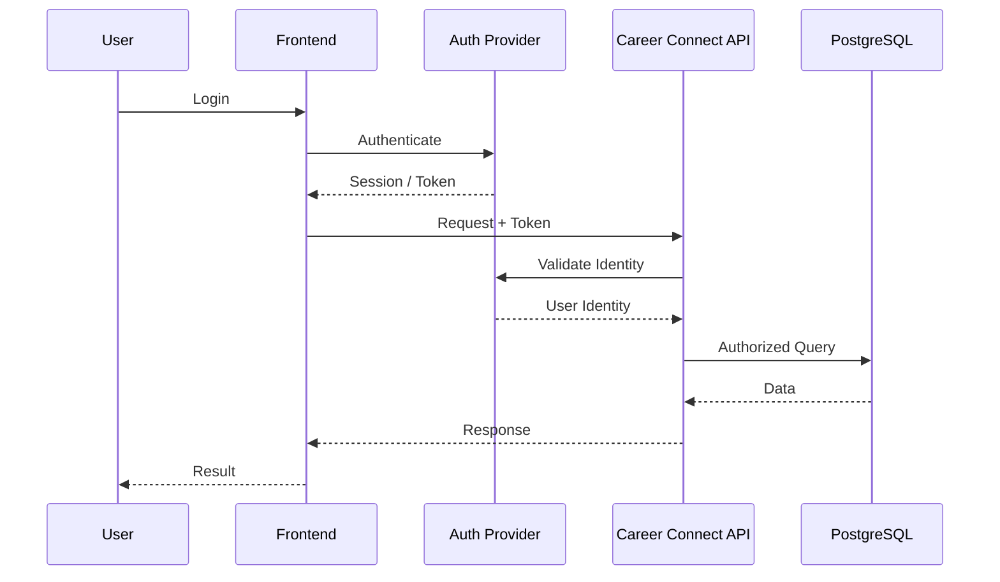
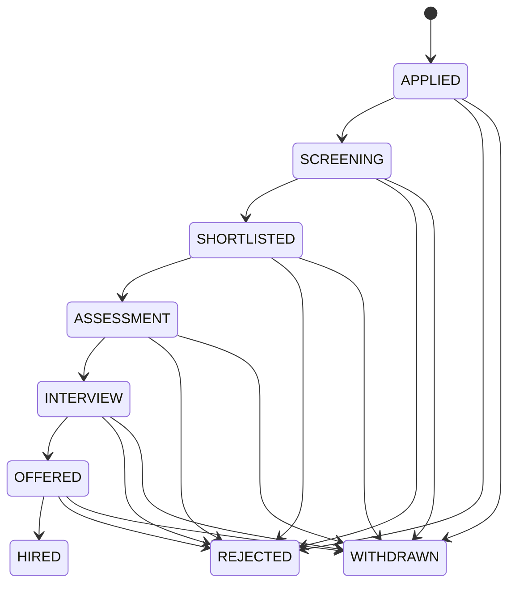
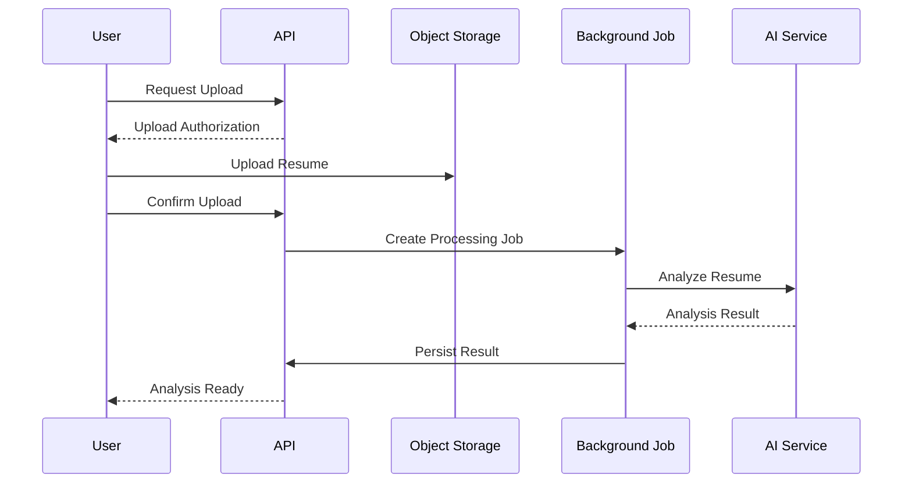
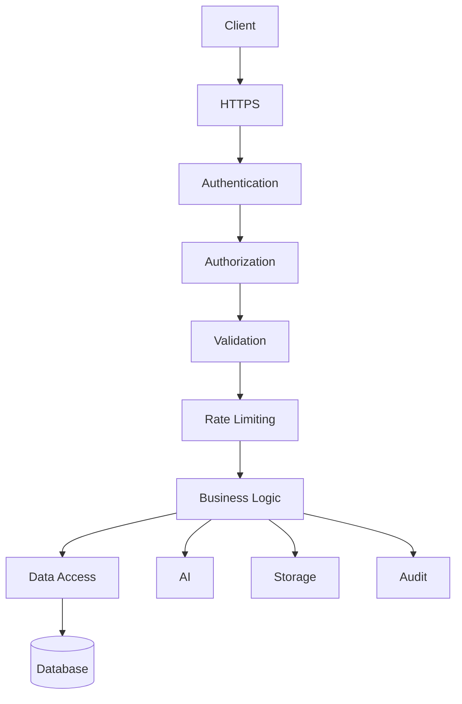
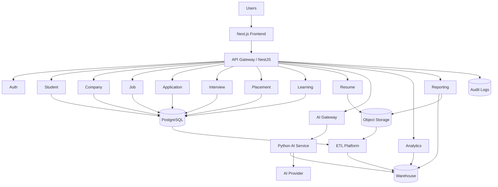

# 19 — API Documentation

# Career Connect — AI Career Intelligence Platform

**Document Type:** Enterprise API Documentation
**Project:** Career Connect
**Version:** 1.0
**Status:** API Architecture Baseline
**API Style:** RESTful JSON API
**Primary Backend:** NestJS + TypeScript
**API Version:** `/api/v1`
**Authentication:** Supabase Auth / JWT-based session validation
**Authorization:** RBAC + Organization/Tenant Scope + Resource-Level Authorization
**Primary Consumers:** Next.js Frontend, BI Services, AI Services, Recruiter Applications, Administrative Tools

---

# 1. Executive Summary

The Career Connect API is the primary application interface connecting the frontend, backend services, AI services, data platform, reporting system, and external integrations.

The API should expose business capabilities rather than directly exposing database tables.

The architectural flow is:

```text
Client
  ↓
API Gateway / Backend
  ↓
Authentication
  ↓
Authorization
  ↓
Controller
  ↓
Application Service
  ↓
Domain Logic
  ↓
Repository / External Service
  ↓
Database / AI / Storage
```

The API should provide:

- Secure authentication
- Role-based authorization
- Student management
- Job management
- Applications
- Recruitment
- Placement
- Skills
- Learning
- Certifications
- Resume intelligence
- Career recommendations
- AI assistant
- Analytics
- Reports
- Notifications
- Administration
- Audit access

---

# 2. API Design Goals

The API must be:

```text
Consistent
Secure
Versioned
Observable
Documented
Testable
Idempotent where appropriate
Scalable
Backward-compatible where practical
```

---

# 3. API Architectural Principles

## 3.1 API-First

Frontend and external consumers should interact through documented APIs.

---

## 3.2 Resource-Oriented

Use business resources:

```text
/students
/jobs
/applications
/placements
```

instead of technical database endpoints such as:

```text
/student_table
/job_table
```

---

## 3.3 Versioned

All production APIs begin with:

```text
/api/v1
```

Future breaking changes can introduce:

```text
/api/v2
```

---

## 3.4 Secure by Default

Every protected endpoint should require:

```text
Authentication
+
Authorization
+
Tenant/Organization Validation
+
Input Validation
```

---

## 3.5 Consistent Response Structure

Successful and failed responses should follow predictable formats.

---

# 4. API Base URL

Production:

```text
https://api.careerconnect.example.com/api/v1
```

Development:

```text
http://localhost:3000/api/v1
```

The actual production domain should be configured through environment variables.

---

# 5. API Versioning Strategy

Current:

```text
/api/v1
```

Future:

```text
/api/v2
```

A major version should change only when backward compatibility cannot reasonably be preserved.

---

# 6. HTTP Methods

Career Connect uses standard HTTP semantics.

| Method | Purpose                 |
| ------ | ----------------------- |
| GET    | Read                    |
| POST   | Create / Execute Action |
| PUT    | Full Replacement        |
| PATCH  | Partial Update          |
| DELETE | Delete / Deactivate     |

---

# 7. Standard HTTP Status Codes

| Status | Meaning                                  |
| ------ | ---------------------------------------- |
| 200    | Successful request                       |
| 201    | Resource created                         |
| 202    | Accepted for asynchronous processing     |
| 204    | Successful request with no response body |
| 400    | Invalid request                          |
| 401    | Authentication required/invalid          |
| 403    | Authenticated but not authorized         |
| 404    | Resource not found                       |
| 409    | Conflict                                 |
| 422    | Validation failure                       |
| 429    | Rate limit exceeded                      |
| 500    | Internal server error                    |
| 502    | Upstream service failure                 |
| 503    | Temporary service unavailable            |

---

# 8. Standard Success Response

Example:

```json
{
  "success": true,
  "data": {
    "student_id": "2a6f8d1e-3b1b-4f43-a3e1-3b8e9f4f2b11",
    "status": "ACTIVE"
  },
  "meta": {
    "request_id": "cc-20260730-9f23ab"
  }
}
```

---

# 9. Standard Error Response

Example:

```json
{
  "success": false,
  "error": {
    "code": "VALIDATION_ERROR",
    "message": "One or more fields are invalid.",
    "details": [
      {
        "field": "email",
        "message": "Invalid email format"
      }
    ]
  },
  "meta": {
    "request_id": "cc-20260730-9f23ab"
  }
}
```

---

# 10. Request Correlation

Every API request should receive a correlation identifier.

Example:

```text
X-Request-ID: cc-20260730-9f23ab
```

The same ID should be propagated into:

```text
Application Logs
Audit Logs
AI Service Calls
Background Jobs
Data Processing
```

This enables end-to-end troubleshooting.

---

# 11. Authentication

Authentication is handled through the configured identity provider.

Typical flow:



---

# 12. Authorization Model

Authorization uses:

```text
Role
+
Organization
+
Resource
+
Action
```

Example:

```text
PLACEMENT_OFFICER
+
College A
+
Student Record
+
VIEW
```

---

# 13. Roles

Initial roles:

```text
SUPER_ADMIN
ORG_ADMIN
PLACEMENT_OFFICER
FACULTY
RECRUITER
STUDENT
JOB_SEEKER
```

---

# 14. Authentication Endpoints

```text
POST   /auth/login
POST   /auth/logout
POST   /auth/refresh
GET    /auth/me
POST   /auth/forgot-password
POST   /auth/reset-password
GET    /auth/providers
```

Where authentication is fully managed by the external identity provider, some of these may be implemented through provider-specific flows rather than custom application logic.

---

# 15. `GET /auth/me`

Returns the authenticated application identity.

Example response:

```json
{
  "success": true,
  "data": {
    "user_id": "7b7f1e6e-9ea8-4c7b-bd87-3f8f2a3e9b04",
    "email": "user@example.com",
    "roles": ["STUDENT"],
    "organization": {
      "organization_id": "c3f8a1a0-7c2a-48f6-8e1b-39a12e2b6e1c",
      "organization_name": "Example College"
    }
  }
}
```

---

# 16. Organization APIs

```text
GET    /organizations
POST   /organizations
GET    /organizations/:organizationId
PATCH  /organizations/:organizationId
DELETE /organizations/:organizationId
GET    /organizations/:organizationId/users
GET    /organizations/:organizationId/departments
```

Only authorized administrative users should access organization-management endpoints.

---

# 17. Department APIs

```text
GET    /departments
POST   /departments
GET    /departments/:departmentId
PATCH  /departments/:departmentId
DELETE /departments/:departmentId
GET    /departments/:departmentId/students
```

---

# 18. Student API Group

```text
GET    /students
POST   /students
GET    /students/:studentId
PATCH  /students/:studentId
DELETE /students/:studentId

GET    /students/:studentId/profile
PATCH  /students/:studentId/profile

GET    /students/:studentId/skills
POST   /students/:studentId/skills
PATCH  /students/:studentId/skills/:skillId
DELETE /students/:studentId/skills/:skillId

GET    /students/:studentId/education
POST   /students/:studentId/education
PATCH  /students/:studentId/education/:educationId
DELETE /students/:studentId/education/:educationId

GET    /students/:studentId/projects
POST   /students/:studentId/projects
PATCH  /students/:studentId/projects/:projectId
DELETE /students/:studentId/projects/:projectId

GET    /students/:studentId/experience
POST   /students/:studentId/experience
PATCH  /students/:studentId/experience/:experienceId
DELETE /students/:studentId/experience/:experienceId
```

---

# 19. Create Student

```text
POST /students
```

Request:

```json
{
  "organization_id": "c3f8a1a0-7c2a-48f6-8e1b-39a12e2b6e1c",
  "department_id": "89f0db1d-0e86-4f29-9fc3-17dd2e0ddf11",
  "student_number": "STU-2026-00125",
  "graduation_year": 2027,
  "education_level": "UNDERGRADUATE",
  "career_goal": "Data Engineer"
}
```

Response:

```text
201 Created
```

---

# 20. Update Student Profile

```text
PATCH /students/:studentId/profile
```

Example:

```json
{
  "career_goal": "Cloud Data Engineer",
  "education_level": "UNDERGRADUATE"
}
```

Only permitted fields should be accepted based on the caller's role.

---

# 21. Skill APIs

```text
GET    /skills
POST   /skills
GET    /skills/:skillId
PATCH  /skills/:skillId

GET    /skill-categories
GET    /skills/search?q=python
GET    /skills/:skillId/related
```

Administrative endpoints for creating or editing canonical skills should be restricted.

---

# 22. Student Skill API

```text
POST /students/:studentId/skills
```

Request:

```json
{
  "skill_id": "4ce85fd7-f2a8-4c79-9c14-8f26419f1b15",
  "proficiency_level": "INTERMEDIATE",
  "years_experience": 1.5,
  "source": "SELF_REPORTED"
}
```

---

# 23. Skill Verification

Authorized systems may update:

```text
verified_flag
confidence_score
source
last_assessed_at
```

A normal student should not be allowed to mark a skill as institution-verified.

---

# 24. Company APIs

```text
GET    /companies
POST   /companies
GET    /companies/:companyId
PATCH  /companies/:companyId
DELETE /companies/:companyId

GET    /companies/:companyId/jobs
GET    /companies/:companyId/recruiters
GET    /companies/:companyId/hiring-analytics
```

---

# 25. Recruiter APIs

```text
GET    /recruiters/:recruiterId
PATCH  /recruiters/:recruiterId

GET    /recruiters/:recruiterId/jobs
GET    /recruiters/:recruiterId/candidates
GET    /recruiters/:recruiterId/analytics
```

---

# 26. Job APIs

```text
GET    /jobs
POST   /jobs
GET    /jobs/:jobId
PATCH  /jobs/:jobId
DELETE /jobs/:jobId

POST   /jobs/:jobId/publish
POST   /jobs/:jobId/pause
POST   /jobs/:jobId/close

GET    /jobs/:jobId/skills
POST   /jobs/:jobId/skills
DELETE /jobs/:jobId/skills/:skillId

GET    /jobs/:jobId/applications
```

---

# 27. Job Search Parameters

Example:

```text
GET /jobs?
    search=data engineer
    &location=Chennai
    &experience=ENTRY_LEVEL
    &employment_type=FULL_TIME
    &work_mode=HYBRID
    &skill=Python
    &page=1
    &page_size=20
```

---

# 28. Job Response

```json
{
  "success": true,
  "data": [
    {
      "job_id": "d3e2c2f7-1d93-47c9-9408-22f1b7f8d0c3",
      "job_reference": "CC-JOB-2026-000145",
      "job_title": "Data Engineer",
      "company": {
        "company_id": "c8a2b0cc-91bb-4b6d-9f0c-8ac8f728d0c1",
        "company_name": "Example Technologies"
      },
      "location": {
        "city": "Chennai",
        "country": "India"
      },
      "employment_type": "FULL_TIME",
      "work_mode": "HYBRID"
    }
  ],
  "meta": {
    "page": 1,
    "page_size": 20,
    "total": 152
  }
}
```

---

# 29. Application APIs

```text
GET    /applications
POST   /applications
GET    /applications/:applicationId
PATCH  /applications/:applicationId
DELETE /applications/:applicationId

POST   /applications/:applicationId/withdraw
GET    /applications/:applicationId/events
POST   /applications/:applicationId/events

POST   /jobs/:jobId/apply
```

---

# 30. Apply to Job

```text
POST /jobs/:jobId/apply
```

Request:

```json
{
  "resume_id": "b50fb2f6-4200-48b3-aef1-56a4a2f124f1",
  "source": "CAREER_CONNECT"
}
```

Response:

```json
{
  "success": true,
  "data": {
    "application_id": "db4f1f87-4b59-4a61-a3f2-7d5f64c9b18b",
    "status": "APPLIED"
  }
}
```

---

# 31. Application State Transition API

For authorized recruiters/admins:

```text
POST /applications/:applicationId/status
```

Request:

```json
{
  "status": "SHORTLISTED",
  "notes": "Skills match the job requirements."
}
```

The backend should validate whether the requested transition is permitted.

---

# 32. Application State Machine



The exact transition matrix should be configurable.

---

# 33. Interview APIs

```text
GET    /interviews
POST   /interviews
GET    /interviews/:interviewId
PATCH  /interviews/:interviewId
DELETE /interviews/:interviewId

POST   /interviews/:interviewId/complete
POST   /interviews/:interviewId/reschedule
POST   /interviews/:interviewId/feedback
```

---

# 34. Create Interview

```text
POST /interviews
```

Request:

```json
{
  "application_id": "db4f1f87-4b59-4a61-a3f2-7d5f64c9b18b",
  "scheduled_at": "2026-08-05T10:30:00Z",
  "interview_type": "TECHNICAL",
  "round_number": 1
}
```

---

# 35. Interview Feedback

```text
POST /interviews/:interviewId/feedback
```

Request:

```json
{
  "score": 82,
  "result": "PASS",
  "feedback": "Strong fundamentals and good problem-solving approach."
}
```

Feedback access must follow role and data-privacy rules.

---

# 36. Offer APIs

```text
POST   /offers
GET    /offers/:offerId
PATCH  /offers/:offerId

POST   /offers/:offerId/accept
POST   /offers/:offerId/decline
POST   /offers/:offerId/withdraw
```

---

# 37. Placement APIs

```text
GET    /placements
POST   /placements
GET    /placements/:placementId
PATCH  /placements/:placementId

GET    /students/:studentId/placements
GET    /organizations/:organizationId/placements
```

Creating a placement should validate that the underlying recruitment relationship is valid.

---

# 38. Salary Intelligence APIs

```text
GET /analytics/salary
GET /analytics/salary/by-role
GET /analytics/salary/by-location
GET /analytics/salary/by-company
GET /analytics/salary/trends
```

Example:

```text
GET /analytics/salary?
    role=Data Engineer
    &location=Chennai
    &experience=ENTRY_LEVEL
```

---

# 39. Resume APIs

```text
POST   /resumes/upload
GET    /resumes
GET    /resumes/:resumeId
DELETE /resumes/:resumeId

POST   /resumes/:resumeId/analyze
GET    /resumes/:resumeId/analyses
GET    /resumes/:resumeId/analysis/:analysisId
```

---

# 40. Resume Upload Architecture

Resume uploads should use controlled object-storage workflows.



---

# 41. Resume Analyze API

```text
POST /resumes/:resumeId/analyze
```

Request:

```json
{
  "target_career_id": "2d00a2e3-cf11-45e2-9aa5-26b77e5a4a1e"
}
```

Because AI processing may be asynchronous, the API may return:

```text
202 Accepted
```

with a job reference.

---

# 42. Async Job Response

```json
{
  "success": true,
  "data": {
    "job_id": "2c123e14-99bf-4e5e-96fb-31d0a1bb2a7e",
    "status": "PROCESSING"
  }
}
```

---

# 43. Background Job APIs

```text
GET /jobs/tasks/:taskId
```

Example response:

```json
{
  "success": true,
  "data": {
    "task_id": "2c123e14-99bf-4e5e-96fb-31d0a1bb2a7e",
    "type": "RESUME_ANALYSIS",
    "status": "COMPLETED",
    "result_reference": "/resumes/.../analysis/..."
  }
}
```

---

# 44. Skill Gap APIs

```text
GET  /students/:studentId/skill-gaps
POST /students/:studentId/skill-gaps/analyze

GET  /students/:studentId/skill-gaps/:skillGapId
PATCH /students/:studentId/skill-gaps/:skillGapId
```

---

# 45. Analyze Skill Gap

```text
POST /students/:studentId/skill-gaps/analyze
```

Request:

```json
{
  "target_type": "CAREER",
  "target_id": "2d00a2e3-cf11-45e2-9aa5-26b77e5a4a1e"
}
```

Response:

```json
{
  "success": true,
  "data": {
    "target": "Data Engineer",
    "gaps": [
      {
        "skill": "Apache Airflow",
        "current_level": "BEGINNER",
        "required_level": "INTERMEDIATE",
        "priority": "HIGH"
      }
    ]
  }
}
```

---

# 46. Career Recommendation APIs

```text
GET  /career-paths
GET  /career-paths/:careerPathId
GET  /career-paths/:careerPathId/skills

POST /students/:studentId/career-recommendations
GET  /students/:studentId/career-recommendations
GET  /students/:studentId/career-recommendations/:recommendationId
```

---

# 47. Career Recommendation Request

```text
POST /students/:studentId/career-recommendations
```

Request:

```json
{
  "preferences": {
    "location": "Chennai",
    "employment_type": "FULL_TIME"
  }
}
```

Response:

```json
{
  "success": true,
  "data": [
    {
      "career": "Data Engineer",
      "match_score": 84,
      "confidence_score": 0.91,
      "missing_skills": ["Apache Airflow", "Apache Spark"]
    }
  ]
}
```

Scores are product-defined analytical indicators and should be accompanied by appropriate explanations.

---

# 48. Learning APIs

```text
GET    /courses
GET    /courses/:courseId
POST   /courses

GET    /students/:studentId/learning
POST   /students/:studentId/learning
PATCH  /students/:studentId/learning/:progressId

GET    /skills/:skillId/courses
```

---

# 49. Certifications APIs

```text
GET    /certifications
POST   /certifications
GET    /certifications/:certificationId

GET    /students/:studentId/certifications
POST   /students/:studentId/certifications
PATCH  /students/:studentId/certifications/:id
DELETE /students/:studentId/certifications/:id
```

---

# 50. AI Career Assistant APIs

```text
POST /ai/chat/sessions
GET  /ai/chat/sessions
GET  /ai/chat/sessions/:sessionId
POST /ai/chat/sessions/:sessionId/messages
POST /ai/chat/sessions/:sessionId/close
```

---

# 51. AI Chat Request

```text
POST /ai/chat/sessions/:sessionId/messages
```

Request:

```json
{
  "message": "What skills should I learn for a Data Engineer role?"
}
```

Response:

```json
{
  "success": true,
  "data": {
    "message_id": "5a2a2c35-31a0-4c5b-b1b4-1d3a0e3c0df5",
    "answer": "Based on your current profile...",
    "sources": [
      {
        "type": "CAREER_PROFILE",
        "reference": "Data Engineer"
      }
    ]
  }
}
```

The `sources` field can be used to provide traceability when the product has appropriate source references.

---

# 52. AI Mock Interview APIs

```text
POST /ai/mock-interviews
GET  /ai/mock-interviews/:sessionId
POST /ai/mock-interviews/:sessionId/start
POST /ai/mock-interviews/:sessionId/answer
POST /ai/mock-interviews/:sessionId/complete
GET  /ai/mock-interviews/:sessionId/report
```

---

# 53. Mock Interview Request

```json
{
  "career_path_id": "2d00a2e3-cf11-45e2-9aa5-26b77e5a4a1e",
  "interview_type": "TECHNICAL",
  "difficulty": "INTERMEDIATE"
}
```

---

# 54. AI Output Validation

AI responses should be validated before persistence or display.

The API should validate:

```text
Schema
Required Fields
Allowed Enum Values
Maximum Length
Safety Rules
Access Scope
```

---

# 55. AI Provider Abstraction

The backend should not expose provider-specific endpoints.

Avoid:

```text
POST /openai
POST /gemini
```

Prefer:

```text
POST /ai/chat
POST /ai/resume-analysis
POST /ai/career-recommendation
```

The internal AI gateway decides which provider/model is used.

---

# 56. Analytics API Architecture

Analytics endpoints should return governed metrics.

```text
GET /analytics/executive
GET /analytics/placement
GET /analytics/recruitment
GET /analytics/salary
GET /analytics/skills
GET /analytics/jobs
GET /analytics/learning
GET /analytics/student
```

---

# 57. Executive Analytics API

```text
GET /analytics/executive
```

Response:

```json
{
  "success": true,
  "data": {
    "placement_rate": 82.4,
    "average_salary": 8400,
    "total_placements": 410,
    "active_jobs": 1250,
    "total_hires": 640,
    "top_skill": "Python"
  },
  "meta": {
    "data_as_of": "2026-07-30T00:00:00Z"
  }
}
```

Example numerical values are demonstration values only.

---

# 58. Placement Analytics API

```text
GET /analytics/placement
```

Query parameters:

```text
organization_id
department_id
company_id
location_id
from
to
```

Example:

```text
GET /analytics/placement?
    organization_id=...
    &department_id=...
    &from=2026-01-01
    &to=2026-07-30
```

---

# 59. Skill Analytics API

```text
GET /analytics/skills
GET /analytics/skills/demand
GET /analytics/skills/supply
GET /analytics/skills/gaps
GET /analytics/skills/trends
```

---

# 60. Recruitment Analytics API

```text
GET /analytics/recruitment
GET /analytics/recruitment/funnel
GET /analytics/recruitment/by-company
GET /analytics/recruitment/by-role
GET /analytics/recruitment/by-location
```

---

# 61. Student Analytics API

```text
GET /students/:studentId/analytics
```

Example response:

```json
{
  "success": true,
  "data": {
    "profile_completion": 92,
    "resume_score": 84,
    "skill_alignment": 78,
    "applications": 18,
    "interviews": 5,
    "offers": 1,
    "learning_progress": 64
  }
}
```

---

# 62. Reporting APIs

```text
POST /reports
GET  /reports
GET  /reports/:reportId
DELETE /reports/:reportId
GET  /reports/:reportId/download
```

---

# 63. Create Report

```text
POST /reports
```

Request:

```json
{
  "report_type": "PLACEMENT_REPORT",
  "format": "PDF",
  "filters": {
    "organization_id": "c3f8a1a0-7c2a-48f6-8e1b-39a12e2b6e1c",
    "year": 2026
  }
}
```

Response:

```text
202 Accepted
```

---

# 64. Report Status

```text
GET /reports/:reportId
```

Example:

```json
{
  "success": true,
  "data": {
    "report_id": "f3e0e87a-a7cd-4a91-a82a-d19a2c91d82d",
    "status": "COMPLETED",
    "format": "PDF"
  }
}
```

---

# 65. Notification APIs

```text
GET   /notifications
PATCH /notifications/:notificationId/read
POST  /notifications/mark-all-read
```

---

# 66. Audit APIs

Audit access should be restricted.

```text
GET /audit/logs
GET /audit/logs/:auditId
GET /audit/security-events
```

Typical filters:

```text
user_id
organization_id
action
resource_type
from
to
```

---

# 67. Administration APIs

```text
GET    /admin/users
PATCH  /admin/users/:userId/status
GET    /admin/roles
POST   /admin/roles
PATCH  /admin/roles/:roleId
GET    /admin/data-sources
GET    /admin/pipelines
GET    /admin/quality
GET    /admin/system-health
```

---

# 68. ETL Monitoring APIs

These should generally be internal/admin endpoints.

```text
GET /admin/pipelines
GET /admin/pipelines/:pipelineId
GET /admin/pipeline-runs
GET /admin/pipeline-runs/:runId
GET /admin/data-quality
GET /admin/data-quality/:dataset
```

---

# 69. Data Dictionary APIs

Future metadata endpoints:

```text
GET /metadata/datasets
GET /metadata/tables
GET /metadata/columns
GET /metadata/metrics
GET /metadata/lineage
GET /metadata/quality-rules
```

---

# 70. Search API

A unified search endpoint may support:

```text
GET /search?q=data%20engineer&type=jobs
GET /search?q=python&type=skills
GET /search?q=example&type=companies
```

Search types:

```text
JOBS
SKILLS
COMPANIES
COURSES
CAREERS
```

---

# 71. Pagination

All collection endpoints should support pagination.

Recommended:

```text
page
page_size
```

Example:

```text
GET /jobs?page=2&page_size=20
```

Response:

```json
{
  "data": [],
  "meta": {
    "page": 2,
    "page_size": 20,
    "total": 560,
    "total_pages": 28
  }
}
```

---

# 72. Sorting

Use:

```text
sort_by
sort_order
```

Example:

```text
GET /jobs?
    sort_by=posted_at
    &sort_order=desc
```

Only approved sortable fields should be accepted.

---

# 73. Filtering

Use explicit query parameters.

Example:

```text
GET /applications?
    status=INTERVIEW
    &student_id=...
```

Avoid allowing arbitrary database column names in query parameters.

---

# 74. Search vs Filter

Use:

### Search

For text-oriented discovery:

```text
search=data engineer
```

### Filter

For exact/controlled criteria:

```text
status=ACTIVE
experience=ENTRY_LEVEL
```

---

# 75. Field Selection

A future optimization may support:

```text
GET /students/:id?fields=basic,skills
```

This should only expose approved field groups.

---

# 76. Bulk APIs

For institutional uploads:

```text
POST /bulk/students/import
POST /bulk/jobs/import
POST /bulk/placements/import
```

Bulk operations should be asynchronous.

---

# 77. Bulk Import Workflow


---

# 78. Bulk Import API

```text
POST /bulk/students/import
```

Request:

```text
multipart/form-data
```

Response:

```json
{
  "success": true,
  "data": {
    "import_id": "45efc06e-c7f6-44bb-bd6c-6d9bc4ec3c84",
    "status": "PROCESSING"
  }
}
```

---

# 79. Bulk Import Status

```text
GET /bulk/imports/:importId
```

Response:

```json
{
  "success": true,
  "data": {
    "status": "COMPLETED",
    "total_records": 10000,
    "accepted_records": 9850,
    "rejected_records": 150
  }
}
```

---

# 80. Idempotency

For operations where duplicate processing would be harmful, support:

```text
Idempotency-Key
```

Example:

```text
Idempotency-Key: 54a74e4c-0cc6-4b0a-8c6e-348f2cc9652e
```

This is especially useful for:

- Job applications
- Payments in a future billing module
- Report generation
- Bulk imports

---

# 81. API Rate Limiting

Rate limits should differ by endpoint type.

Example policy:

```text
Public Read APIs
→ Higher Limit

Authentication
→ Strict Limit

AI APIs
→ Usage-Based Limit

Admin APIs
→ Strict Access + Moderate Limit
```

Exact limits should be configured according to observed traffic and service capacity.

---

# 82. AI Rate Limiting

AI requests should consider:

```text
Requests per minute
Requests per day
Organization quota
User quota
AI cost
```

---

# 83. File Upload Security

Upload APIs must validate:

```text
File Type
File Size
Content Type
File Name
Malware Policy
Owner
Tenant
```

Do not trust only the file extension.

---

# 84. API Input Validation

Every request body must be validated.

Example:

```json
{
  "progress_percentage": 150
}
```

must return:

```text
422 Unprocessable Entity
```

because:

```text
0 <= progress_percentage <= 100
```

---

# 85. Output Validation

API output should also be serialized through defined response DTOs.

Do not return:

```text
SELECT *
```

from database entities directly.

This prevents accidental exposure of:

- Internal fields
- Audit fields
- Secrets
- PII
- Debug metadata

---

# 86. DTO Architecture

Recommended NestJS-style logical structure:

```text
students/
├── dto/
│   ├── create-student.dto
│   ├── update-student.dto
│   └── student-response.dto
│
├── students.controller
├── students.service
├── students.repository
└── students.module
```

---

# 87. Service Layer

Business rules belong in services/domain logic.

Example:

```text
ApplicationController
       ↓
ApplicationService
       ↓
ApplicationRules
       ↓
ApplicationRepository
```

The controller should not implement the entire workflow.

---

# 88. API Error Codes

Use stable machine-readable codes.

Examples:

```text id="zzk7vh"
AUTH_REQUIRED
ACCESS_DENIED
RESOURCE_NOT_FOUND
VALIDATION_ERROR
DUPLICATE_RESOURCE
INVALID_STATE_TRANSITION
RATE_LIMITED
UPSTREAM_TIMEOUT
AI_PROCESSING_FAILED
DATA_NOT_READY
```

---

# 89. API Security Error Handling

Avoid revealing unnecessary internal details.

Bad:

```json
{
  "error": "PostgreSQL relation recruitment.applications does not exist"
}
```

Better:

```json
{
  "error": {
    "code": "INTERNAL_ERROR",
    "message": "An unexpected error occurred."
  }
}
```

Detailed database errors belong in secure logs.

---

# 90. Authorization Error Example

If a student accesses another student's profile:

```json
{
  "success": false,
  "error": {
    "code": "ACCESS_DENIED",
    "message": "You do not have permission to access this resource."
  }
}
```

Return `403` where the resource is known but forbidden; use carefully selected `404` behavior where hiding resource existence is part of the security design.

---

# 91. API Identities and Tenant Context

Every authenticated request should derive:

```text
user_id
organization_id
roles
permissions
```

from trusted server-side authentication context.

The client should not be allowed to simply declare:

```json
{
  "organization_id": "another-tenant"
}
```

and thereby obtain access.

---

# 92. API Tenant Authorization

Conceptual middleware:

```text
Request
 ↓
Authenticate
 ↓
Resolve User
 ↓
Resolve Organization
 ↓
Check Role
 ↓
Check Resource Ownership
 ↓
Execute
```

---

# 93. Public vs Protected Endpoints

## Public

Potentially:

```text
GET /jobs/public
GET /skills/public
GET /career-paths/public
```

## Protected

Most user-specific endpoints:

```text
/students
/applications
/resumes
/ai
/analytics
/reports
```

---

# 94. Internal APIs

The following may be internal-only:

```text
/internal/etl
/internal/ai
/internal/warehouse
/internal/metadata
```

These should not be exposed publicly unless required.

---

# 95. AI Service API

Backend-to-AI communication may use an internal contract:

```text
POST /internal/ai/resume-analysis
POST /internal/ai/skill-extraction
POST /internal/ai/career-recommendation
POST /internal/ai/mock-interview
POST /internal/ai/chat
```

The AI service should authenticate internal requests independently.

---

# 96. Resume AI Internal Request

```json
{
  "request_id": "cc-20260730-9f23ab",
  "student_context": {
    "education_level": "UNDERGRADUATE",
    "skills": ["Python", "SQL"]
  },
  "resume_text_reference": "storage://..."
}
```

Avoid unnecessarily sending unrelated user data.

---

# 97. Analytics Service Boundary

The application should not permit arbitrary SQL.

Instead:

```text
GET /analytics/placement
GET /analytics/salary
GET /analytics/skills
```

The service maps the request to approved queries/semantic models.

---

# 98. Natural-Language BI API

Potential endpoint:

```text
POST /analytics/query
```

Request:

```json
{
  "question": "Show placement rate by department for 2026."
}
```

Backend flow:

```text
Question
↓
Intent
↓
Metric Dictionary
↓
Semantic Layer
↓
Approved Query
↓
Warehouse
↓
Result
```

---

# 99. Natural-Language BI Response

```json
{
  "success": true,
  "data": {
    "question": "Show placement rate by department for 2026.",
    "columns": ["department", "placement_rate"],
    "rows": [
      {
        "department": "Computer Science",
        "placement_rate": 82.1
      }
    ]
  }
}
```

Values are illustrative.

---

# 100. API Caching

Cache appropriate read-only data such as:

```text id="99eabf"
Skill Taxonomy
Career Taxonomy
Country List
Employment Types
Experience Levels
Selected Public Analytics
```

Do not cache sensitive user-specific responses without correct cache isolation.

---

# 101. API Performance

Performance targets should be established through measurement.

Track:

```text
P50 latency
P95 latency
P99 latency
Error rate
Throughput
```

AI endpoints should use separate latency expectations because model inference has different characteristics.

---

# 102. API Observability

Every API request should capture:

```text
request_id
route
method
status_code
latency
user_context where appropriate
tenant_context
error_code
```

Sensitive request bodies should not be logged indiscriminately.

---

# 103. API Metrics

Core metrics:

```text
Requests per minute
Error rate
Latency
4xx count
5xx count
Authentication failures
Rate-limit events
AI requests
Report generation requests
```

---

# 104. API Audit Events

Sensitive API actions should create audit records.

Examples:

```text
STUDENT_UPDATED
RESUME_ACCESSED
APPLICATION_SUBMITTED
PLACEMENT_CREATED
REPORT_EXPORTED
ROLE_CHANGED
AI_REPORT_GENERATED
```

---

# 105. API Documentation Standard

Every endpoint should document:

```text
HTTP Method
Path
Authentication
Authorization
Purpose
Request Parameters
Request Body
Success Response
Error Responses
Example
Rate Limit
Idempotency
Audit Event
```

---

# 106. OpenAPI Specification

The API should be described using an OpenAPI-compatible specification.

Suggested repository location:

```text
docs/api/openapi.yaml
```

This specification can drive:

- API documentation
- Client generation
- Testing
- Contract validation

---

# 107. Example OpenAPI Structure

```yaml
openapi: 3.0.3

info:
  title: Career Connect API
  version: 1.0.0

servers:
  - url: https://api.careerconnect.example.com/api/v1

paths:
  /students:
    get:
      summary: List students
    post:
      summary: Create student
```

The full generated specification should be maintained alongside the application code.

---

# 108. API Folder Structure

```text
backend/
├── src/
│   ├── modules/
│   │   ├── auth/
│   │   ├── students/
│   │   ├── skills/
│   │   ├── jobs/
│   │   ├── applications/
│   │   ├── interviews/
│   │   ├── placements/
│   │   ├── learning/
│   │   ├── certifications/
│   │   ├── resumes/
│   │   ├── career/
│   │   ├── ai/
│   │   ├── analytics/
│   │   ├── reports/
│   │   ├── notifications/
│   │   └── admin/
│   │
│   ├── common/
│   ├── guards/
│   ├── interceptors/
│   ├── middleware/
│   └── main.ts
│
└── openapi/
    └── openapi.yaml
```

---

# 109. API Testing Strategy

Every endpoint should be tested at multiple levels.

## Unit

Service logic.

## Integration

API + database.

## Contract

Request/response structure.

## End-to-End

Complete user workflow.

## Security

Authorization bypass attempts.

---

# 110. API Test Example

### Scenario

Student applies to job.

### Given

```text
Valid authenticated student
Active job
Student has permission
```

### When

```text
POST /jobs/:jobId/apply
```

### Then

```text
201 or appropriate success response
Application exists
Application event exists
Audit event exists
```

---

# 111. API Security Testing

Test:

```text
Missing JWT
Expired JWT
Invalid JWT
Wrong Tenant
Wrong Role
Unauthorized Resource
IDOR
Malformed Input
Oversized Payload
Rate Limit
```

---

# 112. IDOR Protection

Example attack:

```text
GET /students/student-B
```

from Student A.

The API must verify ownership or authorized role.

Never rely only on the fact that the UUID is difficult to guess.

---

# 113. SQL Injection Protection

Use:

```text
Parameterized Queries
ORM Query APIs
Validated Filters
```

Never concatenate user-provided SQL fragments directly.

---

# 114. XSS Protection

API responses containing user-generated text should be safely encoded/handled by the frontend.

AI-generated text must also be treated as untrusted output until safely rendered.

---

# 115. File Upload API Protection

The upload API should enforce:

```text
Maximum File Size
Allowed Content Types
Secure Filename Handling
Storage Isolation
Malware Controls where required
Authorization
```

---

# 116. API Rate Limit Strategy

Suggested conceptual tiers:

```text
AUTH
→ Strict

STUDENT
→ Moderate

RECRUITER
→ Moderate

ANALYTICS
→ Controlled

AI
→ Strict + Usage Quota

ADMIN
→ Controlled + Strong Authorization
```

Exact thresholds should be configured from actual usage patterns.

---

# 117. API Deprecation

When an endpoint becomes obsolete:

```text
Deprecated
↓
Migration Notice
↓
Monitoring
↓
Versioned Replacement
↓
Removal
```

Document deprecated APIs clearly.

---

# 118. Backward Compatibility

Prefer additive changes:

```text
Add optional field
Add optional endpoint
Add response metadata
```

rather than breaking:

```text
Rename required field
Change type
Remove response field
```

---

# 119. API Documentation for Frontend Developers

Frontend developers should be able to answer:

```text
How do I authenticate?
How do I fetch the current student?
How do I upload a resume?
How do I apply to a job?
How do I request career recommendations?
How do I fetch analytics?
How do I generate reports?
```

The API documentation should answer each without requiring access to backend implementation.

---

# 120. API Documentation for External Partners

A partner API should use separate scopes such as:

```text
partner.jobs.read
partner.skills.read
partner.analytics.read
partner.candidates.read
```

Do not expose internal administrative permissions to external clients.

---

# 121. API Keys for External Integrations

Future partner APIs may use:

```text
API Key
+
OAuth 2.0
+
Scoped Permissions
```

The exact scheme should depend on integration requirements.

---

# 122. Webhooks

Career Connect can eventually provide outbound webhooks.

Examples:

```text
job.created
application.created
application.status_changed
interview.scheduled
offer.created
placement.created
report.ready
ai.analysis.completed
```

---

# 123. Webhook Payload

Example:

```json
{
  "event": "application.status_changed",
  "event_id": "4d8f5a8f-52f8-4a4b-a80a-7dc7f9e5a77c",
  "timestamp": "2026-07-30T10:30:00Z",
  "data": {
    "application_id": "db4f1f87-4b59-4a61-a3f2-7d5f64c9b18b",
    "status": "INTERVIEW"
  }
}
```

---

# 124. Webhook Security

Outbound webhooks should support:

```text
Signature
Timestamp
Event ID
Retry
Replay Protection
```

---

# 125. Webhook Retry

A failed delivery should follow:

```text
Attempt 1
↓
Retry
↓
Retry
↓
Dead-letter / Failed Delivery
```

The recipient should be able to reconcile events using the event ID.

---

# 126. API Governance

A central API governance process should define:

```text
Naming
Versioning
Authentication
Authorization
Response Format
Errors
Pagination
Rate Limits
Audit
Documentation
```

---

# 127. API Naming Standards

Use plural resources:

```text
/students
/jobs
/applications
/interviews
/placements
```

Use action endpoints only where the operation is not a simple resource update.

Example:

```text
/jobs/:id/publish
/reports/:id/generate
/interviews/:id/reschedule
```

---

# 128. Avoid Verb-Heavy Resource Names

Avoid:

```text
/getStudents
/createJob
/updateApplication
```

Prefer:

```text
GET /students
POST /jobs
PATCH /applications/:id
```

---

# 129. API Security Boundary



---

# 130. API-to-Data Mapping

| API Resource              | Primary Data           |
| ------------------------- | ---------------------- |
| `/students`               | Student                |
| `/skills`                 | Skills                 |
| `/companies`              | Companies              |
| `/jobs`                   | Jobs                   |
| `/applications`           | Applications           |
| `/interviews`             | Interviews             |
| `/offers`                 | Offers                 |
| `/placements`             | Placements             |
| `/courses`                | Courses                |
| `/certifications`         | Certifications         |
| `/resumes`                | Resume Metadata        |
| `/career-paths`           | Career Paths           |
| `/career-recommendations` | Recommendations        |
| `/analytics/*`            | Warehouse / Data Marts |
| `/reports`                | Reporting Service      |
| `/notifications`          | Notification Store     |

---

# 131. API-to-AI Mapping

| Endpoint                               | AI Capability         |
| -------------------------------------- | --------------------- |
| `/ai/chat`                             | Career Assistant      |
| `/resumes/:id/analyze`                 | Resume Analysis       |
| `/students/:id/skill-gaps/analyze`     | Skill Gap             |
| `/students/:id/career-recommendations` | Career Recommendation |
| `/ai/mock-interviews`                  | Mock Interview        |
| `/analytics/query`                     | Natural-Language BI   |

---

# 132. API-to-ETL Mapping

The API may initiate controlled data workflows:

```text
POST /bulk/students/import
POST /bulk/jobs/import
POST /admin/pipelines/:id/run
```

However, long-running ETL processing should remain asynchronous and isolated from normal API request processing.

---

# 133. API-to-BI Mapping

The frontend should receive business metrics through APIs such as:

```text
GET /analytics/executive
GET /analytics/placement
GET /analytics/recruitment
GET /analytics/skills
```

The API should use governed warehouse queries.

---

# 134. API-to-Report Mapping

```text
POST /reports
↓
Create Background Job
↓
Warehouse Query
↓
Generate PDF/Excel
↓
Object Storage
↓
Secure Download
```

---

# 135. API Availability

Availability requirements should be defined separately for:

```text
Core APIs
AI APIs
Analytics APIs
Administrative APIs
```

A failure in an analytics endpoint should not necessarily make the entire application unavailable.

---

# 136. API Resilience

Use:

```text
Timeouts
Retries
Circuit Breaking where appropriate
Fallbacks
Asynchronous Jobs
Caching
```

For example:

```text
AI unavailable
↓
Career Profile still accessible
```

---

# 137. API Timeout Strategy

Each upstream dependency should have a bounded timeout.

Examples:

```text
Database
AI Provider
Storage
External Job API
```

No external dependency should be allowed to hold an API request indefinitely.

---

# 138. External API Integration

External data connectors should be isolated.

Example:

```text
NestJS
 ↓
ExternalDataService
 ↓
ProviderAdapter
 ↓
External API
```

This keeps provider-specific code outside core business logic.

---

# 139. API Integration Error Handling

External service errors should be normalized.

Example:

```json
{
  "success": false,
  "error": {
    "code": "UPSTREAM_TIMEOUT",
    "message": "The requested external service is temporarily unavailable."
  }
}
```

Detailed provider errors should be logged securely.

---

# 140. Complete API Architecture



---

# 141. API Release Strategy

Recommended releases:

```text
v1.0
Authentication
Students
Skills
Jobs
Applications

v1.1
Interviews
Placements
Reports

v1.2
Resume AI
Skill Gap
Career Recommendation

v1.3
Recruiter Analytics
Learning

v2.0
Advanced AI
Natural-Language BI
Partner APIs
```

The actual release boundaries should follow product readiness rather than fixed dates.

---

# 142. Minimum Academic API Set

For the final-year project, implement at least:

```text
POST /auth/login
GET /auth/me

GET /students/:id
PATCH /students/:id

GET /skills
POST /students/:id/skills

GET /jobs
GET /jobs/:id
POST /jobs/:id/apply

GET /applications
GET /applications/:id

POST /resumes/upload
POST /resumes/:id/analyze

POST /students/:id/skill-gaps/analyze
POST /students/:id/career-recommendations

GET /analytics/placement
GET /analytics/skills
GET /analytics/salary

POST /reports
GET /reports/:id
```

---

# 143. Production API Set

The production SaaS platform should eventually include:

```text
Identity
Organizations
Students
Skills
Companies
Recruitment
Applications
Interviews
Placements
Learning
Certifications
Resume AI
Career AI
Analytics
Reports
Notifications
Audit
Billing
Integrations
Webhooks
Metadata
Admin
```

---

# 144. API Documentation Folder

```text
docs/
└── api/
    ├── README.md
    ├── authentication.md
    ├── authorization.md
    ├── students.md
    ├── skills.md
    ├── jobs.md
    ├── applications.md
    ├── recruitment.md
    ├── placements.md
    ├── resumes.md
    ├── ai.md
    ├── analytics.md
    ├── reports.md
    ├── administration.md
    ├── webhooks.md
    └── openapi.yaml
```

---

# 145. API Documentation Success Criteria

The API layer is considered complete when:

```text
✓ Every core business capability has an endpoint
✓ Authentication is enforced
✓ Authorization is enforced
✓ Tenant boundaries are enforced
✓ Validation is centralized
✓ Errors are standardized
✓ Pagination is standardized
✓ Observability is implemented
✓ APIs are versioned
✓ OpenAPI documentation exists
✓ Sensitive actions are audited
✓ Async workloads do not block requests
```

---

# 146. CTO-Level API Recommendation

The API should be treated as a **stable product contract**, not merely as a thin wrapper around database tables.

The correct architectural flow is:

```text
Client
↓
API Contract
↓
Authentication
↓
Authorization
↓
Application Service
↓
Domain Logic
↓
Data / AI / Storage
```

This allows the frontend, mobile clients, partner integrations, AI services, and future external customers to consume a stable platform interface.

---

# 147. Final API Statement

> **Career Connect will expose a versioned, secure, REST-oriented API built around business domains rather than database tables. The API will provide standardized authentication, role and tenant authorization, request validation, pagination, filtering, rate limiting, asynchronous job handling, auditability, observability, OpenAPI documentation, and controlled access to operational, analytical, AI, reporting, and administrative capabilities. The API will serve as the stable integration contract between the Career Connect frontend, backend services, AI platform, data platform, and future external SaaS consumers.**

---

## Document Status

| Attribute        | Value                                                                  |
| ---------------- | ---------------------------------------------------------------------- |
| Project          | Career Connect                                                         |
| Document         | API Documentation                                                      |
| Version          | 1.0                                                                    |
| API Style        | REST + JSON                                                            |
| Base Version     | `/api/v1`                                                              |
| Backend          | NestJS                                                                 |
| Authentication   | Supabase Auth / JWT Session                                            |
| Authorization    | RBAC + Tenant + Resource Scope                                         |
| Core Domains     | Student, Skills, Jobs, Recruitment, Placement, Learning, AI, Analytics |
| Async Workloads  | AI, Reports, Imports                                                   |
| Documentation    | OpenAPI                                                                |
| Security         | Validation + Rate Limiting + Audit                                     |
| Observability    | Request ID + Logs + Metrics                                            |
| Integration      | Webhooks + Future Partner APIs                                         |
| Academic Scope   | Core CRUD + AI + Analytics APIs                                        |
| Enterprise Scope | SaaS + Integrations + Governed APIs                                    |
| Status           | API Architecture Baseline                                              |
