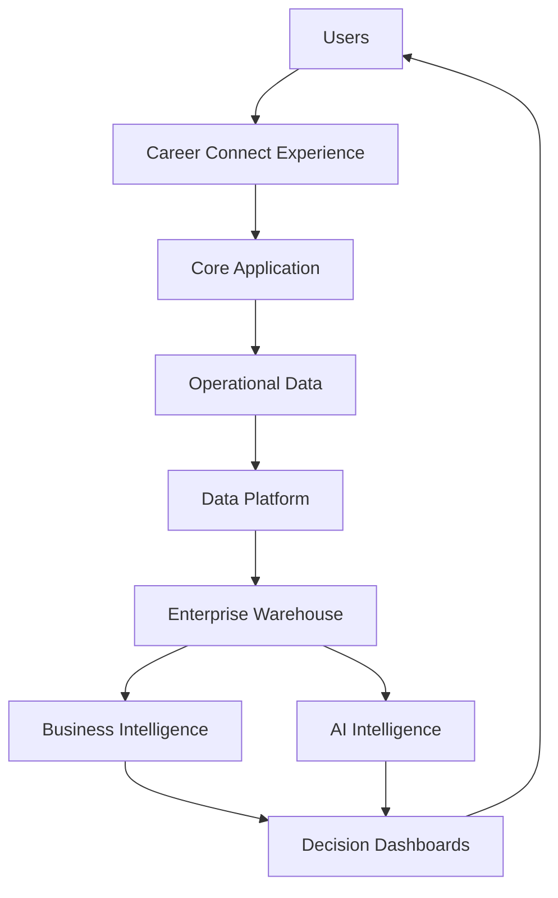
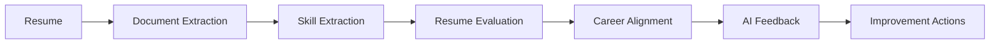
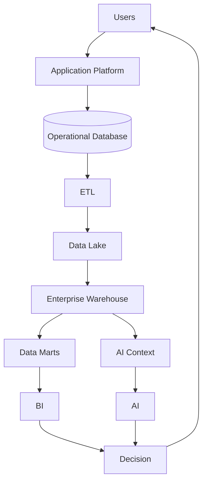
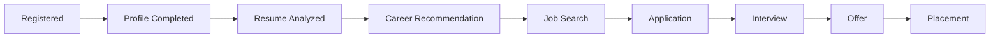
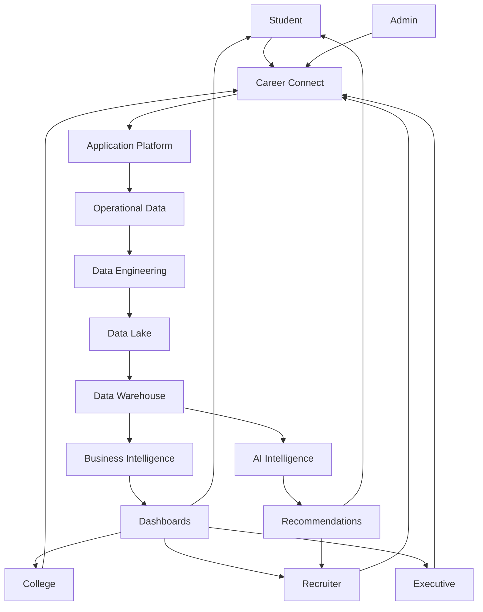

# 20 — Product Requirements Document (PRD)

# Career Connect — AI Career Intelligence Platform

**Document Type:** Product Requirements Document
**Project:** Career Connect
**Version:** 1.0
**Status:** Product Baseline
**Product Category:** AI + Career Intelligence + Business Intelligence + Data Platform + SaaS
**Target:** Final-Year BE CSE Project + Cloud/Data Warehouse Project + AI Product + Startup MVP

---

# 1. Executive Summary

Career Connect is an AI-powered Career Intelligence Platform designed to help students, job seekers, colleges, placement officers, recruiters, companies, and training organizations make better career and workforce decisions.

The platform combines:

```text
Career Management
+
Job Intelligence
+
AI
+
Data Warehouse
+
Business Intelligence
+
Learning Intelligence
+
Recruitment Analytics
```

into one unified product.

The platform is not intended to be a conventional CRUD portal.

Its core value proposition is:

> **Convert fragmented career, education, recruitment, skill, learning, salary, and market data into actionable career intelligence.**

The product continuously transforms:

```text
Raw Data
↓
Trusted Data
↓
Analytics
↓
AI Intelligence
↓
Recommendations
↓
Actions
↓
Career Outcomes
```

---

# 2. Product Vision

The long-term vision is:

> **Become an intelligent career operating system connecting people, education, skills, jobs, companies, and learning through a unified data and AI platform.**

Career Connect should help a user answer:

```text
What career is right for me?
What skills am I missing?
What should I learn?
Which jobs fit my profile?
What salary should I expect?
Which companies are hiring?
Which skills are trending?
How competitive is my profile?
How can my college improve placements?
How can recruiters find better candidates?
```

---

# 3. Product Mission

The mission is:

> **Make career decisions measurable, personalized, data-driven, and continuously actionable.**

---

# 4. Problem Definition

Career decisions are often fragmented across:

```text id="m4r8w2"
Resume Platforms
Job Portals
Learning Platforms
College Placement Systems
Certification Platforms
Salary Websites
Recruitment Systems
Spreadsheets
Personal Research
```

Users must manually combine information from these sources.

This creates problems such as:

```text id="x9q3k7"
Unclear career direction
Skill gaps
Poor job matching
Outdated market knowledge
Weak resumes
Disconnected learning
Limited placement visibility
Recruitment inefficiency
Inconsistent analytics
```

Career Connect addresses these problems through a unified intelligence platform.

---

# 5. Product Goals

## Goal 1 — Career Intelligence

Provide personalized career recommendations based on:

- Skills
- Education
- Experience
- Preferences
- Market demand

---

## Goal 2 — Skill Intelligence

Identify:

- Existing skills
- Missing skills
- High-demand skills
- Emerging technologies
- Skill priorities

---

## Goal 3 — Job Intelligence

Provide:

- Job discovery
- Matching
- Filtering
- Market trends
- Salary intelligence
- Location intelligence

---

## Goal 4 — Placement Intelligence

Help institutions analyze:

- Placement rate
- Salary
- Hiring companies
- Role trends
- Department performance
- Skill readiness

---

## Goal 5 — Recruitment Intelligence

Help recruiters improve:

- Candidate discovery
- Job targeting
- Skill matching
- Interview management
- Hiring funnel visibility

---

## Goal 6 — Learning Intelligence

Connect:

```text
Skill Gap
↓
Learning
↓
Certification
↓
Skill Improvement
↓
Career Outcome
```

---

# 6. Product Non-Goals

The initial product will not attempt to become:

```text id="q4v6x1"
A Full Payroll System
A Full HRMS
A Full University ERP
A Financial Accounting Platform
A Government Employment Registry
A Fully Autonomous Hiring System
```

These may become future integration opportunities.

---

# 7. Target Users

Primary users:

```text id="0l3m8q"
Students
Graduates
Job Seekers
Colleges
Placement Officers
Recruiters
Companies
Training Institutes
Administrators
```

---

# 8. User Personas

# Persona 1 — Student

### Goal

Get a job aligned with skills and career interests.

### Problems

```text id="3n6w7p"
Does not know which career to choose
Does not know missing skills
Has weak resume
Cannot compare opportunities
Unclear learning priorities
```

### Product Value

```text id="1w8q4r"
AI Career Recommendation
Skill Gap
Resume Analysis
Learning Roadmap
Job Matching
AI Career Coach
```

---

# 9. Persona 2 — Job Seeker

### Goal

Find relevant jobs and improve employability.

### Problems

```text id="k7m2p5"
Too many irrelevant jobs
Low application success
Weak interview preparation
Unknown salary expectations
```

### Product Value

```text id="f4x9v2"
Personalized Job Matching
Resume Optimization
Skill Recommendations
Salary Intelligence
Mock Interview
```

---

# 10. Persona 3 — Placement Officer

### Goal

Improve institutional placement performance.

### Problems

```text id="d8q3m6"
Fragmented student records
Manual spreadsheets
Limited market visibility
Difficult company comparison
```

### Product Value

```text id="n2v7x5"
Placement Dashboard
Student Skill Analytics
Company Hiring Analytics
Salary Analytics
Reports
```

---

# 11. Persona 4 — Recruiter

### Goal

Identify qualified candidates efficiently.

### Problems

```text id="y6m3q8"
Too many applications
Skill mismatch
Manual candidate screening
Poor recruitment visibility
```

### Product Value

```text id="c7n4w2"
Talent Search
Skill Matching
Candidate Ranking
Application Funnel
Interview Analytics
```

---

# 12. Persona 5 — Executive

### Goal

Understand organizational or institutional performance.

### Problems

```text id="r8q2m5"
Too much raw data
No unified KPI view
Difficult trend analysis
```

### Product Value

```text id="p3x7k9"
Executive Dashboard
Strategic KPIs
Trend Analysis
Benchmarking
Smart Reports
```

---

# 13. Product Value Proposition

## For Students

> **Know what to learn, where to apply, and which career fits you.**

## For Colleges

> **Turn student and placement data into measurable career outcomes.**

## For Recruiters

> **Find candidates based on skills and evidence rather than resumes alone.**

## For Companies

> **Understand talent availability, hiring demand, and skill trends.**

## For Training Institutes

> **Align courses with actual market demand.**

---

# 14. Product Differentiation

Career Connect combines five traditionally separate systems:

```text id="6q3m8z"
Career Platform
+
Job Platform
+
Learning Platform
+
Recruitment Analytics
+
Data Intelligence Platform
```

The differentiator is the connection between them.

Example:

```text id="z8x4m1"
Student Skill Gap
↓
Recommended Course
↓
Learning Progress
↓
Skill Improvement
↓
Job Match
↓
Application
↓
Interview
↓
Placement
```

---

# 15. Product Architecture



---

# 16. Product Modules

Career Connect consists of:

```text id="p7x2m4"
1. Identity & Access
2. Student Career Profile
3. Resume Intelligence
4. Skill Intelligence
5. Job Intelligence
6. Application Management
7. Recruitment Intelligence
8. Interview Intelligence
9. Placement Intelligence
10. Learning Intelligence
11. Certification Intelligence
12. Salary Intelligence
13. AI Career Assistant
14. Business Intelligence
15. Reporting
16. Notifications
17. Administration
18. Data Platform
```

---

# 17. Module 1 — Identity & Access

## Objective

Securely identify users and control access.

Capabilities:

```text id="x3m8q1"
Login
Logout
Google Authentication
Role Assignment
Organization Membership
Permission Management
Session Management
Audit
```

---

# 18. Module 2 — Student Career Profile

## Objective

Create a unified career identity.

Profile information:

```text id="r6w2k9"
Education
Skills
Projects
Experience
Certifications
Career Goals
Preferred Locations
Employment Preference
Learning Progress
Resume
```

---

# 19. Profile Completion

The platform should calculate a profile completion indicator.

Possible components:

```text id="c4m7x2"
Basic Profile
Education
Skills
Projects
Experience
Resume
Career Goal
Preferences
```

Example:

```text id="z5n8q1"
Profile Completion: 92%
```

The score methodology should be documented and versioned.

---

# 20. Module 3 — Resume Intelligence

## Objective

Analyze resumes and provide actionable improvements.

Capabilities:

```text id="p2x8m4"
Resume Upload
Text Extraction
Section Detection
Skill Extraction
Resume Score
ATS-Oriented Review
Strength Detection
Weakness Detection
Improvement Suggestions
Target Career Comparison
```

---

# 21. Resume Intelligence Workflow



---

# 22. Module 4 — Skill Intelligence

## Objective

Understand the user's skills and market requirements.

Capabilities:

```text id="q9m3x7"
Skill Profile
Skill Normalization
Skill Assessment
Skill Gap
Skill Demand
Skill Supply
Skill Trends
Technology Trends
Career Skill Mapping
```

---

# 23. Skill Intelligence Model

```text id="k4x8m2"
Student Skills
+
Career Requirements
+
Job Requirements
+
Market Demand
=
Skill Intelligence
```

---

# 24. Module 5 — Job Intelligence

## Objective

Help users find relevant employment opportunities.

Capabilities:

```text id="y7m2q5"
Job Search
Job Filtering
Job Matching
Job Recommendations
Location Filtering
Experience Filtering
Employment Type
Work Mode
Skill Matching
Salary Filtering
```

---

# 25. Job Matching

The matching engine may consider:

```text id="p8w3x1"
Skills
Experience
Education
Location
Employment Type
Career Goal
Job Requirements
```

The final match score should be explainable.

---

# 26. Explainable Job Match

Example:

```text id="n5q7m3"
Match Score: 86%

Strong Matches:
✓ Python
✓ SQL
✓ Cloud

Partial Matches:
△ Spark

Missing:
✗ Airflow
```

This is more useful than displaying a score without explanation.

---

# 27. Module 6 — Application Management

## Objective

Track the complete job-application lifecycle.

Capabilities:

```text id="j4m8x2"
Apply
Withdraw
Track Status
Application History
Recruiter Updates
Interview Tracking
Offer Tracking
```

---

# 28. Application Funnel

```text id="w3q7n5"
Applied
↓
Screening
↓
Shortlisted
↓
Assessment
↓
Interview
↓
Offer
↓
Hire
```

The user should see the current state and historical events where appropriate.

---

# 29. Module 7 — Recruitment Intelligence

## Objective

Help recruiters identify and evaluate talent.

Capabilities:

```text id="c8m2x6"
Job Creation
Skill Requirements
Candidate Search
Skill Match
Candidate Ranking
Application Management
Interview Management
Hiring Analytics
```

---

# 30. Candidate Matching

Recruiter search can filter by:

```text id="m7x4q9"
Skill
Proficiency
Experience
Education
Location
Certification
Career Goal
Availability
```

---

# 31. Candidate Ranking

Ranking should be explainable.

Example:

```text id="v5n8q3"
Candidate A
Skill Match: 94%
Experience Match: 85%
Location Match: 100%
Overall Match: 92%
```

A ranking should not be presented as an objective measure of candidate worth.

---

# 32. Module 8 — Interview Intelligence

## Objective

Manage and analyze interviews.

Capabilities:

```text id="p4x7m2"
Schedule Interview
Interview Rounds
Interview Feedback
Scores
Results
AI Mock Interview
Interview Analytics
```

---

# 33. Module 9 — Placement Intelligence

## Objective

Provide institutions with measurable placement performance.

Capabilities:

```text id="r8m3x5"
Placement Dashboard
Placement Rate
Salary Analytics
Company Analytics
Department Analytics
Student Outcomes
Role Analytics
Location Analytics
Historical Comparison
```

---

# 34. Placement Analytics

Core KPIs:

```text id="7q2m6x"
Placement Rate
Average Salary
Highest Salary
Total Placements
Companies Hiring
Offers
Joining Rate
```

---

# 35. Module 10 — Learning Intelligence

## Objective

Connect skill gaps with learning.

Capabilities:

```text id="k5x8m1"
Course Discovery
Skill-Based Courses
Learning Roadmap
Progress Tracking
Assessment
Completion
Course Recommendations
```

---

# 36. Learning Roadmap

Example:

```text id="b3w7q9"
Target Career:
Data Engineer

Month 1
Python + SQL

Month 2
ETL + Data Modeling

Month 3
Cloud Data Engineering

Month 4
Spark + Airflow

Month 5
Portfolio Project
```

The roadmap should adapt to the user's current proficiency.

---

# 37. Module 11 — Certification Intelligence

Capabilities:

```text id="w2m6x8"
Certification Search
Skill Mapping
Credential Tracking
Expiry Tracking
Verification
Certification Recommendations
```

---

# 38. Module 12 — Salary Intelligence

Capabilities:

```text id="q7x3m5"
Role Salary
Experience Salary
City Salary
Company Salary
Technology Salary
Salary Trends
Salary Bands
```

Salary data must distinguish:

```text id="n4v8r2"
Actual Placement Salary
Market Salary Observation
Estimated Salary
```

---

# 39. Module 13 — AI Career Assistant

## Objective

Provide conversational career assistance.

Capabilities:

```text id="m5x2q8"
Career Questions
Skill Questions
Learning Guidance
Resume Assistance
Job Guidance
Interview Preparation
Career Planning
```

---

# 40. AI Assistant Context

AI can use:

```text id="v7q3m9"
Student Profile
Skills
Career Goal
Skill Gap
Market Data
Learning Progress
Job Data
```

Only authorized and necessary data should be supplied to the model.

---

# 41. Module 14 — Business Intelligence

The BI layer is the analytical decision engine.

Dashboards:

```text id="q4m8x2"
Executive
College
Placement
Student
Recruiter
Skill
Salary
Job Market
Hiring
Learning
```

---

# 42. Module 15 — Reporting

Report types:

```text id="n6x3m7"
Weekly
Monthly
Quarterly
Yearly
Placement
Hiring
Student
Company
Skill
Salary
Executive
```

Formats:

```text id="x8q2m5"
PDF
Excel
CSV
Dashboard
```

---

# 43. Module 16 — Notifications

Notification types:

```text id="c5m7x3"
New Job Match
Interview Reminder
Application Update
Skill Recommendation
Course Recommendation
Report Ready
Placement Update
```

---

# 44. Module 17 — Administration

Administration includes:

```text id="w9q4m2"
User Management
Organization Management
Role Management
Permission Management
Data Sources
Pipeline Monitoring
Data Quality
Audit Logs
System Configuration
```

---

# 45. Module 18 — Data Platform

The product's analytical foundation includes:

```text id="k3m8x5"
Data Lake
ETL
Data Warehouse
Data Marts
Semantic Layer
Metadata
Data Quality
Lineage
```

---

# 46. MVP Definition

The MVP should deliver the strongest end-to-end user value without implementing every enterprise feature.

Recommended MVP:

```text id="v5q8m3"
Authentication
Student Profile
Resume Upload
Resume Analysis
Skill Profile
Skill Gap
Career Recommendation
Job Search
Job Matching
Applications
Placement Dashboard
Salary Analytics
Skill Analytics
AI Career Assistant
Basic Reports
Admin
```

---

# 47. MVP Exclusions

The first MVP can defer:

```text id="a6m2x9"
Advanced Billing
Enterprise SSO
Complex Partner APIs
Global Multi-Region
Large-Scale Streaming
Advanced Workforce Planning
Full HRMS
```

These remain roadmap items.

---

# 48. Product Prioritization

Use:

```text id="q8m4x2"
P0 — Mission Critical
P1 — High Value
P2 — Enhancement
P3 — Future
```

---

# 49. P0 Features

```text id="n7x3m5"
Authentication
Student Profile
Skills
Jobs
Applications
Resume Upload
Resume Analysis
Skill Gap
Career Recommendation
Core Analytics
```

---

# 50. P1 Features

```text id="r4m8q2"
AI Career Assistant
Learning Roadmap
Salary Intelligence
Recruiter Analytics
Placement Reports
Interview Management
```

---

# 51. P2 Features

```text id="x5n2m7"
Mock Interviews
Advanced Benchmarking
Natural-Language BI
Advanced Skill Graph
Automated Notifications
```

---

# 52. P3 Features

```text id="w8q3m6"
SaaS Billing
Partner Marketplace
Enterprise SSO
Workforce Planning
Global Talent Intelligence
Advanced Predictive Models
```

---

# 53. Functional Requirements Summary

The product shall:

### FR-01

Allow users to securely authenticate.

### FR-02

Allow organizations to manage authorized users.

### FR-03

Allow students to create and maintain career profiles.

### FR-04

Allow resumes to be uploaded securely.

### FR-05

Analyze resumes using AI-assisted processing.

### FR-06

Extract and normalize skills.

### FR-07

Calculate skill gaps.

### FR-08

Recommend career paths.

### FR-09

Recommend jobs.

### FR-10

Allow users to apply to jobs.

### FR-11

Track application states.

### FR-12

Manage interview events.

### FR-13

Track offers and placements.

### FR-14

Provide salary intelligence.

### FR-15

Provide skill-market analytics.

### FR-16

Provide placement dashboards.

### FR-17

Provide recruiter analytics.

### FR-18

Generate reports.

### FR-19

Provide AI career assistance.

### FR-20

Maintain audit logs.

---

# 54. User Stories — Student

## US-01

> As a student, I want to create my profile so that Career Connect can understand my career background.

## US-02

> As a student, I want to upload my resume so that I can receive AI feedback.

## US-03

> As a student, I want to understand my skill gaps so that I know what to learn.

## US-04

> As a student, I want career recommendations so that I can choose suitable career paths.

## US-05

> As a student, I want job recommendations so that I can find relevant opportunities.

## US-06

> As a student, I want to track applications so that I know my recruitment progress.

---

# 55. User Stories — Placement Officer

## US-07

> As a placement officer, I want to view placement analytics so that I can monitor institutional performance.

## US-08

> As a placement officer, I want department-level analytics so that I can identify weak areas.

## US-09

> As a placement officer, I want company hiring analytics so that I can understand recruitment patterns.

---

# 56. User Stories — Recruiter

## US-10

> As a recruiter, I want to define job skill requirements so that candidates can be matched accurately.

## US-11

> As a recruiter, I want to search candidates by skill so that I can reduce manual screening.

## US-12

> As a recruiter, I want to analyze the hiring funnel so that I can identify recruitment bottlenecks.

---

# 57. User Stories — Executive

## US-13

> As an executive, I want a unified dashboard so that I can monitor important career and hiring KPIs.

---

# 58. User Stories — Administrator

## US-14

> As an administrator, I want to manage roles so that access remains secure.

## US-15

> As an administrator, I want to monitor data pipelines so that analytical data remains trustworthy.

---

# 59. Core User Journey — Student


---

# 60. Core User Journey — College

```text id="m5q8x2"
Login
↓
Institution Dashboard
↓
Student Analytics
↓
Placement Analytics
↓
Company Hiring
↓
Salary Trends
↓
Skill Gaps
↓
Report
```

---

# 61. Core User Journey — Recruiter

```text id="x3m7q9"
Login
↓
Create Job
↓
Define Skills
↓
Search Candidates
↓
Candidate Matching
↓
Shortlist
↓
Interview
↓
Offer
↓
Hiring Analytics
```

---

# 62. Product-Level Data Flow



---

# 63. Product Decision Intelligence Loop

The product's central intelligence loop is:

```text id="q2m7x8"
Observe
↓
Analyze
↓
Recommend
↓
Act
↓
Measure Outcome
↓
Learn
↓
Improve
```

Example:

```text id="9x4m6p"
Skill Gap
↓
Course Recommendation
↓
Course Completion
↓
Skill Improvement
↓
Job Application
↓
Interview
↓
Placement
```

---

# 64. Product Success Metrics

Success must be measured at four levels.

## Product Adoption

```text id="m8q3x7"
Registered Users
Active Users
Returning Users
Profile Completion
```

---

## Engagement

```text id="p5x9m2"
Resume Analyses
Career Recommendations
Job Searches
Applications
AI Conversations
Learning Activity
```

---

## Outcome

```text id="v4m7q1"
Interview Conversion
Offer Conversion
Placement Rate
Salary Outcome
Skill Improvement
```

---

## Business

```text id="x8n3m5"
Organizations
Recruiters
Companies
Reports Generated
AI Usage
Subscription Opportunities
```

---

# 65. North Star Metric

A strong North Star Metric could be:

> **Career Progression Actions Completed**

where an action might represent:

```text id="j5q2x8"
Skill Gap Resolved
Course Completed
Application Submitted
Interview Completed
Placement Achieved
```

A more mature product may define a weighted “meaningful career outcome” metric rather than counting all actions equally.

---

# 66. Product Analytics Events

Track:

```text id="n7m4x2"
user_registered
profile_completed
resume_uploaded
resume_analyzed
skill_gap_generated
career_recommendation_generated
job_viewed
job_applied
interview_scheduled
offer_received
placement_recorded
course_started
course_completed
ai_question_asked
report_generated
```

---

# 67. Product Funnel



Conversion should be measured at every stage.

---

# 68. Product KPIs

### Student KPIs

```text id="p7m3x9"
Profile Completion
Resume Score
Skill Alignment
Applications
Interviews
Offers
Learning Progress
```

### College KPIs

```text id="w5x8m2"
Eligible Students
Placement Rate
Average Salary
Company Count
Interview Rate
Skill Readiness
```

### Recruiter KPIs

```text id="q3n7m4"
Applications
Shortlists
Interviews
Offers
Hires
Time to Hire
```

---

# 69. UX Requirements

The UI should be:

```text id="v8m4x1"
Modern
Minimal
Responsive
Accessible
Fast
Professional
Data-Dense but Clear
```

Visual direction:

```text id="x2q7m5"
Apple
Linear
Vercel
Stripe
Snowflake
Power BI
Microsoft Fabric
```

---

# 70. UI Design System

Primary visual characteristics:

```text id="m6x3q8"
Blue
White
Dark Gray
Purple Accent
Glassmorphism
Soft Shadows
Rounded Surfaces
Clear Data Visualization
```

The design system should avoid excessive visual effects that interfere with readability or accessibility.

---

# 71. Accessibility

The product should target strong accessibility practices.

Requirements:

```text id="r4n8x2"
Keyboard Navigation
Readable Contrast
Accessible Labels
Focus Indicators
Responsive Layout
Screen Reader Compatibility
Meaningful Error Messages
```

---

# 72. Responsive Requirements

The platform should support:

```text id="q7m2x9"
Desktop
Laptop
Tablet
Mobile
```

Dashboards may prioritize desktop due to analytical density but should degrade gracefully on smaller screens.

---

# 73. Performance Requirements

Targets should be established and validated through measurement.

Recommended initial engineering targets:

```text id="k5x8m4"
Normal API:
Low-latency interactive response

Dashboard:
Fast first render

AI:
Asynchronous for long-running tasks

Reports:
Background generation
```

Specific numerical SLOs should be finalized after performance testing.

---

# 74. Availability Requirements

Core application services should have higher availability expectations than non-critical analytical features.

Priority:

```text id="n8q3m6"
Authentication
Core Application
Job Search
Applications
        ↓
AI
Analytics
Reports
```

This means non-critical intelligence workloads should not unnecessarily bring down the core application.

---

# 75. Security Requirements

The product must include:

```text id="x4m7q1"
Authentication
RBAC
Tenant Isolation
Object-Level Authorization
Input Validation
Rate Limiting
Audit Logs
Encryption
Secure APIs
File Security
Secrets Management
```

---

# 76. Privacy Requirements

The platform should implement:

```text id="p2x8m5"
Data Minimization
Purpose Limitation
Access Controls
Retention Policies
Auditability
Controlled Data Export
```

Applicable legal and institutional privacy obligations must be reviewed for the target deployment.

---

# 77. AI Product Requirements

AI features must:

```text id="v7m3q9"
Provide useful answers
Use relevant context
Avoid unsupported claims
Protect sensitive data
Track model versions
Support evaluation
Provide structured results where needed
Fail safely
```

---

# 78. AI Explainability

Whenever practical, AI recommendations should explain:

```text id="q5x2m8"
Why Recommended
Supporting Skills
Missing Skills
Relevant Market Signals
Recommended Next Action
```

This improves user trust.

---

# 79. AI Failure Modes

Potential failures:

```text id="n4m8x3"
Incorrect Skill Extraction
Wrong Career Recommendation
Hallucinated Job Information
Outdated Market Context
Unsafe Advice
Provider Failure
Timeout
```

Mitigation:

```text id="x6q3m7"
Validation
Grounded Context
Data Freshness
Output Schemas
Fallback
Monitoring
Human Review where appropriate
```

---

# 80. Data Product Requirements

The data platform must:

```text id="m8x4q2"
Preserve Raw Data
Validate Sources
Track Lineage
Measure Quality
Support Incremental Loads
Support Reprocessing
Maintain Historical Data
Publish Trusted Metrics
```

---

# 81. BI Requirements

Dashboards should support:

```text id="q7m3x5"
Filtering
Drilldown
Time Comparison
Department Comparison
Company Comparison
Location Comparison
Skill Comparison
Export
```

---

# 82. Dashboard Interaction

Example:

```text id="v4x8m1"
Executive Dashboard
↓
Click "Placement Rate"
↓
College Breakdown
↓
Department Breakdown
↓
Student Group
↓
Underlying Details
```

The exact drilldown permissions must respect privacy and authorization.

---

# 83. Reporting Requirements

Reports must:

```text id="k2m7q8"
Use governed metrics
Show data-as-of date
Show filters
Identify organization scope
Support PDF/Excel
Record export event
```

---

# 84. Data Freshness Visibility

Important dashboards should display:

```text id="x5q8m2"
Data Updated:
2026-07-30 06:00 UTC
```

where freshness matters.

This reduces the risk of users treating stale information as current.

---

# 85. Product Auditability

Important events must be auditable:

```text id="m9x3q7"
Role Changes
Resume Access
Application Status
Placement Creation
Report Export
AI Generation
Data Import
```

---

# 86. Product Scalability

Scale independently:

```text id="q4m8x2"
Web Traffic
→ Web/API Scale

AI Demand
→ AI Worker Scale

Data Volume
→ Data Platform Scale

BI Workload
→ Warehouse Scale
```

---

# 87. Product Reliability

Use:

```text id="n7x3m5"
Retries
Timeouts
Health Checks
Circuit Breaking where necessary
Background Jobs
Backups
Monitoring
Alerts
```

---

# 88. Product Integrations

Future integrations:

```text id="w5m8q1"
College ERP
Learning Management Systems
Job Platforms
HR Systems
ATS Platforms
Certification Providers
Cloud Storage
AI Providers
Business Intelligence Tools
```

---

# 89. External Integration Principle

All external integrations should use adapters:

```text id="x3q7m9"
Integration Interface
      |
      +-- Provider A
      +-- Provider B
      +-- Provider C
```

This reduces vendor lock-in.

---

# 90. SaaS Requirements

The commercial product should support:

```text id="m4x8q2"
Organizations
Tenants
Plans
Usage
Subscriptions
Feature Flags
Data Isolation
Administration
```

---

# 91. Multi-Tenant Model

Conceptually:

```text id="p7q3m8"
Tenant
├── Users
├── Students
├── Recruiters
├── Jobs
├── Applications
├── Placements
└── Reports
```

Global reference intelligence may be shared where policy permits.

---

# 92. Product Monetization Opportunities

Potential business models:

## Freemium

Free student career profile.

Paid:

```text id="v8m2q5"
Advanced AI
Resume Analysis
Mock Interviews
Career Analytics
```

---

## Institution SaaS

Colleges pay for:

```text id="x4q7m1"
Placement Analytics
Student Intelligence
Recruiter Management
Reports
```

---

## Recruiter SaaS

Companies pay for:

```text id="n6m3x8"
Talent Intelligence
Candidate Search
Skill Matching
Hiring Analytics
```

---

## Enterprise

Custom:

```text id="q2x8m5"
Integrations
SSO
Dedicated Environment
Advanced Security
Custom Data Models
```

---

# 93. Product Pricing Architecture

Pricing should eventually be based on:

```text id="m7q3x9"
Users
Organizations
AI Usage
Data Volume
Recruiter Seats
Reports
Integrations
```

Actual prices should be determined by market validation and operating costs.

---

# 94. Product Roadmap Alignment

The PRD should act as the bridge between:

```text id="p5x8m2"
Vision
↓
Product Roadmap
↓
Features
↓
Engineering
↓
Testing
↓
Release
```

---

# 95. Release Strategy

Recommended:

```text id="x7m4q1"
Alpha
↓
Internal Pilot
↓
College Pilot
↓
MVP
↓
Startup Beta
↓
Public SaaS
↓
Enterprise
```

---

# 96. MVP Acceptance Criteria

The MVP is successful when a student can complete:

```text id="n3q8m5"
Register
↓
Create Profile
↓
Add Skills
↓
Upload Resume
↓
Receive Resume Analysis
↓
See Skill Gap
↓
Receive Career Recommendation
↓
Find Matching Jobs
↓
Apply
```

and a college/recruiter can demonstrate:

```text id="v2m7x4"
Login
↓
View Dashboard
↓
Filter Analytics
↓
View KPIs
↓
Generate Report
```

---

# 97. Product Demo Scenario

A strong final-year demonstration should follow one connected story.

```text id="q8m3x7"
Student Registration
↓
Resume Upload
↓
AI Resume Analysis
↓
Skill Extraction
↓
Skill Gap
↓
Career Recommendation
↓
Learning Roadmap
↓
Job Recommendation
↓
Application
↓
Recruiter Dashboard
↓
Interview
↓
Placement
↓
College Analytics
```

This demonstrates the platform as one system rather than isolated modules.

---

# 98. Product Data Demonstration

At the same time, show:

```text id="x4m8q2"
Raw Dataset
↓
ETL
↓
Quality Checks
↓
Warehouse
↓
Star Schema
↓
Dashboard
```

This demonstrates the Data Engineering and Data Warehouse requirements.

---

# 99. AI Demonstration

Show:

```text id="n7q3m5"
Resume
↓
Extracted Skills
↓
Career Recommendation
↓
Explanation
↓
Learning Recommendation
```

Then compare AI output against the structured analytical data used as context.

---

# 100. Product Success Definition

Career Connect succeeds when it can connect:

```text id="m5x8q2"
PERSON
↓
SKILLS
↓
CAREER
↓
LEARNING
↓
JOB
↓
APPLICATION
↓
INTERVIEW
↓
OFFER
↓
PLACEMENT
↓
ANALYTICS
↓
AI
```

within one coherent platform.

---

# 101. Product Risks

## Risk 1 — Scope Expansion

The project can become too large.

### Mitigation

Maintain strict MVP boundaries.

---

## Risk 2 — AI Overdependence

AI output may become the product instead of the data platform.

### Mitigation

Use AI as an intelligence layer over governed data.

---

## Risk 3 — Poor Data Quality

Bad inputs produce bad recommendations.

### Mitigation

Build DataOps from the start.

---

## Risk 4 — Dashboard Complexity

Too many charts reduce usability.

### Mitigation

Use role-specific dashboards and focused KPIs.

---

## Risk 5 — Privacy

Career information can be sensitive.

### Mitigation

Use least privilege, data minimization, audit, and tenant isolation.

---

# 102. Product Dependencies

Major dependencies:

```text id="v8m3q6"
Authentication Provider
PostgreSQL
Object Storage
AI Provider
Data Warehouse
ETL Runtime
Frontend Hosting
Backend Hosting
```

Provider failures should be isolated where possible.

---

# 103. Product Assumptions

Initial assumptions:

```text id="q2x7m4"
Users have internet access
Institutions can provide structured data
Synthetic data is acceptable for demonstration
AI provider APIs are available
Cloud services can be configured
The first release focuses on a manageable target segment
```

These assumptions should be validated during implementation.

---

# 104. Product Constraints

Potential constraints:

```text id="n6m3x8"
Student Project Time
Cloud Budget
API Costs
Data Availability
Team Size
AI Usage Limits
Institutional Data Access
```

The architecture should remain enterprise-ready without requiring enterprise-scale infrastructure for the academic demonstration.

---

# 105. Product Requirements Traceability

Every major requirement should map to:

```text id="x5q8m2"
PRD
↓
User Story
↓
Feature
↓
API
↓
Database
↓
ETL
↓
Test Case
↓
Dashboard
```

This creates complete traceability.

---

# 106. Example Requirement Traceability

### Requirement

> Student should receive career recommendation.

Trace:

```text id="w7m4q1"
PRD Feature
↓
US-04
↓
POST /students/:id/career-recommendations
↓
career.recommendations
↓
Skill Gap + Career Data
↓
AI Service
↓
Career Recommendation Test
↓
Student Dashboard
```

---

# 107. Product Governance

A feature should not enter production without:

```text id="p3x7m9"
Requirement
+
Acceptance Criteria
+
Security Review
+
Data Impact
+
Testing
+
Documentation
```

---

# 108. Product Definition of Ready

A feature is ready for development when:

```text id="n8q3m6"
Business Problem Defined
User Defined
Outcome Defined
Acceptance Criteria Defined
Dependencies Known
Data Requirements Known
UX Available
Security Impact Identified
```

---

# 109. Product Definition of Done

A feature is complete when:

```text id="q4x8m2"
Implemented
Tested
Reviewed
Secured
Documented
Integrated
Deployed
Monitored
```

---

# 110. Product Documentation Requirements

The product repository must maintain:

```text id="m7x3q9"
PRD
SRS
Architecture
API Documentation
Database Documentation
ETL Documentation
AI Documentation
Security Documentation
Testing Documentation
Deployment Documentation
README
```

---

# 111. Final Product Architecture



---

# 112. Product North Star Architecture

```text id="h7m4q2"
                    CAREER CONNECT
                         │
                ┌────────┴────────┐
                │                 │
           EXPERIENCE          INTELLIGENCE
                │                 │
        ┌───────┴───────┐   ┌─────┴─────────┐
        │               │   │               │
      Student         Recruiter           BI
      College         Company              AI
        │               │                   │
        └───────────────┼───────────────────┘
                        │
                 DATA PLATFORM
                        │
             ┌──────────┴──────────┐
             │                     │
          OLTP / API           WAREHOUSE
             │                     │
             └──────────┬──────────┘
                        │
                  CAREER OUTCOMES
```

---

# 113. Final PRD Decision

Career Connect should be positioned as:

> **A Career Intelligence Platform, not merely a Job Portal.**

The product's deepest differentiation is the connection between:

```text id="j5x8m2"
Profile
+
Skill
+
Career
+
Learning
+
Job
+
Recruitment
+
Placement
+
Analytics
+
AI
```

---

# 114. Final Product Strategy

The development strategy should follow:

```text id="q7m3x9"
Start with Student Career Intelligence
↓
Add Job Matching
↓
Add Recruitment
↓
Add Placement Analytics
↓
Add Learning Intelligence
↓
Add Enterprise BI
↓
Add AI Intelligence
↓
Add SaaS Monetization
```

The architecture already supports the later stages.

---

# 115. Final PRD Statement

> **Career Connect is an AI-powered Career Intelligence Platform that unifies career profiles, skills, learning, jobs, recruitment, placements, salary intelligence, Business Intelligence, and AI recommendations into a single cloud-native product. The platform is designed to transform raw career and workforce data into trusted analytics and actionable intelligence for students, institutions, recruiters, companies, and training organizations. The MVP will focus on the end-to-end student career journey and core institutional/recruiter analytics while preserving a scalable path toward a multi-tenant SaaS platform and enterprise talent-intelligence product.**

---

## Document Status

| Attribute            | Value                                      |
| -------------------- | ------------------------------------------ |
| Project              | Career Connect                             |
| Document             | Product Requirements Document              |
| Version              | 1.0                                        |
| Product Type         | AI + BI + Data Platform + SaaS             |
| Primary Users        | Students, Colleges, Recruiters, Companies  |
| Core Value           | Career Intelligence                        |
| MVP                  | Student + Jobs + AI + Analytics            |
| AI                   | Resume + Skill Gap + Career + Chat         |
| Data                 | OLTP + Data Lake + Warehouse               |
| BI                   | Executive + College + Student + Recruiter  |
| SaaS                 | Multi-Tenant Ready                         |
| Security             | RBAC + Tenant + Audit                      |
| Success Focus        | Career Progression + Business Intelligence |
| Academic Suitability | Yes                                        |
| Startup Potential    | Yes                                        |
| Enterprise Evolution | Yes                                        |
| Status               | Product Baseline                           |
