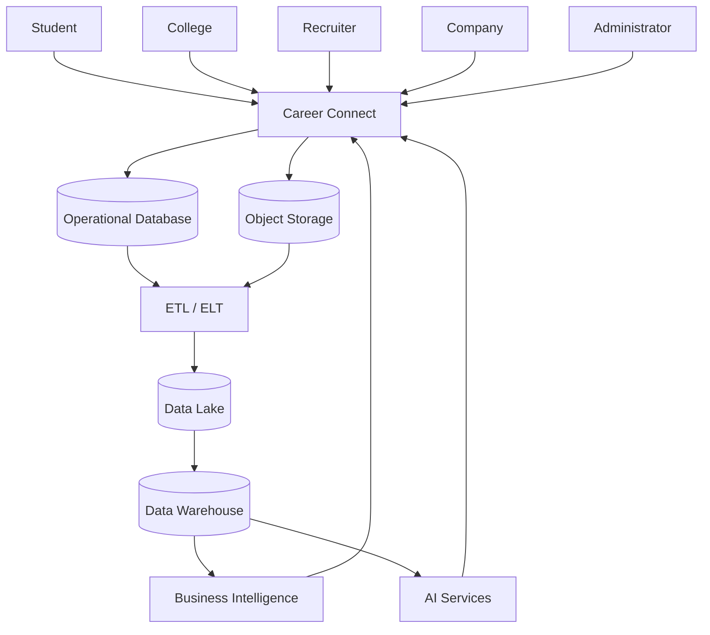
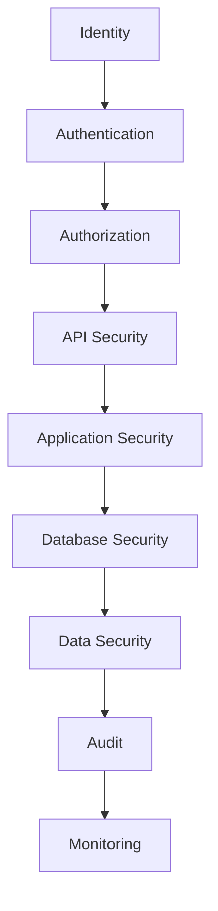
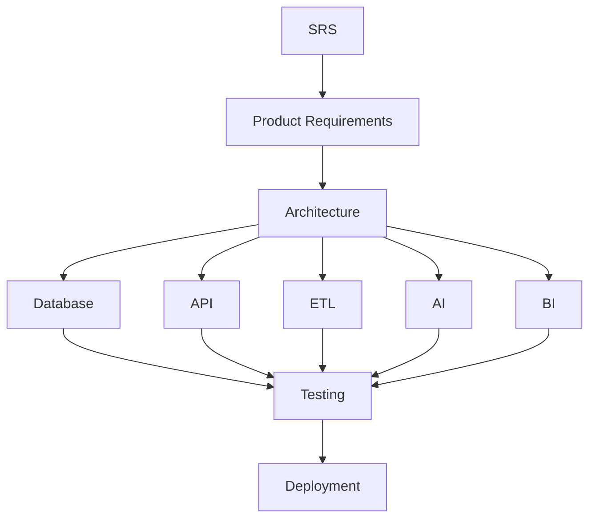

# 21 — Software Requirements Specification (SRS)

# Career Connect — AI Career Intelligence Platform

**Document Type:** Software Requirements Specification
**Project:** Career Connect
**Version:** 1.0
**Status:** Baseline Requirements Specification
**Architecture:** Cloud-Native + Data-Centric + AI-Enabled
**Primary Frontend:** Next.js + TypeScript
**Primary Backend:** NestJS + TypeScript
**AI Services:** Python
**Operational Database:** PostgreSQL / Supabase
**Analytical Warehouse:** BigQuery / Snowflake
**Storage:** Cloud Object Storage
**Authentication:** Supabase Auth / OAuth
**Deployment:** Vercel + Render / Cloud Infrastructure
**CI/CD:** GitHub Actions

---

# 1. Introduction

## 1.1 Purpose

This Software Requirements Specification defines the functional, non-functional, technical, data, security, integration, AI, analytics, and operational requirements for Career Connect.

The document establishes a formal contract between:

```text
Product
Engineering
Frontend
Backend
AI
Data Engineering
BI
Testing
Security
Deployment
```

It describes what the platform must provide without prescribing every implementation detail.

---

# 2. Product Scope

Career Connect is a cloud-based career intelligence platform serving:

```text
Students
Graduates
Job Seekers
Colleges
Placement Officers
Recruiters
Companies
Training Institutes
Administrators
```

The system combines:

```text
Career Management
Job Intelligence
Recruitment
Learning
Placement Analytics
Data Warehouse
Business Intelligence
Artificial Intelligence
Reporting
```

---

# 3. Intended Audience

This SRS is intended for:

- Product managers
- Software architects
- Full-stack developers
- AI engineers
- Data engineers
- BI developers
- Database engineers
- QA engineers
- Security engineers
- DevOps engineers
- Academic evaluators
- Project stakeholders

---

# 4. Product Objectives

The system shall:

1. Centralize career-related information.
2. Analyze student career readiness.
3. Identify skill gaps.
4. Recommend career paths.
5. Recommend learning activities.
6. Match users with relevant jobs.
7. Track recruitment processes.
8. Analyze placement outcomes.
9. Analyze job and salary markets.
10. Provide role-specific dashboards.
11. Provide AI-powered career assistance.
12. Build trusted analytical datasets through ETL.
13. Maintain an enterprise data warehouse.
14. Generate business reports.
15. Support future multi-tenant SaaS operation.

---

# 5. System Context



---

# 6. System Boundaries

## 6.1 Inside the System

Career Connect includes:

```text
Authentication Integration
User Management
Student Management
Recruitment
Jobs
Applications
Interviews
Placements
Learning
Certifications
Resume Intelligence
Skill Intelligence
AI
ETL
Warehouse
BI
Reports
Notifications
Administration
```

---

## 6.2 Outside the System

External dependencies may include:

```text
Identity Provider
AI Model Provider
Cloud Storage
External Job Sources
External Market Data
Learning Providers
Certification Providers
Institution Systems
```

---

# 7. Overall System Architecture

The system shall follow a layered architecture:

```text
Presentation Layer
        ↓
API Layer
        ↓
Application / Domain Layer
        ↓
Operational Data Layer
        ↓
Data Engineering Layer
        ↓
Analytical Warehouse
        ↓
BI / AI Intelligence Layer
```

---

# 8. Functional Requirement Priority

Each requirement is classified as:

```text
MUST
SHOULD
COULD
FUTURE
```

### MUST

Required for the core project.

### SHOULD

High-value functionality recommended for MVP.

### COULD

Useful enhancement.

### FUTURE

Post-MVP capability.

---

# 9. Functional Requirements

# FR-001 — User Registration

**Priority:** MUST

The system shall allow supported users to create an account through an approved authentication mechanism.

The system shall:

- Validate required identity information.
- Prevent duplicate accounts where applicable.
- Create the application-level user record.
- Record account creation metadata.

---

# 10. FR-002 — User Authentication

**Priority:** MUST

The system shall authenticate users using the configured identity provider.

Supported mechanisms may include:

```text
Email
Password
Google OAuth
```

The system shall create a valid authenticated session after successful login.

---

# 11. FR-003 — Logout

**Priority:** MUST

The system shall allow authenticated users to terminate their session.

The application shall invalidate or close the relevant session according to the authentication architecture.

---

# 12. FR-004 — Password Recovery

**Priority:** SHOULD

The system shall support password recovery through the configured identity provider where applicable.

The application shall not expose password-reset secrets in application logs.

---

# 13. FR-005 — Role-Based Access Control

**Priority:** MUST

The system shall support:

```text
SUPER_ADMIN
ORG_ADMIN
PLACEMENT_OFFICER
FACULTY
RECRUITER
STUDENT
JOB_SEEKER
```

The role model shall be extensible.

---

# 14. FR-006 — Organization Management

**Priority:** MUST

Authorized administrators shall be able to:

- Create organizations.
- Update organizations.
- Deactivate organizations.
- Manage organization metadata.
- Manage organization members.

---

# 15. FR-007 — Organization Isolation

**Priority:** MUST

The system shall prevent users from accessing organization-owned data without authorization.

The tenant context shall be derived from authenticated identity and server-side authorization rules.

---

# 16. FR-008 — Student Profile

**Priority:** MUST

Students shall be able to maintain:

```text
Basic Information
Education
Skills
Projects
Experience
Certifications
Career Goal
Location Preferences
Employment Preferences
```

---

# 17. FR-009 — Profile Completion

**Priority:** SHOULD

The system should calculate a profile completion score based on configured required sections.

The score definition shall be versioned and documented.

---

# 18. FR-010 — Education Management

**Priority:** MUST

Students shall be able to add and manage educational records.

Each education record should support:

```text
Institution
Degree
Field of Study
Start Date
End Date
GPA / Grade
```

---

# 19. FR-011 — Project Management

**Priority:** MUST

Students shall be able to maintain project information.

Supported information:

```text
Project Name
Description
Repository
Demo
Start Date
End Date
Skills Used
```

---

# 20. FR-012 — Experience Management

**Priority:** SHOULD

Students shall be able to maintain work and internship experience.

---

# 21. FR-013 — Skill Management

**Priority:** MUST

The system shall maintain a standardized skill catalog.

Each skill may have:

```text
Name
Canonical Name
Category
Technology
Description
Status
Aliases
```

---

# 22. FR-014 — Student Skill Profile

**Priority:** MUST

Students shall be able to associate skills with their profile.

The platform shall support:

```text
Skill
Proficiency
Years of Experience
Source
Verification
Confidence
```

---

# 23. FR-015 — Skill Verification

**Priority:** SHOULD

Authorized users or systems shall be able to verify skills derived from:

```text
Assessment
Certification
Projects
Interview
Institution Validation
```

---

# 24. FR-016 — Job Creation

**Priority:** MUST

Authorized recruiters shall be able to create job postings.

Required information may include:

```text
Job Title
Description
Company
Location
Employment Type
Experience
Skills
Salary Range
Closing Date
Work Mode
```

---

# 25. FR-017 — Job Publishing

**Priority:** MUST

A recruiter shall be able to:

```text
Save Draft
Publish
Pause
Close
```

a job.

The system shall validate required fields before publishing.

---

# 26. FR-018 — Job Search

**Priority:** MUST

Users shall be able to search jobs using:

```text
Keyword
Location
Skill
Experience
Employment Type
Work Mode
Company
Salary Range
```

---

# 27. FR-019 — Job Filtering

**Priority:** MUST

The system shall support combinations of multiple filters.

Example:

```text
Role = Data Engineer
Experience = Entry Level
Location = Chennai
Work Mode = Hybrid
Skill = Python
```

---

# 28. FR-020 — Job Skill Requirements

**Priority:** MUST

Recruiters shall be able to define required skills for each job.

Each requirement may include:

```text
Skill
Required Level
Importance
Mandatory Flag
```

---

# 29. FR-021 — Job Recommendation

**Priority:** SHOULD

The system shall recommend jobs based on authorized user profile data.

Recommendation signals may include:

```text
Skills
Experience
Education
Career Goal
Location
Employment Preference
Job Requirements
```

---

# 30. FR-022 — Job Matching Explanation

**Priority:** SHOULD

The system should provide an explanation of why a job is recommended.

Example:

```text
Strong Skill Match
Partial Experience Match
Location Match
Missing Skill: Apache Airflow
```

---

# 31. FR-023 — Job Application

**Priority:** MUST

An eligible student/job seeker shall be able to apply to an active job.

The system shall:

- Validate job status.
- Validate user eligibility.
- Prevent duplicate applications where policy prohibits them.
- Create the application.
- Record an application event.
- Create an audit event.

---

# 32. FR-024 — Application Tracking

**Priority:** MUST

Users shall be able to view application status.

Statuses shall include approved workflow states such as:

```text
APPLIED
SCREENING
SHORTLISTED
ASSESSMENT
INTERVIEW
OFFERED
REJECTED
WITHDRAWN
HIRED
```

---

# 33. FR-025 — Application History

**Priority:** MUST

The system shall preserve important application events.

Example:

```text
Applied
Screened
Shortlisted
Interview
Offer
Hired
```

---

# 34. FR-026 — Application Withdrawal

**Priority:** SHOULD

Users shall be able to withdraw an eligible application.

The system shall record the withdrawal event.

---

# 35. FR-027 — Interview Scheduling

**Priority:** MUST

Authorized recruiters shall be able to schedule interviews.

Supported information:

```text
Application
Date
Time
Round
Interview Type
Recruiter
```

---

# 36. FR-028 — Interview Management

**Priority:** MUST

The system shall support:

```text
Schedule
Reschedule
Complete
Score
Feedback
Result
```

---

# 37. FR-029 — Interview Feedback

**Priority:** MUST

Authorized interviewers shall be able to record structured feedback.

Access must respect role and confidentiality rules.

---

# 38. FR-030 — Offer Management

**Priority:** SHOULD

Authorized recruiters shall be able to create and manage offers.

Supported lifecycle:

```text
DRAFT
ISSUED
ACCEPTED
DECLINED
EXPIRED
WITHDRAWN
```

---

# 39. FR-031 — Placement Record

**Priority:** MUST

Authorized placement staff shall be able to create verified placement records.

A placement record shall be linked to an appropriate recruitment outcome.

---

# 40. FR-032 — Placement Analytics

**Priority:** MUST

The system shall provide:

```text
Total Placements
Placement Rate
Average Salary
Highest Salary
Company Count
Role Count
Location Count
Department Performance
```

---

# 41. FR-033 — Resume Upload

**Priority:** MUST

Students shall be able to upload supported resume file formats.

The system shall validate:

```text
File Type
File Size
Ownership
Upload Authorization
```

---

# 42. FR-034 — Resume Versioning

**Priority:** SHOULD

Students shall be able to maintain multiple resume versions.

Each version shall have:

```text
Version Number
Upload Time
Active Flag
File Reference
```

---

# 43. FR-035 — Resume Parsing

**Priority:** MUST

The system shall extract relevant information from supported resumes.

Possible outputs:

```text
Skills
Education
Experience
Projects
Certifications
Contact Metadata
```

Extraction results should be treated as machine-generated data unless verified.

---

# 44. FR-036 — Resume Analysis

**Priority:** MUST

The system shall analyze resumes against defined evaluation criteria.

Potential outputs:

```text
Overall Score
ATS-Oriented Score
Skills Score
Content Score
Format Score
Strengths
Weaknesses
Recommendations
```

---

# 45. FR-037 — Resume Target Career

**Priority:** SHOULD

Users shall be able to analyze a resume against a selected career path.

Example:

```text
Resume
+
Target = Data Engineer
```

---

# 46. FR-038 — Skill Gap Analysis

**Priority:** MUST

The system shall identify differences between:

```text
Current User Skills
```

and:

```text
Required Career / Job Skills
```

---

# 47. FR-039 — Skill Gap Prioritization

**Priority:** SHOULD

Skill gaps shall be prioritized using factors such as:

```text
Importance
Current Proficiency
Career Relevance
Job Demand
Learning Availability
```

The prioritization method shall be documented.

---

# 48. FR-040 — Career Path Catalog

**Priority:** MUST

The system shall maintain standardized career paths.

Examples:

```text
Data Analyst
Data Engineer
Data Scientist
Cloud Engineer
Software Developer
Cybersecurity Analyst
```

---

# 49. FR-041 — Career Recommendation

**Priority:** MUST

The system shall recommend suitable career paths.

Inputs may include:

```text
Skills
Education
Experience
Career Goal
Skill Gaps
Market Demand
```

---

# 50. FR-042 — Recommendation Explanation

**Priority:** MUST

Every recommendation should provide understandable reasons.

Example:

```text
Recommended because:
Python skill = strong
SQL skill = strong
Data interest = high
Gap = Airflow
Market demand = relevant
```

---

# 51. FR-043 — Career Recommendation History

**Priority:** SHOULD

The system shall maintain recommendation history including:

```text
Recommendation
Score
Confidence
Model
Model Version
Generated Time
```

---

# 52. FR-044 — Learning Catalog

**Priority:** MUST

The system shall maintain a learning catalog containing:

```text
Courses
Providers
Skills Covered
Difficulty
Duration
Delivery Mode
```

---

# 53. FR-045 — Course Recommendation

**Priority:** SHOULD

The system shall recommend courses based on:

```text
Skill Gaps
Target Career
Current Skill Level
Course Coverage
```

---

# 54. FR-046 — Learning Progress

**Priority:** MUST

Students shall be able to track:

```text
Course
Progress
Assessment Score
Completion
Start Date
Completion Date
```

---

# 55. FR-047 — Certification Management

**Priority:** SHOULD

Students shall be able to record certifications.

Information may include:

```text
Provider
Certification
Credential ID
Issue Date
Expiry Date
Verification URL
```

---

# 56. FR-048 — Skill-to-Course Mapping

**Priority:** SHOULD

The system shall map:

```text
Skill
→
Relevant Courses
```

---

# 57. FR-049 — Skill-to-Career Mapping

**Priority:** MUST

The system shall map:

```text
Career
→
Required Skills
```

including:

```text
Required Level
Importance
Mandatory Status
```

---

# 58. FR-050 — Skill-to-Job Mapping

**Priority:** MUST

The system shall map:

```text
Job
→
Required Skills
```

---

# 59. FR-051 — Company Management

**Priority:** MUST

Authorized users shall manage company information.

---

# 60. FR-052 — Recruiter Management

**Priority:** MUST

Companies shall be able to associate recruiters with their organization.

---

# 61. FR-053 — Candidate Search

**Priority:** SHOULD

Recruiters shall be able to search candidates using approved filters.

---

# 62. FR-054 — Candidate Ranking

**Priority:** SHOULD

The system shall rank candidates using configured matching criteria.

Ranking should be explainable and auditable.

---

# 63. FR-055 — Hiring Analytics

**Priority:** MUST

Recruiters shall have access to:

```text
Applications
Shortlists
Interviews
Offers
Hires
Conversion Rates
Time to Hire
```

---

# 64. FR-056 — Salary Intelligence

**Priority:** MUST

The system shall provide salary analysis by:

```text
Role
Company
Location
Experience
Technology
Date
```

---

# 65. FR-057 — Market Salary Distinction

**Priority:** MUST

The platform shall distinguish:

```text
Actual Placement Salary
Market Salary Observation
Estimated Salary
```

to avoid semantic ambiguity.

---

# 66. FR-058 — Job Market Analytics

**Priority:** MUST

The platform shall provide:

```text
Job Demand
Role Trends
Skill Demand
Technology Trends
Location Trends
Company Hiring
Employment Types
Experience Demand
```

---

# 67. FR-059 — Business Intelligence Dashboards

**Priority:** MUST

The system shall provide role-specific dashboards.

Required:

```text
Executive
College
Placement Officer
Student
Recruiter
Admin
```

---

# 68. FR-060 — Dashboard Filtering

**Priority:** MUST

Dashboards shall support relevant filters:

```text
Date
College
Department
Company
Role
Skill
Technology
Location
Experience
Employment Type
```

---

# 69. FR-061 — Dashboard Drilldown

**Priority:** SHOULD

Authorized users shall be able to drill down from:

```text
KPI
→ Dimension
→ Sub-Dimension
→ Detail
```

without violating privacy permissions.

---

# 70. FR-062 — Data Freshness

**Priority:** MUST

Analytics pages should expose the latest available data timestamp where freshness is important.

---

# 71. FR-063 — Report Generation

**Priority:** MUST

Users with permission shall be able to generate:

```text
PDF
Excel
CSV
```

reports.

---

# 72. FR-064 — Scheduled Reports

**Priority:** SHOULD

Authorized users shall be able to configure recurring reports.

Potential schedules:

```text
Weekly
Monthly
Quarterly
Yearly
```

---

# 73. FR-065 — Report Audit

**Priority:** MUST

Export operations shall be recorded in audit logs.

---

# 74. FR-066 — AI Career Assistant

**Priority:** MUST

The system shall provide conversational assistance for career-related queries.

---

# 75. FR-067 — AI Context Retrieval

**Priority:** MUST

The AI system shall use authorized contextual information when generating personalized responses.

Possible context:

```text
Profile
Skills
Career Target
Skill Gap
Learning Progress
Job Market
Salary Data
```

---

# 76. FR-068 — AI Provider Abstraction

**Priority:** SHOULD

The architecture should support interchangeable model providers through an internal abstraction.

---

# 77. FR-069 — AI Model Versioning

**Priority:** MUST

AI-generated analytical results shall record the relevant model/version metadata where appropriate.

---

# 78. FR-070 — AI Output Validation

**Priority:** MUST

Structured AI output shall be validated before being persisted or consumed by downstream components.

---

# 79. FR-071 — AI Mock Interview

**Priority:** SHOULD

The system should provide an AI-assisted mock interview.

Possible capabilities:

```text
Question Generation
Answer Evaluation
Feedback
Skill Evaluation
Improvement Suggestions
```

---

# 80. FR-072 — AI Resume Review

**Priority:** MUST

The system shall provide actionable resume feedback.

---

# 81. FR-073 — AI Skill Extraction

**Priority:** MUST

The AI service shall extract candidate skills from resume text or other authorized sources.

Extracted skills should include confidence metadata where supported.

---

# 82. FR-074 — AI Data Governance

**Priority:** MUST

The system shall prevent unrestricted AI access to operational or analytical databases.

AI access shall occur through approved context/retrieval services.

---

# 83. FR-075 — Notifications

**Priority:** SHOULD

The system shall provide notifications for:

```text
Application Updates
Interview Reminders
New Job Matches
Reports
Skill Recommendations
Placement Updates
```

---

# 84. FR-076 — Notification Channels

**Priority:** SHOULD

Supported channels may include:

```text
In-App
Email
Push
```

---

# 85. FR-077 — Audit Logging

**Priority:** MUST

The platform shall record security- and business-sensitive activities.

Examples:

```text
Login
Role Change
Resume Access
Application Update
Placement Change
Report Export
AI Analysis
Data Import
```

---

# 86. FR-078 — Data Import

**Priority:** MUST

Authorized institutional users shall be able to import structured datasets.

Supported formats:

```text
CSV
JSON
Excel
```

---

# 87. FR-079 — Data Validation

**Priority:** MUST

Imported data shall be validated before publication.

Validation shall include:

```text
Schema
Types
Completeness
Uniqueness
Business Rules
Referential Integrity
```

---

# 88. FR-080 — Data Quarantine

**Priority:** MUST

Invalid records shall be isolated from valid records for controlled review.

---

# 89. FR-081 — ETL Monitoring

**Priority:** MUST

Administrators/data engineers shall be able to monitor:

```text
Pipeline Status
Run Duration
Rows Processed
Rows Rejected
Quality Score
Freshness
Errors
```

---

# 90. FR-082 — Data Lineage

**Priority:** SHOULD

The platform should provide source-to-target lineage for important analytical fields and datasets.

---

# 91. FR-083 — Data Dictionary

**Priority:** MUST

Core data entities and metrics shall have governed definitions.

---

# 92. FR-084 — Data Quality Reporting

**Priority:** SHOULD

The platform should expose data-quality metrics such as:

```text
Completeness
Validity
Uniqueness
Freshness
Referential Integrity
```

---

# 93. FR-085 — Administration

Authorized administrators shall manage:

```text
Users
Organizations
Roles
Permissions
Data Sources
Pipelines
Reference Data
System Configuration
```

---

# 94. FR-086 — Reference Data Management

**Priority:** MUST

Authorized administrators shall manage controlled reference data such as:

```text
Skills
Career Paths
Countries
Employment Types
Experience Levels
```

---

# 95. FR-087 — Search

**Priority:** SHOULD

The platform should provide unified search across approved entities.

---

# 96. FR-088 — Pagination

**Priority:** MUST

Collection APIs shall support pagination for large datasets.

---

# 97. FR-089 — Bulk Processing

**Priority:** SHOULD

The system should support asynchronous bulk imports and processing.

---

# 98. FR-090 — Health Monitoring

**Priority:** MUST

Authorized administrators shall be able to monitor major service health.

---

# 99. Non-Functional Requirements

# NFR-001 — Performance

The system shall provide responsive interaction for normal application requests.

Performance targets must be defined and validated through load testing.

---

# 100. NFR-002 — Scalability

The platform shall support independent scaling of:

```text
Frontend
Backend
AI
ETL
Warehouse
```

---

# 101. NFR-003 — Availability

Core application services should be designed to remain available when non-critical analytical or AI components temporarily fail.

---

# 102. NFR-004 — Reliability

The system shall use:

```text
Timeouts
Retries
Health Checks
Background Jobs
Backups
Recovery Procedures
```

where appropriate.

---

# 103. NFR-005 — Security

The system shall implement:

```text
Authentication
Authorization
RBAC
Tenant Isolation
Input Validation
Encryption
Audit Logs
Rate Limiting
```

---

# 104. NFR-006 — Data Privacy

The platform shall minimize collection and exposure of personal data.

---

# 105. NFR-007 — Maintainability

The codebase shall be modular and follow domain-oriented organization.

---

# 106. NFR-008 — Testability

Major business logic shall be testable independently of the user interface.

---

# 107. NFR-009 — Observability

The system shall provide:

```text
Logs
Metrics
Traces
Alerts
Correlation IDs
```

---

# 108. NFR-010 — Portability

Core backend and AI services should be containerized where practical.

---

# 109. NFR-011 — Interoperability

The platform shall expose documented REST APIs.

---

# 110. NFR-012 — Extensibility

The architecture shall allow new:

```text
AI Providers
Data Sources
Dashboards
Integrations
User Roles
Career Taxonomies
```

without major architectural redesign.

---

# 111. NFR-013 — Accessibility

The frontend should support:

```text
Keyboard Navigation
Accessible Labels
Readable Contrast
Focus Management
Responsive Design
```

---

# 112. NFR-014 — Localization Readiness

The platform should be architected so that language, timezone, currency, and regional formats can be added later.

---

# 113. NFR-015 — Auditability

Important state changes shall be traceable to:

```text
User
Action
Resource
Time
Request
Organization
```

---

# 114. NFR-016 — Data Quality

Analytical data shall be subject to configurable quality rules before publication.

---

# 115. NFR-017 — Recoverability

The system shall support:

```text
Database Recovery
Pipeline Replay
Raw Data Reprocessing
Report Regeneration
```

where applicable.

---

# 116. NFR-018 — Configuration

Environment-specific values shall not be hard-coded.

Configurations shall be externally managed.

---

# 117. NFR-019 — Secret Protection

Secrets shall not be stored in source control.

---

# 118. NFR-020 — API Compatibility

The API shall use versioning and controlled compatibility practices.

---

# 119. NFR-021 — Data Freshness

Datasets shall have defined freshness expectations based on source and business criticality.

---

# 120. NFR-022 — AI Explainability

Personalized AI recommendations should provide explanations where technically and product-wise appropriate.

---

# 121. NFR-023 — AI Safety

The system shall not present AI-generated information as guaranteed fact when uncertainty is material.

---

# 122. NFR-024 — AI Traceability

AI-generated business outputs should preserve relevant model/version metadata.

---

# 123. NFR-025 — Cost Awareness

The architecture shall support monitoring of variable cloud and AI usage.

---

# 124. System Constraints

The project may be constrained by:

```text
Cloud Budget
AI Provider Quotas
Data Availability
Team Size
Development Time
Academic Infrastructure
```

These constraints shall influence implementation scope but should not compromise the fundamental architectural model.

---

# 125. External Interface Requirements

# 125.1 User Interface

The frontend shall support:

```text
Dashboard
Navigation
Search
Forms
Data Tables
Charts
Reports
Notifications
AI Chat
```

---

# 126. API Interface

REST JSON APIs shall provide all primary application functions.

---

# 127. File Interface

Supported file operations may include:

```text
Resume Upload
Dataset Import
Report Download
Excel Export
CSV Export
```

---

# 128. AI Interface

The AI subsystem shall expose controlled service interfaces for:

```text
Resume Analysis
Skill Extraction
Career Recommendation
Mock Interview
Career Chat
```

---

# 129. Data Interface

The ETL system shall consume:

```text
PostgreSQL
CSV
JSON
Excel
API
Object Storage
```

---

# 130. Database Requirements

The operational database shall support:

```text
Transactions
Constraints
Relationships
Indexes
Auditability
Tenant Scope
```

---

# 131. Analytical Requirements

The warehouse shall support:

```text
Facts
Dimensions
SCD
Data Marts
Aggregations
Historical Analysis
```

---

# 132. Data Warehouse Requirements

The warehouse shall include at minimum:

```text
dim_date
dim_student
dim_company
dim_job
dim_skill
dim_college
dim_location

fact_application
fact_placement
fact_interview
fact_salary
```

The enterprise design may include additional facts.

---

# 133. ETL Requirements

ETL shall support:

```text
Extract
Clean
Transform
Load
Validate
Deduplicate
Standardize
Incremental Processing
Logging
Error Handling
```

---

# 134. AI Requirements

The AI system shall support:

```text
Resume Analysis
Skill Extraction
Skill Gap
Career Recommendation
Career Assistant
Learning Recommendation
Mock Interview
```

---

# 135. BI Requirements

The platform shall provide:

```text
Executive Dashboard
College Dashboard
Placement Dashboard
Student Dashboard
Recruiter Dashboard
Analytics Dashboard
```

---

# 136. Reporting Requirements

The platform shall generate:

```text
Weekly Reports
Monthly Reports
Yearly Reports
Placement Reports
Hiring Reports
Student Reports
Company Reports
Skill Reports
Salary Reports
```

---

# 137. Security Architecture Requirements



---

# 138. Role Access Matrix

| Capability          |  Student | Placement Officer | Recruiter |      Admin |
| ------------------- | -------: | ----------------: | --------: | ---------: |
| Own Profile         |     Full |           Limited |   Limited |       Full |
| Student Profiles    |      Own |        Authorized |  Relevant |       Full |
| Job Search          |     Full |              Full |      Full |       Full |
| Create Job          |       No |          Optional |      Full |       Full |
| Apply               |     Full |                No |        No | Controlled |
| Interview           | View Own |        Authorized |      Full |       Full |
| Placement           |      Own |              Full |  Relevant |       Full |
| Reports             |      Own |              Full |      Full |       Full |
| User Administration |       No |                No |        No |       Full |
| Audit Logs          |       No |           Limited |   Limited |       Full |

---

# 139. Data Flow Requirements

The system shall support:

```text
User → Application
Application → Operational DB
Operational DB → ETL
ETL → Data Lake
Data Lake → Warehouse
Warehouse → BI
Warehouse → AI
AI / BI → Application
```

---

# 140. Business Rules

## BR-001

A student may apply only to a job that is eligible for applications.

## BR-002

A placement should reference a valid recruitment outcome.

## BR-003

A salary range shall not contain negative values.

## BR-004

Maximum salary shall not be below minimum salary.

## BR-005

Learning progress shall be between 0 and 100.

## BR-006

Only authorized roles may update application status.

## BR-007

Only authorized users may access sensitive student data.

## BR-008

AI recommendations shall record generation metadata where persisted.

## BR-009

Reference taxonomy changes shall be governed.

## BR-010

Analytics shall use approved metric definitions.

---

# 141. State Transition Requirements

The system shall validate business workflow transitions.

Example:

```text
APPLIED
↓
SCREENING
↓
SHORTLISTED
↓
INTERVIEW
↓
OFFER
↓
HIRED
```

Invalid transitions shall be rejected.

---

# 142. Data Validation Requirements

The platform shall validate:

```text
Required Fields
Data Types
Ranges
Formats
Relationships
Enumerations
Business Rules
```

---

# 143. API Validation Requirements

API endpoints shall reject:

```text
Malformed JSON
Invalid IDs
Invalid Enum Values
Oversized Requests
Unauthorized Fields
Invalid Relationships
```

---

# 144. File Validation Requirements

Uploaded files shall be validated for:

```text
Supported Type
Maximum Size
Content Type
Ownership
Storage Path
```

---

# 145. Data Quality Requirements

Every important pipeline shall define:

```text
Quality Rules
Threshold
Severity
Owner
Failure Action
```

---

# 146. Data Lineage Requirements

For major analytical outputs, the system should provide traceability:

```text
Dashboard
↓
Metric
↓
Data Mart
↓
Warehouse
↓
Transformation
↓
Source
```

---

# 147. Logging Requirements

Logs shall include appropriate:

```text
Timestamp
Service
Request ID
Severity
Event
Error Code
```

Sensitive data must not be unnecessarily logged.

---

# 148. Monitoring Requirements

Monitor:

```text
API Health
Database Health
Pipeline Health
AI Health
Warehouse Health
Storage Health
Authentication
```

---

# 149. Alerting Requirements

Alerts should be generated for:

```text
Repeated API Failure
Database Unavailability
Pipeline Failure
Data Quality Failure
Stale Dataset
AI Provider Failure
High Error Rate
Security Events
```

---

# 150. Deployment Requirements

The system shall support:

```text
Development
Staging
Production
```

with separate credentials and configuration.

---

# 151. CI/CD Requirements

The CI/CD system shall perform:

```text
Lint
Unit Tests
Integration Tests
Security Checks
Build
Deployment
Smoke Tests
```

---

# 152. Container Requirements

Backend and Python AI workloads should support Docker-based deployment.

---

# 153. Backup Requirements

Operational databases and critical configuration must have appropriate backup and recovery mechanisms.

---

# 154. Disaster Recovery Requirements

The system should document:

```text
Recovery Point Objective
Recovery Time Objective
Backup Strategy
Restore Procedure
Pipeline Replay Procedure
```

Exact targets must be selected based on deployment requirements.

---

# 155. SRS Traceability

Every functional requirement should map to:

```text
User Story
API
Database
UI
Test Case
```

Example:

```text
FR-041
Career Recommendation

↓
US-04

↓
POST /students/:id/career-recommendations

↓
career.recommendations

↓
Career Recommendation UI

↓
TC-AI-001
```

---

# 156. Requirement Traceability Matrix

| Requirement | Module       | API                       | Data            | Test     |
| ----------- | ------------ | ------------------------- | --------------- | -------- |
| FR-001      | Auth         | `/auth/*`                 | users           | AUTH-001 |
| FR-008      | Student      | `/students/*`             | students        | STU-001  |
| FR-014      | Skills       | `/students/:id/skills`    | student_skills  | SKL-001  |
| FR-018      | Jobs         | `/jobs`                   | jobs            | JOB-001  |
| FR-023      | Applications | `/jobs/:id/apply`         | applications    | APP-001  |
| FR-027      | Interview    | `/interviews`             | interviews      | INT-001  |
| FR-031      | Placement    | `/placements`             | placements      | PLC-001  |
| FR-033      | Resume       | `/resumes`                | resumes         | RES-001  |
| FR-038      | Skill Gap    | `/skill-gaps`             | skill_gaps      | AI-001   |
| FR-041      | Career AI    | `/career-recommendations` | recommendations | AI-002   |
| FR-061      | BI           | `/analytics/*`            | warehouse       | BI-001   |
| FR-063      | Reports      | `/reports`                | marts/storage   | REP-001  |
| FR-077      | Audit        | Internal                  | audit_logs      | SEC-001  |
| FR-078      | Import       | `/bulk/*`                 | ETL             | ETL-001  |

---

# 157. Acceptance Criteria Framework

Every major feature should define:

```text
Given
When
Then
```

Example:

### Feature

Student applies to job.

### Given

```text
Authenticated student
+
Active job
```

### When

```text
Student submits application
```

### Then

```text
Application created
+
Event recorded
+
Audit recorded
```

---

# 158. AI Acceptance Criteria

### Resume Analysis

Given a valid resume:

```text
When
analysis is requested

Then
a structured analysis shall be generated or a processing status shall be returned.
```

The system should not claim perfect extraction accuracy.

---

# 159. Data Pipeline Acceptance Criteria

### ETL

Given a source dataset:

```text
When
the pipeline runs

Then:
valid records are processed,
invalid records are quarantined,
quality results are recorded,
and warehouse loading occurs only when publication criteria are satisfied.
```

---

# 160. BI Acceptance Criteria

### Placement Dashboard

Given valid warehouse data:

```text
When
the placement dashboard is opened

Then:
KPIs are shown,
filters work,
data freshness is visible,
and values reconcile with governed warehouse metrics.
```

---

# 161. Security Acceptance Criteria

### Unauthorized Access

Given Student A:

```text
When
Student A requests Student B's private profile

Then
the request is denied.
```

---

# 162. Performance Acceptance Criteria

Performance targets shall be validated using measured test workloads.

The project shall report:

```text
P50
P95
P99
Throughput
Error Rate
```

rather than relying solely on subjective claims of speed.

---

# 163. SRS Risk Register

| Risk                   | Impact   | Mitigation             |
| ---------------------- | -------- | ---------------------- |
| Scope too large        | High     | MVP prioritization     |
| Poor data quality      | High     | ETL quality controls   |
| AI inaccuracies        | High     | Grounding + validation |
| Cloud costs            | Medium   | Usage monitoring       |
| Security failure       | Critical | RBAC + audit + testing |
| API dependency failure | Medium   | Adapters + fallback    |
| Stale analytics        | High     | Freshness monitoring   |
| Integration complexity | Medium   | Modular interfaces     |

---

# 164. Minimum Viable SRS Scope

For the academic implementation, the minimum working scope is:

```text
Authentication
Student Profile
Skills
Jobs
Applications
Resume Analysis
Skill Gap
Career Recommendation
Placement Analytics
Salary Analytics
Skill Analytics
AI Assistant
Reports
Admin
```

---

# 165. Enterprise SRS Expansion

Future enterprise functionality:

```text
Multi-Tenant SaaS
Enterprise SSO
Billing
Advanced Partner APIs
Global Data
Predictive Workforce Analytics
Advanced MLOps
Streaming
Dedicated Environments
Enterprise Governance
```

---

# 166. SRS-to-Architecture Relationship



---

# 167. SRS Completion Criteria

The SRS is considered complete when:

```text
✓ Functional requirements defined
✓ Non-functional requirements defined
✓ Business rules defined
✓ Interfaces defined
✓ Security requirements defined
✓ Data requirements defined
✓ AI requirements defined
✓ BI requirements defined
✓ ETL requirements defined
✓ Traceability defined
✓ Acceptance criteria established
```

---

# 168. Final SRS Architecture Statement

> **The Career Connect Software Requirements Specification defines a cloud-native career intelligence platform that combines secure user workflows, student career management, recruitment, placement analytics, learning, AI services, ETL, enterprise data warehousing, Business Intelligence, reporting, and administration. The requirements deliberately separate core transactional capabilities from analytical and AI workloads while establishing security, data quality, observability, scalability, auditability, and SaaS-readiness as first-class system requirements.**

---

## Document Status

| Attribute               | Value                                         |
| ----------------------- | --------------------------------------------- |
| Project                 | Career Connect                                |
| Document                | Software Requirements Specification           |
| Version                 | 1.0                                           |
| Requirement Types       | Functional + Non-Functional                   |
| Functional Requirements | FR-001 to FR-090                              |
| Priority Model          | MUST / SHOULD / COULD / FUTURE                |
| Core Modules            | Auth, Student, Jobs, Recruitment, AI, BI, ETL |
| Security                | RBAC + Tenant Isolation + Audit               |
| Data                    | OLTP + Lake + Warehouse                       |
| AI                      | Resume + Skill + Career + Chat                |
| BI                      | Dashboards + Reports                          |
| QA                      | Traceability + Acceptance Criteria            |
| Deployment              | Development + Staging + Production            |
| SaaS                    | Multi-Tenant Ready                            |
| Status                  | Baseline Requirements Specification           |
