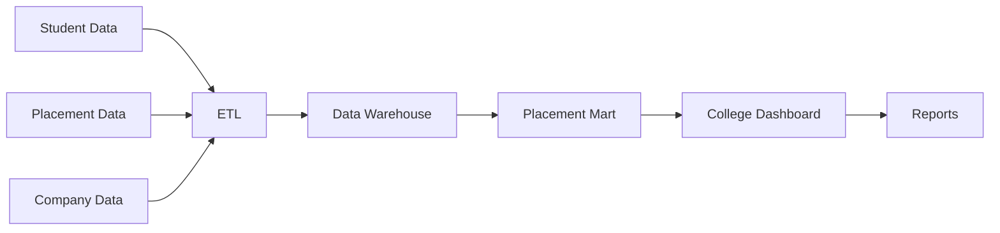
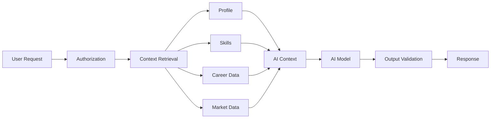

# 22 — Functional Requirements

# Career Connect — AI Career Intelligence Platform

**Document Type:** Functional Requirements Specification
**Project:** Career Connect
**Version:** 1.0
**Status:** Functional Requirements Baseline
**Primary Goal:** Define what the Career Connect platform must do
**Scope:** Application + AI + Data Warehouse + BI + ETL + Reporting + Administration

---

# 1. Introduction

This document defines the **functional requirements** of Career Connect.

Functional requirements describe the observable capabilities and behaviors the system must provide to its users and connected systems.

The requirements are organized by business domain:

```text id="q7m3x8"
1. Identity & Access
2. Organization Management
3. Student Management
4. Skill Intelligence
5. Resume Intelligence
6. Career Intelligence
7. Job Intelligence
8. Application Management
9. Recruitment Management
10. Interview Management
11. Offer & Placement Management
12. Learning Intelligence
13. Certification Management
14. Salary Intelligence
15. Business Intelligence
16. Reporting
17. AI Assistant
18. Notifications
19. Data Engineering
20. Data Warehouse
21. Administration
22. Audit & Governance
23. Search
24. System Operations
```

---

# 2. Requirement Identification Convention

Every requirement receives a unique identifier.

Format:

```text id="w8m2q4"
FR-<DOMAIN>-<NUMBER>
```

Examples:

```text id="f5x7m2"
FR-AUTH-001
FR-STU-001
FR-JOB-001
FR-AI-001
FR-BI-001
```

Priority values:

```text id="q3n8x5"
MUST
SHOULD
COULD
FUTURE
```

---

# 3. Identity and Access Requirements

## FR-AUTH-001 — User Registration

**Priority:** MUST

The system shall allow supported users to register through the configured authentication mechanism.

The system shall:

- Validate required registration information.
- Prevent duplicate accounts.
- Create the corresponding application profile.
- Record registration time.
- Assign the appropriate initial role.

---

## FR-AUTH-002 — User Login

**Priority:** MUST

The system shall allow authorized users to authenticate.

Supported methods may include:

```text id="x5m8q2"
Email + Password
Google OAuth
Institutional Identity Provider
```

---

## FR-AUTH-003 — Logout

**Priority:** MUST

The system shall allow users to terminate their authenticated session.

---

## FR-AUTH-004 — Current User Profile

**Priority:** MUST

The system shall provide an authenticated endpoint to retrieve:

```text id="m7q3x9"
User ID
Email
Roles
Organization
Profile Type
Account Status
```

---

## FR-AUTH-005 — Password Recovery

**Priority:** SHOULD

The system shall provide a secure password-recovery workflow when password-based authentication is enabled.

---

## FR-AUTH-006 — Role Assignment

**Priority:** MUST

Authorized administrators shall be able to assign supported roles.

---

## FR-AUTH-007 — Permission Management

**Priority:** MUST

The system shall support permissions at resource/action level.

Example:

```text id="v8m4q1"
STUDENT_READ
STUDENT_UPDATE
JOB_CREATE
APPLICATION_READ
REPORT_EXPORT
USER_MANAGE
```

---

## FR-AUTH-008 — Role Validation

**Priority:** MUST

Every protected operation shall verify that the current user has the required permissions.

---

## FR-AUTH-009 — Session Validation

**Priority:** MUST

The backend shall validate the authentication context before processing protected requests.

---

## FR-AUTH-010 — Account Status

**Priority:** MUST

The system shall support account states such as:

```text id="q5x8m3"
ACTIVE
PENDING
SUSPENDED
INACTIVE
DELETED
```

---

# 4. Organization Management Requirements

## FR-ORG-001 — Create Organization

**Priority:** MUST

Authorized administrators shall be able to create organizations.

Supported organization types include:

```text id="n2m7x4"
College
University
Company
Training Institute
Recruitment Agency
Enterprise
```

---

## FR-ORG-002 — Update Organization

**Priority:** MUST

Authorized administrators shall be able to update organization metadata.

---

## FR-ORG-003 — Deactivate Organization

**Priority:** MUST

Authorized administrators shall be able to deactivate an organization without unnecessarily deleting historical data.

---

## FR-ORG-004 — Organization Users

**Priority:** MUST

Authorized users shall be able to view users belonging to an organization according to their permissions.

---

## FR-ORG-005 — Organization Roles

**Priority:** MUST

The system shall support organization-specific role assignment.

---

## FR-ORG-006 — Department Management

**Priority:** MUST

Authorized users shall be able to:

```text id="y6m3q8"
Create Department
Update Department
Deactivate Department
List Department
```

---

## FR-ORG-007 — Organization Dashboard

**Priority:** SHOULD

Organizations shall have a dashboard showing relevant operational and analytical summaries.

---

# 5. Student Management Requirements

## FR-STU-001 — Student Profile Creation

**Priority:** MUST

The system shall create a student profile associated with an authenticated user.

---

## FR-STU-002 — Student Profile Update

**Priority:** MUST

Students shall be able to update permitted profile attributes.

---

## FR-STU-003 — Student Profile View

**Priority:** MUST

Students shall be able to view their own complete career profile.

Authorized institutional and recruiter users may view permitted fields according to policy.

---

## FR-STU-004 — Education Management

**Priority:** MUST

Students shall be able to:

```text id="p4x7m2"
Add Education
Edit Education
Delete/Deactivate Education
View Education History
```

---

## FR-STU-005 — Project Management

**Priority:** MUST

Students shall be able to manage project records.

---

## FR-STU-006 — Experience Management

**Priority:** SHOULD

Students shall be able to record:

```text id="m5q8x2"
Internships
Employment
Freelance Experience
Relevant Experience
```

---

## FR-STU-007 — Career Goal

**Priority:** MUST

Students shall be able to define one or more career goals.

---

## FR-STU-008 — Preferred Locations

**Priority:** SHOULD

Students shall be able to configure preferred work locations.

---

## FR-STU-009 — Employment Preferences

**Priority:** SHOULD

Students shall be able to select:

```text id="x4m7q1"
Full Time
Part Time
Contract
Internship
Remote
Hybrid
Onsite
```

---

## FR-STU-010 — Profile Completion

**Priority:** SHOULD

The system shall calculate profile completion based on required profile components.

---

## FR-STU-011 — Student Activity Timeline

**Priority:** SHOULD

The system should provide a timeline containing important career activities:

```text id="q8m3x5"
Resume Analysis
Skill Update
Course Completion
Application
Interview
Offer
Placement
```

---

# 6. Skill Intelligence Requirements

## FR-SKL-001 — Skill Catalog

**Priority:** MUST

The system shall maintain a canonical skill catalog.

---

## FR-SKL-002 — Skill Categories

**Priority:** MUST

Skills shall belong to controlled categories such as:

```text id="v2m7x4"
Programming
Cloud
Database
Data Engineering
AI / ML
Analytics
DevOps
Cybersecurity
Soft Skills
```

---

## FR-SKL-003 — Skill Aliases

**Priority:** MUST

The system shall support aliases.

Example:

```text id="x5q8m2"
React
React.js
ReactJS
React JS
```

can map to one canonical skill when the governance rules establish equivalence.

---

## FR-SKL-004 — Add Student Skill

**Priority:** MUST

Students shall be able to add skills.

---

## FR-SKL-005 — Update Student Skill

**Priority:** MUST

Students shall be able to update skill proficiency.

---

## FR-SKL-006 — Skill Verification

**Priority:** SHOULD

Authorized systems shall be able to mark skills as verified.

---

## FR-SKL-007 — Skill Source

**Priority:** MUST

The system shall track the origin of a skill:

```text id="m7x3q9"
Self Reported
Resume Extracted
Assessment
Certification
Project
Interview
Institution Verified
AI Inferred
```

---

## FR-SKL-008 — Skill Proficiency

**Priority:** MUST

The system shall support controlled proficiency levels.

Example:

```text id="n8q3m6"
Beginner
Intermediate
Advanced
Expert
```

---

## FR-SKL-009 — Skill Relationship

**Priority:** SHOULD

The system shall support relationships between related skills and technologies.

---

## FR-SKL-010 — Skill Demand

**Priority:** MUST

The system shall calculate approved market-demand metrics for skills.

---

## FR-SKL-011 — Skill Supply

**Priority:** MUST

The system shall calculate the number of candidates/students possessing a skill according to approved validation rules.

---

## FR-SKL-012 — Skill Gap

**Priority:** MUST

The system shall calculate skill gaps between current skills and target requirements.

---

## FR-SKL-013 — Skill Gap Priority

**Priority:** SHOULD

The system shall prioritize detected skill gaps.

---

# 7. Resume Intelligence Requirements

## FR-RES-001 — Resume Upload

**Priority:** MUST

Students shall be able to securely upload resumes.

---

## FR-RES-002 — Resume Validation

**Priority:** MUST

The system shall validate:

```text id="q4m8x2"
File Type
File Size
Ownership
Content Type
```

---

## FR-RES-003 — Resume Storage

**Priority:** MUST

Resume files shall be stored in controlled object storage.

---

## FR-RES-004 — Resume Versioning

**Priority:** SHOULD

The system shall support multiple versions.

---

## FR-RES-005 — Resume Parsing

**Priority:** MUST

The system shall extract supported information from resumes.

---

## FR-RES-006 — Skill Extraction

**Priority:** MUST

The system shall identify candidate skills from resume content.

---

## FR-RES-007 — Resume Scoring

**Priority:** MUST

The system shall calculate configured resume-quality indicators.

---

## FR-RES-008 — ATS-Oriented Analysis

**Priority:** SHOULD

The platform should provide an ATS-oriented analysis.

The result must be presented as a product-generated score, not as a universal ATS standard.

---

## FR-RES-009 — Resume Strengths

**Priority:** MUST

The platform shall identify positive resume characteristics.

---

## FR-RES-010 — Resume Weaknesses

**Priority:** MUST

The platform shall identify improvement opportunities.

---

## FR-RES-011 — Resume Recommendations

**Priority:** MUST

The system shall provide actionable recommendations.

---

## FR-RES-012 — Target Career Analysis

**Priority:** SHOULD

Users shall be able to compare their resume against a target career.

---

## FR-RES-013 — Analysis History

**Priority:** SHOULD

The system shall maintain analysis history and relevant model metadata.

---

# 8. Career Intelligence Requirements

## FR-CAR-001 — Career Path Catalog

**Priority:** MUST

The platform shall maintain a canonical career catalog.

---

## FR-CAR-002 — Career Hierarchy

**Priority:** SHOULD

Career paths should support:

```text id="p6x2m8"
Career Family
Career Category
Career Role
Career Level
```

---

## FR-CAR-003 — Career Skill Mapping

**Priority:** MUST

The system shall map careers to required skills.

---

## FR-CAR-004 — Career Recommendation

**Priority:** MUST

The system shall recommend career paths using approved data and recommendation logic.

---

## FR-CAR-005 — Recommendation Explanation

**Priority:** MUST

Each personalized recommendation shall provide understandable reasons.

---

## FR-CAR-006 — Recommendation Score

**Priority:** MUST

The system shall produce a defined match indicator where applicable.

---

## FR-CAR-007 — Recommendation Confidence

**Priority:** SHOULD

Recommendations generated by AI/model-based logic should include confidence metadata where meaningful.

---

## FR-CAR-008 — Recommendation History

**Priority:** SHOULD

The system shall retain recommendation history where the product requires longitudinal evaluation.

---

## FR-CAR-009 — Related Careers

**Priority:** SHOULD

The system should identify adjacent career paths.

---

## FR-CAR-010 — Career Progress Tracking

**Priority:** COULD

The platform may compare a student's current profile against previous recommendation states to measure progression.

---

# 9. Job Intelligence Requirements

## FR-JOB-001 — Company Creation

**Priority:** MUST

Authorized users shall create companies.

---

## FR-JOB-002 — Company Profile

**Priority:** MUST

Company profiles shall include relevant:

```text id="x7m4q2"
Industry
Size
Location
Website
Type
```

---

## FR-JOB-003 — Recruiter Profile

**Priority:** MUST

Companies shall be able to associate recruiters with company accounts.

---

## FR-JOB-004 — Job Creation

**Priority:** MUST

Authorized recruiters shall create jobs.

---

## FR-JOB-005 — Job Draft

**Priority:** MUST

Recruiters shall be able to save jobs as drafts.

---

## FR-JOB-006 — Job Publishing

**Priority:** MUST

Recruiters shall be able to publish jobs after validation.

---

## FR-JOB-007 — Job Update

**Priority:** MUST

Authorized recruiters shall update active jobs.

Important changes should be audited.

---

## FR-JOB-008 — Job Closure

**Priority:** MUST

Recruiters shall be able to close jobs.

---

## FR-JOB-009 — Job Skill Requirements

**Priority:** MUST

Each job may have multiple required skills.

---

## FR-JOB-010 — Job Locations

**Priority:** MUST

Jobs shall support one or more authorized locations where applicable.

---

## FR-JOB-011 — Work Mode

**Priority:** MUST

Jobs shall support:

```text id="q6m3x9"
Onsite
Hybrid
Remote
```

---

## FR-JOB-012 — Employment Type

**Priority:** MUST

Jobs shall support controlled employment types.

---

## FR-JOB-013 — Job Search

**Priority:** MUST

Users shall be able to search available jobs.

---

## FR-JOB-014 — Job Filtering

**Priority:** MUST

Users shall be able to filter jobs by approved dimensions.

---

## FR-JOB-015 — Job Sorting

**Priority:** SHOULD

Users shall be able to sort jobs by:

```text id="p4x8m2"
Relevance
Posting Date
Salary
Company
```

Only approved sortable fields should be exposed.

---

## FR-JOB-016 — Job Recommendation

**Priority:** SHOULD

The platform should recommend jobs based on the user's authorized career profile.

---

## FR-JOB-017 — Job Match Explanation

**Priority:** SHOULD

The platform should display major matching and missing criteria.

---

# 10. Application Management Requirements

## FR-APP-001 — Apply to Job

**Priority:** MUST

Eligible users shall be able to apply to an active job.

---

## FR-APP-002 — Duplicate Application Prevention

**Priority:** MUST

The system shall prevent duplicate active applications according to defined business rules.

---

## FR-APP-003 — Application Reference

**Priority:** MUST

Each application shall receive a unique reference.

---

## FR-APP-004 — Application Status

**Priority:** MUST

Authorized users shall be able to manage application status.

---

## FR-APP-005 — Application Events

**Priority:** MUST

Important lifecycle changes shall be recorded as events.

---

## FR-APP-006 — Application History

**Priority:** MUST

Users shall be able to view relevant application history.

---

## FR-APP-007 — Application Withdrawal

**Priority:** SHOULD

Users shall be able to withdraw eligible applications.

---

## FR-APP-008 — Recruiter Shortlisting

**Priority:** MUST

Recruiters shall be able to shortlist candidates.

---

## FR-APP-009 — Recruiter Rejection

**Priority:** MUST

Recruiters shall be able to reject candidates through approved workflow states.

---

## FR-APP-010 — Application Funnel

**Priority:** MUST

The system shall maintain the recruitment funnel.

```text id="m7q3x8"
Applications
↓
Screening
↓
Shortlist
↓
Interview
↓
Offer
↓
Hire
```

---

# 11. Recruitment Management Requirements

## FR-REC-001 — Candidate Search

**Priority:** SHOULD

Recruiters shall be able to search authorized candidate profiles.

---

## FR-REC-002 — Candidate Filtering

**Priority:** SHOULD

Recruiters shall be able to filter candidates by:

```text id="v8m2q4"
Skills
Experience
Location
Education
Certification
Career
```

---

## FR-REC-003 — Candidate Matching

**Priority:** SHOULD

The system shall provide an explainable matching mechanism.

---

## FR-REC-004 — Candidate Ranking

**Priority:** SHOULD

The system shall rank eligible candidates based on configured criteria.

---

## FR-REC-005 — Candidate Profile View

**Priority:** MUST

Authorized recruiters shall be able to view permitted candidate information.

---

## FR-REC-006 — Candidate Privacy

**Priority:** MUST

Recruiters shall not access fields outside their authorized scope.

---

## FR-REC-007 — Recruiter Dashboard

**Priority:** MUST

Recruiters shall have a dashboard containing:

```text id="x5m8q3"
Active Jobs
Applications
Shortlists
Interviews
Offers
Hires
```

---

## FR-REC-008 — Hiring Funnel Analytics

**Priority:** MUST

Recruiters shall be able to view conversion through recruitment stages.

---

## FR-REC-009 — Time-to-Hire

**Priority:** SHOULD

The system should calculate time-to-hire using the governed definition.

---

# 12. Interview Requirements

## FR-INT-001 — Schedule Interview

**Priority:** MUST

Authorized recruiters shall schedule interviews.

---

## FR-INT-002 — Interview Round

**Priority:** MUST

Interviews shall support round numbers.

---

## FR-INT-003 — Interview Type

**Priority:** MUST

The system shall support configured interview types.

---

## FR-INT-004 — Reschedule Interview

**Priority:** SHOULD

Authorized users shall be able to reschedule interviews.

---

## FR-INT-005 — Interview Completion

**Priority:** MUST

Interviewers shall be able to mark an interview completed.

---

## FR-INT-006 — Interview Score

**Priority:** MUST

Interviewers shall be able to record structured scores where applicable.

---

## FR-INT-007 — Interview Feedback

**Priority:** MUST

Authorized interviewers shall be able to provide feedback.

---

## FR-INT-008 — Interview Result

**Priority:** MUST

The system shall support:

```text id="m8x3q5"
PASS
FAIL
PENDING
NO_SHOW
RESCHEDULED
```

---

## FR-INT-009 — Interview Analytics

**Priority:** SHOULD

The system shall calculate interview performance metrics.

---

# 13. Offer and Placement Requirements

## FR-PLC-001 — Create Offer

**Priority:** SHOULD

Authorized recruiters shall be able to issue offers.

---

## FR-PLC-002 — Offer Status

**Priority:** SHOULD

The system shall support offer states.

---

## FR-PLC-003 — Offer Acceptance

**Priority:** SHOULD

Where enabled, candidates shall be able to record acceptance.

---

## FR-PLC-004 — Offer Decline

**Priority:** SHOULD

Candidates shall be able to decline eligible offers.

---

## FR-PLC-005 — Placement Creation

**Priority:** MUST

Authorized placement officers shall create verified placement records.

---

## FR-PLC-006 — Placement Validation

**Priority:** MUST

The platform shall validate the relationship between:

```text id="q4m8x2"
Student
Application
Job
Company
Offer
Placement
```

before creating a valid placement outcome.

---

## FR-PLC-007 — Placement Salary

**Priority:** MUST

The system shall record actual placement salary separately from market salary observations.

---

## FR-PLC-008 — Placement Status

**Priority:** MUST

The platform shall support controlled placement states.

---

## FR-PLC-009 — Placement Dashboard

**Priority:** MUST

Authorized placement users shall have access to placement KPIs.

---

# 14. Learning Intelligence Requirements

## FR-LEARN-001 — Course Catalog

**Priority:** MUST

The system shall maintain a course catalog.

---

## FR-LEARN-002 — Course Skill Mapping

**Priority:** MUST

Courses shall map to the skills they teach.

---

## FR-LEARN-003 — Course Search

**Priority:** SHOULD

Students shall be able to search courses by:

```text id="x7m3q9"
Skill
Category
Difficulty
Provider
Duration
```

---

## FR-LEARN-004 — Course Recommendation

**Priority:** SHOULD

The system shall recommend courses based on skill gaps.

---

## FR-LEARN-005 — Learning Enrollment

**Priority:** SHOULD

Students shall be able to add a course to their learning plan.

---

## FR-LEARN-006 — Progress Tracking

**Priority:** MUST

Students shall be able to record learning progress.

---

## FR-LEARN-007 — Completion Tracking

**Priority:** MUST

The system shall record course completion.

---

## FR-LEARN-008 — Assessment Score

**Priority:** SHOULD

The system shall support assessment results where available.

---

## FR-LEARN-009 — Learning Roadmap

**Priority:** SHOULD

The system shall generate a career-oriented learning roadmap.

---

## FR-LEARN-010 — Skill Improvement

**Priority:** COULD

The system may compare skill state before and after learning activity.

---

# 15. Certification Requirements

## FR-CERT-001 — Certification Catalog

**Priority:** SHOULD

The system shall maintain certification definitions.

---

## FR-CERT-002 — Student Certification

**Priority:** SHOULD

Students shall be able to add certifications.

---

## FR-CERT-003 — Credential Verification

**Priority:** SHOULD

The system should support credential verification where external verification is available.

---

## FR-CERT-004 — Certification Expiry

**Priority:** SHOULD

The system shall track applicable certification expiry dates.

---

## FR-CERT-005 — Certification Skill Mapping

**Priority:** SHOULD

Certifications shall be associated with relevant skills.

---

# 16. Salary Intelligence Requirements

## FR-SAL-001 — Salary Data Ingestion

**Priority:** MUST

The data platform shall ingest approved salary sources.

---

## FR-SAL-002 — Salary Normalization

**Priority:** MUST

Salary values shall be standardized with:

```text id="n6q3x8"
Currency
Role
Location
Experience
Observation Date
```

---

## FR-SAL-003 — Salary Range Validation

**Priority:** MUST

The system shall validate that salary ranges are logically valid.

---

## FR-SAL-004 — Salary by Role

**Priority:** MUST

Users shall be able to analyze salary by career/job role.

---

## FR-SAL-005 — Salary by Location

**Priority:** MUST

Users shall be able to compare salaries by location.

---

## FR-SAL-006 — Salary by Experience

**Priority:** SHOULD

The system shall provide experience-level salary analysis.

---

## FR-SAL-007 — Salary Trends

**Priority:** SHOULD

The system shall display salary trends over time.

---

## FR-SAL-008 — Salary Source

**Priority:** MUST

The system shall preserve the source of a salary observation.

---

# 17. Business Intelligence Requirements

## FR-BI-001 — Executive Dashboard

**Priority:** MUST

The executive dashboard shall display high-level KPIs.

---

## FR-BI-002 — College Dashboard

**Priority:** MUST

The college dashboard shall display:

```text id="x5m8q2"
Placement
Salary
Companies
Departments
Students
Skills
```

---

## FR-BI-003 — Student Dashboard

**Priority:** MUST

The student dashboard shall show:

```text id="r7q3m8"
Profile
Skills
Resume
Career Recommendations
Applications
Learning
```

---

## FR-BI-004 — Recruiter Dashboard

**Priority:** MUST

The recruiter dashboard shall show:

```text id="n4x8q2"
Jobs
Applications
Candidates
Interviews
Offers
Hires
```

---

## FR-BI-005 — Skill Dashboard

**Priority:** MUST

The skill dashboard shall show:

```text id="m6q3x7"
Skill Demand
Skill Supply
Skill Gap
Technology Trends
```

---

## FR-BI-006 — Job Market Dashboard

**Priority:** MUST

The dashboard shall show:

```text id="p8x2m5"
Jobs
Roles
Locations
Companies
Skills
Technologies
```

---

## FR-BI-007 — Placement KPI

**Priority:** MUST

The system shall provide the governed placement-rate definition.

---

## FR-BI-008 — Average Salary KPI

**Priority:** MUST

The system shall provide approved salary aggregation.

---

## FR-BI-009 — Highest Salary KPI

**Priority:** MUST

The system shall show the highest salary for authorized populations.

---

## FR-BI-010 — Department Analytics

**Priority:** MUST

Authorized institutional users shall be able to compare departments.

---

## FR-BI-011 — Company Analytics

**Priority:** MUST

Authorized users shall be able to compare hiring companies.

---

## FR-BI-012 — Location Analytics

**Priority:** MUST

The system shall support country/state/city analysis where applicable.

---

## FR-BI-013 — Technology Trends

**Priority:** SHOULD

The platform should identify technology-demand trends.

---

## FR-BI-014 — Experience Analytics

**Priority:** MUST

The system shall allow analysis by experience category.

---

## FR-BI-015 — Employment Analytics

**Priority:** MUST

The system shall support employment-type analysis.

---

## FR-BI-016 — Application Funnel

**Priority:** MUST

Dashboards shall visualize:

```text id="v3m7q8"
Applications
Screened
Shortlisted
Interviewed
Offered
Hired
```

---

## FR-BI-017 — Interview Funnel

**Priority:** SHOULD

The system should visualize interview-stage conversion.

---

## FR-BI-018 — Recruitment Funnel

**Priority:** MUST

Recruiters and authorized executives shall be able to view the complete hiring funnel.

---

## FR-BI-019 — Dashboard Filters

**Priority:** MUST

Dashboards shall support controlled filters.

---

## FR-BI-020 — Dashboard Export

**Priority:** SHOULD

Authorized users shall be able to export dashboard data or reports.

---

# 18. Reporting Requirements

## FR-REP-001 — Report Types

**Priority:** MUST

The system shall support:

```text id="j8m4q2"
Weekly Reports
Monthly Reports
Yearly Reports
Placement Reports
Hiring Reports
Student Reports
Company Reports
Skill Reports
Salary Reports
Executive Reports
```

---

## FR-REP-002 — PDF Generation

**Priority:** MUST

The system shall generate PDF reports.

---

## FR-REP-003 — Excel Export

**Priority:** MUST

The system shall generate spreadsheet exports for authorized data.

---

## FR-REP-004 — CSV Export

**Priority:** SHOULD

The system should provide CSV exports for appropriate datasets.

---

## FR-REP-005 — Report Filters

**Priority:** MUST

Reports shall retain the filter scope used to generate them.

---

## FR-REP-006 — Report Timestamp

**Priority:** MUST

Reports shall display the relevant data-as-of or generated timestamp.

---

## FR-REP-007 — Report Status

**Priority:** MUST

Long-running report jobs shall expose:

```text id="m7q3x9"
PENDING
PROCESSING
COMPLETED
FAILED
```

---

## FR-REP-008 — Report History

**Priority:** SHOULD

Authorized users should be able to view previously generated reports.

---

# 19. AI Functional Requirements

## FR-AI-001 — AI Career Chat

**Priority:** MUST

The system shall allow authorized users to ask career-related questions.

---

## FR-AI-002 — Contextual AI

**Priority:** MUST

Personalized AI responses shall use only authorized contextual data.

---

## FR-AI-003 — Resume Review

**Priority:** MUST

The AI layer shall support resume review.

---

## FR-AI-004 — Skill Extraction

**Priority:** MUST

AI shall be able to extract candidate skills from supported text.

---

## FR-AI-005 — Career Recommendation

**Priority:** MUST

AI/model-based logic shall support career recommendations.

---

## FR-AI-006 — Skill Gap Explanation

**Priority:** SHOULD

AI should explain why a skill is considered missing or important.

---

## FR-AI-007 — Learning Recommendation

**Priority:** SHOULD

The AI system should recommend learning actions.

---

## FR-AI-008 — Mock Interview

**Priority:** SHOULD

The AI system should conduct simulated interview sessions.

---

## FR-AI-009 — AI Model Metadata

**Priority:** MUST

Persisted AI results shall record relevant model metadata where required.

---

## FR-AI-010 — AI Output Validation

**Priority:** MUST

Structured AI output shall be validated before downstream use.

---

## FR-AI-011 — AI Failure Handling

**Priority:** MUST

If an AI provider fails, the platform shall return a controlled failure state rather than blocking unrelated core functionality.

---

## FR-AI-012 — AI Usage Tracking

**Priority:** SHOULD

The platform should track:

```text id="x5m8q3"
Request Count
Latency
Token/Usage Data where available
Failure Rate
```

---

## FR-AI-013 — AI Feedback

**Priority:** SHOULD

Users should be able to provide feedback on AI outputs.

---

## FR-AI-014 — AI Conversation History

**Priority:** SHOULD

The platform should preserve supported AI conversation history according to privacy policies.

---

## FR-AI-015 — AI Grounding

**Priority:** MUST

For factual market or platform-specific questions, the AI should prefer approved platform data and identified source context rather than inventing information.

---

# 20. Notification Requirements

## FR-NOT-001 — In-App Notification

**Priority:** SHOULD

The system shall support in-app notifications.

---

## FR-NOT-002 — Email Notification

**Priority:** SHOULD

The system should support email notifications.

---

## FR-NOT-003 — Job Match Notification

**Priority:** SHOULD

The system should notify users about significant new job matches.

---

## FR-NOT-004 — Interview Reminder

**Priority:** SHOULD

The system should send interview reminders.

---

## FR-NOT-005 — Application Update

**Priority:** SHOULD

Users should receive application-state notifications.

---

## FR-NOT-006 — Report Ready

**Priority:** SHOULD

Users should be notified when requested reports become available.

---

# 21. Data Engineering Requirements

## FR-ETL-001 — Source Registration

**Priority:** MUST

Every production source shall be registered with metadata.

---

## FR-ETL-002 — Data Extraction

**Priority:** MUST

The system shall extract data from supported sources.

---

## FR-ETL-003 — Raw Preservation

**Priority:** MUST

Raw source data shall be preserved according to retention policy.

---

## FR-ETL-004 — Schema Validation

**Priority:** MUST

Incoming datasets shall be validated against expected schemas.

---

## FR-ETL-005 — Data Cleaning

**Priority:** MUST

The ETL process shall clean configured technical inconsistencies.

---

## FR-ETL-006 — Data Standardization

**Priority:** MUST

The system shall standardize:

```text id="q7m3x9"
Locations
Skills
Company Names
Job Titles
Employment Types
```

where applicable.

---

## FR-ETL-007 — Deduplication

**Priority:** MUST

The ETL process shall detect and handle duplicates.

---

## FR-ETL-008 — Data Quality

**Priority:** MUST

Each important dataset shall undergo data-quality validation.

---

## FR-ETL-009 — Quarantine

**Priority:** MUST

Invalid records shall be routed to a quarantine mechanism.

---

## FR-ETL-010 — Incremental Load

**Priority:** MUST

The platform shall support incremental ingestion for appropriate sources.

---

## FR-ETL-011 — Full Refresh

**Priority:** SHOULD

The platform shall support controlled full refresh for selected datasets.

---

## FR-ETL-012 — Idempotency

**Priority:** MUST

Reprocessing the same batch shall not create unintended duplicate records.

---

## FR-ETL-013 — Retry

**Priority:** MUST

Transient pipeline errors shall support controlled retries.

---

## FR-ETL-014 — Pipeline Logging

**Priority:** MUST

Each execution shall record:

```text id="m8x2q5"
Start
End
Status
Rows Processed
Rows Rejected
Errors
```

---

## FR-ETL-015 — Data Reconciliation

**Priority:** MUST

Source and target counts/critical measures shall be reconciled.

---

## FR-ETL-016 — Data Lineage

**Priority:** SHOULD

The system should preserve source-to-target lineage for critical datasets.

---

## FR-ETL-017 — Pipeline Replay

**Priority:** SHOULD

Failed or corrected batches should be replayable.

---

# 22. Data Warehouse Requirements

## FR-DW-001 — Dimension Loading

**Priority:** MUST

The warehouse shall load conformed dimensions.

---

## FR-DW-002 — Fact Loading

**Priority:** MUST

The warehouse shall load analytical facts.

---

## FR-DW-003 — Surrogate Keys

**Priority:** MUST

Dimensions shall use warehouse-managed surrogate keys.

---

## FR-DW-004 — Historical Dimensions

**Priority:** MUST

The warehouse shall support historical dimension handling where required.

---

## FR-DW-005 — SCD Type 2

**Priority:** MUST

Selected dimensions shall use Type 2 history.

---

## FR-DW-006 — Fact Grain

**Priority:** MUST

Every fact table shall have an explicitly documented grain.

---

## FR-DW-007 — Conformed Dimensions

**Priority:** MUST

Core dimensions shall be reusable across business-process facts.

---

## FR-DW-008 — Data Marts

**Priority:** MUST

The system shall provide domain-specific analytical marts.

Examples:

```text id="q5m8x3"
Placement
Recruitment
Salary
Skill
Student
Executive
```

---

## FR-DW-009 — Historical Analysis

**Priority:** MUST

The warehouse shall support trend and year-over-year analysis.

---

## FR-DW-010 — Partitioning

**Priority:** SHOULD

Large fact tables should use appropriate partitioning.

---

## FR-DW-011 — Clustering

**Priority:** SHOULD

Frequently filtered columns should be candidates for clustering based on actual workload measurements.

---

# 23. Semantic Layer Requirements

## FR-SEM-001 — Governed Metrics

**Priority:** MUST

Every major KPI shall have a controlled definition.

---

## FR-SEM-002 — Business-Friendly Names

**Priority:** MUST

BI consumers shall see business-friendly metric and dimension names.

---

## FR-SEM-003 — Metric Consistency

**Priority:** MUST

The same KPI shall use the same governed definition across dashboards and reports.

---

## FR-SEM-004 — Metric Versioning

**Priority:** SHOULD

Major metric-definition changes should be versioned.

---

## FR-SEM-005 — Natural-Language Mapping

**Priority:** SHOULD

The semantic layer should support mapping business language to approved metrics and dimensions.

---

# 24. Search Requirements

## FR-SEARCH-001 — Unified Search

**Priority:** SHOULD

The system should support searching:

```text id="m7x3q9"
Jobs
Skills
Companies
Courses
Careers
```

---

## FR-SEARCH-002 — Search Relevance

**Priority:** SHOULD

Search results should be ranked based on relevance.

---

## FR-SEARCH-003 — Search Authorization

**Priority:** MUST

Search results shall exclude unauthorized resources.

---

# 25. Administration Requirements

## FR-ADMIN-001 — User Management

**Priority:** MUST

Administrators shall view and manage authorized user accounts.

---

## FR-ADMIN-002 — Role Management

**Priority:** MUST

Administrators shall manage roles.

---

## FR-ADMIN-003 — Permission Management

**Priority:** MUST

Administrators shall manage supported permissions.

---

## FR-ADMIN-004 — Reference Data Management

**Priority:** MUST

Authorized administrators shall manage controlled reference data.

---

## FR-ADMIN-005 — Data Source Management

**Priority:** SHOULD

Administrators/data engineers should manage registered data sources.

---

## FR-ADMIN-006 — Pipeline Monitoring

**Priority:** MUST

Authorized administrators shall view ETL pipeline health.

---

## FR-ADMIN-007 — Data Quality Monitoring

**Priority:** SHOULD

Administrators/data engineers should view data-quality results.

---

## FR-ADMIN-008 — System Health

**Priority:** MUST

Administrators shall have access to major service-health indicators.

---

# 26. Audit and Governance Requirements

## FR-AUD-001 — Audit Logging

**Priority:** MUST

Important operations shall create audit records.

---

## FR-AUD-002 — Audit Search

**Priority:** MUST

Authorized administrators shall be able to search audit logs.

---

## FR-AUD-003 — Audit Filtering

**Priority:** SHOULD

Audit logs should support filtering by:

```text id="q5m8x2"
User
Organization
Action
Resource
Date
Request ID
```

---

## FR-AUD-004 — Audit Immutability

**Priority:** MUST

Normal application users shall not be able to alter audit records.

---

## FR-AUD-005 — Data Classification

**Priority:** MUST

Important datasets shall carry an appropriate classification.

---

## FR-AUD-006 — Data Dictionary

**Priority:** MUST

Core entities, fields, and metrics shall have governed definitions.

---

# 27. Security Functional Requirements

## FR-SEC-001 — Input Validation

**Priority:** MUST

Every API and import interface shall validate inputs.

---

## FR-SEC-002 — SQL Injection Protection

**Priority:** MUST

The application shall use parameterized database access mechanisms.

---

## FR-SEC-003 — XSS Protection

**Priority:** MUST

User-generated and AI-generated content shall be safely handled by the frontend.

---

## FR-SEC-004 — Rate Limiting

**Priority:** MUST

Public and sensitive APIs shall have controlled rate limits.

---

## FR-SEC-005 — Secure File Access

**Priority:** MUST

Resume and sensitive files shall require authorization.

---

## FR-SEC-006 — Tenant Isolation

**Priority:** MUST

Tenant-owned resources shall remain isolated.

---

## FR-SEC-007 — Security Event Logging

**Priority:** MUST

Security-relevant events shall be logged.

---

## FR-SEC-008 — Secret Protection

**Priority:** MUST

Secrets shall not be exposed through source code, APIs, or normal logs.

---

# 28. Reporting and Export Security

## FR-SEC-009 — Export Authorization

**Priority:** MUST

Only authorized users shall export sensitive datasets.

---

## FR-SEC-010 — Export Auditing

**Priority:** MUST

Sensitive exports shall be audited.

---

## FR-SEC-011 — Organization Scope

**Priority:** MUST

Exports shall respect organization scope.

---

# 29. Performance-Related Functional Requirements

## FR-PERF-001 — Pagination

**Priority:** MUST

Large API collections shall support pagination.

---

## FR-PERF-002 — Async Processing

**Priority:** MUST

Long-running tasks such as:

```text id="x4m8q2"
Resume Analysis
Report Generation
Bulk Imports
Large ETL Jobs
```

shall be processed asynchronously where appropriate.

---

## FR-PERF-003 — Caching

**Priority:** SHOULD

Frequently accessed stable reference data should support caching.

---

# 30. System Health Requirements

## FR-OPS-001 — Health Endpoint

**Priority:** MUST

The backend shall expose a controlled health-check endpoint.

---

## FR-OPS-002 — Dependency Health

**Priority:** SHOULD

The health subsystem should monitor:

```text id="m7q3x9"
Database
Storage
AI
Warehouse
External Dependencies
```

---

## FR-OPS-003 — Application Metrics

**Priority:** MUST

The system shall collect application performance metrics.

---

## FR-OPS-004 — Error Monitoring

**Priority:** MUST

Unhandled production errors shall be captured by the monitoring system.

---

## FR-OPS-005 — Deployment Tracking

**Priority:** SHOULD

The system should associate deployments with application versions.

---

# 31. Integration Requirements

## FR-INTG-001 — AI Provider Integration

**Priority:** MUST

The platform shall support at least one approved AI provider.

The architecture should allow additional providers through an abstraction layer.

---

## FR-INTG-002 — Object Storage Integration

**Priority:** MUST

The platform shall integrate with cloud object storage for documents and generated reports.

---

## FR-INTG-003 — Warehouse Integration

**Priority:** MUST

The application/data platform shall integrate with BigQuery or Snowflake.

---

## FR-INTG-004 — Authentication Integration

**Priority:** MUST

The platform shall integrate with the selected identity provider.

---

## FR-INTG-005 — External Data Integration

**Priority:** SHOULD

The ETL platform should support external job/market data sources.

---

## FR-INTG-006 — Learning Integration

**Priority:** COULD

The platform may integrate with external learning providers.

---

## FR-INTG-007 — Certification Integration

**Priority:** COULD

The platform may integrate with external certification verification systems.

---

# 32. Data Import Functional Requirements

## FR-IMP-001 — Import Dataset

**Priority:** MUST

Authorized users shall upload supported structured files.

---

## FR-IMP-002 — Import Preview

**Priority:** SHOULD

The system should display a preview before executing a large import.

---

## FR-IMP-003 — Import Validation

**Priority:** MUST

The import shall validate schema and quality.

---

## FR-IMP-004 — Import Result

**Priority:** MUST

The system shall report:

```text id="m8x3q5"
Total Records
Accepted
Rejected
Warnings
```

---

## FR-IMP-005 — Import Error Download

**Priority:** SHOULD

Authorized users should be able to download rejected-record details.

---

# 33. Bulk Operations

## FR-BULK-001 — Bulk Student Import

**Priority:** SHOULD

Authorized institutions shall be able to import student datasets.

---

## FR-BULK-002 — Bulk Placement Import

**Priority:** SHOULD

Authorized institutions shall be able to import placement datasets.

---

## FR-BULK-003 — Bulk Job Import

**Priority:** COULD

Authorized users may import jobs from external sources.

---

# 34. Data Governance Functional Requirements

## FR-GOV-001 — Data Owner

**Priority:** SHOULD

Important datasets shall have an assigned owner.

---

## FR-GOV-002 — Data Steward

**Priority:** SHOULD

Critical reference domains should have designated stewards.

---

## FR-GOV-003 — Data Quality Rules

**Priority:** MUST

Critical datasets shall have defined validation rules.

---

## FR-GOV-004 — Data Lineage

**Priority:** SHOULD

Critical analytical fields should have source lineage.

---

## FR-GOV-005 — Metadata

**Priority:** MUST

The system shall maintain technical and business metadata for important datasets.

---

# 35. AI Governance Requirements

## FR-AIG-001 — AI Model Registry

**Priority:** SHOULD

The AI platform should maintain model/provider metadata.

---

## FR-AIG-002 — Prompt Versioning

**Priority:** SHOULD

Important production prompts should be version controlled.

---

## FR-AIG-003 — AI Output Audit

**Priority:** MUST

Important AI-generated business outcomes should have audit metadata.

---

## FR-AIG-004 — AI Feedback

**Priority:** SHOULD

User feedback should be collected for evaluating AI quality.

---

## FR-AIG-005 — AI Evaluation

**Priority:** SHOULD

Production AI capabilities should be periodically evaluated against approved test datasets.

---

# 36. Data Warehouse Functional Use Cases

The warehouse shall support at least:

```text id="v4m8q2"
Placement Analysis
Salary Analysis
Job Demand
Skill Demand
Application Funnel
Hiring Funnel
Learning Analytics
Student Progress
College Benchmarking
Company Hiring
Career Analytics
```

---

# 37. Cross-Domain Analytics

## FR-XA-001

**Priority:** MUST

The platform shall support analysis across multiple business dimensions.

Example:

```text id="q7m3x9"
Skill
+
Role
+
Company
+
Location
+
Date
+
Salary
```

---

## FR-XA-002 — Career Outcome Analysis

**Priority:** SHOULD

The system should connect learning and skill information to recruitment outcomes.

---

# 38. Student Career Intelligence Workflow


All components are connected through controlled system workflows.

---

# 39. College Intelligence Workflow



---

# 40. Recruiter Intelligence Workflow


---

# 41. AI Intelligence Workflow



---

# 42. End-to-End Functional Workflow

```text id="x3q7m9"
USER
↓
AUTHENTICATION
↓
PROFILE
↓
SKILLS
↓
RESUME
↓
AI ANALYSIS
↓
SKILL GAP
↓
CAREER RECOMMENDATION
↓
LEARNING
↓
JOBS
↓
APPLICATION
↓
INTERVIEW
↓
OFFER
↓
PLACEMENT
↓
ANALYTICS
↓
REPORT
```

This represents the core product lifecycle.

---

# 43. Functional Requirement Traceability

Every functional requirement should map to implementation artifacts.

```text id="n7m4x2"
Requirement
↓
User Story
↓
UX
↓
API
↓
Service
↓
Database
↓
Test
↓
Monitoring
```

---

# 44. Minimum Functional Scope for BE CSE Project

The project should fully implement:

```text id="q5x8m3"
Authentication
Student Profile
Skill Profile
Resume Upload
Resume Analysis
Skill Gap
Career Recommendation
Job Search
Job Matching
Application
Interview
Placement
Salary Dashboard
Skill Dashboard
College Dashboard
AI Assistant
Reports
Admin
ETL
Warehouse
```

---

# 45. Functional Scope for Startup MVP

Add:

```text id="m8q3x7"
Recruiter Candidate Search
Candidate Ranking
Learning Roadmap
Certification Tracking
Hiring Analytics
Natural-Language BI
Notifications
Multi-Tenant Administration
```

---

# 46. Functional Scope for Enterprise

Add:

```text id="v4m7x2"
Enterprise SSO
Advanced RBAC
Partner APIs
Webhooks
Billing
Global Taxonomies
Advanced Benchmarking
Workforce Analytics
Predictive Analytics
Advanced Data Governance
```

---

# 47. Functional Requirements Summary Matrix

| Domain         | MUST                       | SHOULD                   | COULD                    |
| -------------- | -------------------------- | ------------------------ | ------------------------ |
| Authentication | Login, Logout, RBAC        | Recovery                 | Advanced SSO             |
| Student        | Profile, Education, Skills | Experience, Preferences  | Career Tracking          |
| Resume         | Upload, Parse, Analyze     | Versioning, ATS Analysis | Advanced Resume Builder  |
| Skills         | Catalog, Profile, Gap      | Verification, Trends     | Advanced Skill Graph     |
| Career         | Catalog, Recommendation    | Related Careers          | Career Simulation        |
| Jobs           | Create, Search, Filter     | Recommendation           | External Job Aggregation |
| Applications   | Apply, Track               | Withdrawal Analytics     | Smart Follow-up          |
| Recruitment    | Jobs, Applications         | Candidate Matching       | Advanced Ranking         |
| Interviews     | Schedule, Result           | Analytics                | AI Interview             |
| Placement      | Record, Dashboard          | Benchmarking             | Predictive Placement     |
| Learning       | Catalog, Progress          | Recommendations          | Adaptive Learning        |
| Certifications | Catalog                    | Verification             | Automated Verification   |
| Salary         | Analytics                  | Trends                   | Forecasting              |
| BI             | Core Dashboards            | Drilldowns               | NL BI                    |
| Reports        | PDF/Excel                  | Scheduling               | Automated Narratives     |
| AI             | Chat, Resume, Career       | Mock Interview           | Advanced Agents          |
| ETL            | Extract, Transform, Load   | Lineage                  | Streaming                |
| Warehouse      | Facts, Dimensions          | Advanced Marts           | Feature Store            |
| Admin          | Users, Roles               | Data Quality             | Advanced Governance      |

---

# 48. Functional Completeness Criteria

The functional design shall be considered complete when:

```text id="j7m3q9"
✓ Every primary user has defined workflows
✓ Every core business entity has operations
✓ AI capabilities have defined inputs and outputs
✓ ETL stages are defined
✓ Warehouse consumers are defined
✓ BI workflows are defined
✓ Reporting is defined
✓ Security functions are defined
✓ Administration is defined
✓ Integration points are defined
```

---

# 49. Final Functional Architecture

```text id="x8m4q2"
                      CAREER CONNECT
                           │
       ┌───────────────────┼───────────────────┐
       │                   │                   │
    STUDENT             RECRUITER           COLLEGE
       │                   │                   │
       ▼                   ▼                   ▼
   PROFILE               JOBS              PLACEMENT
   SKILLS             APPLICATIONS          ANALYTICS
   RESUME             INTERVIEWS           REPORTS
   CAREER             HIRING               BENCHMARKS
       │                   │                   │
       └───────────────────┼───────────────────┘
                           ▼
                     DATA PLATFORM
                           │
                ┌──────────┴──────────┐
                ▼                     ▼
               BI                    AI
                │                     │
                └──────────┬──────────┘
                           ▼
                     CAREER OUTCOMES
```

---

# 50. CTO-Level Functional Requirement Principle

The functional requirements are intentionally organized around **business capabilities**, not database CRUD operations.

The system should not merely provide:

```text id="q4m8x2"
Create Student
Create Job
Update Application
```

It should provide complete capabilities such as:

```text id="n7x3m9"
Understand Career
Identify Skill Gap
Recommend Learning
Find Suitable Jobs
Improve Application Success
Measure Recruitment
Analyze Placement
Generate Business Intelligence
```

This distinction is what makes Career Connect an intelligence platform rather than a conventional CRUD project.

---

# 51. Final Functional Requirements Statement

> **Career Connect shall provide a complete set of functional capabilities covering identity, organization management, student career profiles, skills, resumes, career recommendations, job intelligence, applications, recruitment, interviews, offers, placements, learning, certifications, salary intelligence, Business Intelligence, reporting, AI assistance, ETL, data warehousing, administration, auditability, and governance. The system shall connect these capabilities into an end-to-end career lifecycle while enforcing authorization, data-quality, audit, tenant-isolation, and AI-governance requirements.**

---

## Document Status

| Attribute            | Value                                                                                                                                            |
| -------------------- | ------------------------------------------------------------------------------------------------------------------------------------------------ |
| Project              | Career Connect                                                                                                                                   |
| Document             | Functional Requirements                                                                                                                          |
| Version              | 1.0                                                                                                                                              |
| Requirement Prefixes | AUTH / ORG / STU / SKL / RES / CAR / JOB / APP / REC / INT / PLC / LEARN / CERT / SAL / BI / REP / AI / ETL / DW / SEM / ADMIN / AUD / SEC / OPS |
| Core Scope           | Career + Jobs + Recruitment + AI + BI                                                                                                            |
| Data Scope           | OLTP + Data Lake + Warehouse                                                                                                                     |
| Security             | RBAC + Tenant + Audit                                                                                                                            |
| AI                   | Resume + Skills + Career + Assistant                                                                                                             |
| BI                   | Executive + College + Student + Recruiter                                                                                                        |
| Academic Scope       | Full End-to-End Demonstration                                                                                                                    |
| Startup Scope        | SaaS-Ready Extension                                                                                                                             |
| Enterprise Scope     | Governed Data + AI Platform                                                                                                                      |
| Status               | Functional Requirements Baseline                                                                                                                 |
