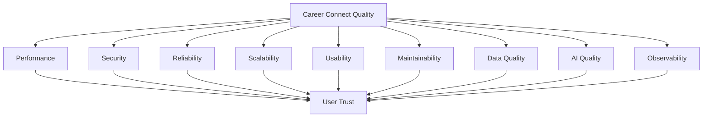

# 23 — Non-Functional Requirements

# Career Connect — AI Career Intelligence Platform

**Document Type:** Non-Functional Requirements Specification
**Project:** Career Connect
**Version:** 1.0
**Status:** Non-Functional Requirements Baseline
**Scope:** Performance + Security + Scalability + Reliability + Availability + Maintainability + Usability + AI + Data + Cloud + Operations

---

# 1. Introduction

Non-functional requirements define **how well** Career Connect must operate rather than only what features it provides.

Functional requirements answer:

> What should the system do?

Non-functional requirements answer:

> How securely, reliably, quickly, consistently, and maintainably should the system do it?

For Career Connect, these requirements are especially important because the system combines:

```text
 id="8c3m7x"
Web Application
+
Cloud Infrastructure
+
Operational Database
+
Data Lake
+
Data Warehouse
+
ETL
+
Business Intelligence
+
AI Services
```

Therefore, quality requirements must cover the complete platform rather than only the frontend.

---

# 2. Non-Functional Requirement Categories

Career Connect shall define requirements across:

```text
1. Performance
2. Scalability
3. Availability
4. Reliability
5. Resilience
6. Security
7. Privacy
8. Usability
9. Accessibility
10. Maintainability
11. Testability
12. Observability
13. Data Quality
14. Data Freshness
15. AI Quality
16. AI Safety
17. Interoperability
18. Portability
19. Disaster Recovery
20. Cost Efficiency
21. Compliance Readiness
22. Documentation
```

---

# 3. NFR Identification Convention

Requirements shall use:

```text
NFR-<DOMAIN>-<NUMBER>
```

Examples:

```text
NFR-PERF-001
NFR-SEC-001
NFR-SCAL-001
NFR-AVAIL-001
NFR-DATA-001
NFR-AI-001
```

Priority:

```text
MUST
SHOULD
COULD
FUTURE
```

---

# 4. Performance Requirements

# NFR-PERF-001 — API Responsiveness

**Priority:** MUST

Normal synchronous application APIs shall be designed for low-latency interactive use.

The implementation shall define measurable targets for:

```text
P50 latency
P95 latency
P99 latency
```

These targets shall be validated using realistic workloads rather than assumed.

---

# 5. NFR-PERF-002 — API Performance Measurement

The platform shall monitor:

```text
Request Count
Response Time
Error Rate
Throughput
Latency Distribution
```

Performance reports shall distinguish between:

```text
4xx
5xx
Timeout
Successful
```

responses.

---

# 6. NFR-PERF-003 — Dashboard Performance

Interactive dashboards shall load progressively and avoid unnecessary repeated warehouse queries.

Dashboard performance should be optimized using:

```text
Semantic Metrics
Caching
Aggregate Tables
Materialized Structures
Efficient Queries
Appropriate Warehouse Partitioning
```

---

# 7. NFR-PERF-004 — Dashboard Query Optimization

The BI layer should avoid querying raw transactional tables for executive analytics.

Preferred:

```text
OLTP
 ↓
Warehouse
 ↓
Data Mart
 ↓
Semantic Metric
 ↓
Dashboard
```

---

# 8. NFR-PERF-005 — Asynchronous Processing

Long-running operations shall not block normal HTTP requests.

Operations include:

```text
Resume Analysis
AI Mock Interview
Report Generation
Bulk Import
Large Data Processing
ETL
Warehouse Rebuild
```

These shall use background jobs where appropriate.

---

# 9. NFR-PERF-006 — File Upload

Resume uploads shall support controlled file sizes and asynchronous processing.

Uploading a file should not require synchronous completion of:

```text
Parsing
AI Analysis
Skill Extraction
Resume Scoring
```

---

# 10. NFR-PERF-007 — Search Performance

Job and skill search shall be optimized for interactive use.

The implementation should use:

```text
Indexes
Search Optimization
Caching
Pagination
```

and a dedicated search system may be introduced later where justified by workload.

---

# 11. NFR-PERF-008 — Pagination

Large API collections shall never require the backend to return the entire dataset by default.

Examples:

```text
Students
Jobs
Applications
Audit Logs
Reports
Notifications
```

shall support pagination.

---

# 12. NFR-PERF-009 — Database Query Efficiency

The backend shall avoid:

```text
N+1 queries
Unbounded joins
Unbounded result sets
Repeated identical queries
```

Repository/service logic should be reviewed for query efficiency.

---

# 13. NFR-PERF-010 — Connection Pooling

The backend shall use managed database connection pooling.

The connection pool size shall be controlled according to:

```text
Application Instances
Database Capacity
Expected Concurrency
Warehouse/OLTP Separation
```

---

# 14. NFR-PERF-011 — Caching

Stable reference information should support caching where appropriate.

Examples:

```text
Skills
Skill Categories
Career Paths
Employment Types
Experience Levels
Countries
```

Sensitive user-specific responses shall not be cached in shared caches without proper isolation.

---

# 15. NFR-PERF-012 — AI Latency

AI operations shall have separate latency expectations from normal APIs.

Interactive queries should return promptly where possible.

Long-running AI operations shall support:

```text
Accepted
Processing
Completed
Failed
```

states.

---

# 16. NFR-PERF-013 — Warehouse Query Performance

The warehouse shall use appropriate:

```text
Partitioning
Clustering
Query Optimization
Data Marts
Aggregate Structures
```

based on measured workloads.

---

# 17. NFR-PERF-014 — ETL Throughput

ETL pipelines shall support batch processing at a volume appropriate to the intended academic and MVP datasets.

The system should measure:

```text
Rows Per Minute
Rows Processed
Rows Rejected
Pipeline Duration
```

---

# 18. NFR-PERF-015 — Scalability

The system shall be capable of increasing:

```text
Users
Jobs
Applications
Resumes
AI Requests
Data Volume
Warehouse Queries
```

without requiring a fundamental architectural redesign.

---

# 19. Scalability Requirements

# NFR-SCAL-001 — Horizontal Backend Scaling

The backend should support multiple application instances.

The application should avoid relying on process-local state for critical user sessions or workflow state.

---

# 20. NFR-SCAL-002 — Stateless API

The application API should be designed to be as stateless as practical.

State should be stored in:

```text
Database
Object Storage
Cache
Job Queue
External Session Provider
```

rather than relying on one server process.

---

# 21. NFR-SCAL-003 — Independent Scaling

The platform shall permit independent scaling of:

```text
Frontend
Backend API
AI Workers
ETL Workers
Report Workers
Warehouse
```

---

# 22. NFR-SCAL-004 — AI Worker Scaling

AI workloads shall be isolated from normal application workloads.

Example:

```text
Web/API
   |
   └──> AI Job Queue
           |
       AI Workers
```

This prevents heavy AI usage from consuming all application resources.

---

# 23. NFR-SCAL-005 — Data Warehouse Scaling

Analytical workloads shall be isolated from transactional workloads.

The operational database shall not be used as the primary enterprise BI engine.

---

# 24. NFR-SCAL-006 — Data Lake Scalability

The data lake shall support increasing:

```text
File Count
Dataset Size
Source Count
Historical Records
```

without requiring redesign of the raw storage hierarchy.

---

# 25. NFR-SCAL-007 — Multi-Tenant Scalability

The system shall support increasing organizations without requiring a separate application deployment for every organization.

---

# 26. NFR-SCAL-008 — Modular Scalability

New domains shall be addable through modular services.

Examples:

```text
Assessment
Billing
Workforce Analytics
Partner Integrations
```

should be introduced without rewriting the core architecture.

---

# 27. NFR-SCAL-009 — Warehouse Growth

Warehouse models shall support historical growth without changing fact-table grain.

---

# 28. NFR-SCAL-010 — Event Volume

Append-oriented event data such as:

```text
Application Events
Audit Logs
AI Messages
Notifications
```

should be designed for potentially high-volume growth.

---

# 29. Availability Requirements

# NFR-AVAIL-001 — Core Availability

Core application services shall be designed for high availability appropriate to the deployment tier.

Priority should be:

```text
Authentication
Core API
Student Profiles
Jobs
Applications
```

before:

```text
Advanced AI
Reports
Non-critical Analytics
```

---

# 30. NFR-AVAIL-002 — Dependency Isolation

If the AI service becomes unavailable:

```text
Student Profile
Job Search
Application Tracking
```

should remain functional where possible.

---

# 31. NFR-AVAIL-003 — Graceful Degradation

The application shall degrade gracefully.

Example:

```text
AI Unavailable
↓
Show "AI temporarily unavailable"
↓
Core application remains usable
```

rather than presenting a system-wide failure.

---

# 32. NFR-AVAIL-004 — Health Checks

Each major service shall expose or provide health information.

Health categories:

```text
Application
Database
Storage
AI
Warehouse
ETL
```

---

# 33. NFR-AVAIL-005 — Deployment Safety

Production deployments shall use controlled release procedures.

Where practical:

```text
Build
↓
Test
↓
Staging
↓
Smoke Test
↓
Production
```

---

# 34. NFR-AVAIL-006 — Backup Availability

Critical data shall have accessible backups according to the approved backup policy.

---

# 35. Reliability Requirements

# NFR-REL-001 — Transactional Reliability

Core transactional workflows shall use database transactions where multiple operations must remain consistent.

Example:

```text
Create Application
+
Create Application Event
+
Create Audit Event
```

---

# 36. NFR-REL-002 — Idempotency

Repeat execution of idempotent operations shall not create duplicate business outcomes.

Important examples:

```text
Job Application
Bulk Import
Report Creation
ETL Batch
Webhook Processing
```

---

# 37. NFR-REL-003 — Retry

Transient failures shall support controlled retries.

Appropriate examples:

```text
Network Timeout
Temporary API Failure
Storage Timeout
Warehouse Transient Error
```

---

# 38. NFR-REL-004 — Retry Classification

Persistent errors should not be retried indefinitely.

Examples:

```text
Invalid Credentials
Invalid Schema
Invalid Data
Authorization Failure
```

must be routed to correction or intervention.

---

# 39. NFR-REL-005 — Dead-Letter Handling

Repeatedly failed asynchronous tasks shall be moved to a controlled failure state or dead-letter mechanism.

---

# 40. NFR-REL-006 — Consistency

Business-critical relationships shall remain consistent.

Example:

```text
Placement
→ Valid Application
→ Valid Job
→ Valid Company
→ Valid Student
```

---

# 41. NFR-REL-007 — Recovery After Restart

Services shall recover without corrupting in-flight persistent state after controlled restarts.

---

# 42. NFR-REL-008 — Queue Durability

Background jobs considered business-critical should be persisted sufficiently to support retry/recovery.

---

# 43. Resilience Requirements

# NFR-RES-001 — External Provider Failure

The system shall tolerate temporary failures from:

```text
AI Provider
External Job Source
Learning Provider
Storage Service
```

where possible.

---

# 44. NFR-RES-002 — Timeout Protection

External dependency calls shall have explicit timeouts.

---

# 45. NFR-RES-003 — Circuit Protection

Repeated failures from an external service should trigger controlled circuit-breaking or equivalent protection where appropriate.

---

# 46. NFR-RES-004 — Fallback

Fallbacks should be available for appropriate non-critical services.

Example:

```text
Advanced AI unavailable
↓
Basic profile-based recommendation
```

where such a fallback is actually implemented and validated.

---

# 47. NFR-RES-005 — Data Pipeline Recovery

Failed ETL batches shall be replayable from preserved raw data where possible.

---

# 48. NFR-RES-006 — Warehouse Recovery

Warehouse loads shall support controlled reruns without creating duplicate facts.

---

# 49. Security Requirements

# NFR-SEC-001 — Authentication Security

All protected functionality shall require valid authentication.

---

# 50. NFR-SEC-002 — Authorization

Authorization shall consider:

```text
User
Role
Organization
Resource
Action
```

---

# 51. NFR-SEC-003 — Least Privilege

Users and services shall receive only permissions necessary for their tasks.

---

# 52. NFR-SEC-004 — Tenant Isolation

Organization-owned data shall be isolated through:

```text
Application Authorization
Database Controls
Query Scoping
```

and appropriate row-level policies where applicable.

---

# 53. NFR-SEC-005 — Secure Transport

Production traffic shall use encrypted transport.

---

# 54. NFR-SEC-006 — Data Encryption

Sensitive data shall be protected using encryption at rest and in transit according to the chosen cloud/platform controls.

---

# 55. NFR-SEC-007 — Secret Management

Secrets shall be managed through secure environment/configuration mechanisms.

They shall never be committed to source control.

---

# 56. NFR-SEC-008 — Password Protection

The application shall not store plaintext passwords.

Where authentication is delegated to an identity provider, application tables should retain only appropriate references rather than duplicating password storage.

---

# 57. NFR-SEC-009 — SQL Injection Protection

All user-generated database queries shall use parameterized access mechanisms.

---

# 58. NFR-SEC-010 — XSS Protection

User-generated and AI-generated content shall be handled safely.

---

# 59. NFR-SEC-011 — CSRF Protection

Where cookie-based authentication and state-changing browser requests make CSRF relevant, the application shall implement appropriate CSRF defenses.

---

# 60. NFR-SEC-012 — Rate Limiting

The platform shall rate-limit:

```text
Authentication
AI
Public APIs
Sensitive Endpoints
Bulk Operations
```

---

# 61. NFR-SEC-013 — Brute Force Protection

Authentication interfaces shall implement appropriate controls against repeated failed login attempts.

---

# 62. NFR-SEC-014 — File Security

Uploaded files shall be validated before being processed.

---

# 63. NFR-SEC-015 — Signed/Controlled File Access

Sensitive files such as resumes shall be accessed through controlled authorization mechanisms.

---

# 64. NFR-SEC-016 — Security Logging

The platform shall record security-relevant events.

Examples:

```text
Login Failure
Suspicious Access
Role Change
Permission Change
Unauthorized Resource Attempt
Export
Sensitive File Access
```

---

# 65. NFR-SEC-017 — Security Headers

Production HTTP services shall use appropriate security headers.

---

# 66. NFR-SEC-018 — Dependency Security

Third-party dependencies shall be scanned and updated according to a defined vulnerability-management process.

---

# 67. NFR-SEC-019 — Secure Error Messages

Production APIs shall not expose:

```text
Stack Traces
SQL Queries
Secrets
Internal Architecture Details
```

to normal clients.

---

# 68. NFR-SEC-020 — Service-to-Service Authentication

Internal services such as:

```text
Backend
AI Service
ETL
Reporting
```

shall authenticate to each other when required.

---

# 69. Privacy Requirements

# NFR-PRIV-001 — Data Minimization

The system shall collect only data required for defined business purposes.

---

# 70. NFR-PRIV-002 — Purpose Limitation

Data collected for one purpose shall not automatically become available for unrelated purposes.

---

# 71. NFR-PRIV-003 — PII Separation

Personally identifiable information should be separated from analytical data where practical.

Example:

```text
Identity Data
      ↓
student_id
      ↓
Analytics
```

---

# 72. NFR-PRIV-004 — Sensitive Data Access

Sensitive information shall be accessible only to authorized roles.

---

# 73. NFR-PRIV-005 — Data Export Controls

Exports containing sensitive data shall require authorization and generate audit records.

---

# 74. NFR-PRIV-006 — Retention

Data retention shall be defined by business, institutional, and applicable legal requirements.

---

# 75. NFR-PRIV-007 — Deletion

Where applicable, the platform shall support controlled deletion or anonymization workflows consistent with retention and audit requirements.

---

# 76. NFR-PRIV-008 — Resume Privacy

Resume content shall not be publicly accessible by default.

---

# 77. NFR-PRIV-009 — AI Privacy

Only the minimum required user context should be sent to an AI provider.

---

# 78. NFR-PRIV-010 — AI Data Handling

The AI layer shall follow the approved organization's policies regarding storage, retention, logging, and external processing of user information.

---

# 79. Usability Requirements

# NFR-UX-001 — Ease of Use

Core workflows shall be understandable to first-time users without requiring technical knowledge.

---

# 80. NFR-UX-002 — Consistency

The UI shall use consistent:

```text
Navigation
Buttons
Forms
Labels
Colors
Icons
Feedback
```

---

# 81. NFR-UX-003 — Error Messages

User errors shall produce actionable messages.

Bad:

```text
Error 422
```

Better:

```text
Please select at least one skill.
```

---

# 82. NFR-UX-004 — Form Validation

Validation should occur close to the point where errors are entered.

---

# 83. NFR-UX-005 — Loading States

Long-running operations shall show:

```text
Loading
Processing
Completed
Failed
```

---

# 84. NFR-UX-006 — Empty States

Empty lists shall explain:

```text
What is missing
Why it is empty
What action the user can take
```

---

# 85. NFR-UX-007 — Confirmation

Destructive actions such as deleting or deactivating important records shall require appropriate confirmation.

---

# 86. NFR-UX-008 — Responsive Design

The application shall support:

```text
Desktop
Laptop
Tablet
Mobile
```

---

# 87. Accessibility Requirements

# NFR-A11Y-001 — Keyboard Access

Core workflows shall be usable through keyboard navigation.

---

# 88. NFR-A11Y-002 — Focus Management

Interactive elements shall have visible focus states.

---

# 89. NFR-A11Y-003 — Semantic Structure

The frontend should use semantic HTML elements.

---

# 90. NFR-A11Y-004 — Labels

Forms shall provide accessible labels and useful error messages.

---

# 91. NFR-A11Y-005 — Contrast

Text and important UI controls shall maintain adequate contrast.

---

# 92. NFR-A11Y-006 — Charts

Important dashboard insights should not rely only on color.

Charts should provide:

```text
Labels
Tooltips
Legends
Accessible Alternatives
```

---

# 93. NFR-A11Y-007 — Screen Readers

Primary navigation and essential content should be compatible with assistive technologies.

---

# 94. Maintainability Requirements

# NFR-MAINT-001 — Modular Architecture

The codebase shall be organized into domain modules.

Example:

```text
students
skills
jobs
applications
ai
analytics
reports
```

---

# 95. NFR-MAINT-002 — Separation of Concerns

The system shall separate:

```text
Controller
Service
Domain Logic
Repository
Integration
```

---

# 96. NFR-MAINT-003 — Coding Standards

The project shall use consistent:

```text
Naming
Formatting
Error Handling
Typing
Documentation
```

---

# 97. NFR-MAINT-004 — Type Safety

TypeScript and Python code should use strong typing where practical.

---

# 98. NFR-MAINT-005 — Configuration Management

Environment-specific settings shall be externalized.

---

# 99. NFR-MAINT-006 — Database Migrations

Schema changes shall be version-controlled.

---

# 100. NFR-MAINT-007 — API Versioning

Breaking API changes shall use versioned endpoints.

---

# 101. NFR-MAINT-008 — Dependency Management

Dependencies shall be version-pinned or controlled using appropriate package-management practices.

---

# 102. NFR-MAINT-009 — Technical Documentation

Every major service shall have:

```text
Purpose
Architecture
Configuration
Run Instructions
Dependencies
Failure Modes
```

---

# 103. Testability Requirements

# NFR-TEST-001 — Unit Testability

Core business logic shall be unit-testable.

---

# 104. NFR-TEST-002 — API Testability

Every important API shall be testable independently.

---

# 105. NFR-TEST-003 — Data Testability

ETL transformations shall have reproducible test data.

---

# 106. NFR-TEST-004 — AI Evaluation

AI capabilities shall support evaluation against controlled datasets and test scenarios.

---

# 107. NFR-TEST-005 — Regression Testing

Major releases shall execute regression tests.

---

# 108. NFR-TEST-006 — Security Testing

Security testing shall include:

```text
Authentication
Authorization
IDOR
Input Validation
Rate Limiting
File Upload
```

---

# 109. NFR-TEST-007 — Performance Testing

The project shall conduct load testing for significant APIs and dashboards.

---

# 110. NFR-TEST-008 — Integration Testing

The platform shall test:

```text
API + Database
API + AI
ETL + Warehouse
Storage + Resume
Report + Warehouse
```

---

# 111. Observability Requirements

# NFR-OBS-001 — Centralized Logging

Application and service logs should be available through a centralized observability mechanism.

---

# 112. NFR-OBS-002 — Structured Logs

Logs should use structured formats where possible.

Example:

```json id="8l7z1b"
{
  "timestamp": "2026-07-30T10:20:00Z",
  "service": "career-api",
  "level": "ERROR",
  "request_id": "cc-123",
  "event": "AI_REQUEST_FAILED"
}
```

---

# 113. NFR-OBS-003 — Metrics

The system shall measure:

```text
API Requests
Latency
Errors
Database Connections
ETL Runs
AI Requests
AI Failures
Warehouse Jobs
Storage Usage
```

---

# 114. NFR-OBS-004 — Tracing

Distributed operations should support trace/correlation identifiers.

Example:

```text
Frontend Request
↓
API
↓
AI Service
↓
Database
↓
Audit
```

---

# 115. NFR-OBS-005 — Alerting

Alerts shall be generated for important system degradation.

---

# 116. NFR-OBS-006 — Business Metrics

Operational monitoring should be supplemented by business indicators.

Examples:

```text
Applications per Hour
Resume Analyses
AI Recommendations
Placement Records
Reports Generated
```

---

# 117. Data Quality Requirements

# NFR-DATA-001 — Completeness

Critical datasets shall meet defined completeness thresholds.

---

# 118. NFR-DATA-002 — Validity

Values shall follow approved types, ranges, and enumerations.

---

# 119. NFR-DATA-003 — Uniqueness

Fields defined as unique shall not contain unintended duplicates.

---

# 120. NFR-DATA-004 — Consistency

Related datasets shall maintain logical consistency.

---

# 121. NFR-DATA-005 — Referential Integrity

Relationships between facts and dimensions shall resolve correctly.

---

# 122. NFR-DATA-006 — Freshness

Critical datasets shall have measurable freshness expectations.

---

# 123. NFR-DATA-007 — Data Quality Score

Data-quality scores should be produced for critical pipelines.

---

# 124. NFR-DATA-008 — Quarantine

Critical failures shall prevent invalid data from being published as trusted analytical data.

---

# 125. NFR-DATA-009 — Reconciliation

Source and target datasets shall be reconciled after important loads.

---

# 126. NFR-DATA-010 — Data Lineage

Critical analytical data should be traceable from source to output.

---

# 127. Data Freshness Requirements

# NFR-FRESH-001 — Source Freshness

Every important source shall have an expected update frequency.

Example:

```text
Jobs: Daily
Applications: Near-Real-Time or Daily
Placements: Daily
Salary: Periodic
Reference Data: Periodic
```

These are example operational targets, not universal requirements.

---

# 128. NFR-FRESH-002 — Freshness Monitoring

The platform shall detect stale datasets.

---

# 129. NFR-FRESH-003 — Data-As-Of

Analytical dashboards should expose an appropriate data-as-of timestamp.

---

# 130. NFR-FRESH-004 — Stale Data Warning

Critical dashboards may display a warning when data freshness exceeds the approved threshold.

---

# 131. AI Quality Requirements

# NFR-AI-001 — Relevant Context

AI responses shall use relevant authorized context.

---

# 132. NFR-AI-002 — Structured Output

Where downstream processing depends on AI output, responses should follow defined schemas.

---

# 133. NFR-AI-003 — Hallucination Reduction

The AI architecture shall reduce unsupported factual claims through:

```text
Context Retrieval
Validation
Source Data
Structured Prompts
Output Schemas
```

---

# 134. NFR-AI-004 — Explainability

Personalized recommendations should expose major reasoning factors.

---

# 135. NFR-AI-005 — Model Versioning

The system shall record the AI model/version associated with persisted AI results when relevant.

---

# 136. NFR-AI-006 — Prompt Versioning

Important production prompts should be version-controlled.

---

# 137. NFR-AI-007 — AI Evaluation

AI features shall have measurable evaluation criteria.

Examples:

```text
Skill Extraction Accuracy
Recommendation Relevance
Structured Output Validity
Response Safety
User Feedback
```

---

# 138. NFR-AI-008 — AI Failure Recovery

Provider outages shall not permanently block normal application usage.

---

# 139. NFR-AI-009 — AI Safety

The system shall not represent AI-generated career outcomes as guaranteed employment results.

---

# 140. NFR-AI-010 — Sensitive Context Control

The AI system shall receive only the minimum contextual information necessary for the requested operation.

---

# 141. NFR-AI-011 — AI Auditability

Important AI-generated records shall include:

```text
Model
Model Version
Prompt Version where applicable
Timestamp
Context Reference
```

---

# 142. NFR-AI-012 — Bias Monitoring

Where AI is used to rank or recommend candidates, the system should support monitoring for undesirable disparities and unintended behavior.

---

# 143. Interoperability Requirements

# NFR-INT-001 — REST APIs

The backend shall expose documented REST APIs.

---

# 144. NFR-INT-002 — JSON

Standard application APIs shall support JSON requests and responses.

---

# 145. NFR-INT-003 — OpenAPI

The API shall maintain OpenAPI-compatible documentation.

---

# 146. NFR-INT-004 — File Formats

The system should support common structured data formats:

```text
CSV
JSON
XLSX
Parquet
```

where the relevant pipeline supports them.

---

# 147. NFR-INT-005 — External AI Provider

The AI layer shall be abstracted from one specific model provider.

---

# 148. NFR-INT-006 — Data Warehouse Portability

Warehouse transformations should minimize unnecessary provider-specific coupling where practical.

---

# 149. Portability Requirements

# NFR-PORT-001 — Containerization

Backend and AI services should support Docker deployment.

---

# 150. NFR-PORT-002 — Environment Independence

The system shall support:

```text
Development
Staging
Production
```

through environment-specific configuration.

---

# 151. NFR-PORT-003 — Provider Abstraction

The architecture should allow migration between:

```text
BigQuery
Snowflake
```

through an analytical abstraction/data-model strategy.

Complete zero-change portability is not assumed.

---

# 152. NFR-PORT-004 — Object Storage Abstraction

Storage access should use an application abstraction rather than scattering provider-specific SDK calls throughout the business layer.

---

# 153. Disaster Recovery Requirements

# NFR-DR-001 — Backup

Critical production data shall be backed up according to the approved recovery policy.

---

# 154. NFR-DR-002 — Recovery Point Objective

The deployment shall define an acceptable maximum amount of data loss.

Example:

```text
RPO = defined business target
```

The exact value shall depend on the deployment tier.

---

# 155. NFR-DR-003 — Recovery Time Objective

The deployment shall define the acceptable restoration time for critical services.

---

# 156. NFR-DR-004 — Restore Testing

Backups shall be periodically tested through actual restoration procedures.

---

# 157. NFR-DR-005 — Raw Data Reprocessing

The data platform shall retain sufficient raw data to support controlled pipeline reprocessing where required.

---

# 158. NFR-DR-006 — Recovery Runbook

A recovery runbook shall document:

```text
Detection
Isolation
Backup Selection
Restore
Validation
ETL Replay
Dashboard Validation
Service Recovery
```

---

# 159. Cost Efficiency Requirements

# NFR-COST-001 — Cloud Usage Monitoring

The platform shall monitor cloud usage for major resources.

---

# 160. NFR-COST-002 — AI Cost Monitoring

AI usage should track appropriate provider usage metrics where available.

---

# 161. NFR-COST-003 — Warehouse Cost Optimization

The data platform should reduce unnecessary warehouse consumption through:

```text
Partitioning
Incremental Processing
Efficient Queries
Data Lifecycle Policies
```

---

# 162. NFR-COST-004 — Storage Lifecycle

Raw and temporary files should follow defined lifecycle policies.

---

# 163. NFR-COST-005 — Environment Cost Control

Development resources should not unnecessarily run at production scale.

---

# 164. Compliance Readiness

# NFR-COMP-001

The platform shall maintain sufficient metadata and auditability to support applicable organizational and regulatory requirements.

---

# 165. NFR-COMP-002

Sensitive data processing shall be documented.

---

# 166. NFR-COMP-003

Data retention and deletion policies shall be documented.

---

# 167. NFR-COMP-004

Security-sensitive operations shall be auditable.

---

# 168. NFR-COMP-005

The platform should support data access reviews.

---

# 169. Documentation Requirements

# NFR-DOC-001

Every major service shall have technical documentation.

---

# 170. NFR-DOC-002

APIs shall be documented.

---

# 171. NFR-DOC-003

Database schemas shall be documented.

---

# 172. NFR-DOC-004

ETL pipelines shall be documented.

---

# 173. NFR-DOC-005

AI models/features shall have documented inputs, outputs, and limitations.

---

# 174. NFR-DOC-006

Operational runbooks shall exist for critical systems.

---

# 175. NFR-DOC-007

The GitHub repository shall provide a complete project README.

---

# 176. NFR-DOC-008

Architecture diagrams shall be version-controlled.

---

# 177. Configuration Requirements

# NFR-CONFIG-001

Application configuration shall be environment-driven.

---

# 178. NFR-CONFIG-002

The system shall maintain separate configuration for:

```text
Development
Staging
Production
```

---

# 179. NFR-CONFIG-003

Secrets shall be stored outside source code.

---

# 180. NFR-CONFIG-004

Configuration changes should be auditable for production environments.

---

# 181. API Reliability Requirements

# NFR-API-001

APIs shall return consistent response structures.

---

# 182. NFR-API-002

Errors shall use stable machine-readable error codes.

---

# 183. NFR-API-003

APIs shall implement input validation.

---

# 184. NFR-API-004

Protected endpoints shall enforce authorization.

---

# 185. NFR-API-005

Long-running work shall use asynchronous processing.

---

# 186. NFR-API-006

APIs shall support correlation/request IDs.

---

# 187. NFR-API-007

Public and sensitive APIs shall use appropriate rate limits.

---

# 188. NFR-API-008

Breaking changes shall be versioned.

---

# 189. Frontend Quality Requirements

# NFR-FE-001

The frontend shall use a consistent design system.

---

# 190. NFR-FE-002

The application shall provide responsive layouts.

---

# 191. NFR-FE-003

The frontend shall provide clear loading/error/empty states.

---

# 192. NFR-FE-004

Charts shall remain understandable at supported screen sizes.

---

# 193. NFR-FE-005

Frontend state shall not expose sensitive server credentials.

---

# 194. Backend Quality Requirements

# NFR-BE-001

The backend shall follow modular domain architecture.

---

# 195. NFR-BE-002

Business logic shall not be embedded in controllers unnecessarily.

---

# 196. NFR-BE-003

Data-access logic shall be separated from transport logic.

---

# 197. NFR-BE-004

Background tasks shall be separated from synchronous request handling.

---

# 198. ETL Quality Requirements

# NFR-ETL-001

Every production pipeline shall have a defined owner.

---

# 199. NFR-ETL-002

Every critical dataset shall have a schema/data contract.

---

# 200. NFR-ETL-003

Failed records shall be traceable to source and batch.

---

# 201. NFR-ETL-004

Pipelines shall be idempotent where possible.

---

# 202. NFR-ETL-005

Pipelines shall support reprocessing from preserved raw data.

---

# 203. NFR-ETL-006

Pipeline execution shall generate metadata.

---

# 204. NFR-ETL-007

Critical data-quality failures shall prevent publication of invalid data.

---

# 205. Warehouse Quality Requirements

# NFR-DW-001

Every fact table shall have documented grain.

---

# 206. NFR-DW-002

Every dimension shall have documented key strategy.

---

# 207. NFR-DW-003

Conformed dimensions shall retain consistent meaning across facts.

---

# 208. NFR-DW-004

Historical changes shall follow documented SCD rules.

---

# 209. NFR-DW-005

Warehouse loads shall be reconciled.

---

# 210. NFR-DW-006

Analytical metrics shall use governed semantic definitions.

---

# 211. BI Quality Requirements

# NFR-BI-001

Dashboards shall use approved semantic metrics.

---

# 212. NFR-BI-002

Dashboard filters shall respect authorization.

---

# 213. NFR-BI-003

Dashboards shall expose meaningful data freshness.

---

# 214. NFR-BI-004

Exported metrics shall reconcile with dashboard metrics.

---

# 215. NFR-BI-005

Dashboard calculations should not duplicate business logic unnecessarily across multiple frontend pages.

---

# 216. Reporting Quality Requirements

# NFR-REP-001

Reports shall identify their reporting period.

---

# 217. NFR-REP-002

Reports shall identify data-as-of time.

---

# 218. NFR-REP-003

Reports shall respect user authorization.

---

# 219. NFR-REP-004

Generated reports shall be stored securely.

---

# 220. NFR-REP-005

Report generation shall be auditable.

---

# 221. SaaS Requirements

# NFR-SAAS-001 — Multi-Tenancy

The platform shall support multiple organizations within the same product architecture.

---

# 222. NFR-SAAS-002 — Tenant Isolation

One organization's private data shall not be visible to another organization.

---

# 223. NFR-SAAS-003 — Tenant-Aware Analytics

Analytics shall respect organizational boundaries.

---

# 224. NFR-SAAS-004 — Feature Configuration

The system should support organization-level feature configuration.

---

# 225. NFR-SAAS-005 — Usage Tracking

The platform should track:

```text
Users
AI Requests
Reports
Storage
Data Processing
```

for future commercial billing or quota management.

---

# 226. NFR-SAAS-006 — Tenant Administration

Organization administrators shall be able to manage their permitted users and configuration.

---

# 227. NFR-SAAS-007 — Global Reference Data

Appropriate reference data may be shared across tenants.

Examples:

```text
Skills
Countries
Career Paths
Technology Taxonomy
```

Tenant-specific business data shall remain isolated.

---

# 228. Data Governance Requirements

# NFR-GOV-001

Critical data domains shall have defined business ownership.

---

# 229. NFR-GOV-002

Critical datasets shall have technical ownership.

---

# 230. NFR-GOV-003

Important metrics shall have approved definitions.

---

# 231. NFR-GOV-004

Reference taxonomy changes shall be versioned.

---

# 232. NFR-GOV-005

Data lineage should be maintained for critical analytical outputs.

---

# 233. NFR-GOV-006

Deprecated data fields shall be documented.

---

# 234. NFR-GOV-007

Synthetic data shall be clearly distinguishable from production data.

---

# 235. Security and Privacy Classification

The following categories shall be consistently used.

```text
PUBLIC
INTERNAL
CONFIDENTIAL
RESTRICTED
```

Every major dataset shall have an assigned classification.

---

# 236. Recommended Data Classification

| Data                       | Classification          |
| -------------------------- | ----------------------- |
| Public Skill Taxonomy      | PUBLIC                  |
| Public Career Taxonomy     | PUBLIC                  |
| Internal Pipeline Metadata | INTERNAL                |
| Student Profile            | CONFIDENTIAL            |
| Application Data           | CONFIDENTIAL            |
| Resume                     | RESTRICTED/CONFIDENTIAL |
| Interview Feedback         | RESTRICTED              |
| Compensation Data          | RESTRICTED              |
| Authentication Secrets     | RESTRICTED              |
| Audit Security Metadata    | RESTRICTED              |

Actual classification should be finalized according to deployment policy.

---

# 237. NFR Priority Matrix

| Category                     | Importance |
| ---------------------------- | ---------- |
| Security                     | Critical   |
| Data Integrity               | Critical   |
| Privacy                      | Critical   |
| Reliability                  | Critical   |
| Availability                 | High       |
| Performance                  | High       |
| Scalability                  | High       |
| Maintainability              | High       |
| Observability                | High       |
| AI Safety                    | High       |
| Data Quality                 | Critical   |
| Usability                    | High       |
| Accessibility                | High       |
| Cost Efficiency              | Medium     |
| Portability                  | Medium     |
| Localization                 | Medium     |
| Advanced Enterprise Features | Future     |

---

# 238. System Quality Model



---

# 239. Quality Gates

A production feature shall ideally pass:

```text id="w3m8q2"
Functional Tests
+
Security Tests
+
Performance Validation
+
Data Quality Validation
+
Observability Validation
+
Documentation
```

---

# 240. Definition of Non-Functional Readiness

A module is NFR-ready when:

```text
✓ Performance measured
✓ Security reviewed
✓ Errors handled
✓ Logs emitted
✓ Metrics available
✓ Authorization enforced
✓ Data quality defined
✓ Recovery path documented
✓ Documentation complete
```

---

# 241. Academic Demonstration Requirements

For the BE CSE demonstration, the project should visibly demonstrate:

```text id="q5x8m3"
Secure Login
Responsive UI
Fast Search
AI Processing
ETL Pipeline
Data Quality
Warehouse
BI Dashboard
Error Handling
Audit Log
```

This provides evidence that the project is more than a collection of screens.

---

# 242. Enterprise Production Requirements

The production SaaS version should additionally demonstrate:

```text id="m7q3x9"
Horizontal Scaling
Multi-Tenant Isolation
Advanced Monitoring
Automated Backups
Disaster Recovery
Advanced Security
Cost Monitoring
Model Evaluation
Data Governance
Partner Integrations
```

---

# 243. NFR-to-Architecture Mapping

```text id="v4m8q2"
Performance
→ Caching + Indexing + Warehouse Optimization

Scalability
→ Stateless Services + Independent Workers

Security
→ Auth + RBAC + RLS + Encryption

Reliability
→ Transactions + Retry + Idempotency

Data Quality
→ ETL Validation + Quarantine

AI Quality
→ Context + Validation + Evaluation

Availability
→ Health Checks + Isolation + Recovery

Maintainability
→ Modular Architecture + Documentation

Observability
→ Logs + Metrics + Tracing

Disaster Recovery
→ Backup + Replay + Restore
```

---

# 244. Non-Functional Acceptance Matrix

| Requirement       | Validation Method                    |
| ----------------- | ------------------------------------ |
| Performance       | Load Testing                         |
| Scalability       | Stress Testing                       |
| Security          | Security Testing                     |
| Reliability       | Failure Injection / Recovery Testing |
| Availability      | Health Monitoring                    |
| Data Quality      | Data Tests                           |
| AI Quality        | Evaluation Dataset                   |
| Usability         | User Testing                         |
| Accessibility     | Accessibility Review                 |
| Maintainability   | Code Review                          |
| Observability     | Monitoring Validation                |
| Disaster Recovery | Restore Test                         |

---

# 245. Final Non-Functional Architecture

```text id="x8m3q7"
                       CAREER CONNECT
                            │
          ┌─────────────────┼─────────────────┐
          │                 │                 │
      EXPERIENCE         PLATFORM          DATA
          │                 │                 │
       Usability        Security          Quality
       Accessibility    Reliability       Freshness
       Performance      Availability      Lineage
          │                 │                 │
          └─────────────────┼─────────────────┘
                            │
                     INTELLIGENCE
                            │
                    ┌───────┴───────┐
                    ▼               ▼
                   BI              AI
                    │               │
                    └───────┬───────┘
                            ▼
                         OUTCOMES
```

---

# 246. CTO-Level Non-Functional Principle

Career Connect should not define quality through vague statements such as:

```text
"System should be fast."
"System should be secure."
"System should be scalable."
```

Instead, every major quality characteristic should be converted into:

```text
Requirement
↓
Metric
↓
Target
↓
Measurement
↓
Alert
↓
Improvement
```

Example:

```text
Data Freshness
↓
Freshness Lag
↓
Defined Threshold
↓
Pipeline Measurement
↓
Alert
↓
Remediation
```

This turns non-functional requirements into engineering controls.

---

# 247. Final NFR Statement

> **Career Connect shall be engineered as a secure, scalable, observable, reliable, maintainable, cloud-native platform capable of supporting transactional workflows, analytical workloads, AI services, and enterprise data processing independently. The system shall enforce strong authorization, data-quality, privacy, and audit controls while providing measurable performance, availability, recovery, usability, accessibility, and AI-quality characteristics. Non-functional requirements shall be validated through automated testing, monitoring, data-quality checks, security assessments, performance testing, and operational runbooks rather than treated as documentation-only objectives.**

---

## Document Status

| Attribute     | Value                                             |
| ------------- | ------------------------------------------------- |
| Project       | Career Connect                                    |
| Document      | Non-Functional Requirements                       |
| Version       | 1.0                                               |
| Performance   | Measured P50/P95/P99                              |
| Scalability   | Horizontal + Independent Service Scaling          |
| Availability  | Core-Service Priority                             |
| Reliability   | Retry + Idempotency + Recovery                    |
| Security      | Auth + RBAC + Tenant Isolation + Encryption       |
| Privacy       | Minimization + Controlled Access + Retention      |
| Data Quality  | Completeness + Validity + Consistency + Freshness |
| AI            | Grounding + Validation + Evaluation + Versioning  |
| BI            | Governed Metrics + Freshness                      |
| Observability | Logs + Metrics + Correlation                      |
| DR            | Backup + Restore + Replay                         |
| SaaS          | Multi-Tenant Ready                                |
| Accessibility | Responsive + Accessible UI                        |
| Status        | Non-Functional Requirements Baseline              |
