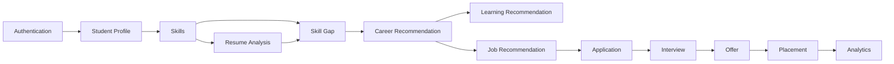
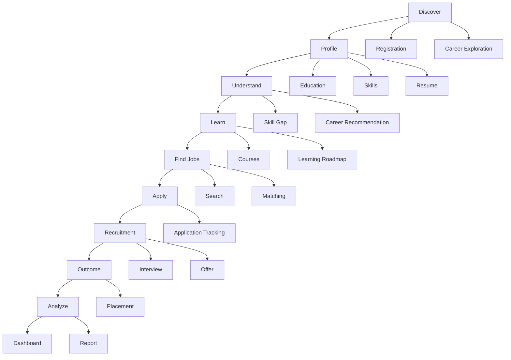
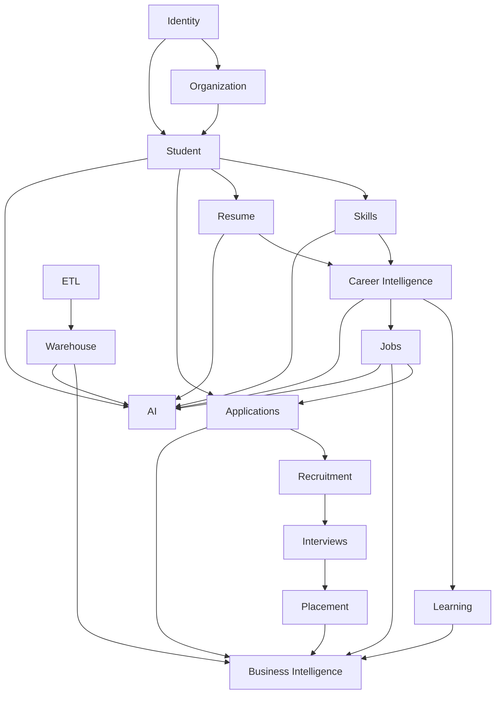

# 24 — User Stories

# Career Connect — AI Career Intelligence Platform

**Document Type:** Agile User Stories & Acceptance Criteria
**Project:** Career Connect
**Version:** 1.0
**Status:** Product Backlog Baseline
**Methodology:** Agile / Scrum
**Scope:** Student + College + Recruiter + Company + Admin + Data + AI + BI
**Primary Goal:** Convert business requirements into independently understandable, testable user outcomes.

---

# 1. Introduction

User stories describe Career Connect from the perspective of the people and systems that use the platform.

The standard format is:

> **As a [user], I want [capability], so that [business value].**

Each story should be:

```text
Independent
Negotiable
Valuable
Estimable
Small
Testable
```

The user-story catalog translates the broader product vision into implementation-ready work.

---

# 2. User Story Structure

Each important story contains:

```text
Story ID
Epic
Persona
User Story
Priority
Business Value
Acceptance Criteria
Dependencies
```

Priority:

```text
P0 — Critical
P1 — High
P2 — Medium
P3 — Future
```

---

# 3. Personas

Career Connect supports the following primary personas:

```text
STU — Student
JOB — Job Seeker
PO  — Placement Officer
FAC — Faculty
REC — Recruiter
COM — Company Admin
ORG — Organization Admin
EXE — Executive
ADM — Platform Administrator
DAT — Data Engineer
BI  — BI Analyst
AIE — AI Engineer
```

---

# 4. Epic Map

```text
EPIC-01  Identity & Access
EPIC-02  Organization Management
EPIC-03  Student Career Profile
EPIC-04  Skill Intelligence
EPIC-05  Resume Intelligence
EPIC-06  Career Intelligence
EPIC-07  Job Intelligence
EPIC-08  Applications
EPIC-09  Recruitment
EPIC-10  Interviews
EPIC-11  Offers & Placements
EPIC-12  Learning
EPIC-13  Certifications
EPIC-14  Salary Intelligence
EPIC-15  Business Intelligence
EPIC-16  Reporting
EPIC-17  AI Assistant
EPIC-18  Notifications
EPIC-19  Data Engineering
EPIC-20  Data Warehouse
EPIC-21  Administration
EPIC-22  Governance & Audit
EPIC-23  SaaS & Integrations
```

---

# 5. Epic 01 — Identity & Access

## US-AUTH-001 — Register Account

**Persona:** Student / Job Seeker / Recruiter

> As a user, I want to create an account so that I can access Career Connect.

**Priority:** P0

### Acceptance Criteria

```text
Given a valid registration request
When the user submits the required information
Then an account shall be created
And the user shall receive the appropriate initial role
And registration shall be recorded.
```

---

# 6. US-AUTH-002 — Login

**Persona:** All Users

> As a user, I want to securely log in so that I can access my authorized features.

**Priority:** P0

### Acceptance Criteria

```text
Valid credentials
→ Authentication succeeds

Invalid credentials
→ Authentication fails

Suspended account
→ Access denied
```

---

# 7. US-AUTH-003 — Google Login

**Persona:** User

> As a user, I want to sign in with Google so that I can access the platform conveniently.

**Priority:** P1

---

# 8. US-AUTH-004 — Logout

> As a user, I want to log out so that my session is securely terminated.

**Priority:** P0

---

# 9. US-AUTH-005 — Recover Access

> As a user, I want to recover access to my account so that I can continue using Career Connect after forgetting my password.

**Priority:** P1

---

# 10. US-AUTH-006 — View Current Identity

> As a user, I want to view my account and role information so that I understand which features I can access.

**Priority:** P0

---

# 11. US-AUTH-007 — Role-Based Access

**Persona:** Administrator

> As an administrator, I want to assign roles so that users receive only appropriate platform capabilities.

**Priority:** P0

### Example

```text
Student
→ Student Dashboard

Recruiter
→ Recruiter Dashboard

Placement Officer
→ Placement Dashboard
```

---

# 12. US-AUTH-008 — Permission Management

> As an administrator, I want to manage permissions so that access can be controlled at a finer level than roles alone.

**Priority:** P1

---

# 13. Epic 02 — Organization Management

## US-ORG-001 — Create Organization

**Persona:** Platform Administrator

> As an administrator, I want to create an organization so that a college, company, or training institute can use Career Connect.

**Priority:** P0

---

# 14. US-ORG-002 — Organization Profile

> As an organization administrator, I want to maintain organization information so that the platform has accurate institutional data.

**Priority:** P1

---

# 15. US-ORG-003 — Departments

> As an organization administrator, I want to create departments so that student and performance information can be organized correctly.

**Priority:** P0

---

# 16. US-ORG-004 — Manage Organization Users

> As an organization administrator, I want to manage users belonging to my organization so that access remains controlled.

**Priority:** P0

---

# 17. US-ORG-005 — Organization Dashboard

> As an organization administrator, I want an organization dashboard so that I can monitor important activity and performance.

**Priority:** P1

---

# 18. Epic 03 — Student Career Profile

## US-STU-001 — Create Career Profile

**Persona:** Student

> As a student, I want to create my career profile so that Career Connect can understand my background.

**Priority:** P0

### Acceptance Criteria

The profile shall support:

```text
Basic Information
Education
Skills
Projects
Experience
Career Goal
Preferences
```

---

# 19. US-STU-002 — Update Profile

> As a student, I want to update my profile so that my career information remains current.

**Priority:** P0

---

# 20. US-STU-003 — Education History

> As a student, I want to record my education history so that recruiters and AI features can understand my academic background.

**Priority:** P0

---

# 21. US-STU-004 — Add Projects

> As a student, I want to add projects so that I can demonstrate practical experience beyond academic marks.

**Priority:** P0

---

# 22. US-STU-005 — Add Experience

> As a student or job seeker, I want to record internships and work experience so that my profile reflects practical exposure.

**Priority:** P1

---

# 23. US-STU-006 — Career Goal

> As a student, I want to specify my career goal so that the platform can personalize recommendations.

**Priority:** P0

---

# 24. US-STU-007 — Preferred Location

> As a job seeker, I want to specify preferred locations so that job recommendations are relevant to me.

**Priority:** P1

---

# 25. US-STU-008 — Employment Preference

> As a job seeker, I want to define employment preferences so that I can focus on suitable opportunities.

**Priority:** P1

---

# 26. US-STU-009 — Profile Completion

> As a student, I want to know how complete my profile is so that I can identify missing information.

**Priority:** P1

### Example

```text
Profile Completion
████████████████░░ 88%
```

---

# 27. US-STU-010 — Career Activity Timeline

> As a student, I want to see my career activity timeline so that I can understand my progress over time.

**Priority:** P2

---

# 28. Epic 04 — Skill Intelligence

## US-SKL-001 — Browse Skills

> As a student, I want to browse available skills so that I can understand the platform's skill taxonomy.

**Priority:** P0

---

# 29. US-SKL-002 — Add Skill

> As a student, I want to add a skill to my profile so that Career Connect can personalize recommendations.

**Priority:** P0

---

# 30. US-SKL-003 — Set Skill Proficiency

> As a student, I want to specify my skill proficiency so that recommendations consider my actual capability level.

**Priority:** P0

---

# 31. US-SKL-004 — Skill Source

> As a student, I want my skill source to be recorded so that I can distinguish self-reported skills from verified skills.

**Priority:** P1

---

# 32. US-SKL-005 — Skill Verification

> As a placement officer, I want to verify a student's skill where appropriate so that institutional analytics use more trustworthy information.

**Priority:** P1

---

# 33. US-SKL-006 — Skill Gap

> As a student, I want to see missing skills for my target career so that I know what to learn next.

**Priority:** P0

---

# 34. US-SKL-007 — Skill Gap Priority

> As a student, I want missing skills to be prioritized so that I can focus on the most valuable improvements first.

**Priority:** P1

---

# 35. US-SKL-008 — Skill Demand

**Persona:** Student / Recruiter / Placement Officer

> As a user, I want to see which skills are in demand so that I can make better career decisions.

**Priority:** P0

---

# 36. US-SKL-009 — Skill Supply

**Persona:** Recruiter / College

> As a recruiter or institution, I want to understand skill supply so that I can evaluate talent availability.

**Priority:** P1

---

# 37. US-SKL-010 — Skill Trend

> As an analyst, I want to see how skill demand changes over time so that I can identify emerging technologies.

**Priority:** P1

---

# 38. US-SKL-011 — Related Skills

> As a student, I want to discover related skills so that I can expand my career capabilities.

**Priority:** P2

---

# 39. Epic 05 — Resume Intelligence

## US-RES-001 — Upload Resume

**Persona:** Student

> As a student, I want to upload my resume so that Career Connect can analyze it.

**Priority:** P0

---

# 40. US-RES-002 — Resume Version

> As a student, I want to keep multiple resume versions so that I can compare and manage versions for different job targets.

**Priority:** P1

---

# 41. US-RES-003 — Resume Parsing

> As a student, I want my resume to be automatically parsed so that I do not need to enter every career detail manually.

**Priority:** P0

---

# 42. US-RES-004 — Resume Skill Extraction

> As a student, I want the platform to identify skills from my resume so that my skill profile can be enriched.

**Priority:** P0

---

# 43. US-RES-005 — Resume Score

> As a student, I want to receive a resume score so that I can understand areas requiring improvement.

**Priority:** P0

---

# 44. US-RES-006 — ATS-Oriented Review

> As a job seeker, I want an ATS-oriented review so that I can improve resume structure and keyword alignment.

**Priority:** P1

---

# 45. US-RES-007 — Resume Strengths

> As a student, I want to know what my resume does well so that I can preserve strong content.

**Priority:** P0

---

# 46. US-RES-008 — Resume Weaknesses

> As a student, I want to know my resume weaknesses so that I can improve them.

**Priority:** P0

---

# 47. US-RES-009 — Resume Recommendations

> As a student, I want actionable resume recommendations so that I know exactly what to change.

**Priority:** P0

---

# 48. US-RES-010 — Target Career Resume Analysis

> As a job seeker, I want to evaluate my resume against a specific career so that I can tailor my resume to that target.

**Priority:** P1

---

# 49. Epic 06 — Career Intelligence

## US-CAR-001 — Browse Career Paths

> As a student, I want to browse career paths so that I can explore different professional options.

**Priority:** P0

---

# 50. US-CAR-002 — Career Requirements

> As a student, I want to see the skills required for a career so that I can compare them with my current profile.

**Priority:** P0

---

# 51. US-CAR-003 — Career Recommendation

> As a student, I want personalized career recommendations so that I can make better career decisions.

**Priority:** P0

---

# 52. US-CAR-004 — Recommendation Explanation

> As a student, I want to know why a career was recommended so that I can trust and evaluate the recommendation.

**Priority:** P0

### Example

```text
Data Engineer — 86% Match

Strong:
✓ Python
✓ SQL
✓ Cloud

Needs Improvement:
△ Spark
△ Airflow
```

The displayed score is a product metric, not a guarantee of employment.

---

# 53. US-CAR-005 — Compare Careers

> As a student, I want to compare multiple career paths so that I can evaluate alternatives.

**Priority:** P1

---

# 54. US-CAR-006 — Related Careers

> As a student, I want to discover related careers so that I can consider alternative paths with similar skills.

**Priority:** P2

---

# 55. US-CAR-007 — Career Readiness

> As a student, I want to understand my readiness for a target career so that I know how far I am from my goal.

**Priority:** P1

---

# 56. US-CAR-008 — Career Progress

> As a student, I want to compare my current profile with previous assessments so that I can measure improvement.

**Priority:** P2

---

# 57. Epic 07 — Job Intelligence

## US-JOB-001 — Browse Jobs

> As a job seeker, I want to browse available jobs so that I can discover opportunities.

**Priority:** P0

---

# 58. US-JOB-002 — Search Jobs

> As a job seeker, I want to search for specific job roles so that I can quickly find relevant opportunities.

**Priority:** P0

---

# 59. US-JOB-003 — Filter Jobs

> As a job seeker, I want to filter jobs by location, skill, experience, and employment type so that I can reduce irrelevant results.

**Priority:** P0

---

# 60. US-JOB-004 — View Job Details

> As a job seeker, I want to view complete job information so that I can decide whether to apply.

**Priority:** P0

---

# 61. US-JOB-005 — Save Job

> As a job seeker, I want to save a job so that I can return to it later.

**Priority:** P1

---

# 62. US-JOB-006 — Recommended Jobs

> As a student, I want to receive recommended jobs based on my profile so that I spend less time searching manually.

**Priority:** P0

---

# 63. US-JOB-007 — Job Match Explanation

> As a student, I want to understand why a job matches me so that I can decide whether it is worth applying.

**Priority:** P1

---

# 64. US-JOB-008 — Salary Filter

> As a job seeker, I want to filter jobs by salary range so that I can focus on opportunities within my expectations.

**Priority:** P1

---

# 65. US-JOB-009 — Location Intelligence

> As a job seeker, I want to compare opportunities by location so that I can choose suitable markets.

**Priority:** P1

---

# 66. US-JOB-010 — Employment Mode

> As a job seeker, I want to filter by remote, hybrid, or onsite work so that I can find opportunities matching my preferences.

**Priority:** P1

---

# 67. Epic 08 — Applications

## US-APP-001 — Apply to Job

> As a job seeker, I want to apply to a job so that I can enter the recruitment process.

**Priority:** P0

---

# 68. US-APP-002 — Select Resume

> As a job seeker, I want to choose which resume version to submit so that I can tailor my application.

**Priority:** P1

---

# 69. US-APP-003 — Prevent Duplicate Application

> As a platform, I want to prevent unauthorized duplicate applications so that recruitment data remains reliable.

**Priority:** P0

---

# 70. US-APP-004 — Track Application

> As a job seeker, I want to track my application status so that I know what stage I am in.

**Priority:** P0

---

# 71. US-APP-005 — View Application Timeline

> As a job seeker, I want to see my application history so that I understand what happened during recruitment.

**Priority:** P1

---

# 72. US-APP-006 — Withdraw Application

> As a job seeker, I want to withdraw an eligible application so that recruiters know I am no longer participating.

**Priority:** P1

---

# 73. US-APP-007 — Recruiter Shortlist

> As a recruiter, I want to shortlist candidates so that I can move qualified applicants to the next stage.

**Priority:** P0

---

# 74. US-APP-008 — Application Status Update

> As a recruiter, I want to update application status so that candidates and dashboards remain current.

**Priority:** P0

---

# 75. US-APP-009 — Application Funnel

> As a recruiter, I want to see how candidates move through recruitment stages so that I can identify bottlenecks.

**Priority:** P1

---

# 76. Epic 09 — Recruitment

## US-REC-001 — Create Job

> As a recruiter, I want to create a job so that I can start a hiring process.

**Priority:** P0

---

# 77. US-REC-002 — Define Required Skills

> As a recruiter, I want to define required skills and proficiency levels so that candidate matching is meaningful.

**Priority:** P0

---

# 78. US-REC-003 — Publish Job

> As a recruiter, I want to publish a validated job so that candidates can discover it.

**Priority:** P0

---

# 79. US-REC-004 — Pause Job

> As a recruiter, I want to pause a job so that new applications can temporarily stop.

**Priority:** P1

---

# 80. US-REC-005 — Close Job

> As a recruiter, I want to close a job so that applications are no longer accepted.

**Priority:** P0

---

# 81. US-REC-006 — Search Candidates

> As a recruiter, I want to search candidates by skills and experience so that I can find relevant talent faster.

**Priority:** P1

---

# 82. US-REC-007 — Candidate Ranking

> As a recruiter, I want candidates ranked using defined matching criteria so that I can prioritize review.

**Priority:** P1

---

# 83. US-REC-008 — Explain Candidate Match

> As a recruiter, I want to understand why a candidate matched a job so that I can make a more informed decision.

**Priority:** P1

---

# 84. US-REC-009 — Recruitment Dashboard

> As a recruiter, I want a hiring dashboard so that I can monitor open jobs, applications, interviews, offers, and hires.

**Priority:** P0

---

# 85. US-REC-010 — Hiring Trends

> As a recruiter, I want to see hiring trends so that I can understand recruitment performance over time.

**Priority:** P1

---

# 86. Epic 10 — Interviews

## US-INT-001 — Schedule Interview

> As a recruiter, I want to schedule an interview so that a shortlisted candidate can be evaluated.

**Priority:** P0

---

# 87. US-INT-002 — Interview Round

> As a recruiter, I want to define the interview round so that the recruitment process remains structured.

**Priority:** P0

---

# 88. US-INT-003 — Interview Feedback

> As an interviewer, I want to record structured feedback so that candidate evaluation is documented.

**Priority:** P0

---

# 89. US-INT-004 — Interview Score

> As an interviewer, I want to record scores so that evaluation can be compared consistently.

**Priority:** P1

---

# 90. US-INT-005 — Interview Result

> As a recruiter, I want to record interview results so that the application can progress correctly.

**Priority:** P0

---

# 91. US-INT-006 — Interview Reminder

> As a candidate, I want to receive an interview reminder so that I do not miss scheduled interviews.

**Priority:** P1

---

# 92. US-INT-007 — Interview Analytics

> As a recruiter, I want interview conversion analytics so that I can identify recruitment bottlenecks.

**Priority:** P1

---

# 93. Epic 11 — Offers & Placements

## US-PLC-001 — Create Offer

> As a recruiter, I want to create an offer for a successful candidate so that the hiring process can progress.

**Priority:** P1

---

# 94. US-PLC-002 — View Offer

> As a candidate, I want to view my offer information so that I can make an informed decision.

**Priority:** P1

---

# 95. US-PLC-003 — Accept Offer

> As a candidate, I want to record my offer acceptance so that the recruiter receives my decision.

**Priority:** P1

---

# 96. US-PLC-004 — Decline Offer

> As a candidate, I want to decline an offer so that the recruiter knows my decision.

**Priority:** P1

---

# 97. US-PLC-005 — Record Placement

**Persona:** Placement Officer

> As a placement officer, I want to record verified placement outcomes so that institutional analytics remain accurate.

**Priority:** P0

---

# 98. US-PLC-006 — Placement Verification

> As a placement officer, I want to verify placement data so that incorrect outcomes do not enter official reports.

**Priority:** P0

---

# 99. US-PLC-007 — Placement Dashboard

> As a placement officer, I want to see placement performance so that I can monitor institutional outcomes.

**Priority:** P0

---

# 100. US-PLC-008 — Department Comparison

> As a placement officer, I want to compare department placement performance so that I can identify areas requiring intervention.

**Priority:** P0

---

# 101. US-PLC-009 — Company Hiring Analysis

> As a placement officer, I want to understand which companies hired students so that I can evaluate recruiter engagement.

**Priority:** P1

---

# 102. US-PLC-010 — Salary Analysis

> As a placement officer, I want to analyze placement salaries so that I can understand outcome quality.

**Priority:** P0

---

# 103. Epic 12 — Learning Intelligence

## US-LEARN-001 — Browse Courses

> As a student, I want to browse courses so that I can find learning opportunities.

**Priority:** P0

---

# 104. US-LEARN-002 — Skill-Based Course Search

> As a student, I want to find courses for a specific skill so that I can close my skill gaps.

**Priority:** P0

---

# 105. US-LEARN-003 — Recommended Course

> As a student, I want course recommendations based on my skill gaps so that I can focus on relevant learning.

**Priority:** P1

---

# 106. US-LEARN-004 — Start Learning

> As a student, I want to add a course to my learning plan so that I can track my progress.

**Priority:** P1

---

# 107. US-LEARN-005 — Update Progress

> As a student, I want to update course progress so that Career Connect understands my learning activity.

**Priority:** P0

---

# 108. US-LEARN-006 — Complete Course

> As a student, I want to mark a course complete so that the platform can update my career-readiness profile.

**Priority:** P1

---

# 109. US-LEARN-007 — Learning Roadmap

> As a student, I want a step-by-step learning roadmap so that I know what to study next.

**Priority:** P1

---

# 110. US-LEARN-008 — Learning Analytics

> As a placement officer, I want to understand student learning activity so that I can evaluate career readiness.

**Priority:** P2

---

# 111. Epic 13 — Certifications

## US-CERT-001 — Add Certification

> As a student, I want to add my certification so that my profile reflects validated learning achievements.

**Priority:** P1

---

# 112. US-CERT-002 — Certification Verification

> As an administrator, I want to verify certifications where supported so that inaccurate credentials are not treated as verified.

**Priority:** P2

---

# 113. US-CERT-003 — Track Expiry

> As a student, I want to know when a certification expires so that I can renew it when necessary.

**Priority:** P2

---

# 114. US-CERT-004 — Certification Recommendations

> As a student, I want certification recommendations based on my target career so that I can prioritize valuable credentials.

**Priority:** P2

---

# 115. Epic 14 — Salary Intelligence

## US-SAL-001 — View Salary by Role

> As a job seeker, I want to compare salary information by role so that I can set realistic expectations.

**Priority:** P0

---

# 116. US-SAL-002 — View Salary by Location

> As a job seeker, I want to compare salary information by location so that I can evaluate different markets.

**Priority:** P1

---

# 117. US-SAL-003 — Salary by Experience

> As a job seeker, I want to understand salary differences by experience level so that I can plan my career progression.

**Priority:** P1

---

# 118. US-SAL-004 — Salary Trends

> As an analyst, I want to see salary trends over time so that I can identify market movement.

**Priority:** P1

---

# 119. US-SAL-005 — Salary Source

> As an analyst, I want to know where salary observations originated so that I can evaluate data quality and context.

**Priority:** P0

---

# 120. US-SAL-006 — Distinguish Actual vs Market Salary

> As an analyst, I want actual placement salaries separated from market observations so that reports do not mix different concepts.

**Priority:** P0

---

# 121. Epic 15 — Business Intelligence

## US-BI-001 — Executive Dashboard

**Persona:** Executive

> As an executive, I want a high-level dashboard so that I can quickly understand important career and hiring KPIs.

**Priority:** P0

---

# 122. US-BI-002 — Placement Dashboard

**Persona:** Placement Officer

> As a placement officer, I want a placement dashboard so that I can monitor institutional performance.

**Priority:** P0

---

# 123. US-BI-003 — Student Dashboard

**Persona:** Student

> As a student, I want a personal dashboard so that I can understand my career progress.

**Priority:** P0

---

# 124. US-BI-004 — Recruiter Dashboard

**Persona:** Recruiter

> As a recruiter, I want a recruiting dashboard so that I can monitor my hiring funnel.

**Priority:** P0

---

# 125. US-BI-005 — Skill Dashboard

> As an analyst, I want a skill demand dashboard so that I can understand changing skill requirements.

**Priority:** P1

---

# 126. US-BI-006 — Salary Dashboard

> As an analyst, I want a salary intelligence dashboard so that I can compare compensation patterns.

**Priority:** P1

---

# 127. US-BI-007 — Application Funnel

> As a recruiter, I want to visualize the application funnel so that I can identify drop-off points.

**Priority:** P0

---

# 128. US-BI-008 — Interview Funnel

> As a recruiter, I want to visualize interview conversion so that I can understand candidate progression.

**Priority:** P1

---

# 129. US-BI-009 — College Comparison

> As a placement officer or executive, I want to compare approved college metrics so that I can benchmark performance.

**Priority:** P2

---

# 130. US-BI-010 — Company Comparison

> As a recruiter or executive, I want to compare hiring activity across companies so that I can understand market behavior.

**Priority:** P1

---

# 131. US-BI-011 — Location Trends

> As an analyst, I want city and regional job trends so that I can identify geographic demand.

**Priority:** P1

---

# 132. US-BI-012 — Technology Trends

> As a technology leader, I want to understand technology demand so that I can make strategic training decisions.

**Priority:** P1

---

# 133. Epic 16 — Reporting

## US-REP-001 — Generate Placement Report

> As a placement officer, I want to generate a placement report so that I can share official performance information.

**Priority:** P0

---

# 134. US-REP-002 — Generate Hiring Report

> As a recruiter, I want to generate a hiring report so that I can review recruitment performance.

**Priority:** P1

---

# 135. US-REP-003 — Generate Skill Report

> As an analyst, I want to generate a skill report so that I can understand current demand and supply.

**Priority:** P1

---

# 136. US-REP-004 — Generate Salary Report

> As an analyst, I want to generate a salary report so that I can compare market conditions.

**Priority:** P1

---

# 137. US-REP-005 — Export PDF

> As an authorized user, I want to export reports as PDF so that they can be shared or presented.

**Priority:** P0

---

# 138. US-REP-006 — Export Excel

> As an authorized user, I want to export reports to Excel so that I can perform additional analysis.

**Priority:** P0

---

# 139. US-REP-007 — Report History

> As an authorized user, I want to view previously generated reports so that I can access earlier analysis.

**Priority:** P1

---

# 140. US-REP-008 — Scheduled Reports

> As a placement officer, I want recurring reports so that I do not need to generate them manually every time.

**Priority:** P2

---

# 141. Epic 17 — AI Assistant

## US-AI-001 — Ask Career Question

> As a student, I want to ask the AI career assistant questions so that I can receive personalized guidance.

**Priority:** P0

---

# 142. US-AI-002 — Personalized AI Context

> As a student, I want the AI assistant to understand my profile so that the advice is relevant to my situation.

**Priority:** P0

---

# 143. US-AI-003 — Skill Advice

> As a student, I want to ask what skills to learn so that I can improve toward a target career.

**Priority:** P0

---

# 144. US-AI-004 — Learning Advice

> As a student, I want AI to suggest learning actions so that I can close important skill gaps.

**Priority:** P1

---

# 145. US-AI-005 — Resume Advice

> As a job seeker, I want to ask AI how to improve my resume so that I can increase its quality.

**Priority:** P1

---

# 146. US-AI-006 — Interview Preparation

> As a job seeker, I want AI interview preparation so that I can practice before a real interview.

**Priority:** P1

---

# 147. US-AI-007 — Mock Interview

> As a job seeker, I want to complete a mock interview so that I can practice realistic interview questions.

**Priority:** P1

---

# 148. US-AI-008 — AI Feedback

> As a user, I want to rate AI responses so that the platform can improve AI quality.

**Priority:** P2

---

# 149. US-AI-009 — AI Transparency

> As a user, I want to understand important reasons behind AI recommendations so that I can make informed decisions.

**Priority:** P0

---

# 150. US-AI-010 — AI Failure State

> As a user, I want a clear message when AI is temporarily unavailable so that I know the platform has not lost my information.

**Priority:** P0

---

# 151. Epic 18 — Notifications

## US-NOT-001 — Application Notification

> As a job seeker, I want to receive application-status notifications so that I know when something changes.

**Priority:** P1

---

# 152. US-NOT-002 — Interview Reminder

> As a candidate, I want an interview reminder so that I can prepare and attend on time.

**Priority:** P1

---

# 153. US-NOT-003 — New Job Match

> As a student, I want to know when an important new job match appears so that I can apply quickly.

**Priority:** P2

---

# 154. US-NOT-004 — Report Notification

> As an analyst, I want to be notified when a report is ready so that I do not have to check manually.

**Priority:** P2

---

# 155. Epic 19 — Data Engineering

## US-ETL-001 — Register Data Source

**Persona:** Data Engineer

> As a data engineer, I want to register a source so that the platform knows where a dataset originates.

**Priority:** P0

---

# 156. US-ETL-002 — Extract Data

> As a data engineer, I want to extract data from supported sources so that it can enter the data platform.

**Priority:** P0

---

# 157. US-ETL-003 — Preserve Raw Data

> As a data engineer, I want to preserve source data so that the platform can support traceability and reprocessing.

**Priority:** P0

---

# 158. US-ETL-004 — Validate Schema

> As a data engineer, I want to detect schema changes so that source problems do not silently corrupt the warehouse.

**Priority:** P0

---

# 159. US-ETL-005 — Clean Data

> As a data engineer, I want automated cleaning so that analytical data follows consistent formatting.

**Priority:** P0

---

# 160. US-ETL-006 — Standardize Data

> As a data engineer, I want different source representations mapped to canonical values so that analytics remain consistent.

**Priority:** P0

---

# 161. US-ETL-007 — Deduplicate

> As a data engineer, I want to detect duplicate records so that analytics do not double count data.

**Priority:** P0

---

# 162. US-ETL-008 — Quarantine Bad Data

> As a data engineer, I want invalid records isolated so that they do not contaminate trusted datasets.

**Priority:** P0

---

# 163. US-ETL-009 — Data Quality Score

> As a data engineer, I want quality scores for datasets so that I can identify reliability problems quickly.

**Priority:** P1

---

# 164. US-ETL-010 — Pipeline Retry

> As a data engineer, I want failed transient pipeline tasks to retry so that temporary infrastructure failures do not require manual intervention.

**Priority:** P0

---

# 165. US-ETL-011 — Pipeline Replay

> As a data engineer, I want to replay historical batches so that corrected transformations can be applied to previous data.

**Priority:** P1

---

# 166. US-ETL-012 — Data Reconciliation

> As a data engineer, I want source and target counts reconciled so that I can detect missing or duplicated records.

**Priority:** P0

---

# 167. US-ETL-013 — Pipeline Monitoring

> As a data engineer, I want to monitor pipeline execution so that I can react quickly to failures.

**Priority:** P0

---

# 168. US-ETL-014 — Data Freshness

> As a data engineer, I want freshness monitoring so that stale datasets can be identified.

**Priority:** P1

---

# 169. Epic 20 — Data Warehouse

## US-DW-001 — Load Dimensions

**Persona:** Data Engineer

> As a data engineer, I want standardized dimensions so that facts can be analyzed consistently.

**Priority:** P0

---

# 170. US-DW-002 — Load Facts

> As a data engineer, I want business-process facts so that BI can analyze applications, placements, hiring, salary, and learning.

**Priority:** P0

---

# 171. US-DW-003 — Maintain Historical Dimensions

> As an analyst, I want historical dimension versions so that past reports reflect the correct historical context.

**Priority:** P0

---

# 172. US-DW-004 — Conformed Dimensions

> As a BI developer, I want shared dimensions so that metrics remain consistent across dashboards.

**Priority:** P0

---

# 173. US-DW-005 — Data Mart

> As a BI analyst, I want curated data marts so that dashboard queries remain simple and efficient.

**Priority:** P0

---

# 174. US-DW-006 — Warehouse Reconciliation

> As a data engineer, I want warehouse loads reconciled against source data so that analytical numbers remain trustworthy.

**Priority:** P0

---

# 175. US-DW-007 — Analytical History

> As an analyst, I want historical records so that I can identify trends over time.

**Priority:** P0

---

# 176. Epic 21 — Administration

## US-ADM-001 — Manage Users

> As an administrator, I want to manage users so that unauthorized access can be controlled.

**Priority:** P0

---

# 177. US-ADM-002 — Manage Roles

> As an administrator, I want to manage roles so that users have correct capabilities.

**Priority:** P0

---

# 178. US-ADM-003 — Manage Permissions

> As an administrator, I want to manage permissions so that access can be controlled precisely.

**Priority:** P0

---

# 179. US-ADM-004 — Manage Reference Data

> As an administrator, I want to manage skills, career paths, locations, and other reference data so that analytics remain standardized.

**Priority:** P0

---

# 180. US-ADM-005 — Monitor System Health

> As an administrator, I want to monitor application health so that system problems can be detected.

**Priority:** P0

---

# 181. US-ADM-006 — Monitor Data Quality

> As an administrator, I want to monitor data quality so that executive dashboards use trustworthy information.

**Priority:** P1

---

# 182. US-ADM-007 — Audit Activity

> As an administrator, I want to inspect audit logs so that important platform actions can be investigated.

**Priority:** P0

---

# 183. Epic 22 — Governance & Audit

## US-GOV-001 — Data Definition

**Persona:** Data Steward

> As a data steward, I want business definitions documented so that teams interpret data consistently.

**Priority:** P0

---

# 184. US-GOV-002 — Data Lineage

> As a data engineer, I want to trace analytical data to its source so that I can investigate unexpected values.

**Priority:** P1

---

# 185. US-GOV-003 — Data Classification

> As a security administrator, I want data classified so that sensitive information receives appropriate controls.

**Priority:** P0

---

# 186. US-GOV-004 — Metric Governance

> As a BI owner, I want official KPI definitions so that dashboards do not use conflicting formulas.

**Priority:** P0

---

# 187. US-GOV-005 — Audit Export

> As a security administrator, I want sensitive exports recorded so that data access can be investigated.

**Priority:** P0

---

# 188. US-GOV-006 — AI Model Traceability

> As an AI engineer, I want model and prompt versions tracked so that recommendation behavior can be investigated.

**Priority:** P1

---

# 189. Epic 23 — SaaS & Integrations

## US-SAAS-001 — Multi-Tenant Organization

> As a SaaS administrator, I want multiple organizations supported in one platform so that Career Connect can operate as a shared service.

**Priority:** P1

---

# 190. US-SAAS-002 — Tenant Isolation

> As an organization administrator, I want my organization's private data isolated so that another organization cannot access it.

**Priority:** P0

---

# 191. US-SAAS-003 — Usage Monitoring

> As a SaaS administrator, I want to track usage so that platform capacity and future billing can be managed.

**Priority:** P2

---

# 192. US-SAAS-004 — Partner Integration

> As a platform administrator, I want supported external integrations so that Career Connect can exchange data with partner systems.

**Priority:** P2

---

# 193. US-SAAS-005 — Webhooks

> As an integration developer, I want event notifications so that external systems can respond to important Career Connect events.

**Priority:** P2

---

# 194. Cross-Functional User Stories

Some stories span multiple domains.

## US-X-001 — End-to-End Career Journey

> As a student, I want Career Connect to connect my profile, skills, learning, jobs, applications, and outcomes so that I can manage my career from one platform.

**Priority:** P0

---

# 195. US-X-002 — Career Intelligence Loop

> As a student, I want the platform to update recommendations based on my new skills and learning progress so that my guidance evolves over time.

**Priority:** P1

---

# 196. US-X-003 — Market-to-Learning Connection

> As a placement officer, I want to see market skill demand compared with student skill supply so that training programs can be aligned with industry needs.

**Priority:** P0

---

# 197. US-X-004 — Learning-to-Outcome Connection

> As an institution, I want to compare learning activity with career outcomes so that I can evaluate whether training programs are aligned with placement goals.

**Priority:** P1

---

# 198. US-X-005 — Skill-to-Job Connection

> As a recruiter, I want to connect required job skills with candidate skills so that recruitment can focus on capability alignment.

**Priority:** P0

---

# 199. US-X-006 — AI-to-Data Connection

> As a user, I want AI recommendations grounded in platform data so that responses are more useful and traceable.

**Priority:** P0

---

# 200. US-X-007 — Dashboard-to-Source Traceability

> As an analyst, I want important dashboard metrics traceable to approved warehouse datasets so that I can investigate unexpected numbers.

**Priority:** P1

---

# 201. US-X-008 — Unified Search

> As a user, I want to search jobs, skills, companies, courses, and careers from one place so that I can discover information quickly.

**Priority:** P1

---

# 202. US-X-009 — Smart Career Report

> As a student, I want a generated career report summarizing my profile, skills, gaps, recommendations, and next actions so that I have one actionable career plan.

**Priority:** P1

---

# 203. US-X-010 — Executive Intelligence

> As an executive, I want a single view combining placement, hiring, skills, salary, and market trends so that I can make strategic decisions.

**Priority:** P0

---

# 204. User Story Acceptance Criteria Standard

Every production story should have acceptance criteria using:

```text
Given
When
Then
```

Example:

### US-CAR-003

```text
Given
A student has a populated profile

And
The career taxonomy contains valid career paths

When
The student requests career recommendations

Then
The system shall generate recommendations

And
Each recommendation shall include a score or equivalent approved indicator

And
The system shall show major reasons for the recommendation.
```

---

# 205. Epic Acceptance Criteria

An epic shall not be considered complete merely because individual screens exist.

For example:

```text
Career Intelligence Epic
```

requires:

```text
Profile
+
Skills
+
Career Taxonomy
+
Recommendation Engine
+
Explanation
+
Persistence
+
Analytics
+
Testing
```

---

# 206. User Story INVEST Validation

Each story should be reviewed against:

```text
Independent
Negotiable
Valuable
Estimable
Small
Testable
```

Example:

```text
"Build the entire AI system"
```

is too large.

Better:

```text
Analyze resume
Extract skills
Calculate gap
Recommend career
Generate explanation
```

Each becomes independently testable.

---

# 207. Story Dependency Model

Some stories depend on others.



---

# 208. Recommended Implementation Order

## Phase 1 — Foundation

```text
Authentication
Organizations
Roles
Users
```

---

## Phase 2 — Student Core

```text
Student Profile
Education
Projects
Skills
Experience
```

---

## Phase 3 — Career Intelligence

```text
Resume
Skill Extraction
Skill Gap
Career Recommendation
```

---

## Phase 4 — Job & Application

```text
Jobs
Search
Matching
Applications
```

---

## Phase 5 — Recruitment

```text
Recruiter
Interview
Offers
Placement
```

---

## Phase 6 — Learning

```text
Courses
Learning Progress
Certifications
Roadmaps
```

---

## Phase 7 — Data Platform

```text
ETL
Data Lake
Warehouse
Star Schema
Data Marts
```

---

## Phase 8 — BI

```text
Executive Dashboard
College Dashboard
Recruiter Dashboard
Student Dashboard
Skill Analytics
Salary Analytics
```

---

## Phase 9 — Advanced AI

```text
Career Assistant
Mock Interview
Natural-Language BI
Advanced Recommendations
```

---

# 209. Story Priority Distribution

## P0 — Critical

Core user value:

```text
Authentication
Profile
Skills
Resume
Career
Jobs
Applications
Placement
Core BI
AI Career Assistance
ETL
Warehouse
Security
```

---

## P1 — High

High-value improvements:

```text
Recruiter Search
Candidate Matching
Learning Recommendations
Certifications
Salary Trends
Advanced Analytics
Notifications
Reports
```

---

## P2 — Medium

Enhancements:

```text
Career Comparison
Mock Interview
Scheduled Reports
Unified Search
Benchmarking
Webhooks
```

---

## P3 — Future

Long-term:

```text
Billing
Enterprise SSO
Workforce Planning
Global Talent Intelligence
Advanced Predictive Models
```

---

# 210. Student Epic Journey

```text
US-STU-001
Create Profile
        ↓
US-SKL-002
Add Skills
        ↓
US-RES-001
Upload Resume
        ↓
US-RES-005
Resume Score
        ↓
US-SKL-006
Skill Gap
        ↓
US-CAR-003
Career Recommendation
        ↓
US-LEARN-003
Course Recommendation
        ↓
US-JOB-006
Recommended Jobs
        ↓
US-APP-001
Apply
        ↓
US-INT-001
Interview
        ↓
US-PLC-003
Offer
        ↓
US-PLC-005
Placement
```

---

# 211. College Epic Journey

```text
Organization
↓
Import Student Data
↓
Data Quality
↓
Placement Data
↓
Warehouse
↓
Placement Mart
↓
College Dashboard
↓
Skill Gap Analytics
↓
Company Analysis
↓
Salary Analysis
↓
Executive Report
```

---

# 212. Recruiter Epic Journey

```text
Create Company
↓
Create Job
↓
Define Skills
↓
Publish
↓
Receive Applications
↓
Search Candidates
↓
Shortlist
↓
Interview
↓
Offer
↓
Hire
↓
Hiring Analytics
```

---

# 213. Data Engineer Epic Journey

```text
Register Source
↓
Extract
↓
Raw Storage
↓
Validate
↓
Clean
↓
Standardize
↓
Deduplicate
↓
Quality
↓
Warehouse
↓
Reconcile
↓
Publish
```

---

# 214. BI Analyst Epic Journey

```text
Warehouse
↓
Data Mart
↓
Semantic Metric
↓
Dashboard
↓
Filter
↓
Drilldown
↓
Report
↓
Export
```

---

# 215. AI Engineer Epic Journey

```text
Requirement
↓
Context Definition
↓
Prompt / Model
↓
Structured Output
↓
Validation
↓
Evaluation
↓
Versioning
↓
Monitoring
```

---

# 216. Definition of Ready

A user story is ready for development when:

```text
✓ Persona identified
✓ Business value identified
✓ Acceptance criteria written
✓ Dependencies known
✓ Data requirements known
✓ Security impact known
✓ UX requirement understood
✓ API requirement understood where applicable
```

---

# 217. Definition of Done

A user story is complete when:

```text
✓ Code implemented
✓ Unit tests pass
✓ Integration tests pass
✓ UI completed
✓ API completed
✓ Database migration completed
✓ Security reviewed
✓ Logging implemented
✓ Documentation updated
✓ Acceptance criteria pass
```

For data/AI stories, also require:

```text
✓ Data quality validated
✓ AI evaluation completed where applicable
✓ Model/prompt metadata recorded where required
```

---

# 218. Story Estimation

A practical academic Scrum team may estimate stories using:

```text
1
2
3
5
8
13
```

Fibonacci story points.

Example:

| Story                 | Estimate |
| --------------------- | -------: |
| Login                 |        2 |
| Student Profile       |        3 |
| Skill Profile         |        3 |
| Resume Upload         |        3 |
| Resume AI Analysis    |        8 |
| Skill Gap             |        5 |
| Career Recommendation |        8 |
| Job Search            |        5 |
| Application           |        3 |
| Placement Dashboard   |        8 |
| ETL Pipeline          |        8 |
| Warehouse             |       13 |

These are planning examples, not fixed development estimates.

---

# 219. Story Mapping



---

# 220. MVP User Story Set

A realistic MVP should prioritize:

```text
US-AUTH-001
US-AUTH-002
US-AUTH-007

US-STU-001
US-STU-002
US-STU-003
US-STU-004

US-SKL-001
US-SKL-002
US-SKL-003
US-SKL-006

US-RES-001
US-RES-003
US-RES-004
US-RES-005
US-RES-009

US-CAR-001
US-CAR-002
US-CAR-003
US-CAR-004

US-JOB-001
US-JOB-002
US-JOB-003
US-JOB-006

US-APP-001
US-APP-004

US-INT-001
US-INT-005

US-PLC-005
US-PLC-007

US-BI-001
US-BI-002
US-BI-003
US-BI-004

US-AI-001
US-AI-002

US-ETL-002
US-ETL-004
US-ETL-006
US-ETL-007
US-ETL-008
US-ETL-012

US-DW-001
US-DW-002
US-DW-004

US-ADM-001
US-ADM-002
US-ADM-007
```

---

# 221. Complete User Story Dependency Graph



---

# 222. Business Value Mapping

| Capability            | Primary Value             |
| --------------------- | ------------------------- |
| Student Profile       | Personalized intelligence |
| Skills                | Career matching           |
| Resume AI             | Employability improvement |
| Skill Gap             | Learning prioritization   |
| Career Recommendation | Career direction          |
| Job Matching          | Opportunity discovery     |
| Applications          | Recruitment tracking      |
| Interviews            | Hiring workflow           |
| Placement             | Outcome measurement       |
| Learning              | Skill improvement         |
| Salary Analytics      | Market awareness          |
| BI                    | Decision support          |
| ETL                   | Data trust                |
| Warehouse             | Historical intelligence   |
| AI Assistant          | Personalized guidance     |

---

# 223. Story Quality Rules

The team should avoid stories such as:

> “Build dashboard.”

Instead:

> “As a placement officer, I want placement rate by department so that I can identify departments requiring intervention.”

This gives the team:

```text
User
+
Capability
+
Business Value
```

---

# 224. Story Splitting Example

Large story:

> “As a student, I want complete AI career guidance.”

Split into:

```text
1. Add skills
2. Analyze resume
3. Calculate skill gap
4. Recommend careers
5. Recommend courses
6. Recommend jobs
7. Explain recommendation
8. Chat with AI
```

Each story becomes independently deliverable.

---

# 225. Final User Story Architecture

```text
                         CAREER CONNECT
                              │
                    USER STORY BACKLOG
                              │
        ┌─────────────────────┼─────────────────────┐
        │                     │                     │
     STUDENT               RECRUITER              COLLEGE
        │                     │                     │
     PROFILE                 JOBS                PLACEMENT
     SKILLS               APPLICATIONS            BI
     RESUME               INTERVIEWS             REPORTS
     CAREER                 HIRING               BENCHMARKS
        │                     │                     │
        └─────────────────────┼─────────────────────┘
                              │
                       DATA / AI PLATFORM
                              │
                    ┌─────────┴─────────┐
                    ▼                   ▼
                   BI                  AI
                    │                   │
                    └─────────┬─────────┘
                              ▼
                         OUTCOMES
```

---

# 226. CTO-Level Product Principle

The Career Connect backlog should remain centered on **outcomes**, not isolated technical tasks.

For example:

```text
Technical Task:
Build recommendation API
```

is necessary but is not the product outcome.

The corresponding business story is:

> **As a student, I want personalized career recommendations so that I can choose a suitable career direction.**

The engineering task exists to deliver that outcome.

---

# 227. Final User Story Statement

> **The Career Connect user-story catalog translates the platform vision into actionable Agile requirements across students, job seekers, colleges, placement officers, recruiters, companies, administrators, data engineers, BI analysts, and AI engineers. The stories are organized around complete career outcomes—from profile creation and skill intelligence through learning, jobs, recruitment, placement, analytics, and AI guidance—while maintaining clear acceptance criteria, dependencies, priorities, and definitions of ready and done.**

---

## Document Status

| Attribute        | Value                                                                  |
| ---------------- | ---------------------------------------------------------------------- |
| Project          | Career Connect                                                         |
| Document         | User Stories                                                           |
| Version          | 1.0                                                                    |
| Methodology      | Agile / Scrum                                                          |
| Personas         | Student, Job Seeker, Placement Officer, Recruiter, Admin, Data, BI, AI |
| Epics            | 23                                                                     |
| Priority Model   | P0 / P1 / P2 / P3                                                      |
| Acceptance Style | Given / When / Then                                                    |
| Core Journey     | Profile → Skill → Career → Learning → Job → Application → Placement    |
| Data Journey     | Source → ETL → Warehouse → BI / AI                                     |
| MVP              | Prioritized Core User Stories                                          |
| Enterprise       | SaaS + Integrations + Governance                                       |
| Status           | Product Backlog Baseline                                               |
