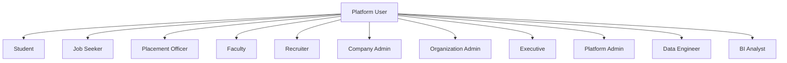
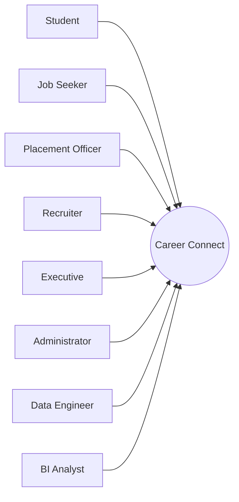
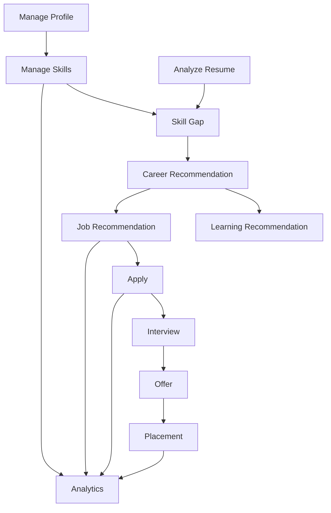
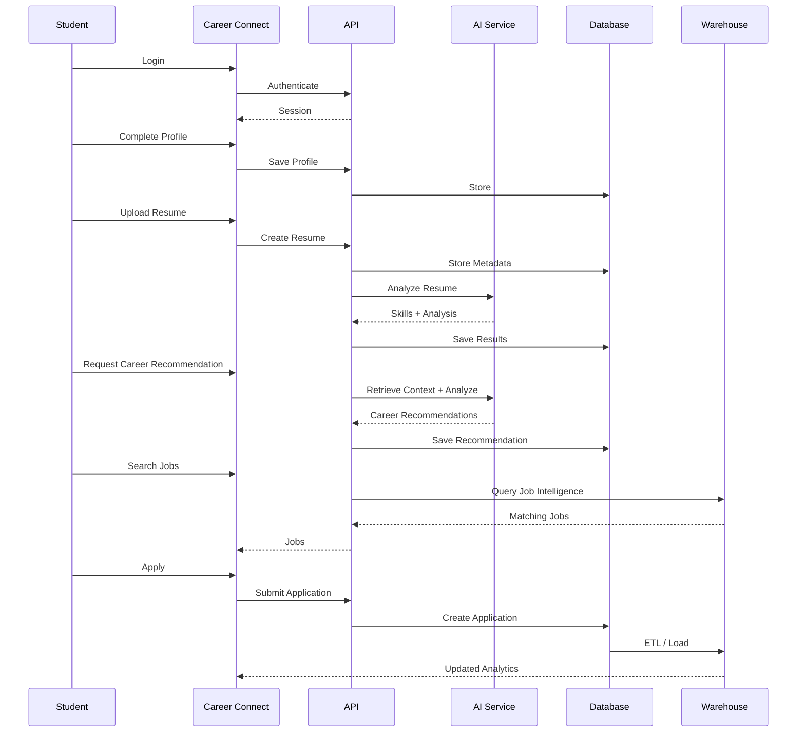
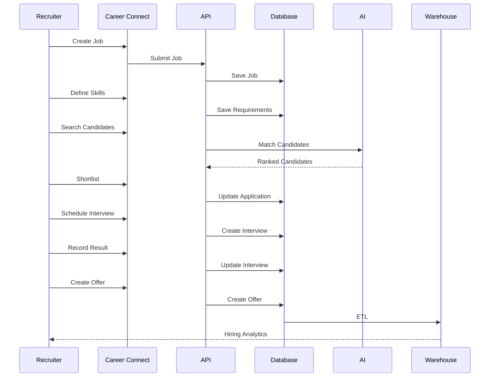
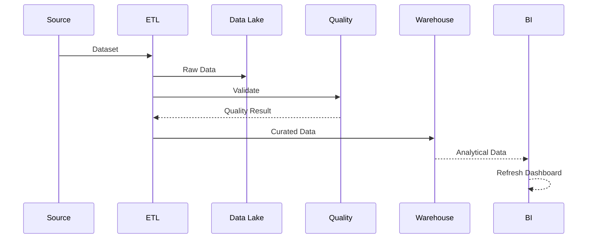
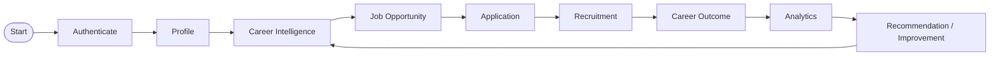
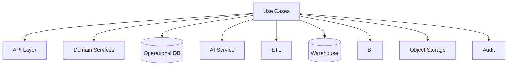

# 25 — Use Cases

# Career Connect — AI Career Intelligence Platform

**Document Type:** Use Case Specification
**Project:** Career Connect
**Version:** 1.0
**Status:** Use Case Baseline
**Methodology:** UML / Agile Use-Case Modeling
**Scope:** Student + Job Seeker + College + Placement + Recruiter + AI + BI + Data Platform + Administration

---

# 1. Introduction

This document defines the major use cases of Career Connect.

A use case describes:

> **How an actor interacts with the system to accomplish a meaningful business goal.**

Unlike user stories, which express requirements from the user's perspective, use cases define the complete interaction flow, including:

```text
Actor
↓
Preconditions
↓
Trigger
↓
Main Flow
↓
Alternative Flows
↓
Exceptions
↓
Postconditions
```

The Career Connect use-case model covers both user-facing workflows and important platform/data workflows.

---

# 2. Use Case Objectives

The use-case model shall:

1. Identify all major system actors.
2. Define their interactions with Career Connect.
3. Describe successful workflows.
4. Define alternative and failure paths.
5. Establish system boundaries.
6. Support functional testing.
7. Support UML diagrams.
8. Provide traceability to requirements and APIs.
9. Demonstrate the complete career lifecycle.
10. Cover AI, ETL, warehouse, BI, and administration workflows.

---

# 3. System Boundary

```text id="m4r8q2"
                CAREER CONNECT SYSTEM
┌──────────────────────────────────────────────────────────────┐
│                                                              │
│  Identity & Access                                           │
│  Student Career Management                                   │
│  Skill Intelligence                                          │
│  Resume Intelligence                                         │
│  Career Intelligence                                         │
│  Job Intelligence                                            │
│  Recruitment                                                 │
│  Applications                                                │
│  Interviews                                                  │
│  Placements                                                  │
│  Learning                                                    │
│  Salary Intelligence                                         │
│  Business Intelligence                                       │
│  Reports                                                     │
│  AI Assistant                                                │
│  ETL / Data Warehouse                                        │
│  Administration                                              │
│  Audit & Governance                                          │
│                                                              │
└──────────────────────────────────────────────────────────────┘
```

External systems remain outside the system boundary.

---

# 4. Primary Actors

Career Connect has the following major actors:

```text
Student
Job Seeker
Placement Officer
Faculty
Recruiter
Company Administrator
Organization Administrator
Executive
Platform Administrator
Data Engineer
BI Analyst
AI Service
External Identity Provider
External Data Source
```

---

# 5. Actor Descriptions

## 5.1 Student

A student uses Career Connect for:

```text
Profile
Skills
Resume
Career Recommendation
Learning
Jobs
Applications
AI Career Guidance
```

---

## 5.2 Job Seeker

A graduate or professional primarily uses:

```text
Job Search
Resume Intelligence
Career Matching
Applications
Interview Preparation
Salary Intelligence
```

---

## 5.3 Placement Officer

Responsible for institutional career outcomes:

```text
Students
Placements
Recruiters
Companies
Reports
Analytics
```

---

## 5.4 Faculty

Faculty may access authorized student and academic analytics.

---

## 5.5 Recruiter

A recruiter manages:

```text
Jobs
Candidates
Applications
Interviews
Offers
Hiring Analytics
```

---

## 5.6 Company Administrator

Manages company-level:

```text
Recruiters
Jobs
Hiring Data
Company Analytics
```

---

## 5.7 Organization Administrator

Manages:

```text
Users
Roles
Departments
Organization Configuration
```

---

## 5.8 Executive

Consumes high-level Business Intelligence.

Examples:

```text
Placement
Salary
Hiring
Skill Demand
Market Trends
```

---

## 5.9 Platform Administrator

Maintains the SaaS platform:

```text
Users
Organizations
Permissions
Reference Data
System Health
Audit
```

---

## 5.10 Data Engineer

Maintains:

```text
ETL
Data Quality
Data Lake
Warehouse
Pipeline Monitoring
Lineage
```

---

## 5.11 BI Analyst

Maintains:

```text
Semantic Metrics
Dashboards
Data Marts
Reports
Analytics
```

---

## 5.12 AI Service

An internal system actor performing:

```text
Resume Analysis
Skill Extraction
Career Recommendations
Skill Gap Analysis
Career Chat
Mock Interviews
```

---

## 5.13 External Identity Provider

Provides authentication services.

---

## 5.14 External Data Source

Provides:

```text
Jobs
Salary
Company
Skill
Market
Location
```

data to the ETL platform.

---

# 6. Actor Hierarchy



This hierarchy is conceptual; actual application roles and permissions are controlled by RBAC.

---

# 7. Use Case Diagram — Overall System



---

# 8. Use Case Classification

Use cases are grouped into:

```text
UC-A — Authentication
UC-O — Organization
UC-S — Student
UC-K — Skills
UC-R — Resume
UC-C — Career
UC-J — Jobs
UC-Ap — Applications
UC-Re — Recruitment
UC-I — Interviews
UC-P — Placements
UC-L — Learning
UC-Cert — Certifications
UC-Sal — Salary
UC-BI — Business Intelligence
UC-Rep — Reporting
UC-AI — Artificial Intelligence
UC-E — ETL
UC-DW — Data Warehouse
UC-Adm — Administration
UC-G — Governance
```

---

# 9. UC-AUTH-001 — Register Account

**Actor:** Student / Job Seeker / Recruiter

**Goal:** Create a Career Connect account.

### Preconditions

- User is not already registered.
- Registration service is available.

### Trigger

User selects **Create Account**.

### Main Flow

```text id="z5m8q2"
1. User enters registration details.
2. System validates input.
3. System checks account uniqueness.
4. System sends authentication request to identity provider.
5. Identity provider creates identity.
6. Career Connect creates application profile.
7. Appropriate role is assigned.
8. Registration event is recorded.
9. User is redirected to onboarding.
```

### Alternative Flow

If email already exists:

```text id="x4q7m3"
System informs user that an account already exists.
```

### Postconditions

```text id="n8m2q5"
User identity exists.
Application profile exists.
Audit/registration event exists.
```

---

# 10. UC-AUTH-002 — Login

**Actors:** All Users

**Goal:** Access authorized functionality.

### Main Flow

```text id="q3m8x7"
1. User enters login information.
2. System validates credentials.
3. Identity provider authenticates user.
4. Career Connect resolves application identity.
5. Roles and organization context are loaded.
6. Session is established.
7. User is redirected to the appropriate dashboard.
```

### Exception

Invalid credentials:

```text id="v5x2m9"
Authentication fails.
Attempt is monitored/logged according to policy.
```

---

# 11. UC-AUTH-003 — Role-Based Access

**Actor:** Administrator

### Goal

Assign a user appropriate system permissions.

### Main Flow

```text id="m7q4x2"
1. Administrator opens user management.
2. Searches for user.
3. Selects organization scope.
4. Selects role.
5. System validates administrator permission.
6. System saves role assignment.
7. Audit event is generated.
```

### Postcondition

User permissions reflect the new role after authorization context is refreshed.

---

# 12. UC-ORG-001 — Create Organization

**Actor:** Platform Administrator

### Goal

Create a new tenant/organization.

### Main Flow

```text id="x8m3q5"
1. Admin enters organization details.
2. System validates required fields.
3. System checks organization uniqueness.
4. Organization is created.
5. Default configuration is initialized.
6. Organization audit event is recorded.
```

---

# 13. UC-ORG-002 — Create Department

**Actor:** Organization Administrator

### Main Flow

```text id="q6m8x3"
1. Admin selects organization.
2. Admin enters department code/name.
3. System validates uniqueness within organization.
4. Department is created.
5. Audit event is recorded.
```

---

# 14. UC-STU-001 — Create Student Profile

**Actor:** Student

### Goal

Create a complete career profile.

### Main Flow

```text id="m4x8q2"
1. Student opens onboarding.
2. Enters academic information.
3. Adds career goal.
4. Adds location preferences.
5. Adds employment preferences.
6. Saves profile.
7. System calculates profile completion.
8. Profile becomes available for authorized intelligence workflows.
```

---

# 15. UC-STU-002 — Manage Education

**Actor:** Student

### Main Flow

```text id="v7m3q9"
1. Student opens education section.
2. Selects Add Education.
3. Enters institution and degree information.
4. System validates dates and fields.
5. Education record is saved.
6. Profile completion is recalculated.
```

---

# 16. UC-STU-003 — Manage Projects

**Actor:** Student

### Main Flow

```text id="q5m8x2"
1. Student opens projects.
2. Creates project.
3. Enters description and links.
4. Adds related skills.
5. System validates input.
6. Project is stored.
7. Career profile is updated.
```

---

# 17. UC-SKL-001 — Add Student Skill

**Actor:** Student

### Main Flow

```text id="x8m4q7"
1. Student searches skill.
2. System searches canonical skill catalog.
3. Student selects skill.
4. Student specifies proficiency.
5. System stores relationship.
6. Skill profile is recalculated.
```

### Alternative

Unknown skill:

```text id="m3q7x8"
System suggests canonical alternatives.
```

---

# 18. UC-SKL-002 — Verify Student Skill

**Actor:** Placement Officer / Authorized Verifier

### Main Flow

```text id="q7m4x2"
1. Officer searches student.
2. Opens skill profile.
3. Reviews evidence.
4. Confirms or rejects verification.
5. System updates verification state.
6. Audit record is created.
```

---

# 19. UC-SKL-003 — Analyze Skill Gap

**Actors:** Student / AI Service

### Goal

Identify missing skills for a career target.

### Preconditions

- Student has sufficient profile data.
- Target career exists.
- Career skill requirements exist.

### Main Flow

```text id="w8m3q5"
1. Student selects target career.
2. System retrieves career requirements.
3. System retrieves student skills.
4. Skill levels are normalized.
5. Platform compares current vs required levels.
6. Gaps are calculated.
7. Gaps are prioritized.
8. Results are stored.
9. Results are displayed.
```

---

# 20. UC-SKL-004 — View Skill Demand

**Actors:** Student / Placement Officer / Recruiter / Analyst

### Main Flow

```text id="m5x8q3"
1. User opens Skill Intelligence.
2. Selects timeframe.
3. Selects role/location filters.
4. System queries approved analytical data.
5. Skill-demand metrics are calculated or retrieved.
6. Dashboard displays results.
```

---

# 21. UC-RES-001 — Upload Resume

**Actor:** Student

### Main Flow

```text id="q4m7x2"
1. Student selects Upload Resume.
2. System validates file.
3. Secure upload location is created.
4. File is uploaded.
5. Metadata is recorded.
6. Resume version is created.
7. Processing status is shown.
```

### Exceptions

```text id="x8m3q5"
Unsupported file
→ Reject

Oversized file
→ Reject

Unauthorized upload
→ Deny
```

---

# 22. UC-RES-002 — Analyze Resume

**Actors:** Student / AI Service

### Main Flow

```text id="v7q3m9"
1. Student selects resume.
2. Selects target career optionally.
3. System creates analysis job.
4. Resume text is extracted.
5. Skills and sections are detected.
6. AI evaluates resume.
7. Output schema is validated.
8. Analysis results are persisted.
9. Student receives notification/result.
```

---

# 23. UC-RES-003 — Review Resume Results

**Actor:** Student

The system shall display:

```text id="m8x2q4"
Overall Score
ATS-Oriented Score
Skill Score
Content Score
Strengths
Weaknesses
Recommendations
```

The product shall communicate that scores are platform-generated evaluations rather than universal hiring guarantees.

---

# 24. UC-CAR-001 — Explore Career

**Actor:** Student

### Main Flow

```text id="q5m8x3"
1. Student opens Career Explorer.
2. Searches career.
3. Selects career.
4. System displays:
   - Description
   - Required skills
   - Related careers
   - Experience expectations
   - Market information
5. Student saves career as target.
```

---

# 25. UC-CAR-002 — Recommend Career

**Actor:** Student

### Main Flow

```text id="x4m7q2"
1. Student requests recommendations.
2. System retrieves profile.
3. System retrieves skills.
4. System retrieves career requirements.
5. System retrieves relevant market information.
6. Recommendation engine runs.
7. Results are validated.
8. Recommendations are stored.
9. Student sees ranked options.
```

---

# 26. UC-CAR-003 — Explain Career Recommendation

**Actor:** Student

The system shall display understandable factors such as:

```text id="m8q3x5"
Matched Skills
Missing Skills
Experience Alignment
Education Alignment
Career Goal
Market Signals
```

---

# 27. UC-JOB-001 — Search Jobs

**Actor:** Student / Job Seeker

### Main Flow

```text id="v5m8q2"
1. User enters keyword.
2. Adds filters.
3. System validates filters.
4. Search service retrieves authorized jobs.
5. Results are ranked.
6. User views results.
```

---

# 28. UC-JOB-002 — View Job

**Actor:** Student / Job Seeker

The system shall display:

```text id="q7m3x8"
Job Title
Company
Description
Skills
Location
Work Mode
Experience
Employment Type
Salary Information where available
Posting/Closing Information
```

---

# 29. UC-JOB-003 — Recommend Job

**Actors:** Student / AI Service

### Main Flow

```text id="m4x8q2"
1. System retrieves candidate profile.
2. Retrieves active jobs.
3. Compares candidate skills with job requirements.
4. Calculates match signals.
5. Ranks jobs.
6. Generates explanation.
7. Displays recommended jobs.
```

---

# 30. UC-APP-001 — Apply to Job

**Actor:** Student / Job Seeker

### Preconditions

```text id="x8m3q5"
User authenticated
Job active
Candidate eligible
Application not already submitted under applicable duplicate rules
```

### Main Flow

```text id="q5m7x2"
1. User opens job.
2. Selects Apply.
3. Selects resume.
4. Reviews application.
5. Submits.
6. System validates.
7. Application is created.
8. APPLIED event is recorded.
9. Audit event is generated.
10. Confirmation is returned.
```

---

# 31. UC-APP-002 — Track Application

**Actor:** Student / Job Seeker

### Main Flow

```text id="m7x4q8"
1. User opens Applications.
2. Selects application.
3. System retrieves current state.
4. Displays timeline.
5. User views relevant notes/status.
```

---

# 32. UC-APP-003 — Withdraw Application

**Actor:** Student / Job Seeker

### Main Flow

```text id="q8m3x5"
1. User selects an eligible application.
2. Selects Withdraw.
3. System checks business rules.
4. Application is marked withdrawn.
5. Event is recorded.
6. Relevant users receive notification.
```

---

# 33. UC-REC-001 — Create Job

**Actor:** Recruiter

### Main Flow

```text id="x4m7q2"
1. Recruiter opens job management.
2. Creates job draft.
3. Enters job details.
4. Adds skills.
5. Adds location.
6. Adds salary information.
7. Saves draft.
```

---

# 34. UC-REC-002 — Publish Job

**Actor:** Recruiter

### Main Flow

```text id="m8x3q5"
1. Recruiter selects draft.
2. System validates required data.
3. Validation succeeds.
4. Job status changes to ACTIVE.
5. Search index/analytics pipeline receives update where applicable.
6. Job becomes discoverable.
```

---

# 35. UC-REC-003 — Search Candidates

**Actor:** Recruiter

### Main Flow

```text id="q7m4x2"
1. Recruiter defines required skills.
2. Adds experience filters.
3. Adds location criteria.
4. System searches authorized candidate data.
5. Matching candidates are ranked.
6. Results are displayed.
```

---

# 36. UC-REC-004 — Candidate Match Explanation

The system may display:

```text id="x5m8q3"
Skill Match
Experience Match
Education Match
Location Match
Certification Match
Missing Requirements
```

The ranking should not be represented as an absolute measure of candidate quality.

---

# 37. UC-REC-005 — Shortlist Candidate

**Actor:** Recruiter

### Main Flow

```text id="m4x7q2"
1. Recruiter opens candidate.
2. Reviews profile.
3. Selects Shortlist.
4. System updates application state.
5. Event is recorded.
6. Candidate is notified according to configured workflow.
```

---

# 38. UC-INT-001 — Schedule Interview

**Actor:** Recruiter

### Main Flow

```text id="q8m3x5"
1. Recruiter selects shortlisted candidate.
2. Chooses interview type.
3. Selects round.
4. Sets date/time.
5. System validates scheduling data.
6. Interview record is created.
7. Application stage becomes INTERVIEW where applicable.
8. Candidate receives notification.
```

---

# 39. UC-INT-002 — Complete Interview

**Actor:** Interviewer

### Main Flow

```text id="m5x8q2"
1. Interviewer opens scheduled interview.
2. Marks interview completed.
3. Records score.
4. Records feedback.
5. Selects result.
6. System stores outcome.
7. Application workflow is updated where appropriate.
```

---

# 40. UC-PLC-001 — Create Offer

**Actor:** Recruiter

### Main Flow

```text id="x7m3q8"
1. Recruiter selects eligible candidate.
2. Creates offer.
3. Enters compensation data.
4. Sets joining date.
5. Validates information.
6. Issues offer.
7. Candidate is notified.
8. Audit event is recorded.
```

---

# 41. UC-PLC-002 — Accept Offer

**Actor:** Candidate

### Main Flow

```text id="q4m8x2"
1. Candidate opens offer.
2. Reviews terms.
3. Selects Accept.
4. System validates offer state.
5. Offer becomes ACCEPTED.
6. Application may progress to accepted-hire workflow.
7. Notification is issued.
```

---

# 42. UC-PLC-003 — Record Placement

**Actor:** Placement Officer

### Main Flow

```text id="m8x3q5"
1. Officer selects successful candidate.
2. Selects company/application.
3. Enters placement details.
4. System validates recruitment relationships.
5. Placement record is created.
6. Salary is stored.
7. Placement status is set.
8. Audit record is generated.
9. Warehouse pipeline receives new business event/data.
```

---

# 43. UC-LEARN-001 — Search Course

**Actor:** Student

### Main Flow

```text id="q6m8x3"
1. Student searches course.
2. Applies skill/category filters.
3. System returns matching courses.
4. Student opens course details.
```

---

# 44. UC-LEARN-002 — Recommend Learning

**Actors:** Student / AI Service

### Main Flow

```text id="x5m7q2"
1. Student has identified skill gaps.
2. System retrieves relevant courses.
3. Course coverage is compared with gaps.
4. Recommendations are ranked.
5. Student receives learning suggestions.
```

---

# 45. UC-LEARN-003 — Track Learning Progress

**Actor:** Student

```text id="m7q3x8"
1. Student opens learning plan.
2. Updates progress.
3. System validates percentage.
4. Progress is stored.
5. Learning analytics are updated.
```

---

# 46. UC-CERT-001 — Add Certification

**Actor:** Student

```text id="q8m4x2"
1. Student selects Add Certification.
2. Enters provider and credential details.
3. System validates required information.
4. Certification is saved.
5. Related skills can be associated.
```

---

# 47. UC-SAL-001 — View Salary Intelligence

**Actor:** Student / Job Seeker / Analyst

### Main Flow

```text id="m5x8q3"
1. User selects role.
2. Selects location.
3. Selects experience.
4. System retrieves approved salary observations.
5. Aggregates values.
6. Displays ranges/trends.
7. Shows data freshness/source context.
```

---

# 48. UC-BI-001 — View Executive Dashboard

**Actor:** Executive

### Main Flow

```text id="x7m3q2"
1. Executive opens dashboard.
2. System validates authorization.
3. Retrieves approved KPIs.
4. Displays:
   - Placement
   - Salary
   - Hiring
   - Skill Demand
   - Market Trends
5. Executive filters date/organization scope.
```

---

# 49. UC-BI-002 — View Placement Dashboard

**Actor:** Placement Officer

The dashboard shall show:

```text id="m8q3x5"
Placement Rate
Total Placements
Average Salary
Highest Salary
Company Hiring
Department Performance
Trend
```

---

# 50. UC-BI-003 — View Student Dashboard

**Actor:** Student

The dashboard shall show:

```text id="q5m8x2"
Profile Completion
Skills
Resume Score
Skill Gaps
Career Recommendations
Learning Progress
Job Matches
Applications
```

---

# 51. UC-BI-004 — View Recruiter Dashboard

**Actor:** Recruiter

The dashboard shall show:

```text id="x4m7q8"
Active Jobs
Applications
Shortlists
Interviews
Offers
Hires
Funnel
```

---

# 52. UC-BI-005 — Drill Down

**Actor:** Authorized Analyst

### Main Flow

```text id="m7x3q5"
1. Analyst opens KPI.
2. Selects dimension.
3. System retrieves lower-level aggregation.
4. Displays detail.
5. Authorization is checked at every stage.
```

---

# 53. UC-BI-006 — Natural-Language BI Query

**Actors:** Executive / Analyst

### Goal

Ask a business question in natural language.

### Main Flow

```text id="q8m4x2"
1. User enters question.
2. System identifies business intent.
3. Semantic layer identifies approved metric.
4. Dimensions are mapped.
5. Query is generated against approved warehouse structures.
6. Query is validated.
7. Warehouse executes query.
8. Result is returned.
9. Explanation/context is shown.
```

### Example

```text id="x5m7q8"
"Show placement rate by department for 2026."
```

---

# 54. UC-REP-001 — Generate Report

**Actor:** Authorized User

### Main Flow

```text id="m4x8q2"
1. User selects report type.
2. Selects filters.
3. Selects output format.
4. System creates report job.
5. Report query runs.
6. Report is generated.
7. File is securely stored.
8. User receives report link/status.
```

---

# 55. UC-REP-002 — Export Dashboard

**Actor:** Authorized User

### Main Flow

```text id="q7m3x5"
1. User opens dashboard.
2. Applies filters.
3. Selects Export.
4. System checks permission.
5. Data is generated.
6. Export event is audited.
7. File is delivered securely.
```

---

# 56. UC-AI-001 — AI Career Chat

**Actor:** Student / Job Seeker

### Main Flow

```text id="x8m3q5"
1. User opens AI assistant.
2. Enters question.
3. System authenticates user.
4. Context retrieval identifies permitted data.
5. AI service receives relevant context.
6. Model generates response.
7. Output is validated.
8. Response is returned.
9. Usage metadata is recorded where applicable.
```

---

# 57. UC-AI-002 — AI Resume Review

**Actor:** Student

```text id="m5q8x2"
1. User selects resume.
2. Selects Analyze.
3. System retrieves resume content.
4. AI service processes content.
5. Structured analysis is returned.
6. Validation succeeds.
7. Result is persisted.
8. User sees recommendations.
```

---

# 58. UC-AI-003 — AI Career Recommendation

**Actor:** Student

### Main Flow

```text id="q4m7x8"
1. User requests recommendation.
2. System retrieves:
   - Skills
   - Education
   - Experience
   - Career Goal
   - Skill Gap
   - Relevant Market Data
3. Context is assembled.
4. AI/recommendation engine executes.
5. Result is validated.
6. Recommendation is stored.
7. User sees recommendation and reasons.
```

---

# 59. UC-AI-004 — AI Mock Interview

**Actor:** Job Seeker

### Main Flow

```text id="x7m3q2"
1. User selects career.
2. Selects interview type.
3. System creates mock interview session.
4. AI asks question.
5. User submits answer.
6. AI evaluates answer.
7. Feedback is generated.
8. Process repeats for selected number of rounds.
9. Final report is generated.
```

---

# 60. UC-AI-005 — AI Skill Extraction

**Actors:** AI Service / Resume Pipeline

### Main Flow

```text id="m8q4x2"
1. Resume text is available.
2. AI service receives authorized text/context.
3. Skills are extracted.
4. Confidence values are produced where supported.
5. Candidate skills are normalized against the canonical skill catalog.
6. Results are stored.
```

---

# 61. UC-AI-006 — AI Failure

### Trigger

AI provider becomes unavailable.

### Main Flow

```text id="x5m7q8"
1. AI request starts.
2. Provider fails or times out.
3. Service records failure.
4. Retry policy executes where appropriate.
5. If still unavailable, system returns controlled failure state.
6. Core application remains available.
```

---

# 62. UC-E-001 — Register Data Source

**Actor:** Data Engineer

### Main Flow

```text id="q4m8x2"
1. Data engineer opens data source management.
2. Creates source definition.
3. Defines source type.
4. Defines schema information.
5. Defines refresh frequency.
6. Defines classification.
7. Saves source.
```

---

# 63. UC-E-002 — Execute ETL Pipeline

**Actor:** Data Engineer / Scheduler

### Main Flow

```text id="m7x3q8"
1. Pipeline is triggered.
2. Source data is extracted.
3. Raw data is stored.
4. Schema is validated.
5. Data is cleaned.
6. Data is standardized.
7. Duplicates are detected.
8. Data is enriched.
9. Data-quality rules execute.
10. Invalid data is quarantined.
11. Curated data is generated.
12. Warehouse loading starts.
13. Reconciliation executes.
14. Pipeline publishes success.
```

---

# 64. UC-E-003 — Handle Bad Data

**Actor:** Data Engineer

### Main Flow

```text id="q8m4x2"
1. ETL identifies invalid record.
2. Record is routed to quarantine.
3. Error code is recorded.
4. Data engineer reviews issue.
5. Record is corrected or source issue is fixed.
6. Batch is replayed.
7. Result is revalidated.
```

---

# 65. UC-E-004 — Pipeline Failure

### Main Flow

```text id="x5m7q3"
1. Pipeline task fails.
2. Failure type is classified.
3. Transient failures are retried.
4. Persistent failures are escalated.
5. Failed batch remains traceable.
6. Alert is generated.
```

---

# 66. UC-DW-001 — Load Dimension

**Actor:** ETL Pipeline

### Main Flow

```text id="m4q8x2"
1. Curated source is received.
2. Business key is resolved.
3. Existing dimension record is searched.
4. SCD rule is applied.
5. New/current record is inserted or updated.
6. Surrogate key is generated/resolved.
```

---

# 67. UC-DW-002 — Load Fact

**Actor:** ETL Pipeline

### Main Flow

```text id="q7m3x8"
1. Curated event is received.
2. Fact grain is validated.
3. Dimension keys are resolved.
4. Measures are calculated.
5. Duplicate check is performed.
6. Fact is loaded.
7. Load metadata is recorded.
```

---

# 68. UC-DW-003 — Reconcile Warehouse

**Actor:** Data Engineer

### Main Flow

```text id="x8m4q2"
1. Source totals are retrieved.
2. Warehouse totals are retrieved.
3. Counts/measures are compared.
4. Differences are calculated.
5. Threshold is evaluated.
6. Result is marked PASS/WARNING/FAIL.
7. Alert is generated if required.
```

---

# 69. UC-GOV-001 — Manage Data Dictionary

**Actor:** Data Steward / BI Analyst

### Main Flow

```text id="m5q7x3"
1. User selects dataset.
2. Reviews business definition.
3. Adds/updates metadata.
4. Defines classification.
5. Defines metric formula where applicable.
6. Publishes metadata.
7. Change is versioned.
```

---

# 70. UC-GOV-002 — Trace Data Lineage

**Actor:** Data Engineer / BI Analyst

### Main Flow

```text id="q4m8x2"
1. Analyst selects metric/field.
2. System retrieves lineage.
3. Displays:
   Source
   Transformation
   Target
   Pipeline
   Metric
4. Analyst uses lineage for investigation.
```

---

# 71. UC-ADM-001 — Manage Users

**Actor:** Administrator

### Main Flow

```text id="x7m3q5"
1. Admin opens user management.
2. Searches user.
3. Views account status.
4. Updates permitted fields.
5. Activates/suspends account where authorized.
6. Audit event is generated.
```

---

# 72. UC-ADM-002 — Manage Reference Data

**Actor:** Administrator / Data Steward

### Main Flow

```text id="m8q4x2"
1. User selects reference domain.
2. Searches record.
3. Creates/updates/deactivates record.
4. System validates relationships.
5. Change is versioned.
6. Audit record is created.
```

---

# 73. UC-ADM-003 — Monitor System Health

**Actor:** Administrator

### Main Flow

```text id="q5m7x3"
1. Admin opens system health.
2. System checks services.
3. Displays:
   API
   Database
   Storage
   AI
   Warehouse
   ETL
4. Unhealthy components are highlighted.
```

---

# 74. UC-AUD-001 — Review Audit Logs

**Actor:** Administrator / Security Officer

### Main Flow

```text id="x4m8q2"
1. User opens audit logs.
2. Applies filters.
3. System retrieves authorized records.
4. Displays action/user/time/resource.
5. User investigates relevant activity.
```

---

# 75. UC-AUD-002 — Audit Sensitive Export

**Actor:** System

### Trigger

Sensitive report/data export occurs.

### Main Flow

```text id="m7q3x8"
1. User requests export.
2. Authorization succeeds.
3. Export is generated.
4. System records:
   User
   Organization
   Dataset
   Time
   Request ID
5. Audit record is immutable to normal application users.
```

---

# 76. UC-SAAS-001 — Create Tenant

**Actor:** Platform Administrator

### Main Flow

```text id="q8m4x2"
1. Admin creates organization.
2. System creates tenant context.
3. Default settings are initialized.
4. Initial administrator is assigned.
5. Tenant becomes active.
```

---

# 77. UC-SAAS-002 — Enforce Tenant Isolation

**Actor:** System

### Main Flow

```text id="x5m7q3"
1. Request arrives.
2. User identity is resolved.
3. Organization context is resolved.
4. Authorization is evaluated.
5. Database query is scoped.
6. Only permitted records are returned.
```

---

# 78. UC-INTG-001 — External Job Data Ingestion

**Actor:** External Data Source / ETL

### Main Flow

```text id="m4q8x2"
1. Scheduled pipeline starts.
2. Connector authenticates.
3. External job data is retrieved.
4. Raw response is stored.
5. Schema is validated.
6. Job records are standardized.
7. Duplicates are removed.
8. Jobs enter curated layer.
9. Warehouse is updated.
```

---

# 79. UC-INTG-002 — External Identity Authentication

**Actors:** User / Identity Provider

### Main Flow

```text id="q7m3x8"
1. User selects external login.
2. Career Connect redirects to identity provider.
3. Identity provider authenticates user.
4. Provider returns authentication response.
5. Career Connect validates identity.
6. Application session is established.
```

---

# 80. UC-INTG-003 — AI Provider Integration

**Actor:** AI Service

### Main Flow

```text id="x8m4q2"
1. Career Connect creates AI request.
2. AI service validates request.
3. Provider adapter selects configured provider/model.
4. Request is sent.
5. Response is received.
6. Schema is validated.
7. AI result is returned to application.
8. Usage/failure metadata is recorded.
```

---

# 81. Use Case Relationship Model

Important relationships include:

```text id="j2f40n"
Upload Resume
    <<include>>
Extract Resume Text

Analyze Resume
    <<include>>
Extract Skills

Career Recommendation
    <<include>>
Retrieve Skills

Career Recommendation
    <<include>>
Retrieve Career Requirements

Apply to Job
    <<include>>
Validate Eligibility

Apply to Job
    <<include>>
Create Application Event

Generate Report
    <<include>>
Retrieve Warehouse Data

AI Career Chat
    <<include>>
Retrieve Authorized Context
```

---

# 82. Include vs Extend

### Include

Used when a behavior is required every time.

Example:

```text id="x4m8q2"
Apply to Job
→ Validate Application
```

### Extend

Used when optional behavior occurs.

Example:

```text id="m7q3x8"
Job Application
← optional Resume Recommendation
```

---

# 83. Use Case Dependency Diagram



---

# 84. End-to-End Student Use Case



---

# 85. End-to-End Recruiter Use Case



---

# 86. End-to-End Data Engineer Use Case



---

# 87. Use Case — Placement Analytics

**Actor:** Placement Officer

### Goal

Understand institutional placement performance.

### Preconditions

- Placement data exists.
- User is authorized.
- Warehouse contains current data.

### Main Flow

```text id="m8q4x2"
1. Officer opens Placement Dashboard.
2. System retrieves placement metrics.
3. Officer selects year.
4. Selects department.
5. System recalculates metrics.
6. Officer drills into company/role.
7. Officer exports report.
8. Export is audited.
```

---

# 88. Use Case — Skill Demand vs Supply

**Actor:** Placement Officer / Training Manager

### Goal

Compare industry demand with student capability.

### Main Flow

```text id="x5m7q3"
1. User selects skill.
2. System retrieves job demand.
3. System retrieves student skill supply.
4. System calculates gap indicator.
5. User compares trend over time.
6. User identifies priority skills.
7. User uses results for training decisions.
```

---

# 89. Use Case — Career Readiness

**Actor:** Student

### Goal

Understand readiness for a target career.

### Main Flow

```text id="q4m8x2"
1. Student selects career.
2. System retrieves career skill requirements.
3. System retrieves student skill profile.
4. System retrieves education/experience signals.
5. System calculates readiness indicators.
6. System shows strengths.
7. System shows gaps.
8. System provides next actions.
```

---

# 90. Use Case — Learning-to-Placement Analysis

**Actor:** Placement Officer / BI Analyst

### Goal

Analyze whether learning activity is associated with recruitment outcomes.

### Main Flow

```text id="m7q3x8"
1. Analyst selects learning program.
2. System retrieves learning participation.
3. Retrieves completion data.
4. Retrieves placement outcomes.
5. Aligns populations under approved analytical rules.
6. Calculates comparative metrics.
7. Displays trend/comparison.
```

The output should be interpreted carefully as analytical association, not automatic causal proof.

---

# 91. Use Case — Executive Market Intelligence

**Actor:** Executive

### Goal

Understand major market trends.

### Main Flow

```text id="x8m4q2"
1. Executive opens Executive Dashboard.
2. System retrieves:
   Job Demand
   Skill Demand
   Salary
   Hiring
   Placement
3. Executive filters date/location.
4. Dashboard updates.
5. Executive drills into high-priority trends.
6. Executive exports strategic report.
```

---

# 92. Use Case — AI Natural-Language Analytics

**Actor:** Executive / BI Analyst

### Example Question

> “Which skills are most demanded for entry-level Data Engineer roles?”

### Main Flow

```text id="q5m7x3"
1. User asks question.
2. System authenticates user.
3. Natural-language parser identifies:
   Role = Data Engineer
   Experience = Entry Level
   Metric = Skill Demand
4. Semantic layer maps approved dimensions.
5. Warehouse query is generated.
6. Query is validated.
7. Warehouse returns result.
8. System presents result.
9. AI optionally summarizes insights.
```

---

# 93. Use Case — Smart Career Report

**Actor:** Student

### Goal

Generate a personalized career report.

### Main Flow

```text id="m4x8q2"
1. Student selects Career Report.
2. System retrieves profile.
3. Retrieves skill profile.
4. Retrieves skill gaps.
5. Retrieves career recommendations.
6. Retrieves learning recommendations.
7. Retrieves relevant market information.
8. Report engine creates document.
9. File is securely stored.
10. Student downloads report.
```

---

# 94. Use Case — Bulk Student Import

**Actor:** Placement Officer

### Goal

Import student data from institutional files.

### Main Flow

```text id="x7m3q5"
1. Officer uploads CSV/Excel.
2. System creates import job.
3. Schema validation executes.
4. Data profiling executes.
5. Records are cleaned.
6. Duplicate detection executes.
7. Invalid records are quarantined.
8. Valid records are loaded.
9. Import summary is generated.
10. Audit event is recorded.
```

---

# 95. Use Case — Data Quality Investigation

**Actor:** Data Engineer

### Goal

Investigate a dashboard discrepancy.

### Main Flow

```text id="q8m4x2"
1. Data Engineer receives alert.
2. Opens quality dashboard.
3. Selects failed dataset.
4. Reviews failed rules.
5. Opens quarantined records.
6. Traces records to source/batch.
7. Identifies transformation issue.
8. Corrects pipeline logic.
9. Replays affected batch.
10. Reconciles warehouse.
11. Closes incident.
```

---

# 96. Use Case — Reference Taxonomy Management

**Actor:** Data Steward

### Goal

Maintain canonical skills.

### Main Flow

```text id="m5x7q3"
1. Steward searches skill.
2. Reviews aliases.
3. Adds canonical mapping.
4. Associates category.
5. Associates technology family.
6. Validates downstream impact.
7. Publishes taxonomy version.
8. ETL uses updated mapping.
```

---

# 97. Use Case — Security Incident Investigation

**Actor:** Security Administrator

### Main Flow

```text id="x4m8q2"
1. Security alert is received.
2. Administrator opens audit logs.
3. Filters by user/request/time.
4. Reviews access events.
5. Identifies suspicious activity.
6. Suspends account where authorized.
7. Records incident.
8. Initiates response process.
```

---

# 98. Exception Handling Model

Every important use case should define at least:

```text id="q7m3x8"
Validation Failure
Authorization Failure
Resource Not Found
Dependency Failure
Timeout
Duplicate Request
Data Quality Failure
```

---

# 99. Common Exception Flow

```text id="m8q4x2"
User Action
↓
Validation
↓
Failure
↓
Controlled Error
↓
Log
↓
Audit if Sensitive
↓
User Guidance
```

---

# 100. Use Case — Authorization Failure

### Example

Student attempts to view another student's private resume.

```text id="x5m7q3"
1. Request received.
2. User authenticated.
3. Resource ownership evaluated.
4. Authorization fails.
5. Access denied.
6. Security event may be logged.
7. No private data returned.
```

---

# 101. Use Case — Resource Not Found

Example:

```text id="q4m8x2"
Application does not exist.
```

System:

```text id="m7x3q8"
Return controlled NOT_FOUND response.
Do not expose database internals.
```

---

# 102. Use Case — AI Timeout

```text id="x8m4q2"
AI Request
↓
Provider Timeout
↓
Retry Policy
↓
Still Failed
↓
PROCESSING_FAILED
↓
User Notification
```

---

# 103. Use Case — ETL Schema Drift

```text id="q5m7x3"
Source Schema
↓
Validation
↓
Unexpected Column/Type
↓
Schema Drift Event
↓
Pipeline Block
↓
Alert
↓
Data Engineer Review
```

---

# 104. Use Case — Dashboard Data Stale

```text id="m4x8q2"
Dashboard Request
↓
Freshness Check
↓
Threshold Exceeded
↓
Show Last Updated
+
Stale Warning
↓
Data Engineer Alert
```

---

# 105. Use Case Security Matrix

| Use Case              |  Student | Placement Officer |  Recruiter |            Admin |
| --------------------- | -------: | ----------------: | ---------: | ---------------: |
| Own Profile           |     Full |           Limited |    Limited |             Full |
| Career Recommendation |     Full |          Optional |         No |       Controlled |
| Job Search            |     Full |              Full |       Full |             Full |
| Apply                 |     Full |                No |         No |       Controlled |
| Candidate Search      |       No |        Authorized |       Full |             Full |
| Placement             | View Own |              Full |   Relevant |             Full |
| Executive Dashboard   |       No |        Authorized | Authorized |             Full |
| ETL                   |       No |                No |         No | Engineering Role |
| Audit                 |       No |           Limited |    Limited |             Full |

Actual authorization must be implemented through the application's permission model.

---

# 106. Use Case Traceability

Each use case should map to:

```text id="q7m3x8"
User Story
↓
Functional Requirement
↓
API
↓
Database
↓
UI
↓
Test Case
```

---

# 107. Example Traceability — Resume Analysis

```text id="m8x4q2"
UC-RES-002
↓
US-RES-005
↓
FR-RES-007
↓
POST /resumes/:id/analyze
↓
ai.resumes
ai.resume_analysis
↓
Resume Analysis Screen
↓
TC-RES-001
```

---

# 108. Example Traceability — Placement Dashboard

```text id="x5m7q3"
UC-BI-002
↓
US-BI-002
↓
FR-BI-002
↓
GET /analytics/placement
↓
fact_placement
dim_student
dim_college
dim_company
dim_date
↓
Placement Dashboard
↓
TC-BI-001
```

---

# 109. Use Case State Model



This represents a continuous intelligence loop rather than a one-time transaction.

---

# 110. Core System Use Case Set

For the final-year implementation, the most important use cases are:

```text id="m7x3q8"
UC-AUTH-002  Login
UC-STU-001   Student Profile
UC-SKL-003   Skill Gap
UC-RES-002   Resume Analysis
UC-CAR-002   Career Recommendation
UC-JOB-001   Job Search
UC-JOB-003   Job Recommendation
UC-APP-001   Apply
UC-INT-001   Schedule Interview
UC-PLC-003   Record Placement
UC-BI-002    Placement Dashboard
UC-BI-004    Recruiter Dashboard
UC-AI-001    Career Chat
UC-E-002     ETL Pipeline
UC-DW-002    Fact Loading
UC-REP-001   Report Generation
UC-ADM-003   Health Monitoring
```

---

# 111. Enterprise Use Case Expansion

Enterprise versions may add:

```text id="x8m4q2"
UC-SAAS-001 Tenant Creation
UC-SAAS-002 Tenant Isolation
UC-INTG-001 External Data Integration
UC-INTG-002 External Identity
UC-INTG-003 AI Provider
UC-AI-004 Mock Interview
UC-BI-006 Natural-Language BI
UC-GOV-002 Data Lineage
UC-AUD-002 Sensitive Export Audit
```

---

# 112. End-to-End Career Intelligence Use Case

This is the most important integrated use case.

**Use Case ID:** UC-X-001

**Actors:** Student, AI Service, Data Platform

**Goal:** Move from profile creation to career outcome.

### Main Flow

```text id="m4x7q8"
1. Student creates profile.
2. Student adds education.
3. Student adds skills.
4. Student uploads resume.
5. AI analyzes resume.
6. System updates skill evidence.
7. Skill Gap Engine identifies missing skills.
8. Career Engine recommends career paths.
9. Learning Engine recommends courses.
10. Job Engine finds matching jobs.
11. Student applies.
12. Recruiter evaluates application.
13. Interview is scheduled.
14. Offer is issued.
15. Placement is recorded.
16. ETL transfers outcome data.
17. Warehouse updates.
18. BI measures outcome.
19. AI uses new outcome data for future authorized insights.
```

---

# 113. End-to-End Intelligence Loop

```text id="q8m3x5"
PROFILE
 ↓
SKILLS
 ↓
CAREER
 ↓
LEARNING
 ↓
JOB
 ↓
APPLICATION
 ↓
INTERVIEW
 ↓
OFFER
 ↓
PLACEMENT
 ↓
ANALYTICS
 ↓
AI
 ↓
NEW RECOMMENDATION
```

The system therefore becomes a continuous career intelligence platform.

---

# 114. Use Case Quality Criteria

Every production use case shall define:

```text id="x5m7q2"
Actor
Goal
Preconditions
Trigger
Main Flow
Alternative Flows
Exception Flows
Postconditions
Security Rules
Data Changes
Audit Requirements
```

---

# 115. Use Case Documentation Template

```text id="m7x4q8"
Use Case ID:
Name:
Actor:
Goal:

Preconditions:

Trigger:

Main Flow:
1.
2.
3.

Alternative Flow:
A1.
A2.

Exception Flow:
E1.
E2.

Postconditions:

Data Created/Updated:

Security:

Audit:

Related API:

Related User Story:

Related Test Cases:
```

---

# 116. Use Case Coverage Matrix

| Domain         | Primary Actors                | Core Use Cases              |
| -------------- | ----------------------------- | --------------------------- |
| Authentication | All                           | Registration, Login, Logout |
| Student        | Student                       | Profile, Education, Skills  |
| Resume         | Student, AI                   | Upload, Analyze             |
| Career         | Student, AI                   | Explore, Recommend          |
| Jobs           | Student, Recruiter            | Search, Create, Match       |
| Applications   | Student, Recruiter            | Apply, Track, Shortlist     |
| Interviews     | Recruiter, Candidate          | Schedule, Evaluate          |
| Placement      | Placement Officer             | Record, Verify, Analyze     |
| Learning       | Student                       | Search, Recommend, Track    |
| Salary         | Student, Analyst              | Analyze, Compare            |
| BI             | Executive, Officer, Recruiter | Dashboard, Drilldown        |
| Reports        | Authorized Users              | Generate, Export            |
| AI             | Student, AI                   | Chat, Career, Resume        |
| ETL            | Data Engineer                 | Ingest, Clean, Load         |
| Warehouse      | Data Engineer                 | Dimensions, Facts           |
| Governance     | Data Steward                  | Dictionary, Lineage         |
| Admin          | Administrator                 | Users, Roles, Health        |

---

# 117. Use Case to Architecture Mapping



The use-case layer therefore connects directly to all major architecture layers.

---

# 118. CTO-Level Use Case Principle

Career Connect should model **business journeys**, not merely technical endpoints.

For example:

```text id="m8x4q2"
POST /jobs/:id/apply
```

is an API operation.

The corresponding business use case is:

> **Apply to Job**

which includes:

```text id="q5m7x3"
Eligibility
Resume Selection
Application Creation
Event Creation
Audit
Notification
Analytics
```

The use case therefore represents the complete behavior.

---

# 119. Final Use Case Architecture

```text id="x4m8q2"
                         CAREER CONNECT
                              │
                    ┌─────────┴─────────┐
                    │                   │
                HUMAN ACTORS       SYSTEM ACTORS
                    │                   │
       ┌────────────┼────────────┐      │
       │            │            │      │
    Student      Recruiter    College   AI
       │            │            │      │
       └────────────┼────────────┘      │
                    │                   │
                BUSINESS USE CASES      │
                    │                   │
       ┌────────────┼────────────┐      │
       │            │            │      │
     Career        Jobs       Recruitment│
       │            │            │      │
       └────────────┼────────────┘      │
                    │                   │
                Career Outcomes         │
                    │                   │
                 Analytics ←────────────┘
```

---

# 120. Final Use Case Statement

> **The Career Connect use-case model defines the complete interaction between users, enterprise data processes, AI services, and the platform's operational and analytical components. The use cases cover the full career lifecycle—from authentication and profile creation through skill analysis, resume intelligence, career recommendation, learning, job discovery, applications, recruitment, interviews, offers, placement, analytics, and AI-guided improvement. They also define the data-engineering lifecycle covering ingestion, quality validation, transformation, warehouse loading, reporting, governance, and audit.**

---

## Document Status

| Attribute        | Value                                                               |
| ---------------- | ------------------------------------------------------------------- |
| Project          | Career Connect                                                      |
| Document         | Use Cases                                                           |
| Version          | 1.0                                                                 |
| Modeling         | UML / Agile                                                         |
| Primary Actors   | Students, Job Seekers, Colleges, Recruiters, Admins                 |
| System Actors    | AI Service, Identity Provider, External Data Sources                |
| Core Lifecycle   | Profile → Skill → Career → Learning → Job → Application → Placement |
| Data Lifecycle   | Source → ETL → Warehouse → BI / AI                                  |
| AI               | Resume, Skill Gap, Career, Chat, Mock Interview                     |
| Governance       | Audit + Data Quality + Lineage                                      |
| Security         | RBAC + Tenant + Resource Authorization                              |
| Academic Scope   | Complete End-to-End Use Cases                                       |
| Enterprise Scope | SaaS + Integrations                                                 |
| Status           | Use Case Baseline                                                   |
