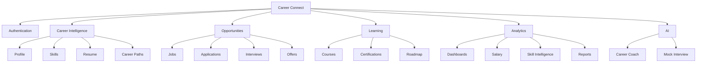
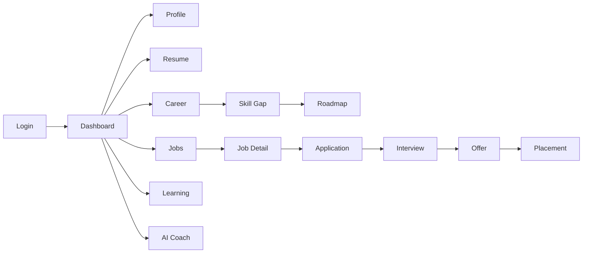

# 26 — Wireframes

# Career Connect — AI Career Intelligence Platform

**Document Type:** Product Wireframe Specification
**Project:** Career Connect
**Version:** 1.0
**Status:** UX Architecture Baseline
**Design Level:** Low-Fidelity → High-Level Structural Wireframes
**Primary Consumers:** UI/UX Designers, Frontend Engineers, Product Managers, Test Engineers, Academic Reviewers

---

# 1. Introduction

This document defines the structural wireframes for Career Connect.

The purpose of wireframing is to establish:

```text id="w4x8m2"
Page Structure
Content Hierarchy
Navigation
User Flow
Information Architecture
Interaction Placement
Dashboard Composition
Responsive Behavior
```

Wireframes intentionally focus first on:

> **What information appears where, how users move through the product, and which actions are most important.**

Visual styling, animations, advanced 3D effects, gradients, glassmorphism, detailed typography, and final component styling belong to the subsequent UI/UX Design phase.

---

# 2. Wireframe Design Principles

Career Connect wireframes follow these principles:

```text id="m7q3x8"
1. Clear hierarchy
2. Minimal cognitive load
3. Role-specific navigation
4. Action-first dashboards
5. Data before decoration
6. Progressive disclosure
7. Responsive structure
8. Accessibility-aware layouts
9. Consistent navigation
10. Explainable intelligence
```

---

# 3. Global Application Structure

The primary authenticated application uses:

```text id="q5m8x2"
┌────────────────────────────────────────────────────────────┐
│ Top Navigation                                             │
├───────────────┬────────────────────────────────────────────┤
│               │                                            │
│ Sidebar       │ Main Content                               │
│ Navigation    │                                            │
│               │                                            │
│               │                                            │
│               │                                            │
├───────────────┴────────────────────────────────────────────┤
│ Optional Footer / Status                                  │
└────────────────────────────────────────────────────────────┘
```

---

# 4. Global Layout

Desktop:

```text id="x8m4q2"
┌────────────────────────────────────────────────────────────────────┐
│ Career Connect     Search...              🔔   AI   Profile        │
├───────────────┬────────────────────────────────────────────────────┤
│ Dashboard     │                                                    │
│ My Profile    │                                                    │
│ Career        │                   MAIN CONTENT                     │
│ Skills        │                                                    │
│ Resume        │                                                    │
│ Jobs          │                                                    │
│ Applications  │                                                    │
│ Learning      │                                                    │
│ Analytics     │                                                    │
│ Reports       │                                                    │
│ Settings      │                                                    │
│               │                                                    │
└───────────────┴────────────────────────────────────────────────────┘
```

---

# 5. Global Top Navigation

The top navigation should contain:

```text id="m7q3x8"
Career Connect Logo
Global Search
Notifications
AI Assistant
Help
User Avatar
Organization Context
```

For administrators, an additional:

```text id="q4m8x2"
Environment / System Status
```

may be displayed.

---

# 6. Global Sidebar

Student navigation:

```text id="v5m8q2"
Dashboard
My Career
Profile
Skills
Resume
Career Paths
Jobs
Applications
Learning
Certifications
AI Coach
Reports
Settings
```

---

# 7. Recruiter Sidebar

Recruiter navigation:

```text id="x7m3q8"
Dashboard
Jobs
Candidates
Applications
Interviews
Offers
Hiring Analytics
Reports
Company Profile
Settings
```

---

# 8. Placement Officer Sidebar

Placement navigation:

```text id="m4q8x2"
Dashboard
Students
Companies
Jobs
Applications
Interviews
Placements
Skill Intelligence
Salary Intelligence
Reports
Data Import
Settings
```

---

# 9. Administrator Sidebar

Admin navigation:

```text id="q8m3x5"
Dashboard
Users
Organizations
Roles
Permissions
Reference Data
Data Sources
ETL Pipelines
Data Quality
Warehouse
Audit Logs
System Health
Settings
```

---

# 10. Responsive Navigation

On mobile:

```text id="x5m7q2"
┌─────────────────────────────┐
│ ☰  Career Connect     🔔 👤│
├─────────────────────────────┤
│                             │
│        MAIN CONTENT         │
│                             │
└─────────────────────────────┘
```

The sidebar becomes a slide-out navigation drawer.

---

# 11. Landing Page Wireframe

```text id="m8q4x2"
┌───────────────────────────────────────────────────────────────┐
│ CAREER CONNECT                    Login   Sign Up              │
├───────────────────────────────────────────────────────────────┤
│                                                               │
│        YOUR CAREER.                                          │
│        YOUR DATA.                                             │
│        YOUR FUTURE.                                           │
│                                                               │
│     AI-powered career intelligence for students,              │
│     institutions and recruiters.                              │
│                                                               │
│       [ Get Started ]    [ Explore Careers ]                  │
│                                                               │
│                    ┌───────────────────────┐                  │
│                    │ Career Intelligence   │                  │
│                    │       Preview         │                  │
│                    │   KPI / Chart / AI    │                  │
│                    └───────────────────────┘                  │
│                                                               │
├───────────────────────────────────────────────────────────────┤
│ AI Career │ Skill Gap │ Job Intelligence │ Analytics          │
├───────────────────────────────────────────────────────────────┤
│ How It Works                                                  │
│ Profile → Analyze → Recommend → Learn → Apply → Grow         │
├───────────────────────────────────────────────────────────────┤
│ For Students | Colleges | Recruiters | Companies              │
└───────────────────────────────────────────────────────────────┘
```

---

# 12. Landing Page Content Hierarchy

Priority order:

```text id="x7m3q2"
1. Product Value
2. Primary CTA
3. Product Differentiation
4. How It Works
5. User Segments
6. Intelligence / Analytics
7. Trust
8. Footer
```

---

# 13. Login Wireframe

```text id="m5q8x3"
┌────────────────────────────────────────────────────┐
│                                                    │
│               CAREER CONNECT                       │
│          AI Career Intelligence Platform           │
│                                                    │
│       ┌──────────────────────────────────┐         │
│       │ Email                            │         │
│       │ [____________________________]   │         │
│       │                                  │         │
│       │ Password                         │         │
│       │ [____________________________]   │         │
│       │                                  │         │
│       │ [        Sign In        ]        │         │
│       │                                  │         │
│       │ [ Continue with Google ]         │         │
│       │                                  │         │
│       │ Forgot password?                 │         │
│       └──────────────────────────────────┘         │
│                                                    │
│             New here? Create account               │
│                                                    │
└────────────────────────────────────────────────────┘
```

---

# 14. Student Onboarding Wireframe

```text id="q8m4x2"
┌──────────────────────────────────────────────────────────┐
│ Career Connect                                Step 1 of 5 │
├──────────────────────────────────────────────────────────┤
│                                                          │
│ Complete Your Career Profile                             │
│                                                          │
│ ● Basic Information                                      │
│ ○ Education                                              │
│ ○ Skills                                                 │
│ ○ Career Goals                                           │
│ ○ Preferences                                            │
│                                                          │
│ Name                                                     │
│ [____________________________________________]           │
│                                                          │
│ Graduation Year                                          │
│ [____________]                                           │
│                                                          │
│ Department                                               │
│ [________________________▼]                              │
│                                                          │
│              [ Back ]      [ Continue ]                  │
└──────────────────────────────────────────────────────────┘
```

---

# 15. Student Dashboard Wireframe

```text id="m4q8x2"
┌────────────────────────────────────────────────────────────────────┐
│ Dashboard                                      🔔   AI Coach   👤   │
├──────────────┬─────────────────────────────────────────────────────┤
│ Dashboard    │ Good morning, Kalai                               │
│ Profile      │ Your career intelligence at a glance.             │
│ Skills       │                                                     │
│ Resume       │ ┌───────────┐ ┌───────────┐ ┌───────────┐        │
│ Careers      │ │ Profile   │ │ Resume    │ │ Skill     │        │
│ Jobs         │ │ 92%       │ │ 84/100    │ │ Match 78% │        │
│ Applications │ └───────────┘ └───────────┘ └───────────┘        │
│ Learning     │                                                     │
│ AI Coach     │ ┌──────────────────────┐ ┌───────────────────────┐│
│ Reports      │ │ Career Recommendation│ │ Skill Gaps             ││
│              │ │ Data Engineer        │ │ 3 High Priority       ││
│              │ │ 86% Match            │ │ [View Gaps]            ││
│              │ │ [View Career]        │ └───────────────────────┘│
│              │ └──────────────────────┘                           │
│              │                                                     │
│              │ ┌───────────────────────────────────────────────┐ │
│              │ │ Recommended Jobs                              │ │
│              │ │ Data Engineer | Chennai | Hybrid              │ │
│              │ │ Data Analyst  | Bengaluru | Remote            │ │
│              │ │ Cloud Engineer| Hyderabad | Hybrid            │ │
│              │ └───────────────────────────────────────────────┘ │
└──────────────┴─────────────────────────────────────────────────────┘
```

---

# 16. Student Dashboard KPI Cards

Recommended cards:

```text id="x7m3q8"
Profile Completion
Resume Score
Career Match
Skill Alignment
Applications
Interviews
Offers
Learning Progress
```

Only the most important metrics should be visible above the fold.

---

# 17. Student Career Readiness Widget

```text id="m8q4x2"
┌─────────────────────────────────────┐
│ Career Readiness                    │
│                                     │
│              78 / 100               │
│          ████████████░░              │
│                                     │
│ Skills       ███████████░ 82%       │
│ Resume       ██████████░░ 76%       │
│ Learning     ████████░░░░ 64%       │
│ Experience   █████████░░░ 71%       │
│                                     │
│ [ Improve Readiness ]               │
└─────────────────────────────────────┘
```

The score should be clearly labeled as a platform-defined indicator.

---

# 18. Student Profile Wireframe

```text id="q5m8x3"
┌──────────────────────────────────────────────────────────────┐
│ My Profile                                      [ Edit ]      │
├──────────────────────────────────────────────────────────────┤
│                                                              │
│  ● Avatar        Kalaiyarasan                                │
│                   Computer Science                            │
│                   Graduation: 2027                            │
│                                                              │
│ Profile Completion                                           │
│ ██████████████████░░ 92%                                     │
│                                                              │
├──────────────────────────────────────────────────────────────┤
│ About                                                        │
│ [Career summary...]                                          │
├──────────────────────────────────────────────────────────────┤
│ Education                                                    │
│ ┌──────────────────────────────────────────────────────────┐ │
│ │ BE CSE | College | 2023–2027                             │ │
│ └──────────────────────────────────────────────────────────┘ │
├──────────────────────────────────────────────────────────────┤
│ Skills                                                       │
│ [Python] [SQL] [Java] [Cloud] [Git]                         │
├──────────────────────────────────────────────────────────────┤
│ Projects                                                     │
│ [Project cards...]                                           │
├──────────────────────────────────────────────────────────────┤
│ Experience                                                  │
│ [Experience timeline...]                                     │
└──────────────────────────────────────────────────────────────┘
```

---

# 19. Skills Page Wireframe

```text id="m4q8x2"
┌──────────────────────────────────────────────────────────────┐
│ My Skills                                    [ + Add Skill ] │
├──────────────────────────────────────────────────────────────┤
│ Search skills...                          Category ▼          │
├──────────────────────────────────────────────────────────────┤
│                                                              │
│ Technical Skills                                             │
│ ┌──────────────────────────────────────────────────────────┐ │
│ │ Python                         Advanced    ✓ Verified     │ │
│ │ █████████████████░░ 86%                                  │ │
│ ├──────────────────────────────────────────────────────────┤ │
│ │ SQL                            Advanced    ✓ Verified     │ │
│ │ ██████████████████░ 91%                                  │ │
│ ├──────────────────────────────────────────────────────────┤ │
│ │ Apache Spark                   Beginner                  │ │
│ │ ██████░░░░░░░░░░░░ 34%                                  │ │
│ └──────────────────────────────────────────────────────────┘ │
│                                                              │
│ Recommended Skills                                           │
│ [Airflow] [Docker] [BigQuery] [Kafka]                       │
└──────────────────────────────────────────────────────────────┘
```

---

# 20. Skill Gap Wireframe

```text id="x7m3q5"
┌──────────────────────────────────────────────────────────────┐
│ Skill Gap Analysis                                           │
│ Target Career: [ Data Engineer ▼ ]                           │
├──────────────────────────────────────────────────────────────┤
│                                                              │
│ Overall Alignment                                            │
│ ████████████████░░░░ 78%                                     │
│                                                              │
│ High Priority                                                 │
│ ┌──────────────────────────────────────────────────────────┐ │
│ │ Apache Airflow                           HIGH             │ │
│ │ Current: Beginner   Required: Intermediate              │ │
│ │ Gap: ███████████░░                                      │ │
│ │ [ Learn This Skill ]                                    │ │
│ ├──────────────────────────────────────────────────────────┤ │
│ │ Apache Spark                           HIGH               │ │
│ │ Current: Beginner   Required: Intermediate              │ │
│ │ [ Learn This Skill ]                                    │ │
│ └──────────────────────────────────────────────────────────┘ │
│                                                              │
│ Medium Priority                                              │
│ [Docker] [Data Modeling]                                     │
└──────────────────────────────────────────────────────────────┘
```

---

# 21. Career Explorer Wireframe

```text id="m8q4x2"
┌──────────────────────────────────────────────────────────────┐
│ Career Explorer                                              │
├──────────────────────────────────────────────────────────────┤
│ Search career...                                             │
│                                                              │
│ Categories                                                   │
│ [Software] [Data] [Cloud] [AI] [Cybersecurity]              │
│                                                              │
│ ┌────────────────────┐ ┌────────────────────┐                │
│ │ Data Engineer      │ │ Data Scientist    │                │
│ │ Data               │ │ AI / Data         │                │
│ │ ████████████       │ │ ██████████        │                │
│ │ Demand: High       │ │ Demand: High      │                │
│ │ [Explore]          │ │ [Explore]         │                │
│ └────────────────────┘ └────────────────────┘                │
│                                                              │
│ Recommended for You                                         │
│ [Data Engineer] [Cloud Engineer] [Analytics Engineer]       │
└──────────────────────────────────────────────────────────────┘
```

---

# 22. Career Detail Wireframe

```text id="q5m7x3"
┌──────────────────────────────────────────────────────────────┐
│ ← Career Explorer                                            │
│                                                              │
│ Data Engineer                                                │
│ Build and maintain scalable data systems.                    │
│                                                              │
│ Match: 86%                       Demand: High                 │
│                                                              │
│ Required Skills                                              │
│ [Python] [SQL] [ETL] [Cloud] [Spark] [Airflow]              │
│                                                              │
│ Your Skills                                                  │
│ ✓ Python   ✓ SQL   ✓ Cloud                                  │
│ △ Spark    ✕ Airflow                                         │
│                                                              │
│ Salary Intelligence                                         │
│ [Chart Placeholder]                                         │
│                                                              │
│ Learning Roadmap                                             │
│ 1. Airflow → 2. Spark → 3. Portfolio Project                │
│                                                              │
│          [ Set as Career Goal ]                              │
└──────────────────────────────────────────────────────────────┘
```

---

# 23. Resume Upload Wireframe

```text id="m7q4x2"
┌──────────────────────────────────────────────────────────────┐
│ Resume Intelligence                                          │
├──────────────────────────────────────────────────────────────┤
│                                                              │
│                ┌─────────────────────────────┐               │
│                │                             │               │
│                │       ↑ Upload Resume       │               │
│                │                             │               │
│                │ Drag & Drop or Browse      │               │
│                │ PDF / DOCX                 │               │
│                │                             │               │
│                └─────────────────────────────┘               │
│                                                              │
│ Previous Versions                                            │
│ ┌──────────────────────────────────────────────────────────┐ │
│ │ Resume v3       84/100       Active       [View]         │ │
│ │ Resume v2       76/100                  [View]           │ │
│ │ Resume v1       71/100                  [View]           │ │
│ └──────────────────────────────────────────────────────────┘ │
└──────────────────────────────────────────────────────────────┘
```

---

# 24. Resume Analysis Wireframe

```text id="x8m3q5"
┌──────────────────────────────────────────────────────────────┐
│ Resume Analysis                                              │
├──────────────────────────────────────────────────────────────┤
│                                                              │
│ Overall Score                     ATS-Oriented Score         │
│     84 / 100                           88 / 100              │
│                                                              │
│ ┌──────────────┐ ┌──────────────┐ ┌──────────────┐          │
│ │ Skills       │ │ Content      │ │ Format       │          │
│ │ 89           │ │ 82           │ │ 78           │          │
│ └──────────────┘ └──────────────┘ └──────────────┘          │
│                                                              │
│ Strengths                                                    │
│ ✓ Strong technical skills                                   │
│ ✓ Good project evidence                                     │
│                                                              │
│ Improvements                                                 │
│ △ Add quantified project outcomes                            │
│ △ Improve experience descriptions                            │
│ △ Add missing target skills                                 │
│                                                              │
│ [ Improve Resume ]                                           │
└──────────────────────────────────────────────────────────────┘
```

---

# 25. Job Search Wireframe

```text id="m5q8x2"
┌─────────────────────────────────────────────────────────────────┐
│ Job Search                                                      │
├───────────────┬─────────────────────────────────────────────────┤
│ Filters       │ Search jobs...                                 │
│               │                                                 │
│ Location      │ ┌─────────────────────────────────────────────┐ │
│ [Chennai ▼]   │ │ Data Engineer                               │ │
│               │ │ Example Technologies                        │ │
│ Experience    │ │ Chennai • Hybrid                            │ │
│ [Entry ▼]     │ │ ₹ Salary Range • Full Time                 │ │
│               │ │ Match 92%                     [View Job]     │ │
│ Work Mode     │ └─────────────────────────────────────────────┘ │
│ [Hybrid ▼]    │                                                 │
│               │ ┌─────────────────────────────────────────────┐ │
│ Skills        │ │ Cloud Data Engineer                         │ │
│ [Python]      │ │ Example Company                             │ │
│ [SQL]         │ │ Bengaluru • Remote                          │ │
│               │ │ Match 86%                     [View Job]     │ │
│ Salary        │ └─────────────────────────────────────────────┘ │
└───────────────┴─────────────────────────────────────────────────┘
```

---

# 26. Job Detail Wireframe

```text id="x7m4q3"
┌──────────────────────────────────────────────────────────────┐
│ ← Jobs                                                        │
├──────────────────────────────────────────────────────────────┤
│ Data Engineer                              [ Apply Now ]      │
│ Example Technologies                                           │
│ Chennai • Hybrid • Full Time                                   │
│                                                              │
│ Match Score                                                  │
│ █████████████████░░ 86%                                      │
│                                                              │
│ Why You Match                                                │
│ ✓ Python                                                     │
│ ✓ SQL                                                        │
│ ✓ Cloud                                                      │
│                                                              │
│ Missing                                                     │
│ △ Apache Airflow                                             │
│                                                              │
│ About the Role                                               │
│ [Job description...]                                         │
│                                                              │
│ Required Skills                                              │
│ [Python] [SQL] [Cloud] [Spark] [Airflow]                   │
│                                                              │
│ Salary                                                       │
│ [Salary range / market information]                         │
│                                                              │
│ [ Apply Now ]        [ Save Job ]                            │
└──────────────────────────────────────────────────────────────┘
```

---

# 27. Application Tracking Wireframe

```text id="m8q2x5"
┌──────────────────────────────────────────────────────────────┐
│ My Applications                                              │
├──────────────────────────────────────────────────────────────┤
│ Search...                 Status ▼                            │
├──────────────────────────────────────────────────────────────┤
│ Data Engineer | Example Tech | INTERVIEW                     │
│                                                              │
│ ● Applied ─── ● Screening ─── ● Shortlisted ─── ● Interview │
│                                                              │
│ Applied: Jul 12                                              │
│ Interview: Aug 05                                             │
│                                                              │
│ [ View Application ]                                         │
├──────────────────────────────────────────────────────────────┤
│ Cloud Engineer | Example Corp | APPLIED                     │
│ ● Applied                                                    │
│                                                              │
│ [ View Application ]                                         │
└──────────────────────────────────────────────────────────────┘
```

---

# 28. Recruiter Dashboard Wireframe

```text id="x4m7q2"
┌─────────────────────────────────────────────────────────────────────┐
│ Recruiter Dashboard                                  🔔   👤       │
├──────────────┬──────────────────────────────────────────────────────┤
│ Dashboard    │ Hello, Recruiter                                     │
│ Jobs         │                                                      │
│ Candidates   │ ┌─────────┐ ┌─────────┐ ┌─────────┐ ┌─────────┐   │
│ Applications │ │ Active  │ │ Apps    │ │Interviews│ │ Hires   │   │
│ Interviews   │ │ 24      │ │ 1,280   │ │ 84      │ │ 18      │   │
│ Offers       │ └─────────┘ └─────────┘ └─────────┘ └─────────┘   │
│ Analytics    │                                                      │
│              │ ┌──────────────────────┐ ┌────────────────────────┐ │
│              │ │ Recruitment Funnel   │ │ Top Jobs               │ │
│              │ │ Applications         │ │ Data Engineer           │ │
│              │ │ ↓                    │ │ Cloud Engineer          │ │
│              │ │ Interviews           │ │ Software Engineer       │ │
│              │ │ ↓                    │ └────────────────────────┘ │
│              │ │ Offers               │                              │
│              │ │ ↓                    │                              │
│              │ │ Hires                │                              │
│              │ └──────────────────────┘                              │
└──────────────┴──────────────────────────────────────────────────────┘
```

---

# 29. Candidate Search Wireframe

```text id="m7q4x2"
┌──────────────────────────────────────────────────────────────┐
│ Candidate Search                                              │
├──────────────────────────────────────────────────────────────┤
│ Search candidates...                                          │
│                                                              │
│ Skills: [Python] [SQL] [AWS]                                 │
│ Experience: [0–2 Years ▼]                                    │
│ Location: [Chennai ▼]                                       │
│                                                              │
│ ┌──────────────────────────────────────────────────────────┐ │
│ │ Candidate A                                              │ │
│ │ Match 94%                                                │ │
│ │ Python ✓ SQL ✓ AWS ✓                                     │ │
│ │ Experience: 1.5 yrs                                      │ │
│ │ [View Profile] [Shortlist]                               │ │
│ ├──────────────────────────────────────────────────────────┤ │
│ │ Candidate B                                              │ │
│ │ Match 87%                                                │ │
│ │ Python ✓ SQL ✓ AWS △                                     │ │
│ │ [View Profile] [Shortlist]                               │ │
│ └──────────────────────────────────────────────────────────┘ │
└──────────────────────────────────────────────────────────────┘
```

---

# 30. Candidate Detail Wireframe

```text id="x8m3q5"
┌──────────────────────────────────────────────────────────────┐
│ Candidate Profile                            [ Shortlist ]   │
├──────────────────────────────────────────────────────────────┤
│                                                              │
│ Candidate Name                                               │
│ Student / Professional                                       │
│                                                              │
│ Match Score: 92%                                             │
│                                                              │
│ Skills                                                       │
│ [Python] [SQL] [AWS] [ETL]                                  │
│                                                              │
│ Experience                                                   │
│ [Timeline]                                                   │
│                                                              │
│ Education                                                    │
│ [Education Summary]                                          │
│                                                              │
│ Resume                                                       │
│ [View Resume]                                                │
│                                                              │
│ Match Explanation                                            │
│ ✓ Skills                                                     │
│ ✓ Experience                                                │
│ △ Location                                                   │
│                                                              │
│ [ Shortlist ] [ Schedule Interview ]                         │
└──────────────────────────────────────────────────────────────┘
```

---

# 31. Interview Management Wireframe

```text id="m5q8x2"
┌──────────────────────────────────────────────────────────────┐
│ Interviews                                                    │
├──────────────────────────────────────────────────────────────┤
│ Upcoming                                                     │
│                                                              │
│ ┌──────────────────────────────────────────────────────────┐ │
│ │ Candidate A | Data Engineer                              │ │
│ │ Technical Round 1                                        │ │
│ │ Aug 05 • 10:30 AM                                        │ │
│ │ [Open] [Reschedule]                                      │ │
│ └──────────────────────────────────────────────────────────┘ │
│                                                              │
│ Completed                                                    │
│ ┌──────────────────────────────────────────────────────────┐ │
│ │ Candidate B | Cloud Engineer                             │ │
│ │ Technical Round 2 • PASS                                 │ │
│ │ Score: 84                                                │ │
│ │ [View Feedback]                                          │ │
│ └──────────────────────────────────────────────────────────┘ │
└──────────────────────────────────────────────────────────────┘
```

---

# 32. Placement Officer Dashboard

```text id="x7m3q8"
┌────────────────────────────────────────────────────────────────────┐
│ Placement Intelligence                                🔔   👤      │
├──────────────┬─────────────────────────────────────────────────────┤
│ Dashboard    │ Placement Overview                                 │
│ Students     │                                                     │
│ Companies    │ ┌──────────┐ ┌────────────┐ ┌────────────┐        │
│ Jobs         │ │ Placement│ │ Avg Salary │ │ Companies  │        │
│ Applications │ │ Rate 82% │ │ ₹8.4 LPA   │ │ 146        │        │
│ Interviews   │ └──────────┘ └────────────┘ └────────────┘        │
│ Placements   │                                                     │
│ Skills       │ ┌───────────────────────────────────────────────┐  │
│ Salary       │ │ Placement Trend                              │  │
│ Reports      │ │              [Chart]                          │  │
│ Data Import  │ │                                               │  │
│              │ └───────────────────────────────────────────────┘  │
│              │                                                     │
│              │ ┌──────────────────┐ ┌──────────────────────────┐ │
│              │ │ Department       │ │ Top Hiring Companies    │ │
│              │ │ CSE 88%          │ │ Company A                │ │
│              │ │ ECE 82%          │ │ Company B                │ │
│              │ │ IT 91%           │ │ Company C                │ │
│              │ └──────────────────┘ └──────────────────────────┘ │
└──────────────┴─────────────────────────────────────────────────────┘
```

Any monetary value shown above is illustrative sample data only.

---

# 33. College Analytics Dashboard

```text id="m4q8x2"
┌────────────────────────────────────────────────────────────────────┐
│ College Intelligence                                               │
├────────────────────────────────────────────────────────────────────┤
│ Filters: Year ▼  Department ▼  Company ▼  Location ▼             │
├────────────────────────────────────────────────────────────────────┤
│                                                                     │
│ Placement Rate        Avg Salary         Highest Salary             │
│ 82%                   ₹8.4 LPA           ₹22 LPA                    │
│                                                                     │
│ ┌───────────────────────┐ ┌──────────────────────────────────────┐ │
│ │ Department Placement  │ │ Salary Distribution                  │ │
│ │ [Bar Chart]           │ │ [Chart]                              │ │
│ └───────────────────────┘ └──────────────────────────────────────┘ │
│                                                                     │
│ ┌───────────────────────────────────────────────────────────────┐   │
│ │ Company Hiring                                             │   │
│ │ Company | Students | Avg Salary | Top Role               │   │
│ └───────────────────────────────────────────────────────────────┘   │
└────────────────────────────────────────────────────────────────────┘
```

---

# 34. Executive Dashboard Wireframe

```text id="x7m3q5"
┌────────────────────────────────────────────────────────────────────┐
│ Executive Intelligence                               Date ▼       │
├────────────────────────────────────────────────────────────────────┤
│                                                                    │
│ Placement      Avg Salary      Hires          Job Demand           │
│ 82.4%          ₹8.4 LPA        642            12.8K                │
│                                                                    │
│ ┌────────────────────────────┐ ┌────────────────────────────────┐ │
│ │ Placement Trend            │ │ Hiring Trend                   │ │
│ │ [Line Chart]               │ │ [Line Chart]                   │ │
│ └────────────────────────────┘ └────────────────────────────────┘ │
│                                                                    │
│ ┌────────────────────────────┐ ┌────────────────────────────────┐ │
│ │ Top Skills                 │ │ Top Hiring Companies           │ │
│ │ Python                     │ │ Company A                      │ │
│ │ SQL                        │ │ Company B                      │ │
│ │ Cloud                      │ │ Company C                      │ │
│ └────────────────────────────┘ └────────────────────────────────┘ │
│                                                                    │
│ Strategic Insights                                                │
│ • Data engineering demand increasing                              │
│ • Cloud skills show strong demand                                 │
│ • Department X needs additional training                          │
└────────────────────────────────────────────────────────────────────┘
```

Sample values are illustrative only.

---

# 35. Skill Intelligence Dashboard

```text id="m8q4x2"
┌────────────────────────────────────────────────────────────────────┐
│ Skill Intelligence                                                 │
├────────────────────────────────────────────────────────────────────┤
│ Filters: Role ▼ Location ▼ Experience ▼ Date ▼                    │
├────────────────────────────────────────────────────────────────────┤
│                                                                    │
│ Demand Index      Student Supply       Skill Gap                    │
│ 8.6               4.2K                 High                         │
│                                                                    │
│ ┌────────────────────────────┐ ┌────────────────────────────────┐ │
│ │ Top Demanded Skills        │ │ Demand vs Supply               │ │
│ │ Python                     │ │ [Comparison Chart]              │ │
│ │ SQL                        │ │                                │ │
│ │ AWS                        │ │                                │ │
│ │ Spark                      │ │                                │ │
│ └────────────────────────────┘ └────────────────────────────────┘ │
│                                                                    │
│ Emerging Skills                                                  │
│ [Airflow] [Databricks] [dbt] [GenAI]                            │
└────────────────────────────────────────────────────────────────────┘
```

---

# 36. Salary Intelligence Dashboard

```text id="x5m7q3"
┌────────────────────────────────────────────────────────────────────┐
│ Salary Intelligence                                                │
├────────────────────────────────────────────────────────────────────┤
│ Role ▼     Location ▼     Experience ▼     Company ▼              │
├────────────────────────────────────────────────────────────────────┤
│                                                                    │
│ Median / Avg        Min             Max                            │
│ ₹8.4 LPA            ₹5.2 LPA        ₹18 LPA                       │
│                                                                    │
│ ┌────────────────────────────┐ ┌────────────────────────────────┐ │
│ │ Salary by Experience      │ │ Salary by Location              │ │
│ │ [Chart]                    │ │ [Chart]                         │ │
│ └────────────────────────────┘ └────────────────────────────────┘ │
│                                                                    │
│ Market Observation vs Actual Placement                            │
│ [Comparison Visualization]                                        │
└────────────────────────────────────────────────────────────────────┘
```

Sample values are illustrative only.

---

# 37. Learning Dashboard

```text id="m7q4x2"
┌──────────────────────────────────────────────────────────────┐
│ My Learning                                                  │
├──────────────────────────────────────────────────────────────┤
│ Current Goal: Data Engineer                                  │
│                                                              │
│ Overall Progress                                             │
│ █████████████░░░ 64%                                         │
│                                                              │
│ Current Courses                                              │
│ ┌──────────────────────────────────────────────────────────┐ │
│ │ SQL for Data Engineering                82%              │ │
│ │ ████████████████░░                                      │ │
│ ├──────────────────────────────────────────────────────────┤ │
│ │ Apache Airflow                          32%              │ │
│ │ ██████░░░░░░░░░░                                        │ │
│ └──────────────────────────────────────────────────────────┘ │
│                                                              │
│ Recommended Next                                             │
│ [Spark] [Cloud Data Engineering] [Data Modeling]            │
└──────────────────────────────────────────────────────────────┘
```

---

# 38. AI Career Assistant Wireframe

```text id="x8m3q5"
┌──────────────────────────────────────────────────────────────┐
│ AI Career Coach                                              │
├──────────────────────────────────────────────────────────────┤
│                                                              │
│ AI: Hi! I understand your current career profile.            │
│     What would you like to improve?                         │
│                                                              │
│ You: What should I learn for Data Engineering?               │
│                                                              │
│ AI: Based on your current skills, prioritize:                 │
│     1. Apache Airflow                                        │
│     2. Apache Spark                                          │
│     3. Data Modeling                                         │
│                                                              │
│     Why: Python and SQL are already strong.                 │
│                                                              │
│ ┌──────────────────────────────────────────────────────────┐ │
│ │ Ask your career question...                              │ │
│ └──────────────────────────────────────────────────────────┘ │
│                         [ Send ]                             │
└──────────────────────────────────────────────────────────────┘
```

---

# 39. AI Recommendation Card

```text id="m5q8x2"
┌──────────────────────────────────────────────┐
│ AI Recommendation                            │
│                                              │
│ Data Engineer                                │
│ Match: 86%                                   │
│ Confidence: High                             │
│                                              │
│ Why                                             │
│ ✓ Python                                      │
│ ✓ SQL                                         │
│ ✓ Cloud                                       │
│                                              │
│ Improve                                       │
│ △ Airflow                                     │
│ △ Spark                                       │
│                                              │
│ Next Action                                   │
│ [ Start Learning Roadmap ]                   │
└──────────────────────────────────────────────┘
```

---

# 40. Mock Interview Wireframe

```text id="x7m4q3"
┌──────────────────────────────────────────────────────────────┐
│ AI Mock Interview                          Question 3 / 10  │
├──────────────────────────────────────────────────────────────┤
│                                                              │
│ Interview Type: Technical                                    │
│ Career: Data Engineer                                        │
│ Difficulty: Intermediate                                     │
│                                                              │
│ Question                                                     │
│ "How would you design a scalable ETL pipeline?"             │
│                                                              │
│ ┌──────────────────────────────────────────────────────────┐ │
│ │ Type your answer...                                      │ │
│ │                                                          │ │
│ │                                                          │ │
│ └──────────────────────────────────────────────────────────┘ │
│                                                              │
│ [ Submit Answer ]                                           │
│                                                              │
│ Progress                                                     │
│ ● ● ● ○ ○ ○ ○ ○ ○ ○                                        │
└──────────────────────────────────────────────────────────────┘
```

---

# 41. AI Mock Interview Result

```text id="m8q4x2"
┌──────────────────────────────────────────────────────────────┐
│ Mock Interview Report                                        │
├──────────────────────────────────────────────────────────────┤
│ Overall Performance: 82 / 100                                │
│                                                              │
│ Technical Knowledge     ███████████████░ 84                  │
│ Communication           █████████████░░░ 76                  │
│ Problem Solving         ████████████████ 88                  │
│ Clarity                 █████████████░░░ 77                  │
│                                                              │
│ Strengths                                                     │
│ ✓ Strong ETL concepts                                         │
│ ✓ Good architecture reasoning                                 │
│                                                              │
│ Improve                                                       │
│ △ Explain trade-offs more clearly                             │
│ △ Use concrete examples                                       │
│                                                              │
│ [ Practice Again ] [ View Learning Recommendations ]          │
└──────────────────────────────────────────────────────────────┘
```

---

# 42. Report Generation Wireframe

```text id="x4m7q2"
┌──────────────────────────────────────────────────────────────┐
│ Generate Report                                               │
├──────────────────────────────────────────────────────────────┤
│ Report Type                                                   │
│ [ Placement Report ▼ ]                                       │
│                                                              │
│ Organization                                                  │
│ [ Example College ▼ ]                                        │
│                                                              │
│ Period                                                        │
│ [ Jan 2026 ] — [ Jul 2026 ]                                  │
│                                                              │
│ Include                                                       │
│ ☑ Placement Rate                                             │
│ ☑ Salary Analysis                                            │
│ ☑ Company Hiring                                             │
│ ☑ Department Comparison                                      │
│ ☑ Skill Analytics                                            │
│                                                              │
│ Format                                                        │
│ ○ PDF      ○ Excel      ○ CSV                                │
│                                                              │
│                     [ Generate Report ]                      │
└──────────────────────────────────────────────────────────────┘
```

---

# 43. Report Status Wireframe

```text id="m7q3x8"
┌─────────────────────────────────────────────┐
│ Report Generation                           │
│                                             │
│ Placement Report                            │
│                                             │
│ ● Preparing data                            │
│ ● Running analytics                         │
│ ○ Generating document                       │
│ ○ Ready                                     │
│                                             │
│ Status: PROCESSING                          │
│                                             │
│ Please continue using Career Connect.       │
└─────────────────────────────────────────────┘
```

---

# 44. Data Import Wireframe

```text id="x8m4q2"
┌──────────────────────────────────────────────────────────────┐
│ Import Student Data                                          │
├──────────────────────────────────────────────────────────────┤
│                                                              │
│ Upload CSV / XLSX                                            │
│ ┌──────────────────────────────────────────────────────────┐ │
│ │ Drag and Drop File                                       │ │
│ │                 [ Browse ]                               │ │
│ └──────────────────────────────────────────────────────────┘ │
│                                                              │
│ Dataset Type                                                 │
│ [ Students ▼ ]                                               │
│                                                              │
│ Validation Rules                                             │
│ ✓ Required columns                                           │
│ ✓ Duplicate detection                                        │
│ ✓ Department mapping                                         │
│ ✓ Email validation                                           │
│                                                              │
│ [ Preview ]                      [ Start Import ]             │
└──────────────────────────────────────────────────────────────┘
```

---

# 45. Data Import Result

```text id="m5q8x2"
┌──────────────────────────────────────────────────────────────┐
│ Import Completed                                             │
├──────────────────────────────────────────────────────────────┤
│ Total Records        10,000                                  │
│ Accepted              9,850                                  │
│ Rejected                150                                  │
│ Warnings                220                                  │
│                                                              │
│ Data Quality Score     97.4%                                 │
│                                                              │
│ [ View Errors ] [ Download Error File ] [ Close ]            │
└──────────────────────────────────────────────────────────────┘
```

Sample values are illustrative.

---

# 46. ETL Monitoring Wireframe

```text id="x7m4q3"
┌────────────────────────────────────────────────────────────────────┐
│ Data Engineering Monitor                                           │
├────────────────────────────────────────────────────────────────────┤
│                                                                     │
│ Pipeline Health        Data Quality        Freshness                 │
│ 98%                    96%                 Healthy                   │
│                                                                     │
│ ┌───────────────────────────────────────────────────────────────┐  │
│ │ Pipeline          Status       Duration       Records         │  │
│ │ Jobs Daily        ✓ SUCCESS    14m            120K           │  │
│ │ Students Daily    ✓ SUCCESS     8m             15K           │  │
│ │ Salary Weekly     ⚠ WARNING    24m              8K           │  │
│ │ Placement Daily   ✕ FAILED      3m              2K           │  │
│ └───────────────────────────────────────────────────────────────┘  │
│                                                                     │
│ [ Failed Runs ] [ Quality ] [ Lineage ] [ Reprocess ]              │
└────────────────────────────────────────────────────────────────────┘
```

---

# 47. Data Quality Dashboard Wireframe

```text id="m8q4x2"
┌────────────────────────────────────────────────────────────────────┐
│ Data Quality                                                       │
├────────────────────────────────────────────────────────────────────┤
│                                                                     │
│ Completeness 96%   Validity 98%   Uniqueness 99%   Freshness 94%  │
│                                                                     │
│ ┌───────────────────────────────────────────────────────────────┐  │
│ │ Dataset           Quality      Failed Checks                   │  │
│ │ Students          98%         2                               │  │
│ │ Jobs              95%         5                               │  │
│ │ Salaries          93%         8                               │  │
│ │ Placements        99%         1                               │  │
│ └───────────────────────────────────────────────────────────────┘  │
│                                                                     │
│ Quarantined Records                                                │
│ [ View Records ]                                                  │
└────────────────────────────────────────────────────────────────────┘
```

Sample values are illustrative.

---

# 48. Data Warehouse Monitoring Wireframe

```text id="x5m7q3"
┌──────────────────────────────────────────────────────────────┐
│ Warehouse Health                                             │
├──────────────────────────────────────────────────────────────┤
│                                                              │
│ Tables                                                       │
│ ┌──────────────────────────────────────────────────────────┐ │
│ │ fact_application     12.4M rows      Healthy             │ │
│ │ fact_placement         620K rows      Healthy             │ │
│ │ fact_salary            2.8M rows      Healthy             │ │
│ │ dim_student             85K rows      Healthy             │ │
│ └──────────────────────────────────────────────────────────┘ │
│                                                              │
│ Latest Loads                                                 │
│ Last Application Load: 06:00 UTC                            │
│ Last Placement Load:   05:30 UTC                            │
│                                                              │
│ [ Query Monitor ] [ Reconciliation ]                         │
└──────────────────────────────────────────────────────────────┘
```

Sample values are illustrative.

---

# 49. Audit Log Wireframe

```text id="m7q4x2"
┌────────────────────────────────────────────────────────────────────┐
│ Audit Logs                                                         │
├────────────────────────────────────────────────────────────────────┤
│ User ▼  Action ▼  Resource ▼  Date ▼  Search                       │
├────────────────────────────────────────────────────────────────────┤
│ Time       User          Action          Resource        Status     │
│ 10:42      Admin         ROLE_CHANGED     User-102       SUCCESS    │
│ 10:41      Officer       EXPORT_REPORT    Report-55      SUCCESS    │
│ 10:36      Recruiter     VIEW_RESUME      Resume-91      SUCCESS    │
│ 10:28      Student       APPLICATION      Job-445        SUCCESS    │
└────────────────────────────────────────────────────────────────────┘
```

---

# 50. System Health Wireframe

```text id="x8m3q5"
┌──────────────────────────────────────────────────────────────┐
│ System Health                                                │
├──────────────────────────────────────────────────────────────┤
│                                                              │
│ API                    ● Healthy                             │
│ PostgreSQL             ● Healthy                             │
│ Object Storage         ● Healthy                             │
│ AI Service             ● Healthy                             │
│ Data Warehouse         ● Healthy                             │
│ ETL Scheduler          ● Healthy                             │
│ Reporting              ● Healthy                             │
│                                                              │
│ Recent Incidents                                             │
│ No critical incidents                                       │
│                                                              │
│ [ View Logs ] [ View Metrics ]                              │
└──────────────────────────────────────────────────────────────┘
```

---

# 51. Mobile Student Dashboard

```text id="m4q7x2"
┌─────────────────────────────┐
│ ☰ Career Connect      🔔 👤│
├─────────────────────────────┤
│ Good morning                │
│                             │
│ Profile                     │
│ ███████████████░ 92%        │
│                             │
│ Resume       Skill Match    │
│ 84/100       78%            │
│                             │
│ Career Recommendation       │
│ Data Engineer               │
│ 86% Match                   │
│ [ View ]                    │
│                             │
│ Skill Gaps                  │
│ 3 High Priority             │
│ [ View ]                    │
│                             │
│ Recommended Jobs            │
│ [ Job Card ]                │
│ [ Job Card ]                │
│                             │
└─────────────────────────────┘
```

---

# 52. Mobile Job Detail

```text id="x7m3q8"
┌─────────────────────────────┐
│ ← Job Details          ⋮    │
├─────────────────────────────┤
│ Data Engineer               │
│ Example Technologies        │
│ Chennai • Hybrid             │
│                             │
│ Match                       │
│ 86%                         │
│                             │
│ Skills                      │
│ ✓ Python                    │
│ ✓ SQL                       │
│ △ Airflow                   │
│                             │
│ Salary                      │
│ Market information          │
│                             │
│ [ Apply Now ]               │
│ [ Save Job ]                │
└─────────────────────────────┘
```

---

# 53. Mobile AI Coach

```text id="m8q4x2"
┌─────────────────────────────┐
│ ← AI Career Coach           │
├─────────────────────────────┤
│                             │
│ AI                         │
│ What would you like         │
│ help with?                  │
│                             │
│ You                        │
│ What should I learn next?   │
│                             │
│ AI                         │
│ Focus on Airflow first...   │
│                             │
│ ┌─────────────────────────┐ │
│ │ Ask anything...          │ │
│ └─────────────────────────┘ │
│                        ➤    │
└─────────────────────────────┘
```

---

# 54. Global Empty State

```text id="x5m7q3"
┌─────────────────────────────────────────────┐
│                                             │
│                 [ Illustration ]            │
│                                             │
│            Nothing here yet                 │
│                                             │
│    Add your first item to get started.      │
│                                             │
│              [ Get Started ]                │
│                                             │
└─────────────────────────────────────────────┘
```

---

# 55. Global Error State

```text id="m7q4x2"
┌─────────────────────────────────────────────┐
│                                             │
│        Something went wrong                │
│                                             │
│ The request could not be completed.         │
│                                             │
│ Request ID: cc-20260730-9f23ab              │
│                                             │
│ [ Try Again ]       [ Go Back ]             │
│                                             │
└─────────────────────────────────────────────┘
```

The request ID helps support teams investigate the failure.

---

# 56. AI Loading State

```text id="x8m3q5"
┌─────────────────────────────────────────────┐
│                                             │
│          AI is analyzing your profile       │
│                                             │
│          ● ● ●                              │
│                                             │
│ Reviewing skills and career requirements... │
│                                             │
│ This may take a moment.                     │
└─────────────────────────────────────────────┘
```

For long-running tasks, the UI should show a persistent processing state rather than keeping an HTTP request open unnecessarily.

---

# 57. Confirmation Dialog

```text id="m4q8x2"
┌──────────────────────────────────────┐
│ Confirm Action                       │
├──────────────────────────────────────┤
│ Are you sure you want to withdraw    │
│ this application?                   │
│                                      │
│ This action may affect your current  │
│ recruitment process.                │
│                                      │
│ [ Cancel ]        [ Withdraw ]       │
└──────────────────────────────────────┘
```

---

# 58. Global Search Wireframe

```text id="x7m3q5"
┌────────────────────────────────────────────────────────────┐
│ Search Career Connect...                                    │
├────────────────────────────────────────────────────────────┤
│                                                             │
│ Recent                                                       │
│ • Data Engineer                                             │
│ • Python                                                    │
│                                                             │
│ Jobs                                                        │
│ Data Engineer                                               │
│ Cloud Data Engineer                                         │
│                                                             │
│ Skills                                                      │
│ Python                                                      │
│ Apache Spark                                                │
│                                                             │
│ Careers                                                     │
│ Data Engineer                                               │
│ Analytics Engineer                                          │
└────────────────────────────────────────────────────────────┘
```

---

# 59. Global Notification Center

```text id="m8q4x2"
┌─────────────────────────────────────────────┐
│ Notifications                               │
├─────────────────────────────────────────────┤
│ ● New job match                            │
│   Data Engineer — Chennai                   │
│                                             │
│ ● Interview scheduled                      │
│   Aug 05 • 10:30 AM                        │
│                                             │
│ ● Resume analysis completed                 │
│   Score: 84                                 │
│                                             │
│ ○ Course completed                          │
│   SQL for Data Engineering                  │
├─────────────────────────────────────────────┤
│              Mark all as read               │
└─────────────────────────────────────────────┘
```

---

# 60. Settings Wireframe

```text id="x5m7q3"
┌──────────────────────────────────────────────────────────────┐
│ Settings                                                      │
├──────────────┬───────────────────────────────────────────────┤
│ Profile      │ Account                                       │
│ Security     │ Email                                         │
│ Preferences  │ [ user@example.com ]                          │
│ Notifications│                                               │
│ Privacy      │ Language                                      │
│ AI           │ [ English ▼ ]                                 │
│              │                                               │
│              │ Notification Preferences                      │
│              │ ☑ Job Matches                                │
│              │ ☑ Applications                               │
│              │ ☑ Interviews                                 │
│              │                                               │
│              │ [ Save Changes ]                              │
└──────────────┴───────────────────────────────────────────────┘
```

---

# 61. Privacy Settings Wireframe

```text id="m7q4x2"
┌──────────────────────────────────────────────────────────────┐
│ Privacy                                                       │
├──────────────────────────────────────────────────────────────┤
│                                                              │
│ Profile Visibility                                           │
│ ○ Private                                                    │
│ ● Recruiters can view approved profile information           │
│                                                              │
│ Resume Visibility                                            │
│ ● Applications only                                         │
│ ○ Recruiters with access                                    │
│                                                              │
│ AI Personalization                                           │
│ ☑ Use approved profile context for AI recommendations        │
│                                                              │
│ Data Export                                                  │
│ [ Request My Data ]                                          │
│                                                              │
│ Account Management                                           │
│ [ Deactivate Account ]                                       │
└──────────────────────────────────────────────────────────────┘
```

---

# 62. Admin User Management Wireframe

```text id="x8m3q5"
┌────────────────────────────────────────────────────────────────────┐
│ User Management                                                    │
├────────────────────────────────────────────────────────────────────┤
│ Search users...     Role ▼     Status ▼                           │
├────────────────────────────────────────────────────────────────────┤
│ User        Organization       Role              Status            │
│ Kalai       College A          STUDENT           ACTIVE             │
│ Arun        College A          OFFICER           ACTIVE             │
│ Priya       Company B          RECRUITER         ACTIVE             │
│                                                                     │
│ [ View ] [ Edit ] [ Suspend ]                                      │
└────────────────────────────────────────────────────────────────────┘
```

---

# 63. Admin Reference Data Wireframe

```text id="m5q8x2"
┌──────────────────────────────────────────────────────────────┐
│ Reference Data                                                │
├───────────────┬──────────────────────────────────────────────┤
│ Skills        │ Search...                                    │
│ Careers       │                                              │
│ Locations     │ Canonical Value                              │
│ Industries    │ Python                                       │
│ Technologies  │ SQL                                          │
│ Employment    │ Apache Spark                                 │
│ Experience    │ Apache Airflow                              │
│               │                                              │
│               │ [ + Add ] [ Edit ] [ Version ]              │
└───────────────┴──────────────────────────────────────────────┘
```

---

# 64. Information Architecture

The platform information architecture is:



---

# 65. Navigation Hierarchy

## Level 1

Primary navigation:

```text id="m8q3x5"
Dashboard
Career
Jobs
Applications
Learning
Analytics
AI
Reports
```

## Level 2

Secondary navigation appears within each domain.

---

# 66. Dashboard Layout Grid

Recommended desktop grid:

```text id="x5m7q2"
12-column layout
```

Example:

```text id="m4q8x3"
[ KPI ] [ KPI ] [ KPI ] [ KPI ]

[      Large Chart       ] [  Insight ]

[ Chart ] [ Chart ] [ Chart ]

[              Data Table                ]
```

---

# 67. Card Hierarchy

Cards should be categorized:

### Tier 1 — KPI

```text
Number
Label
Trend
```

### Tier 2 — Insight

```text
Headline
Explanation
Action
```

### Tier 3 — Detail

```text
Table
Chart
Timeline
```

---

# 68. Intelligence-First Layout

The product should not simply display data.

Where possible, the hierarchy should be:

```text id="q7m3x8"
Metric
↓
Meaning
↓
Problem
↓
Recommendation
↓
Action
```

Example:

```text id="m5x8q2"
Skill Gap: Airflow
↓
High Market Demand
↓
Current Skill: Beginner
↓
Recommended Course
↓
[ Start Learning ]
```

---

# 69. Dashboard Drilldown Pattern

```text id="x8m4q3"
Executive KPI
       ↓
Department
       ↓
Role
       ↓
Skill
       ↓
Student Group
```

Access permissions must be evaluated at every level.

---

# 70. Recommended Page List

The complete UI may contain:

```text id="m7q3x8"
/
 /login
 /register
 /dashboard

 /profile
 /skills
 /resume
 /career
 /career/:id

 /jobs
 /jobs/:id
 /applications
 /applications/:id

 /learning
 /learning/:id
 /certifications

 /ai
 /ai/mock-interview

 /analytics
 /analytics/placement
 /analytics/skills
 /analytics/salary
 /analytics/recruitment

 /reports

 /recruiter
 /recruiter/jobs
 /recruiter/candidates
 /recruiter/interviews
 /recruiter/analytics

 /admin
 /admin/users
 /admin/organizations
 /admin/reference-data
 /admin/pipelines
 /admin/data-quality
 /admin/audit
 /admin/health

 /settings
```

---

# 71. Wireframe-to-Frontend Mapping

| Wireframe           | Frontend Route          |
| ------------------- | ----------------------- |
| Login               | `/login`                |
| Student Dashboard   | `/dashboard`            |
| Profile             | `/profile`              |
| Skills              | `/skills`               |
| Skill Gap           | `/career/skill-gap`     |
| Resume              | `/resume`               |
| Career Explorer     | `/career`               |
| Career Detail       | `/career/:id`           |
| Jobs                | `/jobs`                 |
| Job Detail          | `/jobs/:id`             |
| Applications        | `/applications`         |
| Recruiter Dashboard | `/recruiter`            |
| Candidate Search    | `/recruiter/candidates` |
| Placement Dashboard | `/analytics/placement`  |
| Skill Dashboard     | `/analytics/skills`     |
| Salary Dashboard    | `/analytics/salary`     |
| AI Coach            | `/ai`                   |
| Reports             | `/reports`              |
| Admin               | `/admin`                |

---

# 72. Wireframe-to-API Mapping

Example:

```text id="x7m4q2"
Student Dashboard
↓
GET /students/:id
GET /students/:id/skills
GET /students/:id/career-recommendations
GET /students/:id/analytics
GET /jobs/recommended
```

---

# 73. Wireframe-to-Data Mapping

Example:

```text id="m8q3x5"
Placement Dashboard
↓
fact_placement
fact_application
fact_hiring
dim_student
dim_college
dim_company
dim_job
dim_date
```

---

# 74. Wireframe-to-AI Mapping

Example:

```text id="q5m7x2"
Career Coach
↓
Student Context
Skill Context
Career Context
Market Context
↓
AI Service
```

---

# 75. Wireframe-to-ETL Mapping

Example:

```text id="x4m8q2"
Job Market Dashboard
↓
External Job Sources
↓
ETL
↓
fact_job_posting
+
dim_job
+
dim_skill
+
dim_location
↓
Dashboard
```

---

# 76. Responsive Breakpoints

Recommended structural breakpoints:

```text id="m7q3x8"
Mobile
Tablet
Desktop
Large Desktop
```

Exact pixel values should be controlled by the frontend design system rather than hard-coded independently on every page.

---

# 77. Mobile Layout Rule

Desktop:

```text id="q8m4x2"
Sidebar + Main
```

Mobile:

```text id="x5m7q3"
Top Navigation
+
Main
+
Drawer Navigation
```

---

# 78. Tablet Layout Rule

Tablet may use:

```text id="m4x8q2"
Collapsed Sidebar
+
Two-column Dashboard
```

---

# 79. Accessibility Wireframe Rule

Every wireframe with an interactive component should account for:

```text id="q7m3x8"
Keyboard Focus
Accessible Label
Error State
Loading State
Empty State
Disabled State
```

---

# 80. Error/Loading/Empty State Design System

Every major screen should define all four:

```text id="x8m4q2"
Default
Loading
Empty
Error
```

Example:

```text
Jobs
├── Default
├── Loading
├── No Jobs Found
└── API Error
```

This should be treated as a standard frontend requirement.

---

# 81. Component-Level Wireframe Inventory

Core reusable components:

```text id="m5q8x3"
AppShell
Topbar
Sidebar
PageHeader
KpiCard
ChartCard
InsightCard
DataTable
FilterBar
SearchInput
StatusBadge
ProgressBar
Timeline
SkillBadge
MatchScore
RecommendationCard
UploadZone
AIChat
Modal
Drawer
Toast
Pagination
EmptyState
ErrorState
LoadingSkeleton
```

---

# 82. AI Interaction Patterns

AI should appear through:

```text id="q4m8x2"
Dedicated AI Coach
Contextual Recommendation Card
Inline Explanation
Resume Analysis
Mock Interview
Natural-Language BI
```

The product should avoid placing an AI chatbot everywhere when a simpler UI control is more appropriate.

---

# 83. Recommendation Interaction

Recommendation cards should support:

```text id="x7m3q5"
View Why
View Details
Take Action
Dismiss
Save
```

---

# 84. Skill Gap Interaction

A skill gap card should support:

```text id="m8q4x2"
Understand Gap
View Importance
View Courses
Start Learning
Mark Progress
```

---

# 85. Job Match Interaction

A job match card should support:

```text id="q5m7x3"
View Job
Why Match?
View Missing Skills
Save
Apply
```

---

# 86. Dashboard Insight Interaction

A dashboard insight should use:

```text id="x4m8q2"
Metric
↓
Context
↓
Explanation
↓
Recommended Action
```

Example:

```text
Airflow demand ↑
↓
Student supply low
↓
Skill gap identified
↓
Recommend training
```

---

# 87. Wireframe Design Tokens

At wireframe level, use neutral structural tokens:

```text id="m7q3x8"
Spacing
Grid
Radius
Typography hierarchy
Component sizes
Elevation hierarchy
```

Final colors belong to the UI/UX Design phase.

---

# 88. Prototype Navigation

The clickable prototype should follow:



---

# 89. Final Wireframe User Journey

```text id="m5x8q2"
LOGIN
 ↓
DASHBOARD
 ↓
PROFILE
 ↓
SKILLS
 ↓
RESUME
 ↓
AI ANALYSIS
 ↓
SKILL GAP
 ↓
CAREER
 ↓
LEARNING
 ↓
JOBS
 ↓
APPLICATION
 ↓
INTERVIEW
 ↓
OFFER
 ↓
PLACEMENT
 ↓
ANALYTICS
```

---

# 90. Wireframe Validation Checklist

Before moving to high-fidelity UI design, each page should be checked for:

```text id="x7m3q8"
✓ Primary goal is clear
✓ Main CTA is visible
✓ Information hierarchy is correct
✓ Navigation is understandable
✓ Empty state exists
✓ Loading state exists
✓ Error state exists
✓ Permission behavior is defined
✓ Mobile layout considered
✓ Data source understood
✓ API dependencies identified
```

---

# 91. Wireframe Review Checklist by Role

## Student Review

Check:

```text id="m8q4x2"
Can I understand my career position?
Can I understand my skill gaps?
Can I find relevant jobs?
Can I take the next action?
```

## Recruiter Review

```text
Can I create a job?
Can I understand candidate fit?
Can I manage recruitment?
Can I see hiring performance?
```

## Placement Officer Review

```text
Can I understand placement performance?
Can I compare departments?
Can I identify skill gaps?
Can I generate reports?
```

## Executive Review

```text
Can I understand the business quickly?
Can I identify trends?
Can I identify risks?
Can I take strategic action?
```

---

# 92. Wireframe MVP Set

The minimum high-value wireframes for implementation are:

```text id="q4m8x2"
1. Landing
2. Login
3. Student Onboarding
4. Student Dashboard
5. Profile
6. Skills
7. Skill Gap
8. Resume Upload
9. Resume Analysis
10. Career Explorer
11. Career Detail
12. Job Search
13. Job Detail
14. Applications
15. Recruiter Dashboard
16. Candidate Search
17. Interview
18. Placement Dashboard
19. Skill Dashboard
20. Salary Dashboard
21. AI Coach
22. Reports
23. Admin
```

---

# 93. Enterprise Wireframe Expansion

Additional wireframes:

```text id="m7q3x8"
Executive Intelligence
College Benchmarking
Natural-Language BI
Advanced Candidate Intelligence
AI Mock Interview
Data Quality
ETL Monitoring
Warehouse Monitoring
Audit
SaaS Administration
Tenant Management
Integration Management
```

---

# 94. Complete Wireframe Architecture

```mermaid id="x8m4q2"
flowchart TB

A[Career Connect UI]

A --> B[Public Experience]
B --> B1[Landing]
B --> B2[Login]
B --> B3[Registration]

A --> C[Student Experience]
C --> C1[Dashboard]
C --> C2[Profile]
C --> C3[Skills]
C --> C4[Resume]
C --> C5[Career]
C --> C6[Jobs]
C --> C7[Applications]
C --> C8[Learning]
C --> C9[AI Coach]

A --> D[Recruiter Experience]
D --> D1[Dashboard]
D --> D2[Jobs]
D --> D3[Candidates]
D --> D4[Interviews]
D --> D5[Hiring Analytics]

A --> E[Institution Experience]
E --> E1[Placement Dashboard]
E --> E2[Skill Intelligence]
E --> E3[Salary Intelligence]
E --> E4[Reports]

A --> F[Admin Experience]
F --> F1[Users]
F --> F2[Organizations]
F --> F3[Reference Data]
F --> F4[ETL]
F --> F5[Quality]
F --> F6[Audit]
```



---

# 95. Wireframe-to-Product Architecture

```text id="m4x8q2"
                        WIREFRAMES
                            │
          ┌─────────────────┼─────────────────┐
          │                 │                 │
       STUDENT           RECRUITER          ADMIN
          │                 │                 │
       CAREER            HIRING            GOVERNANCE
          │                 │                 │
          └─────────────────┼─────────────────┘
                            │
                         API LAYER
                            │
                ┌───────────┴───────────┐
                ▼                       ▼
              OLTP                    AI
                │                       │
                └───────────┬───────────┘
                            ▼
                      DATA PLATFORM
                            │
                         BI / AI
```

---

# 96. CTO-Level Wireframe Principle

The wireframes intentionally establish a product architecture in which:

> **Every important page has a clear user goal, every major data view leads to an actionable insight, and every intelligence feature leads toward a measurable career or business outcome.**

The platform should avoid building dashboards merely because charts are available.

A useful pattern is:

```text id="x7m3q8"
SEE
↓
UNDERSTAND
↓
DECIDE
↓
ACT
```

---

# 97. Final Wireframe Statement

> **The Career Connect wireframe system defines a role-aware, responsive application structure connecting student career management, skill intelligence, resume analysis, career recommendations, job discovery, recruitment, learning, AI assistance, Business Intelligence, reporting, data engineering, and administration. The wireframes establish a common interaction model that can be translated directly into Next.js pages, reusable components, API contracts, and test scenarios while leaving high-fidelity visual styling for the UI/UX design phase.**

---

## Document Status

| Attribute             | Value                                                   |
| --------------------- | ------------------------------------------------------- |
| Project               | Career Connect                                          |
| Document              | Wireframes                                              |
| Version               | 1.0                                                     |
| Design Level          | Low-Fidelity Structural                                 |
| Primary Personas      | Student, Recruiter, Placement Officer, Executive, Admin |
| Core Screens          | 20+                                                     |
| Mobile                | Included                                                |
| Responsive            | Included                                                |
| AI UX                 | Included                                                |
| BI UX                 | Included                                                |
| ETL/Admin UX          | Included                                                |
| Accessibility         | Considered                                              |
| Frontend Target       | Next.js + TypeScript                                    |
| Component Strategy    | Reusable Design-System Components                       |
| Prototype Ready       | Yes                                                     |
| High-Fidelity Styling | Next Section                                            |
| Status                | UX Architecture Baseline                                |
