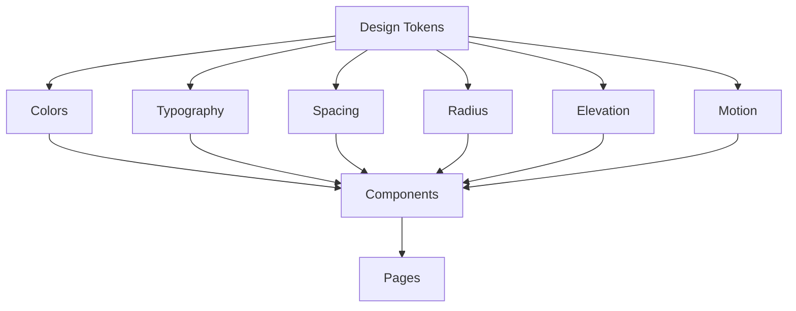
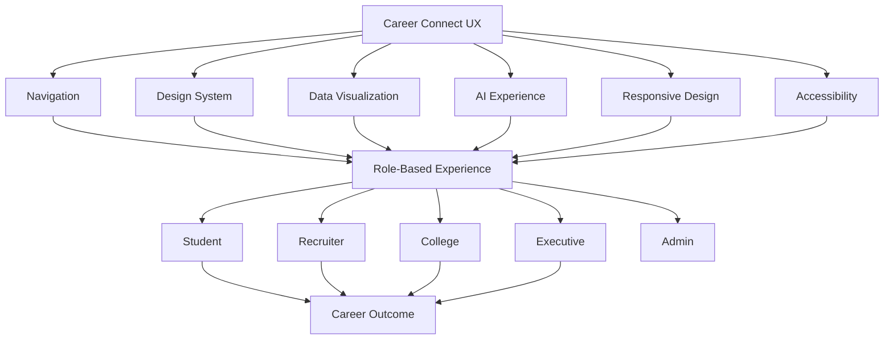

# 27 — UI/UX Design

# Career Connect — AI Career Intelligence Platform

**Document Type:** UI/UX Design Specification
**Project:** Career Connect
**Version:** 1.0
**Status:** UI/UX Design Baseline
**Design Direction:** Enterprise + Minimal + Intelligent
**Primary References:** Apple + Linear + Vercel + Stripe + Snowflake + Microsoft Fabric + Power BI
**Frontend:** Next.js + TypeScript
**Styling:** Tailwind CSS
**Component System:** shadcn/ui
**Visualization:** Recharts / equivalent analytical charting library
**Responsive:** Mobile + Tablet + Desktop
**Accessibility:** Accessibility-first design

---

# 1. Introduction

The Career Connect UI/UX system transforms the structural wireframes into a coherent product experience.

The design objective is not simply to create visually attractive screens.

The objective is to create an interface where users can:

```text
SEE
↓
UNDERSTAND
↓
DECIDE
↓
ACT
```

The interface must therefore combine:

```text
Modern Product Design
+
Enterprise Data Visualization
+
AI Interaction
+
Career Decision Support
+
Role-Based Workflows
```

---

# 2. UX Vision

The UX vision is:

> **Make complex career intelligence feel simple, actionable, and trustworthy.**

The platform should feel sophisticated enough for executives and simple enough for first-time students.

---

# 3. Design Principles

## Principle 1 — Clarity Over Decoration

Every visual element must support:

```text
Understanding
Navigation
Decision
Action
```

Avoid decorative elements that compete with analytical information.

---

# 4. Principle 2 — Intelligence Must Be Explainable

Do not display:

```text id="x4m8q2"
"86% Match"
```

without explanation.

Instead:

```text id="m7q3x8"
86% Match

Strong:
✓ Python
✓ SQL
✓ Cloud

Needs improvement:
△ Airflow
```

---

# 5. Principle 3 — One Primary Action

Important screens should have one dominant CTA.

Examples:

```text id="q5m8x2"
Resume → Analyze Resume
Skill Gap → Start Learning
Job → Apply
Career → Set Career Goal
Report → Generate Report
```

Secondary actions should remain visually subordinate.

---

# 6. Principle 4 — Progressive Disclosure

Do not expose every analytical detail immediately.

Use:

```text id="x8m4q3"
Summary
↓
Details
↓
Advanced Analysis
↓
Underlying Data
```

Example:

```text id="m4q7x2"
Placement Rate
↓
Department Breakdown
↓
Company Breakdown
↓
Underlying Records
```

---

# 7. Principle 5 — Consistency

The same interaction should behave the same way everywhere.

Examples:

```text id="q7m3x8"
Filters
Tables
Pagination
Status Badges
Modals
Loading
Notifications
```

must use consistent patterns.

---

# 8. Principle 6 — Data Before Decoration

For dashboards:

```text id="m8x4q2"
KPI
↓
Trend
↓
Insight
↓
Detail
```

should generally receive more visual emphasis than decorative backgrounds.

---

# 9. Principle 7 — Actionable Intelligence

Every important insight should answer:

```text id="x5m8q3"
What happened?
Why does it matter?
What should I do?
```

Example:

```text id="q4m7x2"
Airflow demand is high
↓
Student supply is low
↓
Recommended action:
Launch Airflow training
```

---

# 10. Design Language

Career Connect should combine:

```text id="m7x3q8"
Apple
→ Simplicity

Linear
→ Productivity

Vercel
→ Modern developer aesthetic

Stripe
→ Information hierarchy

Snowflake
→ Data-platform credibility

Power BI
→ Analytics depth

Microsoft Fabric
→ Enterprise data experience
```

These are design inspirations, not elements to copy directly.

---

# 11. Brand Personality

The visual personality should communicate:

```text id="x8m4q2"
Intelligent
Professional
Modern
Trustworthy
Precise
Calm
Premium
Technical
Approachable
```

The product should feel like serious enterprise software rather than a generic college portal.

---

# 12. Visual Hierarchy

Use five levels:

```text id="m5q8x3"
Level 1 — Page Objective
Level 2 — Primary KPI / Action
Level 3 — Key Insight
Level 4 — Supporting Data
Level 5 — Metadata
```

Example:

```text id="q7m4x2"
Placement Dashboard
    ↓
Placement Rate
    ↓
Placement Trend
    ↓
Department Breakdown
    ↓
Data-as-of timestamp
```

---

# 13. Color System

Primary palette:

```text id="x4m8q2"
Primary Blue
Dark Gray
White
Purple Accent
Neutral Gray Scale
```

The palette should remain restrained.

---

# 14. Suggested Color Tokens

```text
--color-primary
--color-primary-hover
--color-primary-soft

--color-purple
--color-purple-soft

--color-background
--color-surface
--color-surface-elevated

--color-text-primary
--color-text-secondary
--color-text-muted

--color-border
--color-divider
```

The actual HEX values should be managed centrally in the design system rather than repeated across components.

---

# 15. Semantic Colors

Use colors by meaning.

```text
Success → Green
Warning → Amber
Error → Red
Information → Blue
AI / Intelligence → Purple
Neutral → Gray
```

Do not use semantic colors only as decoration.

---

# 16. Accessibility and Color

Color must not be the only way to communicate state.

For example:

Bad:

```text id="m7q3x8"
🟢
```

Better:

```text id="q5m8x2"
● Healthy
```

Charts should also include labels, legends, or patterns where appropriate.

---

# 17. Typography

Use a modern sans-serif type system.

Recommended hierarchy:

```text id="x8m4q2"
Display
H1
H2
H3
Body
Small
Caption
```

---

# 18. Typography Hierarchy

Example:

```text id="m4q7x2"
Display:
48–64px

H1:
36–48px

H2:
28–36px

H3:
20–24px

Body:
14–16px

Small:
12–14px

Caption:
11–12px
```

Exact sizes should be finalized within the responsive design system.

---

# 19. Font Weight System

Recommended:

```text id="q7m3x8"
Regular
Medium
Semibold
Bold
```

Avoid excessive use of bold typography.

---

# 20. Spacing System

Use a consistent spacing scale.

Example:

```text id="x5m8q2"
4
8
12
16
20
24
32
40
48
64
80
```

Components should use spacing tokens rather than arbitrary values.

---

# 21. Border Radius

Use a restrained radius system.

```text id="m7q4x2"
Small
Medium
Large
Extra Large
Full
```

Example use:

```text id="x8m3q5"
Buttons → Medium
Cards → Large
Modal → Extra Large
Avatar → Full
```

---

# 22. Elevation System

Use soft elevation rather than heavy shadows.

```text id="q4m7x2"
Level 0 → Flat
Level 1 → Card
Level 2 → Elevated
Level 3 → Modal / Overlay
```

---

# 23. Glassmorphism

Glass effects may be used selectively for:

```text id="m5x8q3"
AI Assistant
Hero Section
Floating Navigation
Premium Intelligence Cards
```

Avoid applying glassmorphism to every dashboard card because it can reduce information clarity.

---

# 24. Background System

Recommended:

```text id="x7m3q8"
Light:
Soft neutral background

Dark:
Deep charcoal / dark gray

Accent:
Subtle blue/purple gradients
```

Background gradients should remain subtle.

---

# 25. Dark Mode

The application should support dark mode.

Dark-mode priorities:

```text id="q8m4x2"
High Contrast
Readable Charts
Clear Borders
Reduced Glow
Consistent Status Colors
```

---

# 26. Dark Mode Wireframe

```text id="m4q7x2"
┌──────────────────────────────────────────────────────────────┐
│ Career Connect                    Search     🔔   AI   👤    │
├────────────┬─────────────────────────────────────────────────┤
│ Dashboard  │                                                 │
│ Profile    │          Dark Intelligence Dashboard             │
│ Skills     │                                                 │
│ Jobs       │       [ KPI ] [ KPI ] [ KPI ] [ KPI ]           │
│ Analytics  │                                                 │
│ AI         │        [ Chart ]       [ Insights ]             │
└────────────┴─────────────────────────────────────────────────┘
```

---

# 27. Design Tokens Architecture



---

# 28. Component Design System

Core reusable components:

```text id="m7q4x2"
Button
Input
Select
Textarea
Checkbox
Radio
Switch
Tabs
Badge
Avatar
Card
Dialog
Drawer
Dropdown
Tooltip
Toast
Table
Pagination
Breadcrumb
Calendar
Date Picker
Progress
Skeleton
Alert
Command Search
```

---

# 29. Enterprise Components

Career Connect also requires:

```text id="q5m8x3"
KPI Card
Insight Card
Data Table
Analytics Filter
Chart Card
Timeline
Skill Badge
Match Score
Recommendation Card
AI Chat
Resume Score
Data Quality Indicator
Pipeline Status
Freshness Badge
```

---

# 30. Button System

Primary:

```text id="x8m3q5"
[ Apply Now ]
```

Secondary:

```text id="m4q7x2"
[ Save ]
```

Tertiary:

```text id="q7m3x8"
[ View Details ]
```

Destructive:

```text id="x5m8q2"
[ Delete ]
```

AI:

```text id="m7q4x2"
[ ✦ Ask AI ]
```

---

# 31. Button Hierarchy Rule

A page should generally have:

```text
1 Primary CTA
0–2 Secondary CTAs
Additional actions inside menus
```

Avoid five equally prominent buttons.

---

# 32. Form Design

Forms should follow:

```text id="q8m4x2"
Label
Input
Helper Text
Validation
Error State
```

Example:

```text
Career Goal
[ Data Engineer                    ]

Tell us what role you're targeting.

✓ Valid
```

---

# 33. Form Error

```text id="m5q7x3"
Career Goal
[                                ]

Please select a career goal.
```

Error messages should explain how to resolve the problem.

---

# 34. Form Success

After important actions:

```text id="x4m8q2"
✓ Profile updated successfully.
```

Use a toast for lightweight feedback and inline confirmation for important forms.

---

# 35. Input Autocomplete

Use searchable controls for:

```text id="m7x3q8"
Skills
Career Paths
Companies
Locations
Courses
```

This is preferable to giant static dropdowns.

---

# 36. Search Experience

The global search should support:

```text id="q5m8x2"
Jobs
Skills
Careers
Companies
Courses
```

Search suggestions should appear while typing.

---

# 37. Command Palette

Desktop users may access a command palette.

Example:

```text id="x8m4q3"
⌘K

Search commands...

Go to Jobs
Go to Resume
Ask AI
Generate Report
Open Analytics
```

---

# 38. Navigation Design

Primary navigation should remain stable.

Example:

```text id="m4q7x2"
Dashboard
Career
Jobs
Applications
Learning
Analytics
AI
Reports
```

Role-specific sections should be dynamically displayed according to permissions.

---

# 39. Breadcrumbs

Use breadcrumbs on deep pages.

Example:

```text id="q7m3x8"
Analytics
/
Salary Intelligence
/
Data Engineer
```

---

# 40. Page Header

Each page should use:

```text id="x5m8q2"
Title
Description
Optional Status
Primary Action
Secondary Actions
```

Example:

```text
Skill Intelligence

Understand industry demand and student skill supply.

[ Export ] [ Ask AI ]
```

---

# 41. KPI Card Design

```text id="m8q4x2"
┌──────────────────────────────┐
│ Placement Rate               │
│                              │
│ 82.4%                        │
│ ↑ 4.2% vs previous period    │
│                              │
│ [View Details →]             │
└──────────────────────────────┘
```

---

# 42. KPI Card Rules

Each KPI card should contain:

```text id="q5m7x3"
Metric Name
Primary Value
Comparison / Trend
Optional Context
Optional Action
```

Avoid showing unnecessary metadata inside the card.

---

# 43. Trend Indicator

Use:

```text id="x7m4q2"
↑ Increasing
↓ Decreasing
→ Stable
```

The interpretation must depend on whether an increase is actually positive or negative for the metric.

---

# 44. Insight Card

```text id="m8q3x5"
┌─────────────────────────────────────────────┐
│ ✦ INSIGHT                                   │
│                                             │
│ Cloud skill demand is increasing.           │
│                                             │
│ Student supply remains below job demand.    │
│                                             │
│ [ Explore Skills ]                          │
└─────────────────────────────────────────────┘
```

---

# 45. AI Insight Card

```text id="x4m7q2"
┌─────────────────────────────────────────────┐
│ ✦ AI Insight                                │
│                                             │
│ Your strongest next career move is          │
│ improving Airflow and Spark skills.         │
│                                             │
│ Why?                                        │
│ • Strong Python foundation                  │
│ • Strong SQL foundation                     │
│ • Current market alignment                  │
│                                             │
│ [ View Roadmap ]                            │
└─────────────────────────────────────────────┘
```

---

# 46. Match Score Component

```text id="m7q3x8"
86% Match
████████████████░░
```

Use score + explanation together.

Do not imply that the score is a guarantee.

---

# 47. Match Score Variants

```text id="q8m4x2"
Excellent
Strong
Moderate
Low
```

The underlying threshold definitions must be product-controlled.

---

# 48. Skill Badge

```text id="x5m7q3"
[ Python ]
[ SQL ]
[ React ]
[ AWS ]
```

Variants:

```text
Required
Current
Verified
Missing
Recommended
```

---

# 49. Skill Status

```text id="m4q8x2"
Python       ✓ Verified
SQL          ✓ Verified
Spark        △ Learning
Airflow      ✕ Missing
```

---

# 50. Progress Component

Use for:

```text id="x7m3q8"
Profile
Learning
Career Readiness
Resume
Skill Development
```

---

# 51. Timeline Component

Application timeline:

```text id="m8q4x2"
● Applied
│
● Screening
│
● Shortlisted
│
● Interview
│
○ Offer
│
○ Hired
```

Current stage should be visually distinct.

---

# 52. Data Table Design

Tables should include:

```text id="q5m7x3"
Header
Rows
Status
Pagination
Sorting
Filtering
Empty State
Loading State
```

---

# 53. Data Table Density

Default:

```text id="x8m3q5"
Comfortable
```

Analytical users may optionally use:

```text
Compact
```

Do not make the primary interface unnecessarily dense.

---

# 54. Table Actions

Row actions should be:

```text id="m7q4x2"
View
Edit
More
```

Avoid multiple destructive buttons directly on every row.

---

# 55. Chart Design

Charts should answer a specific question.

Examples:

```text id="q4m8x2"
Trend
Comparison
Distribution
Composition
Ranking
Funnel
```

Choose the chart based on analytical purpose.

---

# 56. Line Chart

Use for:

```text id="x5m7q3"
Placement Trend
Hiring Trend
Salary Trend
Skill Demand Trend
```

---

# 57. Bar Chart

Use for:

```text id="m8q4x2"
Department Comparison
Skill Ranking
Company Hiring
Location Comparison
```

---

# 58. Donut Chart

Use sparingly.

Appropriate for small categorical distributions such as:

```text id="q7m3x8"
Employment Type
Interview Results
```

Avoid donut charts for highly detailed comparisons.

---

# 59. Funnel Chart

Use for:

```text id="x4m8q2"
Recruitment Funnel
Application Funnel
Interview Funnel
```

---

# 60. Heatmap

Use for:

```text id="m7q3x8"
Skill Demand by Location
Hiring by Month
Department vs Skill
```

---

# 61. Geographic Visualization

Use maps only when geographic information is genuinely useful.

Examples:

```text id="q5m8x2"
City Jobs
Country Jobs
Regional Hiring
```

---

# 62. Chart Interaction

Charts should support, where relevant:

```text id="x8m4q2"
Hover
Tooltip
Legend
Filter
Drilldown
Date Range
```

---

# 63. Dashboard Filtering

Use one consistent filter bar.

```text id="m4q7x3"
Date ▼
Organization ▼
Department ▼
Company ▼
Role ▼
Location ▼
Experience ▼
```

---

# 64. Sticky Filter Bar

For large dashboards:

```text id="q7m3x8"
┌────────────────────────────────────────────────┐
│ Date ▼  Role ▼  Location ▼  Company ▼         │
└────────────────────────────────────────────────┘
                  ↓
             Dashboard
```

The filter bar may remain sticky while scrolling.

---

# 65. Filter Chips

Active filters should appear as removable chips.

```text id="x5m8q2"
Date: 2026
Role: Data Engineer
Location: Chennai

[ × ] [ × ] [ × ]
```

---

# 66. Dashboard Drilldown Interaction

```text id="m7q4x2"
Click KPI
↓
Open Detail Panel
↓
Select Dimension
↓
Update Chart
↓
View Table
```

This avoids excessive page navigation.

---

# 67. Side Panel

Use side panels for contextual details.

Examples:

```text id="q8m4x2"
Candidate Details
Job Details
Metric Details
AI Explanation
Audit Event
```

---

# 68. Modal Usage

Use modals for:

```text id="x4m7q3"
Confirmation
Short Forms
Important Configuration
Delete / Deactivate
```

Avoid putting large analytics dashboards inside modals.

---

# 69. Drawer Usage

Use drawers for:

```text id="m5q8x2"
Filters
Details
Mobile Navigation
AI Assistant
```

---

# 70. Toast Notifications

Use toasts for:

```text id="x7m3q8"
Saved
Updated
Export Started
Report Ready
Application Submitted
```

Do not use toasts for critical information that users may miss.

---

# 71. Loading Skeleton

Use skeletons instead of blank pages.

```text id="m8q4x2"
┌──────────────────────────────┐
│ ██████████████               │
│ █████████░░░░               │
│                              │
│ ███████████████████████     │
└──────────────────────────────┘
```

---

# 72. AI Loading

AI loading should communicate meaningful progress where possible.

```text id="q5m7x3"
Analyzing resume...
Extracting skills...
Comparing career requirements...
Generating recommendations...
```

Avoid fake progress percentages unless actual progress is known.

---

# 73. Skeleton vs Spinner

Use:

```text id="x8m3q2"
Skeleton
→ Page/data loading

Spinner
→ Small localized action

Progress
→ Genuine known progress
```

---

# 74. Empty State Design

A useful empty state contains:

```text id="m7q4x2"
Illustration/Icon
Title
Explanation
Primary Action
```

Example:

```text
No saved jobs yet.

Save interesting jobs to compare them later.

[ Explore Jobs ]
```

---

# 75. Error State Design

Error states should contain:

```text id="q4m8x2"
Problem
Impact
Recovery
```

Example:

```text
Could not load salary intelligence.

Your saved filters are preserved.

[ Retry ]
```

---

# 76. Data Freshness Badge

```text id="x5m7q3"
● Updated 12 minutes ago
```

or:

```text id="m8q4x2"
⚠ Data may be stale
```

Use exact timestamps in detailed views.

---

# 77. Data Quality Badge

```text
Data Quality
98%
```

Possible states:

```text
Healthy
Warning
Failed
```

---

# 78. Pipeline Status Badge

```text id="q7m3x8"
✓ SUCCESS
⚠ WARNING
✕ FAILED
● RUNNING
```

---

# 79. AI Trust Indicator

For important recommendations:

```text id="x4m8q2"
AI Generated
Based on your profile + market data
```

This makes AI involvement explicit.

---

# 80. Source Indicator

For market intelligence:

```text id="m7q3x8"
Source: Career Connect Market Dataset
As of: Jul 30, 2026
```

This provides context and helps users understand freshness.

---

# 81. Recommendation Explanation Pattern

```text id="q5m8x2"
WHY THIS?

✓ Skill alignment
✓ Career interest
✓ Market demand

WHAT'S MISSING?

△ Airflow
△ Spark

NEXT STEP

[ Start Learning ]
```

---

# 82. Student Homepage UX

The homepage should prioritize:

```text id="x8m4q2"
Career Goal
Current Readiness
Skill Gaps
Recommended Action
Job Opportunities
```

Rather than overwhelming the student with dozens of statistics.

---

# 83. Student “Next Best Action”

One of the strongest UX concepts is:

```text id="m4q7x3"
Your Next Best Action

Learn Apache Airflow

Why:
High job demand
Current skill gap
Relevant to your target career

[ Start Learning ]
```

The system should avoid showing dozens of competing recommendations.

---

# 84. Recruiter “Next Best Action”

```text id="q7m3x8"
Hiring Action

18 candidates match your new role.

8 have strong skill alignment.

[ Review Candidates ]
```

---

# 85. Placement Officer “Next Best Action”

```text id="x5m8q2"
Institution Insight

Cloud and Data Engineering show strong demand,
but student readiness is below market demand.

[ View Skill Gaps ]
```

---

# 86. Executive “Next Best Action”

```text id="m8q4x2"
Strategic Insight

Placement rate increased this year,
while demand for AI/Cloud skills is rising.

[ Explore Market Trends ]
```

---

# 87. AI Assistant UX Pattern

The AI assistant should have:

```text id="q5m7x3"
Conversation
Context
Suggested Prompts
Source/Context Indicators
Feedback
Clear Conversation Controls
```

---

# 88. Suggested AI Prompts

For students:

```text id="x8m3q2"
What should I learn next?
Why is Data Engineering recommended for me?
How can I improve my resume?
Which jobs match me?
Prepare me for a technical interview.
```

---

# 89. AI Response Structure

Prefer:

```text id="m7q4x2"
Answer
↓
Reasoning Summary
↓
Data/Context
↓
Next Action
```

rather than very long unstructured paragraphs.

---

# 90. AI Conversation Safety

The UI should distinguish:

```text id="q8m3x5"
Platform Data
AI Recommendation
User Input
```

This helps prevent users from assuming every AI statement is verified platform information.

---

# 91. Accessibility Focus States

Buttons and inputs should have visible focus.

Example:

```text id="x5m7q2"
[ Apply Now ]
     ↑
Focus ring
```

---

# 92. Keyboard Navigation Order

The navigation sequence should be logical:

```text id="m4q8x3"
Header
→ Sidebar
→ Page Header
→ Main Content
→ Actions
```

---

# 93. Screen Reader Labels

Charts should expose meaningful labels.

Instead of:

```text id="q7m3x8"
Chart 1
```

use:

```text
Placement rate by department for 2026.
```

---

# 94. Accessible Tables

Tables should include:

```text id="x8m4q2"
Column Headers
Row Context
Sort State
Pagination State
```

---

# 95. Motion Design

Motion should be subtle and functional.

Use animation for:

```text id="m7q3x8"
Page transitions
Card reveal
Loading
Progress
AI response
Toast
Drawer
```

---

# 96. Motion Principles

Animations should be:

```text id="q5m8x2"
Fast
Purposeful
Non-blocking
Consistent
Respectful of reduced-motion preferences
```

---

# 97. Avoid Excessive 3D Effects

The product may use depth through:

```text id="x4m7q3"
Layering
Shadow
Blur
Perspective
Subtle hover effects
```

But the UI should remain enterprise-grade rather than becoming visually noisy.

---

# 98. Hover Interaction

Hover states may provide:

```text id="m8q4x2"
Elevation
Border emphasis
Tooltip
Preview
```

Use hover as enhancement, not as the only way to reveal critical information.

---

# 99. Responsive Card Layout

Desktop:

```text id="q7m3x8"
4 cards
```

Tablet:

```text
2 cards
```

Mobile:

```text
1 card
```

The content order should remain meaningful after stacking.

---

# 100. Dashboard Responsive Structure

Desktop:

```text id="x5m8q2"
KPI Row
2-column Analytics
Table
```

Mobile:

```text
KPI Stack
Chart Stack
Table → Card/List view where necessary
```

---

# 101. Mobile Table Strategy

For complex tables:

```text id="m7q4x2"
Desktop:
Data Table

Mobile:
Card/List
+ expandable details
```

Do not force a tiny unreadable table onto mobile.

---

# 102. Responsive Charts

Charts should:

```text id="q8m3x5"
Scale
Simplify labels
Use scroll where appropriate
Maintain readable tooltips
```

---

# 103. Design for Data Density

Enterprise users need high information density, but not visual clutter.

Use:

```text id="x4m7q2"
Clear grouping
Consistent spacing
Strong headers
Compact metadata
Progressive detail
```

---

# 104. Design for Student Simplicity

Students should see:

```text id="m8q4x2"
What is my goal?
What is my gap?
What should I do next?
What jobs fit me?
```

before seeing advanced data warehouse metrics.

---

# 105. Design for Recruiters

Recruiters should see:

```text id="q5m7x3"
Which jobs are active?
Who matches?
What stage are candidates in?
Where is hiring stuck?
```

---

# 106. Design for Placement Officers

Placement officers should see:

```text id="x8m3q2"
How many students are placed?
Which departments are strongest?
Which skills are missing?
Which companies are hiring?
What salaries are being achieved?
```

---

# 107. Design for Executives

Executives should see:

```text id="m7q4x2"
What changed?
Why?
Where is the opportunity?
Where is the risk?
What should we do?
```

---

# 108. Design for Data Engineers

Data engineers should see:

```text id="q8m3x5"
What failed?
Why?
Which dataset?
Which batch?
How many records?
What quality rule failed?
Can I replay it?
```

---

# 109. Design for BI Analysts

BI analysts should see:

```text id="x5m7q2"
Which metric?
Which data source?
Which definition?
Which filters?
Which data-as-of date?
```

---

# 110. Design for AI Engineers

AI engineers should see:

```text id="m4q8x3"
Model
Version
Prompt
Latency
Usage
Failures
Evaluation
```

---

# 111. Design System Folder Structure

Recommended:

```text id="q7m3x8"
frontend/
├── components/
│   ├── ui/
│   ├── layout/
│   ├── analytics/
│   ├── career/
│   ├── jobs/
│   ├── resume/
│   ├── learning/
│   ├── recruiter/
│   └── ai/
│
├── styles/
│   ├── tokens.css
│   ├── globals.css
│   └── themes.css
│
├── lib/
│   ├── api/
│   ├── auth/
│   └── utils/
│
└── app/
    ├── dashboard/
    ├── career/
    ├── jobs/
    ├── applications/
    ├── analytics/
    ├── ai/
    └── admin/
```

---

# 112. Design Token File Concept

```css id="x4m7q2"
:root {
  --cc-primary: ...;
  --cc-primary-soft: ...;

  --cc-background: ...;
  --cc-surface: ...;

  --cc-text-primary: ...;
  --cc-text-secondary: ...;

  --cc-border: ...;

  --cc-radius-sm: ...;
  --cc-radius-md: ...;
  --cc-radius-lg: ...;
}
```

Actual production values should be centralized and version-controlled.

---

# 113. Component Naming Convention

Use business-aware names.

Good:

```text id="m7q3x8"
PlacementKpiCard
SkillGapCard
CareerRecommendationCard
JobMatchCard
RecruitmentFunnel
SalaryTrendChart
```

Avoid vague names such as:

```text
Box1
Card2
Section3
```

---

# 114. UI State Architecture

Every asynchronous component should support:

```text id="q8m4x2"
idle
loading
success
empty
error
```

Example:

```text
JobList
├── idle
├── loading
├── success
├── empty
└── error
```

---

# 115. Permission-Aware UX

Instead of showing unauthorized buttons and then failing after click:

```text id="x5m7q3"
Hide or disable unavailable actions
```

where product policy allows.

Example:

```text
Student:
No "Shortlist" action

Recruiter:
"Shortlist" visible
```

---

# 116. Security-Aware UX

Sensitive information should be visually indicated when appropriate.

Example:

```text id="m4q8x2"
Restricted
Interview Feedback
```

---

# 117. Data Privacy UX

Users should understand what is visible to recruiters.

Example:

```text id="q7m3x8"
Profile visibility:
Recruiters can view approved profile information.
```

---

# 118. AI Privacy UX

When AI uses user context:

```text id="x8m4q2"
AI uses your approved career profile
to personalize this recommendation.
```

The UI should avoid implying that AI has unrestricted access to the user's account.

---

# 119. Dashboard Personalization

Users may eventually customize:

```text id="m7q3x8"
KPI Order
Dashboard Widgets
Saved Filters
Default Date Range
```

This is a later-stage enhancement.

---

# 120. Saved Views

Analytics users may save:

```text id="q5m8x2"
Placement 2026
CSE Department
Data Engineering Hiring
Chennai Salary Analysis
```

---

# 121. Filter Presets

Example:

```text id="x4m7q3"
[ This Year ]
[ Last 30 Days ]
[ Entry Level ]
[ Top Hiring Roles ]
```

Preset definitions must remain explicit and consistent.

---

# 122. UX for Data Freshness

Display freshness close to metrics.

Example:

```text
Placement Rate
82.4%

Updated:
30 Jul 2026, 06:00 UTC
```

For India-focused deployments, the frontend can additionally format timestamps according to the user's selected locale/timezone.

---

# 123. UX for Data Quality

```text id="m8q4x2"
Data Quality: 98%
✓ Trusted dataset
```

Clicking the badge can open:

```text
Completeness
Validity
Freshness
Last Validation
```

for authorized users.

---

# 124. UX for Source Transparency

For salary data:

```text id="q7m3x8"
Market Observation
Source: Approved Market Dataset
Observed: Jul 2026
```

This is better than displaying a salary value without context.

---

# 125. UX for AI Uncertainty

When confidence is low:

```text id="x5m7q2"
AI Confidence: Moderate

This recommendation is based on limited profile information.
Complete your skills and experience for a stronger analysis.

[ Complete Profile ]
```

---

# 126. UX for Missing Data

Instead of:

```text id="m4q8x3"
N/A
```

show:

```text
Salary information unavailable.

[ Explore Market Salary ]
```

where an alternative data source exists.

---

# 127. Smart Empty States

Example:

```text id="q8m3x5"
No career recommendations yet.

Complete your skill profile to unlock
personalized recommendations.

[ Add Skills ]
```

This turns empty states into product guidance.

---

# 128. Onboarding UX

Onboarding should progressively collect only required information.

Suggested flow:

```text id="x7m4q2"
Account
↓
Basic Profile
↓
Education
↓
Skills
↓
Career Goal
↓
Resume
↓
First Recommendation
```

The user should see value early rather than completing a large form before receiving any useful output.

---

# 129. First-Value Experience

The platform should aim to deliver the first meaningful insight quickly.

Example:

```text id="m8q3x5"
Register
↓
Add 5 skills
↓
Select target career
↓
See first skill-gap insight
```

This gives immediate product value.

---

# 130. Student Activation

A strong activation milestone could be:

> **Student receives the first personalized career insight.**

Examples:

```text id="q5m7x2"
Career Recommendation
Skill Gap
Resume Insight
Job Match
```

---

# 131. Recruiter Activation

A strong recruiter activation milestone could be:

> **Recruiter receives the first qualified candidate match.**

---

# 132. Placement Officer Activation

A strong institutional activation milestone could be:

> **Officer sees the first complete placement intelligence dashboard.**

---

# 133. Executive Activation

A strong executive activation milestone could be:

> **Executive receives a unified data-backed strategic insight.**

---

# 134. UX Metrics

Measure:

```text id="x8m4q2"
Time to First Value
Profile Completion
Feature Adoption
Task Completion
Search Success
Application Conversion
Dashboard Usage
AI Engagement
Report Generation
```

---

# 135. UX Research Metrics

Track:

```text id="m7q3x8"
Task Success Rate
Time on Task
Error Rate
Drop-off Rate
User Satisfaction
```

---

# 136. UX Experimentation

Potential A/B tests:

```text id="q4m8x2"
Resume CTA
Career Recommendation Placement
Job Match Display
AI Assistant Entry Point
Dashboard Layout
```

Experiments should be evaluated against meaningful product outcomes rather than visual preference alone.

---

# 137. Design Handoff Requirements

Before frontend implementation, designers should provide:

```text id="x5m7q3"
High-Fidelity Screens
Responsive Screens
Component States
Tokens
Interaction Specs
Accessibility Notes
Empty States
Error States
Loading States
```

---

# 138. Developer Handoff

Each component should specify:

```text id="m8q4x2"
Props
States
Variants
Responsive Behavior
Accessibility
API Data Requirements
```

---

# 139. UI/UX QA

Before release, verify:

```text id="q7m3x8"
Visual Consistency
Responsive Layout
Keyboard Navigation
Color Contrast
Loading States
Error States
Empty States
Authorization States
Data Freshness
AI States
```

---

# 140. Design QA Example

For a Job Match Card:

```text id="x4m7q2"
✓ Match score shown
✓ Reasons shown
✓ Missing skill shown
✓ Apply CTA visible
✓ Mobile layout works
✓ Loading state exists
✓ Error state exists
```

---

# 141. Visual Regression Testing

Critical pages should be candidates for visual regression tests:

```text id="m7q3x8"
Student Dashboard
Recruiter Dashboard
Placement Dashboard
Executive Dashboard
Job Detail
Resume Analysis
AI Coach
Reports
```

---

# 142. UI Performance

The frontend should optimize:

```text id="q8m3x5"
Image Loading
Code Splitting
Component Rendering
Chart Rendering
API Calls
Caching
```

Large analytics components should not load unnecessary data before they are needed.

---

# 143. Frontend Security UX

Never place:

```text id="x5m7q2"
API Secrets
Database Credentials
AI Provider Keys
Service Credentials
```

in client-side code.

---

# 144. UX for Long-Running Reports

The user should be able to leave the page while the report is being generated.

Workflow:

```text id="m4q8x2"
Generate
↓
Background Processing
↓
Notification
↓
Reports
↓
Download
```

---

# 145. UX for Long-Running AI Tasks

Same principle:

```text id="q7m3x8"
Start
↓
Processing
↓
Continue Using App
↓
Notification
↓
View Result
```

---

# 146. UX for Failed Background Tasks

```text id="x8m4q2"
Report generation failed.

Your filters were saved.

[ Try Again ]
```

The system should not force the user to reconstruct their request.

---

# 147. Premium Visual Treatment

Premium surfaces may use:

```text id="m7q3x8"
Soft gradient
Subtle glow
Glass layer
Fine border
Shadow
Micro-animation
```

Reserve these for:

```text
Hero
AI
Recommendations
Important milestones
```

rather than every card.

---

# 148. Career Progress Visualization

The student experience may eventually include:

```text id="q5m8x2"
Current State
     ↓
Skill Gap
     ↓
Learning
     ↓
Career Readiness
     ↓
Job Match
     ↓
Outcome
```

This creates a strong sense of progress.

---

# 149. Career Progress UI

```text id="x4m7q2"
Career Goal
Data Engineer

Profile      ███████████████ 92%
Skills       █████████████░░ 84%
Resume       █████████████░░ 84%
Learning     ████████░░░░░░ 64%
Readiness    ████████████░░ 78%

Next:
[ Complete Airflow Module ]
```

---

# 150. Enterprise Dashboard Design Principle

Enterprise dashboards should use:

```text id="m8q3x5"
Fewer but meaningful KPIs
Clear period context
Visible filters
Drilldown
Source/Freshness context
Actionable insights
```

---

# 151. Student Dashboard Design Principle

Student dashboards should use:

```text id="q7m4x2"
Personal
Actionable
Simple
Motivating
Goal-Oriented
```

---

# 152. Recruiter Dashboard Design Principle

Recruiter dashboards should use:

```text id="x5m8q3"
Funnel-Oriented
Candidate-Focused
Time-Sensitive
Actionable
```

---

# 153. Placement Dashboard Design Principle

Placement dashboards should use:

```text id="m4q7x2"
Outcome-Focused
Department-Aware
Company-Aware
Trend-Oriented
Report-Ready
```

---

# 154. Executive Dashboard Design Principle

Executive dashboards should use:

```text id="q8m3x5"
Strategic
Concise
Trend-Oriented
Comparative
Insight-Driven
```

---

# 155. AI UX Design Principle

AI should not replace the core interface.

Instead:

```text id="x7m4q2"
Structured UI
+
AI Assistance
```

is preferred over:

```text
AI Chatbot Only
```

Example:

```text
Skill Gap Dashboard
+
Ask AI "Why is Airflow important?"
```

This keeps the system understandable and controllable.

---

# 156. Final UX Architecture



---

# 157. UI/UX Success Criteria

The UI/UX system is successful when:

```text id="x4m7q3"
✓ Users understand the purpose of each screen
✓ Primary actions are obvious
✓ Dashboards are readable
✓ AI recommendations are explainable
✓ Data freshness is visible
✓ Sensitive information is clearly controlled
✓ Mobile experience remains usable
✓ Accessibility is considered
✓ Components are reusable
✓ Visual language is consistent
✓ Loading/error/empty states are complete
```

---

# 158. Final UI/UX Design Principle

The product should feel like:

```text id="m8q3x5"
A premium SaaS platform
+
A professional analytics product
+
An intelligent career coach
```

not:

```text
A traditional college portal
```

---

# 159. CTO-Level UI/UX Recommendation

The strongest visual differentiator should not be excessive decoration.

It should be:

> **The quality of the information hierarchy and the intelligence of the interaction.**

A student should be able to open Career Connect and immediately understand:

```text
Where am I?
Where am I going?
What is missing?
What should I do next?
```

A recruiter should immediately understand:

```text
Who matches?
Why do they match?
What stage are they in?
What should I do next?
```

An executive should immediately understand:

```text
What changed?
Why does it matter?
What action should leadership take?
```

---

# 160. Final UI/UX Statement

> **Career Connect will use a modern enterprise design system combining restrained visual aesthetics, strong information hierarchy, responsive layouts, accessible interaction patterns, role-specific navigation, explainable AI experiences, and analytical dashboards. The interface will prioritize meaningful career and business actions over decorative complexity, while supporting premium visual treatments such as subtle glassmorphism, gradients, depth, and motion where they improve the experience. A centralized design-token and component architecture will ensure that the Next.js frontend remains consistent, maintainable, responsive, and scalable as the SaaS platform grows.**

---

## Document Status

| Attribute        | Value                                                   |
| ---------------- | ------------------------------------------------------- |
| Project          | Career Connect                                          |
| Document         | UI/UX Design                                            |
| Version          | 1.0                                                     |
| Visual Direction | Enterprise + Minimal + Intelligent                      |
| Style References | Apple / Linear / Vercel / Stripe / Snowflake / Power BI |
| Primary Palette  | Blue / White / Dark Gray / Purple                       |
| Design System    | Centralized Tokens + Components                         |
| Responsive       | Mobile / Tablet / Desktop                               |
| Accessibility    | Required                                                |
| AI UX            | Explainable + Contextual                                |
| BI UX            | Insight + Drilldown                                     |
| Motion           | Subtle + Functional                                     |
| Glassmorphism    | Selective                                               |
| Frontend         | Next.js + TypeScript                                    |
| Styling          | Tailwind CSS                                            |
| Components       | shadcn/ui                                               |
| Status           | UI/UX Design Baseline                                   |
