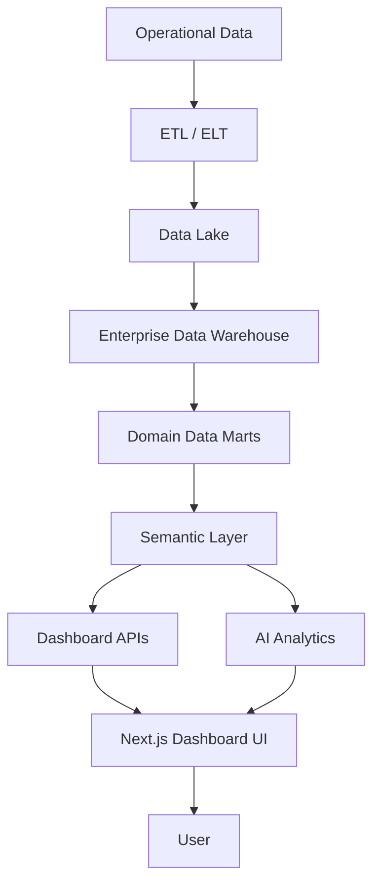
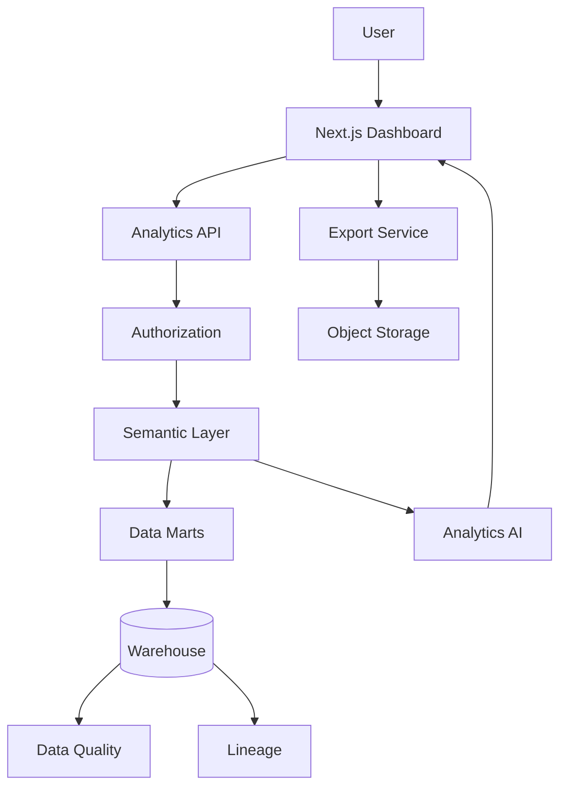
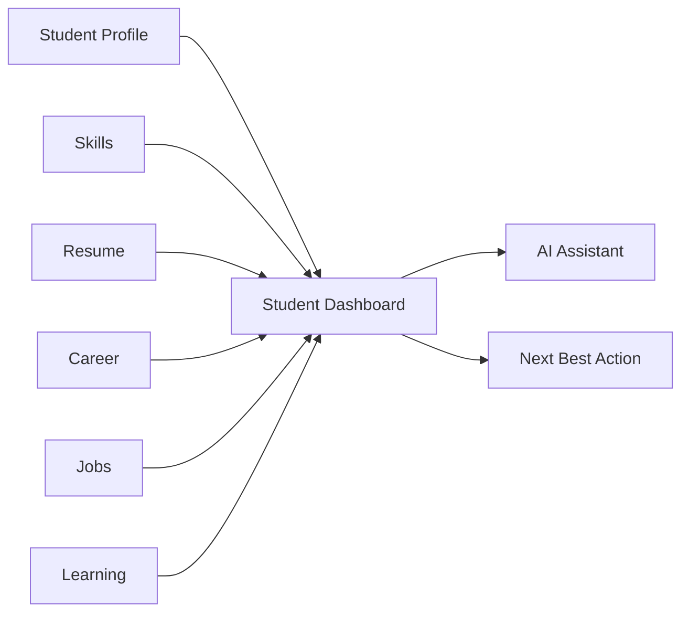
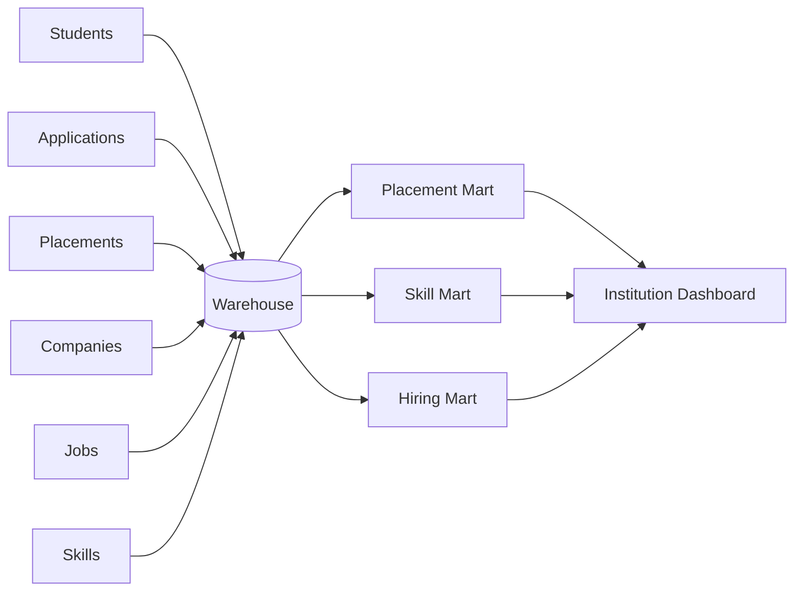
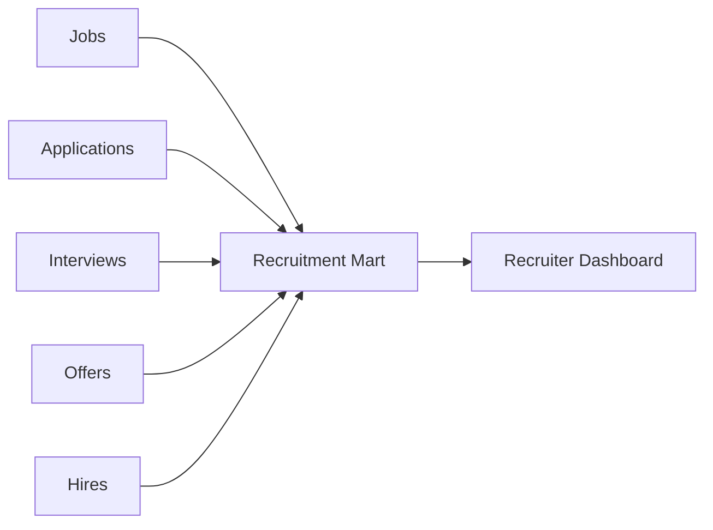
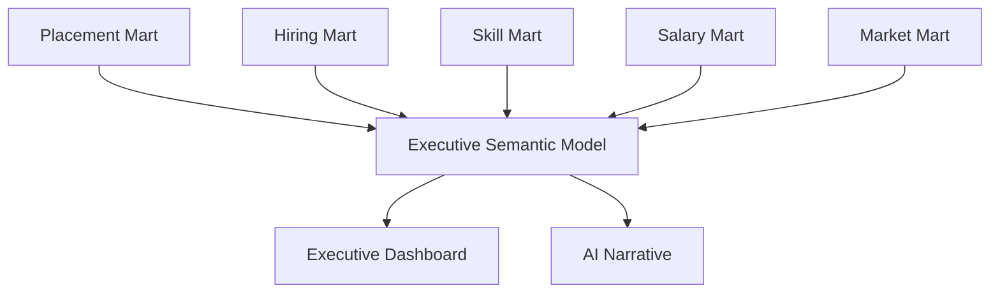

# 28 — Dashboard Design

# Career Connect — AI Career Intelligence Platform

**Document Type:** Enterprise Dashboard Design Specification
**Project:** Career Connect
**Version:** 1.0
**Status:** Dashboard Architecture Baseline
**Primary Users:** Students, Placement Officers, Recruiters, Executives, Administrators, BI Analysts
**Analytical Foundation:** Enterprise Data Warehouse + Data Marts + Semantic Layer
**Frontend:** Next.js + TypeScript
**Visualization:** Recharts / Enterprise Charting Layer
**Design Style:** Modern Enterprise + Minimal + Intelligent

---

# 1. Executive Summary

Dashboards are one of the most important components of Career Connect because they transform the platform's data warehouse into usable decision intelligence.

The dashboard architecture shall follow:

```text
Raw Data
↓
ETL
↓
Data Lake
↓
Data Warehouse
↓
Data Mart
↓
Semantic Metrics
↓
Dashboard
↓
Insight
↓
Action
```

The dashboards should not simply display charts.

They must help users answer:

```text
What is happening?
Why is it happening?
Where is it happening?
How has it changed?
What should I do next?
```

---

# 2. Dashboard Design Objectives

The dashboard system shall:

1. Present trusted business metrics.
2. Support role-specific decision making.
3. Enable filtering and drilldown.
4. Provide historical trends.
5. Connect multiple business domains.
6. Show data freshness.
7. Support report generation.
8. Provide actionable insights.
9. Preserve access boundaries.
10. Support future AI-generated analytical narratives.

---

# 3. Dashboard Portfolio

Career Connect shall contain:

```text
1. Student Dashboard
2. Job Seeker Dashboard
3. Recruiter Dashboard
4. Placement Officer Dashboard
5. College Dashboard
6. Executive Dashboard
7. Company Dashboard
8. Skill Intelligence Dashboard
9. Job Market Dashboard
10. Salary Intelligence Dashboard
11. Recruitment Funnel Dashboard
12. Learning Intelligence Dashboard
13. AI Intelligence Dashboard
14. Data Quality Dashboard
15. ETL Monitoring Dashboard
16. Administration Dashboard
```

---

# 4. Dashboard Architecture



---

# 5. Dashboard Design Principles

## 5.1 Decision First

Every dashboard must have a clearly defined decision purpose.

Example:

```text
Placement Dashboard
→ Improve placement outcomes

Recruiter Dashboard
→ Improve hiring efficiency

Student Dashboard
→ Improve career readiness

Executive Dashboard
→ Make strategic workforce decisions
```

---

# 6. Principle — KPI First

The first screen area should communicate the most important metrics.

Example:

```text
┌────────────┐ ┌────────────┐ ┌────────────┐ ┌────────────┐
│ Placement  │ │ Avg Salary │ │ Hires      │ │ Job Demand │
│ 82.4%      │ │ $72K       │ │ 642        │ │ 12.8K      │
└────────────┘ └────────────┘ └────────────┘ └────────────┘
```

The monetary value is illustrative sample data only.

---

# 7. Principle — Context Always Visible

Metrics should contain:

```text
Value
Period
Comparison
Data-As-Of
```

Example:

```text
Placement Rate
82.4%

2026 YTD
↑ 4.2% vs 2025

Updated:
July 30, 2026
```

---

# 8. Principle — Metric Definitions

Important KPIs should provide access to their definition.

Example:

```text
Placement Rate
ⓘ
Placed Eligible Students
÷
Eligible Students
× 100
```

---

# 9. Principle — Avoid Dashboard Overload

A dashboard should not attempt to show every available metric.

Recommended:

```text
Primary KPIs
+
Key Trends
+
Key Comparisons
+
Actionable Insights
+
Detailed Data
```

---

# 10. Principle — Progressive Drilldown

```text
Executive
↓
Institution
↓
Department
↓
Career Role
↓
Skill
↓
Underlying Record
```

The exact depth is controlled by role permissions.

---

# 11. Global Dashboard Layout

```text
┌──────────────────────────────────────────────────────────────────┐
│ Dashboard Title                          Export   Ask AI         │
├──────────────────────────────────────────────────────────────────┤
│ Filters: Date | Organization | Role | Location | Company        │
├──────────────────────────────────────────────────────────────────┤
│ KPI 1 │ KPI 2 │ KPI 3 │ KPI 4                                   │
├──────────────────────────────────────────────────────────────────┤
│ Primary Trend Chart                    │ AI/Business Insight      │
├────────────────────────────────────────┼─────────────────────────┤
│ Comparison Chart                       │ Ranking / Distribution   │
├──────────────────────────────────────────────────────────────────┤
│ Detailed Data Table                                            │
└──────────────────────────────────────────────────────────────────┘
```

---

# 12. Global Dashboard Header

Every dashboard shall contain:

```text
Dashboard Name
Description
Date Range
Data-As-Of
Filter Controls
Export
Optional Ask AI
```

---

# 13. Global Filter Architecture

Common filters:

```text
Date
Organization
Department
Company
Role
Skill
Technology
Location
Experience
Employment Type
Work Mode
```

Only relevant filters should appear on each dashboard.

---

# 14. Filter Behavior

When a filter changes:

```text
Filter Change
↓
Validate
↓
Update Query State
↓
Refresh Relevant Widgets
↓
Update Data Timestamp if needed
```

The dashboard should avoid unnecessary full-page reloads.

---

# 15. Saved Dashboard Views

Users should eventually be able to save views.

Example:

```text
Saved View:
"Entry-Level Data Engineering — Chennai"

Filters:
Role = Data Engineer
Experience = Entry Level
Location = Chennai
Period = 2026
```

---

# 16. Student Dashboard

# Objective

Help a student understand:

```text
Current Career Position
Career Goal
Skill Gaps
Resume Quality
Learning Progress
Job Opportunities
Applications
```

---

# 17. Student Dashboard KPIs

Primary KPIs:

```text
Profile Completion
Resume Score
Career Match
Skill Alignment
Applications
Interviews
Offers
Learning Progress
```

---

# 18. Student Dashboard Layout

```text
┌─────────────────────────────────────────────────────────────────┐
│ Good morning, Kalai                                             │
│ Your career intelligence at a glance.                           │
├─────────────────────────────────────────────────────────────────┤
│ Profile 92% │ Resume 84 │ Skill Match 78% │ Learning 64%        │
├──────────────────────────────┬──────────────────────────────────┤
│ Career Recommendation         │ Skill Gaps                       │
│ Data Engineer                 │ 3 High Priority                 │
│ 86% Match                     │ Airflow / Spark / Modeling       │
│ [View Career]                 │ [View Gaps]                      │
├──────────────────────────────┴──────────────────────────────────┤
│ Recommended Jobs                                                │
├─────────────────────────────────────────────────────────────────┤
│ Recent Applications                                             │
├─────────────────────────────────────────────────────────────────┤
│ Your Next Best Action                                           │
└─────────────────────────────────────────────────────────────────┘
```

---

# 19. Student Dashboard — Career Widget

```text
┌─────────────────────────────────────────┐
│ Recommended Career                      │
│                                         │
│ Data Engineer                           │
│                                         │
│ 86% Match                               │
│ █████████████████░░                     │
│                                         │
│ Strong Skills                           │
│ ✓ Python ✓ SQL ✓ Cloud                  │
│                                         │
│ Improve                                 │
│ △ Airflow △ Spark                       │
│                                         │
│ [ Explore Career ]                      │
└─────────────────────────────────────────┘
```

---

# 20. Student Dashboard — Skill Gap Widget

```text
┌─────────────────────────────────────────┐
│ Priority Skill Gaps                     │
│                                         │
│ 1. Apache Airflow     HIGH              │
│ 2. Apache Spark       HIGH              │
│ 3. Data Modeling      MEDIUM            │
│                                         │
│ [ Build Learning Roadmap ]              │
└─────────────────────────────────────────┘
```

---

# 21. Student Dashboard — Job Widget

```text
Recommended Jobs

Data Engineer
Example Technologies
Chennai · Hybrid
86% Match

Cloud Data Engineer
Example Corp
Bengaluru · Remote
81% Match

[ View All Jobs ]
```

---

# 22. Student Dashboard — Next Best Action

```text
┌─────────────────────────────────────────────┐
│ ✦ Your Next Best Action                    │
│                                             │
│ Complete Apache Airflow fundamentals.      │
│                                             │
│ Why?                                        │
│ • High relevance to your target career     │
│ • Current skill gap                        │
│ • Relevant job demand                      │
│                                             │
│ [ Start Learning ]                         │
└─────────────────────────────────────────────┘
```

---

# 23. Job Seeker Dashboard

The job seeker dashboard emphasizes:

```text
Recommended Jobs
Applications
Interviews
Resume
Salary Intelligence
Career Opportunities
```

---

# 24. Recruiter Dashboard

# Objective

Help recruiters manage:

```text
Open Jobs
Candidates
Applications
Interviews
Offers
Hires
```

---

# 25. Recruiter KPIs

```text
Active Jobs
Applications
Shortlisted
Interviews
Offers
Hires
Interview Conversion
Hire Conversion
Time to Hire
```

---

# 26. Recruiter Dashboard Layout

```text
┌───────────────────────────────────────────────────────────────┐
│ Recruitment Intelligence                                     │
├───────────────────────────────────────────────────────────────┤
│ Active Jobs │ Applications │ Interviews │ Hires               │
├──────────────────────────────┬────────────────────────────────┤
│ Recruitment Funnel            │ Hiring Trend                  │
│ Applied → Screened → Hired    │ [Line Chart]                 │
├──────────────────────────────┼────────────────────────────────┤
│ Top Jobs                      │ Candidate Quality             │
│ [Ranking]                     │ [Distribution]               │
├──────────────────────────────┴────────────────────────────────┤
│ Open Roles Table                                               │
└───────────────────────────────────────────────────────────────┘
```

---

# 27. Recruitment Funnel

```text
Applications      1,280
      ↓
Screened            720
      ↓
Shortlisted        240
      ↓
Interviews          84
      ↓
Offers              31
      ↓
Hires               18
```

This dashboard should allow the recruiter to identify the largest drop-off.

---

# 28. Recruiter — Candidate Quality Widget

```text
Candidate Match Distribution

90–100%     ███████
80–89%      ███████████
70–79%      ████████
60–69%      ████
<60%        ██
```

The actual chart should use approved candidate-match methodology.

---

# 29. Recruiter — Hiring Bottleneck Insight

```text
✦ Hiring Insight

Interview-to-offer conversion decreased this month.

Possible focus:
Review technical interview criteria.

[ Explore Interview Funnel ]
```

AI-generated explanations should be clearly labeled and grounded in approved data.

---

# 30. Placement Officer Dashboard

# Objective

Monitor institutional placement outcomes.

Primary KPIs:

```text
Eligible Students
Placed Students
Placement Rate
Average Salary
Highest Salary
Companies
Offers
Joining Rate
```

---

# 31. Placement Dashboard Layout

```text
┌──────────────────────────────────────────────────────────────┐
│ Placement Intelligence                                      │
├──────────────────────────────────────────────────────────────┤
│ Eligible │ Placed │ Placement Rate │ Avg Salary │ Highest   │
├───────────────────────────────┬─────────────────────────────┤
│ Placement Trend               │ Department Comparison       │
│ [Line Chart]                  │ [Bar Chart]                 │
├───────────────────────────────┼─────────────────────────────┤
│ Company Hiring                │ Role Distribution           │
│ [Ranking]                     │ [Chart]                    │
├───────────────────────────────┴─────────────────────────────┤
│ Placement Detail Table                                      │
└──────────────────────────────────────────────────────────────┘
```

---

# 32. Placement Rate Widget

```text
Placement Rate
82.4%

↑ 4.2 percentage points

Eligible: 4,980
Placed:   4,104

ⓘ Definition
Placed Eligible Students / Eligible Students
```

Sample values are illustrative.

---

# 33. Department Comparison

```text
Department     Placement Rate

Computer Sci.  █████████████████ 88%
Information    ██████████████████ 91%
Electronics    ███████████████ 79%
Mechanical     ████████████ 68%
```

---

# 34. Company Hiring Widget

```text
Top Hiring Companies

Company A        128
Company B        112
Company C         86
Company D         72
Company E         58
```

---

# 35. Placement Officer — Skill Readiness

```text
Industry Demand vs Student Readiness

Cloud             Demand ███████████████
                  Supply █████████

Data Engineering  Demand ████████████████
                  Supply ███████

AI/ML             Demand █████████████
                  Supply ██████
```

---

# 36. College Executive Dashboard

This dashboard provides institution-level strategic intelligence.

KPIs:

```text
Placement Rate
Average Salary
Companies Hiring
Students Placed
Skill Readiness
Job Demand
```

---

# 37. Executive Dashboard

# Objective

Provide strategic decision support.

The executive dashboard shall avoid operational clutter.

---

# 38. Executive KPI Layer

```text
Placement Rate
Average Salary
Total Hires
Active Job Demand
Top Skill
Top Hiring Industry
```

---

# 39. Executive Dashboard Layout

```text
┌──────────────────────────────────────────────────────────────┐
│ Executive Intelligence                                      │
├──────────────────────────────────────────────────────────────┤
│ Placement │ Salary │ Hires │ Market Demand │ Skill Demand   │
├──────────────────────────┬───────────────────────────────────┤
│ Outcome Trend             │ Market Trend                     │
│ [Chart]                   │ [Chart]                          │
├──────────────────────────┼───────────────────────────────────┤
│ Top Skills                │ Top Companies                    │
│ [Ranking]                 │ [Ranking]                        │
├──────────────────────────┴───────────────────────────────────┤
│ Strategic AI Insights                                      │
└──────────────────────────────────────────────────────────────┘
```

---

# 40. Executive Strategic Insight

```text
✦ Strategic Insight

Placement outcomes improved by 4.2 points,
while demand for cloud and data engineering
skills continues to increase.

Recommended action:
Expand industry-aligned cloud/data training.
```

The recommendation must clearly distinguish measured trends from AI-generated interpretation.

---

# 41. Company Dashboard

For enterprise organizations:

```text
Open Jobs
Applications
Candidate Quality
Interviews
Offers
Hires
Hiring Cost where supported
Time to Hire
Skill Demand
```

---

# 42. Company Dashboard Layout

```text
┌──────────────────────────────────────────────────────────────┐
│ Company Talent Intelligence                                 │
├──────────────────────────────────────────────────────────────┤
│ Open Roles │ Candidates │ Interviews │ Offers │ Hires        │
├─────────────────────────┬────────────────────────────────────┤
│ Hiring Funnel           │ Hiring Trend                       │
├─────────────────────────┼────────────────────────────────────┤
│ Skill Demand            │ Candidate Availability              │
├─────────────────────────┴────────────────────────────────────┤
│ Recruitment Performance Table                               │
└──────────────────────────────────────────────────────────────┘
```

---

# 43. Skill Intelligence Dashboard

# Objective

Compare:

```text
Skill Demand
vs
Skill Supply
vs
Skill Gap
```

---

# 44. Skill Dashboard KPIs

```text
Total Skills
High-Demand Skills
Emerging Skills
Average Skill Gap
Demand/Supply Ratio
Top Technology
```

---

# 45. Skill Dashboard Layout

```text
┌──────────────────────────────────────────────────────────────┐
│ Skill Intelligence                                           │
├──────────────────────────────────────────────────────────────┤
│ Demand Index │ Supply │ Gap │ Emerging Skills               │
├───────────────────────────────┬──────────────────────────────┤
│ Top Skills                   │ Demand vs Supply              │
│ [Ranking]                    │ [Comparison Chart]            │
├───────────────────────────────┼──────────────────────────────┤
│ Technology Trends             │ Location Trends              │
│ [Chart]                       │ [Map / Chart]                │
├───────────────────────────────┴──────────────────────────────┤
│ Skill Detail Table                                            │
└──────────────────────────────────────────────────────────────┘
```

---

# 46. Skill Demand Metric

Definition:

> Number of qualifying jobs requiring a skill during the selected time period.

Example:

```text
Python
Job Demand: 4,820
```

The metric definition must remain governed and versioned.

---

# 47. Skill Supply Metric

Definition:

> Number of qualifying candidates/students with the skill according to the approved skill evidence policy.

---

# 48. Demand/Supply Ratio

Conceptual metric:

```text
Skill Demand
÷
Skill Supply
```

The dashboard should label this as a market indicator rather than a direct measure of hiring probability.

---

# 49. Emerging Skills Widget

```text
Emerging Skills

1. Apache Airflow
2. Databricks
3. dbt
4. Generative AI
5. Data Contracts
```

Emerging status must be calculated using a documented trend methodology.

---

# 50. Job Market Dashboard

# Objective

Understand market demand by:

```text
Role
Location
Industry
Company
Skill
Technology
Experience
Employment Type
```

---

# 51. Job Market KPIs

```text
Active Jobs
New Jobs
Hiring Companies
Top Role
Top Location
Top Skill
Remote Job Share
```

---

# 52. Job Market Dashboard Layout

```text
┌──────────────────────────────────────────────────────────────┐
│ Job Market Intelligence                                      │
├──────────────────────────────────────────────────────────────┤
│ Jobs │ Companies │ Roles │ Locations │ Skills                │
├───────────────────────────┬──────────────────────────────────┤
│ Job Demand Trend          │ Role Ranking                     │
├───────────────────────────┼──────────────────────────────────┤
│ Location Distribution     │ Technology Demand               │
├───────────────────────────┴──────────────────────────────────┤
│ Job Market Detail                                             │
└──────────────────────────────────────────────────────────────┘
```

---

# 53. Location Analysis

Possible hierarchy:

```text
Country
↓
State / Region
↓
City
```

A dashboard should not mix geographic levels without clear labels.

---

# 54. Salary Intelligence Dashboard

# Objective

Provide context-rich salary analytics.

The dashboard must distinguish:

```text
Actual Placement Salary
Market Salary Observation
Estimated Salary
```

---

# 55. Salary Dashboard KPIs

```text
Average / Median Salary
Salary Range
Highest Salary
Salary Growth
Salary by Experience
Salary by Location
Salary by Role
```

---

# 56. Salary Dashboard Layout

```text
┌──────────────────────────────────────────────────────────────┐
│ Salary Intelligence                                         │
├──────────────────────────────────────────────────────────────┤
│ Median │ Avg │ Min │ Max │ Growth                           │
├───────────────────────────┬──────────────────────────────────┤
│ Salary Trend              │ Salary Distribution              │
├───────────────────────────┼──────────────────────────────────┤
│ By Experience             │ By Location                      │
├───────────────────────────┴──────────────────────────────────┤
│ Market vs Actual Placement                                   │
└──────────────────────────────────────────────────────────────┘
```

---

# 57. Salary Data Context

Each salary widget should expose:

```text
Currency
Role
Location
Experience
Observation Period
Source
Data-As-Of
```

---

# 58. Recruitment Funnel Dashboard

# Objective

Provide complete recruitment conversion analysis.

---

# 59. Funnel Metrics

```text
Applications
Screened
Shortlisted
Assessment
Interview
Offer
Hire
```

---

# 60. Recruitment Funnel Visualization

```text
Applications
██████████████████████████ 1,280

Screened
████████████████          720

Shortlisted
████████                  240

Interview
████                      84

Offer
██                         31

Hire
█                          18
```

Sample values are illustrative.

---

# 61. Recruitment Conversion Metrics

Examples:

```text
Screening Rate
Shortlist Rate
Interview Rate
Offer Rate
Hire Rate
```

Each conversion must use a clearly defined denominator.

---

# 62. Learning Intelligence Dashboard

# Objective

Measure:

```text
Learning Participation
Completion
Skill Improvement
Course Demand
Career Alignment
```

---

# 63. Learning Dashboard KPIs

```text
Active Learners
Course Starts
Completion Rate
Average Progress
Top Learning Skill
Certification Rate
```

---

# 64. Learning Dashboard Layout

```text
┌──────────────────────────────────────────────────────────────┐
│ Learning Intelligence                                        │
├──────────────────────────────────────────────────────────────┤
│ Learners │ Starts │ Completion │ Progress │ Certifications   │
├─────────────────────────────┬────────────────────────────────┤
│ Learning Trend              │ Top Skills Being Learned       │
├─────────────────────────────┼────────────────────────────────┤
│ Course Completion           │ Skill Gap Improvement           │
├─────────────────────────────┴────────────────────────────────┤
│ Course Performance Table                                    │
└──────────────────────────────────────────────────────────────┘
```

---

# 65. AI Intelligence Dashboard

# Objective

Help administrators and AI engineers monitor AI usage and quality.

---

# 66. AI Dashboard KPIs

```text
AI Requests
Success Rate
Failure Rate
Average Latency
Token/Usage Volume
Feedback Score
Model Usage
```

---

# 67. AI Dashboard Layout

```text
┌──────────────────────────────────────────────────────────────┐
│ AI Intelligence                                              │
├──────────────────────────────────────────────────────────────┤
│ Requests │ Success │ Latency │ Failures │ Feedback           │
├─────────────────────────────┬────────────────────────────────┤
│ Usage Trend                 │ Model Distribution               │
├─────────────────────────────┼────────────────────────────────┤
│ Feature Usage               │ Failure Analysis                │
├─────────────────────────────┴────────────────────────────────┤
│ AI Evaluation Metrics                                        │
└──────────────────────────────────────────────────────────────┘
```

---

# 68. AI Feature Usage

```text
Resume Analysis        ███████████████
Career Recommendation  ███████████
Career Chat            █████████████
Mock Interview         ███████
Skill Extraction       ██████████████
```

---

# 69. AI Quality Panel

Possible measurements:

```text
Structured Output Validity
Skill Extraction Accuracy
Recommendation Acceptance
User Feedback
Failure Rate
```

These measures should be defined per feature rather than collapsed into an unqualified "AI accuracy" number.

---

# 70. Data Quality Dashboard

# Objective

Give data teams confidence in analytical data.

---

# 71. Data Quality KPIs

```text
Completeness
Validity
Uniqueness
Consistency
Freshness
Referential Integrity
Overall Quality Score
```

---

# 72. Data Quality Dashboard Layout

```text
┌──────────────────────────────────────────────────────────────┐
│ Data Quality                                                 │
├──────────────────────────────────────────────────────────────┤
│ Quality │ Completeness │ Validity │ Freshness │ Integrity     │
├────────────────────────────┬─────────────────────────────────┤
│ Dataset Quality            │ Quality Trend                   │
├────────────────────────────┼─────────────────────────────────┤
│ Failed Rules               │ Quarantine Volume               │
├────────────────────────────┴─────────────────────────────────┤
│ Data Quality Detail Table                                    │
└──────────────────────────────────────────────────────────────┘
```

---

# 73. ETL Monitoring Dashboard

# Objective

Monitor pipeline health.

---

# 74. ETL KPIs

```text
Successful Runs
Failed Runs
Rows Processed
Rows Rejected
Average Runtime
Freshness
Pipeline Success Rate
```

---

# 75. ETL Monitoring Layout

```text
┌──────────────────────────────────────────────────────────────┐
│ Data Engineering                                             │
├──────────────────────────────────────────────────────────────┤
│ Success │ Failed │ Rows │ Runtime │ Freshness                │
├─────────────────────────┬────────────────────────────────────┤
│ Pipeline Health         │ Runtime Trend                       │
├─────────────────────────┼────────────────────────────────────┤
│ Failed Pipelines        │ Quality Failures                    │
├─────────────────────────┴────────────────────────────────────┤
│ Pipeline Run Table                                           │
└──────────────────────────────────────────────────────────────┘
```

---

# 76. Administration Dashboard

# Objective

Provide system-level visibility.

KPIs:

```text
Users
Organizations
Active Sessions
API Health
Database Health
AI Health
ETL Health
Warehouse Health
Security Events
```

---

# 77. Administration Dashboard Layout

```text
┌──────────────────────────────────────────────────────────────┐
│ Platform Administration                                     │
├──────────────────────────────────────────────────────────────┤
│ Users │ Organizations │ API │ AI │ ETL │ Warehouse           │
├──────────────────────┬───────────────────────────────────────┤
│ System Health        │ Security Events                       │
├──────────────────────┼───────────────────────────────────────┤
│ Data Quality         │ Recent Deployments                    │
├──────────────────────┴───────────────────────────────────────┤
│ Operational Events                                            │
└──────────────────────────────────────────────────────────────┘
```

---

# 78. Dashboard Data Architecture

Each dashboard should consume a governed analytical contract.

Example:

```text
Placement Dashboard
↓
Placement Data Mart
↓
fact_placement
dim_student
dim_company
dim_college
dim_department
dim_date
```

---

# 79. Dashboard Semantic Layer

The semantic layer defines:

```text
Metrics
Dimensions
Filters
Relationships
Business Definitions
```

Example:

```text
Metric:
Placement Rate

Dimensions:
Department
College
Year

Filter:
Employment Type
```

---

# 80. Dashboard API Pattern

Recommended architecture:

```text
Dashboard
↓
Analytics API
↓
Semantic Query Service
↓
Warehouse / Data Mart
↓
Result
```

The frontend should not execute arbitrary SQL.

---

# 81. Dashboard Query Example

Conceptual request:

```json
{
  "metric": "placement_rate",
  "dimensions": ["department"],
  "filters": {
    "year": 2026
  }
}
```

The backend resolves this into an approved analytical query.

---

# 82. Dashboard Refresh Strategy

Not every dashboard requires the same refresh frequency.

Suggested model:

```text
Student Profile:
Near Real-Time / Application Data

Recruitment:
Frequent Refresh

Placement:
Daily / Institution-defined

Market Intelligence:
Periodic

Executive:
Daily or defined schedule

Data Quality:
Near Real-Time / Pipeline Driven
```

Actual schedules depend on source freshness and business requirements.

---

# 83. Dashboard Cache Strategy

Good candidates:

```text
Executive KPIs
Reference Taxonomy
Market Aggregates
Historical Trends
```

Avoid uncontrolled caching of sensitive user-level information.

---

# 84. Dashboard Security Model

Every dashboard query must respect:

```text
User
Role
Organization
Data Classification
Resource Access
```

---

# 85. Row-Level Security

Institutional dashboards should enforce organizational scope.

Example:

```text
College A
→ College A data

College B
→ College B data
```

No client-side filter alone should be trusted to enforce this boundary.

---

# 86. Student Dashboard Privacy

The student dashboard may access:

```text
Own Profile
Own Skills
Own Applications
Own Learning
Own Recommendations
```

but not unrestricted data for other students.

---

# 87. Recruiter Dashboard Privacy

Recruiters may access candidate information only within authorized recruitment scope.

---

# 88. Executive Dashboard Privacy

Executive analytics should generally emphasize aggregated information unless the executive role explicitly permits deeper detail.

---

# 89. Dashboard Export

Supported export types:

```text
PDF
Excel
CSV
PNG
```

Where appropriate.

---

# 90. Export Rules

Exports shall:

```text
Use current filters
Use governed metrics
Record data-as-of time
Respect permissions
Create audit event
```

---

# 91. Dashboard AI Assistant

Every major analytical dashboard may provide:

```text
[ Ask AI ]
```

Example:

> "Why did placement rate fall in Mechanical Engineering?"

AI flow:

```text
Question
↓
Dashboard Context
↓
Approved Metrics
↓
Warehouse Analysis
↓
AI Summary
```

---

# 92. Dashboard AI Response

```text
✦ AI Analysis

Placement rate decreased by 5.2 points.

The largest change occurred in:
• Company participation
• Interview conversion
• Entry-level role availability

[ Explore Department Analysis ]
```

The AI should distinguish observed metrics from inferred explanations.

---

# 93. Natural-Language Dashboard Questions

Examples:

```text
Which department has the highest placement rate?

Which skills are growing fastest?

What companies hired the most students?

Where is salary growth strongest?

Which roles have the biggest skill gap?
```

---

# 94. Dashboard Storytelling

An advanced dashboard may organize content as:

```text
Overview
↓
Trend
↓
Drivers
↓
Risk
↓
Opportunity
↓
Action
```

This is particularly useful for executive dashboards.

---

# 95. Dashboard Alert System

Dashboards may include proactive alerts:

```text
⚠ Placement rate below target
⚠ Data pipeline stale
⚠ Salary data freshness threshold exceeded
⚠ Candidate funnel conversion decreased
✓ Skill demand increased
```

---

# 96. Alert Priority

```text
Critical
High
Medium
Informational
```

---

# 97. Goal Tracking

Dashboards may support organizational goals.

Example:

```text
Placement Target

Current:
82.4%

Goal:
90%

Progress:
█████████████████░░░
```

---

# 98. Benchmarking

Authorized institutions may compare:

```text
Current Year
Previous Year
Department Average
Institution Average
Approved Peer Benchmark
```

Peer benchmarking must respect the privacy and governance rules of the deployment.

---

# 99. Forecasting

Future dashboards may include forecast components.

Example:

```text
Historical
───────

Forecast
- - - - -
```

Forecasts must be clearly labeled as estimates.

---

# 100. Dashboard Narrative Layer

Future BI may produce:

```text
"Placement improved primarily because
technology-sector hiring increased."
```

Narratives should link back to observable metrics where possible.

---

# 101. Dashboard Accessibility

Each dashboard shall support:

```text
Keyboard Navigation
Accessible Headings
Screen Reader Labels
Color-Independent Status
Data Table Alternatives
Accessible Tooltips
```

---

# 102. Dashboard Mobile Strategy

Mobile dashboards should prioritize:

```text
KPI
Insight
Critical Alerts
Top Actions
```

Advanced multi-chart analysis should remain desktop-first where necessary.

---

# 103. Mobile Dashboard Example

```text
┌──────────────────────────────┐
│ Placement Intelligence       │
├──────────────────────────────┤
│ Placement Rate               │
│ 82.4%                        │
│ ↑ 4.2 pts                    │
├──────────────────────────────┤
│ Avg Salary                   │
│ $72K                         │
├──────────────────────────────┤
│ Top Hiring Company           │
│ Company A                    │
├──────────────────────────────┤
│ Skill Gap Insight            │
│ Cloud readiness below demand │
├──────────────────────────────┤
│ [ View Analytics ]           │
└──────────────────────────────┘
```

---

# 104. Dashboard Component Library

Required reusable components:

```text
DashboardShell
DashboardHeader
FilterBar
KpiCard
TrendCard
InsightCard
ChartCard
MetricDefinition
FreshnessBadge
QualityBadge
DataTable
FunnelChart
TrendChart
RankingChart
DistributionChart
Heatmap
ProgressCard
RecommendationCard
AlertPanel
ExportMenu
AskAIButton
```

---

# 105. Dashboard Page Template

```text
/dashboard
├── Header
├── Filters
├── KPI Grid
├── Main Insights
├── Charts
├── Tables
└── Footer Metadata
```

---

# 106. Dashboard Metadata Footer

Useful metadata:

```text
Data As Of:
July 30, 2026

Last Refreshed:
06:00 UTC

Source:
Placement Data Mart

Metric Version:
v1.0
```

---

# 107. Dashboard Versioning

Critical analytical changes should be versioned.

Example:

```text
Placement Rate v1
Placement Rate v2
```

This allows historical report interpretation.

---

# 108. Dashboard Design Tokens

Recommended dashboard-specific tokens:

```text
--dashboard-gap
--dashboard-card-padding
--dashboard-grid-columns
--dashboard-kpi-height
--dashboard-chart-height
--dashboard-filter-height
```

---

# 109. Dashboard Performance Budget

Performance should be measured for:

```text
Initial Page Load
Time to First KPI
Time to First Chart
Filter Response
Drilldown Response
Export Start
```

Targets should be defined and validated during testing.

---

# 110. Dashboard Testing

Every dashboard should test:

```text
Correct KPI
Correct Filters
Correct Authorization
Correct Empty State
Correct Error State
Correct Loading State
Correct Data-As-Of
Correct Export
Correct Mobile Layout
```

---

# 111. Dashboard Reconciliation Testing

Example:

```text
Placement Dashboard
```

must reconcile with:

```text
Placement Report
Warehouse Query
Approved Metric Definition
```

The same KPI should not produce contradictory results across surfaces.

---

# 112. Dashboard Data Validation

Test cases should verify:

```text
Filter A
+
Filter B
=
Expected Population
```

For example:

```text
Year = 2026
Department = CSE

→ Dashboard data
must match approved warehouse query.
```

---

# 113. Dashboard Security Testing

Test:

```text
Student → Own Data
Student → Another Student
Recruiter → Authorized Candidate
Recruiter → Unauthorized Candidate
College A → College B
Admin → Full Scope
```

---

# 114. Dashboard Failure Handling

If analytics backend fails:

```text
Dashboard cannot load data.
```

should become:

```text
Unable to load analytics right now.

Last successful data:
July 30, 2026 — 06:00 UTC

[ Retry ]
```

Where policy permits showing the last successful result, clearly label it as historical/stale.

---

# 115. Dashboard Architecture — Enterprise



---

# 116. Dashboard Architecture — Student



---

# 117. Dashboard Architecture — Institution



---

# 118. Dashboard Architecture — Recruiter



---

# 119. Dashboard Architecture — Executive



---

# 120. Recommended Dashboard Build Sequence

## Phase 1

```text
Student Dashboard
Placement Dashboard
Recruiter Dashboard
```

## Phase 2

```text
Executive Dashboard
Skill Intelligence
Salary Intelligence
Job Market
```

## Phase 3

```text
Learning Intelligence
AI Intelligence
Data Quality
ETL Monitoring
Admin
```

## Phase 4

```text
Natural-Language BI
Forecasting
Benchmarking
Advanced Narrative Intelligence
```

---

# 121. Dashboard MVP

For the BE CSE project, implement at least:

```text
1. Student Dashboard
2. Recruiter Dashboard
3. Placement Dashboard
4. Skill Dashboard
5. Salary Dashboard
6. Executive Dashboard
7. Admin Dashboard
```

This gives the project strong visible BI depth.

---

# 122. Dashboard Demo Sequence

For college demonstration:

```text
Student Dashboard
↓
Skill Gap
↓
Career Recommendation
↓
Job Match
↓
Recruiter Dashboard
↓
Application Funnel
↓
Placement Dashboard
↓
Skill Demand
↓
Executive Dashboard
```

This tells one connected business story.

---

# 123. Dashboard KPI Governance

Every KPI must have:

```text
Metric Name
Definition
Formula
Source
Grain
Owner
Refresh
Data-As-Of
Version
```

---

# 124. Example KPI Definition

```text
Metric:
Placement Rate

Formula:
Placed Eligible Students
÷
Eligible Students × 100

Source:
fact_placement + approved eligibility population

Owner:
Placement Analytics

Version:
v1.0
```

---

# 125. Dashboard Semantic Consistency

The same metric should remain consistent across:

```text
Dashboard
Report
Export
AI Analysis
API
```

---

# 126. Dashboard-to-Report Consistency

Example:

```text
Dashboard:
Placement Rate = 82.4%

↓ Export

PDF:
Placement Rate = 82.4%

↓ Query

Warehouse:
Placement Rate = 82.4%
```

The data-as-of context must also be consistent.

---

# 127. Dashboard-to-AI Consistency

If the dashboard says:

```text
Placement Rate = 82.4%
```

and the user asks AI:

> "What is the placement rate?"

the AI should use the governed metric and same filter context when appropriate.

---

# 128. Dashboard-to-Data Lineage

An authorized analyst should be able to trace:

```text
Placement Rate
↓
Placement Semantic Metric
↓
Placement Data Mart
↓
fact_placement
↓
ETL
↓
Source
```

---

# 129. Final Dashboard UX Philosophy

The dashboard system should transform:

```text
DATA
↓
INFORMATION
↓
INSIGHT
↓
DECISION
↓
ACTION
```

rather than stopping at visualization.

---

# 130. Dashboard Success Criteria

The dashboard platform is successful when:

```text
✓ Users can identify important KPIs quickly.
✓ Every major KPI has a governed definition.
✓ Filters produce trustworthy results.
✓ Drilldowns preserve context.
✓ Data freshness is visible.
✓ Exports match dashboard values.
✓ Role-based permissions are enforced.
✓ AI insights are clearly labeled.
✓ Mobile views remain usable.
✓ Data quality and lineage are accessible to authorized users.
```

---

# 131. CTO-Level Dashboard Principle

The strongest dashboard design for Career Connect is not:

> **"More charts."**

It is:

> **"Better decisions with fewer, more trustworthy, more actionable metrics."**

Every dashboard should therefore answer:

```text
What happened?
↓
Why?
↓
Where?
↓
What matters?
↓
What should I do?
```

---

# 132. Final Dashboard Statement

> **Career Connect dashboards will provide role-specific, governed, interactive business intelligence across student careers, recruitment, placements, skills, salary, learning, and market intelligence. The dashboard architecture will separate transactional systems from analytical workloads through data marts and a semantic layer, enforce organizational and role-based access, expose data freshness and metric definitions, support drilldowns and exports, and integrate AI for contextual analytical assistance. The result is a decision-intelligence layer that converts the Career Connect data warehouse into an actionable enterprise product experience.**

---

## Document Status

| Attribute       | Value                                              |
| --------------- | -------------------------------------------------- |
| Project         | Career Connect                                     |
| Document        | Dashboard Design                                   |
| Version         | 1.0                                                |
| Dashboard Count | 16 Core/Extended Dashboards                        |
| Primary Users   | Students, Recruiters, Colleges, Executives, Admins |
| BI Foundation   | Warehouse + Data Marts + Semantic Layer            |
| Core KPIs       | Placement, Salary, Hiring, Skills, Jobs, Learning  |
| Interaction     | Filters + Drilldown + Export                       |
| AI              | Contextual Analytical Assistance                   |
| Security        | RBAC + Tenant + Resource Scope                     |
| Data Governance | Metrics + Freshness + Lineage                      |
| Mobile          | Supported                                          |
| Accessibility   | Required                                           |
| MVP             | 7 Core Dashboards                                  |
| Enterprise      | Advanced BI + NL Query + Forecasting               |
| Status          | Dashboard Architecture Baseline                    |
