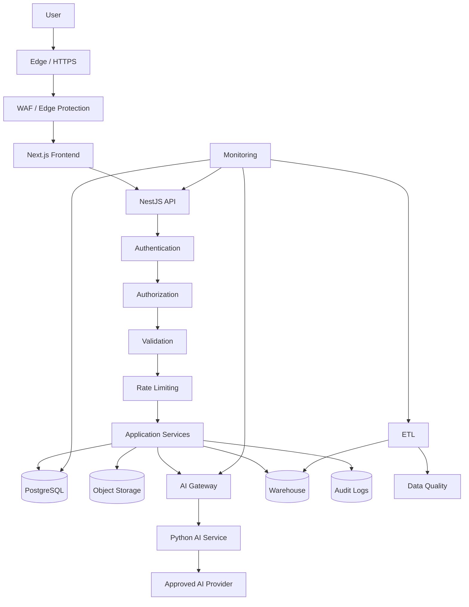
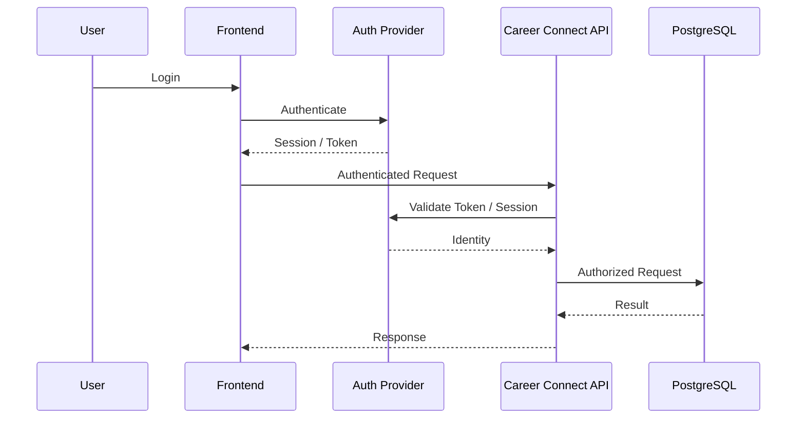
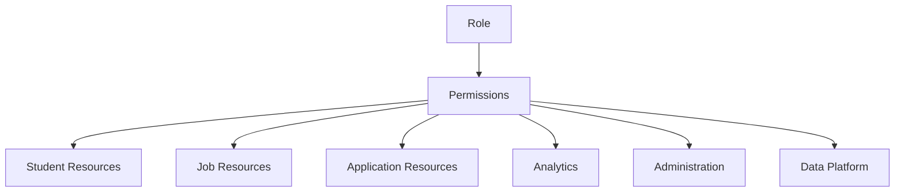
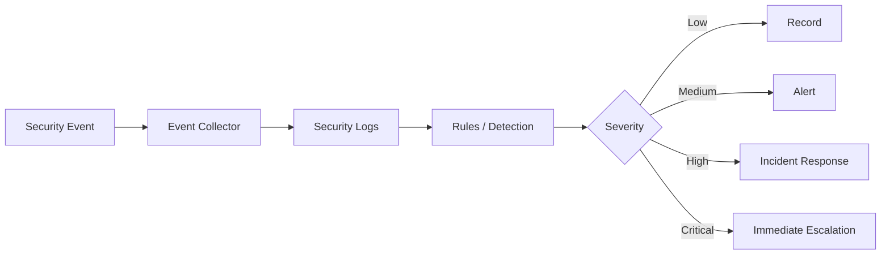
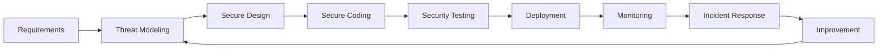
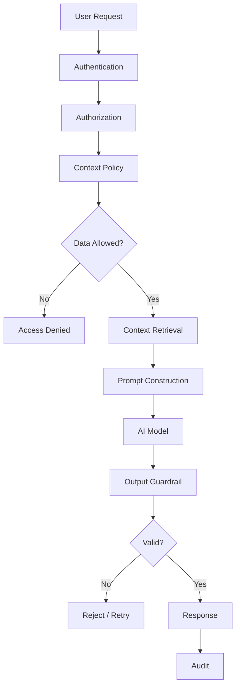
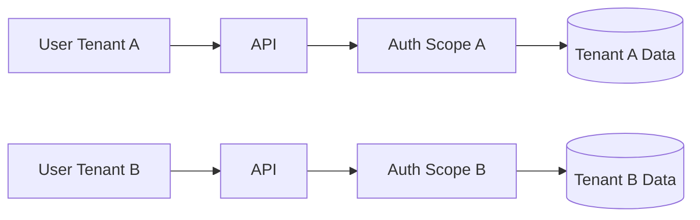
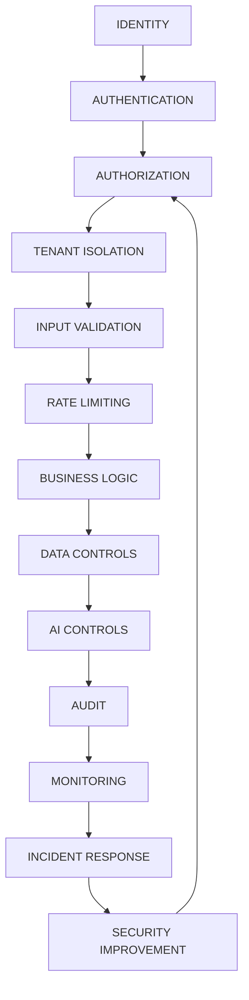

# 30 — Security Design

# Career Connect — AI Career Intelligence Platform

**Document Type:** Enterprise Security Architecture & Design Specification
**Project:** Career Connect
**Version:** 1.0
**Status:** Security Architecture Baseline
**Security Model:** Zero-Trust + Least Privilege + Defense in Depth
**Authentication:** Supabase Auth / OAuth / JWT-based application sessions
**Authorization:** RBAC + Organization/Tenant Scope + Resource-Level Authorization
**Frontend:** Next.js + TypeScript
**Backend:** NestJS + TypeScript
**AI Services:** Python
**Database:** PostgreSQL / Supabase
**Warehouse:** BigQuery / Snowflake
**Storage:** Cloud Object Storage
**CI/CD:** GitHub Actions
**Deployment:** Cloud-Native

---

# 1. Executive Summary

Security is a first-class architectural concern in Career Connect because the platform processes:

```text id="d4m8q2"
Student Profiles
Resumes
Education Records
Skills
Applications
Interview Feedback
Recruitment Data
Placement Outcomes
Salary Information
Company Data
AI Conversations
Analytics
Audit Logs
```

The security architecture must therefore protect:

```text id="x7m3q8"
Identity
Access
Data
APIs
Files
AI Context
Infrastructure
Analytics
Audit Records
```

The fundamental security model is:

> **Never trust a request merely because it came from the frontend. Authenticate every protected request, authorize every sensitive action, isolate organizational data, validate every input, and log security-relevant events.**

---

# 2. Security Objectives

Career Connect security shall protect:

## Confidentiality

Prevent unauthorized access.

## Integrity

Prevent unauthorized modification.

## Availability

Keep critical services operational.

## Authenticity

Verify identities and service relationships.

## Accountability

Trace important actions to users/services.

## Privacy

Minimize unnecessary data collection and exposure.

## Resilience

Continue operating safely during failures and attacks.

---

# 3. Security Principles

The security architecture follows:

```text id="m5q8x2"
1. Zero Trust
2. Least Privilege
3. Defense in Depth
4. Secure by Default
5. Fail Securely
6. Minimize Data
7. Verify Every Request
8. Separate Duties
9. Encrypt Sensitive Data
10. Audit Important Actions
11. Assume External Content Is Untrusted
12. Secure the AI Boundary
```

---

# 4. Zero-Trust Model

The platform should not assume trust based on:

```text id="w8m4q2"
IP Address
Browser
Network Location
Frontend Role
Organization ID Supplied by Client
```

Instead:

```text id="q7x3m8"
Request
↓
Authenticate
↓
Authorize
↓
Validate
↓
Execute
↓
Audit
```

---

# 5. Security Architecture



---

# 6. Security Zones

Career Connect should conceptually separate:

```text id="x4m7q2"
Public Zone
Application Zone
Data Zone
AI Zone
Analytics Zone
Administration Zone
Monitoring Zone
```

---

# 7. Public Zone

Potentially exposed:

```text id="v5m8q3"
Landing Page
Public Job Search
Public Career Information
Authentication Entry Points
```

No sensitive application data should be exposed by default.

---

# 8. Application Zone

Contains:

```text id="m7q3x8"
Frontend
API
Business Services
Authentication Integration
Notification Service
Report Service
```

---

# 9. Data Zone

Contains:

```text id="q8m4x2"
PostgreSQL
Object Storage
Secrets
Sensitive Application Data
```

Access should be tightly controlled.

---

# 10. AI Zone

Contains:

```text id="x5m7q3"
AI Gateway
Context Retrieval
Prompt Management
Python AI Services
AI Workers
Provider Adapters
```

The AI zone must not have unrestricted database access.

---

# 11. Analytics Zone

Contains:

```text id="m4q8x2"
Data Lake
Data Warehouse
Data Marts
Semantic Layer
BI APIs
```

Analytical data should be governed and access-controlled.

---

# 12. Administration Zone

Contains:

```text id="q7m3x8"
User Administration
Roles
Permissions
Data Sources
ETL
Quality
Audit
System Health
```

Administrative access should require stronger controls.

---

# 13. Authentication Architecture

Authentication is responsible for proving:

> **Who is the user?**

Authorization answers:

> **What is the user allowed to do?**

These responsibilities must remain conceptually separate.

---

# 14. Authentication Flow



---

# 15. Supported Authentication

The platform may support:

```text id="x8m3q5"
Email + Password
Google OAuth
Institutional OAuth / SSO
Enterprise Identity Provider
```

Only configured and approved providers should be enabled.

---

# 16. Password Security

If password authentication is handled by an identity provider:

```text id="m7q4x2"
Career Connect
→ Does not store plaintext passwords
```

Application databases should store only the minimum identity linkage required.

---

# 17. Session Security

Sessions should use provider-managed secure mechanisms.

Relevant protections include:

```text id="q5m8x3"
Secure Transport
Expiration
Refresh Handling
Revocation
Session Monitoring
```

---

# 18. JWT Validation

If JWTs are used, the backend should validate:

```text id="x4m7q2"
Signature
Issuer
Audience
Expiration
Not-Before
Required Claims
```

Do not trust client-provided decoded JWT payloads without cryptographic verification.

---

# 19. Token Handling

Tokens should not be:

```text id="m8q3x5"
Logged
Exposed in URLs
Stored in unsafe client locations
Returned unnecessarily
```

---

# 20. OAuth Security

OAuth implementations should validate:

```text id="q7m4x2"
Redirect URI
State
PKCE where applicable
Issuer
Token audience
Authorization response
```

---

# 21. Multi-Factor Authentication

MFA should be supported for privileged accounts.

Priority:

```text id="x5m8q3"
Platform Admin
Organization Admin
Security Admin
Data Admin
```

MFA can later be expanded to recruiters or institutional roles based on policy.

---

# 22. Administrative Authentication

Administrative access should require stronger security controls than standard student access.

Possible requirements:

```text id="m4q8x2"
MFA
Shorter Session Lifetime
Stronger Monitoring
Privileged Audit Logging
```

---

# 23. Authorization Architecture

Career Connect uses multiple authorization layers:

```text id="q8m3x5"
1. Role
2. Permission
3. Organization
4. Resource Ownership
5. Action
6. Data Classification
```

---

# 24. RBAC Model

Roles:

```text id="x7m4q2"
SUPER_ADMIN
PLATFORM_ADMIN
ORG_ADMIN
PLACEMENT_OFFICER
FACULTY
RECRUITER
COMPANY_ADMIN
STUDENT
JOB_SEEKER
DATA_ENGINEER
BI_ANALYST
SECURITY_ADMIN
```

The exact production role catalog should be centrally governed.

---

# 25. Permission Model

Permissions should follow:

```text id="m5q8x3"
RESOURCE_ACTION
```

Examples:

```text id="q4m7x2"
STUDENT_READ
STUDENT_UPDATE

JOB_CREATE
JOB_UPDATE
JOB_CLOSE

APPLICATION_READ
APPLICATION_UPDATE

REPORT_EXPORT
AUDIT_READ

PIPELINE_RUN
DATA_QUALITY_READ
```

---

# 26. Role-to-Permission Mapping



---

# 27. Resource-Level Authorization

Even if a user has:

```text id="x8m3q5"
STUDENT_READ
```

they should not automatically access every student.

The backend must additionally verify resource scope.

---

# 28. Object-Level Authorization

Example:

```text id="m7q4x2"
Student A
→ /students/B
```

must be checked against:

```text id="q5m8x3"
Ownership
Organization
Role
Permission
```

This prevents insecure direct object reference vulnerabilities.

---

# 29. Tenant Isolation

Each organization should have a tenant context.

Conceptual structure:

```text id="x4m7q2"
Tenant A
├── Users
├── Students
├── Jobs
├── Applications
└── Reports

Tenant B
├── Users
├── Students
├── Jobs
├── Applications
└── Reports
```

Cross-tenant access should be denied by default.

---

# 30. Tenant Context

Tenant identity must come from trusted server-side identity/authorization context.

Do not rely solely on:

```json id="v0l0ax"
{
  "organization_id": "tenant-b"
}
```

submitted by a client.

---

# 31. Database-Level Isolation

Where appropriate, PostgreSQL Row-Level Security can provide an additional authorization boundary.

Conceptually:

```text id="m8q3x5"
Application Authorization
+
Database Row-Level Security
```

Defense in depth is preferred over relying on only one layer.

---

# 32. Tenant Query Scope

Every tenant-owned query should conceptually include:

```text id="q7m4x2"
tenant_id = authenticated_tenant
```

This should be enforced systematically rather than manually forgotten in individual endpoints.

---

# 33. Shared Reference Data

Global data may be shared:

```text id="x5m8q3"
Skills
Career Paths
Countries
Employment Types
Technology Taxonomy
```

Tenant-specific data remains isolated.

---

# 34. Data Classification

Career Connect uses:

```text id="m4q7x2"
PUBLIC
INTERNAL
CONFIDENTIAL
RESTRICTED
```

---

# 35. Public Data

Examples:

```text id="q8m3x5"
Public Career Descriptions
Public Skill Definitions
Public Job Information
Public Market Summaries
```

Only intentionally published data belongs here.

---

# 36. Internal Data

Examples:

```text id="x7m4q2"
Pipeline Metadata
Operational Metrics
Internal Configuration
```

---

# 37. Confidential Data

Examples:

```text id="m5q8x3"
Student Profile
Application Data
Company Recruitment Data
Learning Records
```

---

# 38. Restricted Data

Examples:

```text id="q4m7x2"
Interview Feedback
Sensitive Salary Data
Authentication Information
Secrets
Security Investigations
Restricted Resumes
```

---

# 39. Encryption in Transit

Production communication should use encrypted transport.

```text id="x8m3q5"
HTTPS
TLS
Secure Service Connections
```

---

# 40. Encryption at Rest

Sensitive information should be protected by encryption at rest using platform/provider controls.

Applicable systems:

```text id="m7q4x2"
Database
Object Storage
Backups
Logs where sensitive
Warehouse
```

---

# 41. Key Management

Encryption keys should be managed through the selected cloud provider's secure key-management capability where required.

Do not hard-code encryption keys.

---

# 42. Secrets Management

Secrets include:

```text id="q5m8x3"
Database Credentials
AI Provider Keys
OAuth Secrets
Storage Credentials
Webhook Secrets
Encryption Keys
```

These must be managed outside source control.

---

# 43. Secret Storage

Use:

```text id="x4m7q2"
Cloud Secret Manager
Environment Secret Store
Deployment Platform Secret Management
```

according to deployment architecture.

---

# 44. Secret Rotation

Secrets should support controlled rotation.

Example:

```text id="m8q3x5"
Create New Secret
↓
Deploy
↓
Validate
↓
Revoke Old Secret
```

---

# 45. Source Control Security

Never commit:

```text id="q7m4x2"
.env files
API Keys
Passwords
Private Keys
Service Account Credentials
Production Tokens
```

---

# 46. API Security Architecture

Every protected API request should pass through:

```text id="x5m8q3"
HTTPS
↓
Authentication
↓
Authorization
↓
Input Validation
↓
Rate Limiting
↓
Business Logic
↓
Data Access
↓
Audit where required
```

---

# 47. API Input Validation

All API inputs must be validated for:

```text id="m4q7x2"
Type
Length
Format
Range
Enum
Required Fields
Nested Structure
```

---

# 48. Request Size Limits

The API should limit:

```text id="q8m3x5"
JSON Payload Size
Multipart File Size
Array Size
String Length
```

This helps prevent resource exhaustion.

---

# 49. HTTP Security Headers

Production web services should use appropriate security headers such as:

```text id="x7m4q2"
Content Security Policy
Strict Transport Security
Frame Restrictions
Content Type Protection
Referrer Policy
```

The exact policy should be tested with the deployed frontend architecture.

---

# 50. CORS

CORS should use an explicit allowlist.

Avoid unrestricted production configuration such as:

```text id="m5q8x3"
Access-Control-Allow-Origin: *
```

for credentialed protected APIs.

---

# 51. CSRF

Where cookie-based browser authentication is used for state-changing requests, implement appropriate CSRF protections.

---

# 52. SQL Injection Prevention

Use:

```text id="q4m7x2"
Parameterized Queries
ORM Parameter Binding
Validated Query Inputs
```

Never construct SQL using direct string concatenation of user input.

---

# 53. XSS Protection

User-controlled text may appear in:

```text id="x8m3q5"
Profiles
Projects
Job Descriptions
AI Responses
Chat Messages
Reports
```

The application should safely render such content.

---

# 54. HTML Sanitization

If rich HTML is accepted, sanitize it using a well-maintained trusted sanitizer.

Prefer plain text or structured content where rich HTML is unnecessary.

---

# 55. SSR/Frontend Security

Next.js pages should avoid exposing:

```text id="m7q4x2"
Server Secrets
Database Credentials
Private API Keys
Internal Tokens
```

Only intentionally public configuration may be included in browser bundles.

---

# 56. Rate Limiting

Different APIs should receive different rate limits.

Example categories:

```text id="q5m8x3"
Authentication
AI
Search
Read APIs
Write APIs
Bulk APIs
Reports
Admin
```

Exact limits must be based on traffic and abuse analysis.

---

# 57. Brute Force Protection

Protect authentication endpoints using:

```text id="x4m7q2"
Rate Limiting
Backoff
Temporary Blocking
MFA
Monitoring
```

---

# 58. AI Rate Limiting

AI endpoints require special controls because they can have variable cost.

Control by:

```text id="m8q3x5"
User
Organization
Feature
Plan
Token/usage
Time Window
```

---

# 59. File Upload Security

Resume uploads are a major security boundary.

Validate:

```text id="q7m4x2"
Extension
Content Type
Magic Bytes / File Signature
File Size
Ownership
Virus/Malware Policy
Storage Path
```

Do not trust filename extensions alone.

---

# 60. Resume File Isolation

Uploaded files should be stored with:

```text id="x5m8q3"
Randomized Object Identifier
Private Bucket/Container
Controlled Access
No Public Directory Listing
```

---

# 61. Secure Resume Download

A user should retrieve a resume through controlled authorization.

Possible mechanism:

```text id="m4q7x2"
Authenticated Request
↓
Authorization Check
↓
Short-Lived Signed Access
↓
File
```

---

# 62. File Name Security

Do not directly use user-controlled names as filesystem paths.

Use safe generated identifiers.

---

# 63. Malware Protection

Where production requirements justify it, uploaded documents should pass through a malware scanning process before downstream processing.

---

# 64. AI Security Boundary

AI services should not directly receive unrestricted database access.

Preferred:

```text id="q8m3x5"
AI Request
↓
Context Service
↓
Authorized Context
↓
AI
```

---

# 65. Prompt Injection Defense

External/user content must be classified as untrusted.

Sources include:

```text id="x7m4q2"
Resume
Job Description
Course Description
Chat Input
External Documents
```

These must never be able to override system-level instructions.

---

# 66. Retrieval Authorization

Before content is added to a Retrieval-Augmented Generation context:

```text id="m5q8x3"
Check Document Access
↓
Check Tenant
↓
Check Classification
↓
Check Purpose
↓
Retrieve
```

---

# 67. AI Data Leakage Prevention

The AI system must prevent requests such as:

> "Show me another student's private resume."

from returning unauthorized information.

---

# 68. AI Output Controls

Validate:

```text id="q4m7x2"
Schema
Length
Allowed Fields
Numeric Range
Content Rules
Permissions
```

---

# 69. AI Tool Access

AI tools should have explicit permissions.

Example:

```text id="x8m3q5"
Career Assistant
→ get_student_skills: ALLOWED

Career Assistant
→ get_all_students: DENIED
```

---

# 70. AI Tool Least Privilege

Each AI tool should have:

```text id="m7q4x2"
Tool Name
Input Schema
Allowed Role
Allowed Data
Tenant Scope
Purpose
```

---

# 71. AI Model Provider Security

Provider integrations must use:

```text id="q5m8x3"
Secret Management
Encrypted Transport
Provider Policy
Data Minimization
Timeouts
Rate Limits
Monitoring
```

---

# 72. External Data Security

External sources may contain malicious or malformed content.

Therefore:

```text id="x4m7q2"
External Data
↓
Validation
↓
Sanitization
↓
Quarantine if needed
↓
Curated Data
```

---

# 73. Data Warehouse Security

Warehouse access should use roles.

Example:

```text id="m8q3x5"
BI Reader
Analytics Engineer
Data Engineer
Admin
```

Each role receives the minimum required permission.

---

# 74. Warehouse Sensitive Data

Highly sensitive data should not automatically be exposed to all BI users.

Use:

```text id="q7m4x2"
Column-Level Controls
Row-Level Controls
Views
Authorized Data Marts
```

where supported.

---

# 75. Analytical De-Identification

Where detailed identity is unnecessary, analytics should use:

```text id="x5m8q3"
Aggregated Results
Pseudonymous IDs
Masked Fields
```

---

# 76. Data Minimization in BI

Executives often need:

```text id="m4q7x2"
Counts
Rates
Trends
Aggregates
```

rather than:

```text id="q8m3x5"
Full Student PII
Resume Text
Interview Notes
```

The dashboard should therefore expose only what the business decision requires.

---

# 77. Audit Logging

Sensitive actions should produce audit events.

Examples:

```text id="x7m4q2"
LOGIN
LOGIN_FAILED
ROLE_CHANGED
PERMISSION_CHANGED
RESUME_VIEWED
RESUME_EXPORTED
APPLICATION_CREATED
APPLICATION_STATUS_CHANGED
INTERVIEW_FEEDBACK_VIEWED
PLACEMENT_CREATED
REPORT_EXPORTED
USER_SUSPENDED
DATA_IMPORTED
PIPELINE_RUN
AI_ANALYSIS_CREATED
```

---

# 78. Audit Event Structure

```json id="m5q8x3"
{
  "event_id": "audit-123",
  "timestamp": "2026-07-30T10:30:00Z",
  "actor_id": "user-123",
  "organization_id": "org-456",
  "action": "REPORT_EXPORTED",
  "resource_type": "PLACEMENT_REPORT",
  "resource_id": "report-789",
  "request_id": "cc-123",
  "status": "SUCCESS"
}
```

---

# 79. Audit Immutability

Normal application users must not be able to modify or delete audit records.

---

# 80. Audit Retention

Audit retention should be defined according to:

```text id="q4m7x2"
Security Requirements
Institutional Policy
Applicable Law
Storage Cost
Investigation Needs
```

---

# 81. Security Monitoring

Monitor:

```text id="x8m3q5"
Authentication Failures
Authorization Failures
Unusual Data Access
Export Volume
AI Abuse
Rate-Limit Violations
Admin Changes
Pipeline Abuse
```

---

# 82. Security Alerts

Example alerts:

```text id="m7q4x2"
Multiple failed logins
Unusual cross-tenant access attempt
Large sensitive export
Unexpected role escalation
AI request spike
Repeated API abuse
```

---

# 83. Security Event Pipeline



---

# 84. Incident Response Lifecycle

```text id="x5m7q3"
Detect
↓
Triage
↓
Contain
↓
Investigate
↓
Eradicate
↓
Recover
↓
Review
↓
Improve
```

---

# 85. Security Incident Categories

```text id="q8m3x5"
Credential Compromise
Unauthorized Access
Data Exposure
Malware Upload
API Abuse
AI Data Leakage
Tenant Isolation Failure
Infrastructure Attack
```

---

# 86. Incident Severity

## Critical

Potential major data exposure or system compromise.

## High

Significant unauthorized access or service disruption.

## Medium

Limited security issue with controlled impact.

## Low

Minor security anomaly.

---

# 87. Credential Compromise Response

```text id="x7m4q2"
Detect
↓
Disable / Rotate Credential
↓
Invalidate Sessions
↓
Investigate
↓
Review Access
↓
Restore Secure State
```

---

# 88. Tenant Isolation Incident

If cross-tenant exposure is suspected:

```text id="m5q8x3"
1. Disable affected access path.
2. Preserve evidence.
3. Identify affected tenants.
4. Review logs.
5. Correct authorization boundary.
6. Rotate exposed credentials if necessary.
7. Validate isolation.
8. Complete incident review.
```

---

# 89. Privilege Escalation Prevention

Users should not be able to change their own:

```text id="q4m7x2"
Role
Organization
Permissions
Administrative Flags
```

through client-controlled fields.

---

# 90. Separation of Duties

Certain actions should require different roles where appropriate.

Example:

```text id="x8m3q5"
Data Engineer
→ Load Data

Data Steward
→ Approve Definition

Administrator
→ Manage Access
```

This reduces concentration of authority.

---

# 91. Privileged Access

Privileged operations should have:

```text id="m7q4x2"
MFA
Audit
Short Session
Least Privilege
Additional Verification where required
```

---

# 92. Admin API Security

Administrative APIs must be:

```text id="q5m8x3"
Authenticated
Role-Protected
Permission-Protected
Rate-Limited
Audited
```

---

# 93. Security of Reports

Generated reports can contain sensitive information.

Therefore:

```text id="x4m7q2"
Private Storage
Access Control
Short-Lived Download
Audit
Retention
```

should apply.

---

# 94. Export Security

Before export:

```text id="m8q3x5"
Authenticate
↓
Authorize
↓
Validate Filters
↓
Generate
↓
Audit
↓
Deliver
```

---

# 95. Bulk Import Security

Bulk files can introduce malicious or incorrect data.

Workflow:

```text id="q7m4x2"
Upload
↓
Validate
↓
Scan
↓
Preview
↓
Transform
↓
Quality Check
↓
Load
```

---

# 96. ETL Credential Security

Data pipelines must use dedicated service identities.

Avoid:

```text id="x5m8q3"
Shared Admin Credential
```

Prefer:

```text id="m4q7x2"
Dedicated Pipeline Identity
```

with limited permissions.

---

# 97. Service Account Least Privilege

Example:

```text id="q8m3x5"
ETL Service
→ Read Raw Storage
→ Write Curated Storage
→ Write Warehouse
```

It should not automatically have:

```text id="x7m4q2"
User Administration
Role Management
Secrets Administration
```

---

# 98. Database Security

PostgreSQL security should include:

```text id="m5q8x3"
Strong Authentication
Encrypted Connections
Role-Based Access
Row-Level Security where appropriate
Least Privilege
Backups
Logging
```

---

# 99. Database Roles

Example:

```text id="q4m7x2"
app_runtime
etl_writer
analytics_reader
migration_user
admin
```

Each receives different permissions.

---

# 100. Migration Security

Database migrations should:

```text id="x8m3q5"
Be Version Controlled
Be Reviewed
Be Tested
Run Through Controlled Deployment
```

Production schema changes should not be performed manually without an audit trail.

---

# 101. Database Backup Security

Backups must have:

```text id="m7q4x2"
Access Control
Encryption
Retention
Recovery Testing
```

---

# 102. Object Storage Security

Storage should use:

```text id="q5m8x3"
Private Buckets
Explicit Access Policies
Encryption
Lifecycle Controls
Object Versioning where appropriate
```

---

# 103. Storage Path Isolation

Conceptual organization:

```text id="x4m7q2"
tenants/
  org-001/
    resumes/
    reports/

  org-002/
    resumes/
    reports/
```

The path itself is not a security mechanism; backend authorization remains mandatory.

---

# 104. CDN Security

Public content may use CDN delivery.

Sensitive private objects should not be directly exposed through public CDN URLs.

---

# 105. Security of Webhooks

Outbound webhooks should use:

```text id="m8q3x5"
Signed Payloads
Timestamp
Event ID
Replay Protection
Retries
```

---

# 106. Webhook Secret Security

Webhook signing secrets must be securely stored and rotatable.

---

# 107. Replay Attack Protection

Use:

```text id="q7m4x2"
Timestamp Validation
Unique Event ID
Processed Event Store
```

where appropriate.

---

# 108. Dependency Security

The project shall regularly scan:

```text id="x5m8q3"
npm Dependencies
Python Packages
Docker Images
GitHub Actions
Infrastructure Packages
```

---

# 109. Vulnerability Management

Workflow:

```text id="m4q7x2"
Detect
↓
Prioritize
↓
Patch
↓
Test
↓
Deploy
↓
Verify
```

---

# 110. Container Security

Docker images should:

```text id="q8m3x5"
Use Minimal Base Images
Avoid Root where Practical
Pin Dependencies
Scan Vulnerabilities
Avoid Embedded Secrets
```

---

# 111. CI/CD Security

GitHub Actions should use:

```text id="x7m4q2"
Protected Secrets
Least-Privilege Tokens
Pinned Actions where practical
Dependency Scanning
Build Validation
Deployment Approval
```

---

# 112. Branch Protection

Production code should require:

```text id="m5q8x3"
Pull Request
Review
CI Success
Security Checks
```

before merge where appropriate.

---

# 113. Supply Chain Security

Track:

```text id="q4m7x2"
Dependencies
Build Artifacts
Container Images
Third-Party Actions
```

---

# 114. Infrastructure Security

Cloud infrastructure should use:

```text id="x8m3q5"
Least-Privilege IAM
Private Networking where appropriate
Security Groups / Policies
Secret Management
Logging
Monitoring
Backups
```

---

# 115. Network Security

Use layered controls:

```text id="m7q4x2"
Edge Protection
WAF
TLS
Network Policies
Private Services
Database Restrictions
```

---

# 116. Database Network Access

The database should not be publicly reachable unless required by the platform design and appropriately secured.

Prefer application-mediated access.

---

# 117. Warehouse Network Access

Warehouse credentials should be restricted to:

```text id="q5m8x3"
Approved Services
Approved Analysts
Approved BI Systems
```

---

# 118. Security of Development Environment

Development should use:

```text id="x4m7q2"
Synthetic Data
Separate Secrets
Separate Projects
Separate Database
Test AI Keys
```

Production credentials should never be reused for local development.

---

# 119. Environment Isolation

```text id="m8q3x5"
Development
   ≠
Staging
   ≠
Production
```

Each environment should have separate:

```text id="q7m4x2"
Credentials
Databases
Storage
AI Configuration
Secrets
```

where practical.

---

# 120. Production Data in Development

Production personal data should not be copied into development environments without a governed need and appropriate controls.

Prefer:

```text id="x5m8q3"
Synthetic Data
Masked Data
Anonymized Data
```

---

# 121. Synthetic Dataset Security

Synthetic data should be clearly marked:

```text id="m4q7x2"
ENVIRONMENT = DEMO
DATA_TYPE = SYNTHETIC
```

This prevents accidental confusion with production data.

---

# 122. Security Documentation

Security documentation should include:

```text id="q8m3x5"
Threat Model
Data Classification
Access Matrix
Incident Response
Backup Strategy
Secret Management
AI Security
API Security
Security Testing
```

---

# 123. Threat Modeling

Major threats should be identified before deployment.

Recommended methodology:

```text id="x7m4q2"
Assets
↓
Actors
↓
Attack Surface
↓
Threats
↓
Mitigations
↓
Residual Risk
```

---

# 124. Primary Assets

Career Connect assets include:

```text id="m5q8x3"
User Identity
Resume
Student Profile
Application Data
Interview Feedback
Salary Data
Placement Records
Warehouse
AI Context
Reports
Secrets
Audit Logs
```

---

# 125. Primary Threat Actors

Potential threat actors:

```text id="q4m7x2"
Malicious User
External Attacker
Compromised Account
Malicious Insider
Compromised Dependency
Malicious Uploaded Content
Automated Bot
```

---

# 126. Threat Model Summary

| Threat               | Impact      | Primary Controls               |
| -------------------- | ----------- | ------------------------------ |
| Account Takeover     | High        | MFA, rate limiting, monitoring |
| IDOR                 | High        | Object authorization           |
| Cross-Tenant Leak    | Critical    | Tenant scope + RLS             |
| SQL Injection        | Critical    | Parameterized queries          |
| XSS                  | High        | Output handling + CSP          |
| Resume Malware       | High        | File validation/scanning       |
| AI Prompt Injection  | High        | Trust boundaries               |
| AI Data Leakage      | Critical    | Context authorization          |
| API Abuse            | Medium/High | Rate limits                    |
| Privilege Escalation | Critical    | RBAC + server validation       |
| Secret Leak          | Critical    | Secret manager + scanning      |
| Data Corruption      | High        | Validation + transactions      |
| ETL Poisoning        | High        | Quality + quarantine           |
| Report Leakage       | High        | Export authorization           |
| Supply Chain Attack  | High        | Dependency/image scanning      |

---

# 127. OWASP-Oriented Security Coverage

The architecture should address major application risks such as:

```text id="x8m3q5"
Broken Access Control
Cryptographic Failures
Injection
Insecure Design
Security Misconfiguration
Vulnerable Components
Authentication Failures
Integrity Failures
Logging Failures
```

Security testing should be mapped to the deployment's current risk profile.

---

# 128. Secure Development Lifecycle

Career Connect security should follow:



---

# 129. Security Gates

Before production:

```text id="m7q4x2"
✓ Dependency Scan
✓ Secret Scan
✓ SAST
✓ API Security Tests
✓ Authentication Tests
✓ Authorization Tests
✓ File Upload Tests
✓ AI Security Tests
✓ Container Scan
```

---

# 130. Static Analysis

Code quality/security tooling should cover:

```text id="q5m8x3"
TypeScript
Python
SQL
Docker
Infrastructure
```

---

# 131. Dynamic Security Testing

Test deployed APIs for:

```text id="x4m7q2"
Authorization Bypass
Injection
Rate Limit Bypass
Malformed Input
Session Problems
File Upload Abuse
```

---

# 132. Security Regression Tests

Every security defect should create a permanent regression test.

Example:

```text id="m8q3x5"
Bug:
Student could access another student's resume.

Fix:
Authorization filter added.

Regression:
Automated test must remain permanently.
```

---

# 133. Security Test Matrix

| Area           | Tests                             |
| -------------- | --------------------------------- |
| Authentication | Valid, invalid, expired, revoked  |
| Authorization  | RBAC, IDOR, tenant                |
| API            | Injection, validation, rate limit |
| Files          | Type, size, malicious file        |
| AI             | Prompt injection, data leakage    |
| Data           | Access boundaries                 |
| Admin          | Privilege escalation              |
| Reports        | Export leakage                    |
| ETL            | Malformed/malicious input         |
| Infrastructure | Configuration/security scans      |

---

# 134. Security Logging Without Data Leakage

Logs should never automatically contain:

```text id="x7m4q2"
Passwords
Tokens
Full Resumes
Sensitive Interview Notes
Secret Keys
Complete PII
```

Use:

```text id="m5q8x3"
Identifiers
Hashes
Redacted Values
Event Metadata
```

where possible.

---

# 135. PII Masking

Example:

```text id="q4m7x2"
Email:
ka****@example.com
```

when full email is not required for an operational view.

---

# 136. Secure Error Handling

Client:

```json id="x8m3q5"
{
  "code": "ACCESS_DENIED",
  "message": "You do not have permission to access this resource."
}
```

Internal log:

```text id="m7q4x2"
Authorization policy failed:
resource=resume
resource_id=...
user=...
tenant=...
```

Do not expose internal security details to attackers.

---

# 137. Security Headers and Browser Controls

The application should evaluate:

```text id="q5m8x3"
CSP
HSTS
Frame Protection
Referrer Policy
Permissions Policy
Secure Cookies
```

according to actual frontend architecture.

---

# 138. Session Timeout

Session lifetime should be appropriate to role sensitivity.

For example:

```text id="x4m7q2"
Student
→ Standard Session

Admin
→ Shorter/Stronger Session
```

Exact durations should be defined by deployment policy.

---

# 139. Suspicious Session Detection

Potential signals:

```text id="m8q3x5"
Unusual Login Frequency
Impossible Geographic Pattern where available
Repeated Failures
Token Anomaly
High Export Activity
```

The exact detection strategy should avoid false positives and respect privacy policies.

---

# 140. User Security Center

The product may provide:

```text id="q7m4x2"
Recent Logins
Active Sessions
Connected Accounts
MFA
Password / Identity Settings
```

---

# 141. Organization Security Center

For institutions/companies:

```text id="x5m8q3"
User Access
Role Distribution
Security Events
Data Exports
API Usage
```

---

# 142. Platform Security Dashboard

```text id="m4q7x2"
Security Events
Failed Logins
Permission Failures
API Abuse
Sensitive Exports
Active Incidents
```

---

# 143. Security Metrics

Track:

```text id="q8m3x5"
Authentication Failure Rate
Authorization Failure Rate
Security Incident Count
Mean Time to Detect
Mean Time to Respond
Sensitive Export Count
Vulnerability Count
Patch Age
```

---

# 144. AI Security Metrics

Track:

```text id="x7m4q2"
Prompt Injection Attempts
AI Data Access Denials
Tool Authorization Failures
Safety Blocks
Provider Security Errors
```

---

# 145. Data Security Metrics

Track:

```text id="m5q8x3"
Unauthorized Access Attempts
Sensitive File Access
Cross-Tenant Query Denials
Export Volume
Data Classification Coverage
```

---

# 146. Security Incident Evidence

Retain relevant:

```text id="q4m7x2"
Request ID
Timestamp
Actor
Source
Resource
Action
System Logs
Audit Event
```

Evidence should be protected from alteration.

---

# 147. Security Incident Runbook — Unauthorized Access

```text id="x8m3q5"
1. Detect
2. Validate
3. Identify Account
4. Restrict Access
5. Preserve Evidence
6. Identify Impact
7. Correct Root Cause
8. Test Fix
9. Restore
10. Review
```

---

# 148. Security Incident Runbook — Data Exposure

```text id="m7q4x2"
1. Stop Exposure
2. Identify Data
3. Identify Tenants
4. Preserve Logs
5. Correct Access Policy
6. Rotate Credentials where required
7. Validate
8. Notify Appropriate Stakeholders
9. Document Incident
```

---

# 149. Security Incident Runbook — AI Leakage

```text id="q5m8x3"
1. Disable Affected Tool
2. Preserve Prompt/Context Metadata
3. Identify Exposed Context
4. Check Tenant Isolation
5. Correct Retrieval Policy
6. Add Regression Test
7. Re-enable after Validation
```

---

# 150. Security Incident Runbook — Malicious File

```text id="x4m7q2"
1. Quarantine File
2. Stop Processing
3. Preserve Metadata
4. Scan
5. Identify Impact
6. Remove or Isolate
7. Add Detection Rule
8. Review Upload Security
```

---

# 151. Security Architecture for AI + Data



---

# 152. Security Architecture for Tenant Isolation



---

# 153. Zero-Trust Data Flow

```text id="m7q4x2"
Request
↓
Identity
↓
Tenant
↓
Role
↓
Permission
↓
Resource
↓
Action
↓
Data Classification
↓
Decision
```

---

# 154. Security by Design Checklist

Every new feature should ask:

```text id="q5m8x3"
Who can use it?
What data does it access?
Which tenant owns the data?
Can the user modify it?
Can the AI see it?
Can it be exported?
Does it require an audit event?
What happens if an attacker controls the input?
```

---

# 155. Security Review Template

```text id="x4m7q2"
Feature:
Owner:

Data:
Classification:

Actors:
Roles:

API:
Endpoints:

Authorization:
Rules:

Storage:
Database / Object Storage

AI:
Yes / No

External Dependencies:
...

Audit:
Required / Not Required

Threats:
...

Mitigations:
...
```

---

# 156. Security Release Checklist

Before releasing a feature:

```text id="m8q3x5"
✓ Authentication checked
✓ Authorization checked
✓ Tenant isolation checked
✓ Validation checked
✓ Rate limiting checked
✓ Sensitive data checked
✓ Logs checked
✓ Audit checked
✓ Dependency scan passed
✓ Security tests passed
```

---

# 157. Security Maturity Roadmap

## Level 1 — Academic MVP

```text id="q7m4x2"
Authentication
RBAC
Input Validation
Secure APIs
Audit Logs
Secrets
Basic Monitoring
```

## Level 2 — Startup SaaS

```text id="x5m8q3"
Tenant Isolation
RLS
MFA
WAF
Advanced Monitoring
Security Scanning
AI Guardrails
```

## Level 3 — Enterprise

```text id="m4q7x2"
Enterprise SSO
Advanced IAM
Centralized SIEM
Advanced DLP
Privileged Access Management
Formal Incident Response
Continuous Compliance
```

---

# 158. Security Implementation Priority

```text id="q8m3x5"
P0
Authentication
Authorization
Tenant Isolation
Secret Management
Input Validation
Secure File Access
Audit

P1
MFA
WAF
Advanced Monitoring
AI Guardrails
Security Scanning

P2
Advanced DLP
SIEM Integration
PAM
Advanced Threat Detection
```

---

# 159. Security Folder Structure

Recommended:

```text id="x7m4q2"
security/
├── threat-model/
├── policies/
├── access-control/
├── audit/
├── incident-response/
├── secrets/
├── compliance/
├── ai-security/
├── api-security/
└── security-tests/
```

---

# 160. Security Documentation Set

The repository should contain:

```text id="m5q8x3"
docs/security/
├── security-architecture.md
├── authentication.md
├── authorization.md
├── tenant-isolation.md
├── data-classification.md
├── secrets-management.md
├── api-security.md
├── file-security.md
├── ai-security.md
├── threat-model.md
├── incident-response.md
└── security-testing.md
```

---

# 161. Security Architecture Validation

The security architecture should be validated through:

```text id="q4m7x2"
Threat Modeling
Code Review
Security Testing
Penetration Testing where appropriate
Dependency Scanning
Container Scanning
Secret Scanning
Access Review
```

---

# 162. Penetration Testing Scope

Important areas:

```text id="x8m3q5"
Authentication
Authorization
IDOR
Tenant Isolation
APIs
File Uploads
Admin
Reports
AI
```

---

# 163. Security Test Example — Tenant Isolation

### Given

```text id="m7q4x2"
User belongs to Tenant A.
```

### When

```text id="q5m8x3"
User requests Tenant B resource.
```

### Then

```text id="x4m7q2"
Access denied.
No Tenant B data is returned.
Security event is logged where appropriate.
```

---

# 164. Security Test Example — Resume Access

### Given

```text id="m8q3x5"
Student A owns Resume A.
```

### When

```text id="q7m4x2"
Student B requests Resume A.
```

### Then

```text id="x5m8q3"
Access denied.
No file metadata or contents are exposed.
```

---

# 165. Security Test Example — AI Data Leakage

### Given

```text id="m4q7x2"
Student A is authorized only for their own profile.
```

### When

```text id="q8m3x5"
Student A asks the AI to reveal Student B's information.
```

### Then

```text id="x7m4q2"
Context retrieval returns no unauthorized data.
AI cannot disclose it.
```

---

# 166. Security Test Example — Role Escalation

### Given

```text id="m5q8x3"
Student role.
```

### When

```text id="q4m7x2"
Client attempts to send:
role = ADMIN
```

### Then

```text id="x8m3q5"
Server ignores/rejects unauthorized role modification.
```

---

# 167. Security Test Example — API Abuse

### Given

```text id="m7q4x2"
AI endpoint rate limit.
```

### When

```text id="q5m8x3"
User exceeds allowed quota.
```

### Then

```text id="x4m7q2"
429 / controlled quota response.
No unlimited AI consumption.
```

---

# 168. Security Test Example — Malicious Upload

### Given

```text id="m8q3x5"
Unsupported or malicious file.
```

### When

```text id="q7m4x2"
User uploads file.
```

### Then

```text id="x5m8q3"
File is rejected/quarantined.
No downstream processing occurs.
```

---

# 169. Security Architecture Final Model



---

# 170. CTO-Level Security Principle

The most important security rule for Career Connect is:

> **Do not trust the frontend, the user, the uploaded file, the external data source, or the AI model.**

Each is treated as an input that requires validation.

The trust model is:

```text id="q5m7x3"
Frontend
→ Untrusted

User Input
→ Untrusted

Uploaded Resume
→ Untrusted

External Dataset
→ Untrusted

AI Output
→ Untrusted until validated

Database
→ Controlled

Warehouse
→ Governed

Authorization Policy
→ Security Boundary
```

---

# 171. Final Security Statement

> **Career Connect will implement a defense-in-depth security architecture based on zero-trust principles, least privilege, strong authentication, role and resource-level authorization, tenant isolation, secure APIs, encrypted data, protected object storage, centralized secrets management, audit logging, security monitoring, secure development practices, and controlled incident response. The architecture will apply additional security boundaries to AI systems by restricting context retrieval, protecting against prompt injection and data leakage, validating model outputs, controlling tool access, and recording model/prompt metadata. Security controls will extend across the full platform lifecycle—from user interaction and API access through operational data, ETL, data warehousing, AI processing, reporting, deployment, and monitoring.**

---

## Document Status

| Attribute            | Value                                               |
| -------------------- | --------------------------------------------------- |
| Project              | Career Connect                                      |
| Document             | Security Design                                     |
| Version              | 1.0                                                 |
| Security Model       | Zero Trust + Defense in Depth                       |
| Authentication       | Supabase Auth / OAuth / JWT                         |
| Authorization        | RBAC + Tenant + Resource                            |
| Tenant Security      | Application Scope + RLS where appropriate           |
| Data Protection      | Encryption + Classification + Minimization          |
| API Security         | Validation + Rate Limiting + Secure Headers         |
| File Security        | Private Storage + Validation + Controlled Access    |
| AI Security          | Context Filtering + Guardrails + Tool Authorization |
| Audit                | Security + Business-Sensitive Events                |
| Monitoring           | Security Metrics + Alerts                           |
| Incident Response    | Detect → Contain → Investigate → Recover            |
| Development Security | SAST + Dependency + Secret + Container Scanning     |
| Enterprise Expansion | MFA + SSO + SIEM + DLP + PAM                        |
| Status               | Security Architecture Baseline                      |
