# 31 — Deployment Guide

# Career Connect — AI Career Intelligence Platform

**Document Type:** Production Deployment & Infrastructure Guide
**Project:** Career Connect
**Version:** 1.0
**Status:** Deployment Architecture Baseline
**Deployment Model:** Cloud-Native + Containerized + CI/CD
**Frontend:** Next.js + TypeScript
**Backend:** NestJS + TypeScript
**AI:** Python + FastAPI/Worker Services
**Operational Database:** PostgreSQL / Supabase
**Warehouse:** BigQuery or Snowflake
**Object Storage:** Cloud Storage
**Authentication:** Supabase Auth / OAuth
**Frontend Hosting:** Vercel
**Backend/Workers:** Render or equivalent container platform
**Containers:** Docker
**CI/CD:** GitHub Actions
**Source Control:** GitHub

---

# 1. Executive Summary

Career Connect shall use a deployment architecture that separates:

```text
Frontend
Backend
AI Services
Background Workers
Database
Object Storage
Data Engineering
Warehouse
BI
Monitoring
```

The deployment architecture should support three environments:

```text
Development
↓
Staging
↓
Production
```

The core deployment principle is:

> **Build once, validate automatically, deploy through controlled environments, and monitor every production service.**

---

# 2. Deployment Objectives

The deployment platform shall provide:

```text
 id="Q6fTzM"
1. Repeatable deployments
2. Environment isolation
3. Secure configuration
4. Automated testing
5. Containerized services
6. Independent service scaling
7. Monitoring
8. Logging
9. Rollback capability
10. Backup and recovery
11. AI provider isolation
12. Data pipeline scheduling
```

---

# 3. Target Deployment Architecture

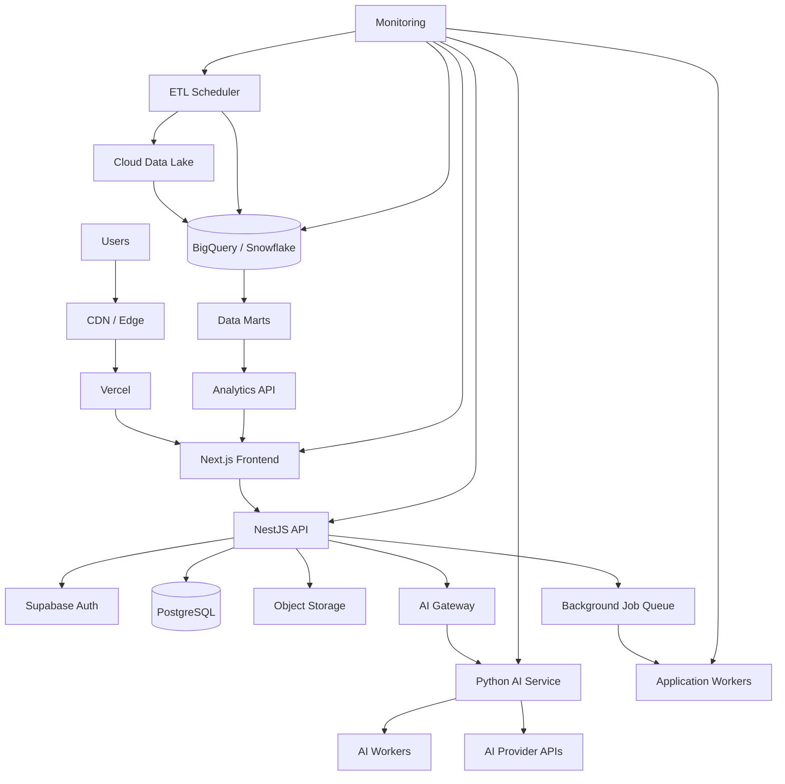

---

# 4. Deployment Environments

The platform shall use:

```text
development
staging
production
```

Each environment must have independent configuration.

---

# 5. Development Environment

Purpose:

```text
Local Development
Feature Development
Unit Testing
Integration Testing
```

Typical services:

```text
Next.js
NestJS
PostgreSQL / Supabase
Python AI Service
Local Worker
Synthetic Data
```

Development should avoid production credentials.

---

# 6. Staging Environment

Purpose:

```text
Integration Testing
End-to-End Testing
Performance Validation
Security Testing
UAT
Release Verification
```

Staging should be as production-like as practical.

---

# 7. Production Environment

Purpose:

```text
Real Users
Production Data
Production AI
Production Analytics
Production Monitoring
```

Production access must be restricted to authorized personnel.

---

# 8. Environment Isolation

Conceptually:

```text
Development
├── Dev Database
├── Dev Storage
├── Dev AI Configuration
└── Dev Warehouse

Staging
├── Staging Database
├── Staging Storage
├── Staging AI Configuration
└── Staging Warehouse

Production
├── Production Database
├── Production Storage
├── Production AI Configuration
└── Production Warehouse
```

---

# 9. Repository Structure

Recommended deployment-related repository layout:

```text
CareerConnect/
│
├── apps/
│   ├── web/
│   ├── api/
│   └── admin/
│
├── services/
│   ├── ai/
│   ├── worker/
│   └── reporting/
│
├── etl/
│
├── warehouse/
│
├── packages/
│   ├── config/
│   ├── types/
│   ├── ui/
│   └── auth/
│
├── database/
│   ├── migrations/
│   ├── seeds/
│   └── policies/
│
├── docker/
│
├── infrastructure/
│
├── scripts/
│
├── docs/
│
└── .github/
    └── workflows/
```

---

# 10. Git Branch Strategy

Recommended:

```text
main
develop
feature/*
hotfix/*
release/*
```

Meaning:

```text
feature/*
→ Development

develop
→ Integration

release/*
→ Release Candidate

main
→ Production
```

A simpler academic project may use:

```text
main
feature/*
```

while preserving the same release controls.

---

# 11. Pull Request Workflow

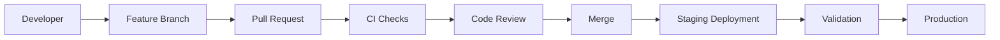

---

# 12. CI/CD Philosophy

Every change should pass through automated verification.

Pipeline:

```text
Code
↓
Lint
↓
Unit Tests
↓
Build
↓
Security Scan
↓
Integration Tests
↓
Container Build
↓
Staging
↓
Smoke Test
↓
Production
```

---

# 13. GitHub Actions Architecture

Recommended workflows:

```text
.github/workflows/
├── ci.yml
├── frontend.yml
├── backend.yml
├── ai.yml
├── etl.yml
├── security.yml
└── production.yml
```

---

# 14. CI Workflow

The CI workflow should execute:

```text
Install Dependencies
↓
Lint
↓
Type Check
↓
Unit Tests
↓
Build
↓
Security Checks
```

---

# 15. Frontend Deployment

Recommended:

```text
GitHub
↓
Vercel
↓
Next.js
↓
Production CDN
```

The frontend should be deployed independently from backend services.

---

# 16. Frontend Build Process

```text
Source Code
↓
npm ci
↓
Lint
↓
Type Check
↓
Test
↓
Next.js Build
↓
Deployment
```

---

# 17. Frontend Environment Variables

Example:

```env
NEXT_PUBLIC_API_URL=https://api.example.com
NEXT_PUBLIC_SUPABASE_URL=...
NEXT_PUBLIC_SUPABASE_ANON_KEY=...
```

Only values explicitly designed for browser exposure should use public environment variables.

Never expose:

```text
DATABASE_PASSWORD
AI_PROVIDER_KEY
SERVICE_ROLE_KEY
PRIVATE_STORAGE_SECRET
```

to browser code.

---

# 18. Backend Deployment

Recommended:

```text
GitHub
↓
Docker Build
↓
Container Registry
↓
Render / Cloud Platform
↓
NestJS API
```

---

# 19. Backend Container

Conceptual Dockerfile:

```dockerfile
FROM node:22-alpine

WORKDIR /app

COPY package*.json ./
RUN npm ci

COPY . .

RUN npm run build

EXPOSE 3000

CMD ["npm", "run", "start:prod"]
```

The exact Node version should be pinned to the project's tested runtime rather than copied blindly between environments.

---

# 20. Backend Health Endpoints

Recommended:

```text
GET /health
GET /ready
```

Example:

```json
{
  "status": "ok"
}
```

Readiness may verify:

```text
Database
Required Configuration
Dependent Services
```

---

# 21. Backend Environment Variables

Example:

```env
NODE_ENV=production

DATABASE_URL=...

SUPABASE_URL=...
SUPABASE_SERVICE_ROLE_KEY=...

STORAGE_BUCKET=resumes

AI_SERVICE_URL=...

REDIS_URL=...

WAREHOUSE_PROJECT=...
```

Secrets must be supplied through secure deployment configuration.

---

# 22. AI Service Deployment

The Python AI service should be independently deployable.

Recommended:

```text
Docker
+
FastAPI
+
Worker
```

---

# 23. AI Dockerfile

Conceptual:

```dockerfile
FROM python:3.12-slim

WORKDIR /app

COPY requirements.txt .
RUN pip install --no-cache-dir -r requirements.txt

COPY . .

EXPOSE 8000

CMD ["uvicorn", "src.main:app", "--host", "0.0.0.0", "--port", "8000"]
```

The final Python version should match the team's tested dependency matrix.

---

# 24. AI Worker Deployment

Long-running AI workloads should use workers.

Examples:

```text
Resume Analysis
Mock Interview Evaluation
Bulk Skill Extraction
Batch Candidate Matching
Smart Report Narrative
```

---

# 25. Worker Architecture

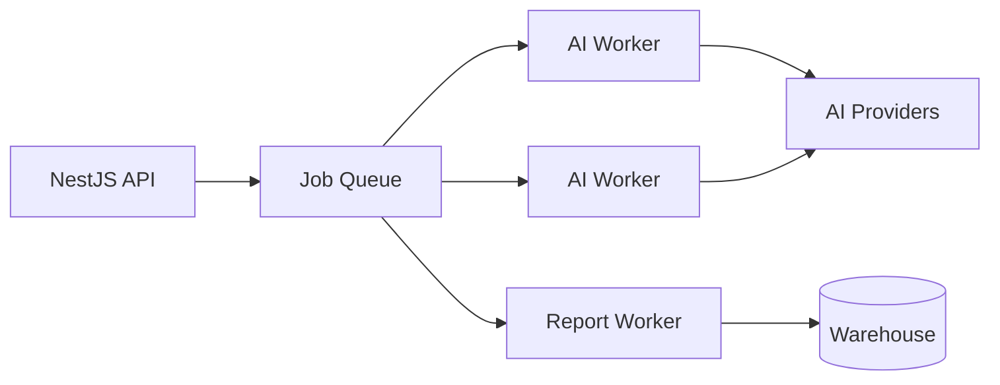

---

# 26. Queue Requirements

The queue should support:

```text
Job ID
Priority
Retry Count
Status
Created At
Started At
Completed At
Failure Reason
```

---

# 27. Job States

```text
PENDING
PROCESSING
COMPLETED
FAILED
RETRYING
CANCELLED
```

---

# 28. Deployment of ETL

The ETL layer should run separately from the transactional backend.

Possible architecture:

```text
Scheduler
↓
ETL Worker
↓
Object Storage
↓
Transform
↓
Warehouse
```

---

# 29. ETL Scheduler

Possible scheduling approach:

```text
Daily
Hourly
Weekly
Event Triggered
Manual
```

The exact schedule depends on the dataset.

---

# 30. ETL Deployment Model

Academic MVP:

```text
Scheduled Python Jobs
+
GitHub Actions / Cron
```

Startup:

```text
Dedicated Workflow Orchestrator
```

Enterprise:

```text
Managed Data Orchestration Platform
```

---

# 31. Data Lake Deployment

Recommended object-storage structure:

```text
data-lake/
├── raw/
│   ├── jobs/
│   ├── salaries/
│   ├── students/
│   ├── placements/
│   └── companies/
│
├── curated/
│   ├── jobs/
│   ├── salaries/
│   └── placements/
│
├── quarantine/
│
└── archive/
```

---

# 32. Raw Data Rule

Raw data should be preserved before destructive transformation.

```text
Source
↓
Raw
↓
Curated
↓
Warehouse
```

---

# 33. Data Lake Partitioning

Datasets should be partitioned according to actual query and ingestion patterns.

Possible partition dimensions:

```text
date
year
source
organization
```

Avoid creating excessive tiny partitions.

---

# 34. Warehouse Deployment

The warehouse should be provisioned separately from PostgreSQL.

Architecture:

```text
PostgreSQL
→ Operational Transactions

Warehouse
→ Historical Analytics
```

---

# 35. BigQuery Option

If BigQuery is selected:

```text
Cloud Storage
↓
ETL
↓
BigQuery
↓
Data Marts
↓
Analytics API
```

---

# 36. Snowflake Option

If Snowflake is selected:

```text
Cloud Storage
↓
ETL / Loading
↓
Snowflake
↓
Schemas / Marts
↓
Analytics API
```

---

# 37. Warehouse Environment Separation

Recommended schemas:

```text
dev
staging
production
```

or controlled database/project separation.

---

# 38. Warehouse Deployment Structure

```text
warehouse/
├── staging/
├── intermediate/
├── marts/
│   ├── placement/
│   ├── hiring/
│   ├── skill/
│   ├── salary/
│   └── student/
└── semantic/
```

---

# 39. Database Deployment

PostgreSQL should be provisioned through:

```text
Supabase
```

or another managed PostgreSQL service.

---

# 40. Database Migration Flow

```text
Developer
↓
Migration File
↓
Local Validation
↓
CI
↓
Staging
↓
Migration Test
↓
Production
```

---

# 41. Migration Rules

Never:

```text
Edit production schema manually
```

without a controlled process.

Prefer:

```text
Versioned Migration
+
Review
+
Testing
```

---

# 42. Database Seed Strategy

Development seeds may contain:

```text
Sample Users
Sample Skills
Sample Jobs
Sample Companies
Sample Students
Sample Placements
```

Production must not use fake demo accounts unless intentionally created and clearly identified.

---

# 43. Synthetic Dataset Deployment

Academic demonstration data should be:

```text
Synthetic
Clearly Labeled
Versioned
Reproducible
```

---

# 44. Deployment Configuration

Configuration must be separated into:

```text
Code
Configuration
Secrets
Runtime State
```

---

# 45. Configuration Example

```text
NODE_ENV=production
LOG_LEVEL=info
API_TIMEOUT_MS=10000
AI_TIMEOUT_MS=30000
```

These are configuration values, not secrets.

---

# 46. Secret Example

```text
DATABASE_URL
AI_PROVIDER_KEY
SERVICE_ROLE_KEY
OAUTH_CLIENT_SECRET
```

These must remain in secure secret storage.

---

# 47. Container Registry

Container images should be stored in a private registry where required.

Example:

```text
registry/
├── careerconnect-api
├── careerconnect-ai
├── careerconnect-worker
└── careerconnect-etl
```

---

# 48. Image Tagging

Recommended:

```text
latest
```

should not be the only production identifier.

Prefer:

```text
careerconnect-api:1.4.2
careerconnect-api:git-<commit>
```

This enables rollback.

---

# 49. Image Promotion

```text
Build
↓
Test
↓
Tag
↓
Scan
↓
Staging
↓
Approve
↓
Production
```

---

# 50. Rollback Strategy

If deployment fails:

```text
Current Version
↓
Failure
↓
Health Check
↓
Rollback
↓
Previous Stable Version
↓
Validation
```

Database migrations require additional compatibility planning.

---

# 51. Zero-Downtime Deployment Principle

For backend releases:

```text
Old Version
+
New Version
```

may temporarily coexist.

Therefore APIs and database changes should follow backward-compatible migration patterns where practical.

---

# 52. Database Migration Compatibility

Prefer:

```text
Add New Column
↓
Deploy Code Supporting Both
↓
Backfill
↓
Switch Reads/Writes
↓
Remove Old Column Later
```

rather than destructive one-step changes.

---

# 53. Frontend/Backend Version Compatibility

The frontend should tolerate brief backend version transitions during deployment.

Use:

```text
API Versioning
Backward-Compatible Contracts
Feature Flags
```

---

# 54. Feature Flags

Feature flags can safely control releases:

```text
ai.career_recommendation
ai.mock_interview
analytics.nlbi
reports.new_engine
```

---

# 55. Staged Feature Rollout

```text
Internal
↓
10% Users
↓
25%
↓
50%
↓
100%
```

This is especially useful for AI capabilities.

---

# 56. Deployment Health Checks

After deployment verify:

```text
Frontend Available
API Available
Database Connected
Authentication Working
AI Health
Queue Health
ETL Scheduler
Warehouse Queries
```

---

# 57. Smoke Test

A production smoke test should validate:

```text
Login
Profile
Job Search
Application
Dashboard
AI Request
```

at minimum for enabled functionality.

---

# 58. Deployment Smoke Test Flow

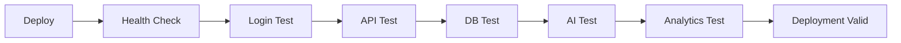

---

# 59. Monitoring Stack

Monitor:

```text
Application Logs
Infrastructure Metrics
Database Metrics
AI Metrics
ETL Metrics
Warehouse Metrics
Security Events
```

---

# 60. Application Logging

Log:

```text
Request ID
Service
Timestamp
Level
Event
Duration
Error Code
```

Avoid logging secrets or unnecessary personal data.

---

# 61. Log Levels

Recommended:

```text
DEBUG
INFO
WARN
ERROR
FATAL
```

Production default:

```text
INFO
```

with DEBUG selectively enabled for investigation.

---

# 62. Metrics

Application:

```text
Requests
Latency
Errors
Throughput
```

Database:

```text
Connections
Query Time
Errors
```

AI:

```text
Requests
Latency
Failures
Usage
```

ETL:

```text
Runs
Rows
Failures
Duration
```

---

# 63. Distributed Tracing

Use a correlation ID:

```text
cc-request-8f72
```

across:

```text
Frontend
↓
API
↓
AI
↓
Database
↓
Worker
↓
Audit
```

---

# 64. Alerting

Alerts should exist for:

```text
5xx Spike
Database Failure
AI Failure Spike
Queue Backlog
ETL Failure
Stale Warehouse
High Security Events
Storage Error
```

---

# 65. Production Alert Priority

```text
P1 — Critical
P2 — High
P3 — Medium
P4 — Informational
```

---

# 66. Backup Architecture

Critical backup targets:

```text
PostgreSQL
Configuration
Warehouse Metadata
Important Object Storage
Audit Data
```

---

# 67. Backup Strategy

```text
Automated Backup
+
Retention
+
Encryption
+
Restore Testing
```

---

# 68. Recovery Architecture

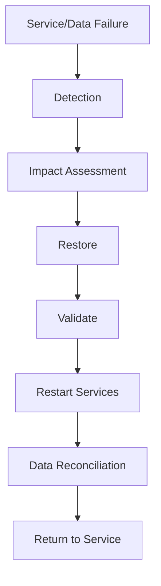

---

# 69. Disaster Recovery

Document:

```text
RPO
RTO
Backup Location
Restore Procedure
Service Dependencies
Owner
Escalation
```

Actual RPO/RTO values must match the selected deployment tier and business requirements.

---

# 70. Cloud Storage Lifecycle

Possible lifecycle:

```text
Raw
↓
Active
↓
Archive
↓
Retention Expired
↓
Delete
```

Retention must comply with data policy.

---

# 71. Deployment Security

Production deployment should require:

```text
Protected Branch
CI Success
Security Checks
Environment Approval
```

---

# 72. Production Access

Production access should be limited.

Prefer:

```text
Read-Only
```

for users who do not need modification capability.

---

# 73. Infrastructure Access

Infrastructure administrators should use:

```text
MFA
Named Accounts
Audit
Least Privilege
```

Avoid shared admin accounts.

---

# 74. Infrastructure as Code

Where possible, infrastructure should be version-controlled.

Possible structure:

```text
infrastructure/
├── environments/
│   ├── dev/
│   ├── staging/
│   └── prod/
├── networking/
├── database/
├── storage/
├── monitoring/
└── secrets/
```

---

# 75. Docker Compose Development

A local development environment may use:

```text
docker-compose.yml
```

services:

```text
web
api
postgres
redis
ai
worker
```

---

# 76. Local Architecture

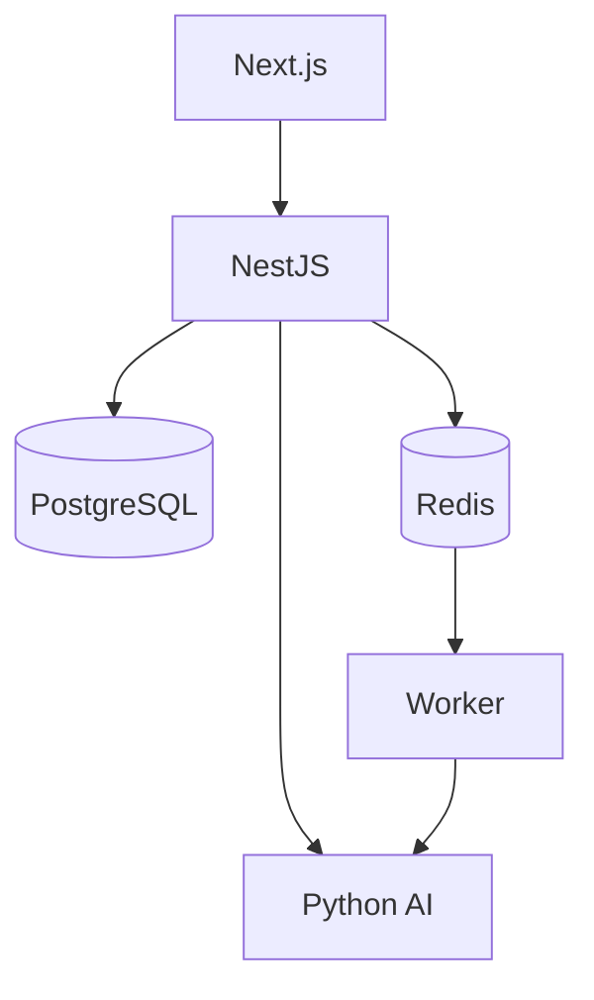

---

# 77. Production vs Development

Development:

```text
Single Machine
Docker Compose
Synthetic Data
Local Services
```

Production:

```text
Managed Services
Independent Scaling
Managed Database
Cloud Storage
Warehouse
Monitoring
Backup
```

---

# 78. Deployment Architecture — Academic MVP

```text
GitHub
↓
Vercel
├── Next.js

Render
├── NestJS
├── Python AI
└── Worker

Supabase
├── Auth
└── PostgreSQL

Cloud Storage
├── Resumes
└── Reports

BigQuery / Snowflake
└── Analytics
```

This is sufficient to demonstrate cloud computing, AI, ETL, warehouse, and BI concepts without requiring a complex enterprise Kubernetes platform.

---

# 79. Startup MVP Architecture

```text
CDN
↓
Next.js
↓
API Cluster
↓
Managed PostgreSQL
↓
Queue
├── Worker
├── AI Worker
└── Report Worker

Object Storage
↓
Data Lake
↓
Warehouse
↓
BI / AI
```

---

# 80. Enterprise Deployment Evolution

Future:

```text
Global CDN
↓
WAF
↓
Load Balancer
↓
Multiple API Instances
↓
Service Mesh / Platform Controls
↓
Managed Databases
↓
Distributed Workers
↓
Enterprise Data Platform
↓
Central Observability
```

---

# 81. Kubernetes Future Option

Kubernetes is not mandatory for the academic MVP.

It can be introduced when:

```text
Multiple Services
+
High Traffic
+
Complex Scaling
+
Advanced Deployment Requirements
```

justify its operational complexity.

---

# 82. Cloud Service Mapping

Conceptual mapping:

| Capability | Preferred Option      |
| ---------- | --------------------- |
| Frontend   | Vercel                |
| Auth       | Supabase Auth         |
| PostgreSQL | Supabase              |
| Backend    | Render                |
| AI         | Python Service        |
| Queue      | Redis / Managed Queue |
| Storage    | Cloud Storage         |
| Warehouse  | BigQuery / Snowflake  |
| CI/CD      | GitHub Actions        |
| Monitoring | Managed Observability |
| DNS/CDN    | Cloud/Vercel Edge     |

Exact providers may be substituted through service abstractions.

---

# 83. Domain Names

Recommended production domains:

```text
careerconnect.example
app.careerconnect.example
api.careerconnect.example
admin.careerconnect.example
```

The actual domain depends on the deployed environment.

---

# 84. Environment Domains

Example:

```text
dev.careerconnect.example
staging.careerconnect.example
app.careerconnect.example
```

---

# 85. API Domain

```text
api.careerconnect.example
```

The frontend should access a stable API domain rather than internal service addresses.

---

# 86. TLS

Production domains should use valid TLS certificates.

Certificate management should be automated by the hosting/cloud platform where possible.

---

# 87. DNS

DNS should point:

```text
app
api
admin
```

to the appropriate edge/hosting services.

---

# 88. CDN Strategy

Static frontend assets should be cached through the CDN.

Dynamic authenticated responses should follow appropriate cache-control policies.

---

# 89. Cache Headers

Public/static resources:

```text
Longer Cache
```

Sensitive authenticated API responses:

```text
No Shared Cache / Controlled Cache
```

---

# 90. Deployment of Reports

Generated reports should be:

```text
Created Asynchronously
Stored Privately
Authorized
Audited
```

---

# 91. Report File Expiration

Download links should preferably use short-lived access mechanisms.

---

# 92. AI Provider Deployment Configuration

Providers should be configured through environment/secret management.

Conceptual:

```text
AI_PROVIDER=openai
AI_MODEL=...
AI_API_KEY=...
```

The system may later support:

```text
AI_PROVIDER=gemini
AI_PROVIDER=claude
```

without changing application business logic.

---

# 93. Provider Failover

Production architecture may use:

```text
Primary Provider
↓
Provider Failure
↓
Fallback Provider
```

where policy and cost allow.

---

# 94. Deployment Pipeline — Frontend

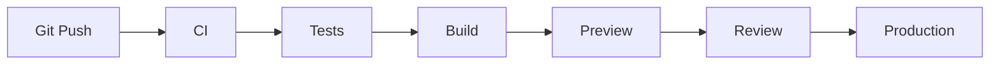

---

# 95. Deployment Pipeline — Backend

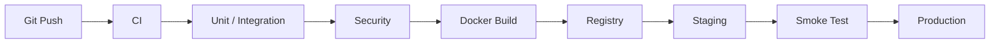

---

# 96. Deployment Pipeline — AI

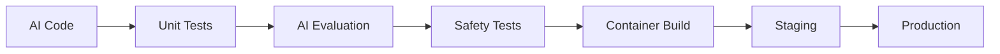

---

# 97. Deployment Pipeline — ETL

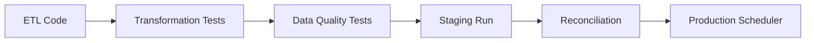

---

# 98. Database Migration Pipeline

```text
Migration
↓
Lint / Validation
↓
Unit / Integration Test
↓
Staging Migration
↓
Application Compatibility Test
↓
Production Migration
↓
Verification
```

---

# 99. Release Versioning

Use semantic versioning where practical:

```text
MAJOR.MINOR.PATCH
```

Example:

```text
1.4.2
```

---

# 100. Release Notes

Each release should document:

```text
New Features
Bug Fixes
Security Changes
Database Changes
AI Changes
Breaking Changes
Migration Requirements
```

---

# 101. Deployment Checklist

## Before Deployment

```text
✓ Tests pass
✓ Security scan passes
✓ Environment configured
✓ Database migration reviewed
✓ AI configuration verified
✓ Secrets available
✓ Rollback plan prepared
```

---

# 102. During Deployment

```text
✓ Build
✓ Deploy
✓ Health Check
✓ Migration
✓ Smoke Test
```

---

# 103. After Deployment

```text
✓ Monitor Errors
✓ Check Latency
✓ Check AI
✓ Check Database
✓ Check ETL
✓ Check Dashboard
✓ Verify Security Events
```

---

# 104. Production Rollback Checklist

```text
Identify Failure
↓
Stop Rollout
↓
Assess Data Impact
↓
Rollback Application
↓
Check Database Compatibility
↓
Restore if Required
↓
Smoke Test
↓
Monitor
↓
Incident Review
```

---

# 105. Deployment Failure Examples

## Frontend Failure

```text
Rollback Vercel Deployment
```

## Backend Failure

```text
Rollback Container
```

## AI Failure

```text
Disable Feature Flag
```

## ETL Failure

```text
Stop Scheduled Job
Repair
Replay Batch
```

## Warehouse Failure

```text
Serve Last Successful Data with Freshness Warning where appropriate
```

---

# 106. Feature Flag Safety

AI and advanced analytics should be independently switchable.

Example:

```text
ai.resume_analysis = true
ai.mock_interview = false
analytics.nlbi = false
```

This makes partial deployment safer.

---

# 107. Observability During Deployment

A deployment dashboard should show:

```text
Version
Deployment Time
Request Rate
Error Rate
Latency
Health
AI Errors
Queue Backlog
```

---

# 108. Post-Deployment Verification

Verify the following end-to-end:

```text
Login
↓
Profile
↓
Job Search
↓
Application
↓
Dashboard
↓
AI
↓
Report
```

---

# 109. Data Pipeline Post-Deployment Verification

```text
Source
↓
ETL
↓
Data Quality
↓
Warehouse
↓
Dashboard
```

Check that no metric unexpectedly changed because of deployment.

---

# 110. Security Post-Deployment Verification

```text
Authentication
Authorization
Tenant Isolation
Admin Access
File Access
AI Context
```

---

# 111. Cost Monitoring

Monitor:

```text
Frontend Usage
Backend Instances
Database
Storage
Warehouse Queries
AI Requests
ETL Compute
```

---

# 112. Cost Alerts

Set alerts for abnormal increases in:

```text
AI Usage
Warehouse Cost
Storage
API Traffic
```

---

# 113. Deployment Runbook

The repository should contain:

```text
docs/deployment/
├── local-development.md
├── staging.md
├── production.md
├── database-migrations.md
├── rollback.md
├── disaster-recovery.md
└── troubleshooting.md
```

---

# 114. Local Setup — Developer

Recommended flow:

```text
1. Clone Repository
2. Install Dependencies
3. Configure Environment
4. Start PostgreSQL
5. Start Redis
6. Start API
7. Start AI
8. Start Web
9. Seed Synthetic Data
10. Run Tests
```

---

# 115. Example Local Commands

```bash
git clone <repository>
cd CareerConnect

npm install

docker compose up -d postgres redis

npm run dev
```

AI services can be started separately:

```bash
cd services/ai
python -m venv .venv
pip install -r requirements.txt
uvicorn src.main:app --reload --port 8000
```

The exact scripts should match the final repository implementation.

---

# 116. Local Environment Verification

Verify:

```text
Web → http://localhost:3000
API → http://localhost:3001
AI → http://localhost:8000
PostgreSQL → local service
Redis → local service
```

Port assignments are examples only.

---

# 117. Staging Deployment Procedure

```text
1. Merge to staging/release branch
2. CI executes
3. Containers built
4. Database migrations run
5. Services deployed
6. Smoke tests run
7. ETL staging run
8. Warehouse validation
9. UAT
10. Release approval
```

---

# 118. Production Deployment Procedure

```text
1. Approve release
2. Verify backups
3. Verify migrations
4. Deploy backend
5. Deploy frontend
6. Deploy AI/workers
7. Run migrations
8. Run smoke tests
9. Validate dashboards
10. Monitor
```

---

# 119. Production Change Freeze

During major incidents or high-risk business periods, production changes may be restricted.

---

# 120. Emergency Change

Emergency changes must still receive:

```text
Authorization
Minimal Testing
Audit
Post-Change Review
```

---

# 121. Deployment Ownership

Recommended responsibilities:

```text
Frontend
→ Frontend Engineer

Backend
→ Backend Engineer

AI
→ AI Engineer

ETL
→ Data Engineer

Warehouse
→ Data Engineer / BI Engineer

Infrastructure
→ DevOps / Cloud Engineer

Security
→ Security Owner
```

For a student team, one person may hold multiple responsibilities, but the responsibilities themselves should remain clearly defined.

---

# 122. Deployment RACI

| Activity            | Developer | Data Engineer | AI Engineer | DevOps | Security |
| ------------------- | --------: | ------------: | ----------: | -----: | -------: |
| Frontend Deploy     |         R |             - |           - |      A |        C |
| API Deploy          |         R |             - |           - |      A |        C |
| AI Deploy           |         - |             - |           R |      A |        C |
| ETL Deploy          |         - |             R |           - |      A |        C |
| Warehouse Deploy    |         - |             R |           - |      A |        C |
| Security Review     |         C |             C |           C |      C |        A |
| Production Approval |         C |             C |           C |      R |        A |

R = Responsible
A = Accountable
C = Consulted

---

# 123. Deployment Documentation

Every service should document:

```text
Purpose
Build
Run
Environment Variables
Dependencies
Ports
Health Check
Deployment
Rollback
Monitoring
```

---

# 124. Troubleshooting Flow

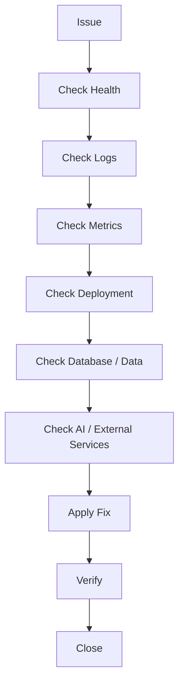

---

# 125. Common Troubleshooting

## API unavailable

Check:

```text
Container
Environment Variables
Database
Port
Health Endpoint
```

## AI unavailable

Check:

```text
Provider Key
Provider Status
Timeout
Rate Limit
AI Service Logs
```

## Dashboard incorrect

Check:

```text
Warehouse
ETL
Data Freshness
Metric Definition
Filter Scope
```

## Resume analysis failed

Check:

```text
File Storage
Text Extraction
AI Queue
AI Provider
Output Validation
```

---

# 126. Deployment Security Checklist

```text
✓ HTTPS
✓ Secret Management
✓ IAM
✓ RBAC
✓ Production Isolation
✓ Dependency Scan
✓ Container Scan
✓ Backup
✓ Monitoring
✓ Audit
```

---

# 127. Deployment Readiness Checklist

```text
✓ Architecture documented
✓ Environment variables defined
✓ Secrets configured
✓ Database configured
✓ Storage configured
✓ Warehouse configured
✓ AI configured
✓ CI/CD configured
✓ Monitoring configured
✓ Backups configured
✓ Rollback tested
✓ Smoke tests automated
```

---

# 128. Academic Project Deployment Checklist

For the final-year demonstration:

```text
✓ Web frontend online
✓ Backend online
✓ Login working
✓ AI feature working
✓ Database working
✓ ETL demonstrable
✓ Warehouse demonstrable
✓ Dashboard working
✓ Report generation working
✓ Admin monitoring working
```

---

# 129. Startup MVP Deployment Checklist

Add:

```text
✓ Multi-Tenant Isolation
✓ Production Backups
✓ Monitoring
✓ Alerts
✓ Usage Tracking
✓ Error Tracking
✓ AI Cost Monitoring
✓ Security Scanning
✓ Automated Rollback
```

---

# 130. Enterprise Deployment Expansion

Future:

```text
Multi-Region
High Availability
Global CDN
Enterprise IAM
Central SIEM
Advanced DLP
Kubernetes
Private Networking
Dedicated Tenant Environments
```

These should only be introduced when scale and operational needs justify the complexity.

---

# 131. Complete Deployment Lifecycle

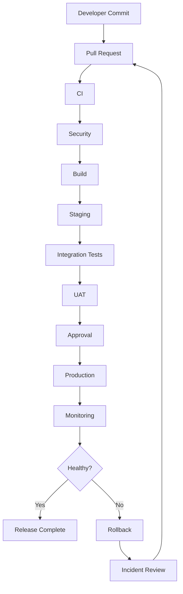

---

# 132. Final Cloud Architecture

```text
                         INTERNET
                            │
                         HTTPS/CDN
                            │
                      ┌─────▼─────┐
                      │  Vercel   │
                      │  Next.js  │
                      └─────┬─────┘
                            │
                      ┌─────▼─────┐
                      │ NestJS API│
                      └─────┬─────┘
                            │
          ┌─────────────────┼─────────────────┐
          │                 │                 │
          ▼                 ▼                 ▼
      PostgreSQL       Object Storage      AI Gateway
          │                                   │
          │                              Python AI
          │                                   │
          │                             AI Providers
          │
          └──────────────┐
                         ▼
                  ETL / Data Platform
                         │
                  ┌──────┴──────┐
                  ▼             ▼
              Data Lake     Warehouse
                                │
                           Data Marts
                                │
                          Analytics API
                                │
                              BI UI
```

---

# 133. Final Deployment Principle

The deployment architecture is designed to demonstrate all major project dimensions:

```text
Cloud Computing
        +
Containerization
        +
CI/CD
        +
AI Deployment
        +
Data Engineering
        +
Data Warehouse
        +
Business Intelligence
        +
Security
        +
Observability
```

This makes the deployment itself part of the project's technical value.

---

# 134. Final Deployment Statement

> **Career Connect shall use a cloud-native deployment model that separates frontend, backend, AI, workers, operational data, object storage, ETL, and analytical workloads while maintaining automated delivery through GitHub Actions. Development, staging, and production environments shall remain isolated, secrets shall be centrally managed, database changes shall use versioned migrations, containers shall be reproducibly built and scanned, and every production release shall pass health, smoke, security, and data-validation checks. The architecture provides a practical academic deployment using Vercel, Render, Supabase, Cloud Storage, and BigQuery/Snowflake while maintaining a clear evolution path toward a highly available, multi-tenant enterprise SaaS platform.**

---

## Document Status

| Attribute            | Value                                |
| -------------------- | ------------------------------------ |
| Project              | Career Connect                       |
| Document             | Deployment Guide                     |
| Version              | 1.0                                  |
| Environments         | Development / Staging / Production   |
| Frontend             | Vercel + Next.js                     |
| Backend              | Render / Container Platform + NestJS |
| AI                   | Python + Workers                     |
| Database             | Supabase / PostgreSQL                |
| Storage              | Cloud Object Storage                 |
| Warehouse            | BigQuery / Snowflake                 |
| CI/CD                | GitHub Actions                       |
| Containers           | Docker                               |
| Monitoring           | Logs + Metrics + Alerts              |
| Security             | IAM + Secrets + RBAC + TLS           |
| Recovery             | Backup + Rollback + Restore          |
| Academic Deployment  | Supported                            |
| Startup SaaS         | Supported                            |
| Enterprise Evolution | Supported                            |
| Status               | Deployment Architecture Baseline     |
