# 34 — CI/CD Pipeline

# Career Connect — AI Career Intelligence Platform

**Document Type:** Continuous Integration & Continuous Delivery Specification
**Project:** Career Connect
**Version:** 1.0
**Status:** CI/CD Architecture Baseline
**Primary Platform:** GitHub + GitHub Actions
**Containerization:** Docker
**Frontend Deployment:** Vercel
**Backend/Services:** Render or equivalent container platform
**AI Services:** Python + Docker
**Database:** PostgreSQL / Supabase
**Warehouse:** BigQuery / Snowflake
**Deployment Model:** Automated + Environment-Promoted
**Security Model:** Shift-Left + Automated Quality Gates

---

# 1. Executive Summary

The Career Connect CI/CD system automates the software delivery lifecycle from developer commit to production deployment.

The pipeline shall connect:

```text
Code
↓
Pull Request
↓
Continuous Integration
↓
Quality Gates
↓
Artifact Creation
↓
Staging
↓
Validation
↓
Production
↓
Monitoring
```

Because Career Connect contains multiple technology domains, CI/CD must support:

```text id="7j4m2x"
Next.js Frontend
NestJS Backend
Python AI
Background Workers
ETL
Database Migrations
Warehouse Models
Infrastructure
Security
```

---

# 2. CI/CD Objectives

The pipeline shall provide:

```text id="m8q5x3"
Fast Feedback
Automated Testing
Reproducible Builds
Security Validation
Artifact Traceability
Environment Promotion
Safe Deployment
Rollback
Auditability
```

---

# 3. CI/CD Principles

## 3.1 Every Change Is Tested

A pull request should not be merged without required automated checks.

---

# 4. 3.2 Build Once, Promote Forward

The preferred model is:

```text id="x7m3q8"
Source
↓
Build Artifact
↓
Test Artifact
↓
Staging
↓
Production
```

The production deployment should use the same validated artifact rather than rebuilding differently.

---

# 5. 3.3 Fail Fast

Cheap checks should execute first:

```text id="q4m8x2"
Formatting
↓
Lint
↓
Type Check
↓
Unit Tests
↓
Integration
↓
Security
↓
Build
```

---

# 6. 3.4 Security Is Part of CI

Security should not be a separate end-of-project activity.

The pipeline shall include:

```text id="m5q7x3"
Secret Scanning
Dependency Scanning
SAST
Container Scanning
Configuration Checks
```

---

# 7. 3.5 Environment Promotion

```text id="x8m3q5"
Development
↓
CI
↓
Staging
↓
Approval
↓
Production
```

---

# 8. CI/CD Architecture

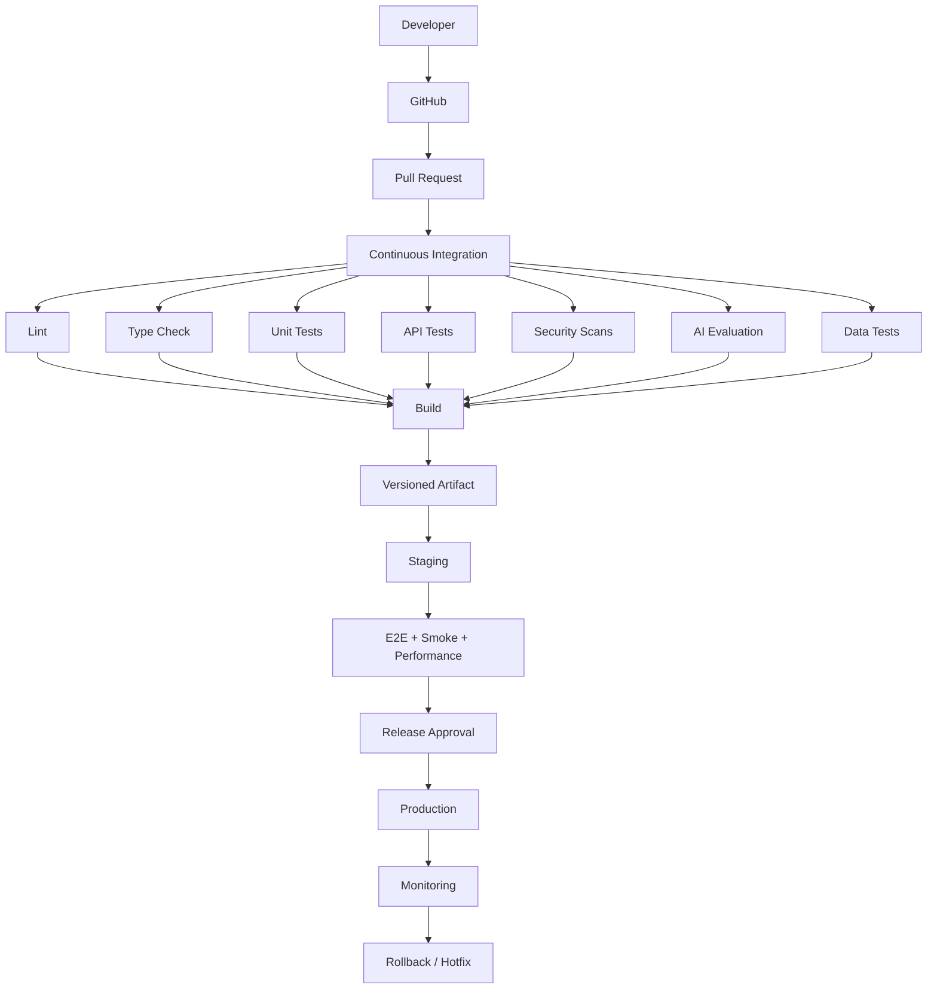

---

# 9. Repository Strategy

The repository should use a monorepo structure where practical.

```text id="m4x8q2"
CareerConnect/
├── apps/
│   ├── web/
│   ├── api/
│   └── admin/
│
├── services/
│   ├── ai/
│   ├── worker/
│   └── reporting/
│
├── etl/
├── warehouse/
├── packages/
├── database/
├── infrastructure/
├── docker/
├── docs/
├── scripts/
└── .github/
```

---

# 10. CI/CD Workflow Categories

Recommended workflows:

```text id="q8m3x5"
ci.yml
frontend.yml
backend.yml
ai.yml
etl.yml
warehouse.yml
security.yml
deploy-staging.yml
deploy-production.yml
rollback.yml
```

Not every workflow must deploy independently; workflow separation should match repository ownership.

---

# 11. Git Branching Model

Recommended:

```text id="x7m4q2"
main
develop
feature/*
release/*
hotfix/*
```

---

# 12. Branch Responsibilities

## `main`

Production-ready code.

## `develop`

Integration branch.

## `feature/*`

Individual development.

## `release/*`

Release stabilization.

## `hotfix/*`

Urgent production fixes.

---

# 13. Pull Request Rules

Pull requests should require:

```text id="m5q8x3"
Build Pass
Tests Pass
Security Pass
Required Review
No Unresolved Critical Findings
```

---

# 14. Branch Protection

Recommended controls:

```text id="q4m7x2"
Require Pull Request
Require Status Checks
Require Review
Restrict Direct Push
Require Up-to-Date Branch
```

---

# 15. Commit Convention

Recommended:

```text id="x8m3q5"
feat:
fix:
refactor:
test:
docs:
chore:
security:
data:
ai:
```

Examples:

```text id="m7q4x2"
feat: add skill gap endpoint
fix: prevent duplicate applications
ai: improve career recommendation prompt
data: add placement mart model
security: restrict resume access
```

---

# 16. Semantic Versioning

Application releases should use:

```text id="q5m8x3"
MAJOR.MINOR.PATCH
```

Example:

```text id="x4m7q2"
v1.3.2
```

---

# 17. CI Pipeline Overview

```text id="m8q3x5"
Checkout
↓
Install
↓
Cache
↓
Lint
↓
Type Check
↓
Unit Test
↓
Integration Test
↓
Security Scan
↓
Build
↓
Artifact
```

---

# 18. Dependency Installation

Use deterministic installation.

Node:

```bash id="q7m4x2"
npm ci
```

Python:

```bash id="x5m8q3"
pip install -r requirements.txt
```

The exact package manager should follow the repository lockfiles.

---

# 19. Dependency Caching

CI may cache:

```text id="m4q7x2"
npm Dependencies
Python Dependencies
Docker Layers
```

Caching should never compromise reproducibility.

---

# 20. Frontend CI Pipeline

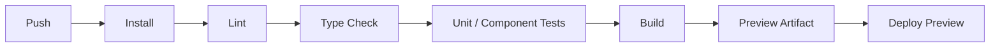

---

# 21. Frontend Checks

Required:

```text id="q5m8x2"
ESLint
TypeScript
Component Tests
Build
Accessibility Checks
```

---

# 22. Frontend Build Validation

The pipeline must fail when:

```text id="m7q4x3"
TypeScript Compilation Fails
Next.js Build Fails
Required Environment Configuration Missing
```

---

# 23. Backend CI Pipeline

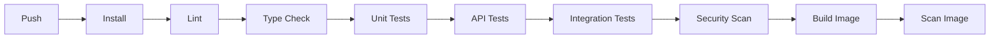

---

# 24. Backend Quality Gates

Required checks:

```text id="x5m8q3"
Lint
Type Safety
Unit
API
Integration
Security
Docker Build
```

---

# 25. AI CI Pipeline

AI needs specialized validation.

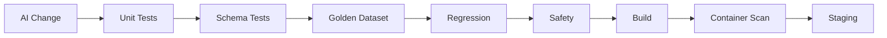

---

# 26. AI CI Quality Gates

Required for production AI changes:

```text id="q8m3x5"
Schema Validity
Golden Evaluation
Safety Tests
Prompt Regression
Security Tests
```

---

# 27. Prompt-Only Changes

Even a prompt-only change can alter production behavior.

Therefore:

```text id="x7m4q2"
Prompt Change
↓
Evaluation
↓
Regression
↓
Approval
```

is required.

---

# 28. Model Change

When changing model configuration:

```text id="m5q8x3"
Model Version
↓
Evaluation Dataset
↓
Quality Comparison
↓
Safety Evaluation
↓
Cost/Latency Comparison
```

---

# 29. ETL CI Pipeline

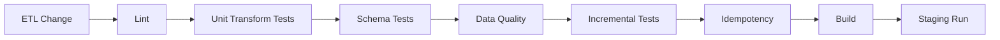

---

# 30. ETL CI Requirements

Validate:

```text id="x8m3q5"
Schema
Transformations
Mappings
Deduplication
Incremental Logic
Idempotency
Quality Rules
```

---

# 31. Warehouse CI Pipeline

```text id="m7q4x2"
Warehouse SQL
↓
SQL Validation
↓
Model Tests
↓
Schema Tests
↓
Metric Tests
↓
Reconciliation
↓
Build / Publish
```

---

# 32. Warehouse Pull Request Tests

A warehouse change should test:

```text id="q5m8x3"
Fact Grain
Dimension Relationships
Metric Definitions
Historical Behavior
Data Quality
```

---

# 33. Database Migration CI

Every schema migration should be tested automatically.

```text id="x4m7q2"
Migration
↓
Fresh Database
↓
Apply All Migrations
↓
Seed
↓
Run Tests
```

---

# 34. Migration Compatibility Test

For production-like databases:

```text id="m8q3x5"
Existing Schema
↓
New Migration
↓
Existing Data
↓
Application Tests
```

---

# 35. Security CI Pipeline

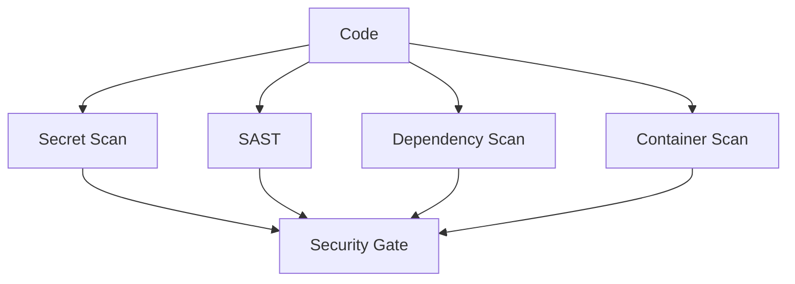

---

# 36. Secret Scanning

The pipeline should block accidental commits containing likely secrets.

Examples:

```text id="x5m8q3"
API Keys
Private Keys
Passwords
Service Credentials
Access Tokens
```

---

# 37. Dependency Scanning

Scan:

```text id="m4q7x2"
Node Dependencies
Python Packages
Docker Base Images
GitHub Actions
```

---

# 38. SAST

Static analysis should detect potentially dangerous patterns.

Examples:

```text id="q8m3x5"
Unsafe Input Handling
Injection
Hardcoded Credentials
Insecure Cryptography
Path Traversal
```

---

# 39. Container Scanning

Before publishing an image:

```text id="x7m4q2"
Build
↓
Scan
↓
Policy
↓
Publish
```

Critical vulnerabilities should block release according to configured policy.

---

# 40. CI Artifact Strategy

Every important build should produce identifiable artifacts:

```text id="m5q8x3"
Web Build
API Image
AI Image
Worker Image
ETL Package
Warehouse Package
Test Reports
```

---

# 41. Artifact Naming

Example:

```text id="q4m7x2"
careerconnect-api:1.4.2
careerconnect-ai:1.4.2
careerconnect-worker:1.4.2
```

Include commit identifiers where useful.

---

# 42. Artifact Immutability

Production artifacts should not be overwritten.

Prefer:

```text id="x8m3q5"
v1.4.2
```

over:

```text id="m7q4x2"
latest
```

as the only production reference.

---

# 43. Staging Deployment

After CI succeeds:

```text id="q5m8x3"
Build Artifact
↓
Deploy Staging
↓
Migration
↓
Smoke
↓
Integration
↓
E2E
```

---

# 44. Staging Environment Tests

Run:

```text id="x4m7q2"
Authentication
API
Database
AI
ETL
Warehouse
Dashboard
Reports
Security
```

---

# 45. Staging Data

Use:

```text id="m8q3x5"
Synthetic Data
Controlled Test Data
Masked Data where justified
```

Avoid unrestricted production PII.

---

# 46. Staging Approval

Release candidate may require approval from:

```text id="q7m4x2"
Product Owner
Technical Lead
Security Owner for high-risk changes
```

---

# 47. Production Deployment

Production deployment occurs only after staging quality gates pass.

```text id="x5m8q3"
Staging PASS
↓
Approval
↓
Production
```

---

# 48. Production Deployment Strategies

Possible strategies:

```text id="m4q7x2"
Rolling
Blue/Green
Canary
Feature-Flagged
```

Academic MVP:

```text id="q8m3x5"
Rolling / Standard Deployment
```

Enterprise:

```text id="x7m4q2"
Canary / Blue-Green
```

where supported and justified.

---

# 49. Feature Flags

Use feature flags for high-risk changes.

Example:

```text id="m5q8x3"
ai.mock_interview
analytics.nlbi
new_resume_engine
new_placement_metric
```

---

# 50. Canary Deployment

Conceptually:

```text id="q4m7x2"
100% Old
↓
10% New + 90% Old
↓
25% New
↓
50% New
↓
100% New
```

Monitor:

```text id="x8m3q5"
Errors
Latency
AI Failures
Business Metrics
```

---

# 51. Blue-Green Deployment

```text id="m7q4x2"
Blue = Current
Green = New

Deploy Green
↓
Test Green
↓
Switch Traffic
↓
Monitor
↓
Keep Blue for Rollback
```

---

# 52. Database Deployment Strategy

Database changes must be backward-compatible when application versions overlap.

Preferred approach:

```text id="q5m8x3"
Expand
↓
Migrate
↓
Switch
↓
Contract
```

---

# 53. Expand/Contract Pattern

Example:

```text id="x4m7q2"
Add new column
↓
Deploy code supporting old + new
↓
Backfill
↓
Switch reads
↓
Switch writes
↓
Remove old field later
```

---

# 54. Production Migration Gate

Before applying migration:

```text id="m8q3x5"
Backup verified
Migration tested
Rollback/Recovery plan reviewed
Application compatibility checked
```

---

# 55. CI/CD Environments

GitHub environments should conceptually include:

```text id="q7m4x2"
development
staging
production
```

Production secrets should only be available to the production workflow.

---

# 56. GitHub Environment Protection

Production can require:

```text id="x5m8q3"
Manual Approval
Protected Branch
Required Review
```

before deployment.

---

# 57. CI/CD Secret Management

Secrets should be stored in secure environment/repository secret storage or a dedicated secret manager.

Never print secrets in CI logs.

---

# 58. Environment Variables

Separate:

```text id="m4q7x2"
Public Configuration
Private Secrets
Environment Settings
Feature Flags
```

---

# 59. CI/CD Environment Matrix

| Environment | Data             | Deployment         | Approval |
| ----------- | ---------------- | ------------------ | -------- |
| Development | Synthetic        | Automatic          | No       |
| Staging     | Synthetic/Masked | Automatic after CI | Optional |
| Production  | Real             | Controlled         | Required |

---

# 60. PR Preview Environments

Frontend pull requests can use temporary preview deployments.

Benefits:

```text id="q8m3x5"
UI Review
Stakeholder Feedback
Visual QA
```

---

# 61. CI Caching

Optimize CI using:

```text id="x7m4q2"
Dependency Cache
Docker Layer Cache
Build Cache
```

But invalidation rules must be reliable.

---

# 62. Parallel Jobs

Independent checks should run in parallel:

```text id="m5q8x3"
Frontend Tests
Backend Tests
AI Tests
ETL Tests
Security Scans
```

This reduces feedback time.

---

# 63. CI Job Dependencies

Example:

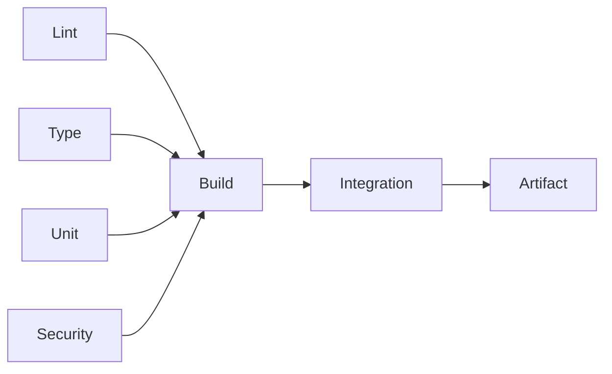

---

# 64. Workflow Cancellation

When multiple commits enter the same branch, outdated CI runs may be cancelled where safe.

This reduces unnecessary resource usage.

---

# 65. Concurrency Control

Production deployments must prevent simultaneous conflicting deployments.

Example:

```text id="x8m3q5"
production-deploy
→ one active deployment
```

---

# 66. Deployment Lock

If one production release is active:

```text id="m7q4x2"
Second deployment
→ queued or blocked
```

---

# 67. Rollback Workflow

Create a dedicated rollback process.

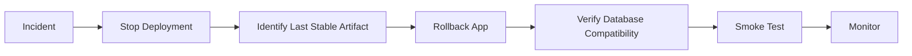

---

# 68. Rollback Limitations

Rollback is not always as simple as returning to an old container.

Potential issues:

```text id="x4m7q2"
Database Schema Changed
Data Migration Completed
External Contract Changed
AI Prompt Version Changed
```

Therefore rollback strategy must be designed per release.

---

# 69. Hotfix Workflow

```text id="m8q3x5"
Production Issue
↓
Create hotfix/*
↓
Fix
↓
Focused Tests
↓
Security
↓
Deploy
↓
Verify
↓
Merge Back
```

---

# 70. CI/CD for AI Prompt Changes

Prompt changes should create a dedicated workflow path:

```text id="q7m4x2"
Prompt PR
↓
Prompt Lint / Validation
↓
Golden Dataset
↓
Regression
↓
Safety
↓
Approval
```

---

# 71. AI Model Rollout

Model change should record:

```text id="x5m8q3"
Previous Model
New Model
Evaluation Difference
Latency Difference
Cost Difference
Safety Difference
```

---

# 72. AI Evaluation Gate

Example:

```text id="m4q7x2"
Grounding:
PASS

Structured Output:
PASS

Safety:
PASS

Latency:
PASS

Cost:
ACCEPTABLE
```

Only then proceed.

---

# 73. ETL Deployment Scheduling

The CI/CD system should deploy ETL code independently from its scheduled execution.

```text id="q8m3x5"
Deploy ETL Code
≠
Run ETL Immediately
```

The first production run may be explicitly approved.

---

# 74. ETL Deployment Validation

Before enabling production schedule:

```text id="x7m4q2"
Staging Run
↓
Quality Check
↓
Reconciliation
↓
Approval
```

---

# 75. Warehouse Deployment

Warehouse changes should use controlled promotion:

```text id="m5q8x3"
Dev Models
↓
Test
↓
Staging
↓
Validate
↓
Production
```

---

# 76. Dashboard Deployment

Dashboard UI should be tested against the corresponding API and semantic model.

A dashboard deployment should not be considered complete if:

```text id="q4m7x2"
UI deploys
but
semantic query fails.
```

---

# 77. Contract Compatibility

Before deploying frontend changes:

```text id="x8m3q5"
Check API Compatibility
```

Before deploying backend changes:

```text id="m7q4x2"
Check Frontend Compatibility
```

---

# 78. API Versioning

Breaking API changes should use versioning.

Example:

```text id="q5m8x3"
 /api/v1/jobs
 /api/v2/jobs
```

---

# 79. CI/CD for Documentation

Documentation changes can be automatically checked for:

```text id="x4m7q2"
Broken Links
Mermaid Syntax
Markdown Formatting
Required Files
```

---

# 80. Documentation Release

Each production release should update:

```text id="m8q3x5"
CHANGELOG
README
API Documentation
Deployment Notes
Migration Notes
```

where relevant.

---

# 81. Automated API Documentation

NestJS can generate OpenAPI documentation.

CI may verify:

```text id="q7m4x2"
API Schema Generated
Schema Valid
No Breaking Change Without Versioning
```

---

# 82. Test Report Artifacts

CI should preserve:

```text id="x5m8q3"
Unit Test Reports
Coverage
Security Results
AI Evaluation
E2E Screenshots
Performance Reports
```

for appropriate retention periods.

---

# 83. Failed E2E Evidence

When E2E fails, capture:

```text id="m4q7x2"
Screenshot
Video where useful
Console Logs
Network Logs
Request ID
```

---

# 84. CI/CD Notifications

Notify the team on:

```text id="q8m3x5"
Production Deploy Success
Production Deploy Failure
Security Gate Failure
Critical Test Failure
Rollback
```

---

# 85. Deployment Audit

Record:

```text id="x7m4q2"
Who deployed
What version
When
Environment
Commit
Artifact
Result
```

---

# 86. Deployment Metadata

Example:

```json id="m5q8x3"
{
  "deployment_id": "deploy-2026-001",
  "environment": "production",
  "version": "1.4.2",
  "commit": "abc123",
  "deployed_by": "release-bot",
  "status": "SUCCESS"
}
```

---

# 87. Release Dashboard

Operations should see:

```text id="q4m7x2"
Current Version
Previous Version
Deployment Time
Health
Error Rate
Latency
AI Status
ETL Status
```

---

# 88. Deployment Metrics

Track:

```text id="x8m3q5"
Deployment Frequency
Lead Time for Changes
Change Failure Rate
Mean Time to Recovery
```

These metrics help the team understand delivery health.

---

# 89. Pipeline Performance

Measure:

```text id="m7q4x2"
CI Duration
Build Duration
Test Duration
Deployment Duration
```

---

# 90. Pipeline Optimization

If CI becomes slow:

```text id="q5m8x3"
Parallelize
Cache
Split Workflows
Run Targeted Tests
Use Build Artifacts
```

Do not remove critical quality gates merely to make CI faster.

---

# 91. Quality Gate Matrix

| Gate          |                PR |    Staging |    Production |
| ------------- | ----------------: | ---------: | ------------: |
| Lint          |                 ✓ |          ✓ |             ✓ |
| Type Check    |                 ✓ |          ✓ |             ✓ |
| Unit          |                 ✓ |          ✓ |             ✓ |
| API           |                 ✓ |          ✓ |         Smoke |
| Security      |                 ✓ |          ✓ |             ✓ |
| AI Evaluation |        AI Changes | AI Changes | Required Gate |
| E2E           | Optional/Targeted |          ✓ |         Smoke |
| Performance   |                 - |          ✓ |       Monitor |
| Data          |                 ✓ |          ✓ |             ✓ |
| Approval      |                 - |   Optional |             ✓ |

---

# 92. CI/CD for Database Seeds

Seed scripts should be separated:

```text id="x4m7q2"
seed:dev
seed:test
seed:staging
```

Production seeding should be tightly controlled.

---

# 93. CI/CD for Synthetic Data

Synthetic data generation should be reproducible.

```text id="m8q3x5"
Generator Version
+
Seed
+
Dataset Version
```

produce the same test dataset when deterministic generation is intended.

---

# 94. Warehouse CI with Synthetic Data

A warehouse model should be validated against known synthetic scenarios.

Example:

```text id="q7m4x2"
10 students
8 eligible
6 placed

Expected:
Placement Rate = 75%
```

---

# 95. CI/CD for Security Policies

Infrastructure/security policy changes should also pass CI.

Examples:

```text id="x5m8q3"
IAM
Storage Policy
Database Policy
CORS
Security Headers
```

---

# 96. Infrastructure Deployment

Future Infrastructure-as-Code pipeline:

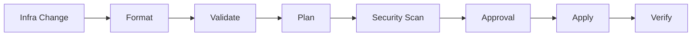

---

# 97. Production Infrastructure Approval

Infrastructure changes should require stronger review than normal application code.

---

# 98. CI/CD Security Boundaries

CI workflows should not receive production credentials unless the workflow is explicitly authorized to deploy production.

---

# 99. OIDC-Based Cloud Authentication

Where supported by the selected cloud platform, GitHub Actions should prefer short-lived federated credentials over long-lived static cloud keys.

Conceptually:

```text id="q8m3x5"
GitHub Actions
↓
Federated Identity
↓
Cloud Role
↓
Temporary Credentials
```

---

# 100. Deployment Credential Principle

Avoid:

```text id="x7m4q2"
Long-Lived Cloud Access Keys
```

when a safer short-lived mechanism is available.

---

# 101. CI/CD Supply Chain Security

Protect:

```text id="m5q8x3"
Source
Dependencies
Build
Artifact
Registry
Deployment
```

---

# 102. Artifact Integrity

Production should deploy artifacts whose identity is verifiable.

Examples:

```text id="q4m7x2"
Image Digest
Commit SHA
Release Tag
```

---

# 103. Signed Artifacts

Enterprise evolution may include:

```text id="x8m3q5"
Signed Container Images
Signed Releases
Provenance Metadata
```

---

# 104. Pipeline Failure Handling

If CI fails:

```text id="m7q4x2"
Merge Blocked
↓
Developer Fix
↓
Rerun
```

No manual bypass should be used for normal development.

---

# 105. Emergency Bypass

Emergency bypasses should be:

```text id="q5m8x3"
Rare
Authorized
Audited
Reviewed Afterward
```

---

# 106. CI/CD Observability

Monitor:

```text id="x4m7q2"
Workflow Failures
Deployment Failures
Build Duration
Security Findings
Artifact Failures
```

---

# 107. CI/CD Logging

Pipeline logs must avoid exposing:

```text id="m8q3x5"
Secrets
Tokens
Passwords
Private Keys
Sensitive User Data
```

---

# 108. Deployment Runbook

Every deployment should have an operational runbook:

```text id="q7m4x2"
Prerequisites
Deployment Steps
Health Checks
Smoke Tests
Rollback
Troubleshooting
Owner
Escalation
```

---

# 109. Release Checklist

```text id="x5m8q3"
✓ PR Approved
✓ CI Passed
✓ Security Passed
✓ AI Evaluation Passed where applicable
✓ Data Tests Passed
✓ Artifact Built
✓ Staging Passed
✓ Migration Approved
✓ Backup Verified
✓ Production Approval
```

---

# 110. Post-Deployment Checklist

```text id="m4q7x2"
✓ Health Checks
✓ Smoke Tests
✓ Error Monitoring
✓ Dashboard Verification
✓ AI Verification
✓ ETL Verification
✓ Audit Verification
```

---

# 111. Rollback Checklist

```text id="q8m3x5"
✓ Incident Confirmed
✓ Impact Understood
✓ Stable Version Identified
✓ Database Compatibility Checked
✓ Rollback Executed
✓ Smoke Test Passed
✓ Monitoring Stable
```

---

# 112. Complete CI/CD Lifecycle

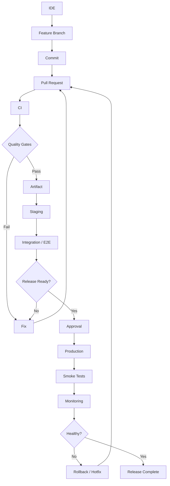

---

# 113. Career Connect Pipeline by Domain

```text id="m5q8x3"
Frontend:
Build → Test → Preview → Deploy

Backend:
Test → Security → Image → Deploy

AI:
Evaluate → Safety → Image → Deploy

ETL:
Transform Tests → Quality → Staging → Schedule

Warehouse:
Model Tests → Reconciliation → Publish

Infrastructure:
Validate → Security → Plan → Apply
```

---

# 114. Recommended GitHub Actions Organization

```text id="q4m7x2"
.github/
└── workflows/
    ├── ci.yml
    ├── web-ci.yml
    ├── api-ci.yml
    ├── ai-ci.yml
    ├── etl-ci.yml
    ├── warehouse-ci.yml
    ├── security.yml
    ├── deploy-staging.yml
    ├── deploy-production.yml
    └── rollback.yml
```

---

# 115. Example CI Workflow Structure

Conceptual:

```yaml id="x8m3q5"
name: CI

on:
  pull_request:

jobs:
  lint:
    runs-on: ubuntu-latest

  test:
    runs-on: ubuntu-latest
    needs: lint

  security:
    runs-on: ubuntu-latest

  build:
    runs-on: ubuntu-latest
    needs:
      - test
      - security
```

The exact workflow should be adapted to the repository's package manager and service structure.

---

# 116. Example Production Deployment Structure

```yaml id="m7q4x2"
name: Deploy Production

on:
  workflow_dispatch:

jobs:
  deploy:
    environment: production
    runs-on: ubuntu-latest
    steps:
      - checkout

      - validate-release
      - deploy
      - smoke-test
      - verify
```

Production deployment should use protected environment controls.

---

# 117. CI/CD Testing Matrix

The pipeline should execute appropriate checks based on changed paths.

Example:

```text id="q5m8x3"
apps/web/**
→ Frontend Tests

apps/api/**
→ Backend Tests

services/ai/**
→ AI Tests

etl/**
→ ETL Tests

warehouse/**
→ Warehouse Tests

database/**
→ Migration Tests
```

This enables efficient monorepo CI.

---

# 118. Path-Based Workflow Optimization

A shared library change may trigger multiple workflows.

Example:

```text id="x4m7q2"
packages/types/
↓
Frontend
+
Backend
+
AI
```

Dependency-aware path rules should be used carefully.

---

# 119. Release Candidate

A release candidate should have:

```text id="m8q3x5"
Version
Commit
Artifact
Test Results
Security Results
Migration Notes
Deployment Notes
```

---

# 120. Release Freeze

After release candidate approval:

```text id="q7m4x2"
No unrelated feature changes
```

until release is complete.

---

# 121. Hotfix Validation

Hotfixes should run a smaller but focused suite:

```text id="x5m8q3"
Affected Module Tests
Security
Critical Regression
Smoke
```

---

# 122. CI/CD for Documentation

A release may automatically verify:

```text id="m4q7x2"
README
Architecture
API Docs
Migration Notes
Version
```

are updated when required.

---

# 123. Release Artifact Manifest

Example:

```json id="q8m3x5"
{
  "release": "1.4.2",
  "commit": "abc123",
  "services": {
    "web": "1.4.2",
    "api": "1.4.2",
    "ai": "1.4.2",
    "worker": "1.4.2"
  }
}
```

This helps operational traceability.

---

# 124. Deployment Governance

Every production deployment should have:

```text id="x7m4q2"
Owner
Version
Reason
Approval
Validation
Rollback Plan
```

---

# 125. CI/CD Success Metrics

Measure:

```text id="m5q8x3"
Deployment Frequency
Lead Time
Change Failure Rate
Mean Time to Recovery
Pipeline Success Rate
Average CI Duration
```

---

# 126. Pipeline Improvement

If failures repeatedly occur in one stage:

```text id="q4m7x2"
Measure
↓
Analyze
↓
Improve
↓
Automate
```

---

# 127. CI/CD Maturity Levels

## Level 1 — Academic

```text id="x8m3q5"
GitHub
Pull Requests
Basic CI
Docker
Vercel/Render
```

## Level 2 — Startup

```text id="m7q4x2"
Automated Security
Staging
Production Approval
Rollback
Observability
```

## Level 3 — Enterprise

```text id="q5m8x3"
Canary
Artifact Signing
Federated Cloud Identity
Advanced Supply Chain Security
Multi-Region
Progressive Delivery
```

---

# 128. Academic Demonstration Pipeline

For the final-year project:

```text id="x4m7q2"
Developer
↓
GitHub
↓
GitHub Actions
↓
Tests
↓
Docker
↓
Vercel / Render
↓
Supabase
↓
BigQuery / Snowflake
```

This is simple enough to demonstrate while still showing industry concepts.

---

# 129. Startup SaaS Pipeline

```text id="m8q3x5"
Pull Request
↓
CI
↓
Security
↓
Staging
↓
AI Evaluation
↓
Data Validation
↓
Approval
↓
Production
↓
Monitoring
```

---

# 130. Enterprise Evolution

```text id="q7m4x2"
GitHub
↓
CI Platform
↓
Artifact Registry
↓
Security / Provenance
↓
Progressive Deployment
↓
Multi-Region Infrastructure
↓
Central Observability
```

---

# 131. Final CI/CD Architecture

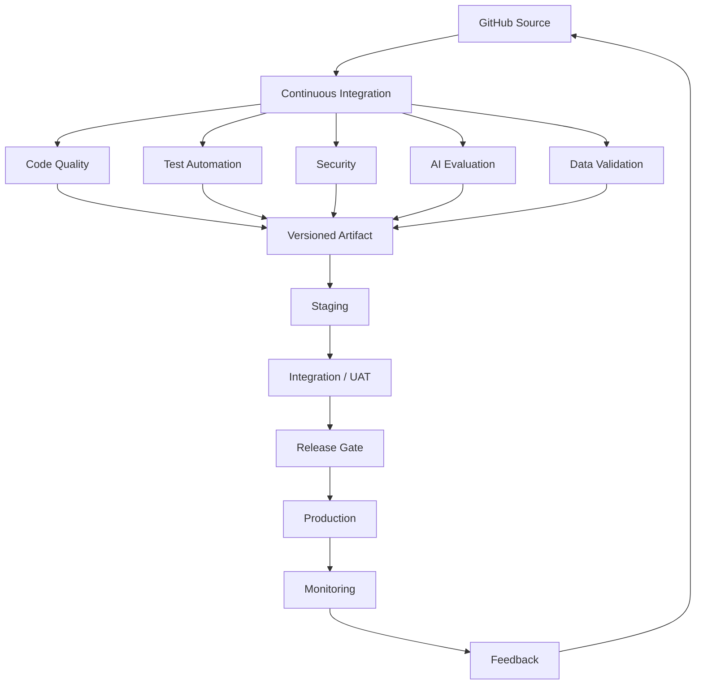

---

# 132. CTO-Level CI/CD Principle

The CI/CD pipeline should make the safest path the easiest path.

A developer should be able to:

```text id="m4q7x2"
Commit
↓
Push
↓
Open PR
↓
Receive Automated Feedback
↓
Fix
↓
Merge
↓
Deploy Staging
↓
Validate
↓
Promote Production
```

without manually copying files, rebuilding servers, or executing undocumented deployment commands.

---

# 133. Final CI/CD Statement

> **Career Connect will implement a centralized, automated CI/CD architecture using GitHub Actions, Docker, environment-controlled deployments, security gates, automated testing, AI evaluation, data validation, versioned artifacts, staging verification, and protected production promotion. Frontend, backend, AI, ETL, warehouse, and infrastructure changes will receive domain-specific validation while sharing common release governance. Production deployments will be traceable to immutable versions and commits, protected by approvals where required, observable after release, and recoverable through controlled rollback or hotfix workflows. This pipeline provides a practical academic implementation while establishing a credible path toward startup and enterprise-grade software delivery.**

---

## Document Status

| Attribute            | Value                                           |
| -------------------- | ----------------------------------------------- |
| Project              | Career Connect                                  |
| Document             | CI/CD Pipeline                                  |
| Version              | 1.0                                             |
| Source Control       | GitHub                                          |
| CI/CD                | GitHub Actions                                  |
| Containerization     | Docker                                          |
| Frontend             | Vercel                                          |
| Backend              | Render / Container Platform                     |
| AI                   | Python Services + Workers                       |
| Database             | PostgreSQL / Supabase                           |
| Warehouse            | BigQuery / Snowflake                            |
| Security             | SAST + Dependency + Secret + Container Scanning |
| AI Quality           | Golden Dataset + Safety + Regression            |
| Data Quality         | ETL + Warehouse Validation                      |
| Deployment           | Development → Staging → Production              |
| Release              | Versioned Artifacts                             |
| Rollback             | Supported                                       |
| Monitoring           | Required                                        |
| Academic MVP         | Supported                                       |
| Startup SaaS         | Supported                                       |
| Enterprise Evolution | Supported                                       |
| Status               | CI/CD Architecture Baseline                     |
