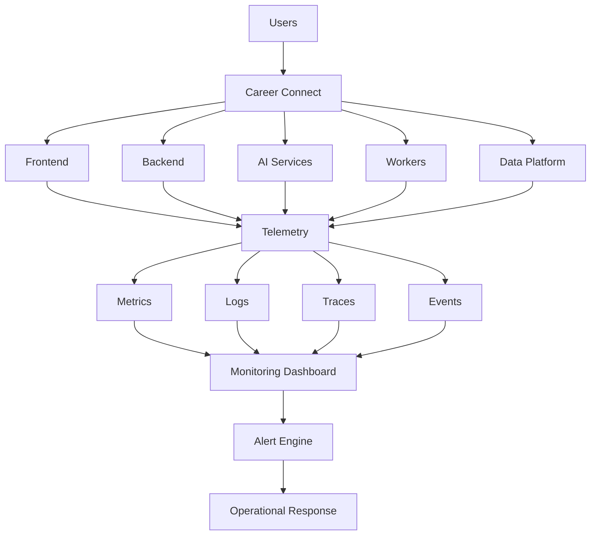
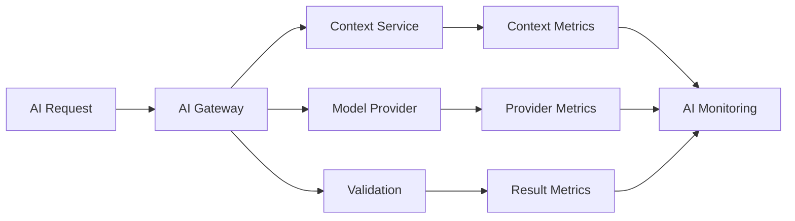
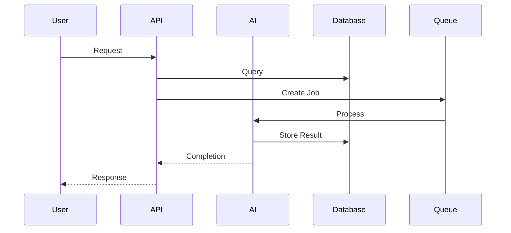
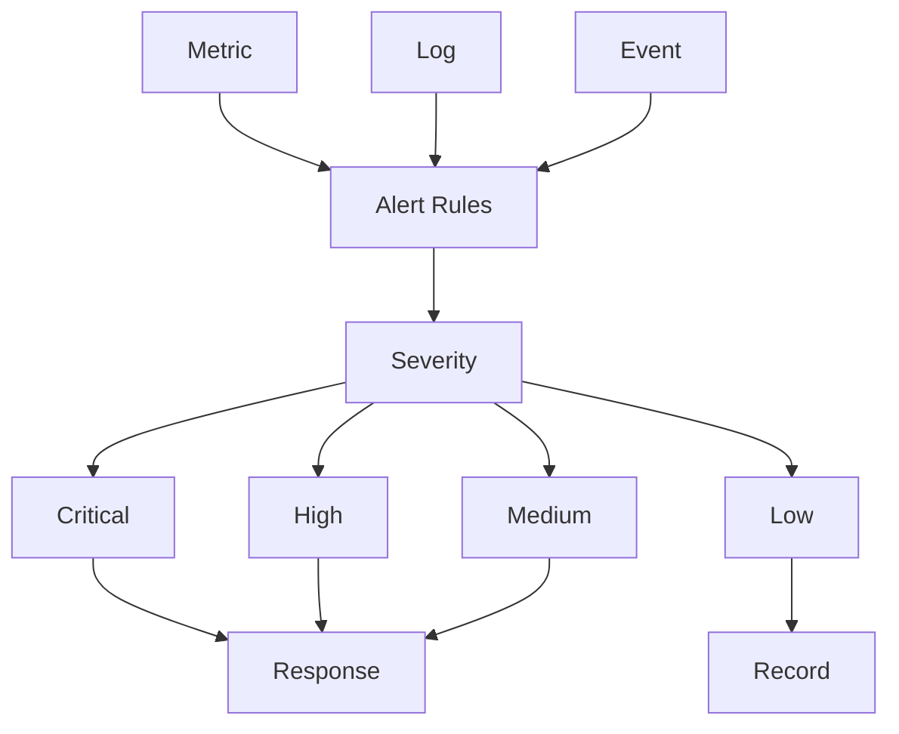
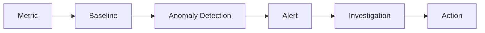
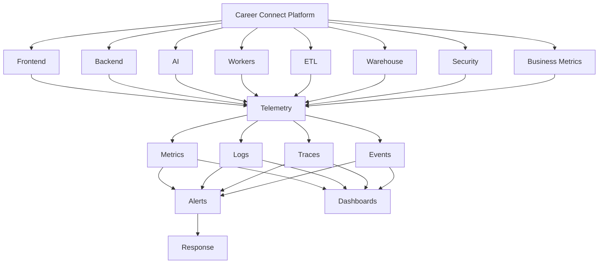

# 35 — Monitoring

# Career Connect — AI Career Intelligence Platform

**Document Type:** Enterprise Monitoring & Observability Specification
**Project:** Career Connect
**Version:** 1.0
**Status:** Monitoring Architecture Baseline
**Monitoring Scope:** Application + API + Database + AI + ETL + Warehouse + BI + Security + Infrastructure
**Primary Goal:** Detect failures early, understand system behavior, protect user experience, and provide enough telemetry to investigate incidents.

---

# 1. Executive Summary

Monitoring is a core component of Career Connect because the platform contains multiple distributed services and data systems.

A successful monitoring architecture must answer:

```text id="n7f4k2"
Is the system healthy?
↓
What is failing?
↓
Who is affected?
↓
Why did it fail?
↓
When did it begin?
↓
What changed?
↓
What should we do?
```

Career Connect monitoring covers:

```text id="x5m8q3"
Frontend
Backend API
Authentication
PostgreSQL
Object Storage
AI Services
AI Providers
Background Workers
Queues
ETL Pipelines
Data Lake
Data Warehouse
Data Marts
BI APIs
Security Events
CI/CD
Infrastructure
```

---

# 2. Monitoring Objectives

The monitoring system shall provide:

```text id="m4q7x2"
Availability
Performance
Reliability
Capacity
Data Freshness
Data Quality
AI Health
Security Visibility
Deployment Visibility
Business Health
```

---

# 3. Observability Model

Career Connect uses three primary telemetry pillars:

```text id="q8m3x5"
Metrics
Logs
Traces
```

These are supplemented by:

```text id="x7m4q2"
Events
Alerts
Health Checks
Business KPIs
Data Quality
AI Evaluation
```

---

# 4. Monitoring Architecture



---

# 5. Monitoring Layers

Career Connect should monitor five layers:

```text id="r9x4m2"
Layer 1 — Infrastructure
Layer 2 — Application
Layer 3 — Data
Layer 4 — AI
Layer 5 — Business
```

---

# 6. Infrastructure Monitoring

Monitor:

```text id="w6m3q8"
CPU
Memory
Storage
Network
Container Health
Process Health
Instance Availability
```

---

# 7. Application Monitoring

Monitor:

```text id="x8q4m2"
Request Rate
Response Time
Error Rate
Availability
Background Jobs
Queue Depth
Dependency Failures
```

---

# 8. Data Monitoring

Monitor:

```text id="m5r7q3"
Freshness
Completeness
Validity
Volume
Schema
Reconciliation
Pipeline Success
Warehouse Loads
```

---

# 9. AI Monitoring

Monitor:

```text id="q7m4x8"
AI Requests
Latency
Failures
Timeouts
Provider Availability
Usage
Cost
Structured Output Failures
Safety Blocks
User Feedback
```

---

# 10. Business Monitoring

Monitor:

```text id="x4q8m3"
Applications
Placements
Hiring
Job Demand
Skill Demand
Learning
Reports
```

Business monitoring allows technical health to be connected to user outcomes.

---

# 11. Monitoring Philosophy

The system should distinguish between:

```text id="m8q3x5"
Technical Health
+
Data Health
+
Business Health
```

A server can be healthy while the business system is broken.

Example:

```text id="q5m7x2"
API = Healthy
Database = Healthy

But:

Placement ETL = Failed
↓
Dashboard = Stale
↓
Business Health = Degraded
```

---

# 12. Service Health Model

Each service should expose:

```text id="x7m4q3"
Health
Readiness
Dependency Status
Version
```

---

# 13. Health Endpoint

Recommended:

```text id="m4q8x2"
/health
```

Response:

```json id="q8m3x5"
{
  "status": "ok",
  "service": "careerconnect-api",
  "version": "1.4.2"
}
```

---

# 14. Readiness Endpoint

Recommended:

```text id="x5m7q3"
/ready
```

It may verify:

```text id="m8q4x2"
Database
Required Configuration
Critical Dependencies
```

---

# 15. Liveness vs Readiness

## Liveness

Answers:

> Is the process alive?

## Readiness

Answers:

> Can the service safely receive work?

These should not be treated as the same check.

---

# 16. Frontend Monitoring

Monitor:

```text id="q7m3x8"
Page Errors
JavaScript Errors
API Failures
Page Performance
Route Errors
User Interaction Failures
```

---

# 17. Frontend Error Categories

```text id="x4m8q2"
NETWORK_ERROR
API_ERROR
RENDER_ERROR
AUTH_ERROR
TIMEOUT
VALIDATION_ERROR
UNKNOWN_ERROR
```

---

# 18. Frontend Performance Monitoring

Track:

```text id="m5q7x3"
Page Load
Route Transition
API Wait
Chart Rendering
Largest Contentful Rendering
Interaction Responsiveness
```

Exact performance targets should be defined per page class.

---

# 19. Frontend Business Events

Track important actions:

```text id="q8m3x5"
PROFILE_COMPLETED
RESUME_UPLOADED
RESUME_ANALYZED
CAREER_RECOMMENDATION_VIEWED
JOB_VIEWED
APPLICATION_SUBMITTED
AI_SESSION_STARTED
REPORT_GENERATED
```

Business events should avoid unnecessary personal data.

---

# 20. Backend Monitoring

The NestJS API should expose:

```text id="x7m4q2"
Request Count
Latency
HTTP Errors
Database Errors
External Dependency Errors
Queue Jobs
Authentication Failures
Authorization Failures
```

---

# 21. API Golden Signals

Monitor:

```text id="m4q8x3"
Latency
Traffic
Errors
Saturation
```

These provide a concise view of service health.

---

# 22. API Request Rate

Example metric:

```text id="q5m7x2"
api_requests_total
```

Dimensions may include:

```text id="x8m3q5"
service
route
method
status_class
```

Avoid excessive high-cardinality labels.

---

# 23. API Latency

Capture:

```text id="m7q4x2"
P50
P95
P99
```

Example:

```text id="q8m3x5"
GET /jobs
P95 = monitored target
```

---

# 24. API Error Rate

Track:

```text id="x5m7q3"
4xx Rate
5xx Rate
```

A rise in 5xx errors is usually more urgent than a rise in expected 4xx validation failures.

---

# 25. Database Monitoring

PostgreSQL monitoring should include:

```text id="m4q8x2"
Connections
Connection Pool
Query Latency
Slow Queries
Locks
Transactions
Errors
Storage
CPU
```

---

# 26. Database Connection Monitoring

Monitor:

```text id="q7m3x8"
Active Connections
Idle Connections
Connection Saturation
Connection Errors
```

---

# 27. Database Query Monitoring

Track:

```text id="x8q4m2"
Query Duration
Query Frequency
Failed Queries
Slow Queries
```

---

# 28. Database Storage Monitoring

Track:

```text id="m5q7x3"
Database Size
Growth Rate
Free Space
Index Growth
```

---

# 29. Database Backup Monitoring

Do not monitor only database health.

Also monitor:

```text id="q8m3x5"
Last Successful Backup
Backup Age
Backup Failure
Restore Test Status
```

---

# 30. Object Storage Monitoring

Monitor:

```text id="x7m4q2"
Uploads
Downloads
Failures
Storage Size
Growth
Access Errors
```

---

# 31. Resume Storage Monitoring

Special metrics:

```text id="m4q8x2"
Resume Upload Rate
Resume Processing Queue
Failed Resume Processing
Storage Growth
```

---

# 32. AI Monitoring Architecture



---

# 33. AI Request Metrics

Track:

```text id="x8q4m2"
ai_requests_total
ai_requests_success_total
ai_requests_failed_total
ai_requests_timeout_total
```

---

# 34. AI Latency

Track:

```text id="m7q3x8"
Context Retrieval Time
Model Time
Validation Time
Total Request Time
```

This helps identify the actual bottleneck.

---

# 35. AI Provider Monitoring

For each provider:

```text id="q5m8x3"
Availability
Latency
Error Rate
Rate Limits
Usage
Cost
```

---

# 36. AI Feature Monitoring

Track by feature:

```text id="x4m7q2"
Resume Analysis
Career Recommendation
Skill Gap
Career Chat
Job Matching
Mock Interview
NL-BI
Smart Report
```

---

# 37. AI Output Validation Monitoring

Track:

```text id="m8q3x5"
Valid Outputs
Invalid Outputs
Repair Attempts
Repair Success
Final Failure
```

---

# 38. AI Safety Monitoring

Track:

```text id="q7m4x2"
Prompt Injection Attempts
Unauthorized Tool Requests
Data Access Denials
Safety Blocks
```

Do not store raw sensitive user content merely to obtain these metrics.

---

# 39. AI Usage Monitoring

Track:

```text id="x5m7q3"
Requests
Input Usage
Output Usage
Organization
Feature
Model
Provider
```

---

# 40. AI Cost Monitoring

Create dashboards for:

```text id="m4q8x2"
Daily Usage
Monthly Usage
Per Feature
Per Organization
Per Model
```

---

# 41. AI Cost Anomaly

Example alert:

```text id="q8m3x5"
AI usage increased significantly above baseline.
```

Potential causes:

```text id="x7m4q2"
Bot Abuse
Looping Client
Broken Worker
Unexpected Traffic
Prompt Growth
```

---

# 42. Queue Monitoring

Background queues should expose:

```text id="m5q7x3"
Queue Depth
Processing Rate
Age of Oldest Job
Failed Jobs
Retry Count
Worker Utilization
```

---

# 43. Queue Backlog Alert

Example:

```text id="q4m8x2"
Oldest AI Job > defined threshold
```

This can indicate:

```text id="x8q3m5"
Worker Failure
Provider Slowness
Traffic Spike
Queue Configuration Problem
```

---

# 44. Worker Monitoring

Each worker should report:

```text id="m7q4x2"
Jobs Started
Jobs Completed
Jobs Failed
Processing Duration
Retries
```

---

# 45. ETL Monitoring

Track each pipeline:

```text id="q5m8x3"
Execution Count
Success
Failure
Duration
Rows Read
Rows Written
Rows Rejected
```

---

# 46. ETL Freshness

For each dataset define:

```text id="x4m7q2"
Expected Refresh
Last Successful Refresh
Current Data Age
```

---

# 47. Data Freshness Status

```text id="m8q3x5"
Healthy
Warning
Stale
Critical
```

Example:

```text
Jobs Dataset
Last Refresh: 06:00
Current Time: 08:00
Status: Healthy
```

---

# 48. ETL Data Volume Monitoring

Watch for unexpected drops/spikes.

Example:

```text id="q7m4x2"
Yesterday:
120,000 jobs

Today:
8,000 jobs
```

This should trigger investigation rather than silently publishing the dataset.

---

# 49. Data Quality Monitoring

Track:

```text id="x5m7q3"
Completeness
Validity
Uniqueness
Consistency
Freshness
Referential Integrity
```

---

# 50. Data Quality Score

A dataset may expose:

```text id="m4q8x2"
Overall Quality
98%

Completeness 99%
Validity 98%
Uniqueness 99%
Freshness 96%
```

The underlying formula must be documented.

---

# 51. Schema Drift Monitoring

Detect:

```text id="q8m3x5"
New Column
Missing Column
Changed Type
Renamed Column
Unexpected Value
```

---

# 52. Schema Drift Alert

```text id="x7m4q2"
Dataset:
external_jobs

Problem:
salary column changed from numeric to text

Action:
Pipeline blocked / quarantined
```

---

# 53. Data Reconciliation Monitoring

Track:

```text id="m5q7x3"
Source Count
Target Count
Rejected Count
Duplicate Count
Unresolved Key Count
```

---

# 54. Warehouse Monitoring

Monitor:

```text id="q4m8x2"
Load Success
Query Performance
Storage
Compute
Table Growth
Freshness
Failed Jobs
```

---

# 55. Data Mart Monitoring

Each data mart should expose:

```text id="x8q3m5"
Last Refresh
Row Count
Quality
Metric Availability
```

---

# 56. Semantic Layer Monitoring

Track:

```text id="m7q4x2"
Metric Query Count
Metric Errors
Unsupported Metrics
Query Duration
```

---

# 57. BI API Monitoring

Monitor:

```text id="q5m8x3"
Dashboard Requests
Latency
Warehouse Query Failures
Authorization Failures
Export Requests
```

---

# 58. Dashboard Health

A dashboard should expose:

```text id="x4m7q2"
Data-As-Of
Last Refresh
Query Status
```

---

# 59. Stale Dashboard Detection

If the data mart is stale:

```text id="m8q3x5"
Dashboard:
⚠ Data may be stale
```

rather than silently displaying old information as current.

---

# 60. Business KPI Monitoring

Monitor important business events such as:

```text id="q7m4x2"
Applications
Interviews
Offers
Placements
Learning Progress
Job Postings
```

---

# 61. Business Anomaly Monitoring

Examples:

```text id="x5m7q3"
Applications suddenly drop
Placement count suddenly increases
Salary values become abnormal
Job posting volume changes sharply
```

These signals can detect data problems or real business changes.

---

# 62. Security Monitoring

Monitor:

```text id="m4q8x2"
Failed Login Rate
Permission Failures
Admin Changes
Sensitive Exports
Cross-Tenant Access Denials
API Abuse
AI Security Events
```

---

# 63. Authentication Alert

Example:

```text id="q8m3x5"
Multiple failed authentication attempts
from a suspicious pattern.
```

---

# 64. Authorization Alert

Example:

```text id="x7m4q2"
Repeated unauthorized resource access.
```

---

# 65. Export Monitoring

Track:

```text id="m5q7x3"
Report Exports
Sensitive Exports
Export Volume
Export Failures
```

---

# 66. Deployment Monitoring

Track each deployment:

```text id="q4m8x2"
Version
Start Time
End Time
Status
Health
Error Rate
Rollback
```

---

# 67. Deployment Change Correlation

When errors increase, monitoring should allow:

```text id="x8q3m5"
Error Spike
↓
Recent Deployment
↓
Version Comparison
```

---

# 68. Correlation IDs

Every distributed request should carry a correlation ID.

Example:

```text id="m7q4x2"
cc-request-73a21
```

This should connect:

```text id="q5m8x3"
API
AI
Worker
Database Logs where appropriate
Audit
```

---

# 69. Trace Architecture



Each segment should be traceable through a common correlation context where supported.

---

# 70. Distributed Trace Use Case

Example:

> Resume analysis took 18 seconds.

Tracing should reveal:

```text id="m8q3x5"
Upload: 0.2s
Text Extraction: 1.4s
Context Retrieval: 0.8s
AI: 14.5s
Validation: 0.3s
Persistence: 0.8s
```

This makes optimization possible.

---

# 71. Structured Logging

Logs should be machine-readable.

Example:

```json id="q7m4x2"
{
  "level": "INFO",
  "service": "careerconnect-api",
  "event": "application.created",
  "request_id": "cc-123",
  "timestamp": "2026-07-30T10:30:00Z"
}
```

---

# 72. Log Levels

```text id="x5m7q3"
DEBUG
INFO
WARN
ERROR
FATAL
```

---

# 73. Production Logging

Default:

```text id="m4q8x2"
INFO
```

Use DEBUG selectively because excessive logging increases cost and can expose unnecessary information.

---

# 74. Sensitive Data Logging

Never log:

```text id="q8m3x5"
Passwords
Access Tokens
AI API Keys
Private Keys
Full Resume Text
Full Interview Feedback
Sensitive PII
```

unless explicitly required under tightly controlled policies.

---

# 75. Log Retention

Retention should consider:

```text id="x7m4q2"
Security
Operations
Compliance
Cost
Investigation
```

---

# 76. Alert Architecture



---

# 77. Alert Severity

## Critical

Requires immediate investigation.

Example:

```text id="q4m8x2"
API unavailable
Database inaccessible
Cross-tenant security concern
Complete ETL outage affecting executive reporting
```

---

# 78. High

Significant degradation.

Example:

```text id="x8q3m5"
High 5xx rate
AI service unavailable
Warehouse freshness breach
Queue backlog
```

---

# 79. Medium

Operational concern.

Example:

```text id="m7q4x2"
Elevated latency
Moderate failure rate
Quality degradation
```

---

# 80. Low

Informational event.

Example:

```text id="q5m8x3"
Deployment completed
Pipeline completed
Routine capacity trend
```

---

# 81. Alert Fatigue Prevention

Do not alert on every minor event.

Use:

```text id="x4q7m2"
Thresholds
Windows
Aggregation
Severity
Deduplication
```

---

# 82. Alert Example

Bad:

```text id="m8q3x5"
Every single 500 error → alert
```

Better:

```text id="q7m4x2"
5xx error rate exceeds defined threshold
for a sustained period.
```

---

# 83. Alert Ownership

Every critical alert needs an owner.

Example:

```text id="x5m7q3"
API Alert
→ Backend Owner

AI Alert
→ AI Owner

ETL Alert
→ Data Engineer

Warehouse Alert
→ Data Platform Owner
```

---

# 84. Alert Runbook Link

Alerts should point to an operational runbook.

Example:

```text id="m4q8x2"
ALERT:
ETL_Pipeline_Failed

RUNBOOK:
docs/operations/etl-failure.md
```

---

# 85. Monitoring Dashboard Structure

The operations dashboard should contain:

```text id="q8m3x5"
Platform Health
Service Health
Database
AI
ETL
Warehouse
Security
Deployments
Business Health
```

---

# 86. Executive Operational Health

An executive-friendly operational card:

```text id="x7m4q2"
Platform Status

● API Healthy
● Database Healthy
● AI Healthy
● ETL Healthy
● Warehouse Healthy
```

---

# 87. Technical Operations Dashboard

```text id="m5q7x3"
┌──────────────────────────────────────────────────────────────┐
│ Platform Operations                                          │
├──────────────────────────────────────────────────────────────┤
│ API       DB       AI       ETL       Warehouse              │
│ Healthy   Healthy  Healthy  Warning   Healthy                │
├──────────────────────────────────────────────────────────────┤
│ Request Rate     [Chart]                                    │
│ Error Rate       [Chart]                                    │
│ Latency          [Chart]                                    │
├─────────────────────────────┬────────────────────────────────┤
│ Active Incidents             │ Recent Deployments             │
└─────────────────────────────┴────────────────────────────────┘
```

---

# 88. AI Operations Dashboard

```text id="q4m8x2"
┌──────────────────────────────────────────────────────────────┐
│ AI Operations                                                │
├──────────────────────────────────────────────────────────────┤
│ Requests │ Success │ Latency │ Failures │ Usage              │
├───────────────────────┬──────────────────────────────────────┤
│ Provider Health       │ Feature Usage                        │
├───────────────────────┼──────────────────────────────────────┤
│ Validation Failures   │ Safety Events                        │
└───────────────────────┴──────────────────────────────────────┘
```

---

# 89. ETL Operations Dashboard

```text id="x8q3m5"
┌──────────────────────────────────────────────────────────────┐
│ Data Platform Operations                                     │
├──────────────────────────────────────────────────────────────┤
│ Success │ Failed │ Rows │ Freshness │ Quality                │
├───────────────────────┬──────────────────────────────────────┤
│ Pipeline Health       │ Runtime Trend                        │
├───────────────────────┼──────────────────────────────────────┤
│ Failed Jobs            │ Data Quality Failures                │
└───────────────────────┴──────────────────────────────────────┘
```

---

# 90. Security Operations Dashboard

```text id="m7q4x2"
┌──────────────────────────────────────────────────────────────┐
│ Security Operations                                          │
├──────────────────────────────────────────────────────────────┤
│ Failed Logins │ Access Denials │ Exports │ Incidents         │
├──────────────────────────┬───────────────────────────────────┤
│ Security Trend           │ Top Event Types                  │
├──────────────────────────┼───────────────────────────────────┤
│ Active Incidents         │ Recent Sensitive Actions         │
└──────────────────────────┴───────────────────────────────────┘
```

---

# 91. SLO Architecture

The product should define Service Level Objectives for important services.

Examples:

```text id="q5m8x3"
API Availability
Dashboard Availability
AI Availability
ETL Freshness
Warehouse Freshness
```

Actual targets should be established according to deployment tier.

---

# 92. SLI vs SLO

## SLI

Measured indicator.

Example:

```text id="x4m7q2"
API success rate
```

## SLO

Target objective.

Example:

```text id="m8q3x5"
API success rate target
```

---

# 93. Example SLI/SLO Model

```text id="q7m4x2"
SLI:
Successful API requests / total valid requests

SLO:
Target defined by production tier
```

The project should document the exact target before claiming compliance.

---

# 94. Error Budget

For mature SaaS operation:

```text id="x5m7q3"
SLO
↓
Allowed Failure Budget
↓
Reliability vs Feature Velocity
```

If the error budget is exhausted, high-risk releases may be paused.

---

# 95. Data SLOs

Career Connect also needs data-specific objectives.

Examples:

```text id="m4q8x2"
Jobs freshness
Placement freshness
Salary freshness
Warehouse refresh
Report availability
```

---

# 96. AI SLOs

AI services may define:

```text id="q8m3x5"
Availability
Latency
Structured Output Success
```

AI quality itself should be monitored separately from infrastructure availability.

---

# 97. AI Quality vs Availability

Important distinction:

```text id="x7m4q2"
AI API = Available

does not necessarily mean

AI Output = Good
```

Therefore monitor both:

```text id="m5q7x3"
Operational Health
+
AI Quality
```

---

# 98. Data Health vs Infrastructure Health

Similarly:

```text id="q4m8x2"
Warehouse = Online
```

does not guarantee:

```text id="x8q3m5"
Data = Correct
```

Monitor:

```text id="m7q4x2"
Infrastructure
+
Data Quality
```

separately.

---

# 99. Business Monitoring

Business monitoring should detect unexpected changes.

Example:

```text id="q5m8x3"
Applications down 70%
```

Possible causes:

```text id="x4q7m2"
Real market event
UI issue
API issue
ETL issue
Job ingestion issue
```

Business metrics become useful for cross-layer investigation.

---

# 100. Anomaly Detection

Future monitoring may identify:

```text id="m8q3x5"
Traffic anomalies
Application anomalies
Salary anomalies
Job volume anomalies
Skill demand anomalies
ETL volume anomalies
```

---

# 101. Anomaly Workflow



---

# 102. Monitoring Business Events

Track events such as:

```text id="x5m7q3"
job.posted
application.created
interview.scheduled
offer.created
placement.recorded
resume.analyzed
report.generated
```

---

# 103. Event Naming

Use consistent event names:

```text id="m4q8x2"
domain.entity.action
```

Examples:

```text id="q8m3x5"
application.created
placement.verified
resume.analyzed
pipeline.completed
report.generated
```

---

# 104. Monitoring Event Correlation

A business event may be traced:

```text id="x7q4m2"
application.created
↓
interview.scheduled
↓
offer.created
↓
placement.recorded
```

This supports both product analytics and operational investigation.

---

# 105. Monitoring Data Retention

Telemetry retention should be tiered:

```text id="m5q7x3"
Recent:
Detailed Logs

Historical:
Aggregated Metrics

Long-Term:
Security / Audit Records according to policy
```

---

# 106. Monitoring Cost Control

Observability can become expensive.

Control:

```text id="q4m8x2"
High-Cardinality Labels
Log Volume
Trace Sampling
Retention
Duplicate Events
```

---

# 107. Trace Sampling

Not every request must necessarily be traced at full detail.

Possible approach:

```text id="x8q3m5"
Normal Requests
→ Sampled

Errors
→ High Sampling

Critical Transactions
→ Higher Sampling
```

---

# 108. Log Sampling

High-volume repetitive logs should be controlled.

Never sacrifice required audit/security logging merely for cost reduction.

---

# 109. Monitoring Storage

Use centralized storage for:

```text id="m7q4x2"
Metrics
Logs
Traces
Security Events
```

---

# 110. Monitoring Access Control

Monitoring systems themselves contain sensitive information.

Therefore restrict:

```text id="q5m8x3"
Security Logs
AI Usage
User-Level Traces
Sensitive Error Context
```

---

# 111. Observability Privacy

Telemetry should follow data minimization.

Do not collect full personal documents just because logging makes it technically possible.

---

# 112. Monitoring Alert Channels

Possible channels:

```text id="x4q7m2"
Email
Team Chat
Incident Platform
Dashboard
Pager/On-Call System
```

---

# 113. Alert Escalation

```text id="m8q3x5"
Alert
↓
Primary Owner
↓
Secondary Owner
↓
Escalation
```

---

# 114. Incident Correlation

During an incident, responders should correlate:

```text id="q7m4x2"
Deployment
+
Metrics
+
Logs
+
Traces
+
Business Events
+
Security Events
```

---

# 115. Monitoring Runbook

Each major service should have:

```text id="x5m7q3"
Symptoms
Checks
Likely Causes
Recovery Steps
Escalation
Rollback
```

---

# 116. API Incident Runbook

```text id="m4q8x2"
Check:
1. Error Rate
2. Latency
3. Health
4. Database
5. Recent Deployment
6. Dependencies

Then:
Rollback / Fix / Scale / Escalate
```

---

# 117. AI Incident Runbook

```text id="q8m3x5"
Check:
1. Provider Health
2. Timeout
3. Rate Limits
4. Queue
5. Validation Failures
6. Prompt/Model Change

Then:
Failover / Disable Feature / Retry / Escalate
```

---

# 118. ETL Incident Runbook

```text id="x7m4q2"
Check:
1. Source
2. Schema
3. Quality
4. Failed Task
5. Quarantine
6. Warehouse

Then:
Repair / Replay / Reconcile
```

---

# 119. Warehouse Incident Runbook

```text id="m5q7x3"
Check:
1. Latest Load
2. Failed Jobs
3. Query Latency
4. Data Quality
5. Source Counts

Then:
Repair / Rebuild / Restore / Escalate
```

---

# 120. Monitoring Release Gates

A release should be monitored immediately after deployment for:

```text id="q4m8x2"
Availability
Errors
Latency
Business Events
AI
ETL
Database
```

---

# 121. Deployment Watch Window

For important releases, the team should actively observe production health after deployment according to the project's operational practice.

---

# 122. Monitoring Dashboard Navigation

Recommended:

```text id="x8q3m5"
Overview
├── Services
├── API
├── Database
├── AI
├── Queue
├── ETL
├── Warehouse
├── BI
├── Security
├── Deployments
└── Business Health
```

---

# 123. Monitoring Folder Structure

```text id="m7q4x2"
monitoring/
├── dashboards/
├── alerts/
├── metrics/
├── logs/
├── tracing/
├── runbooks/
├── slo/
├── security/
└── business/
```

---

# 124. Monitoring Configuration

Example conceptual configuration:

```yaml id="q5m8x3"
monitoring:
  api:
    error_rate_threshold: configured
    latency_threshold: configured

  ai:
    timeout_threshold: configured
    failure_rate_threshold: configured

  etl:
    freshness_threshold: configured
    quality_threshold: configured
```

Actual threshold values should be established using measured production behavior.

---

# 125. Monitoring Data Model

A telemetry event may contain:

```json id="x4m7q2"
{
  "timestamp": "2026-07-30T10:30:00Z",
  "service": "careerconnect-api",
  "environment": "production",
  "level": "INFO",
  "event": "application.created",
  "request_id": "cc-123",
  "version": "1.4.2"
}
```

---

# 126. Business Monitoring Example

```text id="m8q3x5"
Applications Today
4,280

Compared with baseline:
Within expected range

Placement ETL:
Healthy

Dashboard:
Fresh
```

---

# 127. Monitoring for Executive Confidence

An executive operational view should summarize:

```text id="q7m4x2"
System Health
Data Health
AI Health
Security Health
Business Health
```

---

# 128. Monitoring for Data Engineers

Data engineers need:

```text id="x5m7q3"
Pipeline status
Failure reason
Runtime
Freshness
Quality
Volume
Reconciliation
```

---

# 129. Monitoring for AI Engineers

AI engineers need:

```text id="m4q8x2"
Model
Prompt
Provider
Latency
Validation
Safety
Usage
Cost
Feedback
```

---

# 130. Monitoring for Backend Engineers

Backend engineers need:

```text id="q8m3x5"
Request rate
Latency
Errors
Database
Queue
External APIs
Deployments
```

---

# 131. Monitoring for Security Engineers

Security owners need:

```text id="x7q4m2"
Auth failures
Access denials
Privilege changes
Sensitive exports
Tenant violations
Suspicious activity
```

---

# 132. Monitoring for Product Managers

Product owners need:

```text id="m5q7x3"
Feature usage
Activation
Application conversion
AI usage
Recommendation acceptance
Report usage
```

---

# 133. Monitoring Product KPIs

Examples:

```text id="q4m8x2"
Profile Completion Rate
Resume Analysis Adoption
Career Recommendation Usage
Job Application Conversion
AI Assistant Engagement
Learning Roadmap Completion
```

---

# 134. Monitoring AI Outcomes

Track:

```text id="x8q3m5"
Recommendation Viewed
Recommendation Accepted
Course Started
Job Applied
Interview Reached
```

This connects AI features to measurable product behavior.

---

# 135. Monitoring Data Lineage

An operational issue should be traceable:

```text id="m7q4x2"
Dashboard
↓
Metric
↓
Data Mart
↓
Warehouse
↓
ETL
↓
Source
```

---

# 136. Monitoring Incident Example

Scenario:

```text id="q5m8x3"
Placement dashboard shows unexpectedly low placement.
```

Investigation:

```text id="x4q7m2"
Business Metric Alert
↓
Dashboard Freshness
↓
Placement Mart
↓
Warehouse Load
↓
ETL
↓
Source Data Volume
```

This is the intended observability chain.

---

# 137. Monitoring Architecture — Full Platform



---

# 138. Monitoring Maturity

## Level 1 — Academic MVP

```text id="q7m4x2"
Health Checks
Application Logs
Basic Error Alerts
ETL Status
Dashboard Freshness
```

## Level 2 — Startup SaaS

```text id="x5m7q3"
Central Metrics
Central Logs
Tracing
SLOs
AI Monitoring
Security Monitoring
Business Monitoring
```

## Level 3 — Enterprise

```text id="m4q8x2"
Advanced APM
SIEM
Predictive Anomalies
Multi-Region Monitoring
Advanced Capacity Planning
```

---

# 139. Monitoring Priority

## P0

```text id="q8m3x5"
API Availability
Database Availability
Authentication
Tenant Isolation
Data Freshness for Critical Dashboards
```

## P1

```text id="x7m4q2"
AI
Queue
ETL
Warehouse
Business Metrics
```

## P2

```text id="m5q7x3"
Advanced Product Analytics
Cost Optimization
Predictive Monitoring
```

---

# 140. Monitoring Success Criteria

The monitoring architecture is successful when:

```text id="q4m8x2"
✓ Failures are detected
✓ Alerts reach the correct owner
✓ Root cause can be investigated
✓ Services expose health state
✓ Data freshness is measurable
✓ AI quality is measurable
✓ Security events are visible
✓ Deployments are traceable
✓ Business-impacting failures are detectable
```

---

# 141. CTO-Level Monitoring Principle

Monitoring should not answer only:

> **"Is the server up?"**

It should answer:

> **"Can users complete important career and recruitment workflows with correct, secure, and trustworthy data?"**

Therefore:

```text id="x8q3m5"
Infrastructure Health
+
Application Health
+
Data Health
+
AI Health
+
Business Health
```

must be monitored together.

---

# 142. Final Monitoring Statement

> **Career Connect will implement an observability architecture based on metrics, structured logs, distributed traces, events, health checks, alerts, data-quality monitoring, AI monitoring, security telemetry, and business KPIs. Monitoring will extend beyond infrastructure availability to detect application failures, data freshness problems, warehouse issues, AI quality degradation, security anomalies, deployment regressions, and business-impacting changes. Correlation IDs and traceable data lineage will allow operators to follow incidents across the frontend, backend, AI, ETL, warehouse, and BI layers. The monitoring system will evolve from a practical academic baseline into an enterprise observability platform supporting SLOs, advanced alerting, anomaly detection, and centralized operational intelligence.**

---

## Document Status

| Attribute            | Value                                         |
| -------------------- | --------------------------------------------- |
| Project              | Career Connect                                |
| Document             | Monitoring                                    |
| Version              | 1.0                                           |
| Observability        | Metrics + Logs + Traces + Events              |
| Application          | Frontend + Backend + Workers                  |
| AI                   | Usage + Latency + Quality + Safety            |
| Data                 | Freshness + Quality + Volume + Reconciliation |
| Warehouse            | Loads + Queries + Freshness                   |
| Security             | Auth + Access + Sensitive Events              |
| Business             | Applications + Hiring + Placement + Learning  |
| Alerts               | Critical / High / Medium / Low                |
| Traceability         | Correlation IDs + Data Lineage                |
| Reliability          | Health + SLO + Error Budget Ready             |
| Incident Support     | Runbooks + Escalation                         |
| Academic MVP         | Supported                                     |
| Startup SaaS         | Supported                                     |
| Enterprise Evolution | Supported                                     |
| Status               | Monitoring Architecture Baseline              |
