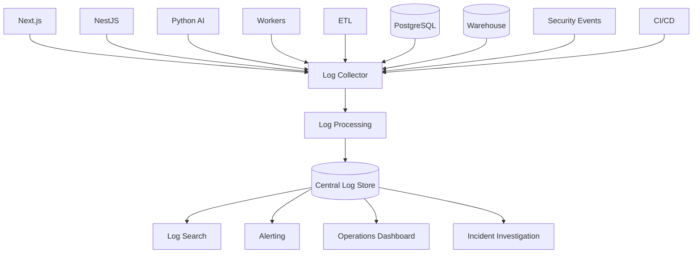
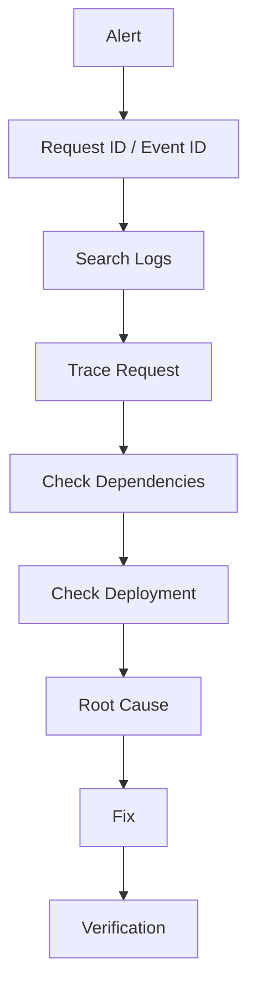
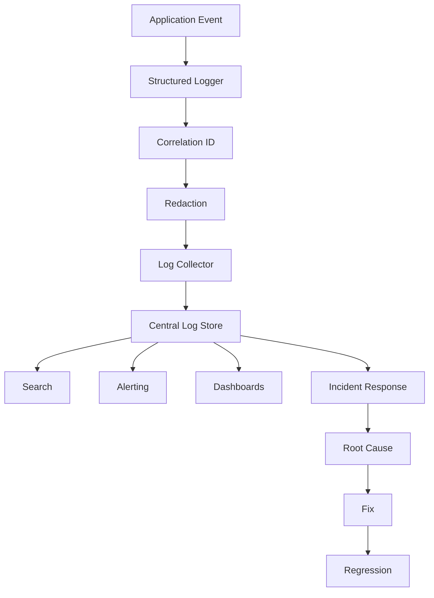

# 36 — Logging

# Career Connect — AI Career Intelligence Platform

**Document Type:** Enterprise Logging Architecture & Design Specification
**Project:** Career Connect
**Version:** 1.0
**Status:** Logging Architecture Baseline
**Scope:** Application + API + Authentication + AI + ETL + Data Warehouse + Security + Audit + Deployment
**Logging Model:** Structured + Centralized + Correlated + Privacy-Aware
**Primary Principle:** Log enough to diagnose problems and prove important actions occurred, but never log sensitive information unnecessarily.

---

# 1. Executive Summary

Logging is one of the foundational operational capabilities of Career Connect.

The platform contains many independent components:

```text
Next.js
NestJS
Python AI
Workers
PostgreSQL
Object Storage
ETL
Data Lake
Warehouse
BI APIs
Authentication
CI/CD
```

Without centralized logging, debugging a distributed workflow becomes extremely difficult.

The logging architecture therefore provides:

```text
Application Diagnostics
+
Security Investigation
+
AI Troubleshooting
+
ETL Debugging
+
Data Pipeline Investigation
+
Deployment Traceability
+
Audit Support
```

---

# 2. Logging Objectives

The logging platform shall provide:

```text id="l7q3m8"
1. Centralized logs
2. Structured logs
3. Request correlation
4. Error diagnostics
5. Security visibility
6. AI observability
7. ETL observability
8. Deployment traceability
9. Privacy protection
10. Searchable operational history
```

---

# 3. Logging Principles

## 3.1 Structured Logging

Logs should be machine-readable.

Prefer:

```json id="p8x4m2"
{
  "timestamp": "2026-07-30T10:30:00Z",
  "level": "INFO",
  "service": "careerconnect-api",
  "event": "application.created",
  "request_id": "cc-123"
}
```

over:

```text id="q7m3x8"
Application created successfully.
```

Structured logs allow filtering, aggregation, alerting, and correlation.

---

# 4. 3.2 Consistent Event Naming

All services should use predictable event names.

Pattern:

```text id="m5q8x3"
domain.entity.action
```

Examples:

```text
user.login
application.created
application.updated
resume.uploaded
resume.analyzed
interview.scheduled
placement.created
pipeline.started
pipeline.completed
report.generated
```

---

# 5. 3.3 Correlation

A single user request may touch:

```text id="x4m7q2"
Frontend
↓
API
↓
Database
↓
Queue
↓
AI
↓
Worker
↓
Storage
```

A common `request_id` or `correlation_id` should connect those events.

---

# 6. 3.4 Security-Aware Logging

Never log secrets.

Avoid logging:

```text id="m8q3x5"
Passwords
JWTs
API Keys
OAuth Secrets
Private Keys
Database Credentials
```

---

# 7. 3.5 Privacy-Aware Logging

Do not automatically log:

```text id="q7m4x2"
Full Resume Text
Full Interview Feedback
Private Chat Content
Sensitive Salary Records
Complete Personal Profiles
```

unless there is a documented need and appropriate controls.

---

# 8. 3.6 Logs Are Not Audit Records

Operational logging and audit logging serve different purposes.

```text id="x5m8q3"
Operational Log
→ Technical troubleshooting

Audit Event
→ Accountability / security / governance
```

A production system may use both.

---

# 9. Logging Architecture



---

# 10. Logging Layers

Career Connect should use:

```text id="q8m3x5"
1. Application Logs
2. Access Logs
3. Error Logs
4. Security Logs
5. Audit Logs
6. AI Logs
7. ETL Logs
8. Database Logs
9. Deployment Logs
10. Business Event Logs
```

---

# 11. Application Logs

Application logs describe internal behavior.

Examples:

```text id="x7m4q2"
application.started
application.config_loaded
application.shutdown
feature.enabled
feature.disabled
```

---

# 12. API Access Logs

Capture:

```text id="m5q8x3"
Timestamp
Method
Route
Status
Duration
Request ID
Service
```

Example:

```json id="q4m7x2"
{
  "level": "INFO",
  "event": "http.request.completed",
  "method": "GET",
  "route": "/api/v1/jobs",
  "status": 200,
  "duration_ms": 148,
  "request_id": "cc-9fa2"
}
```

---

# 13. API Error Logs

For server errors:

```json id="x8m3q5"
{
  "level": "ERROR",
  "event": "http.request.failed",
  "route": "/api/v1/jobs",
  "status": 500,
  "error_code": "JOB_QUERY_FAILED",
  "request_id": "cc-9fa2"
}
```

The user should receive a controlled error, not the internal stack trace.

---

# 14. Error Log Structure

Recommended fields:

```text id="m7q4x2"
timestamp
level
service
environment
event
error_code
request_id
trace_id
message
stack_trace where appropriate
version
```

---

# 15. Environment Field

Every log should identify:

```text id="q5m8x3"
development
staging
production
```

This prevents mixing logs from different environments.

---

# 16. Service Field

Examples:

```text id="x4m7q2"
careerconnect-web
careerconnect-api
careerconnect-ai
careerconnect-worker
careerconnect-etl
careerconnect-reporting
```

---

# 17. Version Field

Logs should identify the deployed application version.

Example:

```text id="m8q3x5"
version = "1.4.2"
commit = "abc123"
```

This is extremely valuable during deployment-related incidents.

---

# 18. Request ID

Every incoming API request should receive or propagate:

```text id="q7m4x2"
request_id
```

Example:

```text
cc-20260730-8f23ab
```

---

# 19. Trace ID

Where distributed tracing is enabled:

```text id="x5m8q3"
trace_id
span_id
```

should be associated with logs.

---

# 20. Correlation Example

One resume analysis operation might generate:

```text id="m4q7x2"
request_id = cc-123

API:
resume.uploaded

Worker:
resume.analysis.started

AI:
resume.skills.extracted

AI:
resume.analysis.completed

Database:
resume.analysis.persisted

API:
resume.analysis.response
```

Searching `cc-123` should reveal the full lifecycle.

---

# 21. Log Levels

Career Connect uses:

```text id="q8m3x5"
DEBUG
INFO
WARN
ERROR
FATAL
```

---

# 22. DEBUG

Use for detailed development diagnostics.

Examples:

```text id="x7m4q2"
Input mapping
Transformation details
Internal state
```

Production DEBUG logging should normally remain disabled unless temporarily enabled under controlled conditions.

---

# 23. INFO

Normal operational events:

```text id="m5q8x3"
Service started
Application created
Pipeline completed
Report generated
Deployment completed
```

---

# 24. WARN

Unexpected but recoverable situations:

```text id="q4m7x2"
Provider retry
Stale data warning
Fallback provider used
Unexpected input
```

---

# 25. ERROR

Operation failed:

```text id="x8m3q5"
Database query failure
AI validation failure
ETL task failure
Report generation failure
```

---

# 26. FATAL

Use only for severe service-level failures requiring immediate intervention.

Example:

```text id="m7q4x2"
Critical startup failure
Required database unavailable
```

---

# 27. Logging Event Taxonomy

Events should be grouped by domain:

```text id="q5m8x3"
auth.*
user.*
organization.*
student.*
skill.*
resume.*
career.*
job.*
application.*
interview.*
placement.*
learning.*
report.*
ai.*
etl.*
warehouse.*
security.*
deployment.*
system.*
```

---

# 28. Authentication Logs

Examples:

```text id="x4q7m2"
auth.login.success
auth.login.failure
auth.logout
auth.session.expired
auth.mfa.success
auth.mfa.failure
auth.oauth.success
auth.account.suspended
```

---

# 29. Authentication Failure Log

Example:

```json id="m8q3x5"
{
  "level": "WARN",
  "event": "auth.login.failure",
  "reason": "INVALID_CREDENTIALS",
  "request_id": "cc-44aa",
  "environment": "production"
}
```

Do not log the password.

---

# 30. Authorization Logs

Examples:

```text id="q7m4x2"
authz.access.granted
authz.access.denied
authz.role.changed
authz.permission.changed
```

---

# 31. Authorization Denial

Example:

```json id="x5m7q3"
{
  "level": "WARN",
  "event": "authz.access.denied",
  "resource_type": "resume",
  "action": "read",
  "request_id": "cc-123"
}
```

Avoid revealing sensitive resource contents.

---

# 32. User Logs

Useful events:

```text id="m4q8x2"
user.created
user.updated
user.suspended
user.reactivated
user.deleted
```

---

# 33. Organization Logs

```text id="q8m3x5"
organization.created
organization.updated
organization.suspended
organization.settings.updated
```

---

# 34. Student Logs

Examples:

```text id="x7m4q2"
student.profile.created
student.profile.updated
student.skill.added
student.skill.updated
student.project.added
```

---

# 35. Resume Logs

Important events:

```text id="m5q8x3"
resume.uploaded
resume.processing.started
resume.processing.completed
resume.analysis.started
resume.analysis.completed
resume.analysis.failed
resume.downloaded
```

---

# 36. Resume Logging Privacy

Log:

```text id="q4m7x2"
Resume ID
Version
Processing Status
Duration
User/Organization Context
```

Do not log the full resume body.

---

# 37. Career Logs

Examples:

```text id="x8m3q5"
career.viewed
career.selected
career.recommendation.requested
career.recommendation.generated
career.recommendation.failed
```

---

# 38. Skill Logs

Examples:

```text id="m7q4x2"
skill.created
skill.mapped
skill.normalized
skill.gap.calculated
skill.verification.updated
```

---

# 39. Job Logs

Examples:

```text id="q5m8x3"
job.created
job.updated
job.published
job.closed
job.viewed
job.recommended
```

---

# 40. Application Logs

Examples:

```text id="x4q7m2"
application.created
application.updated
application.withdrawn
application.shortlisted
application.rejected
application.status_changed
```

---

# 41. Interview Logs

Examples:

```text id="m8q3x5"
interview.scheduled
interview.rescheduled
interview.started
interview.completed
interview.feedback.saved
```

---

# 42. Placement Logs

Examples:

```text id="q7m4x2"
placement.created
placement.updated
placement.verified
placement.rejected
```

---

# 43. Learning Logs

Examples:

```text id="x5m7q3"
course.viewed
course.started
learning.progress.updated
course.completed
certification.added
```

---

# 44. Reporting Logs

Examples:

```text id="m4q8x2"
report.requested
report.started
report.completed
report.failed
report.downloaded
report.exported
```

---

# 45. AI Logs

AI logs require special care because prompts and outputs may contain sensitive data.

Recommended operational events:

```text id="q8m3x5"
ai.requested
ai.context.retrieved
ai.provider.called
ai.response.received
ai.output.validated
ai.output.rejected
ai.retry.started
ai.completed
ai.failed
```

---

# 46. AI Request Log

Example:

```json id="x7m4q2"
{
  "level": "INFO",
  "event": "ai.requested",
  "task_type": "CAREER_RECOMMENDATION",
  "model": "configured-model",
  "request_id": "cc-ai-123"
}
```

---

# 47. AI Provider Log

Log:

```text id="m5q8x3"
Provider
Model
Latency
Status
Usage Metadata
```

Do not log raw provider API keys.

---

# 48. AI Prompt Logging

Default policy:

```text id="q4m7x2"
Do not log complete prompts containing personal data.
```

Instead log:

```text id="x8m3q5"
prompt_version
task_type
context_reference
prompt_hash where appropriate
```

---

# 49. AI Output Logging

Prefer:

```text id="m7q4x2"
result_reference
schema_valid
validation_status
evaluation_metadata
```

rather than storing full free-form outputs in application logs.

---

# 50. AI Security Logs

Examples:

```text id="q5m8x3"
ai.security.prompt_injection
ai.security.tool_denied
ai.security.context_denied
ai.security.output_blocked
```

---

# 51. AI Cost Logs

Track:

```text id="x4q7m2"
organization_id
feature
provider
model
usage
estimated_cost
```

Use organization/user identifiers only where operationally necessary.

---

# 52. AI Failure Log

Example:

```json id="m8q3x5"
{
  "level": "ERROR",
  "event": "ai.failed",
  "task_type": "RESUME_ANALYSIS",
  "error_code": "PROVIDER_TIMEOUT",
  "retryable": true,
  "request_id": "cc-ai-123"
}
```

---

# 53. Worker Logs

Workers should log:

```text id="q7m4x2"
job.started
job.completed
job.failed
job.retrying
job.cancelled
```

---

# 54. Worker Job ID

Every background operation should have a:

```text id="x5m7q3"
job_id
```

Example:

```text
job-7f81
```

This allows queue-level investigation.

---

# 55. Queue Logging

Events:

```text id="m4q8x2"
queue.job.enqueued
queue.job.started
queue.job.completed
queue.job.failed
queue.job.retried
```

---

# 56. ETL Logs

ETL requires detailed operational events:

```text id="q8m3x5"
pipeline.started
pipeline.extracted
pipeline.transformed
pipeline.validated
pipeline.quarantined
pipeline.loaded
pipeline.reconciled
pipeline.completed
pipeline.failed
```

---

# 57. ETL Batch ID

Every pipeline execution should have:

```text id="x7m4q2"
batch_id
```

Example:

```text
batch-20260730-jobs-001
```

---

# 58. ETL Log Example

```json id="m5q8x3"
{
  "level": "INFO",
  "event": "pipeline.completed",
  "pipeline": "jobs_daily",
  "batch_id": "batch-001",
  "rows_read": 125000,
  "rows_written": 122400,
  "rows_rejected": 2600,
  "duration_ms": 840000
}
```

---

# 59. Data Quality Logs

Examples:

```text id="q4m7x2"
dq.check.started
dq.check.failed
dq.check.warning
dq.check.passed
dq.quarantine.created
```

---

# 60. Data Quality Failure

Example:

```json id="x8m3q5"
{
  "level": "WARN",
  "event": "dq.check.failed",
  "dataset": "jobs",
  "rule": "salary_numeric",
  "failed_records": 218,
  "batch_id": "batch-001"
}
```

---

# 61. Data Lineage Logs

When appropriate:

```text id="m7q4x2"
source_dataset
transformation
target_dataset
pipeline
batch_id
```

can be associated with processing events.

---

# 62. Warehouse Logs

Examples:

```text id="q5m8x3"
warehouse.load.started
warehouse.load.completed
warehouse.query.started
warehouse.query.completed
warehouse.query.failed
warehouse.reconciliation.completed
```

---

# 63. Warehouse Query Logging

Record:

```text id="x4q7m2"
query_reference
metric
dataset
duration
status
```

Avoid logging raw queries if they contain sensitive values unless there is a documented need.

---

# 64. BI Logs

Examples:

```text id="m8q3x5"
dashboard.opened
dashboard.filtered
dashboard.drilldown
dashboard.export_requested
dashboard.export_completed
```

---

# 65. Report Logs

Reports may contain sensitive information.

Log metadata:

```text id="q7m4x2"
report_id
report_type
request_id
user scope
status
```

Avoid logging full report content.

---

# 66. Security Logs

Security logs should capture:

```text id="x5m7q3"
Authentication failures
Authorization failures
Role changes
Permission changes
Sensitive exports
Admin actions
Suspicious behavior
Security incidents
```

---

# 67. Audit Logs

Audit records should capture:

```text id="m4q7x2"
Actor
Organization
Action
Resource
Timestamp
Request ID
Outcome
```

---

# 68. Operational vs Audit Example

Operational:

```text id="q8m3x5"
database.query.failed
```

Audit:

```text id="x7m4q2"
REPORT_EXPORTED
```

The first helps engineers troubleshoot.

The second proves an important user action occurred.

---

# 69. Deployment Logs

Examples:

```text id="m5q8x3"
deployment.started
deployment.completed
deployment.failed
rollback.started
rollback.completed
```

---

# 70. Deployment Log Example

```json id="q4m7x2"
{
  "level": "INFO",
  "event": "deployment.completed",
  "environment": "production",
  "version": "1.4.2",
  "commit": "abc123",
  "deployment_id": "deploy-001"
}
```

---

# 71. System Logs

Examples:

```text id="x8m3q5"
service.started
service.ready
service.shutdown
dependency.unavailable
configuration.error
```

---

# 72. Database Logs

Database logging should capture important technical events according to the managed database platform's capabilities.

Examples:

```text id="m7q4x2"
Connection failure
Slow query
Migration
Permission failure
```

Avoid overlogging every successful query in production unless needed.

---

# 73. Log Schema

A common base schema:

```json id="q5m8x3"
{
  "timestamp": "...",
  "level": "INFO",
  "service": "...",
  "environment": "production",
  "event": "...",
  "version": "...",
  "request_id": "...",
  "trace_id": "...",
  "actor_id": "...",
  "organization_id": "...",
  "status": "SUCCESS"
}
```

Not every event requires every field.

---

# 74. Actor Identification

Use a stable internal identifier:

```text id="x4q7m2"
actor_id
```

rather than unnecessarily logging names or email addresses.

---

# 75. Organization Identification

For multi-tenant operations:

```text id="m8q3x5"
organization_id
```

may be recorded where it is necessary for debugging and audit.

---

# 76. Anonymous Requests

For public routes:

```text id="q7m4x2"
actor_id = null
```

but a request ID should still exist.

---

# 77. IP Address Logging

IP addresses can be sensitive.

Use only when operationally/security justified and follow the deployment's privacy policy.

---

# 78. User-Agent Logging

Useful for troubleshooting:

```text id="x5m7q3"
Browser
OS
Device
```

but should not be collected indefinitely without a legitimate purpose.

---

# 79. Log Masking

Sensitive fields should be masked.

Example:

```json id="m4q7x2"
{
  "email": "ka****@example.com"
}
```

only when the email is genuinely needed.

---

# 80. Log Redaction

Sensitive values should preferably never enter logs.

If they do, they should be redacted before storage where practical.

---

# 81. Logging Middleware

NestJS should use centralized middleware/interceptors for:

```text id="q8m3x5"
Request ID
Timing
Status
Route
Error Handling
```

This prevents each controller from implementing logging differently.

---

# 82. Python Logging

Python services should use a structured logging framework with consistent JSON output.

Conceptually:

```python id="x7m4q2"
logger.info(
    "ai.completed",
    extra={
        "request_id": request_id,
        "task_type": task_type
    }
)
```

The exact implementation should follow the selected Python logging stack.

---

# 83. Frontend Logging

Frontend logging should focus on:

```text id="m5q8x3"
Application Errors
Unhandled Exceptions
Failed Requests
Important Product Events
```

Do not send every UI interaction to the log backend.

---

# 84. Frontend Error Example

```json id="q4m7x2"
{
  "level": "ERROR",
  "event": "frontend.unhandled_error",
  "route": "/dashboard",
  "request_id": "cc-123"
}
```

---

# 85. Client-Side Privacy

Never log:

```text id="x8m3q5"
Passwords
Authentication Tokens
Private Chat History
Full Resume Contents
```

from browser code.

---

# 86. Log Collection

A centralized collector should receive logs from:

```text id="m7q4x2"
Frontend
Backend
AI
Workers
ETL
Infrastructure
Security
Deployments
```

---

# 87. Log Storage

The log platform should support:

```text id="q5m8x3"
Search
Filtering
Time Range
Field Queries
Retention
Access Control
Export
```

---

# 88. Log Indexing

Index important fields:

```text id="x4q7m2"
timestamp
service
environment
level
event
request_id
trace_id
organization_id where appropriate
```

Avoid indexing extremely high-cardinality fields indiscriminately.

---

# 89. Log Retention Tiers

Example:

```text id="m8q3x5"
Hot:
Recent operational logs

Warm:
Historical troubleshooting

Archive:
Long-term required records
```

Retention durations should be set by actual operational and governance requirements.

---

# 90. Log Rotation

For self-managed services, implement rotation to prevent:

```text id="q7m4x2"
Disk Exhaustion
```

Managed platforms may provide this automatically.

---

# 91. Log Compression

Archived logs may be compressed to reduce storage cost.

---

# 92. Log Search Examples

Useful searches:

```text id="x5m7q3"
service="careerconnect-api" AND level="ERROR"

event="authz.access.denied"

request_id="cc-123"

batch_id="batch-20260730-001"

task_type="RESUME_ANALYSIS"
```

---

# 93. Incident Investigation Flow



---

# 94. Log Correlation Example

For a failed application:

```text id="q8m3x5"
application.created
↓
payment not applicable
↓
database.constraint.failed
↓
request_id=cc-123
```

The application event and database failure can be connected.

---

# 95. Logging Performance

Logging must not significantly degrade application performance.

Avoid:

```text id="x7m4q2"
Huge synchronous log payloads
Excessive DEBUG logs
Repeated duplicate logs
```

---

# 96. Asynchronous Logging

High-volume services may use asynchronous log transport where appropriate.

---

# 97. Logging Failure Behavior

If central log storage becomes unavailable:

```text id="m5q8x3"
Application
→ Should continue where possible
```

Critical security/audit requirements may require stronger durability guarantees.

---

# 98. Local Buffering

Services may temporarily buffer logs before forwarding where appropriate.

---

# 99. Audit Durability

For critical audit events:

```text id="q4m7x2"
Do not rely only on best-effort application stdout.
```

Use durable audit storage.

---

# 100. Tamper Resistance

Audit logs should be protected against unauthorized modification.

Potential controls:

```text id="x8m3q5"
Restricted Write Access
Immutable Storage
Append-Only Model
Retention Controls
```

---

# 101. Logging Access Control

Roles:

```text id="m7q4x2"
Developer
→ Application Logs

Data Engineer
→ ETL Logs

AI Engineer
→ AI Operational Logs

Security Admin
→ Security Logs

Platform Admin
→ System Logs
```

Access should remain least-privileged.

---

# 102. Sensitive Log Access

Logs that may contain:

```text id="q5m8x3"
PII
Security Events
AI Usage
User-Level Diagnostics
```

should receive stronger access restrictions.

---

# 103. Log Encryption

Central logs should be protected at rest and in transit using platform capabilities.

---

# 104. Log Transport

Service-to-collector transport should use secure channels.

---

# 105. Log Schema Version

The logging schema should be versioned:

```text id="x4q7m2"
schema_version = "1.0"
```

This helps future tooling evolve safely.

---

# 106. Event Schema Registry

A shared event catalog should define:

```text id="m8q3x5"
Event Name
Description
Required Fields
Optional Fields
Classification
Owner
Version
```

---

# 107. Event Definition Example

```yaml id="q7m4x2"
event: resume.analyzed
version: 1
required:
  - timestamp
  - request_id
  - resume_id
  - status
optional:
  - duration_ms
```

---

# 108. Log Contract Testing

CI should validate important structured events against their schemas.

---

# 109. Logging Version Compatibility

Consumers should tolerate additive logging fields.

Breaking schema changes should be versioned.

---

# 110. Log Event Ownership

Each event domain should have an owner.

Example:

```text id="x5m7q3"
resume.* → Career/AI Team
application.* → Backend Team
pipeline.* → Data Team
security.* → Security Owner
deployment.* → DevOps
```

---

# 111. Business Event Logging

Business event logs can feed product analytics.

However:

```text id="m4q7x2"
Operational Log
≠
Long-term Analytics Event
```

For important analytics, publish governed events into the event/data pipeline rather than relying on unstructured logs.

---

# 112. Logging vs Event Streaming

Use logs for:

```text id="q8m3x5"
Diagnostics
Debugging
Operational History
```

Use event pipelines for:

```text id="x7m4q2"
Analytics
Data Warehouse
Business Events
```

---

# 113. ETL Log Retention

Pipeline logs should support investigation of:

```text id="m5q7x3"
Source Problems
Transformation Problems
Quality Failures
Replay
Reconciliation
```

---

# 114. AI Log Retention

AI operational metadata may be retained longer than raw prompt/output content.

This enables:

```text id="q4m7x2"
Usage Analytics
Quality Analysis
Cost Analysis
Incident Investigation
```

without retaining unnecessary sensitive text.

---

# 115. Prompt/Response Reference Pattern

Instead of logging full content:

```text id="x8m3q5"
prompt_ref
response_ref
prompt_version
task_type
result_status
```

Actual content can be stored separately under appropriate access controls when there is a valid need.

---

# 116. Log Sampling

Use sampling for:

```text id="m7q4x2"
High-Volume Successful Requests
Repeated Health Checks
Static Asset Requests
```

Do not sample away:

```text id="q5m8x3"
Critical Security Events
Critical Failures
Audit Events
```

---

# 117. Error Fingerprinting

Group similar errors by:

```text id="x4q7m2"
Error Type
Error Code
Stack Location
Service
Version
```

This prevents thousands of identical alerts.

---

# 118. Error Event Example

```text id="m8q3x5"
ERROR_GROUP:
DB_CONNECTION_TIMEOUT

Occurrences:
1,284

First Seen:
09:15

Last Seen:
10:42

Services:
api, worker
```

---

# 119. Error Budget Integration

Critical error logs should feed operational reliability measurements.

---

# 120. Alert From Logs

Example rule:

```text id="q7m4x2"
IF
event = "authz.access.denied"
AND
count > configured threshold
WITHIN configured time window
THEN
raise security alert
```

---

# 121. Alert From Security Logs

Potential patterns:

```text id="x5m7q3"
Repeated login failure
+
Repeated resource denial
+
Large export
=
High-risk activity
```

---

# 122. Alert From ETL Logs

```text id="m4q7x2"
pipeline.failed
AND
pipeline = placement_daily
```

can trigger a data-team alert.

---

# 123. Alert From AI Logs

```text id="q8m3x5"
ai.output.rejected
rate exceeds configured threshold
```

can indicate:

```text id="x7m4q2"
Model Change
Prompt Problem
Provider Change
Schema Mismatch
```

---

# 124. Logging Dashboard

Recommended operational sections:

```text id="m5q8x3"
Recent Errors
Security Events
AI Errors
ETL Errors
Deployment Events
Top Services
```

---

# 125. Log Search UI

```text id="q4m7x2"
┌──────────────────────────────────────────────────────────────┐
│ Search logs...                                               │
├──────────────────────────────────────────────────────────────┤
│ Service ▼  Level ▼  Event ▼  Environment ▼  Time ▼          │
├──────────────────────────────────────────────────────────────┤
│ 10:42 ERROR api      database.query.failed                   │
│ 10:41 WARN  ai       ai.retrying                             │
│ 10:39 INFO  etl      pipeline.completed                      │
└──────────────────────────────────────────────────────────────┘
```

---

# 126. Log Detail Panel

```text id="x8q3m5"
Event:
database.query.failed

Time:
10:42:31 UTC

Service:
careerconnect-api

Request ID:
cc-123

Error Code:
DB_TIMEOUT

Version:
1.4.2

[View Trace]
[View Related Events]
```

---

# 127. Related Events

For a selected event, users may view:

```text id="m7q4x2"
Same Request
Same Trace
Same Job
Same Batch
Same Deployment
```

---

# 128. Incident Timeline

Logs can produce a timeline:

```text id="q5m8x3"
10:30 Deployment Started
10:31 Deployment Completed
10:34 Error Rate Increased
10:35 DB Timeout
10:36 Alert Triggered
10:38 Rollback Started
10:40 Error Rate Recovered
```

This is extremely useful for root-cause analysis.

---

# 129. Deployment-to-Log Correlation

Every deployment should include:

```text id="x4q7m2"
version
commit
deployment_id
```

Subsequent logs inherit the service version.

---

# 130. Logging for Feature Flags

Record:

```text id="m8q3x5"
feature.enabled
feature.disabled
feature.variant.changed
```

This helps correlate incidents with feature activation.

---

# 131. Logging for Configuration Changes

Important changes:

```text id="q7m4x2"
configuration.updated
provider.changed
model.changed
threshold.changed
```

These should generally be audited.

---

# 132. Logging for AI Model Changes

Example:

```json id="x5m7q3"
{
  "event": "ai.model.changed",
  "feature": "career_recommendation",
  "previous_model": "...",
  "new_model": "...",
  "changed_by": "admin-id",
  "timestamp": "..."
}
```

---

# 133. Logging for Prompt Changes

Example:

```text id="m4q7x2"
ai.prompt.version_changed
```

with:

```text id="q8m3x5"
task_type
old_version
new_version
change_reference
```

---

# 134. Logging for ETL Configuration Changes

Examples:

```text id="x7m4q2"
pipeline.schedule.changed
pipeline.source.changed
pipeline.quality_rule.changed
```

---

# 135. Logging for Warehouse Metric Changes

Example:

```text id="m5q7x3"
metric.definition.changed
```

This is important because analytical changes can alter executive dashboards.

---

# 136. Logging for Security Configuration

Examples:

```text id="q4m8x2"
role.permission.changed
security.policy.changed
rate_limit.changed
```

These should be strongly audited.

---

# 137. Logging for Infrastructure

Examples:

```text id="x8q3m5"
container.started
container.stopped
service.scaled
instance.restarted
```

---

# 138. Logging for Auto-Scaling

Record:

```text id="m7q4x2"
Scale Up
Scale Down
Reason
Target Service
```

---

# 139. Logging for Scheduled Jobs

Examples:

```text id="q5m8x3"
schedule.triggered
schedule.skipped
schedule.completed
schedule.failed
```

---

# 140. Logging for Reports

Track lifecycle:

```text id="x4q7m2"
report.requested
→
report.queued
→
report.started
→
report.completed
→
report.downloaded
```

---

# 141. Logging for Notifications

Examples:

```text id="m8q3x5"
notification.created
notification.sent
notification.failed
```

---

# 142. Logging for External Integrations

Record:

```text id="q7m4x2"
integration.requested
integration.success
integration.failure
integration.retry
```

Do not log external authentication secrets.

---

# 143. Integration Failure Example

```json id="x5m7q3"
{
  "event": "integration.failure",
  "integration": "job-data-source",
  "error_code": "UPSTREAM_TIMEOUT",
  "retryable": true,
  "request_id": "cc-123"
}
```

---

# 144. Logging Reliability

Logs should not become a single point of application failure.

If operational logs fail:

```text id="m4q7x2"
Application should continue when possible.
```

Critical audit paths may require durable fallback.

---

# 145. Logging During Outage

During a major outage, prioritize:

```text id="q8m3x5"
Errors
Security Events
Deployment Events
Health
Critical Business Events
```

---

# 146. Logging Runbooks

Each service should document:

```text id="x7m4q2"
Where logs are
How to search
Important events
Common failures
Retention
Access
```

---

# 147. API Logging Runbook

```text id="m5q7x3"
1. Search request_id.
2. Check status.
3. Check duration.
4. Check downstream calls.
5. Check database errors.
6. Compare deployment version.
```

---

# 148. AI Logging Runbook

```text id="q4m8x2"
1. Find request_id.
2. Identify task.
3. Check provider.
4. Check latency.
5. Check validation.
6. Check retries.
7. Check prompt/model version.
```

---

# 149. ETL Logging Runbook

```text id="x8q3m5"
1. Find batch_id.
2. Check pipeline stage.
3. Check row counts.
4. Check quality failures.
5. Check quarantine.
6. Check warehouse load.
7. Reconcile.
```

---

# 150. Security Logging Runbook

```text id="m7q4x2"
1. Identify actor.
2. Identify request.
3. Check resource.
4. Check authorization.
5. Check related events.
6. Determine impact.
7. Escalate if required.
```

---

# 151. Logging Test Strategy

Logging itself must be tested.

Verify:

```text id="q5m8x3"
Events Generated
Required Fields Present
No Secrets
Correlation Works
Audit Events Persist
Alerts Trigger
Schemas Validate
```

---

# 152. Logging Test — Request ID

### Given

API request is sent.

### Expected

```text id="x4q7m2"
Response
API log
Downstream logs
```

share the same request/correlation identifier where designed.

---

# 153. Logging Test — Secret Protection

### Given

Request contains sensitive credentials.

### Expected

```text id="m8q3x5"
Credential does not appear in logs.
```

---

# 154. Logging Test — Audit

### Given

User exports a sensitive report.

### Expected

```text id="q7m4x2"
Durable audit event exists.
```

---

# 155. Logging Test — AI

### Given

AI provider times out.

### Expected

```text id="x5m7q3"
AI failure event recorded.
Retry status recorded.
Provider secret not logged.
```

---

# 156. Logging Test — ETL

### Given

A quality rule fails.

### Expected

```text id="m4q7x2"
Pipeline identifies dataset, batch, rule, and status.
```

---

# 157. Logging Test — Deployment

### Given

Production deployment completes.

### Expected

```text id="q8m3x5"
Deployment version and commit are recorded.
```

---

# 158. Logging Quality Gates

CI should validate:

```text id="x7m4q2"
Required Event Schema
No Known Secret Patterns
Valid JSON
Valid Event Names
```

for designated event types.

---

# 159. Event Schema Registry

Repository structure:

```text id="m5q8x3"
logging/
├── schemas/
│   ├── auth/
│   ├── application/
│   ├── resume/
│   ├── ai/
│   ├── etl/
│   ├── warehouse/
│   └── deployment/
├── collectors/
├── parsers/
└── alerts/
```

---

# 160. Logging Configuration

Example:

```yaml id="q4m7x2"
logging:
  level: INFO

  structured: true

  correlation:
    request_id: true
    trace_id: true

  privacy:
    redact_secrets: true
    redact_pii: true
```

The final implementation should use the actual configuration conventions of the chosen logging stack.

---

# 161. Logging Cost Management

Monitor:

```text id="x8q3m5"
Logs per Day
Storage Growth
Ingestion Cost
Retention Cost
Top Noisy Services
```

---

# 162. Noisy Log Detection

Example:

```text id="m7q4x2"
service = worker
event = retry
count = unusually high
```

Potentially indicates:

```text id="q5m8x3"
Provider Failure
Bug
Incorrect Retry Policy
```

---

# 163. Logging Maturity

## Level 1 — Academic

```text id="x4q7m2"
Structured API Logs
Error Logs
Request IDs
Basic Audit
```

## Level 2 — Startup

```text id="m8q3x5"
Centralized Logs
Trace IDs
AI/ETL Logs
Security Logs
Search
Alerts
```

## Level 3 — Enterprise

```text id="q7m4x2"
Central SIEM
Immutable Audit
Advanced Correlation
Automated Threat Detection
Long-Term Governance
```

---

# 164. Logging Priority

## P0

```text id="x5m7q3"
Authentication
Authorization
Critical Errors
Audit
Deployment
Database
```

## P1

```text id="m4q7x2"
AI
ETL
Workers
Warehouse
Reports
```

## P2

```text id="q8m3x5"
Product Events
Advanced Debug
Optimization Telemetry
```

---

# 165. Complete Logging Flow



---

# 166. CTO-Level Logging Principle

A good logging system should allow an engineer to answer:

> **"What happened?"**

without asking:

> "Can anyone remember what happened?"

For Career Connect, every important distributed workflow should therefore be traceable from:

```text id="m5q7x3"
Request
↓
Business Event
↓
Service
↓
Worker
↓
Database / AI / ETL
↓
Result
```

---

# 167. Logging vs Monitoring

The relationship is:

```text id="q4m8x2"
Logs
→ Detailed Events

Metrics
→ Numerical Health

Traces
→ Request Journey

Monitoring
→ Detection

Audit
→ Accountability
```

All five work together.

---

# 168. Final Logging Statement

> **Career Connect will implement centralized structured logging with consistent event names, request and trace correlation, service/version metadata, privacy-aware redaction, durable audit records, AI-specific telemetry, ETL and warehouse lifecycle logging, security events, deployment events, and operational search capabilities. Logging will be treated as an engineering subsystem rather than scattered console output, enabling reliable incident investigation across the frontend, API, database, AI, workers, ETL, warehouse, and BI layers. Sensitive content and secrets will be excluded or protected, while important security and audit events will receive stronger durability and access controls.**

---

## Document Status

| Attribute              | Value                                         |
| ---------------------- | --------------------------------------------- |
| Project                | Career Connect                                |
| Document               | Logging                                       |
| Version                | 1.0                                           |
| Logging Model          | Structured + Centralized + Correlated         |
| Core                   | Application + API + Worker                    |
| AI                     | Provider + Task + Validation + Safety         |
| ETL                    | Pipeline + Batch + Quality                    |
| Warehouse              | Load + Query + Reconciliation                 |
| Security               | Auth + Authorization + Audit                  |
| Deployment             | Version + Commit + Release                    |
| Privacy                | Redaction + Data Minimization                 |
| Correlation            | Request ID + Trace ID + Job ID + Batch ID     |
| Testing                | Schema + Secret Protection + Event Validation |
| Monitoring Integration | Alerts + Dashboards + Incident Response       |
| Maturity               | Academic → Startup → Enterprise               |
| Status                 | Logging Architecture Baseline                 |
