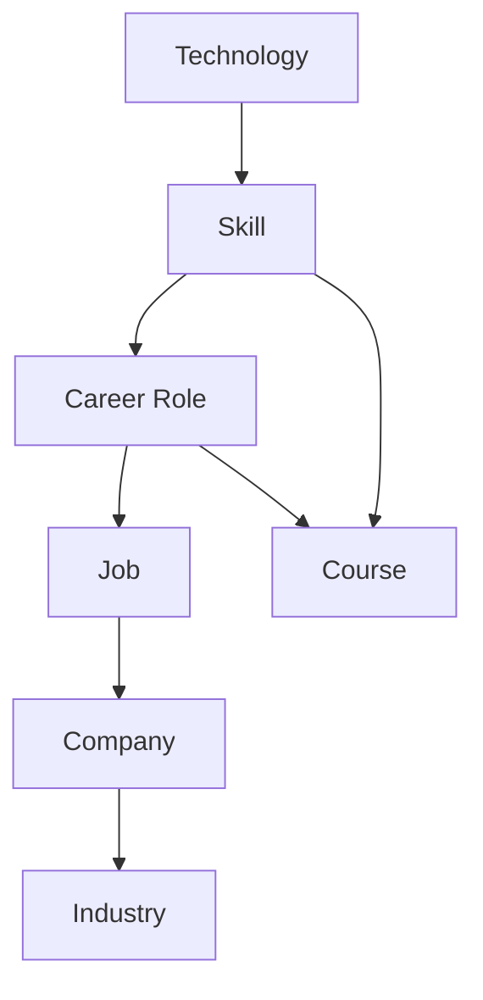
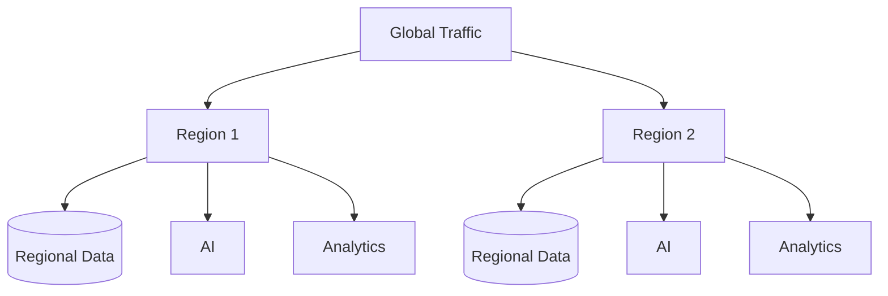
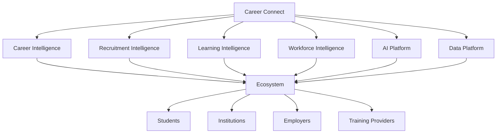
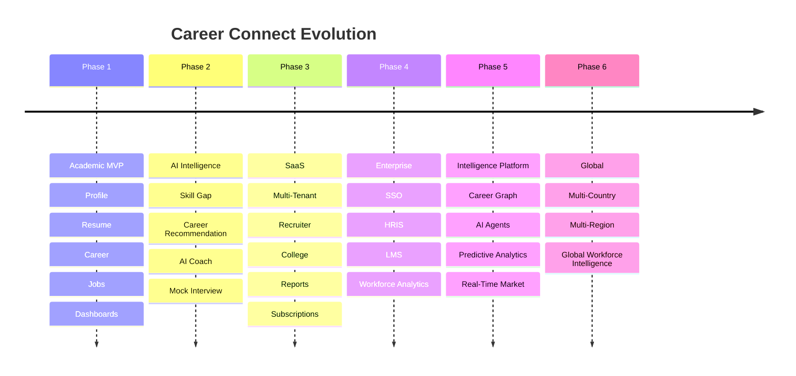
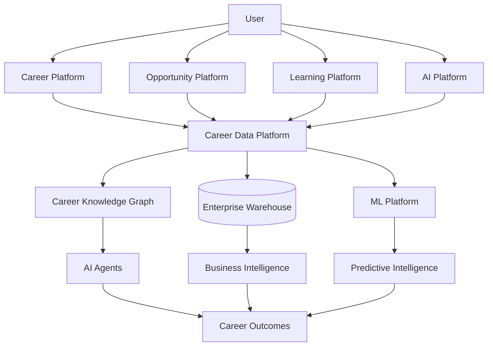

# 37 — Future Scope

# Career Connect — AI Career Intelligence Platform

**Document Type:** Future Scope & Product Evolution Strategy
**Project:** Career Connect
**Version:** 1.0
**Status:** Future Expansion Baseline
**Strategic Horizon:** Academic MVP → Startup SaaS → Enterprise Career Intelligence Platform

---

# 1. Executive Summary

Career Connect is intentionally designed as more than a final-year college application.

Its architecture provides a foundation for evolving into a real SaaS platform serving:

```text id="m8q4x2"
Students
Graduates
Job Seekers
Colleges
Universities
Recruiters
Companies
Training Providers
Career Coaches
Workforce Organizations
```

The future roadmap focuses on expanding:

```text id="q7m3x8"
AI Intelligence
Data Intelligence
Recruitment
Learning
Enterprise SaaS
Cloud Scale
Global Market Intelligence
Predictive Analytics
Automation
Integrations
```

The long-term product vision is:

> **Build an intelligent career and workforce decision platform connecting individual career development with institutional and industry intelligence.**

---

# 2. Future Vision

The future Career Connect platform can evolve from:

```text id="x5m8q3"
Career Portal
```

into:

```text id="m4q7x2"
Career Intelligence Platform
```

and eventually into:

```text id="q8m3x5"
Career + Workforce Intelligence SaaS
```

---

# 3. Product Evolution

```text id="x7m4q2"
Phase 1
Career Management

        ↓

Phase 2
AI Career Intelligence

        ↓

Phase 3
Institutional Career Analytics

        ↓

Phase 4
Recruitment Intelligence

        ↓

Phase 5
Workforce Intelligence

        ↓

Phase 6
Global Career Intelligence Network
```

---

# 4. Future Scope Categories

Future enhancements are grouped into:

```text id="m5q8x3"
1. AI
2. Machine Learning
3. Recruitment
4. Learning
5. Business Intelligence
6. Data Engineering
7. SaaS
8. Cloud
9. Integrations
10. Mobile
11. Global Expansion
12. Security
13. Automation
14. Research
```

---

# 5. AI Future Scope

AI is the largest potential expansion area.

Future capabilities include:

```text id="q4m7x2"
AI Career Agent
AI Job Agent
AI Learning Agent
AI Resume Agent
AI Interview Agent
AI Recruiter Assistant
AI Placement Assistant
AI Executive Analyst
```

---

# 6. AI Career Agent

Instead of requiring the student to initiate every action, the platform could provide an agent that continuously evaluates the user's career progress.

Conceptually:

```text id="x8m3q5"
Profile
↓
Skill Changes
↓
Market Changes
↓
Career Goal
↓
AI Agent
↓
Recommended Actions
```

---

# 7. AI Career Agent — Example

```text id="m7q4x2"
Career Goal:
Data Engineer

Detected:
Airflow demand increased.

Current:
Airflow skill gap exists.

Agent Recommendation:
Start Airflow learning module.

[ View Recommendation ]
```

The agent should remain user-controlled and should not perform consequential actions without appropriate authorization.

---

# 8. AI Job Agent

Future functionality:

```text id="q5m8x3"
Monitor matching jobs
↓
Identify high-fit opportunities
↓
Explain fit
↓
Notify user
```

Advanced versions could prepare applications for user review rather than automatically submitting them.

---

# 9. AI Learning Agent

The learning agent could continuously adapt the roadmap:

```text id="x4q7m2"
Current Skill
↓
Learning Progress
↓
Assessment Result
↓
New Skill Gap
↓
Updated Roadmap
```

---

# 10. AI Resume Agent

Future versions could maintain career-specific resume variants.

Example:

```text id="m8q3x5"
Resume:
General

Variant A:
Data Engineer

Variant B:
Cloud Engineer

Variant C:
Analytics Engineer
```

Each version should remain under user control.

---

# 11. AI Interview Agent

The interview system could evolve from question generation into:

```text id="q7m4x2"
Dynamic Interview
↓
Adaptive Questions
↓
Difficulty Adjustment
↓
Skill Evaluation
↓
Personalized Coaching
```

---

# 12. AI Recruiter Assistant

Recruiters could ask:

```text id="x5m8q3"
"Which candidates strongly match this role?"

"Where is the hiring funnel losing candidates?"

"Which skills are hardest to source?"
```

The assistant should operate only on authorized recruitment data.

---

# 13. AI Placement Officer Assistant

Example:

```text id="m4q7x2"
"Which students are closest to Data Engineering readiness?"

"Which skills should the institution prioritize for training?"

"Which companies are hiring roles aligned with our students?"
```

---

# 14. AI Executive Analyst

The executive assistant could summarize:

```text id="q8m3x5"
Placement
Hiring
Salary
Skill Demand
Market Trends
Risk
Opportunity
```

Example:

```text id="x7m4q2"
Executive Question:
"Why is hiring demand shifting?"

System:
Retrieve approved analytical metrics
+
Identify relevant changes
+
Generate explanation
```

---

# 15. Multi-Agent Architecture

A future architecture could use specialized agents:

```text id="m5q8x3"
Career Agent
Job Agent
Learning Agent
Resume Agent
Interview Agent
Analytics Agent
```

Orchestrator:

```text id="q4m7x2"
                    AI Orchestrator
                         │
       ┌─────────────────┼─────────────────┐
       │        │        │        │        │
    Career     Jobs   Learning Resume  Analytics
```

Agent autonomy should remain bounded by explicit tools and permissions.

---

# 16. AI Personal Memory

Future Career Connect could maintain a controlled career memory containing:

```text id="x8m3q5"
Career Goals
Preferred Roles
Learning Progress
Completed Projects
Resume Versions
Interview History
Application History
```

Users should be able to inspect, control, and delete this memory.

---

# 17. Predictive Analytics

The platform may introduce predictive models for:

```text id="m7q4x2"
Career Readiness
Skill Demand
Hiring Trends
Learning Completion
Application Conversion
Placement Risk Signals
Salary Trends
```

---

# 18. Career Readiness Prediction

Future model:

```text id="q5m8x3"
Profile
+
Skills
+
Projects
+
Learning
+
Experience
↓
ML Model
↓
Readiness Indicator
```

This should be positioned as an analytical estimate rather than a guaranteed outcome.

---

# 19. Placement Forecasting

Institutions could view:

```text id="x4q7m2"
Current Placement
+
Historical Trends
+
Hiring Pipeline
+
Market Signals
↓
Forecast
```

Example:

```text id="m8q3x5"
Current Placement:
82%

Projected Range:
Model-generated estimate
```

Forecasts must clearly communicate uncertainty.

---

# 20. Skill Demand Forecasting

The platform could estimate future demand for:

```text id="q7m4x2"
Python
Cloud
AI
Cybersecurity
Data Engineering
DevOps
```

using historical and current market signals.

---

# 21. Skill Supply Forecasting

Institutions could forecast:

```text id="x5m8q3"
Current Student Skills
+
Expected Graduating Cohort
+
Training Programs
↓
Future Skill Supply
```

---

# 22. Workforce Gap Intelligence

A future enterprise product could compare:

```text id="m4q7x2"
Industry Demand
vs
Talent Supply
```

at:

```text id="q8m3x5"
City
Region
Country
Industry
Role
Technology
```

---

# 23. Workforce Intelligence Platform

This creates a larger product category:

```text id="x7m4q2"
Career Intelligence
+
Talent Intelligence
+
Workforce Intelligence
```

---

# 24. Company Talent Planning

Companies could use Career Connect for:

```text id="m5q8x3"
Workforce Planning
Skills Inventory
Hiring Forecasts
Talent Gaps
Learning Needs
Internal Mobility
```

---

# 25. Internal Mobility

Future employees could discover:

```text id="q4m7x2"
Current Role
↓
Adjacent Roles
↓
Required Skills
↓
Learning Path
↓
Internal Opportunity
```

This expands Career Connect from external hiring into employee career development.

---

# 26. Internal Career Marketplace

An enterprise organization could provide:

```text id="x8m3q5"
Open Roles
Projects
Mentorship
Learning
Career Paths
```

employees could use these to discover internal opportunities.

---

# 27. Mentorship Intelligence

Future feature:

```text id="m7q4x2"
Student / Employee
+
Career Goal
+
Skill Gap
↓
Mentor Matching
```

---

# 28. Mentor Marketplace

Potential platform:

```text id="q5m8x3"
Mentors
Career Coaches
Industry Experts
Alumni
```

matched based on:

```text id="x4q7m2"
Career
Skills
Industry
Experience
Location
Availability
```

---

# 29. Alumni Network

Colleges could use Career Connect to build:

```text id="m8q3x5"
Student
↓
Graduate
↓
Alumni
↓
Mentor
↓
Recruiter
```

This creates a long-term institutional career ecosystem.

---

# 30. Alumni Intelligence

Possible analytics:

```text id="q7m4x2"
Alumni Employers
Career Paths
Salary Progression
Industry Distribution
Geographic Mobility
Skills
```

---

# 31. Institution Benchmarking

Future institutional dashboards could compare:

```text id="x5m8q3"
Placement Rate
Salary
Hiring Companies
Skill Readiness
Learning Outcomes
```

between institutions using governed and privacy-preserving benchmarks.

---

# 32. Institution Benchmarking Architecture

```text id="m4q7x2"
College A
College B
College C
College D
     ↓
Anonymized / Governed Aggregation
     ↓
Benchmarking Engine
     ↓
Institution Dashboard
```

---

# 33. Training Institute Intelligence

Training organizations could understand:

```text id="q8m3x5"
High-Demand Skills
Student Demand
Course Completion
Career Outcomes
Employer Demand
```

---

# 34. Outcome-Based Learning

A future system could connect:

```text id="x7m4q2"
Course
↓
Skill Improvement
↓
Job Applications
↓
Interviews
↓
Placement
```

This enables outcome-oriented learning analytics.

---

# 35. Learning ROI Analytics

Future institutional analytics could study:

```text id="m5q8x3"
Training Participation
+
Skill Progress
+
Career Outcomes
```

while clearly separating correlation from causal claims.

---

# 36. Certification Intelligence

Future capabilities:

```text id="q4m7x2"
Certification Demand
Certification Value Signals
Skill Mapping
Employer Interest
Learning Recommendations
```

---

# 37. Project Intelligence

Students could receive AI feedback on projects.

Example:

```text id="x8m3q5"
Project:
ETL Pipeline

AI Analysis:
✓ SQL
✓ Python
✓ Data Engineering

Missing:
△ Testing
△ Monitoring
△ Cloud Deployment

Recommended:
Add production-style monitoring.
```

---

# 38. Portfolio Intelligence

Career Connect could analyze:

```text id="m7q4x2"
GitHub
Portfolio
Projects
Certificates
Resume
LinkedIn-style profile
```

and create a unified career profile.

---

# 39. GitHub Integration

Possible capabilities:

```text id="q5m8x3"
Repositories
Languages
Contributions
Project Activity
Documentation
```

The platform should request only necessary permissions.

---

# 40. Portfolio Score

Future portfolio evaluation could consider:

```text id="x4q7m2"
Project Relevance
Technical Depth
Documentation
Deployment
Testing
Business Impact
```

This should remain an advisory score rather than a hiring guarantee.

---

# 41. Job Source Integrations

Career Connect could integrate with authorized job data sources and employer feeds.

Potential architecture:

```text id="m8q3x5"
External Source
↓
Connector
↓
Raw Data
↓
Validation
↓
ETL
↓
Warehouse
```

Integrations must comply with applicable source terms and data-use permissions.

---

# 42. ATS Integrations

Enterprise recruiters could integrate with:

```text id="q7m4x2"
Applicant Tracking Systems
HRIS
Recruitment Platforms
```

---

# 43. LMS Integrations

Training and institutions could connect:

```text id="x5m8q3"
Learning Management Systems
Course Platforms
Assessment Platforms
```

---

# 44. University ERP Integration

Colleges could connect:

```text id="m4q7x2"
Student Information
Academic Records
Attendance
Results
Placement
```

with carefully governed data boundaries.

---

# 45. HRIS Integration

Enterprise customers could connect:

```text id="q8m3x5"
Employee
Role
Department
Skills
Learning
Mobility
```

---

# 46. SSO Expansion

Future enterprise authentication:

```text id="x7m4q2"
Google Workspace
Microsoft Entra ID
SAML
OIDC
Enterprise SSO
```

---

# 47. Mobile Application

A native or cross-platform mobile application could provide:

```text id="m5q8x3"
Job Alerts
AI Coach
Application Tracking
Learning
Interview Practice
Notifications
```

---

# 48. Mobile Architecture

```text id="q4m7x2"
Mobile App
↓
API Gateway
↓
Career Connect Services
```

The same business services can support web and mobile clients.

---

# 49. Push Notifications

Mobile and web push may notify users about:

```text id="x8m3q5"
New Job Match
Interview
Application Update
Learning Reminder
AI Recommendation
Report Ready
```

---

# 50. Voice Career Assistant

Future AI interaction could support voice:

```text id="m7q4x2"
User speaks
↓
Speech-to-Text
↓
Career Intelligence
↓
AI Response
↓
Text-to-Speech
```

---

# 51. Multilingual Career Intelligence

Future support may include:

```text id="q5m8x3"
English
Tamil
Hindi
Other regional/global languages
```

The architecture should maintain canonical data models while localizing user-facing responses.

---

# 52. Global Expansion

Career Connect could expand from:

```text id="x4q7m2"
College / Regional
```

to:

```text id="m8q3x5"
National
↓
Multi-Country
↓
Global
```

---

# 53. Global Job Intelligence

Potential dimensions:

```text id="q7m4x2"
Country
Region
City
Remote
Visa Requirements
Employment Type
Industry
```

---

# 54. International Career Matching

Future models may consider:

```text id="x5m8q3"
Career Skills
Education Equivalence
Language
Location
Remote Eligibility
Work Authorization
```

Such recommendations must be carefully framed because legal/work authorization rules vary by jurisdiction.

---

# 55. Compensation Intelligence

Future analytics could expand from salary into:

```text id="m4q7x2"
Compensation
Benefits
Bonus
Equity
Location Adjustment
Career Growth
```

---

# 56. Total Compensation Analytics

Example:

```text id="q8m3x5"
Base Salary
+
Bonus
+
Equity
+
Benefits
=
Total Compensation View
```

Actual data availability may vary by employer and geography.

---

# 57. Career Growth Intelligence

Future platform could estimate:

```text id="x7m4q2"
Role
↓
Next Role
↓
Required Skills
↓
Typical Development Path
```

---

# 58. Career Graph

A future Career Graph could model:

```text id="m5q8x3"
Skills
↔
Technologies
↔
Roles
↔
Courses
↔
Companies
↔
Industries
↔
Locations
```

---

# 59. Career Knowledge Graph



This could become a major differentiating technology for Career Connect.

---

# 60. Graph-Based Recommendations

Instead of only using vector similarity:

```text id="x8q3m5"
Graph Relationships
+
Structured Features
+
Machine Learning
+
AI Explanation
```

could power recommendations.

---

# 61. Advanced Machine Learning

Potential models:

```text id="m7q4x2"
Recommendation Systems
Ranking Models
Time-Series Forecasting
Classification
Clustering
Anomaly Detection
Graph Models
```

---

# 62. Feature Store

At larger scale, Career Connect could introduce a feature store.

Example features:

```text id="q5m8x3"
skill_match_ratio
application_conversion
learning_completion
job_demand_score
career_alignment
```

---

# 63. MLOps

Future ML platform:

```text id="x4q7m2"
Data
↓
Feature Engineering
↓
Training
↓
Evaluation
↓
Model Registry
↓
Deployment
↓
Monitoring
↓
Retraining
```

---

# 64. Model Monitoring

Monitor:

```text id="m8q3x5"
Accuracy
Drift
Feature Distribution
Prediction Distribution
Latency
Bias Indicators
```

---

# 65. Data Drift

Example:

```text id="q7m4x2"
Historical Skill Distribution
vs
Current Skill Distribution
```

A large change may indicate:

```text id="x5m8q3"
Market Shift
Data Source Change
Pipeline Issue
```

---

# 66. Concept Drift

A model's historical assumptions may become less accurate over time.

Career Connect should support model reassessment when:

```text id="m4q7x2"
Career Trends Change
Technology Changes
Market Conditions Change
```

---

# 67. Responsible AI Expansion

Future governance may include:

```text id="q8m3x5"
Model Cards
Risk Assessments
Bias Testing
Explainability Reports
Human Review
Model Versioning
```

---

# 68. AI Evaluation Marketplace

Future platform feature:

```text id="x7m4q2"
Compare:
Model A
Model B
Model C

Across:
Accuracy
Cost
Latency
Safety
User Satisfaction
```

This could become an internal model-selection platform.

---

# 69. AI Provider Abstraction

The existing architecture can evolve toward:

```text id="m5q8x3"
Provider
↓
Routing Policy
↓
Best Model for Task
```

This allows different models to be selected dynamically.

---

# 70. Intelligent Model Routing

Example:

```text id="q4m7x2"
Simple Skill Extraction
→ Efficient Model

Complex Career Reasoning
→ Higher Capability Model

High-Volume Batch
→ Cost-Optimized Model
```

---

# 71. AI Cost Optimization

Future techniques:

```text id="x8q3m5"
Caching
Prompt Compression
Model Routing
Batch Processing
Context Reduction
Usage Quotas
```

---

# 72. Enterprise Data Residency

Future enterprise customers may require data to remain within a specific geographic region.

Architecture could support:

```text id="m7q4x2"
Regional Data Plane
Regional Storage
Regional AI Configuration
Regional Warehouse
```

Subject to the selected cloud/provider capabilities and applicable requirements.

---

# 73. Dedicated Tenant Architecture

Enterprise customers may receive:

```text id="q5m8x3"
Dedicated Database
Dedicated Storage
Dedicated Warehouse
Dedicated AI Configuration
```

This provides stronger isolation at increased operational cost.

---

# 74. Multi-Region Architecture

Future high-availability architecture:



---

# 75. Disaster Recovery Expansion

Future enterprise targets may include:

```text id="m8q3x5"
Automated Backup
Cross-Region Replication
Failover
Recovery Automation
```

---

# 76. Event-Driven Architecture

As the platform grows, more workflows may become event-driven.

Example:

```text id="q7m4x2"
application.created
↓
Notification
+
Analytics
+
Recommendation Update
+
Recruiter Workflow
```

---

# 77. Event Bus

Possible future architecture:

```text id="x5m8q3"
Application Event
↓
Event Bus
├── Analytics
├── Notifications
├── AI
├── Audit
└── Data Warehouse
```

---

# 78. Real-Time Analytics

Future platform could support:

```text id="m4q7x2"
Streaming Jobs
Streaming Applications
Streaming Hiring Events
```

rather than batch-only processing.

---

# 79. Real-Time Job Market

The system could eventually display:

```text id="q8m3x5"
Current Demand
Trending Skill
New Jobs
Hiring Surge
```

with clearly defined freshness guarantees.

---

# 80. Real-Time Alerts

Examples:

```text id="x7m4q2"
"25 new Data Engineer jobs match your profile."

"Your target skill is trending."

"Interview scheduled."
```

---

# 81. Career Simulation

Future users could ask:

> "What happens if I learn Spark and Airflow?"

System:

```text id="m5q8x3"
Current Profile
↓
Hypothetical Skills
↓
Recalculate Matches
↓
Show Career Impact
```

This becomes a **career scenario simulator**.

---

# 82. Scenario Planning

Students could compare:

```text id="q4m7x2"
Path A:
Data Engineer

Path B:
Cloud Engineer

Path C:
Data Scientist
```

with:

```text id="x8q3m5"
Skill Gap
Learning Time
Job Demand
Salary Signals
Career Compatibility
```

---

# 83. Career Decision Simulator

Future UX:

```text id="m7q4x2"
Choose Career
        │
        ├── Skills Required
        ├── Learning Effort
        ├── Market Demand
        ├── Job Matches
        └── Growth Path
```

---

# 84. Personalized Career Roadmap

The roadmap could expand beyond skills:

```text id="q5m8x3"
Skills
Projects
Certifications
Internships
Networking
Interview Preparation
Applications
```

---

# 85. Internship Intelligence

Future module:

```text id="x4q7m2"
Internship Discovery
Internship Matching
Internship Analytics
Internship-to-Placement Analysis
```

---

# 86. Internship Conversion

Measure:

```text id="m8q3x5"
Internship
↓
Interview
↓
Offer
↓
Placement
```

This can become a major institutional KPI.

---

# 87. Campus Recruitment Intelligence

Future enterprise module:

```text id="q7m4x2"
Campus Drive
Candidate Eligibility
Applications
Tests
Interviews
Offers
Joining
```

---

# 88. Assessment Platform

Career Connect could eventually include:

```text id="x5m8q3"
Coding Tests
Aptitude
Technical Tests
Communication
Domain Assessments
```

---

# 89. Assessment Analytics

Dashboards:

```text id="m4q7x2"
Assessment Score
Interview Score
Skill Profile
Hiring Outcome
```

---

# 90. Skill Verification

Future verification could use:

```text id="q8m3x5"
Certificates
Projects
Assessments
Interviews
Employer Validation
```

to build a richer skill evidence profile.

---

# 91. Career Passport

A user could have a portable:

```text id="x7m4q2"
Career Passport
```

containing verified:

```text id="m5q8x3"
Skills
Certifications
Projects
Education
Experience
Achievements
```

The user should control sharing.

---

# 92. Verifiable Credentials

Future architecture could support verifiable digital credentials for:

```text id="q4m7x2"
Certificates
Degrees
Skills
Assessments
Achievements
```

---

# 93. Blockchain — Optional Research Direction

Blockchain could theoretically be explored for credential verification.

However:

> Blockchain should not be added merely to make the project look advanced.

A conventional secure credential service may be simpler and more maintainable.

---

# 94. Startup Monetization Expansion

Future SaaS revenue models:

```text id="x8q3m5"
Freemium
Student Premium
College Subscription
Recruiter Subscription
Enterprise SaaS
Training Provider Subscription
API Usage
Advanced Analytics
```

---

# 95. Student Premium

Possible features:

```text id="m7q4x2"
Advanced Resume Analysis
AI Mock Interviews
Advanced Career Scenarios
Premium Reports
Deep Skill Analytics
```

---

# 96. College SaaS

Possible subscription:

```text id="q5m8x3"
Student Management
Placement Analytics
Skill Intelligence
Reports
Recruiter Management
AI Placement Assistant
```

---

# 97. Recruiter SaaS

Possible subscription:

```text id="x4q7m2"
Candidate Intelligence
Hiring Analytics
AI Recruiter Assistant
Advanced Matching
Talent Search
```

---

# 98. Enterprise SaaS

Possible:

```text id="m8q3x5"
SSO
Dedicated Tenant
Advanced Governance
Data Residency
Enterprise Analytics
HRIS Integration
Internal Mobility
```

---

# 99. API Platform

Future Career Connect APIs could expose:

```text id="q7m4x2"
Career Data
Skill Intelligence
Job Intelligence
Market Intelligence
Analytics
AI Services
```

under controlled licensing and authorization.

---

# 100. Developer Platform

Potential future:

```text id="x5m8q3"
Developer Portal
API Keys
Usage Dashboard
Documentation
Sandbox
Webhooks
```

---

# 101. Marketplace

Career Connect could eventually connect:

```text id="m4q7x2"
Students
Employers
Mentors
Training Providers
Career Coaches
Institutions
```

---

# 102. Career Ecosystem

Long-term model:

```text
                  CAREER CONNECT
                       │
      ┌────────────────┼────────────────┐
      │                │                │
   Students        Colleges         Employers
      │                │                │
      └────────────────┼────────────────┘
                       │
                Career Intelligence
                       │
      ┌────────────────┼────────────────┐
      │                │                │
  Learning          Hiring          Analytics
```

---

# 103. Research Opportunities

Career Connect can become a research platform for:

```text id="q8m3x5"
Recommendation Systems
Career Prediction
Skill Graphs
AI Coaching
Workforce Analytics
NLP
RAG
Explainable AI
Fairness
Time-Series Forecasting
```

---

# 104. Academic Research Papers

Potential paper topics:

```text id="x7m4q2"
AI-Based Career Recommendation Using Skill Graphs

Skill Demand vs Supply Analytics

Explainable AI for Career Recommendations

AI Resume Analysis and Skill Extraction

Career Readiness Prediction

Career Learning Path Optimization
```

---

# 105. Hackathon Expansion

For hackathons, emphasize:

```text id="m5q8x3"
AI Agent
Career Simulation
Real-Time Market Intelligence
Natural-Language BI
Interactive Dashboards
```

---

# 106. Startup Incubator Expansion

For startup validation:

```text id="q4m7x2"
MVP
↓
Pilot College
↓
Pilot Recruiter
↓
Measure Outcomes
↓
Refine Product
↓
SaaS Launch
```

---

# 107. Pilot Program

A future pilot could measure:

```text id="x8q3m5"
Student Activation
Career Recommendation Usage
Skill Gap Resolution
Application Quality
Recruiter Adoption
Placement Outcomes
```

---

# 108. Product Analytics Future

Career Connect should eventually analyze:

```text id="m7q4x2"
Feature Adoption
User Retention
User Journey
AI Usage
Career Outcome
```

---

# 109. User Journey Analytics

Example:

```text id="q5m8x3"
Registration
↓
Profile
↓
Skills
↓
Resume
↓
Career
↓
Job
↓
Application
↓
Interview
↓
Placement
```

Drop-off analysis can identify product improvement opportunities.

---

# 110. A/B Testing

Future product optimization may test:

```text id="x4q7m2"
Dashboard Layout
Recommendation Position
CTA
Resume Flow
AI Entry Point
```

Experiments should measure meaningful outcomes.

---

# 111. Product-Led Growth

Potential growth loops:

```text id="m8q3x5"
Student
↓
Career Insight
↓
Shareable Report
↓
Peer Awareness
↓
New User
```

Any sharing feature must respect privacy.

---

# 112. Social Career Intelligence

Future optional feature:

```text id="q7m4x2"
Career Communities
Role Groups
Skill Communities
Alumni Communities
```

---

# 113. Community Features

Examples:

```text id="x5m8q3"
Questions
Mentorship
Discussion
Project Showcase
Career Events
```

Moderation and safety would become important.

---

# 114. Career Event Intelligence

Future platform could integrate:

```text id="m4q7x2"
Job Fairs
Hackathons
Career Workshops
Recruiter Events
Training Programs
```

and recommend relevant events.

---

# 115. Event-to-Outcome Analytics

Measure:

```text id="q8m3x5"
Event Participation
↓
Applications
↓
Interviews
↓
Offers
```

---

# 116. Employer Branding Intelligence

Companies could understand:

```text id="x7m4q2"
Candidate Interest
Job Engagement
Application Quality
Talent Perception
```

---

# 117. Hiring Market Intelligence

Future reports could combine:

```text id="m5q8x3"
Demand
Supply
Salary
Competition
Skills
Locations
```

into an employer-facing market view.

---

# 118. Talent Heatmaps

Example:

```text id="q4q7m2"
Location
+
Skill
+
Demand
+
Supply
```

could produce talent availability maps.

---

# 119. Career Heatmaps

Students could explore:

```text id="x8m3q5"
High Demand
High Salary
Low Skill Gap
```

career opportunities.

---

# 120. Sustainability and Social Impact

Future reporting could measure:

```text id="m7q4x2"
Graduate Employment
Skill Development
Career Mobility
Regional Opportunity
```

to demonstrate social impact.

---

# 121. Accessibility Expansion

Future platform support:

```text id="q5m8x3"
Voice Navigation
Screen Reader Optimization
High Contrast
Keyboard-First Workflows
Multilingual Accessibility
```

---

# 122. Security Expansion

Future enterprise security:

```text id="x4q7m2"
Enterprise SSO
MFA
Privileged Access
SIEM
DLP
Advanced Threat Detection
```

---

# 123. Compliance Expansion

Depending on deployment markets and organizational requirements, future versions may introduce formal controls for applicable privacy/security frameworks and contractual obligations.

The exact compliance scope must be determined by deployment jurisdiction and customer requirements.

---

# 124. Privacy Center

Future users may manage:

```text id="m8q3x5"
Profile Visibility
AI Personalization
Data Sharing
Connected Accounts
Export Data
Delete Data
```

---

# 125. Data Portability

A user could export their career information:

```text id="q7m4x2"
Profile
Skills
Resume Metadata
Learning
Applications
Certifications
```

in a structured format.

---

# 126. Account Deletion

Future architecture should support controlled deletion/anonymization according to retention obligations.

---

# 127. Explainable Analytics

Future dashboards could allow users to ask:

```text id="x5m8q3"
"Why did this number change?"
```

and automatically show:

```text id="m4q7x2"
Historical comparison
Main contributing dimensions
Data freshness
Relevant events
```

---

# 128. AI + BI Convergence

The platform could evolve from:

```text id="q8m3x5"
Dashboard
+
Chat
```

to:

```text id="x7m4q2"
Conversational Analytics Workspace
```

where users combine:

```text
Charts
Questions
Filters
Tables
AI
```

in one analytical interface.

---

# 129. Conversational Dashboard

Example:

```text id="m5q7x3"
User:
Show placement trends.

AI:
[Chart]

User:
Break it down by department.

AI:
[Updated Chart]

User:
Why did Mechanical fall?

AI:
[Drivers + Supporting Metrics]
```

---

# 130. Autonomous Reporting

Future system could automatically generate:

```text id="q4m7x2"
Weekly
Monthly
Quarterly
Yearly
```

executive reports based on governed metrics.

Human approval can remain required for important external distribution.

---

# 131. Automated Data Quality Remediation

Future data platform:

```text id="x8m3q5"
Quality Failure
↓
Identify Cause
↓
Suggest Fix
↓
Engineer Approval
↓
Replay
```

AI may assist remediation but should not silently modify production pipelines.

---

# 132. Self-Healing Data Pipelines

A mature future architecture could automatically recover from known transient failures:

```text id="m7q4x2"
Timeout
↓
Retry
↓
Fallback
↓
Resume
```

For uncertain data-quality failures, human approval remains appropriate.

---

# 133. Intelligent Cost Optimization

AI could monitor:

```text id="q5m8x3"
Warehouse Usage
AI Usage
Storage
Compute
```

and suggest:

```text id="x4q7m2"
Caching
Query Optimization
Model Routing
Storage Lifecycle
```

---

# 134. FinOps Dashboard

Future enterprise dashboard:

```text id="m8q3x5"
Cloud Cost
AI Cost
Warehouse Cost
Storage Cost
Cost per User
Cost per Organization
```

---

# 135. Sustainability Monitoring

Future infrastructure analytics may estimate:

```text id="q7m4x2"
Compute Utilization
Storage Growth
Workload Efficiency
```

where appropriate data is available.

---

# 136. Long-Term Product Architecture



---

# 137. Future Product Layers

The platform can evolve into:

```text id="m4q7x2"
Layer 1
Career Profile

Layer 2
Career Intelligence

Layer 3
Opportunity Intelligence

Layer 4
Learning Intelligence

Layer 5
Recruitment Intelligence

Layer 6
Workforce Intelligence

Layer 7
AI Agent Platform
```

---

# 138. Future Scope Prioritization

Not every idea should be built immediately.

Use:

```text id="q8m3x5"
Business Value
+
User Demand
+
Technical Feasibility
+
Data Availability
+
Security Risk
+
Implementation Cost
```

to prioritize.

---

# 139. Priority Matrix

## P0 — Core Expansion

```text id="x7m4q2"
Advanced Career Recommendation
Advanced Skill Intelligence
Job Matching
Learning Recommendations
AI Career Assistant
```

## P1 — Product Expansion

```text id="m5q8x3"
Mock Interview
Portfolio Intelligence
Internship Intelligence
Alumni Network
Natural-Language BI
```

## P2 — Enterprise Expansion

```text id="q4m7x2"
HRIS
LMS
SSO
Internal Mobility
Workforce Intelligence
```

## P3 — Research / Long-Term

```text id="x8m3q5"
Multi-Agent AI
Career Simulation
Career Graph
Multi-Region
Advanced ML Platform
```

---

# 140. Future Scope Roadmap



---

# 141. Long-Term Vision

Career Connect should ultimately become:

```text id="q5m8x3"
LinkedIn-like Career Identity
+
Glassdoor-like Market Intelligence
+
Power BI-like Analytics
+
Snowflake-like Data Platform
+
ChatGPT-like AI Assistance
+
Modern SaaS Experience
```

while remaining a coherent product rather than a collection of disconnected features.

---

# 142. Future Architecture



---

# 143. Final Future Scope Principles

Future development should follow:

```text id="m8q3x5"
User Value First
↓
Data Availability
↓
Security
↓
Explainability
↓
Scalability
↓
Business Sustainability
```

Avoid adding technology simply because it is fashionable.

---

# 144. CTO-Level Future Scope Principle

The future of Career Connect is not:

> **"Add more AI features."**

It is:

> **"Build a continuously learning career intelligence ecosystem that connects people, opportunities, skills, learning, organizations, and workforce data."**

The long-term architecture therefore becomes:

```text id="q7m4x2"
Person
↔
Skills
↔
Learning
↔
Career
↔
Job
↔
Company
↔
Industry
↔
Market
```

with AI and analytics providing intelligence across the graph.

---

# 145. Final Future Scope Statement

> **Career Connect has a broad evolution path from a final-year engineering project into a scalable career and workforce intelligence SaaS platform. Future development can introduce advanced AI agents, predictive analytics, adaptive learning, portfolio intelligence, mentorship, alumni networks, internship intelligence, enterprise HR integrations, internal mobility, real-time market analytics, career knowledge graphs, multilingual experiences, mobile applications, global workforce intelligence, and advanced MLOps. The architecture intentionally separates operational systems, analytical systems, AI services, and governance layers so these capabilities can be introduced incrementally without redesigning the entire platform. The long-term objective is to create an intelligent ecosystem in which career development, learning, recruitment, institutional analytics, and workforce intelligence continuously reinforce each other.**

---

## Document Status

| Attribute             | Value                                          |
| --------------------- | ---------------------------------------------- |
| Project               | Career Connect                                 |
| Document              | Future Scope                                   |
| Version               | 1.0                                            |
| Strategic Horizon     | Academic → Startup → Enterprise → Global       |
| AI Expansion          | Agents + Prediction + Personalization          |
| Data Expansion        | Knowledge Graph + Real-Time + Workforce Data   |
| Product Expansion     | Students + Colleges + Recruiters + Enterprises |
| Learning Expansion    | Adaptive Learning + Outcomes                   |
| Recruitment Expansion | Talent Intelligence + Internal Mobility        |
| SaaS Expansion        | Subscriptions + APIs + Integrations            |
| Global Expansion      | Multi-Country + Multi-Region                   |
| Research              | AI + ML + NLP + Graph + Analytics              |
| Security              | Enterprise IAM + Privacy + Governance          |
| Priority Model        | P0 → P1 → P2 → P3                              |
| Long-Term Vision      | Career + Talent + Workforce Intelligence       |
| Status                | Future Expansion Baseline                      |
