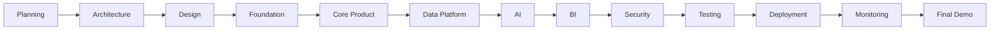
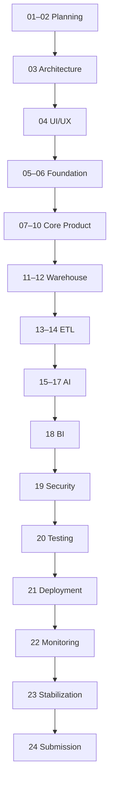

# 38 — Project Timeline

# Career Connect — AI Career Intelligence Platform

**Document Type:** Complete Project Execution Timeline
**Project:** Career Connect
**Version:** 1.0
**Status:** Project Planning Baseline
**Target:** Final Year BE CSE + Cloud + Data Warehouse + BI + AI + SaaS MVP

---

# 1. Executive Summary

The Career Connect project requires coordination across:

```text id="6k2m8q"
Product Management
UI/UX
Frontend
Backend
Database
Cloud
Data Engineering
Data Warehouse
Business Intelligence
AI
Security
Testing
DevOps
Documentation
```

The project timeline is therefore organized into progressive phases rather than attempting to build everything simultaneously.

The recommended development lifecycle is:

```text id="m8q4x2"
Planning
↓
Architecture
↓
Design
↓
Foundation
↓
Core Development
↓
Data Engineering
↓
AI
↓
BI
↓
Security
↓
Testing
↓
Deployment
↓
Demo
↓
Final Documentation
```

---

# 2. Recommended Academic Timeline

A practical final-year implementation can be completed over approximately:

> **24 weeks**

This provides enough time to build a strong working MVP while leaving dedicated time for testing, documentation, presentation, and stabilization.

---

# 3. 24-Week Master Timeline

```text
Week 01–02  → Product & Requirements
Week 03     → Architecture
Week 04     → UI/UX
Week 05–06  → Development Foundation
Week 07–09  → Core Application
Week 10–12  → Data Warehouse
Week 13–14  → ETL / Data Lake
Week 15–17  → AI Modules
Week 18     → BI Dashboards
Week 19     → Security
Week 20     → Testing
Week 21     → CI/CD + Cloud Deployment
Week 22     → Monitoring + Logging
Week 23     → Optimization + Final Integration
Week 24     → Documentation + Demo + Submission
```

---

# 4. Phase Architecture



---

# 5. Phase 1 — Product Planning

**Duration:** Week 1–2

Objectives:

```text id="x8m3q2"
Understand Problem
Define Users
Define Scope
Define MVP
Define Requirements
Define Success Metrics
```

---

# 6. Week 1 — Product Discovery

Tasks:

```text id="m4q8x3"
✓ Finalize project vision
✓ Identify personas
✓ Define core problems
✓ Define platform objectives
✓ Define business use cases
✓ Define MVP boundary
```

Deliverables:

```text id="q7m5x2"
01 Vision Document
02 Problem Statement
03 Market Research
04 Competitor Analysis
```

---

# 7. Week 2 — Product Definition

Tasks:

```text id="x5m7q3"
✓ Define business model
✓ Define product scope
✓ Define product roadmap
✓ Define user journeys
✓ Define acceptance criteria
```

Deliverables:

```text id="m8q4x2"
05 SWOT Analysis
06 Business Model
07 Product Roadmap
08 Software Development Lifecycle
20 PRD
```

---

# 8. Phase 2 — Architecture

**Duration:** Week 3

Objectives:

```text id="q4m8x3"
Define System Architecture
Define Cloud Architecture
Define Data Architecture
Define AI Architecture
Define Security Boundaries
```

---

# 9. Week 3 — Architecture Design

Tasks:

```text id="x7m3q2"
✓ System architecture
✓ Cloud architecture
✓ Data warehouse architecture
✓ ER architecture
✓ Star schema
✓ Snowflake schema
✓ Data flow
✓ API architecture
✓ Security architecture
```

Deliverables:

```text id="m5q8x3"
09 System Architecture
10 Cloud Architecture
11 Data Warehouse Architecture
12 Data Flow Diagram
13 ER Diagram
14 Database Design
15 Star Schema
16 Snowflake Schema
```

---

# 10. Phase 3 — UI/UX

**Duration:** Week 4

Objectives:

```text id="q8m4x2"
Create Design System
Create Wireframes
Create High-Fidelity Screens
Define Responsive Behavior
Define Dashboard Experience
```

---

# 11. Week 4 — Product Design

Tasks:

```text id="x5m7q3"
✓ Wireframes
✓ Design tokens
✓ Navigation
✓ Role-based dashboards
✓ Student experience
✓ Recruiter experience
✓ Placement experience
✓ Admin experience
✓ Mobile layouts
```

Deliverables:

```text id="m4q8x2"
26 Wireframes
27 UI/UX Design
28 Dashboard Design
```

---

# 12. Phase 4 — Development Foundation

**Duration:** Week 5–6

Objectives:

```text id="q7m3x5"
Establish Repository
Set Up Frontend
Set Up Backend
Set Up Database
Set Up Authentication
Set Up Docker
Set Up CI
```

---

# 13. Week 5 — Repository and Frontend

Tasks:

```text id="x8m4q2"
✓ Create GitHub repository
✓ Monorepo structure
✓ Next.js setup
✓ TypeScript
✓ Tailwind
✓ shadcn/ui
✓ Design tokens
✓ App shell
✓ Navigation
```

---

# 14. Week 6 — Backend and Database Foundation

Tasks:

```text id="m5q7x3"
✓ NestJS setup
✓ API structure
✓ PostgreSQL
✓ Supabase integration
✓ Authentication
✓ RBAC foundation
✓ Migration system
✓ Docker Compose
```

Initial deliverable:

```text id="q4m8x2"
Working login
+
Working dashboard shell
+
Database connection
+
Protected API
```

---

# 15. Phase 5 — Core Application

**Duration:** Week 7–9

Objective:

> Build the first end-to-end functional product.

---

# 16. Week 7 — Student Module

Tasks:

```text id="x7m3q2"
✓ Student profile
✓ Education
✓ Skills
✓ Projects
✓ Certifications
✓ Career goals
```

Deliverable:

```text id="m8q4x3"
Functional Student Profile
```

---

# 17. Week 8 — Resume and Career

Tasks:

```text id="q5m7x2"
✓ Resume upload
✓ Resume versioning
✓ Career explorer
✓ Career details
✓ Skill gap UI
✓ Learning roadmap structure
```

---

# 18. Week 9 — Jobs and Applications

Tasks:

```text id="x4m8q3"
✓ Job listings
✓ Search
✓ Filters
✓ Job detail
✓ Job matching structure
✓ Application
✓ Application tracking
```

Milestone:

> **First complete student-to-job workflow.**

---

# 19. Phase 6 — Recruiter and Placement Modules

**Duration:** Week 9–10

Tasks:

```text id="m7q3x2"
✓ Recruiter dashboard
✓ Job management
✓ Candidate search
✓ Candidate profile
✓ Shortlisting
✓ Interview scheduling
✓ Placement management
```

---

# 20. Week 10 Milestone

At the end of Week 10:

```text id="q8m4x3"
Student
↓
Profile
↓
Resume
↓
Career
↓
Job
↓
Application

Recruiter
↓
Job
↓
Candidate
↓
Interview

College
↓
Placement
```

This is the first major product milestone.

---

# 21. Phase 7 — Data Warehouse

**Duration:** Week 10–12

This phase is critical because the project is explicitly a Data Warehouse + BI project.

---

# 22. Week 10 — Warehouse Foundation

Tasks:

```text id="x5m7q2"
✓ Warehouse setup
✓ Staging schema
✓ Dimension strategy
✓ Surrogate key strategy
✓ Date dimension
```

---

# 23. Week 11 — Dimensions

Build:

```text id="m4q8x3"
dim_student
dim_company
dim_skill
dim_job
dim_college
dim_date
dim_location
dim_technology
dim_course
dim_recruiter
```

---

# 24. Week 12 — Facts and Marts

Build:

```text id="q7m3x5"
fact_placement
fact_application
fact_salary
fact_interview
fact_hiring
fact_learning
fact_certification
```

Data marts:

```text id="x8m4q2"
Placement Mart
Hiring Mart
Skill Mart
Salary Mart
Student Mart
```

---

# 25. Warehouse Milestone

At the end of Week 12:

```text id="m5q7x3"
OLTP
+
ETL
+
Warehouse
+
Star Schema
+
Data Mart
```

must be demonstrable.

---

# 26. Phase 8 — Data Lake and ETL

**Duration:** Week 13–14

---

# 27. Week 13 — Data Lake

Tasks:

```text id="q4m8x2"
✓ Raw storage
✓ Curated storage
✓ Quarantine
✓ Archive
✓ Source metadata
✓ Data versioning
```

Structure:

```text id="x7m3q2"
raw/
curated/
quarantine/
archive/
```

---

# 28. Week 14 — ETL

Tasks:

```text id="m8q4x3"
✓ Extract
✓ Clean
✓ Normalize
✓ Deduplicate
✓ Validate
✓ Transform
✓ Incremental loading
✓ Logging
✓ Error handling
✓ Reconciliation
```

Deliverable:

```text id="q5m7x2"
Automated ETL Pipeline
```

---

# 29. ETL Milestone

Demonstrate:

```text id="x4m8q3"
Source Dataset
↓
Raw Data
↓
Transformation
↓
Quality Validation
↓
Warehouse
↓
Dashboard
```

This will strongly demonstrate the project's cloud/data-engineering component.

---

# 30. Phase 9 — AI Development

**Duration:** Week 15–17

This should be implemented after the underlying data model exists.

---

# 31. Week 15 — Resume + Skill AI

Build:

```text id="m7q3x2"
✓ Resume text extraction
✓ Skill extraction
✓ Skill normalization
✓ Resume score
✓ Resume recommendations
```

---

# 32. Week 16 — Career + Job AI

Build:

```text id="q8m4x3"
✓ Skill gap engine
✓ Career recommendation
✓ Learning recommendation
✓ Job matching
```

---

# 33. Week 17 — Conversational AI

Build:

```text id="x5m7q2"
✓ Career Assistant
✓ Tool calling
✓ Context retrieval
✓ AI guardrails
✓ Structured output
```

Optional:

```text id="m4q8x3"
✓ Mock Interview
✓ Natural-Language BI
```

---

# 34. AI Milestone

At the end of Week 17:

```text id="q7m3x5"
Profile
↓
AI Skill Analysis
↓
Skill Gap
↓
Career Recommendation
↓
Learning Recommendation
↓
Job Recommendation
↓
AI Career Chat
```

should function end-to-end.

---

# 35. Phase 10 — Business Intelligence

**Duration:** Week 18

Build:

```text id="x8m4q2"
Student Dashboard
Recruiter Dashboard
Placement Dashboard
Executive Dashboard
Skill Intelligence
Salary Intelligence
```

---

# 36. Week 18 — BI Integration

Tasks:

```text id="m5q7x3"
✓ Semantic metrics
✓ Dashboard APIs
✓ KPI cards
✓ Trends
✓ Filters
✓ Drilldowns
✓ Data freshness
✓ Export
```

---

# 37. BI Milestone

Demonstrate:

```text id="q4m8x2"
Warehouse
↓
Data Mart
↓
Analytics API
↓
Dashboard
```

with the dashboard values reconciling to the warehouse.

---

# 38. Phase 11 — Security

**Duration:** Week 19

Tasks:

```text id="x7m3q2"
✓ RBAC
✓ Tenant isolation
✓ RLS
✓ Input validation
✓ Rate limiting
✓ Secure uploads
✓ Audit logs
✓ Security headers
✓ Secret management
```

---

# 39. Week 19 Security Validation

Test:

```text id="m8q4x3"
Student vs Student
Student vs Admin
Tenant A vs Tenant B
Recruiter vs Unauthorized Candidate
AI vs Private Data
```

---

# 40. Security Milestone

No critical security issue should remain open before final stabilization.

---

# 41. Phase 12 — Testing

**Duration:** Week 20

Tasks:

```text id="q5m7x2"
✓ Unit testing
✓ API testing
✓ Integration
✓ E2E
✓ Security
✓ AI evaluation
✓ ETL testing
✓ Warehouse reconciliation
✓ Dashboard testing
✓ Accessibility
```

---

# 42. Week 20 — Defect Resolution

Execute:

```text id="x4m8q3"
Test
↓
Defect
↓
Fix
↓
Regression
↓
Retest
```

Priority:

```text id="m7q3x2"
Critical
→ High
→ Medium
→ Low
```

---

# 43. Testing Milestone

Deliver:

```text id="q8m4x3"
Test Report
+
Test Case Results
+
Defect Report
+
Security Report
+
AI Evaluation Report
```

---

# 44. Phase 13 — Cloud Deployment

**Duration:** Week 21

Tasks:

```text id="x5m7q2"
✓ Production frontend
✓ Production API
✓ AI service
✓ Workers
✓ PostgreSQL
✓ Storage
✓ Warehouse
✓ CI/CD
```

---

# 45. Week 21 — CI/CD

Implement:

```text id="m4q8x3"
Pull Request
↓
CI
↓
Tests
↓
Security
↓
Build
↓
Staging
↓
Production
```

---

# 46. Deployment Milestone

The complete system should be accessible through a cloud deployment.

---

# 47. Phase 14 — Monitoring and Logging

**Duration:** Week 22

Tasks:

```text id="q7m3x5"
✓ Application logs
✓ API logs
✓ AI logs
✓ ETL logs
✓ Warehouse monitoring
✓ Health checks
✓ Error alerts
✓ Correlation IDs
```

---

# 48. Week 22 — Operational Readiness

Demonstrate:

```text id="x8m4q2"
Service Health
+
Logs
+
Metrics
+
AI Health
+
ETL Health
```

---

# 49. Phase 15 — Final Integration

**Duration:** Week 23

This is the stabilization phase.

Tasks:

```text id="m5q7x3"
✓ Fix remaining bugs
✓ Improve UI
✓ Optimize queries
✓ Optimize AI
✓ Optimize API
✓ Verify dashboards
✓ Verify data
✓ Verify mobile
✓ Verify deployment
```

---

# 50. Week 23 — Performance Optimization

Focus on:

```text id="q4m8x2"
Frontend Load
API Latency
Database Queries
Warehouse Queries
AI Latency
ETL Runtime
Dashboard Rendering
```

---

# 51. Final Integration Milestone

Perform the complete workflow:

```text id="x7m3q2"
Student
→ Resume
→ AI
→ Career
→ Job
→ Application
→ Interview
→ Placement
→ Warehouse
→ Dashboard
→ Report
```

---

# 52. Phase 16 — Final Documentation and Presentation

**Duration:** Week 24

Tasks:

```text id="m8q4x3"
✓ Complete documentation
✓ Final README
✓ Architecture diagrams
✓ Screenshots
✓ Test reports
✓ Deployment documentation
✓ Presentation
✓ Demo dataset
✓ Viva preparation
```

---

# 53. Week 24 Deliverables

Final package:

```text id="q5m7x2"
Source Code
Documentation
Database
ETL
Warehouse
AI
Dashboards
Deployment
Test Cases
Test Report
Presentation
Demo Data
README
```

---

# 54. 24-Week Gantt View

```text
Phase                          W01 W02 W03 W04 W05 W06 W07 W08 W09 W10 W11 W12
────────────────────────────────────────────────────────────────────────────────
Product Planning               ██  ██
Architecture                           ██
UI/UX                                      ██
Foundation                                     ██  ██
Core Application                                      ██  ██  ██  ██
Data Warehouse                                               ██  ██  ██
Data Lake / ETL                                                   ██  ██
AI
```

```text
Phase                          W13 W14 W15 W16 W17 W18 W19 W20 W21 W22 W23 W24
────────────────────────────────────────────────────────────────────────────────
Data Lake / ETL                 ██  ██
AI                                   ██  ██  ██
BI                                             ██
Security                                           ██
Testing                                                ██
Cloud Deployment                                         ██
Monitoring                                                  ██
Final Integration                                               ██
Documentation                                                     ██
```

---

# 55. Detailed Week-by-Week Timeline

| Week | Primary Focus         | Major Deliverable              |
| ---: | --------------------- | ------------------------------ |
|    1 | Product discovery     | Vision + problem               |
|    2 | Requirements          | PRD + roadmap                  |
|    3 | Architecture          | System/cloud/data architecture |
|    4 | UI/UX                 | Wireframes + design            |
|    5 | Frontend foundation   | Next.js application            |
|    6 | Backend foundation    | NestJS + PostgreSQL + Auth     |
|    7 | Student module        | Profile + Skills               |
|    8 | Resume + Career       | Resume + Career                |
|    9 | Jobs + Applications   | Job workflow                   |
|   10 | Recruiter + Placement | Recruitment workflow           |
|   11 | Warehouse dimensions  | Dimensions                     |
|   12 | Warehouse facts       | Facts + marts                  |
|   13 | Data lake             | Raw + curated                  |
|   14 | ETL                   | Automated pipeline             |
|   15 | AI Resume             | Resume + skill AI              |
|   16 | AI Career             | Career + matching              |
|   17 | AI Assistant          | Chat + tools                   |
|   18 | BI                    | Dashboards                     |
|   19 | Security              | RBAC + tenant security         |
|   20 | Testing               | Full QA                        |
|   21 | Cloud                 | Production deployment          |
|   22 | Operations            | Monitoring + logging           |
|   23 | Stabilization         | Optimization                   |
|   24 | Submission            | Documentation + demo           |

---

# 56. Daily Sprint Structure

A practical weekly sprint can follow:

```text id="x8m4q2"
Monday
→ Planning

Tuesday–Thursday
→ Development

Friday
→ Testing + Review
```

---

# 57. Weekly Sprint Review

Every week review:

```text id="m5q7x3"
Completed
In Progress
Blocked
Defects
Risks
Next Week
```

---

# 58. Weekly Sprint Definition of Done

A task is complete when:

```text id="q4m8x2"
✓ Code written
✓ Tested
✓ Reviewed
✓ Integrated
✓ Documented
```

---

# 59. Sprint Planning Board

Recommended columns:

```text id="x7m3q2"
Backlog
↓
Ready
↓
In Progress
↓
Code Review
↓
Testing
↓
Done
```

---

# 60. Recommended Issue Labels

```text id="m8q4x3"
frontend
backend
ai
data
warehouse
etl
bi
security
devops
documentation
bug
enhancement
critical
```

---

# 61. Team Work Allocation

For a 4-member student team:

### Member 1 — Frontend

```text id="q5m7x2"
Next.js
UI/UX
Dashboards
```

### Member 2 — Backend

```text id="x4m8q3"
NestJS
PostgreSQL
APIs
Authentication
```

### Member 3 — Data + Cloud

```text id="m7q3x2"
ETL
Data Lake
Warehouse
Cloud
BI
```

### Member 4 — AI + Testing

```text id="q8m4x3"
AI
Resume
Recommendation
Evaluation
Testing
```

All team members should still participate in integration, security, documentation, and final presentation.

---

# 62. Team Allocation — 3 Members

## Member 1

```text id="x5m7q2"
Frontend + UI/UX
```

## Member 2

```text id="m4q8x3"
Backend + Database + Security
```

## Member 3

```text id="q7m3x5"
AI + Data Engineering + BI + Cloud
```

---

# 63. Team Allocation — Individual Project

For a single student, prioritize:

```text id="x8m4q2"
Phase 1:
Student + Resume + Career + Jobs

Phase 2:
Warehouse + ETL

Phase 3:
AI

Phase 4:
BI

Phase 5:
Cloud + Security
```

Avoid implementing every enterprise feature in full.

---

# 64. MVP Timeline

If only 12 weeks are available:

```text id="m5q7x3"
W1 → Planning
W2 → Architecture
W3 → UI/UX
W4 → Foundation
W5 → Student + Resume
W6 → Jobs + Applications
W7 → Warehouse
W8 → ETL
W9 → AI
W10 → BI
W11 → Security + Testing
W12 → Deployment + Demo
```

---

# 65. 8-Week Accelerated Timeline

For a short hackathon/semester:

```text id="q4m8x2"
Week 1 → Foundation
Week 2 → Student + Resume
Week 3 → Jobs + Applications
Week 4 → Warehouse + ETL
Week 5 → AI
Week 6 → BI
Week 7 → Security + Testing
Week 8 → Deployment + Demo
```

---

# 66. Critical Path

The most important dependency chain is:

```text id="x7m3q2"
Database
↓
Core APIs
↓
Data Model
↓
ETL
↓
Warehouse
↓
Semantic Metrics
↓
BI
```

AI personalization also depends on:

```text id="m8q4x3"
Profile
+
Skills
+
Career Taxonomy
```

---

# 67. AI Dependency Chain

```text id="q5m7x2"
Profile
↓
Skills
↓
Career Taxonomy
↓
Skill Gap
↓
Career Recommendation
↓
Learning Recommendation
```

---

# 68. BI Dependency Chain

```text id="x4m8q3"
Operational Data
↓
ETL
↓
Warehouse
↓
Data Mart
↓
Semantic Metrics
↓
Dashboard
```

---

# 69. Deployment Dependency Chain

```text id="m7q3x2"
Code
↓
Testing
↓
Docker
↓
CI/CD
↓
Cloud
↓
Monitoring
```

---

# 70. Risk-Driven Timeline

If delays occur, prioritize:

```text id="q8m4x3"
P0:
Core Application
Database
Warehouse
ETL
AI Core
BI
Security

P1:
Reports
Mock Interview
NL-BI

P2:
Advanced Agents
Mobile
Marketplace
```

---

# 71. Scope Freeze

At approximately:

> **Week 19**

new major functionality should be frozen.

After this point focus on:

```text id="x5m7q2"
Testing
Bug Fixes
Security
Performance
Deployment
Documentation
```

---

# 72. Documentation Schedule

Documentation should not be postponed until Week 24.

Recommended:

```text id="m4q8x3"
Week 1–4
→ Planning Docs

Week 5–12
→ Architecture/Data Docs

Week 13–18
→ ETL/AI/BI Docs

Week 19–22
→ Security/Testing/Deployment

Week 23–24
→ Final README + Final Report
```

---

# 73. GitHub Activity Target

Maintain regular commits.

Recommended pattern:

```text id="q7m3x5"
Small Feature
↓
Commit
↓
Push
↓
Pull Request
↓
Review
```

Avoid a single enormous commit at the end of the semester.

---

# 74. Milestone Plan

## Milestone 1

**End of Week 3**

```text id="x8m4q2"
Architecture Complete
```

## Milestone 2

**End of Week 6**

```text id="m5q7x3"
Technical Foundation Complete
```

## Milestone 3

**End of Week 10**

```text id="q4m8x2"
Core Product Complete
```

## Milestone 4

**End of Week 14**

```text id="x7m3q2"
Data Platform Complete
```

## Milestone 5

**End of Week 17**

```text id="m8q4x3"
AI Complete
```

## Milestone 6

**End of Week 18**

```text id="q5m7x2"
BI Complete
```

## Milestone 7

**End of Week 21**

```text id="x4m8q3"
Cloud Deployment Complete
```

## Milestone 8

**End of Week 24**

```text id="m7q3x2"
Final Submission Ready
```

---

# 75. Demonstration Milestone

By Week 10, demonstrate:

```text id="q8m4x3"
Student Login
↓
Profile
↓
Resume
↓
Job Search
↓
Apply
```

---

# 76. Data Engineering Demonstration

By Week 14:

```text id="x5m7q2"
Raw Dataset
↓
ETL
↓
Data Quality
↓
Warehouse
↓
Data Mart
```

---

# 77. AI Demonstration

By Week 17:

```text id="m4q8x3"
Resume
↓
Skill Extraction
↓
Skill Gap
↓
Career Recommendation
↓
AI Coach
```

---

# 78. BI Demonstration

By Week 18:

```text id="q7m3x5"
Warehouse
↓
Placement Analytics
↓
Skill Intelligence
↓
Salary Analytics
```

---

# 79. Final Viva Demonstration

The best final demonstration sequence is:

```text id="x8m4q2"
1. Student Login
2. Student Profile
3. Resume Upload
4. AI Resume Analysis
5. Skill Gap
6. Career Recommendation
7. Learning Roadmap
8. Job Search
9. Application
10. Recruiter Dashboard
11. Placement Dashboard
12. Warehouse
13. ETL Pipeline
14. Executive Dashboard
15. AI Career Assistant
16. Security / RBAC
17. Cloud Deployment
18. Monitoring
```

This demonstrates the complete platform rather than isolated features.

---

# 80. Final Submission Checklist

Before submission:

```text id="m5q7x3"
✓ Source Code
✓ Database
✓ ETL
✓ Warehouse
✓ AI
✓ Dashboards
✓ Cloud Deployment
✓ CI/CD
✓ Monitoring
✓ Security
✓ Test Cases
✓ Test Report
✓ Architecture Diagrams
✓ README
✓ Project Report
✓ Presentation
✓ Demo Data
```

---

# 81. Final Week Schedule

## Day 1

```text id="q4m8x2"
Final Bug Review
```

## Day 2

```text id="x7m3q2"
Security + Data Validation
```

## Day 3

```text id="m8q4x3"
Deployment Validation
```

## Day 4

```text id="q5m7x2"
Presentation + Screenshots
```

## Day 5

```text id="x4m8q3"
Final Documentation
```

The exact institutional calendar may require adjusting this sequence.

---

# 82. Project Risk Timeline

| Risk                | Detection | Mitigation               |
| ------------------- | --------- | ------------------------ |
| Frontend delay      | Week 5    | Simplify UI              |
| Backend delay       | Week 6    | Freeze API scope         |
| Warehouse delay     | Week 11   | Start schema early       |
| ETL issues          | Week 13   | Use synthetic baseline   |
| AI instability      | Week 15   | Provider abstraction     |
| Security issues     | Week 19   | Shift-left testing       |
| Deployment failure  | Week 21   | Staging                  |
| Documentation delay | Week 22   | Continuous documentation |

---

# 83. Buffer Strategy

At least the final development phase should include buffer for:

```text id="m7q3x2"
Unexpected Bugs
Integration Problems
Deployment Failures
Data Issues
AI Issues
```

Do not schedule every week at 100% capacity.

---

# 84. Academic Evaluation Alignment

The project timeline deliberately creates evidence for major academic categories:

```text id="q8m4x3"
Cloud Computing
→ Cloud Deployment + Containers

Data Warehouse
→ Star/Snowflake + Facts/Dimensions

Data Engineering
→ Data Lake + ETL

Business Intelligence
→ Dashboards + Analytics

AI
→ Resume + Career + Skill Intelligence

Software Engineering
→ CI/CD + Testing + Architecture

Cybersecurity
→ RBAC + Tenant Isolation + Audit
```

---

# 85. Portfolio Milestones

The GitHub portfolio should show visible progress:

```text id="x5m7q2"
Month 1
Architecture

Month 2
Working Product

Month 3
Data Platform

Month 4
AI + BI

Final
Cloud + Production
```

This demonstrates engineering maturity rather than only presenting a finished screenshot.

---

# 86. Startup MVP Timeline

After the academic 24-week version:

```text id="m4q8x3"
Pilot
↓
User Feedback
↓
Product Analytics
↓
MVP Refinement
↓
College Pilot
↓
Recruiter Pilot
↓
Subscription Model
```

---

# 87. Post-Graduation Roadmap

```text id="q7m3x5"
0–6 Months
MVP + Pilot

6–12 Months
SaaS Product

12–24 Months
Enterprise Integrations

24+ Months
Workforce Intelligence
```

These are strategic planning horizons, not guaranteed business outcomes.

---

# 88. Complete Timeline Architecture



---

# 89. CTO-Level Timeline Principle

The most important scheduling decision is:

> **Build the data and platform foundation before adding large amounts of AI and BI complexity.**

The dependency chain should remain:

```text id="m5q7x3"
Foundation
↓
Reliable Data
↓
Analytics
↓
AI
↓
Automation
```

rather than:

```text id="q4m8x2"
Chatbot
↓
Random Features
↓
Database
↓
Data Warehouse
```

---

# 90. Final Timeline Statement

> **Career Connect will be executed through a structured 24-week roadmap progressing from product discovery and architecture to UI/UX, application foundation, core workflows, enterprise data warehousing, data lake and ETL pipelines, AI services, Business Intelligence, security, testing, cloud deployment, monitoring, stabilization, and final submission. The timeline intentionally places the operational data model and analytics foundation before advanced AI capabilities so that recommendations remain grounded in reliable platform data. Milestones, risk gates, scope freeze, continuous documentation, and progressive demonstrations are incorporated to ensure that the project remains achievable as a BE CSE final-year project while retaining an architecture capable of evolving into a startup SaaS and enterprise workforce intelligence platform.**

---

## Document Status

| Attribute          | Value                     |
| ------------------ | ------------------------- |
| Project            | Career Connect            |
| Document           | Project Timeline          |
| Version            | 1.0                       |
| Primary Duration   | 24 Weeks                  |
| Development Model  | Agile / Iterative         |
| Planning           | Weeks 1–2                 |
| Architecture       | Week 3                    |
| UI/UX              | Week 4                    |
| Foundation         | Weeks 5–6                 |
| Core Product       | Weeks 7–10                |
| Data Warehouse     | Weeks 10–12               |
| Data Lake / ETL    | Weeks 13–14               |
| AI                 | Weeks 15–17               |
| BI                 | Week 18                   |
| Security           | Week 19                   |
| Testing            | Week 20                   |
| Deployment         | Week 21                   |
| Monitoring         | Week 22                   |
| Stabilization      | Week 23                   |
| Final Submission   | Week 24                   |
| Scope Freeze       | Approximately Week 19     |
| Primary Milestones | 8                         |
| Status             | Project Planning Baseline |
