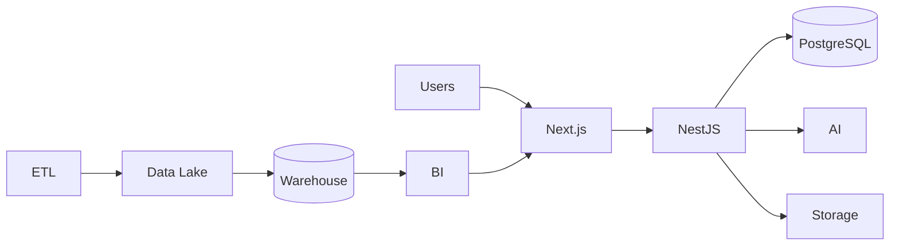
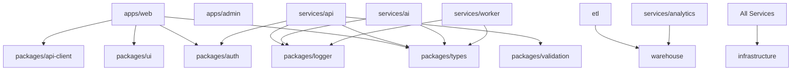
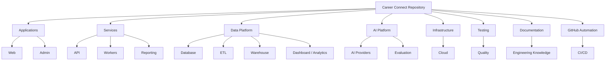

# 39 — GitHub Folder Structure

# Career Connect — AI Career Intelligence Platform

**Document Type:** Production-Grade Repository & GitHub Structure
**Project:** Career Connect
**Version:** 1.0
**Status:** Repository Architecture Baseline
**Repository Model:** Monorepo
**Primary Platform:** GitHub
**Frontend:** Next.js + TypeScript
**Backend:** NestJS + TypeScript
**AI:** Python
**Data Engineering:** Python / SQL
**Warehouse:** BigQuery or Snowflake
**Infrastructure:** Docker + Cloud
**CI/CD:** GitHub Actions

---

# 1. Executive Summary

The GitHub repository must clearly communicate that Career Connect is an enterprise-style platform rather than a simple college CRUD project.

The repository therefore separates:

```text
Application
Backend
AI
Data Engineering
Data Warehouse
Database
Dashboards
Infrastructure
Testing
Documentation
Automation
```

The recommended architecture is a **monorepo** so the complete project can be maintained in a single GitHub repository while individual services remain independently deployable.

---

# 2. Repository Goals

The repository must provide:

```text
Discoverability
Maintainability
Scalability
Clear Ownership
Independent Deployment
Reusable Components
Data Governance
AI Versioning
Automated Testing
CI/CD
Documentation
```

---

# 3. Repository Naming

Recommended repository name:

```text
career-connect-ai-platform
```

Alternative:

```text
careerconnect
```

Preferred professional GitHub repository title:

> **Career Connect — AI Career Intelligence Platform**

---

# 4. Repository Root

The final repository should approximately look like:

```text
career-connect-ai-platform/
│
├── apps/
├── services/
├── packages/
├── database/
├── etl/
├── warehouse/
├── ai/
├── dashboard/
├── frontend/
├── backend/
├── infrastructure/
├── docker/
├── scripts/
├── tests/
├── docs/
├── data/
├── notebooks/
├── .github/
├── .gitignore
├── .dockerignore
├── .editorconfig
├── README.md
├── LICENSE
├── CONTRIBUTING.md
├── SECURITY.md
├── CHANGELOG.md
├── CODE_OF_CONDUCT.md
├── package.json
└── docker-compose.yml
```

---

# 5. Architecture Philosophy

The repository follows:

```text
Business Capability
        ↓
Service / Application
        ↓
Shared Package
        ↓
Infrastructure
        ↓
Documentation
        ↓
Testing
```

---

# 6. Why Monorepo?

A monorepo is appropriate because Career Connect contains tightly related components:

```text
Frontend
Backend
AI
ETL
Warehouse
Database
Shared Types
UI Components
```

Advantages:

```text
Single source of truth
Shared types
Atomic changes
Simpler CI/CD
Central documentation
Unified issue tracking
```

---

# 7. Top-Level Directory Architecture

```text
apps/
→ User-facing and administrative applications

services/
→ Independently deployable backend services

packages/
→ Shared libraries

database/
→ PostgreSQL schema and migrations

etl/
→ Data ingestion and transformation

warehouse/
→ Analytical SQL models

ai/
→ AI orchestration and evaluation

infrastructure/
→ Cloud/IaC configuration

tests/
→ Cross-system tests

docs/
→ Complete project documentation
```

---

# 8. `apps/`

Recommended:

```text
apps/
├── web/
├── admin/
└── portal/
```

---

# 9. `apps/web/`

Main student, job seeker, recruiter, and institutional application.

```text
apps/web/
├── app/
├── components/
├── features/
├── hooks/
├── lib/
├── services/
├── styles/
├── public/
├── tests/
├── next.config.ts
├── package.json
└── tsconfig.json
```

---

# 10. `apps/web/app/`

Use Next.js App Router.

```text
apps/web/app/
├── (marketing)/
├── (auth)/
├── dashboard/
├── career/
├── jobs/
├── applications/
├── resume/
├── learning/
├── analytics/
├── ai/
├── reports/
├── profile/
├── settings/
├── layout.tsx
├── page.tsx
└── globals.css
```

---

# 11. Route Organization

Use logical route groups:

```text
(auth)
(marketing)
(app)
(admin)
```

This keeps UI concerns organized without unnecessarily affecting the URL structure.

---

# 12. Student Routes

```text
apps/web/app/
├── dashboard/
├── profile/
├── resume/
├── career/
├── skills/
├── learning/
├── jobs/
└── applications/
```

---

# 13. Recruiter Routes

```text
apps/web/app/recruiter/
├── dashboard/
├── jobs/
├── candidates/
├── interviews/
├── offers/
├── analytics/
└── settings/
```

---

# 14. College Routes

```text
apps/web/app/college/
├── dashboard/
├── students/
├── placements/
├── companies/
├── skill-intelligence/
├── reports/
└── settings/
```

---

# 15. Executive Routes

```text
apps/web/app/executive/
├── dashboard/
├── market/
├── hiring/
├── salary/
├── skills/
└── reports/
```

---

# 16. `apps/admin/`

Platform administration:

```text
apps/admin/
├── app/
├── components/
├── features/
├── services/
├── hooks/
├── tests/
├── package.json
└── tsconfig.json
```

---

# 17. Admin Modules

```text
User Management
Organization Management
RBAC
Audit Logs
Data Sources
ETL Monitoring
Data Quality
AI Monitoring
System Health
Feature Flags
```

---

# 18. `services/`

Independent backend services:

```text
services/
├── api/
├── ai/
├── worker/
├── reporting/
├── notification/
└── analytics/
```

Not every service must be deployed independently in the MVP.

The separation provides a clean evolution path.

---

# 19. `services/api/`

Main NestJS backend:

```text
services/api/
├── src/
│   ├── modules/
│   ├── common/
│   ├── config/
│   ├── guards/
│   ├── interceptors/
│   ├── middleware/
│   ├── pipes/
│   ├── filters/
│   ├── database/
│   └── main.ts
├── test/
├── package.json
└── tsconfig.json
```

---

# 20. NestJS Module Structure

```text
services/api/src/modules/
├── auth/
├── users/
├── organizations/
├── students/
├── companies/
├── recruiters/
├── jobs/
├── applications/
├── interviews/
├── placements/
├── skills/
├── careers/
├── learning/
├── certifications/
├── resumes/
├── reports/
├── analytics/
├── ai/
├── notifications/
└── audit/
```

---

# 21. Domain-Oriented Backend Design

Each module should contain:

```text
controller
service
repository
dto
entity/model
mapper
validator
tests
```

Example:

```text
jobs/
├── jobs.controller.ts
├── jobs.service.ts
├── jobs.repository.ts
├── dto/
├── entities/
├── mappers/
└── jobs.spec.ts
```

---

# 22. `services/ai/`

Python AI service:

```text
services/ai/
├── src/
│   ├── modules/
│   ├── providers/
│   ├── context/
│   ├── prompts/
│   ├── schemas/
│   ├── guardrails/
│   ├── evaluation/
│   ├── tools/
│   ├── observability/
│   └── main.py
├── tests/
├── requirements.txt
├── pyproject.toml
└── Dockerfile
```

---

# 23. AI Module Structure

```text
services/ai/src/modules/
├── resume/
├── skills/
├── career/
├── learning/
├── jobs/
├── chat/
├── interview/
├── nlbi/
└── reports/
```

---

# 24. AI Provider Structure

```text
services/ai/src/providers/
├── base.py
├── openai/
├── gemini/
├── claude/
└── router.py
```

This protects the business layer from vendor-specific implementation details.

---

# 25. AI Context Structure

```text
services/ai/src/context/
├── profile.py
├── skills.py
├── career.py
├── jobs.py
├── learning.py
├── market.py
├── authorization.py
└── builder.py
```

---

# 26. AI Tools

```text
services/ai/src/tools/
├── get_profile.py
├── get_skills.py
├── get_skill_gap.py
├── search_jobs.py
├── get_career_requirements.py
├── search_courses.py
├── get_market_data.py
└── analytics_query.py
```

Each tool should have explicit authorization.

---

# 27. AI Schemas

```text
services/ai/src/schemas/
├── resume.py
├── career.py
├── job_matching.py
├── learning.py
├── interview.py
└── nlbi.py
```

Use schemas to validate model outputs.

---

# 28. AI Guardrails

```text
services/ai/src/guardrails/
├── input.py
├── output.py
├── prompt_injection.py
├── authorization.py
├── privacy.py
└── safety.py
```

---

# 29. AI Evaluation

```text
services/ai/tests/
├── unit/
├── integration/
├── safety/
├── regression/
└── evaluation/
    ├── datasets/
    ├── expected/
    ├── scorers/
    └── reports/
```

---

# 30. AI Prompt Registry

```text
services/ai/src/prompts/
├── resume/
│   ├── analysis_v1.txt
│   └── analysis_v2.txt
├── career/
├── learning/
├── jobs/
├── chat/
├── interview/
├── nlbi/
└── reports/
```

---

# 31. `services/worker/`

Background jobs:

```text
services/worker/
├── src/
│   ├── jobs/
│   ├── queues/
│   ├── processors/
│   ├── retries/
│   └── main.ts
├── tests/
├── package.json
└── Dockerfile
```

---

# 32. Worker Jobs

```text
ResumeAnalysisJob
ReportGenerationJob
NotificationJob
DataSyncJob
CandidateMatchingJob
AIProcessingJob
```

---

# 33. `services/reporting/`

Responsible for:

```text
PDF Generation
Excel Generation
CSV Export
Report Templates
Report Scheduling
```

Structure:

```text
services/reporting/
├── src/
│   ├── templates/
│   ├── generators/
│   ├── formatters/
│   ├── storage/
│   └── main.ts
├── tests/
└── Dockerfile
```

---

# 34. `services/analytics/`

Analytics API / semantic layer:

```text
services/analytics/
├── src/
│   ├── metrics/
│   ├── dimensions/
│   ├── queries/
│   ├── authorization/
│   ├── caching/
│   └── main.ts
└── tests/
```

---

# 35. `packages/`

Shared reusable components:

```text
packages/
├── ui/
├── types/
├── config/
├── auth/
├── validation/
├── logger/
├── api-client/
├── analytics-sdk/
└── testing/
```

---

# 36. `packages/ui/`

Shared shadcn/Tailwind components:

```text
packages/ui/
├── src/
│   ├── components/
│   ├── tokens/
│   ├── charts/
│   └── index.ts
├── package.json
└── tsconfig.json
```

---

# 37. Shared UI Components

Examples:

```text
Button
Card
Modal
Table
KpiCard
ChartCard
SkillBadge
MatchScore
InsightCard
FilterBar
```

---

# 38. `packages/types/`

Shared TypeScript contracts:

```text
packages/types/
├── src/
│   ├── user.ts
│   ├── student.ts
│   ├── job.ts
│   ├── application.ts
│   ├── placement.ts
│   ├── analytics.ts
│   └── ai.ts
└── package.json
```

This reduces frontend/backend contract drift.

---

# 39. `packages/validation/`

Shared validation schemas:

```text
packages/validation/
├── src/
│   ├── auth.ts
│   ├── student.ts
│   ├── job.ts
│   ├── application.ts
│   ├── report.ts
│   └── ai.ts
└── package.json
```

---

# 40. `packages/auth/`

Shared identity helpers:

```text
packages/auth/
├── src/
│   ├── session.ts
│   ├── roles.ts
│   ├── permissions.ts
│   └── policies.ts
└── package.json
```

---

# 41. `packages/logger/`

Shared logging contracts:

```text
packages/logger/
├── src/
│   ├── logger.ts
│   ├── events.ts
│   ├── redaction.ts
│   └── correlation.ts
└── package.json
```

---

# 42. `packages/api-client/`

Typed API client:

```text
packages/api-client/
├── src/
│   ├── client.ts
│   ├── auth.ts
│   ├── jobs.ts
│   ├── students.ts
│   ├── analytics.ts
│   └── ai.ts
└── package.json
```

---

# 43. `database/`

Operational database assets:

```text
database/
├── migrations/
├── seeds/
├── functions/
├── policies/
├── indexes/
├── views/
└── README.md
```

---

# 44. Database Migrations

```text
database/migrations/
├── 001_create_extensions.sql
├── 002_create_users.sql
├── 003_create_organizations.sql
├── 004_create_students.sql
├── 005_create_skills.sql
├── 006_create_jobs.sql
├── 007_create_applications.sql
├── 008_create_placements.sql
└── ...
```

Migration names should remain descriptive.

---

# 45. Database Seeds

```text
database/seeds/
├── reference/
├── development/
├── test/
└── demo/
```

---

# 46. Database Policies

```text
database/policies/
├── students.sql
├── resumes.sql
├── applications.sql
├── organizations.sql
├── reports.sql
└── audit.sql
```

---

# 47. Database Documentation

```text
database/
└── README.md
```

Should explain:

```text
Schema
Migration
Seeding
RLS
Backup
Local Setup
```

---

# 48. `etl/`

Data engineering workspace:

```text
etl/
├── sources/
├── ingestion/
├── transformations/
├── validation/
├── deduplication/
├── incremental/
├── reconciliation/
├── orchestration/
├── metadata/
├── tests/
└── README.md
```

---

# 49. ETL Sources

```text
etl/sources/
├── jobs/
├── companies/
├── salaries/
├── students/
├── placements/
├── courses/
├── skills/
└── certifications/
```

---

# 50. ETL Ingestion

```text
etl/ingestion/
├── api/
├── csv/
├── json/
├── database/
└── storage/
```

---

# 51. ETL Transformations

```text
etl/transformations/
├── jobs/
├── students/
├── placements/
├── salaries/
├── skills/
└── common/
```

---

# 52. ETL Validation

```text
etl/validation/
├── schema/
├── business/
├── completeness/
├── uniqueness/
├── validity/
└── referential/
```

---

# 53. ETL Reconciliation

```text
etl/reconciliation/
├── source_target_counts.py
├── duplicate_checks.py
├── warehouse_checks.py
└── reports/
```

---

# 54. `warehouse/`

Enterprise analytical layer:

```text
warehouse/
├── staging/
├── dimensions/
├── facts/
├── marts/
├── semantic/
├── tests/
├── macros/
└── README.md
```

---

# 55. Warehouse Staging

```text
warehouse/staging/
├── stg_jobs.sql
├── stg_students.sql
├── stg_companies.sql
├── stg_placements.sql
└── ...
```

---

# 56. Warehouse Dimensions

```text
warehouse/dimensions/
├── dim_student.sql
├── dim_company.sql
├── dim_skill.sql
├── dim_job.sql
├── dim_college.sql
├── dim_date.sql
├── dim_location.sql
├── dim_technology.sql
└── ...
```

---

# 57. Warehouse Facts

```text
warehouse/facts/
├── fact_application.sql
├── fact_placement.sql
├── fact_salary.sql
├── fact_interview.sql
├── fact_hiring.sql
├── fact_learning.sql
└── fact_certification.sql
```

---

# 58. Data Marts

```text
warehouse/marts/
├── placement/
├── hiring/
├── skills/
├── salary/
├── student/
└── learning/
```

---

# 59. Semantic Layer

```text
warehouse/semantic/
├── metrics/
├── dimensions/
├── definitions/
└── access/
```

---

# 60. Metric Definitions

Example:

```text
warehouse/semantic/metrics/
├── placement_rate.sql
├── average_salary.sql
├── hiring_rate.sql
├── skill_demand.sql
├── application_conversion.sql
└── interview_conversion.sql
```

---

# 61. Warehouse Tests

```text
warehouse/tests/
├── dimensions/
├── facts/
├── relationships/
├── metrics/
├── reconciliation/
└── performance/
```

---

# 62. `dashboard/`

Central dashboard definitions:

```text
dashboard/
├── definitions/
├── metrics/
├── filters/
├── exports/
├── layouts/
└── README.md
```

This can complement the frontend dashboard implementation.

---

# 63. `frontend/` and `backend/`

The preferred architecture uses `apps/` and `services/` as canonical directories.

However, because the original project specification explicitly requested:

```text
frontend/
backend/
```

these names may be retained as compatibility aliases or simple entry-point documentation.

Preferred implementation:

```text
apps/web
services/api
```

instead of maintaining duplicate source trees.

---

# 64. Compatibility Structure

If required by the academic specification:

```text
frontend/
└── README.md
```

containing:

```text
Frontend implementation:
apps/web
```

and:

```text
backend/
└── README.md
```

containing:

```text
Backend implementation:
services/api
```

This avoids duplicating code.

---

# 65. `infrastructure/`

Cloud/IaC configuration:

```text
infrastructure/
├── environments/
│   ├── dev/
│   ├── staging/
│   └── prod/
├── networking/
├── database/
├── storage/
├── warehouse/
├── monitoring/
├── secrets/
└── README.md
```

---

# 66. Infrastructure Environment

Each environment should contain only configuration required for that environment.

```text
dev/
staging/
prod/
```

---

# 67. `docker/`

Container definitions:

```text
docker/
├── web/
├── api/
├── ai/
├── worker/
├── etl/
├── reporting/
└── nginx/
```

---

# 68. Docker Compose

Root:

```text
docker-compose.yml
```

Development services:

```text
web
api
postgres
redis
ai
worker
```

---

# 69. Production Docker

Production containers should be independently buildable:

```text
docker/api/Dockerfile
docker/ai/Dockerfile
docker/worker/Dockerfile
```

---

# 70. `scripts/`

Automation utilities:

```text
scripts/
├── dev/
├── database/
├── data/
├── warehouse/
├── deployment/
├── testing/
└── cleanup/
```

---

# 71. Example Scripts

```text
scripts/database/reset.sh
scripts/database/migrate.sh
scripts/data/generate-synthetic-data.py
scripts/testing/run-smoke-tests.sh
scripts/deployment/deploy-staging.sh
```

---

# 72. `tests/`

Cross-service tests:

```text
tests/
├── e2e/
├── integration/
├── security/
├── performance/
├── accessibility/
├── data/
├── contract/
└── fixtures/
```

---

# 73. End-to-End Tests

```text
tests/e2e/
├── student/
├── recruiter/
├── placement/
├── executive/
├── admin/
└── ai/
```

---

# 74. Security Tests

```text
tests/security/
├── authentication/
├── authorization/
├── tenant/
├── api/
├── upload/
├── ai/
└── export/
```

---

# 75. Performance Tests

```text
tests/performance/
├── api/
├── dashboard/
├── ai/
├── etl/
└── warehouse/
```

---

# 76. Accessibility Tests

```text
tests/accessibility/
├── login/
├── dashboard/
├── jobs/
├── application/
└── reports/
```

---

# 77. `data/`

The repository must not accidentally contain production personal information.

Recommended:

```text
data/
├── synthetic/
├── reference/
├── samples/
└── README.md
```

---

# 78. Synthetic Data

```text
data/synthetic/
├── students.csv
├── companies.csv
├── jobs.csv
├── skills.csv
├── courses.csv
├── applications.csv
├── placements.csv
└── salaries.csv
```

---

# 79. Reference Data

Examples:

```text
data/reference/
├── countries.csv
├── locations.csv
├── technologies.csv
├── employment_types.csv
├── experience_levels.csv
└── skill_taxonomy.csv
```

---

# 80. `notebooks/`

For research and experimentation:

```text
notebooks/
├── exploratory/
├── ai/
├── analytics/
├── data_quality/
└── research/
```

---

# 81. Notebook Rule

Notebooks should be used for:

```text
Exploration
Research
Prototyping
Visualization
```

Production logic should move into:

```text
services/
etl/
warehouse/
```

rather than remaining hidden inside notebooks.

---

# 82. `docs/`

The documentation system should follow the requested numbered structure.

```text
docs/
├── 01-vision/
├── 02-problem-statement/
├── 03-market-research/
├── ...
├── 40-readme/
```

---

# 83. Documentation File Naming

Use:

```text
01-vision-document.md
02-problem-statement.md
03-market-research.md
...
```

---

# 84. Full Documentation Structure

```text
docs/
├── 01-vision/
│   └── vision-document.md
├── 02-problem-statement/
│   └── problem-statement.md
├── 03-market-research/
│   └── market-research.md
├── 04-competitor-analysis/
│   └── competitor-analysis.md
├── 05-swot-analysis/
│   └── swot-analysis.md
├── 06-business-model/
│   └── business-model.md
├── 07-product-roadmap/
│   └── product-roadmap.md
├── 08-sdlc/
│   └── sdlc.md
├── 09-system-architecture/
│   └── system-architecture.md
├── 10-cloud-architecture/
│   └── cloud-architecture.md
```

Continue numerically through:

```text
11-data-warehouse-architecture/
12-data-flow-diagram/
13-er-diagram/
14-database-design/
15-star-schema/
16-snowflake-schema/
17-etl-design/
18-data-dictionary/
19-api-documentation/
20-prd/
21-srs/
22-functional-requirements/
23-non-functional-requirements/
24-user-stories/
25-use-cases/
26-wireframes/
27-ui-ux-design/
28-dashboard-design/
29-ai-module-design/
30-security-design/
31-deployment-guide/
32-testing-strategy/
33-test-cases/
34-ci-cd/
35-monitoring/
36-logging/
37-future-scope/
38-project-timeline/
39-github-folder-structure/
40-readme/
```

---

# 85. Documentation Cross-Links

Every document should link to related documents.

Example:

```markdown id="4s1w7q"
See also:

- System Architecture
- Cloud Architecture
- Data Warehouse Architecture
- Security Design
```

This creates a navigable engineering knowledge base.

---

# 86. `docs/diagrams/`

Recommended:

```text
docs/diagrams/
├── architecture/
├── cloud/
├── database/
├── data-flow/
├── ai/
├── security/
└── deployment/
```

---

# 87. Mermaid Sources

Keep complex diagrams in markdown whenever possible.

For larger diagrams:

```text
docs/diagrams/
```

can hold source versions.

---

# 88. `docs/adr/`

Architecture Decision Records:

```text
docs/adr/
├── 0001-monorepo.md
├── 0002-postgresql.md
├── 0003-warehouse-selection.md
├── 0004-ai-provider-abstraction.md
├── 0005-rbac-model.md
└── 0006-tenant-isolation.md
```

---

# 89. Why ADRs Matter

ADRs explain:

```text
Decision
Context
Alternatives
Reason
Consequences
```

This is highly valuable for interviews and professional portfolios.

---

# 90. Example ADR

```markdown id="6o8xza"
# ADR-0001: Use a Monorepo

## Decision

Use a monorepo for the Career Connect platform.

## Reason

The frontend, backend, AI, ETL, and shared packages
require coordinated versioning.

## Consequences

Simpler shared types and CI/CD,
but repository tooling becomes more important.
```

---

# 91. `.github/`

GitHub automation and governance:

```text
.github/
├── workflows/
├── ISSUE_TEMPLATE/
├── PULL_REQUEST_TEMPLATE.md
├── CODEOWNERS
└── dependabot.yml
```

---

# 92. GitHub Workflows

```text
.github/workflows/
├── ci.yml
├── web-ci.yml
├── api-ci.yml
├── ai-ci.yml
├── etl-ci.yml
├── warehouse-ci.yml
├── security.yml
├── deploy-staging.yml
├── deploy-production.yml
└── rollback.yml
```

---

# 93. Issue Templates

```text
.github/ISSUE_TEMPLATE/
├── bug.yml
├── feature.yml
├── security.yml
├── data-quality.yml
├── ai-evaluation.yml
└── documentation.yml
```

---

# 94. Bug Template

Required fields:

```text
Description
Environment
Steps
Expected
Actual
Severity
Logs
Screenshots
Request ID
```

---

# 95. Feature Template

Required:

```text
Problem
Proposed Solution
User
Acceptance Criteria
Security Impact
Data Impact
AI Impact
```

---

# 96. Security Template

Include:

```text
Security Issue
Affected Component
Potential Impact
Reproduction
Evidence
Sensitive Data Involved
```

Avoid posting sensitive security details publicly in GitHub issues if the repository is public.

---

# 97. `CODEOWNERS`

Example:

```text
/apps/web/              @frontend-owner
/services/api/          @backend-owner
/services/ai/           @ai-owner
/etl/                   @data-owner
/warehouse/             @data-owner
/infrastructure/        @devops-owner
/security/              @security-owner
```

Actual GitHub usernames should be inserted when the team is finalized.

---

# 98. Pull Request Template

Recommended:

```markdown id="2vhe1g"
## Summary

## Changes

## Testing

## Security Impact

## Data Impact

## AI Impact

## Screenshots

## Checklist

- [ ] Tests pass
- [ ] Documentation updated
- [ ] Security reviewed
- [ ] Migration reviewed
```

---

# 99. `dependabot.yml`

Automated dependency updates can be configured.

Purpose:

```text
Security Updates
Dependency Updates
```

Changes must still pass CI before merging.

---

# 100. `.gitignore`

Must exclude:

```text id="x7m4q2"
.env
.env.*
node_modules/
.venv/
__pycache__/
.next/
dist/
coverage/
*.log
.DS_Store
```

and other local/build artifacts.

---

# 101. `.dockerignore`

Exclude:

```text
node_modules
.git
coverage
.env
tests where unnecessary
local artifacts
```

This reduces image size and prevents accidental secret inclusion.

---

# 102. `.editorconfig`

Maintain consistent:

```text id="m5q7x3"
Indentation
Line Endings
Encoding
Trailing Whitespace
```

---

# 103. Root `package.json`

For JavaScript/TypeScript workspace management:

```json id="q4m8x2"
{
  "name": "career-connect",
  "private": true,
  "workspaces": ["apps/*", "packages/*", "services/*"]
}
```

The exact workspace setup should match the selected package manager.

---

# 104. Workspace Strategy

Possible package managers:

```text id="x8q3m5"
npm Workspaces
pnpm
Yarn
```

For a large monorepo, `pnpm` is a strong option because of workspace-oriented dependency management.

---

# 105. Python Workspace

Python services should use a reproducible dependency system.

Possible:

```text
pyproject.toml
uv
Poetry
pip-tools
```

Use one consistent project standard.

---

# 106. Shared Configuration

```text
packages/config/
├── eslint/
├── typescript/
├── prettier/
└── environment/
```

---

# 107. Shared TypeScript Configuration

Example:

```text
packages/config/typescript/
├── base.json
├── nextjs.json
└── node.json
```

---

# 108. Shared ESLint Configuration

```text
packages/config/eslint/
├── base.js
├── react.js
└── node.js
```

---

# 109. Shared Environment Validation

Centralized environment schemas should validate:

```text
DATABASE_URL
API_URL
AI_SERVICE_URL
STORAGE
WAREHOUSE
```

and distinguish public from secret variables.

---

# 110. Dependency Boundaries

Avoid:

```text id="m4q8x2"
Frontend
→ Direct Database Access
```

Prefer:

```text id="x7m3q5"
Frontend
→ API
→ Database
```

Likewise:

```text id="q5m7x2"
AI
→ Context Service
→ Authorized Data
```

rather than direct unrestricted access.

---

# 111. Service Dependency Rules

Document permitted dependencies.

Example:

```text
web
→ api

api
→ database
→ storage
→ ai-gateway

ai
→ provider abstraction

etl
→ source + lake + warehouse
```

---

# 112. Circular Dependency Prevention

Shared packages must remain low-level.

Avoid:

```text
packages/types
→ applications
→ web
→ packages/types
```

Design dependency direction intentionally.

---

# 113. Shared Types Strategy

Use common contracts for:

```text
API
AI
Analytics
Events
```

but do not share implementation internals unnecessarily.

---

# 114. Event Contract Directory

```text
packages/types/src/events/
├── application.ts
├── placement.ts
├── resume.ts
├── ai.ts
├── pipeline.ts
└── report.ts
```

---

# 115. API Contract Directory

```text
packages/types/src/api/
├── auth.ts
├── jobs.ts
├── applications.ts
├── analytics.ts
├── reports.ts
└── ai.ts
```

---

# 116. Testing Ownership Structure

```text
tests/
├── contract/
│   ├── api/
│   ├── ai/
│   └── events/
├── integration/
├── e2e/
└── security/
```

Service-specific tests remain close to their implementation.

---

# 117. Generated Files

Generated artifacts should not generally be committed unless required.

Examples:

```text
.next/
coverage/
build/
generated runtime logs
```

API client generation may be committed if it is part of the repository workflow.

---

# 118. GitHub Releases

Each major version should create a GitHub Release.

Example:

```text
v1.0.0
Career Connect MVP
```

Release should include:

```text
Summary
Features
Known Issues
Migration Notes
Deployment Notes
```

---

# 119. GitHub Tags

Use:

```text
v1.0.0
v1.1.0
v1.1.1
```

for stable releases.

---

# 120. GitHub Projects

Recommended project boards:

```text
Product
Development
Data Engineering
AI
Security
Release
```

A single board may be used for the academic MVP.

---

# 121. Labels

Recommended:

```text
type:feature
type:bug
type:task
type:security
type:data
type:ai

priority:p0
priority:p1
priority:p2

status:blocked
status:review
status:testing
```

---

# 122. Milestones

Create GitHub milestones:

```text
M1 Architecture
M2 MVP
M3 Data Platform
M4 AI
M5 BI
M6 Production
M7 Final Submission
```

---

# 123. GitHub Security Settings

Recommended:

```text
Branch Protection
Secret Scanning
Dependency Alerts
Dependabot
Code Scanning
Private Security Advisories where applicable
```

---

# 124. Open Source Strategy

The repository can be public for portfolio purposes if:

```text id="x5m7q3"
No Secrets
No Production PII
No Licensed Data Restrictions
No Private Customer Data
```

---

# 125. Public Repository Data Policy

Only commit:

```text
Synthetic Data
Public Reference Data
Code
Documentation
Public Screenshots
```

---

# 126. Demo Credentials

For public GitHub:

Never publish real credentials.

Instead provide:

```text
Demo account creation instructions
or
Clearly synthetic demo credentials in a dedicated demo environment
```

---

# 127. License

Potential options:

```text
MIT
Apache-2.0
```

Selection depends on intended intellectual-property strategy.

---

# 128. `SECURITY.md`

Include:

```text
Supported Versions
Security Reporting
Responsible Disclosure
Sensitive Issue Handling
```

---

# 129. `CONTRIBUTING.md`

Include:

```text
Local Setup
Branching
Commit Style
Pull Requests
Testing
Code Style
Documentation
```

---

# 130. `CODE_OF_CONDUCT.md`

Useful if the project becomes open-source or accepts external contributors.

---

# 131. `CHANGELOG.md`

Maintain:

```text
Added
Changed
Fixed
Security
Deprecated
Removed
```

---

# 132. Root README

The root README should be the product landing page.

It should contain:

```text id="x8q4m2"
Project Introduction
Architecture
Features
Screenshots
Tech Stack
Quick Start
Cloud Architecture
AI
Data Warehouse
BI
Security
Testing
Deployment
Repository Structure
Future Scope
```

---

# 133. README Architecture Diagram

The README should include a simplified diagram:



---

# 134. Repository Overview for GitHub

The top section of README should communicate:

```text
Career Connect
AI Career Intelligence Platform

AI + Cloud + Data Warehouse + ETL + BI + SaaS
```

This immediately communicates the project's technical depth.

---

# 135. Folder Ownership

| Directory             | Responsibility           |
| --------------------- | ------------------------ |
| `apps/`               | User-facing applications |
| `services/api/`       | Backend API              |
| `services/ai/`        | AI services              |
| `services/worker/`    | Background jobs          |
| `services/reporting/` | Report generation        |
| `packages/`           | Shared libraries         |
| `database/`           | OLTP schema              |
| `etl/`                | Data engineering         |
| `warehouse/`          | OLAP models              |
| `dashboard/`          | Dashboard definitions    |
| `infrastructure/`     | Cloud infrastructure     |
| `docker/`             | Containerization         |
| `tests/`              | Cross-service validation |
| `docs/`               | Project documentation    |
| `scripts/`            | Automation               |
| `data/`               | Synthetic/reference data |
| `.github/`            | GitHub automation        |

---

# 136. Complete Production Repository

```text
career-connect-ai-platform/
│
├── apps/
│   ├── web/
│   └── admin/
│
├── services/
│   ├── api/
│   ├── ai/
│   ├── worker/
│   ├── reporting/
│   ├── notification/
│   └── analytics/
│
├── packages/
│   ├── ui/
│   ├── types/
│   ├── config/
│   ├── auth/
│   ├── validation/
│   ├── logger/
│   ├── api-client/
│   └── analytics-sdk/
│
├── database/
│   ├── migrations/
│   ├── seeds/
│   ├── policies/
│   ├── functions/
│   ├── views/
│   └── indexes/
│
├── etl/
│   ├── sources/
│   ├── ingestion/
│   ├── transformations/
│   ├── validation/
│   ├── deduplication/
│   ├── incremental/
│   ├── reconciliation/
│   ├── orchestration/
│   └── tests/
│
├── warehouse/
│   ├── staging/
│   ├── dimensions/
│   ├── facts/
│   ├── marts/
│   ├── semantic/
│   └── tests/
│
├── ai/
│   ├── prompts/
│   ├── evaluation/
│   ├── datasets/
│   └── research/
│
├── dashboard/
│   ├── definitions/
│   ├── metrics/
│   ├── filters/
│   └── exports/
│
├── infrastructure/
│   ├── environments/
│   ├── networking/
│   ├── database/
│   ├── storage/
│   ├── warehouse/
│   └── monitoring/
│
├── docker/
│   ├── web/
│   ├── api/
│   ├── ai/
│   ├── worker/
│   ├── etl/
│   └── reporting/
│
├── scripts/
│   ├── dev/
│   ├── database/
│   ├── data/
│   ├── testing/
│   └── deployment/
│
├── tests/
│   ├── unit/
│   ├── integration/
│   ├── contract/
│   ├── e2e/
│   ├── security/
│   ├── performance/
│   ├── accessibility/
│   └── data/
│
├── data/
│   ├── synthetic/
│   ├── reference/
│   └── samples/
│
├── notebooks/
│   ├── exploratory/
│   ├── ai/
│   ├── analytics/
│   └── research/
│
├── docs/
│   ├── 01-vision/
│   ├── 02-problem-statement/
│   ├── 03-market-research/
│   ├── 04-competitor-analysis/
│   ├── 05-swot-analysis/
│   ├── 06-business-model/
│   ├── 07-product-roadmap/
│   ├── 08-sdlc/
│   ├── 09-system-architecture/
│   ├── 10-cloud-architecture/
│   ├── 11-data-warehouse-architecture/
│   ├── 12-data-flow-diagram/
│   ├── 13-er-diagram/
│   ├── 14-database-design/
│   ├── 15-star-schema/
│   ├── 16-snowflake-schema/
│   ├── 17-etl-design/
│   ├── 18-data-dictionary/
│   ├── 19-api-documentation/
│   ├── 20-prd/
│   ├── 21-srs/
│   ├── 22-functional-requirements/
│   ├── 23-non-functional-requirements/
│   ├── 24-user-stories/
│   ├── 25-use-cases/
│   ├── 26-wireframes/
│   ├── 27-ui-ux-design/
│   ├── 28-dashboard-design/
│   ├── 29-ai-module-design/
│   ├── 30-security-design/
│   ├── 31-deployment-guide/
│   ├── 32-testing-strategy/
│   ├── 33-test-cases/
│   ├── 34-ci-cd/
│   ├── 35-monitoring/
│   ├── 36-logging/
│   ├── 37-future-scope/
│   ├── 38-project-timeline/
│   ├── 39-github-folder-structure/
│   ├── 40-readme/
│   ├── adr/
│   └── diagrams/
│
├── .github/
│   ├── workflows/
│   ├── ISSUE_TEMPLATE/
│   ├── CODEOWNERS
│   ├── PULL_REQUEST_TEMPLATE.md
│   └── dependabot.yml
│
├── .gitignore
├── .dockerignore
├── .editorconfig
├── README.md
├── CONTRIBUTING.md
├── SECURITY.md
├── CODE_OF_CONDUCT.md
├── CHANGELOG.md
├── LICENSE
├── package.json
├── docker-compose.yml
└── pnpm-workspace.yaml
```

---

# 137. Repository Dependency Architecture



---

# 138. Repository Dependency Rule

The desired dependency direction is:

```text id="m4q8x2"
Applications
↓
Services
↓
Shared Packages
↓
Infrastructure Interfaces
```

rather than creating circular dependencies between applications and services.

---

# 139. Repository Scalability

The structure supports future extraction into separate repositories if required.

For example:

```text
careerconnect-web
careerconnect-api
careerconnect-ai
careerconnect-data
careerconnect-infrastructure
```

The monorepo can therefore evolve without changing domain boundaries.

---

# 140. Academic Simplification

For a smaller student team, the following minimum structure is enough:

```text
career-connect/
├── frontend/
├── backend/
├── ai/
├── etl/
├── warehouse/
├── database/
├── docs/
├── tests/
├── docker/
├── .github/
└── README.md
```

This is simpler while retaining the conceptual architecture.

---

# 141. Recommended Academic Structure

For the final-year project, the best balance is:

```text
apps/web
services/api
services/ai
etl
warehouse
database
tests
docs
docker
.github
```

This keeps the project professional without introducing unnecessary service fragmentation.

---

# 142. Git Commit Strategy

Commit by business capability:

```text
feat(student): add student profile

feat(resume): add resume upload

feat(ai): add career recommendation

feat(bi): add placement dashboard

feat(etl): add jobs pipeline

fix(auth): prevent unauthorized resume access
```

This creates a strong GitHub history for portfolio evaluation.

---

# 143. Pull Request Strategy

One PR should ideally represent one coherent change.

Good:

```text
feat: add skill gap analysis
```

Less desirable:

```text
final changes
```

containing unrelated frontend, database, AI, and documentation changes.

---

# 144. Branch Naming

Recommended:

```text
feature/student-profile
feature/resume-analysis
feature/career-recommendation
feature/job-matching
feature/placement-dashboard
fix/tenant-isolation
security/resume-access
data/placement-etl
ai/career-agent
```

---

# 145. GitHub Milestones

Suggested:

```text
v0.1 Foundation
v0.2 Core Product
v0.3 Data Platform
v0.4 AI
v0.5 BI
v0.6 Security
v0.7 Production
v1.0 Final Release
```

---

# 146. Repository Release Structure

```text
v1.0.0
│
├── Web
├── API
├── AI
├── ETL
├── Warehouse
├── Dashboards
├── Security
└── Documentation
```

---

# 147. Portfolio Presentation

The GitHub repository should immediately demonstrate:

```text
Software Engineering
Cloud Computing
AI
Data Engineering
Data Warehouse
BI
Security
DevOps
```

This is more impressive than a repository dominated by one large frontend folder.

---

# 148. Repository Health Checklist

```text id="q8m3x5"
✓ README exists
✓ License exists
✓ Security policy exists
✓ CI passes
✓ Tests exist
✓ Documentation exists
✓ No secrets
✓ No production PII
✓ Clear folder structure
✓ Release tags
✓ Issue templates
✓ PR template
```

---

# 149. Repository Quality Scorecard

| Area              | Expected   |
| ----------------- | ---------- |
| Documentation     | Excellent  |
| Architecture      | Clear      |
| Code Organization | Modular    |
| Testing           | Automated  |
| Security          | Protected  |
| Data              | Governed   |
| AI                | Versioned  |
| CI/CD             | Automated  |
| Deployment        | Repeatable |
| Git History       | Meaningful |

---

# 150. CTO-Level Repository Principle

The GitHub repository should tell the story of the entire product:

```text
Problem
↓
Architecture
↓
Code
↓
Data
↓
AI
↓
BI
↓
Security
↓
Testing
↓
Cloud
↓
Production
```

A recruiter or evaluator should be able to enter the repository and understand the system without opening the source code first.

---

# 151. Final Repository Architecture



---

# 152. Final GitHub Statement

> **Career Connect will use a production-oriented monorepo structure that separates applications, backend services, AI services, shared packages, operational database assets, ETL pipelines, data warehouse models, dashboards, infrastructure, testing, documentation, and GitHub automation. The structure is intentionally modular so individual services can be developed, tested, deployed, and eventually extracted independently while still benefiting from shared types, UI components, validation contracts, logging, and CI/CD. The repository will also contain numbered engineering documentation, architecture decision records, security policies, testing assets, synthetic data, deployment automation, and professional GitHub governance files, making the project suitable for academic evaluation, portfolio presentation, startup development, and future enterprise-scale evolution.**

---

## Document Status

| Attribute              | Value                             |
| ---------------------- | --------------------------------- |
| Project                | Career Connect                    |
| Document               | GitHub Folder Structure           |
| Version                | 1.0                               |
| Repository Model       | Monorepo                          |
| Frontend               | `apps/web`                        |
| Admin                  | `apps/admin`                      |
| Backend                | `services/api`                    |
| AI                     | `services/ai`                     |
| Workers                | `services/worker`                 |
| ETL                    | `etl/`                            |
| Warehouse              | `warehouse/`                      |
| Database               | `database/`                       |
| Dashboard              | `dashboard/`                      |
| Infrastructure         | `infrastructure/`                 |
| Testing                | `tests/`                          |
| Documentation          | `docs/`                           |
| Automation             | `.github/`                        |
| Containers             | `docker/`                         |
| Synthetic Data         | `data/`                           |
| Architecture Decisions | `docs/adr/`                       |
| CI/CD                  | GitHub Actions                    |
| Governance             | CODEOWNERS + PR + Issue Templates |
| Portfolio Ready        | Yes                               |
| Startup Ready          | Yes                               |
| Enterprise Evolution   | Yes                               |
| Status                 | Repository Architecture Baseline  |
