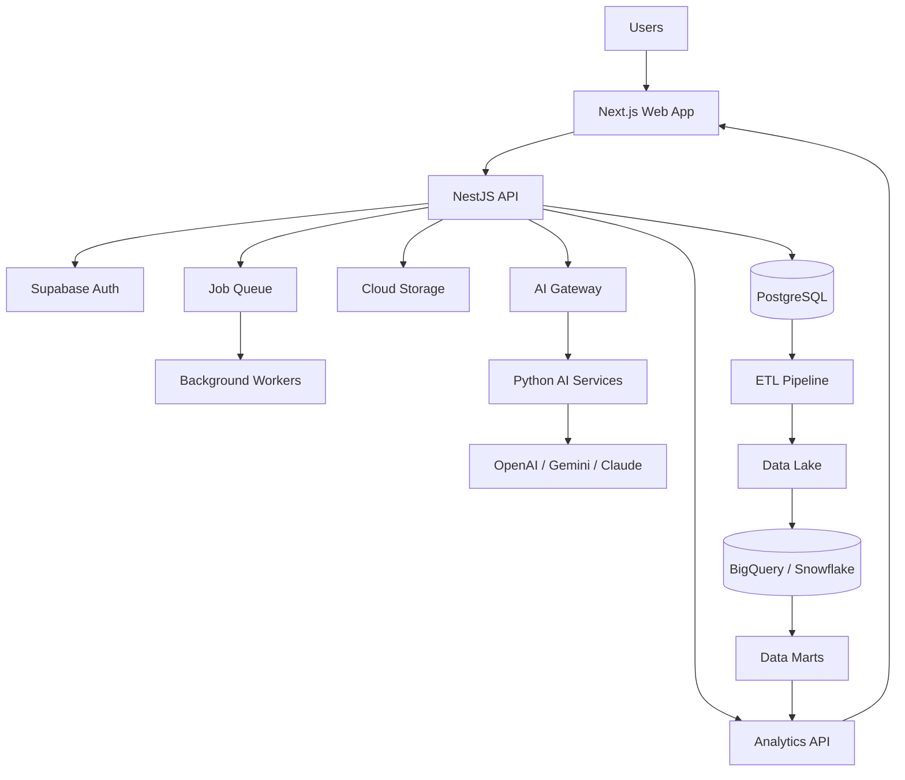
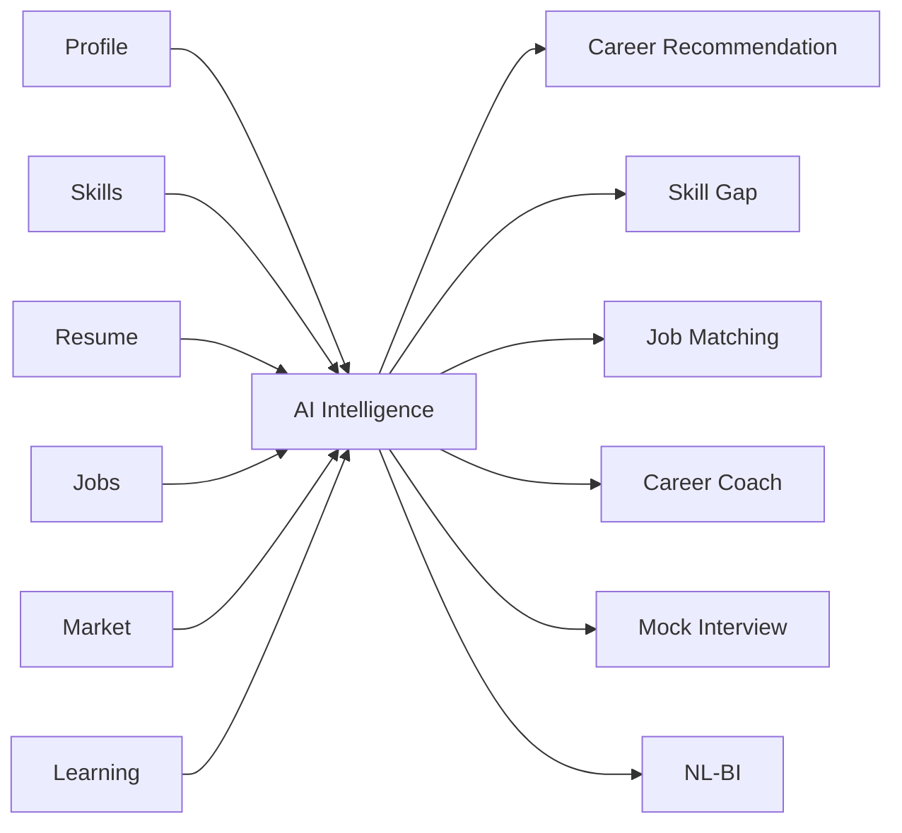
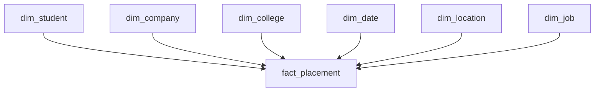
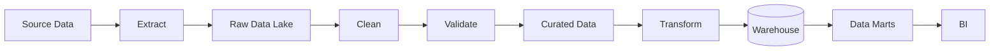
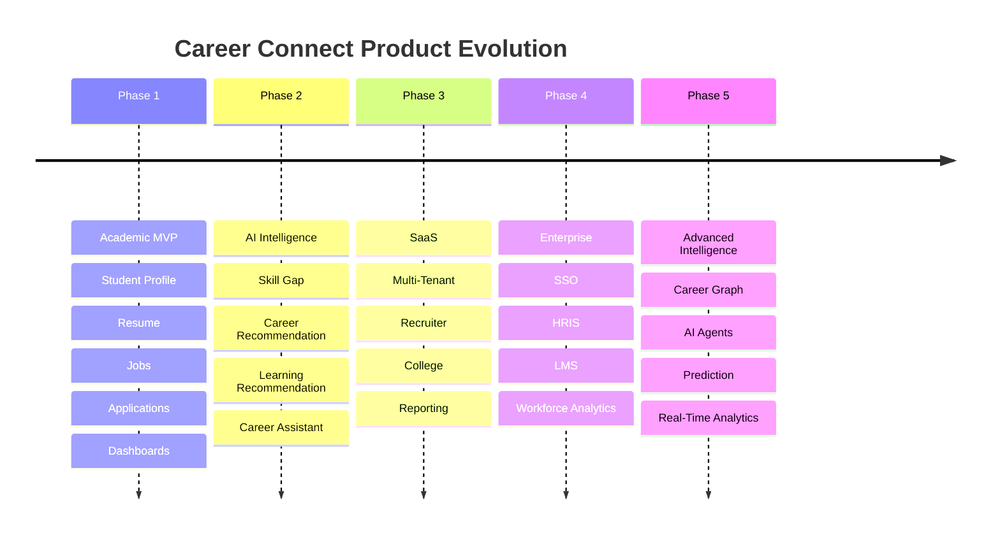
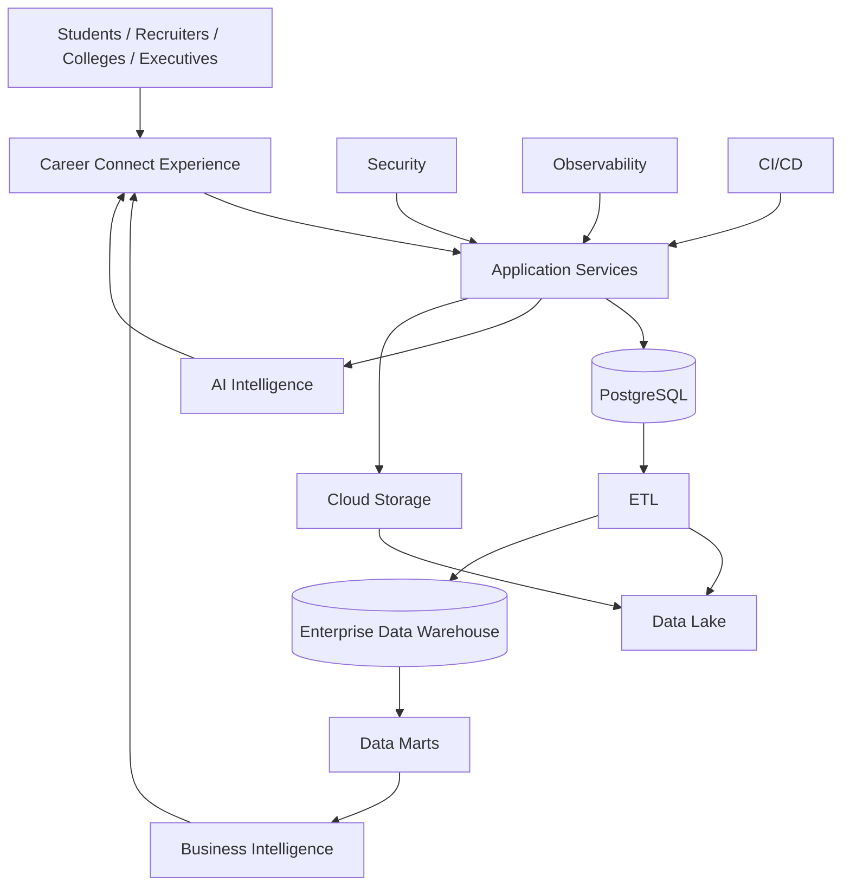

# 40 — Complete README

# Career Connect — AI Career Intelligence Platform

**AI-Powered Career Intelligence, Data Warehouse, Business Intelligence & Cloud Platform**

[](#project-status) [](#technology-stack) [](#technology-stack) [](#ai-intelligence) [](#data-platform) [](#data-platform) [](#cloud-architecture) [](#license)

---

## 1. Project Overview

**Career Connect** is an AI-powered Career Intelligence Platform designed to connect:

```text
Students
Freshers
Job Seekers
Colleges
Placement Officers
Recruiters
Companies
Training Providers
```

through a unified cloud-native intelligence platform.

The platform combines:

```text
AI
+
Cloud Computing
+
Data Engineering
+
Data Lake
+
Enterprise Data Warehouse
+
Business Intelligence
+
Analytics
+
Recruitment Intelligence
+
Learning Intelligence
```

Career Connect is designed as an enterprise-style SaaS architecture rather than a conventional CRUD application.

---

# 2. Vision

The vision of Career Connect is:

> **Help people and organizations make better career and workforce decisions through trusted data, AI, analytics, and personalized intelligence.**

The platform transforms:

```text
Raw Career Data
↓
Data Engineering
↓
Data Warehouse
↓
Analytics
↓
AI Intelligence
↓
Recommendation
↓
Action
```

---

# 3. Problem Statement

Today's career ecosystem is fragmented.

Students use separate systems for:

```text
Resume
Jobs
Learning
Career Planning
Interview Preparation
Certificates
```

Colleges maintain separate data for:

```text
Students
Placements
Companies
Skills
Training
```

Recruiters use separate systems for:

```text
Jobs
Applications
Candidates
Interviews
Hiring
```

As a result, valuable information remains disconnected.

Career Connect addresses this fragmentation through a unified intelligence platform.

---

# 4. Solution

Career Connect creates a connected career intelligence ecosystem:

```text
Student
   ↓
Profile
   ↓
Skills
   ↓
Resume
   ↓
Career Intelligence
   ↓
Learning Roadmap
   ↓
Job Matching
   ↓
Applications
   ↓
Interview
   ↓
Placement
   ↓
Analytics
```

At the same time:

```text
Jobs
+
Companies
+
Salary Data
+
Skill Demand
+
Hiring Trends
```

feed the analytical and AI layers.

---

# 5. Core Product Capabilities

## AI

```text
AI Resume Analyzer
AI Resume Score
AI Skill Extraction
AI Skill Gap Analysis
AI Career Recommendation
AI Learning Recommendation
AI Job Matching
AI Career Coach
AI Mock Interview
AI Natural-Language BI
AI Smart Reports
```

## Business Intelligence

```text
Placement Analytics
Salary Intelligence
Job Market Analytics
Skill Demand
Hiring Trends
Recruiter Analytics
College Analytics
Student Analytics
Application Funnel
Interview Funnel
Recruitment Funnel
```

## Platform

```text
Role-Based Access
Multi-Tenant Architecture
Cloud Deployment
Data Warehouse
ETL
Data Lake
Reports
Audit Logs
Monitoring
CI/CD
```

---

# 6. Target Users

| User              | Primary Value                    |
| ----------------- | -------------------------------- |
| Student           | Career planning + AI guidance    |
| Fresher           | Job readiness + skill gap        |
| Job Seeker        | Job matching + applications      |
| Placement Officer | Placement intelligence           |
| College           | Institutional analytics          |
| Recruiter         | Hiring intelligence              |
| Company           | Talent analytics                 |
| Training Provider | Learning intelligence            |
| Executive         | Strategic workforce intelligence |
| Administrator     | Platform governance              |

---

# 7. Why Career Connect Is Different

Career Connect is not simply:

```text
A Job Portal
```

It combines:

```text
LinkedIn-like Career Identity
+
Recruitment Intelligence
+
Power BI-like Analytics
+
Data Warehouse
+
AI Career Assistant
+
Learning Intelligence
```

The architectural principle is:

> **Use deterministic systems for trusted data, analytical systems for measurement, and AI for interpretation, recommendation, and assistance.**

---

# 8. System Architecture



---

# 9. High-Level Data Flow

```text
Operational Sources
↓
Data Ingestion
↓
Raw Data Lake
↓
Data Quality
↓
Transformation
↓
Curated Data
↓
Enterprise Data Warehouse
↓
Data Marts
↓
Semantic Layer
↓
Business Intelligence
+
AI
```

---

# 10. Technology Stack

## Frontend

```text
Next.js
TypeScript
Tailwind CSS
shadcn/ui
```

## Backend

```text
Node.js
NestJS
TypeScript
```

## AI

```text
Python
FastAPI / Worker Services
OpenAI
Gemini
Claude
```

## Database

```text
PostgreSQL
Supabase
```

## Warehouse

```text
BigQuery
or
Snowflake
```

## Storage

```text
Cloud Object Storage
```

## Authentication

```text
Supabase Auth
OAuth
Google Login
```

## Deployment

```text
Vercel
Render / Container Platform
Docker
GitHub Actions
```

---

# 11. Repository Structure

```text
career-connect-ai-platform/
│
├── apps/
│   ├── web/
│   └── admin/
│
├── services/
│   ├── api/
│   ├── ai/
│   ├── worker/
│   ├── reporting/
│   ├── notification/
│   └── analytics/
│
├── packages/
│   ├── ui/
│   ├── types/
│   ├── config/
│   ├── auth/
│   ├── validation/
│   ├── logger/
│   └── api-client/
│
├── database/
│   ├── migrations/
│   ├── seeds/
│   └── policies/
│
├── etl/
│
├── warehouse/
│
├── ai/
│
├── dashboard/
│
├── infrastructure/
│
├── docker/
│
├── scripts/
│
├── tests/
│
├── data/
│
├── notebooks/
│
├── docs/
│
└── .github/
```

---

# 12. Major Modules

## Student Intelligence

```text
Profile
Education
Skills
Projects
Certifications
Career Goals
Resume
Learning
Applications
```

## Recruiter Intelligence

```text
Jobs
Candidates
Applications
Interviews
Offers
Hiring Analytics
```

## College Intelligence

```text
Students
Placements
Companies
Skill Readiness
Salary
Training
```

## Executive Intelligence

```text
Placement
Hiring
Salary
Market
Skills
Strategic Insights
```

---

# 13. AI Intelligence

Career Connect AI is composed of specialized services.



---

# 14. AI Resume Analyzer

The Resume Analyzer converts a resume into structured intelligence.

Pipeline:

```text
Resume Upload
↓
Text Extraction
↓
Section Detection
↓
Entity Extraction
↓
Skill Extraction
↓
Skill Normalization
↓
Resume Evaluation
↓
Career Alignment
↓
Recommendations
```

---

# 15. AI Skill Gap Analysis

The skill-gap system compares:

```text
Current Skills
vs
Target Career Requirements
```

Example:

```text
Target:
Data Engineer

Current:
Python — Advanced
SQL — Advanced

Gap:
Apache Airflow
Apache Spark
Data Modeling
```

---

# 16. AI Career Recommendation

Career recommendations may consider:

```text
Education
Skills
Skill Levels
Experience
Projects
Career Goals
Location Preference
Employment Preference
Market Demand
```

The system returns:

```text
Career
Match Score
Supporting Evidence
Skill Gaps
Recommended Next Actions
```

---

# 17. AI Learning Recommendation

The learning engine connects:

```text
Skill Gap
+
Career Goal
+
Current Level
+
Course Catalog
```

to:

```text
Personalized Learning Roadmap
```

---

# 18. AI Job Matching

Job matching combines structured data with AI-assisted explanation.

Potential matching dimensions:

```text
Skills
Experience
Education
Location
Employment Type
Career Goal
```

---

# 19. AI Career Assistant

Users can ask:

```text
What should I learn next?

Why was Data Engineering recommended?

Which jobs match my skills?

How can I improve my resume?

How do I prepare for interviews?

What skills are currently important?
```

The assistant uses authorized platform context rather than unrestricted database access.

---

# 20. Natural-Language BI

Users can ask:

```text
Show placement rate by department.

Which skill has the highest demand?

Which companies hired the most students?

Show salary trends by city.
```

The system resolves questions against a governed semantic model.

```text
Question
↓
Intent
↓
Metric
↓
Dimension
↓
Filter
↓
Validated Query
↓
Warehouse
↓
Result
```

---

# 21. Data Warehouse

Career Connect uses an Enterprise Data Warehouse architecture.

Major dimensions:

```text
Dim Student
Dim Company
Dim Skill
Dim Job
Dim College
Dim Date
Dim Location
Dim Technology
Dim Course
Dim Recruiter
```

Major facts:

```text
Fact Placement
Fact Applications
Fact Salaries
Fact Interviews
Fact Hiring
Fact Learning
Fact Certifications
```

---

# 22. Star Schema



The same architectural principle applies to other business facts.

---

# 23. Snowflake Schema

Dimensions may be normalized where it provides analytical or governance value.

Example:

```text
dim_location
↓
dim_city
↓
dim_state
↓
dim_country
```

---

# 24. Data Warehouse Benefits

The warehouse provides:

```text
Historical Analysis
Aggregations
Business Intelligence
Cross-Domain Analytics
Data Consistency
Data Governance
```

It separates analytical workloads from transactional operations.

---

# 25. OLTP vs OLAP

## OLTP

Used for:

```text
User Profiles
Applications
Jobs
Interviews
Placements
```

Characteristics:

```text
Transactional
Current State
Fast Writes
Normalized
```

## OLAP

Used for:

```text
Dashboards
Trends
Forecasting
Business Intelligence
```

Characteristics:

```text
Analytical
Historical
Large Queries
Aggregations
```

---

# 26. ETL Architecture



---

# 27. ETL Capabilities

The platform supports:

```text
Extraction
Transformation
Cleaning
Normalization
Deduplication
Validation
Incremental Loading
Scheduling
Logging
Error Handling
Reconciliation
```

---

# 28. Data Lake

Recommended structure:

```text
data-lake/
├── raw/
├── curated/
├── quarantine/
└── archive/
```

Raw data is preserved before destructive transformation.

---

# 29. Data Quality

Data-quality dimensions:

```text
Completeness
Validity
Uniqueness
Consistency
Freshness
Referential Integrity
```

Invalid records can be quarantined instead of being silently loaded into trusted analytical datasets.

---

# 30. Business Intelligence

Primary dashboards:

```text
Student Dashboard
Recruiter Dashboard
Placement Dashboard
College Dashboard
Executive Dashboard
Skill Intelligence
Salary Intelligence
Job Market Intelligence
Learning Intelligence
AI Intelligence
Data Quality
ETL Monitoring
Admin
```

---

# 31. Executive KPIs

Examples:

```text
Placement Rate
Average Salary
Highest Salary
Total Hires
Active Job Demand
Top Skills
Top Hiring Companies
```

---

# 32. Placement Analytics

Example metrics:

```text
Eligible Students
Placed Students
Placement Rate
Average Salary
Highest Salary
Department Comparison
Company Hiring
Role Distribution
```

---

# 33. Recruitment Analytics

Funnel:

```text
Applications
↓
Screened
↓
Shortlisted
↓
Interviews
↓
Offers
↓
Hires
```

The funnel enables recruiters to identify conversion bottlenecks.

---

# 34. Skill Intelligence

Compare:

```text
Skill Demand
vs
Skill Supply
vs
Skill Gap
```

Possible views:

```text
Top Skills
Emerging Skills
Technology Trends
Location Demand
Career Alignment
```

---

# 35. Salary Intelligence

Analyze:

```text
Median Salary
Average Salary
Salary Range
Salary by Role
Salary by Location
Salary by Experience
Salary Trend
```

The platform should clearly distinguish observed, reported, and estimated salary data.

---

# 36. Security

Security architecture follows:

```text
Zero Trust
Least Privilege
Defense in Depth
Secure by Default
```

Controls include:

```text
Authentication
RBAC
Tenant Isolation
RLS where appropriate
Input Validation
Rate Limiting
Encryption
Audit Logs
Secure File Storage
AI Guardrails
Secret Management
```

---

# 37. Role-Based Access Control

Representative roles:

```text
SUPER_ADMIN
PLATFORM_ADMIN
ORG_ADMIN
PLACEMENT_OFFICER
FACULTY
RECRUITER
COMPANY_ADMIN
STUDENT
JOB_SEEKER
DATA_ENGINEER
BI_ANALYST
SECURITY_ADMIN
```

Permissions are evaluated server-side.

---

# 38. Multi-Tenant Architecture

Each organization receives an isolated scope.

```text
Organization A
├── Users
├── Students
├── Jobs
├── Applications
└── Reports

Organization B
├── Users
├── Students
├── Jobs
├── Applications
└── Reports
```

Cross-tenant data access is denied by default.

---

# 39. File Security

Resume and report files use:

```text
Private Storage
+
Authorization
+
Controlled Download
+
Audit
```

Uploaded files are treated as untrusted input.

---

# 40. Monitoring

Career Connect monitors:

```text
API
Database
AI
Workers
ETL
Warehouse
BI
Security
Deployments
Business Metrics
```

Core telemetry:

```text
Metrics
Logs
Traces
Events
```

---

# 41. Logging

Logging uses:

```text
Structured JSON
Request IDs
Trace IDs
Event Names
Service Versions
Privacy-Aware Redaction
```

Example:

```json
{
  "level": "INFO",
  "service": "careerconnect-api",
  "event": "application.created",
  "request_id": "cc-123"
}
```

---

# 42. Cloud Architecture

Primary cloud deployment model:

```text
Vercel
→ Next.js

Render / Container Platform
→ NestJS
→ Python AI
→ Workers

Supabase
→ Authentication
→ PostgreSQL

Cloud Storage
→ Resumes
→ Reports
→ Data Lake

BigQuery / Snowflake
→ Warehouse
→ Data Marts
```

---

# 43. CI/CD

Deployment pipeline:

```text
Developer
↓
GitHub
↓
Pull Request
↓
CI
↓
Tests
↓
Security
↓
Build
↓
Staging
↓
Validation
↓
Production
```

---

# 44. CI Quality Gates

CI validates:

```text
Lint
Type Check
Unit Tests
Integration Tests
Security
AI Evaluation
Data Quality
Build
```

---

# 45. Testing Strategy

Testing covers:

```text
Unit
Component
API
Integration
End-to-End
Security
AI
ETL
Warehouse
BI
Performance
Accessibility
Deployment
```

---

# 46. Project Timeline

Recommended academic implementation:

```text
24 Weeks
```

Major milestones:

```text
Week 03  → Architecture
Week 06  → Foundation
Week 10  → Core Product
Week 14  → Data Platform
Week 17  → AI
Week 18  → BI
Week 19  → Security
Week 20  → Testing
Week 21  → Cloud
Week 22  → Monitoring
Week 23  → Stabilization
Week 24  → Final Submission
```

---

# 47. Local Development

## Prerequisites

Recommended tooling:

```text
Node.js
npm / pnpm
Python
Git
Docker
PostgreSQL or Supabase
```

---

# 48. Clone Repository

```bash
git clone <your-repository-url>
cd career-connect-ai-platform
```

---

# 49. Install Dependencies

For the JavaScript/TypeScript workspace:

```bash
pnpm install
```

or use the package manager defined by the repository.

For Python services:

```bash
cd services/ai
python -m venv .venv
```

Activate the virtual environment and install the project's pinned dependencies.

---

# 50. Environment Configuration

Create environment files according to the repository's deployment documentation.

Example:

```text
.env.local
.env.development
.env.staging
.env.production
```

Never commit production secrets.

---

# 51. Local Services

Start development infrastructure:

```bash
docker compose up -d
```

Then start the application services using the repository's development scripts.

---

# 52. Expected Local Architecture

```text
Web
→ localhost:3000

API
→ configured local API port

AI
→ configured local AI port

PostgreSQL
→ local database

Redis / Queue
→ local queue service
```

Actual ports should be defined by project configuration rather than hard-coded in documentation.

---

# 53. Seed Demo Data

Use synthetic/demo data:

```bash
python scripts/data/generate-synthetic-data.py
```

Then load it using the project's database/ETL scripts.

---

# 54. Running Tests

Typical commands:

```bash
pnpm test
pnpm lint
pnpm typecheck
```

For Python:

```bash
pytest
```

The exact scripts should match the final implementation.

---

# 55. Running AI Evaluation

Example:

```bash
pytest services/ai/tests/evaluation
```

Evaluation should include:

```text
Grounding
Safety
Structured Output
Regression
```

---

# 56. Running ETL

Example conceptual flow:

```text
Extract
↓
Transform
↓
Validate
↓
Load
↓
Reconcile
```

Use the repository's ETL runner/orchestrator.

---

# 57. Running Warehouse Models

Execute the configured warehouse transformation workflow and then run warehouse tests.

---

# 58. Development Workflow

```text
1. Create Branch
2. Develop
3. Run Local Tests
4. Commit
5. Push
6. Open PR
7. CI
8. Review
9. Merge
```

---

# 59. Pull Request Checklist

```text
- [ ] Code complete
- [ ] Tests added
- [ ] Tests pass
- [ ] Documentation updated
- [ ] Security reviewed
- [ ] Database migration reviewed
- [ ] AI evaluation completed if applicable
- [ ] Screenshots added for UI changes
```

---

# 60. API Documentation

The API should expose documented contracts covering:

```text
Authentication
Students
Skills
Resumes
Careers
Jobs
Applications
Interviews
Placements
Learning
Reports
Analytics
AI
Administration
```

An OpenAPI-compatible specification is recommended.

---

# 61. Example API Structure

```text
/api/v1/auth
/api/v1/students
/api/v1/skills
/api/v1/resumes
/api/v1/careers
/api/v1/jobs
/api/v1/applications
/api/v1/interviews
/api/v1/placements
/api/v1/learning
/api/v1/reports
/api/v1/analytics
/api/v1/ai
```

---

# 62. Data Governance

Every important analytical metric should have:

```text
Name
Definition
Formula
Source
Grain
Owner
Refresh
Version
```

Example:

```text
Placement Rate
=
Placed Eligible Students
/
Eligible Students
× 100
```

---

# 63. Data Privacy

The platform follows data-minimization principles.

Sensitive information should be:

```text
Collected only when needed
Protected
Access Controlled
Audited
Retained according to policy
```

---

# 64. AI Governance

AI features should have:

```text
Model
Prompt Version
Context Source
Output Schema
Evaluation
Guardrails
Audit
Cost Tracking
```

---

# 65. AI Source-of-Truth Principle

The AI is not the authoritative source of platform facts.

The architecture is:

```text
Database
→ Operational Truth

Warehouse
→ Analytical Truth

AI
→ Interpretation + Recommendation
```

---

# 66. Data Lineage

Analytics should be traceable:

```text
Dashboard KPI
↓
Semantic Metric
↓
Data Mart
↓
Warehouse Fact
↓
ETL
↓
Source
```

---

# 67. Reliability

Career Connect is designed for:

```text
Scalability
Availability
Fault Isolation
Retry
Rollback
Observability
```

Not every service must have identical reliability characteristics; critical workloads receive stronger controls.

---

# 68. Error Handling

Errors should provide:

```text
User-Friendly Message
+
Internal Error Code
+
Request ID
+
Operational Log
```

Sensitive internal details should remain server-side.

---

# 69. Background Processing

Use asynchronous jobs for:

```text
Resume Analysis
AI Processing
Report Generation
Large ETL
Bulk Matching
```

This prevents long-running operations from blocking ordinary API requests.

---

# 70. Performance

Performance optimization targets:

```text
Frontend
API
Database
Warehouse
AI
ETL
```

Use:

```text
Caching
Indexing
Pagination
Asynchronous Jobs
Query Optimization
Model Routing
```

where appropriate.

---

# 71. Scalability

The architecture can scale horizontally:

```text
API Instances
AI Workers
Background Workers
Analytics Services
```

Managed databases and warehouse systems provide separate scaling characteristics.

---

# 72. Future Expansion

Potential future features:

```text
AI Agents
Career Knowledge Graph
Predictive Analytics
Mobile Apps
Mentorship
Alumni
Internship Intelligence
HRIS Integration
LMS Integration
Internal Mobility
Global Job Intelligence
```

---

# 73. Project Roadmap



---

# 74. Academic Value

Career Connect demonstrates multiple engineering disciplines in one project:

```text
Web Technology
Cloud Computing
Software Engineering
Database Management
Data Warehousing
ETL
Business Intelligence
Artificial Intelligence
Machine Learning Architecture
Cybersecurity
DevOps
```

---

# 75. Portfolio Value

The project demonstrates experience with:

```text
Full Stack Development
Cloud Architecture
Data Engineering
AI Integration
Analytics
Security
CI/CD
Production Architecture
```

---

# 76. Startup Value

Career Connect can evolve toward a SaaS platform for:

```text
Universities
Colleges
Recruiters
Companies
Training Providers
Job Seekers
```

Potential commercial capabilities include:

```text
Subscriptions
Analytics
Recruiter Tools
Enterprise Integrations
AI Features
API Access
```

---

# 77. Demonstration Flow

For an academic demonstration:

```text
1. Student Login
2. Profile
3. Upload Resume
4. AI Resume Analysis
5. Skill Gap
6. Career Recommendation
7. Learning Roadmap
8. Job Matching
9. Application
10. Recruiter Dashboard
11. Placement Dashboard
12. ETL Pipeline
13. Data Warehouse
14. Executive Dashboard
15. AI Assistant
16. Security / RBAC
17. Cloud Deployment
18. Monitoring
```

---

# 78. What Makes This an Enterprise Project?

The project contains:

```text
✓ Multi-Role Architecture
✓ Multi-Tenant Design
✓ AI Services
✓ Data Lake
✓ Data Warehouse
✓ Data Marts
✓ ETL
✓ Semantic Layer
✓ BI
✓ Security
✓ Audit
✓ Testing
✓ CI/CD
✓ Monitoring
✓ Cloud Deployment
```

---

# 79. Project Metrics

Potential product metrics:

```text
Student Activation
Resume Analysis Usage
Career Recommendation Usage
Skill Gap Resolution
Job Applications
Interview Conversion
Placement Rate
Recruiter Usage
AI Usage
Learning Completion
```

Metrics should be governed and interpreted in the context of the deployment.

---

# 80. Repository Documentation

The complete engineering documentation is organized into:

```text
01 Vision
02 Problem Statement
03 Market Research
04 Competitor Analysis
05 SWOT Analysis
06 Business Model
07 Product Roadmap
08 SDLC
09 System Architecture
10 Cloud Architecture
11 Data Warehouse Architecture
12 Data Flow Diagram
13 ER Diagram
14 Database Design
15 Star Schema
16 Snowflake Schema
17 ETL Design
18 Data Dictionary
19 API Documentation
20 PRD
21 SRS
22 Functional Requirements
23 Non-Functional Requirements
24 User Stories
25 Use Cases
26 Wireframes
27 UI/UX
28 Dashboard Design
29 AI Module Design
30 Security Design
31 Deployment Guide
32 Testing Strategy
33 Test Cases
34 CI/CD
35 Monitoring
36 Logging
37 Future Scope
38 Project Timeline
39 GitHub Folder Structure
40 README
```

---

# 81. Documentation Navigation

| Section | Purpose                          |
| ------- | -------------------------------- |
| 01–08   | Product and Engineering Planning |
| 09–19   | Architecture and Data            |
| 20–25   | Requirements                     |
| 26–28   | Product Design and BI            |
| 29–30   | AI and Security                  |
| 31–36   | Operations and Quality           |
| 37–40   | Future, Planning and Repository  |

---

# 82. Project Status

Current target:

```text
Architecture:
Defined

Product:
Defined

AI:
Designed

Data Warehouse:
Designed

ETL:
Designed

BI:
Designed

Security:
Designed

Testing:
Designed

CI/CD:
Designed

Monitoring:
Designed

Repository:
Defined
```

Implementation progresses according to the project timeline.

---

# 83. Roadmap for MVP

The minimum impressive MVP should include:

```text
1. Authentication
2. Student Profile
3. Resume Upload
4. AI Resume Analysis
5. Skill Gap
6. Career Recommendation
7. Job Search
8. Job Application
9. Recruiter Dashboard
10. Placement Dashboard
11. Data Warehouse
12. ETL
13. Executive Dashboard
14. AI Career Assistant
15. Cloud Deployment
16. Security
17. CI/CD
```

---

# 84. Optional Advanced MVP Features

Where schedule permits:

```text
Mock Interview
Natural-Language BI
Learning Recommendation
Salary Intelligence
Data Quality Dashboard
ETL Monitoring
AI Evaluation Dashboard
```

---

# 85. Development Philosophy

Career Connect follows:

```text
Modular
Secure
Data-Driven
AI-Assisted
Cloud-Native
Observable
Testable
Scalable
```

---

# 86. Engineering Principles

```text
1. API-first
2. Database integrity first
3. Data governance
4. Security by default
5. AI with guardrails
6. Automated testing
7. Infrastructure as code where practical
8. Observability
9. Version everything important
10. Document architectural decisions
```

---

# 87. Design Philosophy

The frontend aims for:

```text
Modern
Minimal
Enterprise
Responsive
Accessible
Fast
```

Visual inspiration:

```text
Linear
Vercel
Stripe
Snowflake
Microsoft Fabric
Power BI
Apple
```

---

# 88. UI Theme

Preferred palette:

```text
Blue
White
Dark Gray
Purple Accent
```

with controlled:

```text
Glassmorphism
Depth
Subtle Motion
Enterprise Data Visualization
```

---

# 89. Dashboard Philosophy

Dashboards should answer:

```text
What happened?
↓
Why?
↓
Where?
↓
What matters?
↓
What should I do?
```

They should prioritize trustworthy KPIs over excessive charts.

---

# 90. AI Philosophy

AI should:

```text
Understand
Analyze
Recommend
Explain
Coach
Assist
```

but should not:

```text
Invent facts
Bypass authorization
Expose private data
Guarantee employment outcomes
Replace required human decisions
```

---

# 91. Data Philosophy

Career Connect separates:

```text
Operational Data
Analytical Data
AI Context
Reporting Data
Audit Data
```

This prevents a single system from becoming responsible for every workload.

---

# 92. Cloud Philosophy

The cloud architecture follows:

```text
Managed Services
Containerization
Independent Deployment
Secure Secrets
Automated Scaling where appropriate
Observability
Backup
Recovery
```

---

# 93. Security Philosophy

The core principle is:

> **Do not trust the client, uploaded data, external data, or AI output. Validate every boundary.**

---

# 94. Testing Philosophy

Testing should provide confidence in:

```text
Functionality
Security
Data
AI
Performance
Reliability
```

rather than optimizing only for code coverage.

---

# 95. Contribution

Contributions should follow:

```text
Issue
↓
Branch
↓
Implementation
↓
Tests
↓
Pull Request
↓
Review
↓
CI
↓
Merge
```

See:

```text
CONTRIBUTING.md
```

for repository-specific guidance.

---

# 96. Security Reporting

Security vulnerabilities should not be posted publicly in normal GitHub issues when they could expose sensitive implementation details.

See:

```text
SECURITY.md
```

for the project's security reporting process.

---

# 97. License

Recommended for an open academic portfolio:

```text
MIT License
```

The final license should be selected according to the project's actual intellectual-property and dependency requirements.

---

# 98. Disclaimer

Career Connect is a software engineering and research project.

AI-generated recommendations such as:

```text
Career Match
Resume Score
Skill Gap
Salary Insights
Career Readiness
```

are intended as decision-support tools.

They should not be interpreted as guaranteed employment outcomes or universally authoritative evaluations.

---

# 99. Roadmap Summary

```text
NOW
↓
Academic MVP

NEXT
↓
AI Enhancement

NEXT
↓
Multi-Tenant SaaS

NEXT
↓
Enterprise Integrations

NEXT
↓
Workforce Intelligence

FUTURE
↓
Global Career Intelligence Platform
```

---

# 100. Final Architecture Summary



---

# 101. Final Project Statement

> **Career Connect is an AI-powered Career Intelligence Platform that combines full-stack engineering, cloud computing, data engineering, enterprise data warehousing, Business Intelligence, AI services, cybersecurity, DevOps, monitoring, and analytics into a unified SaaS architecture. The platform connects students, job seekers, colleges, recruiters, and companies through trusted data and intelligent recommendations. Its architecture is intentionally designed to support an academic final-year project while remaining structurally capable of evolving into a startup MVP and enterprise workforce intelligence platform.**

---

# 102. Quick Reference

## Project

```text
Career Connect
AI Career Intelligence Platform
```

## Core Technologies

```text
Next.js
TypeScript
Tailwind
shadcn/ui
NestJS
Python
PostgreSQL
Supabase
BigQuery / Snowflake
Cloud Storage
Docker
GitHub Actions
```

## Core Domains

```text
AI
Cloud
Data Engineering
Data Warehouse
BI
Security
DevOps
Analytics
```

## Primary AI

```text
Resume
Skills
Career
Learning
Jobs
Chat
Interview
NL-BI
```

## Primary BI

```text
Placement
Hiring
Salary
Skills
Jobs
Learning
Recruitment
Executive
```

## Deployment

```text
Vercel
Render / Container Platform
Supabase
Cloud Storage
BigQuery / Snowflake
GitHub Actions
```

---

# 103. Final Repository Health Checklist

```text
✓ README
✓ Documentation
✓ Architecture
✓ Source Code
✓ Database
✓ ETL
✓ Warehouse
✓ AI
✓ Dashboards
✓ Tests
✓ Security
✓ Docker
✓ CI/CD
✓ Monitoring
✓ Logging
✓ Synthetic Data
✓ Release Management
```

---

# 104. Final CTO Principle

The entire Career Connect platform can be summarized as:

```text
DATA
↓
ENGINEERING
↓
WAREHOUSE
↓
ANALYTICS
↓
AI
↓
INSIGHT
↓
DECISION
↓
ACTION
↓
OUTCOME
```

And the product loop becomes:

```text
User
↓
Career Goal
↓
Data
↓
Intelligence
↓
Recommendation
↓
Action
↓
Result
↓
Learning
↓
Better Recommendation
```

This creates the foundation for a continuously improving Career Intelligence Platform.

---

# 105. Final README Closing

## Career Connect

**AI Career Intelligence Platform**

Built to demonstrate:

```text
Full-Stack Engineering
Cloud Computing
Data Engineering
Enterprise Data Warehouse
Business Intelligence
Artificial Intelligence
Cybersecurity
DevOps
```

Designed for:

```text
BE CSE Final Year Project
Cloud Computing Project
Data Warehouse Project
Business Intelligence Project
AI Project
Portfolio
Hackathon
Startup MVP
```

Long-term vision:

> **Connect people, skills, learning, jobs, companies, institutions, and workforce intelligence through one trusted AI-powered platform.**

---

## Document Status

| Attribute            | Value                               |
| -------------------- | ----------------------------------- |
| Project              | Career Connect                      |
| Document             | Complete README                     |
| Version              | 1.0                                 |
| Repository           | Monorepo                            |
| Frontend             | Next.js + TypeScript                |
| Backend              | NestJS                              |
| AI                   | Python + Model Provider Abstraction |
| Database             | PostgreSQL / Supabase               |
| Warehouse            | BigQuery / Snowflake                |
| ETL                  | Data Lake + Transform + Quality     |
| BI                   | Dashboards + Semantic Metrics       |
| Security             | RBAC + Tenant Isolation + Audit     |
| Testing              | Unit → E2E + AI + Data + Security   |
| CI/CD                | GitHub Actions                      |
| Monitoring           | Metrics + Logs + Traces             |
| Deployment           | Cloud-Native                        |
| Documentation        | 40-Section Engineering Set          |
| Academic Ready       | Yes                                 |
| Portfolio Ready      | Yes                                 |
| Startup Ready        | Yes                                 |
| Enterprise Evolution | Yes                                 |
| Status               | Complete README Baseline            |
