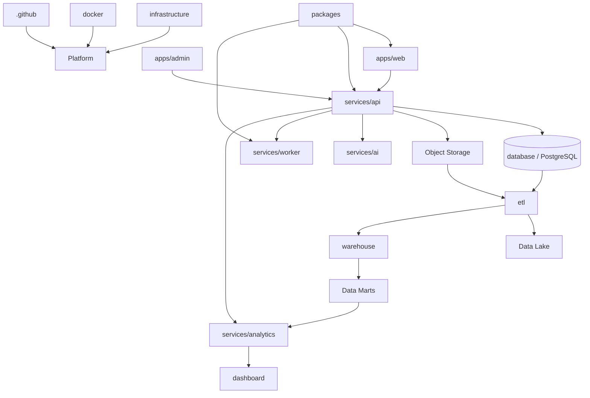

# Career Connect — Production-Ready Project Structure

## AI Career Intelligence Platform

**Architecture Style:** Modular Monorepo
**Frontend:** Next.js + TypeScript
**Backend:** NestJS + TypeScript
**AI:** Python Services
**Operational Database:** PostgreSQL / Supabase
**Data Lake:** Cloud Object Storage
**Warehouse:** BigQuery or Snowflake
**BI:** Analytics API + Dashboard Layer
**Infrastructure:** Docker + Cloud
**CI/CD:** GitHub Actions
**Repository:** GitHub

---

# 1. Complete Root Folder Structure

```text
career-connect-ai-platform/
│
├── apps/
│   ├── web/
│   └── admin/
│
├── services/
│   ├── api/
│   ├── ai/
│   ├── worker/
│   ├── reporting/
│   ├── notification/
│   └── analytics/
│
├── packages/
│   ├── ui/
│   ├── types/
│   ├── config/
│   ├── auth/
│   ├── validation/
│   ├── logger/
│   ├── api-client/
│   └── analytics-sdk/
│
├── database/
│   ├── migrations/
│   ├── seeds/
│   ├── policies/
│   ├── functions/
│   ├── views/
│   ├── indexes/
│   └── docs/
│
├── etl/
│   ├── sources/
│   ├── ingestion/
│   ├── transformations/
│   ├── validation/
│   ├── deduplication/
│   ├── incremental/
│   ├── reconciliation/
│   ├── orchestration/
│   ├── metadata/
│   ├── quarantine/
│   └── tests/
│
├── warehouse/
│   ├── staging/
│   ├── dimensions/
│   ├── facts/
│   ├── intermediate/
│   ├── marts/
│   ├── semantic/
│   ├── snapshots/
│   └── tests/
│
├── ai/
│   ├── prompts/
│   ├── evaluation/
│   ├── datasets/
│   ├── schemas/
│   └── research/
│
├── dashboard/
│   ├── definitions/
│   ├── metrics/
│   ├── dimensions/
│   ├── filters/
│   ├── layouts/
│   ├── exports/
│   └── documentation/
│
├── infrastructure/
│   ├── environments/
│   │   ├── dev/
│   │   ├── staging/
│   │   └── production/
│   ├── networking/
│   ├── database/
│   ├── storage/
│   ├── warehouse/
│   ├── monitoring/
│   ├── security/
│   └── secrets/
│
├── docker/
│   ├── web/
│   ├── admin/
│   ├── api/
│   ├── ai/
│   ├── worker/
│   ├── reporting/
│   ├── notification/
│   ├── analytics/
│   └── etl/
│
├── scripts/
│   ├── dev/
│   ├── database/
│   ├── data/
│   ├── etl/
│   ├── warehouse/
│   ├── testing/
│   ├── deployment/
│   └── maintenance/
│
├── tests/
│   ├── unit/
│   ├── integration/
│   ├── contract/
│   ├── e2e/
│   ├── security/
│   ├── performance/
│   ├── accessibility/
│   ├── data/
│   └── fixtures/
│
├── data/
│   ├── synthetic/
│   ├── reference/
│   ├── samples/
│   └── README.md
│
├── notebooks/
│   ├── exploratory/
│   ├── ai/
│   ├── analytics/
│   ├── data-quality/
│   └── research/
│
├── docs/
│   ├── 01-vision/
│   ├── 02-problem-statement/
│   ├── 03-market-research/
│   ├── 04-competitor-analysis/
│   ├── 05-swot-analysis/
│   ├── 06-business-model/
│   ├── 07-product-roadmap/
│   ├── 08-sdlc/
│   ├── 09-system-architecture/
│   ├── 10-cloud-architecture/
│   ├── 11-data-warehouse-architecture/
│   ├── 12-data-flow-diagram/
│   ├── 13-er-diagram/
│   ├── 14-database-design/
│   ├── 15-star-schema/
│   ├── 16-snowflake-schema/
│   ├── 17-etl-design/
│   ├── 18-data-dictionary/
│   ├── 19-api-documentation/
│   ├── 20-prd/
│   ├── 21-srs/
│   ├── 22-functional-requirements/
│   ├── 23-non-functional-requirements/
│   ├── 24-user-stories/
│   ├── 25-use-cases/
│   ├── 26-wireframes/
│   ├── 27-ui-ux-design/
│   ├── 28-dashboard-design/
│   ├── 29-ai-module-design/
│   ├── 30-security-design/
│   ├── 31-deployment-guide/
│   ├── 32-testing-strategy/
│   ├── 33-test-cases/
│   ├── 34-ci-cd/
│   ├── 35-monitoring/
│   ├── 36-logging/
│   ├── 37-future-scope/
│   ├── 38-project-timeline/
│   ├── 39-github-folder-structure/
│   ├── 40-readme/
│   ├── adr/
│   ├── diagrams/
│   └── runbooks/
│
├── .github/
│   ├── workflows/
│   ├── ISSUE_TEMPLATE/
│   ├── CODEOWNERS
│   ├── PULL_REQUEST_TEMPLATE.md
│   └── dependabot.yml
│
├── .env.example
├── .gitignore
├── .dockerignore
├── .editorconfig
├── .gitattributes
├── .nvmrc
├── .python-version
├── .prettierignore
├── .prettierignore
├── package.json
├── pnpm-workspace.yaml
├── turbo.json
├── docker-compose.yml
├── docker-compose.dev.yml
├── docker-compose.test.yml
├── README.md
├── CONTRIBUTING.md
├── SECURITY.md
├── CODE_OF_CONDUCT.md
├── CHANGELOG.md
└── LICENSE
```

---

# 2. Frontend Structure

## `apps/web`

Primary Career Connect web application.

```text
apps/web/
│
├── app/
│   ├── (marketing)/
│   │   ├── page.tsx
│   │   ├── about/
│   │   ├── features/
│   │   └── contact/
│   │
│   ├── (auth)/
│   │   ├── login/
│   │   ├── register/
│   │   ├── forgot-password/
│   │   └── callback/
│   │
│   ├── dashboard/
│   │
│   ├── profile/
│   ├── resume/
│   ├── skills/
│   ├── career/
│   ├── learning/
│   ├── jobs/
│   ├── applications/
│   ├── interviews/
│   ├── certifications/
│   │
│   ├── recruiter/
│   │   ├── dashboard/
│   │   ├── jobs/
│   │   ├── candidates/
│   │   ├── interviews/
│   │   ├── offers/
│   │   ├── analytics/
│   │   └── settings/
│   │
│   ├── college/
│   │   ├── dashboard/
│   │   ├── students/
│   │   ├── placements/
│   │   ├── companies/
│   │   ├── skills/
│   │   ├── reports/
│   │   └── settings/
│   │
│   ├── executive/
│   │   ├── dashboard/
│   │   ├── hiring/
│   │   ├── placements/
│   │   ├── skills/
│   │   ├── salary/
│   │   ├── market/
│   │   └── reports/
│   │
│   ├── ai/
│   │   ├── career-coach/
│   │   ├── resume-analysis/
│   │   ├── mock-interview/
│   │   └── nlbi/
│   │
│   ├── analytics/
│   ├── reports/
│   ├── notifications/
│   ├── settings/
│   ├── layout.tsx
│   ├── loading.tsx
│   ├── error.tsx
│   ├── not-found.tsx
│   └── globals.css
│
├── components/
│   ├── layout/
│   ├── navigation/
│   ├── forms/
│   ├── tables/
│   ├── charts/
│   ├── cards/
│   ├── dialogs/
│   ├── filters/
│   ├── states/
│   ├── ai/
│   └── accessibility/
│
├── features/
│   ├── auth/
│   ├── student/
│   ├── resume/
│   ├── skills/
│   ├── career/
│   ├── learning/
│   ├── jobs/
│   ├── applications/
│   ├── recruiter/
│   ├── placement/
│   ├── analytics/
│   ├── reports/
│   └── ai/
│
├── hooks/
├── lib/
│   ├── auth/
│   ├── api/
│   ├── analytics/
│   ├── storage/
│   └── utils/
│
├── services/
├── providers/
├── types/
├── constants/
├── config/
├── public/
├── tests/
├── middleware.ts
├── next.config.ts
├── tsconfig.json
├── package.json
└── README.md
```

---

# 3. Admin Frontend

## `apps/admin`

```text
apps/admin/
│
├── app/
│   ├── login/
│   ├── dashboard/
│   ├── users/
│   ├── organizations/
│   ├── roles/
│   ├── permissions/
│   ├── audit/
│   ├── data-sources/
│   ├── pipelines/
│   ├── data-quality/
│   ├── ai-monitoring/
│   ├── system-health/
│   ├── feature-flags/
│   ├── reports/
│   └── settings/
│
├── components/
├── features/
├── hooks/
├── services/
├── lib/
├── types/
├── tests/
├── public/
├── next.config.ts
├── tsconfig.json
├── package.json
└── README.md
```

---

# 4. Backend Structure

## `services/api`

```text
services/api/
│
├── src/
│   │
│   ├── modules/
│   │   ├── auth/
│   │   ├── users/
│   │   ├── organizations/
│   │   ├── roles/
│   │   ├── permissions/
│   │   ├── students/
│   │   ├── education/
│   │   ├── projects/
│   │   ├── skills/
│   │   ├── certifications/
│   │   ├── careers/
│   │   ├── resumes/
│   │   ├── companies/
│   │   ├── recruiters/
│   │   ├── jobs/
│   │   ├── applications/
│   │   ├── interviews/
│   │   ├── offers/
│   │   ├── placements/
│   │   ├── learning/
│   │   ├── notifications/
│   │   ├── reports/
│   │   ├── analytics/
│   │   ├── ai/
│   │   ├── audit/
│   │   └── health/
│   │
│   ├── common/
│   │   ├── constants/
│   │   ├── decorators/
│   │   ├── dto/
│   │   ├── exceptions/
│   │   ├── interfaces/
│   │   ├── types/
│   │   └── utils/
│   │
│   ├── config/
│   ├── database/
│   ├── guards/
│   ├── interceptors/
│   ├── middleware/
│   ├── pipes/
│   ├── filters/
│   ├── adapters/
│   ├── integrations/
│   ├── observability/
│   ├── security/
│   ├── app.module.ts
│   └── main.ts
│
├── test/
│   ├── unit/
│   ├── integration/
│   ├── contract/
│   └── fixtures/
│
├── package.json
├── tsconfig.json
├── nest-cli.json
└── README.md
```

---

# 5. Backend Domain Module Pattern

Each domain should follow the same structure:

```text
module/
├── controllers/
├── services/
├── repositories/
├── dto/
├── entities/
├── mappers/
├── validators/
├── policies/
├── interfaces/
└── tests/
```

Example domains:

```text
students/
jobs/
applications/
placements/
resumes/
```

---

# 6. AI Services Structure

## `services/ai`

```text
services/ai/
│
├── src/
│   ├── modules/
│   │   ├── resume/
│   │   ├── skills/
│   │   ├── career/
│   │   ├── learning/
│   │   ├── job-matching/
│   │   ├── chat/
│   │   ├── interview/
│   │   ├── nlbi/
│   │   └── reports/
│   │
│   ├── providers/
│   │   ├── base/
│   │   ├── openai/
│   │   ├── gemini/
│   │   ├── claude/
│   │   └── router/
│   │
│   ├── context/
│   │   ├── profile/
│   │   ├── skills/
│   │   ├── career/
│   │   ├── jobs/
│   │   ├── learning/
│   │   ├── market/
│   │   ├── analytics/
│   │   └── authorization/
│   │
│   ├── prompts/
│   ├── schemas/
│   ├── guardrails/
│   ├── tools/
│   ├── retrieval/
│   ├── evaluation/
│   ├── observability/
│   ├── configuration/
│   └── main.py
│
├── tests/
│   ├── unit/
│   ├── integration/
│   ├── evaluation/
│   ├── regression/
│   ├── safety/
│   └── security/
│
├── requirements.txt
├── pyproject.toml
├── Dockerfile
└── README.md
```

---

# 7. AI Prompt Structure

```text
ai/
├── prompts/
│   ├── resume/
│   ├── career/
│   ├── skills/
│   ├── learning/
│   ├── jobs/
│   ├── interview/
│   ├── chat/
│   ├── nlbi/
│   └── reports/
```

Prompt naming:

```text
<feature>_<purpose>_v<version>
```

Examples:

```text
resume_analysis_v1
career_recommendation_v1
skill_gap_v1
job_matching_v1
career_chat_v1
```

---

# 8. AI Evaluation Structure

```text
services/ai/tests/evaluation/
│
├── datasets/
│   ├── resume/
│   ├── career/
│   ├── skills/
│   ├── jobs/
│   ├── chat/
│   └── nlbi/
│
├── expected/
├── scorers/
├── regression/
├── safety/
└── reports/
```

---

# 9. ETL Structure

```text
etl/
│
├── sources/
│   ├── students/
│   ├── companies/
│   ├── jobs/
│   ├── internships/
│   ├── skills/
│   ├── certifications/
│   ├── colleges/
│   ├── recruiters/
│   ├── placements/
│   ├── courses/
│   ├── salaries/
│   ├── interviews/
│   ├── applications/
│   └── hiring/
│
├── ingestion/
│   ├── api/
│   ├── csv/
│   ├── json/
│   ├── database/
│   └── storage/
│
├── transformations/
│   ├── students/
│   ├── companies/
│   ├── jobs/
│   ├── salaries/
│   ├── placements/
│   ├── skills/
│   └── common/
│
├── validation/
│   ├── schema/
│   ├── completeness/
│   ├── validity/
│   ├── uniqueness/
│   ├── consistency/
│   ├── referential/
│   └── business-rules/
│
├── deduplication/
├── incremental/
├── reconciliation/
├── orchestration/
├── metadata/
├── quarantine/
└── tests/
```

---

# 10. Data Warehouse Structure

```text
warehouse/
│
├── staging/
│
├── dimensions/
│   ├── dim_date/
│   ├── dim_student/
│   ├── dim_company/
│   ├── dim_skill/
│   ├── dim_job/
│   ├── dim_college/
│   ├── dim_location/
│   ├── dim_technology/
│   ├── dim_course/
│   └── dim_recruiter/
│
├── facts/
│   ├── fact_applications/
│   ├── fact_placements/
│   ├── fact_salaries/
│   ├── fact_interviews/
│   ├── fact_hiring/
│   ├── fact_learning/
│   └── fact_certifications/
│
├── intermediate/
├── snapshots/
│
├── marts/
│   ├── placement/
│   ├── hiring/
│   ├── skills/
│   ├── salary/
│   ├── student/
│   └── learning/
│
├── semantic/
│   ├── metrics/
│   ├── dimensions/
│   ├── filters/
│   ├── definitions/
│   └── access/
│
└── tests/
```

---

# 11. Warehouse Naming

Use:

```text
dim_<entity>
fact_<business_event>
stg_<source>
int_<transformation>
mart_<subject>
```

Examples:

```text
dim_student
fact_placement
stg_jobs
int_job_normalization
mart_placement
```

---

# 12. Database Structure

```text
database/
│
├── migrations/
│
├── seeds/
│   ├── reference/
│   ├── development/
│   ├── test/
│   └── demo/
│
├── policies/
│   ├── users/
│   ├── organizations/
│   ├── students/
│   ├── resumes/
│   ├── jobs/
│   ├── applications/
│   ├── placements/
│   └── reports/
│
├── functions/
├── views/
├── indexes/
└── docs/
```

---

# 13. Database Naming Conventions

Tables:

```text
snake_case
plural
```

Examples:

```text
students
companies
applications
placements
```

Columns:

```text
snake_case
```

Examples:

```text
student_id
organization_id
created_at
updated_at
```

Primary keys:

```text
<entity>_id
```

Foreign keys:

```text
<referenced_entity>_id
```

---

# 14. Dashboard Structure

```text
dashboard/
│
├── definitions/
│   ├── student/
│   ├── recruiter/
│   ├── college/
│   ├── placement/
│   ├── executive/
│   └── admin/
│
├── metrics/
│   ├── placement/
│   ├── hiring/
│   ├── salary/
│   ├── skills/
│   ├── applications/
│   └── learning/
│
├── dimensions/
├── filters/
├── layouts/
├── exports/
└── documentation/
```

---

# 15. Dashboard Naming

Use:

```text
<domain>-<dashboard>-<view>
```

Examples:

```text
placement-overview
recruiter-funnel
executive-hiring
skill-demand
salary-intelligence
student-progress
```

---

# 16. Shared Packages

## `packages/ui`

```text
packages/ui/
├── src/
│   ├── components/
│   ├── charts/
│   ├── forms/
│   ├── tables/
│   ├── feedback/
│   ├── navigation/
│   ├── data-display/
│   ├── overlays/
│   └── tokens/
├── package.json
└── README.md
```

## `packages/types`

Shared contracts.

```text
packages/types/
├── src/
│   ├── user/
│   ├── organization/
│   ├── student/
│   ├── skill/
│   ├── career/
│   ├── job/
│   ├── application/
│   ├── interview/
│   ├── placement/
│   ├── learning/
│   ├── analytics/
│   ├── ai/
│   └── events/
└── package.json
```

## `packages/auth`

```text
packages/auth/
├── src/
│   ├── session/
│   ├── roles/
│   ├── permissions/
│   ├── policies/
│   └── tenant/
└── package.json
```

## `packages/validation`

```text
packages/validation/
├── src/
│   ├── common/
│   ├── auth/
│   ├── students/
│   ├── jobs/
│   ├── applications/
│   ├── reports/
│   └── ai/
└── package.json
```

## `packages/logger`

```text
packages/logger/
├── src/
│   ├── logger/
│   ├── events/
│   ├── correlation/
│   ├── redaction/
│   └── schemas/
└── package.json
```

## `packages/api-client`

```text
packages/api-client/
├── src/
│   ├── auth/
│   ├── students/
│   ├── jobs/
│   ├── applications/
│   ├── placements/
│   ├── analytics/
│   ├── reports/
│   └── ai/
└── package.json
```

---

# 17. Configuration Files

Required root configuration:

```text
package.json
pnpm-workspace.yaml
turbo.json
tsconfig.json
.editorconfig
.gitignore
.dockerignore
.gitattributes
.nvmrc
.python-version
.prettierignore
.env.example
docker-compose.yml
docker-compose.dev.yml
docker-compose.test.yml
```

Recommended service-level configuration:

```text
apps/web/
├── package.json
├── tsconfig.json
├── next.config.ts
└── eslint.config.js

services/api/
├── package.json
├── tsconfig.json
├── nest-cli.json
└── eslint.config.js

services/ai/
├── pyproject.toml
├── requirements.txt
└── Dockerfile
```

---

# 18. Environment Variable Architecture

Environment variables should be grouped by responsibility.

```text
Authentication
Database
Storage
AI
Queue
Warehouse
Application
Security
Monitoring
```

---

# 19. Root Environment Variable Set

```text
NODE_ENV
APP_ENV
APP_NAME
APP_VERSION

API_URL
WEB_URL
ADMIN_URL

LOG_LEVEL
LOG_FORMAT

DATABASE_URL

REDIS_URL

SUPABASE_URL
SUPABASE_ANON_KEY
SUPABASE_SERVICE_ROLE_KEY

STORAGE_ENDPOINT
STORAGE_BUCKET
STORAGE_ACCESS_KEY
STORAGE_SECRET_KEY

AI_PROVIDER
AI_DEFAULT_MODEL
AI_TIMEOUT_MS
AI_MAX_RETRIES

OPENAI_API_KEY
GEMINI_API_KEY
ANTHROPIC_API_KEY

WAREHOUSE_PROVIDER
WAREHOUSE_PROJECT
WAREHOUSE_DATASET

WAREHOUSE_ACCOUNT
WAREHOUSE_DATABASE
WAREHOUSE_SCHEMA
WAREHOUSE_WAREHOUSE

ETL_ENV
ETL_BATCH_SIZE
ETL_MAX_RETRIES

JWT_ISSUER
JWT_AUDIENCE

CORS_ALLOWED_ORIGINS

RATE_LIMIT_WINDOW
RATE_LIMIT_MAX_REQUESTS

SENTRY_DSN
OTEL_ENDPOINT

ENCRYPTION_KEY
```

Only variables actually required by the selected deployment stack should be enabled.

---

# 20. Environment Files

Development:

```text
.env.example
.env.local
```

Staging:

```text
.env.staging.example
```

Production:

```text
.env.production.example
```

Production secrets should come from secure secret management rather than committed files.

---

# 21. Environment Rules

Never commit:

```text
.env
.env.local
.env.production
```

Commit only:

```text
.env.example
```

containing variable names and safe placeholder values.

---

# 22. Docker Structure

```text
docker/
│
├── web/
│   └── Dockerfile
│
├── admin/
│   └── Dockerfile
│
├── api/
│   └── Dockerfile
│
├── ai/
│   └── Dockerfile
│
├── worker/
│   └── Dockerfile
│
├── reporting/
│   └── Dockerfile
│
├── notification/
│   └── Dockerfile
│
├── analytics/
│   └── Dockerfile
│
└── etl/
    └── Dockerfile
```

---

# 23. Docker Compose Structure

Root development orchestration:

```text
docker-compose.yml
docker-compose.dev.yml
docker-compose.test.yml
```

Development services:

```text
web
admin
api
ai
worker
postgres
redis
```

Optional local services:

```text
reporting
notification
analytics
```

---

# 24. CI/CD Structure

```text
.github/
│
├── workflows/
│   ├── ci.yml
│   ├── web-ci.yml
│   ├── api-ci.yml
│   ├── ai-ci.yml
│   ├── worker-ci.yml
│   ├── etl-ci.yml
│   ├── warehouse-ci.yml
│   ├── security.yml
│   ├── deploy-staging.yml
│   ├── deploy-production.yml
│   ├── rollback.yml
│   └── release.yml
│
├── ISSUE_TEMPLATE/
│   ├── bug.yml
│   ├── feature.yml
│   ├── security.yml
│   ├── data-quality.yml
│   └── ai-evaluation.yml
│
├── CODEOWNERS
├── PULL_REQUEST_TEMPLATE.md
└── dependabot.yml
```

---

# 25. GitHub Workflow Responsibilities

## `ci.yml`

Global validation.

```text
Lint
Type Check
Unit Tests
Build
```

## `web-ci.yml`

Frontend.

```text
Lint
Type Check
Component Tests
Build
Accessibility
```

## `api-ci.yml`

Backend.

```text
Lint
Type Check
Unit
API
Integration
```

## `ai-ci.yml`

AI.

```text
Schema
Evaluation
Regression
Safety
```

## `etl-ci.yml`

Data engineering.

```text
Transformation
Validation
Idempotency
Reconciliation
```

## `warehouse-ci.yml`

Analytics.

```text
SQL Validation
Model Tests
Metric Tests
```

## `security.yml`

```text
Secret Scan
Dependency Scan
SAST
Container Scan
```

---

# 26. Deployment Workflow

```text
GitHub
↓
CI
↓
Security
↓
Artifact
↓
Staging
↓
Smoke
↓
Approval
↓
Production
```

---

# 27. Infrastructure Structure

```text
infrastructure/
│
├── environments/
│   ├── dev/
│   ├── staging/
│   └── production/
│
├── networking/
├── database/
├── storage/
├── warehouse/
├── monitoring/
├── security/
└── secrets/
```

The exact IaC tool can be introduced later without changing the logical structure.

---

# 28. Scripts Structure

```text
scripts/
│
├── dev/
│   ├── setup/
│   ├── start/
│   └── reset/
│
├── database/
│   ├── migrate/
│   ├── seed/
│   └── backup/
│
├── data/
│   ├── generate/
│   ├── validate/
│   └── load/
│
├── etl/
│   ├── run/
│   ├── replay/
│   └── reconcile/
│
├── warehouse/
│   ├── build/
│   ├── test/
│   └── refresh/
│
├── testing/
│   ├── unit/
│   ├── integration/
│   ├── e2e/
│   └── smoke/
│
├── deployment/
│   ├── staging/
│   ├── production/
│   └── rollback/
│
└── maintenance/
```

---

# 29. Test Structure

```text
tests/
│
├── unit/
├── integration/
├── contract/
├── e2e/
│   ├── student/
│   ├── recruiter/
│   ├── placement/
│   ├── executive/
│   └── admin/
│
├── security/
│   ├── authentication/
│   ├── authorization/
│   ├── tenant-isolation/
│   ├── file-upload/
│   ├── api/
│   └── ai/
│
├── performance/
│   ├── api/
│   ├── dashboards/
│   ├── ai/
│   ├── etl/
│   └── warehouse/
│
├── accessibility/
├── data/
└── fixtures/
```

---

# 30. Naming Conventions

## General

Use:

```text
lowercase
clear domain terminology
consistent singular/plural rules
```

---

## TypeScript

Classes:

```text
PascalCase
```

Interfaces/types:

```text
PascalCase
```

Functions:

```text
camelCase
```

Variables:

```text
camelCase
```

Constants:

```text
UPPER_SNAKE_CASE
```

Files:

```text
kebab-case
```

---

# 31. Frontend Naming

Components:

```text
PascalCase
```

Examples:

```text
KpiCard
SkillGapCard
JobMatchCard
PlacementChart
```

Hooks:

```text
use<Name>
```

Examples:

```text
useStudentProfile
useJobSearch
useCareerRecommendation
```

Feature folders:

```text
kebab-case
```

---

# 32. Backend Naming

Modules:

```text
plural domain names
```

Examples:

```text
students
applications
placements
```

Controllers:

```text
<Name>Controller
```

Services:

```text
<Name>Service
```

Repositories:

```text
<Name>Repository
```

DTOs:

```text
Create<Name>Dto
Update<Name>Dto
Query<Name>Dto
```

---

# 33. Python Naming

Modules:

```text
snake_case
```

Functions:

```text
snake_case
```

Variables:

```text
snake_case
```

Classes:

```text
PascalCase
```

Constants:

```text
UPPER_SNAKE_CASE
```

---

# 34. Database Naming

Tables:

```text
plural snake_case
```

Columns:

```text
snake_case
```

Indexes:

```text
idx_<table>_<column>
```

Foreign keys:

```text
fk_<table>_<reference>
```

Unique constraints:

```text
uq_<table>_<column>
```

---

# 35. Warehouse Naming

Dimensions:

```text
dim_<entity>
```

Facts:

```text
fact_<business_event>
```

Staging:

```text
stg_<source>
```

Intermediate:

```text
int_<transformation>
```

Marts:

```text
mart_<subject>
```

---

# 36. API Naming

Use plural REST resources:

```text
/api/v1/students
/api/v1/jobs
/api/v1/applications
/api/v1/placements
```

Actions should be used only where they provide meaningful semantics.

---

# 37. Event Naming

Pattern:

```text
domain.entity.action
```

Examples:

```text
resume.uploaded
resume.analyzed

application.created
application.status_changed

placement.verified

pipeline.completed

ai.analysis.failed
```

---

# 38. Environment Naming

Use:

```text
development
staging
production
```

Avoid inconsistent combinations such as:

```text
dev1
prod-new
production-final
```

---

# 39. API Versioning

Use:

```text
/v1/
```

for the initial public API contract.

Breaking changes should use a new version rather than silently changing existing behavior.

---

# 40. Coding Standards

All implementation teams should follow:

```text
Clean Code
SOLID
DRY
Separation of Concerns
Dependency Inversion
Single Responsibility
Explicit Error Handling
Strong Typing
Validated Inputs
```

---

# 41. Frontend Coding Standards

Required:

```text
Typed Props
Reusable Components
Feature-Based Organization
Accessible HTML
Consistent Loading States
Consistent Error States
No Business Logic in Presentation Components
```

---

# 42. Backend Coding Standards

Required:

```text
Thin Controllers
Business Logic in Services
Repository Abstraction
DTO Validation
Explicit Authorization
Centralized Error Handling
Structured Logging
```

---

# 43. AI Coding Standards

Required:

```text
Provider Abstraction
Prompt Versioning
Structured Output
Validation
Guardrails
Evaluation
Logging
Timeout
Retry
```

AI logic should not be scattered across controllers.

---

# 44. ETL Coding Standards

Each transformation should be:

```text
Deterministic
Testable
Idempotent where applicable
Observable
Documented
```

---

# 45. Warehouse Coding Standards

Every fact and dimension must document:

```text
Grain
Keys
Measures
Relationships
Refresh Strategy
Owner
```

---

# 46. Dashboard Coding Standards

Every dashboard must define:

```text
Purpose
Audience
Metrics
Filters
Data Source
Freshness
Authorization
Export Behavior
```

---

# 47. Error Handling Standard

Every service should use:

```text
Internal Error Code
Human-Friendly Message
Request ID
Structured Log
```

Do not expose:

```text
Stack Traces
Database Errors
Secrets
Internal Paths
Provider Credentials
```

to normal users.

---

# 48. Logging Standards

Every important log should contain, when relevant:

```text
timestamp
service
environment
level
event
request_id
trace_id
version
```

Never log credentials or unnecessary sensitive content.

---

# 49. Security Coding Standards

Always:

```text
Validate Inputs
Authorize Server-Side
Parameterize Queries
Protect Files
Use Secure Secrets
Apply Tenant Scope
Audit Sensitive Actions
```

Never trust:

```text
Client Role
Client Tenant ID
Uploaded File
AI Output
External Content
```

---

# 50. Git Standards

Commit format:

```text
<type>(<scope>): <description>
```

Examples:

```text
feat(api): add student profile
feat(ai): add resume skill extraction
data(etl): normalize locations
fix(web): correct application filter
security(api): restrict resume access
test(dw): validate placement grain
```

---

# 51. Pull Request Standards

Every PR should contain:

```text
Summary
Changes
Testing
Security Impact
Data Impact
AI Impact
Screenshots when UI-related
Migration Notes when applicable
```

---

# 52. Review Standards

At least one relevant reviewer should inspect changes for:

```text
Correctness
Architecture
Security
Testing
Maintainability
Performance
Data Impact
```

---

# 53. No-Code-Generation Rule for Scaffolding Phase

Until implementation begins, the repository should contain only:

```text
Folder Structure
Configuration Placeholders
Documentation
Schemas / Contracts where approved
CI/CD Definitions
Docker Definitions
Architecture Metadata
```

No business/application implementation should be introduced into the scaffolding phase.

---

# 54. Production Readiness Structure

The repository is structurally production-ready when the following boundaries exist:

```text
Frontend
+
Backend
+
AI
+
Database
+
ETL
+
Warehouse
+
BI
+
Security
+
Testing
+
Cloud
+
Observability
```

---

# 55. Architecture Dependency Map



---

# 56. Final Production Structure

The final production repository should therefore resolve into these major architectural layers:

```text
1. EXPERIENCE
   apps/

2. APPLICATION SERVICES
   services/

3. SHARED PLATFORM
   packages/

4. OPERATIONAL DATA
   database/

5. DATA ENGINEERING
   etl/

6. ANALYTICAL PLATFORM
   warehouse/

7. AI INTELLIGENCE
   ai/
   services/ai/

8. BUSINESS INTELLIGENCE
   dashboard/
   services/analytics/

9. INFRASTRUCTURE
   infrastructure/
   docker/

10. QUALITY
    tests/

11. AUTOMATION
    scripts/
    .github/

12. DOCUMENTATION
    docs/

13. CONTROLLED DATA
    data/

14. RESEARCH
    notebooks/
```

---

# 57. Architecture Rules That Must Not Be Broken

```text
Frontend must not directly access PostgreSQL.

AI must not receive unrestricted database access.

Dashboards must not independently calculate business metrics.

ETL must not bypass data-quality controls.

Production secrets must not exist in Git.

Operational tables must not become the primary analytical layer.

User-provided content must be treated as untrusted.

Cross-tenant queries must be denied by default.

AI outputs must be validated before trusted persistence.

Warehouse metrics must have governed definitions.
```

---

# 58. Final Scaffolding Principle

The repository should make the architectural boundaries visible before any business logic exists.

The structure should communicate:

```text
Where users interact
Where business logic lives
Where AI lives
Where transactional data lives
Where analytical data lives
Where pipelines live
Where dashboards live
Where infrastructure lives
Where tests live
Where governance lives
```

---

# 59. Final Production Architecture

```text
CAREER CONNECT
│
├── EXPERIENCE
│   ├── Student
│   ├── Recruiter
│   ├── College
│   ├── Executive
│   └── Admin
│
├── APPLICATION
│   └── NestJS Services
│
├── AI
│   ├── Resume
│   ├── Skills
│   ├── Career
│   ├── Learning
│   ├── Matching
│   ├── Interview
│   └── NL-BI
│
├── OPERATIONAL DATA
│   └── PostgreSQL
│
├── DATA ENGINEERING
│   └── ETL + Data Lake
│
├── ANALYTICS
│   └── Warehouse + Data Marts
│
├── BI
│   └── Analytics + Dashboards
│
├── PLATFORM
│   ├── Authentication
│   ├── Security
│   ├── Logging
│   ├── Monitoring
│   └── Audit
│
└── DELIVERY
    ├── Docker
    ├── GitHub
    └── CI/CD
```

---

# 60. Final Architect Standard

The project scaffolding is considered complete when:

```text
✓ Every architectural domain has a defined location.
✓ Every production service has a defined boundary.
✓ Every data layer has a defined location.
✓ Every deployment concern has a defined location.
✓ Every test category has a defined location.
✓ Every documentation category has a defined location.
✓ Naming conventions are standardized.
✓ Environment boundaries are explicit.
✓ Secrets are separated from configuration.
✓ Shared packages have clear ownership.
✓ AI has an isolated service boundary.
✓ Data Warehouse and ETL are independent from OLTP.
✓ Dashboard metrics are governed.
✓ CI/CD has dedicated workflow boundaries.
```

**No application implementation code belongs in this scaffolding phase.**

The repository is now structurally prepared for the next stage: **incremental implementation beginning with Day 1 — repository initialization and development environment setup.**
