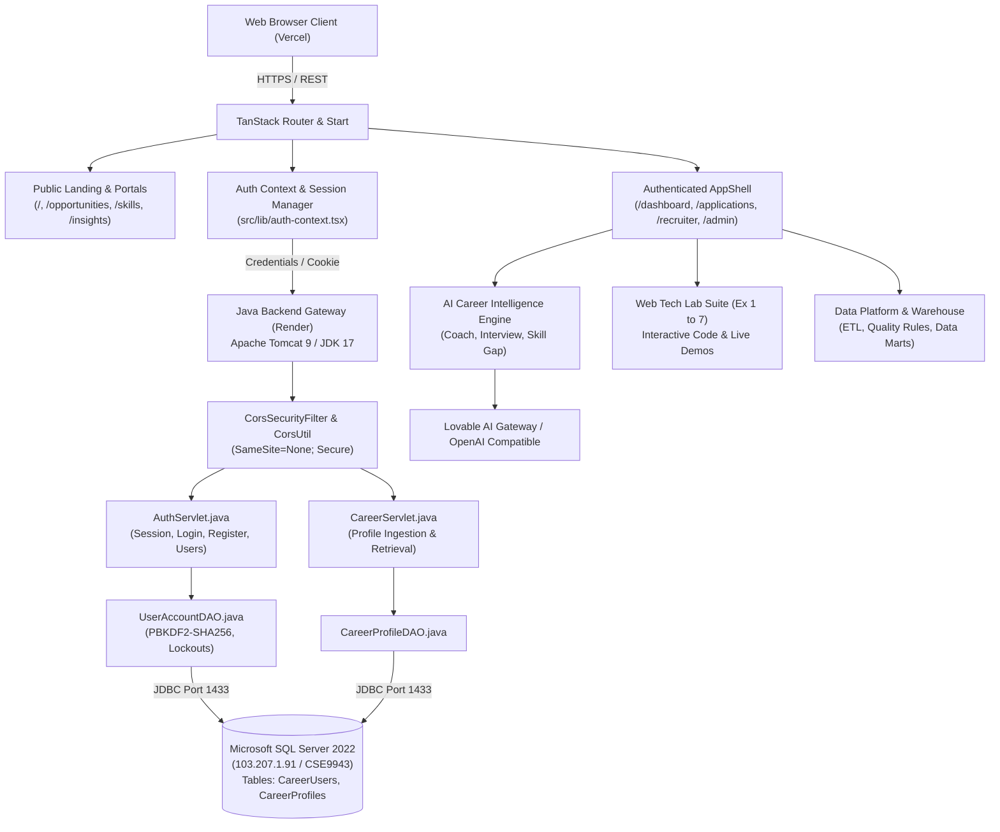

# Career Connect — Website Overview & System Specification

## 1. Executive Summary & Brand Identity

**Platform Name:** Career Connect  
**Tagline:** AI Career Intelligence Platform & Professional Career Network  
**Domain / Production Deployments:**
- **Frontend SPA (Vercel Edge):** `https://careerconnectfinal.vercel.app`
- **Backend Service (Render JVM Container):** `https://careerconnectfinal-3.onrender.com`
- **Primary Repository:** `https://github.com/Spydybat/careerconnectfinal.git`
- **Core Database:** Microsoft SQL Server 2022 (`103.207.1.91:1433`, Database: `CSE9943`)
- **Author / Lead Engineer:** Kalaiyarasan K (Reg. No: 9943) — Web Technology Lab Integration (CS3481)

Career Connect is a dual-purpose enterprise web application:
1. **Commercial-Grade AI Career Intelligence & Hiring Platform:** A full-featured talent ecosystem connecting students/candidates, recruiters/employers, and college placement officers. It features an AI Career Coach, AI Mock Interviewer, AI Skill Gap Analyzer, ATS Resume Reviewer, Job Application Tracking, and an Executive BI Data Warehouse.
2. **Academic Web Technology (WT) Laboratory Suite:** A fully integrated, interactive educational laboratory environment covering all seven required Anna University / CS3481 curriculum exercises (Ex 1 to 7, including native Servlets, Session Tracking, Three-Tier JDBC architectures, MVC DAOs, and XML/XSLT transformations).

---

## 2. Target Audiences & Key Personas

| Persona | Role Key | Primary Goals & Capabilities |
| :--- | :--- | :--- |
| **Candidate / Student** | `candidate` (`student`) | Create verified professional profiles; discover curated career opportunities; practice real-time AI mock interviews; receive AI career guidance; benchmark skill proficiencies; track applications through recruitment stages. |
| **Employer / Recruiter** | `employer` (`recruiter`) | Post job openings; manage applicant pipelines; evaluate candidate resumes and readiness scores; track time-to-hire and talent funnel analytics; manage company branding profiles. |
| **Placement Officer** | `placement_officer` | Orchestrate campus placement drives; manage eligible student cohorts; track corporate recruiting partners; monitor salary packages and placement velocity. |
| **System Administrator** | `admin` | Manage user credentials, access roles, and account statuses (`active`, `suspended`); audit compliance logs; inspect SQL Server infrastructure health; monitor AI token quotas and model routing. |

---

## 3. Core Value Propositions

1. **Modern Decoupled Enterprise Architecture:**
   - Client-side presentation built on **React 19**, **Vite 8**, **TypeScript 5.8**, and **TanStack Router**, deployed globally on Vercel's edge network.
   - Core transactional authentication and multi-tier lab persistence handled by native **Java Servlets 3.1 (`AuthServlet`, `CareerServlet`, `SessionTrackingServlet`)** running in **Apache Tomcat 9** on Render.
   - Dual-persistence options: **Microsoft SQL Server 2022** via JDBC for high-security lab and authentication persistence, alongside **Supabase PostgreSQL** for relational applicant tracking and analytical data marts.
2. **Enterprise Security & Authentication:**
   - Password hashing utilizing **PBKDF2 with HMAC-SHA256** (65,536 iterations, 256-bit derived key, unique 16-byte cryptographic salt).
   - Dynamic cross-site cookie wrapping (`SameSite=None; Secure; HttpOnly`) with origin validation allowing secure cross-domain credentials between Vercel and Render.
   - Automated brute-force defense: Account lockout after 5 consecutive failed login attempts (15-minute lockout cooldown).
3. **AI-Powered Career Acceleration:**
   - LLM-grounded career advisory using modern AI SDKs and Lovable AI Gateway.
   - Interactive conversational Mock Interview engine with real-time feedback, grading metrics, and behavioral analysis.
   - Skill gap decomposition mapping individual candidate profiles against market job descriptions.
4. **Data Platform & Analytical Warehouse:**
   - Dedicated data engineering pipeline featuring Bronze/Silver/Gold Lakehouse tables, ETL extraction, data quality validation rules, and SCD Type-2 dimensional data marts.
5. **Interactive Web Technology Lab Suite:**
   - Live browser execution and editable source code viewers for Exercises 1 through 7, proving compliance with academic lab requirements while seamlessly fitting into an enterprise design system.

---

## 4. End-to-End System Workflows

---

## 5. Summary of Main Platform Modules

1. **Public Marketing & Exploration:**
   - High-conversion Landing Page with Hero Metrics, Featured Job Cards, Skill Highlights, and modernized Interactive Image Map.
   - Opportunities Directory (`/opportunities`) with multi-faceted filtering.
   - Skills Matrix (`/skills`) detailing high-growth technologies and learning roadmaps.
   - Executive Market Insights (`/insights`) with interactive salary distributions and hiring velocity.
   - Candidate Directory (`/career-profiles`) with grid/table view toggle and XML download.
   - Professional Network (`/network`) with mutual connections and invitation management.
2. **Authentication & Identity Portals:**
   - Candidate & Employer unified sign-in (`/login`).
   - Executive Administrator secure portal (`/admin/login`).
   - Registration flow with role assignment (`/register`).
   - Password reset workflow (`/forgot-password`).
3. **Core Portals & Dashboards:**
   - Candidate Dashboard (`/dashboard`) with readiness metrics and recommended roles.
   - Employer / Recruiter Hub (`/employer/dashboard`, `/recruiter/*`) for talent sourcing.
   - Campus Placement Hub (`/placement/*`) for academic placement officers.
   - Administration Console (`/admin/dashboard`, `/admin/users`, `/admin/operations`, `/admin/system`, `/admin/audit`, `/admin/ai`).
4. **AI Intelligence Engine:**
   - AI Career Coach (`/ai/career-coach`).
   - AI Technical & Behavioral Mock Interviewer (`/ai/mock-interview`).
   - AI Skill Gap Analyzer (`/ai/skill-gap`).
5. **Academic Web Tech Lab Suite:**
   - Modules 01 through 07 with live embedded runnable previews, code viewers, and architecture explanations.
